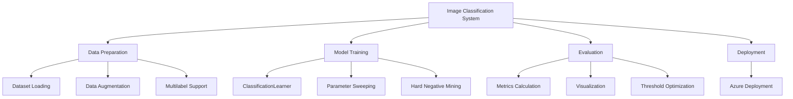
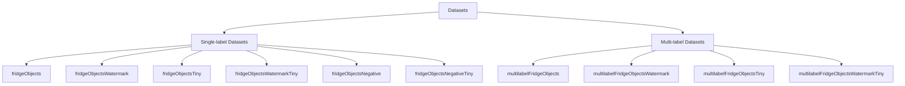
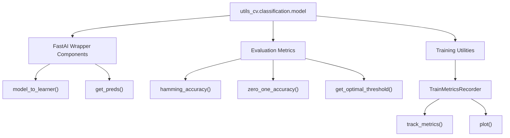
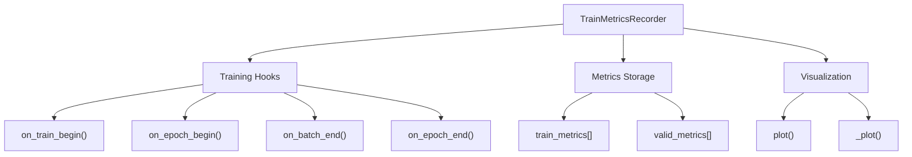
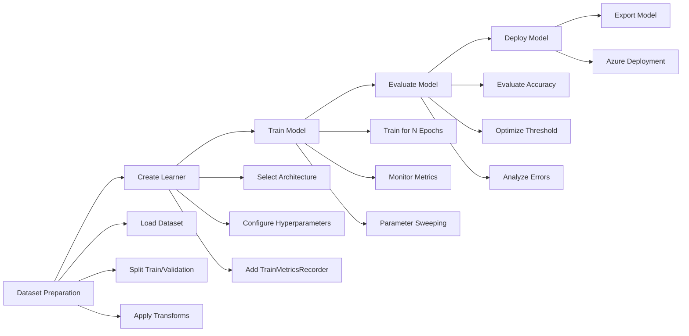
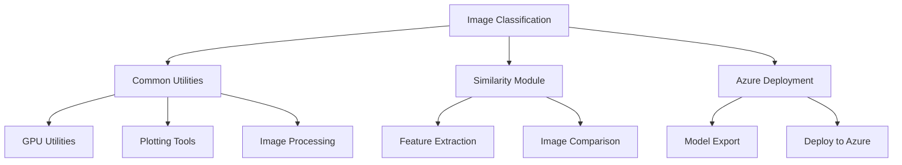

<!-- source: DeepWiki mcp.deepwiki.com · repo microsoft/computervision-recipes · page 2.3 Image Classification · fetched 2026-10-26 -->

# Image Classification

<details>
<summary>Relevant source files</summary>

The following files were used as context for generating this wiki page:

- [.flake8](.flake8)
- [.gitignore](.gitignore)
- [.pre-commit-config.yaml](.pre-commit-config.yaml)
- [contrib/vm_builder/README.md](contrib/vm_builder/README.md)
- [contrib/vm_builder/vm_builder.py](contrib/vm_builder/vm_builder.py)
- [tests/integration/classification/test_integration_classification_notebooks.py](tests/integration/classification/test_integration_classification_notebooks.py)
- [tests/unit/classification/test_classification_data.py](tests/unit/classification/test_classification_data.py)
- [tests/unit/classification/test_classification_model.py](tests/unit/classification/test_classification_model.py)
- [tests/unit/common/test_common_deployment.py](tests/unit/common/test_common_deployment.py)
- [tests/unit/common/test_common_image.py](tests/unit/common/test_common_image.py)
- [tests/unit/common/test_common_misc.py](tests/unit/common/test_common_misc.py)
- [tests/unit/common/test_common_plot.py](tests/unit/common/test_common_plot.py)
- [utils_cv/classification/data.py](utils_cv/classification/data.py)
- [utils_cv/classification/model.py](utils_cv/classification/model.py)
- [utils_cv/common/image.py](utils_cv/common/image.py)
- [utils_cv/common/plot.py](utils_cv/common/plot.py)

</details>


This page documents the image classification functionality within the Computer Vision Recipes repository. It covers the available utilities for creating, training, and evaluating image classification models, including both single-label and multi-label classification scenarios.

For object detection functionality, see [Object Detection](#2.1). For image similarity, see [Image Similarity](#2.4).

## Overview

Image classification is a fundamental computer vision task that involves categorizing images into predefined classes. The classification module in this repository provides tools to:

1. Load and prepare classification datasets (both single-label and multi-label)
2. Train classification models using FastAI/PyTorch 
3. Evaluate model performance
4. Deploy trained models



Sources: [utils_cv/classification/data.py](), [utils_cv/classification/model.py]()

## Classification Datasets

The classification module provides utilities for working with standard image classification datasets as well as custom datasets.

### Available Datasets

The system includes several pre-configured datasets focused on household fridge items. These are particularly useful for testing and demonstration purposes:



Sources: [utils_cv/classification/data.py:16-47]()

### Dataset Utilities

The module provides functions for working with classification datasets:

| Function | Description |
|----------|-------------|
| `imagenet_labels()` | Returns a list of the 1000 ImageNet class labels |
| `downsize_imagelist()` | Resizes images while preserving aspect ratio |
| `is_data_multilabel()` | Detects if a dataset is set up for multi-label classification |

For multi-label datasets, the system expects a CSV file named `labels.csv` with a column titled "labels" where multiple labels are space or comma-delimited.

Sources: [utils_cv/classification/data.py:54-154](), [tests/unit/classification/test_classification_data.py:14-58]()

## Model Framework

The classification module uses FastAI as its primary training framework, which is built on top of PyTorch. This provides an abstraction layer that simplifies the training process while allowing access to powerful features.



Sources: [utils_cv/classification/model.py](), [tests/unit/classification/test_classification_model.py]()

### Key Components

#### Model Creation

The `model_to_learner()` function provides a way to convert PyTorch models to FastAI Learner objects:

```python
# Create a learner from a PyTorch model
learn = model_to_learner(models.resnet18(pretrained=True))
```

This creates a Learner object that can be used for prediction without retraining, or as a starting point for transfer learning.

Sources: [utils_cv/classification/model.py:126-148](), [tests/unit/classification/test_classification_model.py:71-113]()

#### Metrics for Multi-label Classification

The module provides specialized metrics for multi-label classification:

| Metric | Description |
|--------|-------------|
| `hamming_accuracy()` | One minus the fraction of wrong labels to total number of labels |
| `zero_one_accuracy()` | Accuracy that counts a prediction as correct only if all labels match |
| `get_optimal_threshold()` | Finds the best threshold for converting probabilities to binary labels |

Sources: [utils_cv/classification/model.py:34-123](), [tests/unit/classification/test_classification_model.py:28-68]()

#### Training Metrics Recorder

The `TrainMetricsRecorder` class is a FastAI callback that records metrics on both training and validation sets during training:



Sources: [utils_cv/classification/model.py:191-417](), [tests/unit/classification/test_classification_model.py:115-152]()

## Training Workflow

The image classification module supports a complete training workflow, from data preparation to model evaluation.



Sources: [tests/integration/classification/test_integration_classification_notebooks.py]()

## Example Notebooks

The repository includes several example notebooks that demonstrate different aspects of image classification:

| Notebook | Description | Test Coverage |
|----------|-------------|--------------|
| 01 | Basic image classification workflow | Validates training accuracy > 70% |
| 02 | Transfer learning for classification | Tests head vs zero-layer performance |
| 03 | Advanced classification techniques | Tests training over 12 epochs |
| 11 | Parameter sweeping for optimization | Tests different image sizes and configurations |
| 12 | Hard negative mining | Tests improvement with negative samples |

These notebooks provide working examples of the classification workflow, from data loading to model evaluation.

Sources: [tests/integration/classification/test_integration_classification_notebooks.py:13-107]()

## Integration with Other Components

The image classification module integrates with other utilities in the repository:



Sources: [tests/unit/common/test_common_misc.py](), [tests/unit/common/test_common_plot.py](), [utils_cv/common/image.py]()

### GPU Utilities

The classification module uses GPU detection and configuration utilities from the common module to optimize performance:

```python
# Example of creating a DataBunch with appropriate number of workers
data = (
    ImageList.from_folder(data_path)
    .split_by_rand_pct()
    .label_from_folder()
    .transform()
    .databunch(bs=5, num_workers=db_num_workers())
    .normalize()
)
```

Sources: [tests/unit/common/test_common_misc.py:14-37]()

### Visualization Tools

The common module provides visualization tools that work with the classification module:

| Function | Description |
|----------|-------------|
| `line_graph()` | Plots training and validation metrics over time |
| `show_ims()` | Displays images with optional labels |

Sources: [utils_cv/common/plot.py](), [tests/unit/common/test_common_plot.py]()

## Deployment

The classification module includes utilities for deploying trained models to Azure:

| Function | Description |
|----------|-------------|
| `generate_yaml()` | Creates environment files for deployment |

Additionally, the repository includes a VM Builder tool that can create a Data Science Virtual Machine with the repository pre-installed.

Sources: [tests/unit/common/test_common_deployment.py](), [contrib/vm_builder/README.md](), [contrib/vm_builder/vm_builder.py]()

## Performance Considerations

When training image classification models, several factors can affect performance:

1. **Image Size** - Larger images provide more detail but require more memory and computation
2. **Batch Size** - Larger batches generally give more stable gradients but require more memory
3. **Model Architecture** - Deeper models generally perform better but are slower to train
4. **Data Augmentation** - Can improve model robustness but increases training time
5. **Hard Negative Mining** - Can improve accuracy by focusing on difficult examples

The parameter sweeping functionality (as demonstrated in notebook 11) can help find optimal configurations.

Sources: [tests/integration/classification/test_integration_classification_notebooks.py:65-88]()

---

