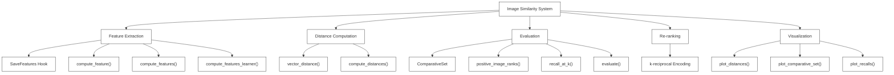
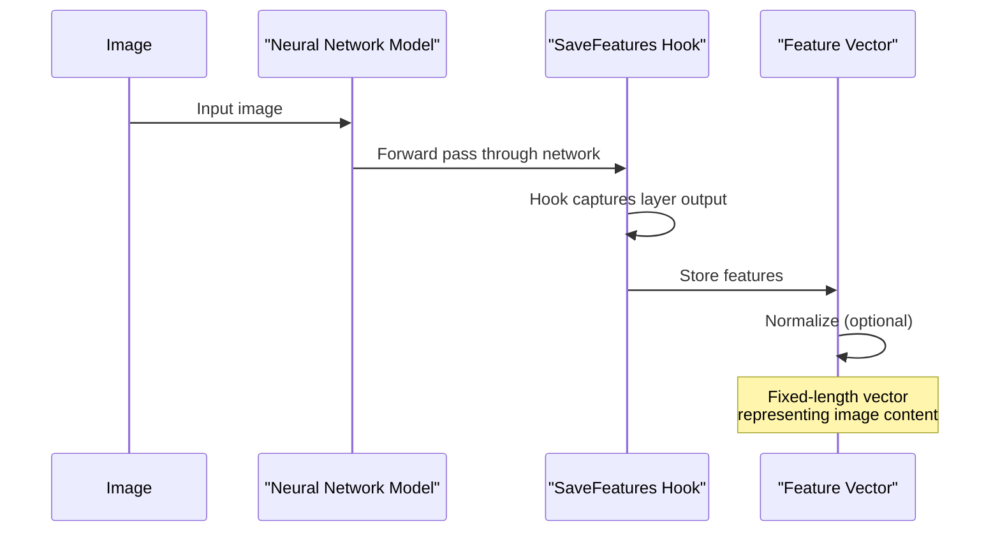
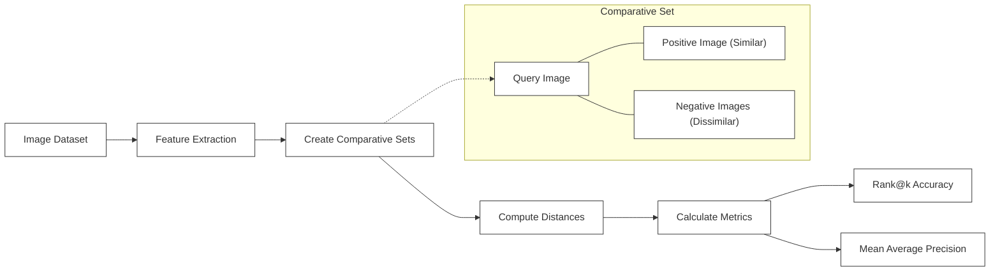
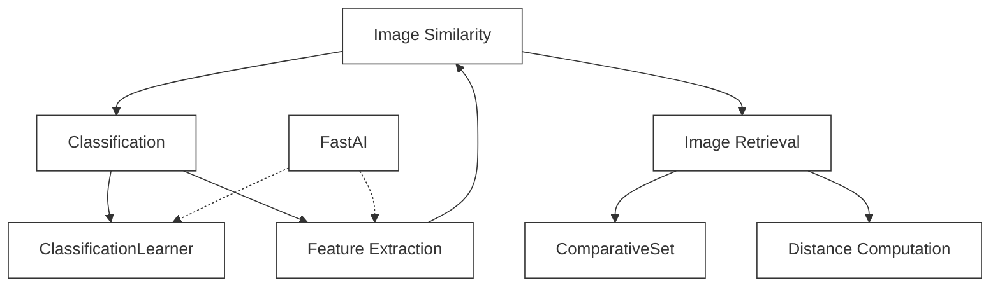
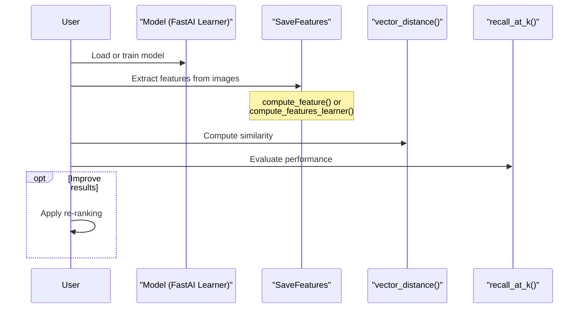

<!-- source: DeepWiki mcp.deepwiki.com · repo microsoft/computervision-recipes · page 2.4 Image Similarity · fetched 2026-10-26 -->

# Image Similarity

<details>
<summary>Relevant source files</summary>

The following files were used as context for generating this wiki page:

- [NOTICE.txt](NOTICE.txt)
- [scenarios/similarity/02_state_of_the_art.ipynb](scenarios/similarity/02_state_of_the_art.ipynb)
- [scenarios/similarity/README.md](scenarios/similarity/README.md)
- [scenarios/similarity/media/imsim_example1.jpg](scenarios/similarity/media/imsim_example1.jpg)
- [tests/unit/similarity/test_similarity_metrics.py](tests/unit/similarity/test_similarity_metrics.py)
- [utils_cv/similarity/data.py](utils_cv/similarity/data.py)
- [utils_cv/similarity/metrics.py](utils_cv/similarity/metrics.py)
- [utils_cv/similarity/model.py](utils_cv/similarity/model.py)
- [utils_cv/similarity/plot.py](utils_cv/similarity/plot.py)
- [utils_cv/similarity/references/evaluate.py](utils_cv/similarity/references/evaluate.py)
- [utils_cv/similarity/references/re_ranking.py](utils_cv/similarity/references/re_ranking.py)

</details>


## Purpose and Scope

This document provides a technical overview of the image similarity system in the Computer Vision Recipes repository. The system enables extraction of visual features from images and computation of similarity between them for tasks such as image retrieval, product identification, and duplicate detection. 

The image similarity module provides functionality for feature extraction, distance computation, evaluation metrics, and re-ranking. It is designed to work with deep neural networks that have been trained for image classification tasks.

Sources: [utils_cv/similarity/model.py](), [scenarios/similarity/README.md]()

## System Architecture

The image similarity system consists of several interconnected components that handle different aspects of the similarity pipeline.



Sources: [utils_cv/similarity/model.py](), [utils_cv/similarity/metrics.py](), [utils_cv/similarity/data.py](), [utils_cv/similarity/plot.py]()

## Feature Extraction Process

The feature extraction process uses a trained neural network to convert images into feature vectors (embeddings) that represent their visual content. These feature vectors can then be compared to find similar images.



The feature extraction is handled by the following components:

### SaveFeatures Class

The `SaveFeatures` class provides a hook mechanism to extract features from intermediate layers of a neural network model.

```python
class SaveFeatures:
    """Hook to save the features in the intermediate layers"""
    
    def __init__(self, model_layer: Module):
        # Register hook to capture outputs
        
    def hook_fn(self, module: Module, input: Tensor, output: Tensor):
        # Save output features
        
    def remove(self):
        # Remove the hook
```

Sources: [utils_cv/similarity/model.py:16-40]()

### Feature Extraction Functions

Three main functions handle feature extraction:

1. **compute_feature**: Extracts features from a single image
   ```python
   def compute_feature(im_or_path: Image, learn: Learner, embedding_layer: Module) -> List[float]:
       # Extract features from a single image
   ```

2. **compute_features**: Extracts features from multiple images without mini-batching
   ```python
   def compute_features(data: ImageDataBunch, learn: Learner, embedding_layer: Module) -> List[dict]:
       # Extract features from multiple images one at a time
   ```

3. **compute_features_learner**: Uses mini-batching for efficient feature extraction
   ```python
   def compute_features_learner(data, dataset_type: DatasetType, learn: Learner, embedding_layer: Module) -> List[Dict[str, np.array]]:
       # Extract features using mini-batches
   ```

Sources: [utils_cv/similarity/model.py:43-144]()

## Distance Computation

After extracting feature vectors, the system computes distances between them to measure similarity. The smaller the distance, the more similar the images are.

### Vector Distance

The `vector_distance` function computes the distance between two vectors using various metrics:

```python
def vector_distance(
    vec1: np.ndarray,
    vec2: np.ndarray,
    method: str = "l2",
    l2_normalize: bool = True,
) -> float:
    # Compute distance between two vectors
```

Supported distance methods include:
- L1 (Manhattan distance)
- L2 (Euclidean distance)
- Normalized L2
- Cosine distance
- Correlation distance
- Chi-squared distance
- Normalized chi-squared distance
- Hamming distance

Sources: [utils_cv/similarity/metrics.py:11-60]()

### Computing Multiple Distances

The `compute_distances` function calculates distances between a query feature and multiple image features:

```python
def compute_distances(
    query_feature: np.array, feature_dict: dict, method: str = "l2"
) -> List:
    # Compute distances between query image and all images in feature_dict
```

Sources: [utils_cv/similarity/metrics.py:63-81]()

## Evaluation Framework

The system includes a comprehensive evaluation framework to measure the performance of image similarity models.

### ComparativeSet

The `ComparativeSet` class represents a set consisting of a query image, one positive example (similar image), and multiple negative examples (dissimilar images):

```python
class ComparativeSet:
    """Class to represent a comparative set with a query image, 1 positive image
       and multiple negative images.
    """
    
    def __init__(self, query_im_path, pos_im_path, neg_im_paths, pos_label, neg_labels):
        # Initialize comparative set
        
    def compute_distances(self, features):
        # Compute distances between query and positive/negative images
        
    def pos_rank(self):
        # Return rank of positive example among all examples
```

Sources: [utils_cv/similarity/data.py:31-82]()

### Evaluation Metrics

The system provides several functions to evaluate image similarity performance:

1. **positive_image_ranks**: Computes the rank of positive examples
   ```python
   def positive_image_ranks(comparative_sets) -> List[int]:
       # Return ranks of positive examples across all comparative sets
   ```

2. **recall_at_k**: Calculates the percentage of positive examples ranked within top-k results
   ```python
   def recall_at_k(ranks: List[int], k: int) -> float:
       # Compute percentage of comparative sets with positive example rank <= k
   ```

3. **evaluate**: Computes rank@1 through rank@10 accuracy and mean Average Precision (mAP)
   ```python
   def evaluate(data: LabelList, features: Dict[str, np.array], use_rerank=False, ...):
       # Compute rank accuracies and mAP
   ```

Sources: [utils_cv/similarity/metrics.py:84-157]()

## Evaluation Workflow

The evaluation process involves creating comparative sets and measuring how well the system can identify similar images.



Sources: [utils_cv/similarity/data.py:85-141](), [utils_cv/similarity/metrics.py:84-157]()

## Re-ranking

Re-ranking is a post-processing technique that can improve retrieval accuracy. The implementation is based on the CVPR 2017 paper "Re-ranking Person Re-identification with k-reciprocal Encoding."

### K-reciprocal Encoding

The re-ranking algorithm works by:
1. Finding k-reciprocal nearest neighbors for each image
2. Expanding the neighbor set based on local density
3. Computing Jaccard distance between expanded neighbor sets
4. Combining original distance with Jaccard distance

Parameters:
- k1: Number of initial neighbors (default: 20)
- k2: Number of neighbors for local query expansion (default: 6)
- lambda: Weight between original distance and Jaccard distance (default: 0.3)

Sources: [utils_cv/similarity/references/re_ranking.py:29-89](), [utils_cv/similarity/references/evaluate.py:13-80]()

## Visualization Tools

The system provides several visualization functions to help understand and analyze similarity results.

### Plot Distances

Visualizes a query image and its similar matches with distance information:

```python
def plot_distances(
    distances: list,
    num_rows: int,
    num_cols: int,
    figsize: Tuple[int, int] = None,
    im_info_font_size: int = None,
):
    # Display images with distances
```

Sources: [utils_cv/similarity/plot.py:15-58]()

### Plot Comparative Set

Visualizes a comparative set with query, positive, and negative examples:

```python
def plot_comparative_set(
    cs: ComparativeSet,
    num_cols: int = 5,
    figsize: Tuple[int, int] = None,
    im_info_font_size: int = None,
):
    # Display comparative set
```

Sources: [utils_cv/similarity/plot.py:60-108]()

### Plot Recall Curves

Visualizes recall@k for different values of k:

```python
def plot_recalls(ranks: List[int], figsize: Tuple[int, int] = None):
    # Display recall@k curve
```

Sources: [utils_cv/similarity/plot.py:110-130]()

## Dataset Utilities

The system includes utilities for working with image similarity datasets.

### Predefined Datasets

The `Urls` class provides URLs for downloading standard image similarity datasets:

```python
class Urls:
    # base url
    base = "https://cvbp-secondary.z19.web.core.windows.net/datasets/image_similarity/"

    # traditional datasets
    fridge_objects_retrieval_path = urljoin(base, "fridgeObjectsImageRetrieval.zip")
    fridge_objects_retrieval_tiny_path = urljoin(base, "fridgeObjectsImageRetrievalTiny.zip")
```

Sources: [utils_cv/similarity/data.py:14-28]()

## Integration with Other Components

The image similarity system integrates with other components in the Computer Vision Recipes repository.



The image similarity system leverages models trained for image classification, and can be used as a foundation for building image retrieval applications.

Sources: [scenarios/similarity/README.md:10-17]()

## Usage Pattern

The typical usage pattern for the image similarity system follows these steps:

1. **Train or load a model**: Use a pre-trained classification model or train your own model
2. **Extract features**: Extract feature vectors from your image dataset
3. **Compute distances**: Calculate distances between query and reference images
4. **Evaluate performance**: Use metrics like recall@k to measure effectiveness
5. **Apply re-ranking**: Optionally use re-ranking to improve results
6. **Build application**: Integrate into an image retrieval application

The system is typically used through the following components:



Sources: [utils_cv/similarity/model.py:43-144](), [utils_cv/similarity/metrics.py:11-60]()

---

