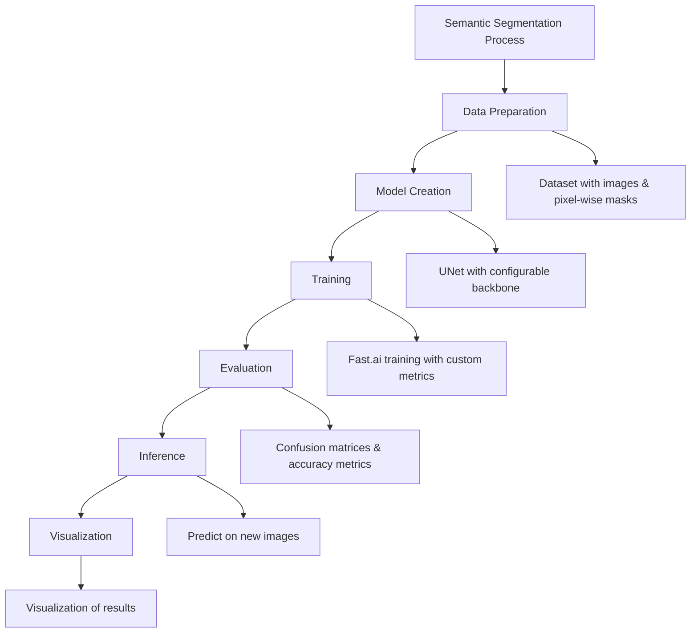
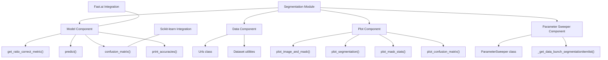
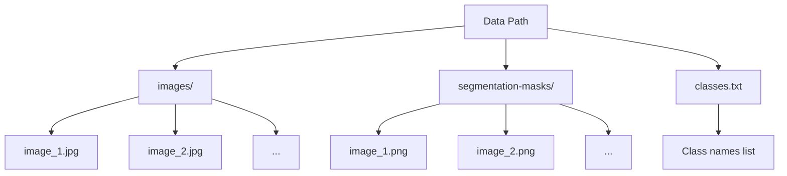
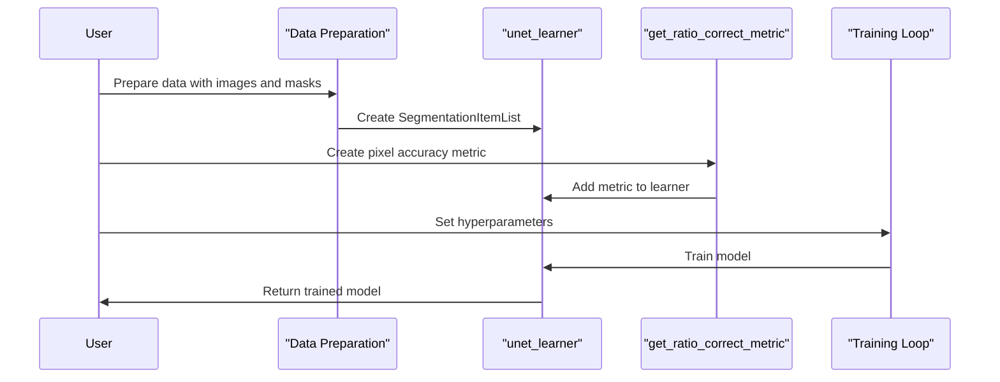
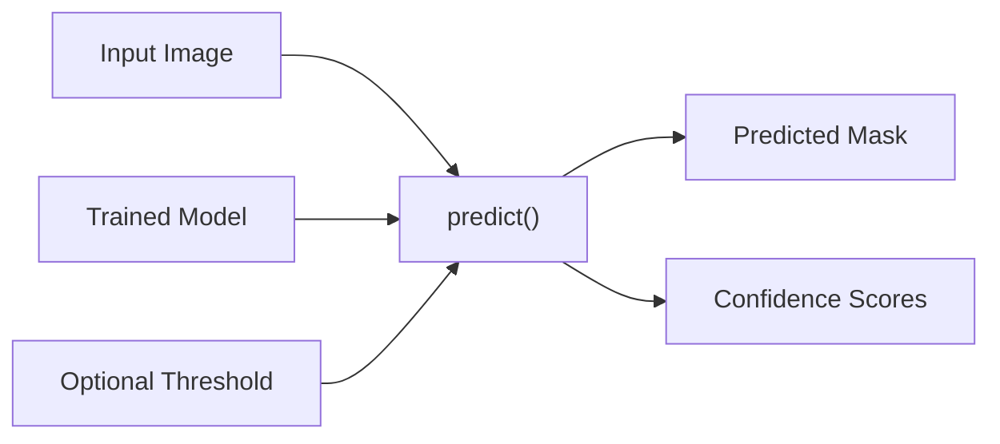
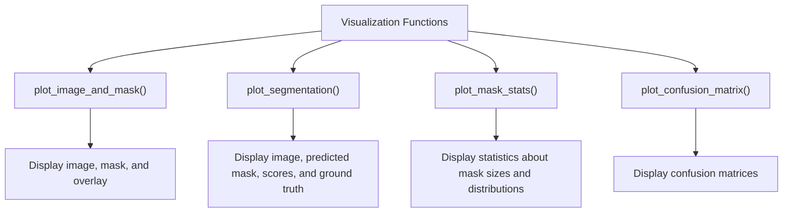
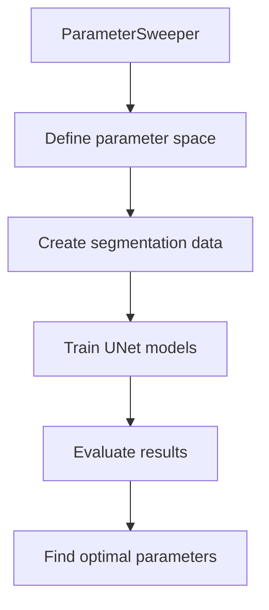
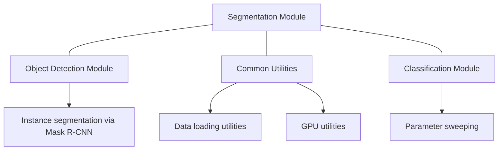

<!-- source: DeepWiki mcp.deepwiki.com · repo microsoft/computervision-recipes · page 2.5 Segmentation · fetched 2026-10-26 -->

# Segmentation

<details>
<summary>Relevant source files</summary>

The following files were used as context for generating this wiki page:

- [scenarios/segmentation/01_training_introduction.ipynb](scenarios/segmentation/01_training_introduction.ipynb)
- [tests/unit/segmentation/test_segmentation_model.py](tests/unit/segmentation/test_segmentation_model.py)
- [utils_cv/classification/parameter_sweeper.py](utils_cv/classification/parameter_sweeper.py)
- [utils_cv/segmentation/data.py](utils_cv/segmentation/data.py)
- [utils_cv/segmentation/model.py](utils_cv/segmentation/model.py)
- [utils_cv/segmentation/plot.py](utils_cv/segmentation/plot.py)

</details>


This page describes the semantic segmentation capabilities of the Computer Vision Recipes repository. Semantic segmentation is the task of classifying each pixel in an image by object class. Unlike instance segmentation (which identifies individual object instances - covered in [Object Detection](#2.1)), semantic segmentation focuses on assigning class labels to pixels without distinguishing between instances of the same class.

## Overview

The segmentation module provides tools to train, evaluate, and visualize semantic segmentation models using U-Net architectures with various backbones. It leverages fast.ai's implementation while providing additional utilities for performance evaluation, visualization, and hyperparameter tuning.



Sources: 
- [scenarios/segmentation/01_training_introduction.ipynb:1-180]()
- [utils_cv/segmentation/model.py:1-141]()
- [utils_cv/segmentation/plot.py:1-201]()

## System Architecture

The segmentation module consists of several components that work together to enable training and using semantic segmentation models:



Sources: 
- [utils_cv/segmentation/model.py:1-141]()
- [utils_cv/segmentation/plot.py:1-201]()
- [utils_cv/segmentation/data.py:1-18]()
- [utils_cv/classification/parameter_sweeper.py:273-301]()

## Data Organization

The segmentation module expects data to be organized in a specific structure to facilitate easy loading and processing:



In this structure:
- The `images/` directory contains the input images
- The `segmentation-masks/` directory contains the corresponding pixel-wise masks
- The `classes.txt` file lists the class names
- Mask filenames must match image filenames (except for extensions)

Sources: 
- [scenarios/segmentation/01_training_introduction.ipynb:143-239]()

## Model Creation and Training

The segmentation module uses a U-Net architecture with configurable backbones (such as ResNet18 or ResNet50) for semantic segmentation tasks.

### Model Configuration Options

| Parameter | Description | Options |
|-----------|-------------|---------|
| `IM_SIZE` | Image size for training | e.g., `[200, 150]` or `[500, 375]` |
| `ARCHITECTURE` | Backbone architecture | `models.resnet18`, `models.resnet50` |
| `BATCH_SIZE` | Batch size for training | Integer (lower for larger images) |
| `EPOCHS` | Number of training epochs | Integer |
| `LEARNING_RATE` | Learning rate | Float (e.g., `3e-4`) |
| `THRESHOLD` | Confidence threshold | Float or `None` |

Sources: 
- [scenarios/segmentation/01_training_introduction.ipynb:120-143]()
- [utils_cv/classification/parameter_sweeper.py:414-425]()

### Training Process

The training process utilizes fast.ai's `unet_learner` with a custom metric to measure pixel-wise accuracy:



Sources: 
- [utils_cv/segmentation/model.py:17-46]()
- [utils_cv/classification/parameter_sweeper.py:414-425]()
- [scenarios/segmentation/01_training_introduction.ipynb:271-326]()

## Evaluation and Inference

The module provides tools for evaluating model performance and making predictions on new images.

### Evaluation Metrics

The main evaluation metric is pixel-wise accuracy, calculated using the `ratio_correct` function which can optionally ignore pixels labeled as "void":

```python
# Ratio of correctly classified pixels
def ratio_correct(void_id, input, target):
    target = target.squeeze(1)
    if void_id != None:
        mask = target != void_id
        ratio_correct = (input.argmax(dim=1)[mask] == target[mask]).float().mean()
    else:
        ratio_correct = (input.argmax(dim=1) == target).float().mean()
    return ratio_correct
```

The module also provides functions to compute confusion matrices and class-wise accuracies:

```python
# Computing overall and per-class accuracies
class_accs = 100.0 * np.diag(cmat_norm)
overall_acc = 100.0 * np.diag(cmat).sum() / cmat.sum()
```

Sources: 
- [utils_cv/segmentation/model.py:17-46]()
- [utils_cv/segmentation/model.py:78-140]()

### Inference

The `predict` function takes an image and a trained model and returns the predicted segmentation mask along with confidence scores:



Sources: 
- [utils_cv/segmentation/model.py:49-75]()

## Visualization

The module provides comprehensive visualization tools for inspecting segmentation results:



### Visualization Examples

1. **Image and Mask Visualization**:
   - Shows the original image, ground truth mask, and an overlay of the two
   - Used for inspecting training data

2. **Segmentation Results Visualization**:
   - Shows the original image, predicted mask, confidence scores, and optionally the ground truth mask
   - Used for evaluating prediction quality

3. **Mask Statistics Visualization**:
   - Shows the distribution of pixels per class, segments per class, and segment sizes
   - Used for analyzing dataset characteristics

4. **Confusion Matrix Visualization**:
   - Shows both raw and normalized confusion matrices
   - Used for detailed analysis of class predictions

Sources: 
- [utils_cv/segmentation/plot.py:18-200]()

## Parameter Sweeping

The module integrates with the `ParameterSweeper` class to enable hyperparameter optimization:



The parameter sweeper supports segmentation-specific data loading and can train U-Net models with various hyperparameter combinations:

```python
# Example parameter space for segmentation
params = {
    "learning_rate": [1e-4, 3e-4],
    "epochs": [10, 20],
    "batch_size": [8, 16],
    "im_size": [200, 400],
    "architecture": [models.resnet18, models.resnet50],
    # ...other parameters
}
```

Sources: 
- [utils_cv/classification/parameter_sweeper.py:273-301]()
- [utils_cv/classification/parameter_sweeper.py:414-425]()

## Usage Example

Here's a simplified workflow for training and using a segmentation model:

1. **Prepare data**: Organize images and masks in the required directory structure
2. **Configure model**: Choose backbone, image size, and other hyperparameters
3. **Create data bunch**: Load and preprocess the data
4. **Create and train model**: Initialize U-Net learner and train
5. **Evaluate performance**: Compute confusion matrices and accuracies
6. **Make predictions**: Use the model on new images
7. **Visualize results**: Display segmentation masks and confidence scores

Sources: 
- [scenarios/segmentation/01_training_introduction.ipynb:16-364]()

## Integration with Other Modules

The segmentation module integrates with other parts of the Computer Vision Recipes repository:



The semantic segmentation functionality complements the instance segmentation capabilities provided by the Object Detection module, offering different approaches for pixel-wise image understanding.

Sources: 
- [scenarios/segmentation/01_training_introduction.ipynb:16-29]()
- [utils_cv/segmentation/model.py:1-13]()

## Conclusion

The segmentation module provides a comprehensive toolkit for training, evaluating, and using semantic segmentation models with U-Net architectures. It offers flexibility in model configuration, robust evaluation metrics, and detailed visualization tools, making it suitable for a variety of image segmentation tasks.

---

