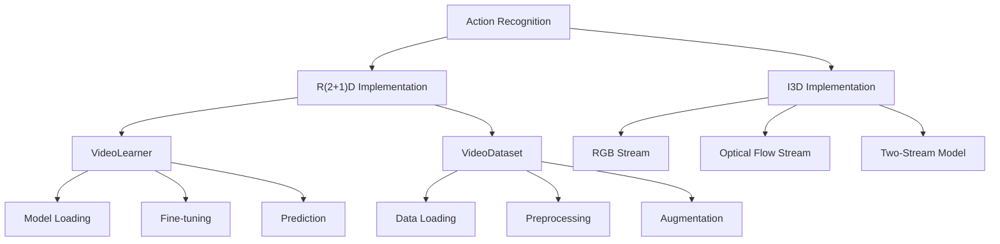
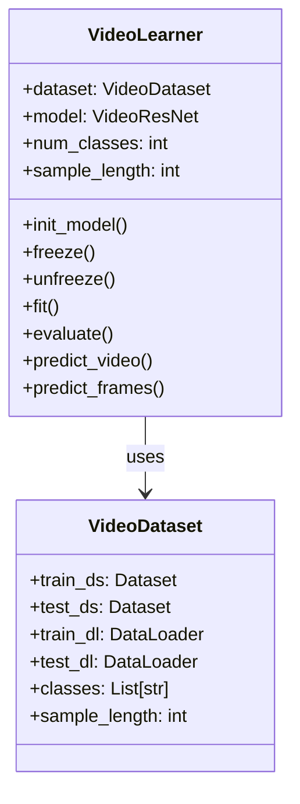
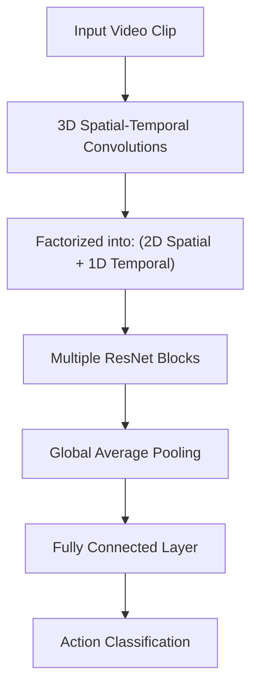
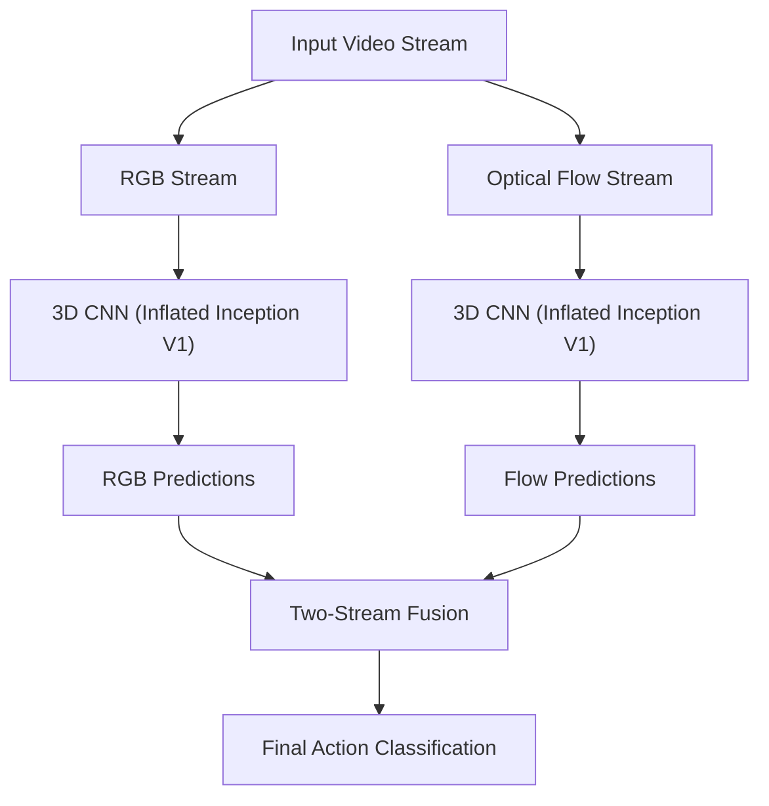
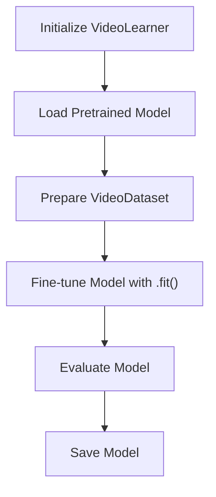
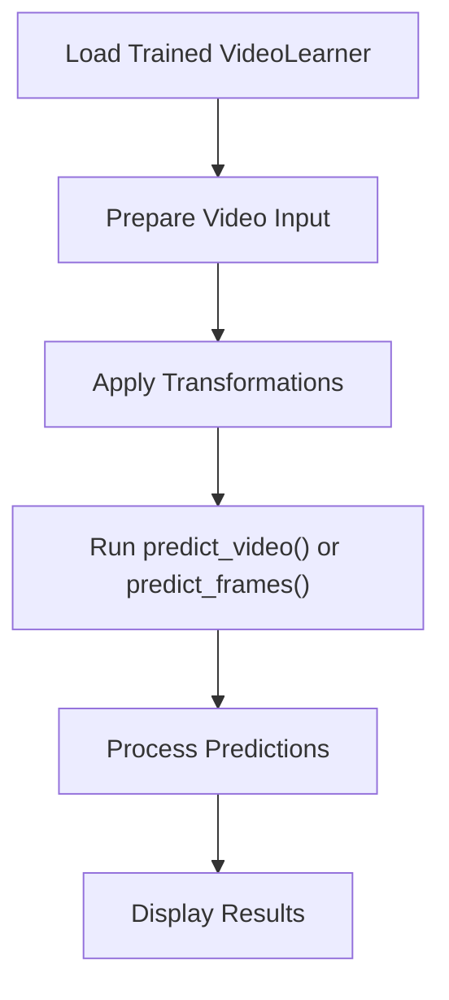
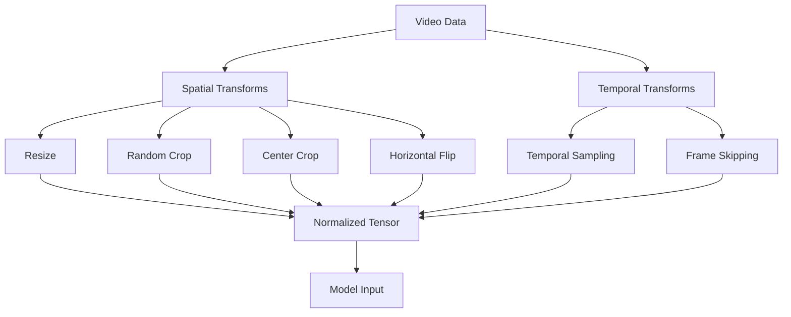
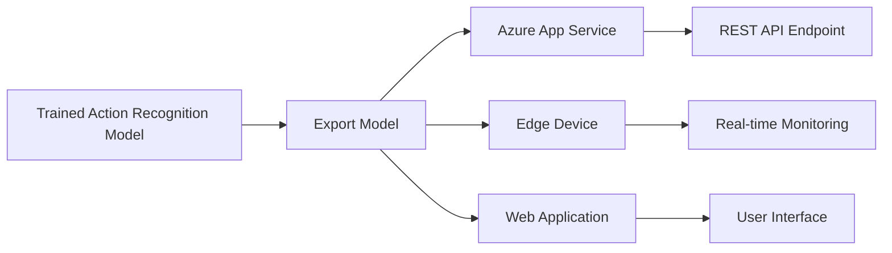

<!-- source: DeepWiki mcp.deepwiki.com · repo microsoft/computervision-recipes · page 2.6 Action Recognition · fetched 2026-10-26 -->

# Action Recognition

<details>
<summary>Relevant source files</summary>

The following files were used as context for generating this wiki page:

- [contrib/action_recognition/README.md](contrib/action_recognition/README.md)
- [contrib/action_recognition/i3d/.gitignore](contrib/action_recognition/i3d/.gitignore)
- [contrib/action_recognition/i3d/README.md](contrib/action_recognition/i3d/README.md)
- [contrib/action_recognition/i3d/config/train_flow.yaml](contrib/action_recognition/i3d/config/train_flow.yaml)
- [contrib/action_recognition/i3d/config/train_rgb.yaml](contrib/action_recognition/i3d/config/train_rgb.yaml)
- [contrib/action_recognition/i3d/dataset.py](contrib/action_recognition/i3d/dataset.py)
- [contrib/action_recognition/i3d/default.py](contrib/action_recognition/i3d/default.py)
- [contrib/action_recognition/i3d/download_models.sh](contrib/action_recognition/i3d/download_models.sh)
- [contrib/action_recognition/i3d/environment.yml](contrib/action_recognition/i3d/environment.yml)
- [contrib/action_recognition/i3d/inference.py](contrib/action_recognition/i3d/inference.py)
- [contrib/action_recognition/i3d/metrics.py](contrib/action_recognition/i3d/metrics.py)
- [contrib/action_recognition/i3d/models/pytorch_i3d.py](contrib/action_recognition/i3d/models/pytorch_i3d.py)
- [contrib/action_recognition/i3d/test.py](contrib/action_recognition/i3d/test.py)
- [contrib/action_recognition/i3d/train.py](contrib/action_recognition/i3d/train.py)
- [contrib/action_recognition/i3d/videotransforms.py](contrib/action_recognition/i3d/videotransforms.py)
- [contrib/action_recognition/media/action_recognition.gif](contrib/action_recognition/media/action_recognition.gif)
- [contrib/crowd_counting/README.md](contrib/crowd_counting/README.md)
- [contrib/crowd_counting/crowdcounting/examples/tutorial.ipynb](contrib/crowd_counting/crowdcounting/examples/tutorial.ipynb)
- [contrib/html_demo/JupyterCode/1_image_similarity_export.ipynb](contrib/html_demo/JupyterCode/1_image_similarity_export.ipynb)
- [contrib/html_demo/JupyterCode/readme.md](contrib/html_demo/JupyterCode/readme.md)
- [scenarios/action_recognition/00_webcam.ipynb](scenarios/action_recognition/00_webcam.ipynb)
- [scenarios/action_recognition/01_training_introduction.ipynb](scenarios/action_recognition/01_training_introduction.ipynb)
- [scenarios/action_recognition/02_training_hmdb.ipynb](scenarios/action_recognition/02_training_hmdb.ipynb)
- [scenarios/action_recognition/10_video_transformation.ipynb](scenarios/action_recognition/10_video_transformation.ipynb)
- [scenarios/action_recognition/data/kinetics400/label_map.txt](scenarios/action_recognition/data/kinetics400/label_map.txt)
- [scenarios/classification/FAQ.md](scenarios/classification/FAQ.md)
- [scenarios/similarity/12_fast_retrieval.ipynb](scenarios/similarity/12_fast_retrieval.ipynb)
- [tests/unit/action_recognition/test_action_recognition_data.py](tests/unit/action_recognition/test_action_recognition_data.py)
- [tests/unit/action_recognition/test_action_recognition_dataset.py](tests/unit/action_recognition/test_action_recognition_dataset.py)
- [tests/unit/action_recognition/test_action_recognition_model.py](tests/unit/action_recognition/test_action_recognition_model.py)
- [tests/unit/action_recognition/test_action_recognition_notebooks.py](tests/unit/action_recognition/test_action_recognition_notebooks.py)
- [utils_cv/action_recognition/data.py](utils_cv/action_recognition/data.py)
- [utils_cv/action_recognition/dataset.py](utils_cv/action_recognition/dataset.py)
- [utils_cv/action_recognition/model.py](utils_cv/action_recognition/model.py)
- [utils_cv/common/misc.py](utils_cv/common/misc.py)

</details>


The Action Recognition module in the Computer Vision Recipes repository provides tools and models for classifying actions in videos. Action recognition consists of identifying various human activities from a sequence of frames, such as "drinking," "running," or "clapping."

This guide covers the implementation of action recognition in the repository, focusing on the two main approaches:

1. **R(2+1)D model** - The recommended approach for its competitive accuracy, fast inference speed, and fewer dependencies
2. **I3D model** (Inflated 3D ConvNets) - An alternative implementation supporting RGB and optical flow inputs

## Architecture Overview

The repository provides two distinct implementations for action recognition tasks:



### R(2+1)D Implementation

The primary implementation in `utils_cv/action_recognition/` uses the R(2+1)D model, providing a user-friendly interface through the `VideoLearner` class. This implementation is sufficient for most use cases and easier to work with.

### I3D Implementation

The alternative implementation in `contrib/action_recognition/i3d/` uses the I3D approach from the paper "Quo vadis, action recognition?" by Carreira and Zisserman. It offers RGB and optical flow models that can be combined for more accurate predictions.

Sources:
- [contrib/action_recognition/README.md]()
- [utils_cv/action_recognition/model.py]()
- [utils_cv/action_recognition/dataset.py]()
- [contrib/action_recognition/i3d/README.md]()

## Data Structures and Components



### VideoLearner

The `VideoLearner` class is the primary interface for working with action recognition models:

- Loads and manages the R(2+1)D model
- Handles training and fine-tuning
- Provides methods for inference on videos
- Supports both 8-frame and 32-frame models
- Integrates with VideoDataset for data loading

```python
# Example initialization
learner = VideoLearner(
    dataset=data,              # Optional VideoDataset
    num_classes=num_classes,   # Number of action classes
    base_model="ig65m",        # or "kinetics"
    sample_length=8            # or 32 frames
)
```

### VideoDataset

The `VideoDataset` class handles loading and preprocessing video data:

- Loads videos from a directory structure
- Splits data into training and validation sets
- Applies transformations and data augmentation
- Creates PyTorch DataLoaders for training

The dataset expects a directory structure with subdirectories for each action class:

```
/data
+-- action_class_1
|   +-- video_01.mp4
|   +-- video_02.mp4
+-- action_class_2
|   +-- video_11.mp4
|   +-- video_12.mp4
```

Sources:
- [utils_cv/action_recognition/model.py:54-173]()
- [utils_cv/action_recognition/dataset.py:32-265]()
- [scenarios/action_recognition/01_training_introduction.ipynb:185-202]()

## Model Architecture

### R(2+1)D Model

The R(2+1)D model is a 3D convolutional neural network that decomposes 3D convolutions into separate spatial and temporal components:



The model is available in two variants:
- 8-frame model: Faster but slightly less accurate
- 32-frame model: More accurate but slower inference

The repository uses pretrained models from either the Kinetics dataset or the larger IG65M dataset.

### I3D Model

The I3D model inflates 2D CNN models into 3D by expanding filters and pooling kernels:



The I3D model uses two streams:
- RGB stream: Processes raw video frames
- Optical flow stream: Processes precomputed optical flow fields

Sources:
- [utils_cv/action_recognition/model.py:92-129]()
- [contrib/action_recognition/i3d/README.md:1-10]()
- [contrib/action_recognition/i3d/models/pytorch_i3d.py]()

## Training and Inference

### Training Process



Fine-tuning a model involves:

1. Preparing a dataset in the required directory structure
2. Creating a `VideoDataset` instance
3. Initializing a `VideoLearner` with the dataset
4. Calling the `fit()` method with training parameters
5. Evaluating the model on a test set

Example code for training:

```python
# Initialize dataset and learner
data = VideoDataset(DATA_PATH, batch_size=BATCH_SIZE, sample_length=MODEL_INPUT_SIZE)
learner = VideoLearner(dataset=data, num_classes=len(data.classes))

# Fine-tune the model
learner.fit(
    lr=0.001,               # Learning rate
    epochs=16,              # Number of epochs
    model_dir="checkpoints" # Where to save models
)
```

### Inference Process



For inference on a video file:

```python
# Load model
learner = VideoLearner(sample_length=NUM_FRAMES)

# Predict on a video
learner.predict_video(
    video_fpath="video.mp4",    # Path to video file
    labels=LABELS,              # Action class labels
    score_threshold=0.01,       # Confidence threshold
    target_labels=TARGET_LABELS # Optional filtering of predictions
)
```

Sources:
- [utils_cv/action_recognition/model.py:146-282]()
- [utils_cv/action_recognition/model.py:505-621]()
- [scenarios/action_recognition/01_training_introduction.ipynb]()
- [scenarios/action_recognition/00_webcam.ipynb]()

## Model Performance

The repository includes implementations of two state-of-the-art approaches with the following reported accuracies:

| Model | Reported in paper | Our results |
| ------- | -------| ------- |
| R(2+1)D-34 RGB | 79.6% | 79.8% |
| I3D RGB | 74.8% | 73.7% |
| I3D Optical flow | 77.1% | 77.5% |
| I3D Two-Stream | 80.7% | 81.2% |

The R(2+1)D model is recommended for most use cases due to:
- Competitive accuracy
- Faster inference speed
- Fewer dependencies compared to I3D

Sources:
- [contrib/action_recognition/README.md:10-19]()

## Examples and Use Cases

### Webcam Inference

The repository includes a notebook demonstrating real-time action recognition using a webcam:

```python
# Initialize VideoLearner
learner = VideoLearner(base_model="kinetics", sample_length=NUM_FRAMES)

# Process webcam stream
# See scenarios/action_recognition/00_webcam.ipynb for complete implementation
```

### Training on Custom Data

The repository demonstrates fine-tuning on a custom "Milk Bottle Actions" dataset:

```python
# Download and prepare dataset
DATA_PATH = unzip_url(Urls.milk_bottle_action_path, exist_ok=True)

# Create dataset and learner
data = VideoDataset(DATA_PATH, batch_size=BATCH_SIZE, sample_length=MODEL_INPUT_SIZE)
learner = VideoLearner(dataset=data)

# Train and evaluate
learner.fit(lr=LR, epochs=EPOCHS)
results = learner.evaluate(num_samples=10, train_or_test="test")
```

### Training on HMDB-51

For more advanced users, the repository includes a notebook for fine-tuning on the HMDB-51 benchmark dataset using the I3D implementation:

```bash
# For I3D model training
python train.py --cfg config/train_rgb.yaml  # Train RGB model
python train.py --cfg config/train_flow.yaml # Train flow model
python test.py  # Evaluate combined model
```

Sources:
- [scenarios/action_recognition/00_webcam.ipynb]()
- [scenarios/action_recognition/01_training_introduction.ipynb]()
- [scenarios/action_recognition/02_training_hmdb.ipynb]()
- [contrib/action_recognition/i3d/README.md:43-58]()

## Transforms and Data Augmentation

The repository provides various video transformations to improve model generalization:



Common transformations include:

- `ResizeVideo` - Resizes all frames to a target size
- `RandomCropVideo` - Randomly crops frames
- `CenterCropVideo` - Center crops all frames
- `RandomHorizontalFlipVideo` - Randomly flips frames horizontally
- `NormalizeVideo` - Normalizes pixel values using mean and standard deviation

These transformations help improve model robustness and prevent overfitting.

Sources:
- [utils_cv/action_recognition/dataset.py:267-306]()
- [scenarios/action_recognition/10_video_transformation.ipynb]()
- [contrib/action_recognition/i3d/videotransforms.py]()

## Integration with Other Systems

The action recognition models can be deployed and integrated with other systems:



The repository includes examples for:

- Deploying models to Azure services
- Creating web applications with HTML interfaces
- Building real-time video analytics pipelines

Sources:
- [contrib/html_demo/JupyterCode/readme.md]()
- [contrib/html_demo/JupyterCode/3_deployment_to_azure_app_service.ipynb]()

## Conclusion

The Action Recognition module provides comprehensive tools for classifying actions in videos. The R(2+1)D implementation is recommended for most use cases, while the I3D implementation offers an alternative approach with RGB and optical flow support.

By following the examples and using the provided APIs, you can:
- Analyze videos to identify human actions
- Fine-tune models on custom datasets
- Deploy models for real-time inference
- Integrate action recognition into larger applications

For specialized scenarios requiring optical flow or other advanced features, consider the I3D implementation in the contrib directory.

---

