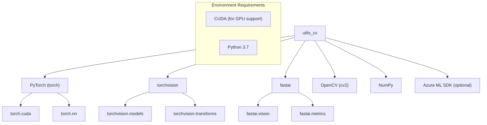
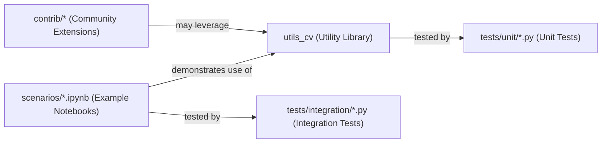

<!-- source: DeepWiki mcp.deepwiki.com · repo microsoft/computervision-recipes · page 3 Utilities Library (utils_cv) · fetched 2026-10-26 -->

# Utilities Library (utils_cv)

<details>
<summary>Relevant source files</summary>

The following files were used as context for generating this wiki page:

- [README.md](README.md)
- [environment.yml](environment.yml)
- [scenarios/README.md](scenarios/README.md)
- [scenarios/classification/README.md](scenarios/classification/README.md)
- [scenarios/media/figures.pptx](scenarios/media/figures.pptx)
- [scenarios/media/intro_ic_vis.jpg](scenarios/media/intro_ic_vis.jpg)
- [scenarios/media/intro_is_vis.jpg](scenarios/media/intro_is_vis.jpg)
- [scenarios/media/intro_iseg_vis.jpg](scenarios/media/intro_iseg_vis.jpg)
- [scenarios/media/intro_kp_vis.jpg](scenarios/media/intro_kp_vis.jpg)
- [scenarios/media/intro_od_vis.jpg](scenarios/media/intro_od_vis.jpg)
- [tests/integration/similarity/test_integration_similarity_notebooks.py](tests/integration/similarity/test_integration_similarity_notebooks.py)
- [tests/unit/classification/test_classification_notebooks.py](tests/unit/classification/test_classification_notebooks.py)
- [tests/unit/common/test_common_gpu.py](tests/unit/common/test_common_gpu.py)
- [tests/unit/similarity/test_similarity_notebooks.py](tests/unit/similarity/test_similarity_notebooks.py)
- [utils_cv/common/gpu.py](utils_cv/common/gpu.py)

</details>


The `utils_cv` library serves as the core utilities package for the Microsoft Computer Vision Recipes repository. It provides a collection of reusable utility functions and classes that support various computer vision tasks, enabling developers to implement computer vision solutions without having to recreate common functionality. This library underpins all the example scenario notebooks in the repository and serves as a foundation for building custom computer vision applications.

For information about the example notebooks that use these utilities, see [Core Scenarios](#2).

## Architecture

The utils_cv library is organized into a modular structure with common utilities and task-specific modules:

```mermaid
graph TD
    A["utils_cv"] --> B["common"]
    A --> C["classification"]
    A --> D["detection"]
    A --> E["similarity"]
    A --> F["segmentation"]
    A --> G["action_recognition"]
    A --> H["tracking"]
    
    B --> B1["gpu.py (Device detection & configuration)"]
    B --> B2["Data loading optimizations"]
    B --> B3["System information utilities"]
    
    C --> C1["ClassificationLearner"]
    C --> C2["Dataset handling"]
    C --> C3["Model evaluation"]
    
    D --> D1["DetectionLearner"]
    D --> D2["Bounding box utilities"]
    D --> D3["Visualization tools"]
    
    E --> E1["Feature extraction"]
    E --> E2["Similarity metrics"]
    E --> E3["Image retrieval"]
    
    F --> F1["Segmentation utilities"]
    F --> F2["Mask processing"]
    
    G --> G1["Video processing"]
    G --> G2["Temporal analysis"]
    
    H --> H1["Object tracking"]
    H --> H2["Trajectory analysis"]
```



Sources: [README.md:47-61]()

## Common Utilities

### GPU Utilities

The `utils_cv.common.gpu` module provides functions for detecting and configuring GPU usage, which is critical for optimizing computer vision workflows that benefit from GPU acceleration.

Key functions include:

| Function | Description |
|---------|-------------|
| `which_processor()` | Checks and prints if torch is using GPU or CPU |
| `is_linux()` | Returns if machine is running a Linux OS |
| `is_windows()` | Returns if machine is running a Windows OS |
| `linux_with_gpu()` | Returns if machine is running a Linux OS and has a GPU |
| `is_binder()` | Returns if machine is running within a Binder environment |
| `torch_device()` | Gets the torch device (cuda if available, otherwise cpu) |
| `num_devices()` | Gets the number of devices based on cpu/gpu |
| `db_num_workers()` | Returns optimal number of workers for data loading (0 for Windows, configurable for Linux) |
| `system_info()` | Prints system information including Python, PyTorch, and torchvision versions and available devices |

The `db_num_workers()` function is particularly important as it helps optimize data loading performance across different operating systems:

```python
def db_num_workers(non_windows_num_workers: int = 16):
    """Returns how many workers to use when loading images in a databunch. On windows machines using >0 works significantly slows down model
    training and evaluation. Setting num_workers to zero on Windows machines will speed up training/inference significantly, but will still be
    2-3 times slower. Additionally, also set num_workers to zero if running within Binder to avoid an error being thrown. 

    For a description of the slow windows speed see: https://github.com/pytorch/pytorch/issues/12831
    """
    if is_windows() or is_binder():
        return 0
    else:
        return non_windows_num_workers
```

Sources: [utils_cv/common/gpu.py:13-79](), [tests/unit/common/test_common_gpu.py:4-46]()

## Task-Specific Modules

The `utils_cv` library contains specialized modules for different computer vision tasks:

### Classification Module

The classification module provides tools for image classification tasks, including functions for data loading, model training, and evaluation. These utilities are used by the classification scenario notebooks. The tests show this module supports both single-label and multi-label classification.

Sources: [tests/unit/classification/test_classification_notebooks.py:34-149](), [scenarios/classification/README.md:1-13]()

### Detection Module

The detection module contains utilities for object detection tasks, supporting the detection scenario notebooks with functions for handling detection datasets, model training, and visualization of bounding boxes.

### Similarity Module

The similarity module provides tools for computing image similarity, including feature extraction and comparison metrics. These utilities enable finding similar images in a dataset based on visual features. The tests demonstrate its ability to perform feature extraction and similarity ranking.

```python
# Example of similarity functionality as seen in test files
from utils_cv.similarity import compute_features, vector_distance
```

Sources: [tests/unit/similarity/test_similarity_notebooks.py:20-101](), [tests/integration/similarity/test_integration_similarity_notebooks.py:15-77]()

### Segmentation Module

The segmentation module contains utilities for image segmentation tasks, supporting pixel-wise classification of images into different categories.

### Action Recognition Module

The action recognition module provides tools for recognizing actions in videos, supporting temporal analysis of video sequences to identify activities.

### Tracking Module

The tracking module contains utilities for tracking objects across video frames, enabling consistent object identification over time.

Sources: [README.md:50-58]()

## Library Dependencies

The utils_cv library relies on several key external dependencies to provide its functionality:



Sources: [environment.yml:18-46]()

## Integration with Repository Components

The `utils_cv` library serves as the foundation for the scenario notebooks and other components in the repository:



The library provides:
- Simplified implementation of common patterns
- Consistent API across different computer vision tasks
- Shared functionality for data handling, model training, and evaluation
- Performance optimizations for different computing environments

Sources: [README.md:61-85]()

## Usage Examples

The scenario notebooks in the repository demonstrate practical applications of the `utils_cv` library for different computer vision tasks. These notebooks serve as both documentation and examples of how to leverage the utilities effectively.

For specific usage of the GPU utilities, here's a basic example:

```python
from utils_cv.common.gpu import torch_device, num_devices, db_num_workers, system_info

# Print system information
system_info()

# Get the appropriate device (GPU if available)
device = torch_device()

# Get number of available devices
num_gpus = num_devices()

# Get optimal number of workers for data loading
workers = db_num_workers()

print(f"Using device: {device}")
print(f"Number of available devices: {num_gpus}")
print(f"Optimal number of workers: {workers}")
```

Sources: [utils_cv/common/gpu.py:43-67]()

## Testing

The utils_cv library is extensively tested using both unit tests and integration tests:

- **Unit tests**: Test individual components of the library in isolation
- **Integration tests**: Test the library's interaction with other components, such as the scenario notebooks

The testing infrastructure uses:
- `pytest` for test execution
- `papermill` for notebook execution
- `scrapbook` for capturing and validating notebook outputs

Sources: [tests/unit/common/test_common_gpu.py:1-46](), [tests/unit/similarity/test_similarity_notebooks.py:1-102](), [tests/unit/classification/test_classification_notebooks.py:1-150](), [tests/integration/similarity/test_integration_similarity_notebooks.py:1-77]()

---

