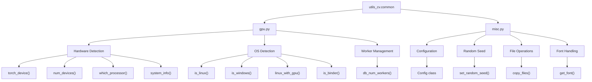
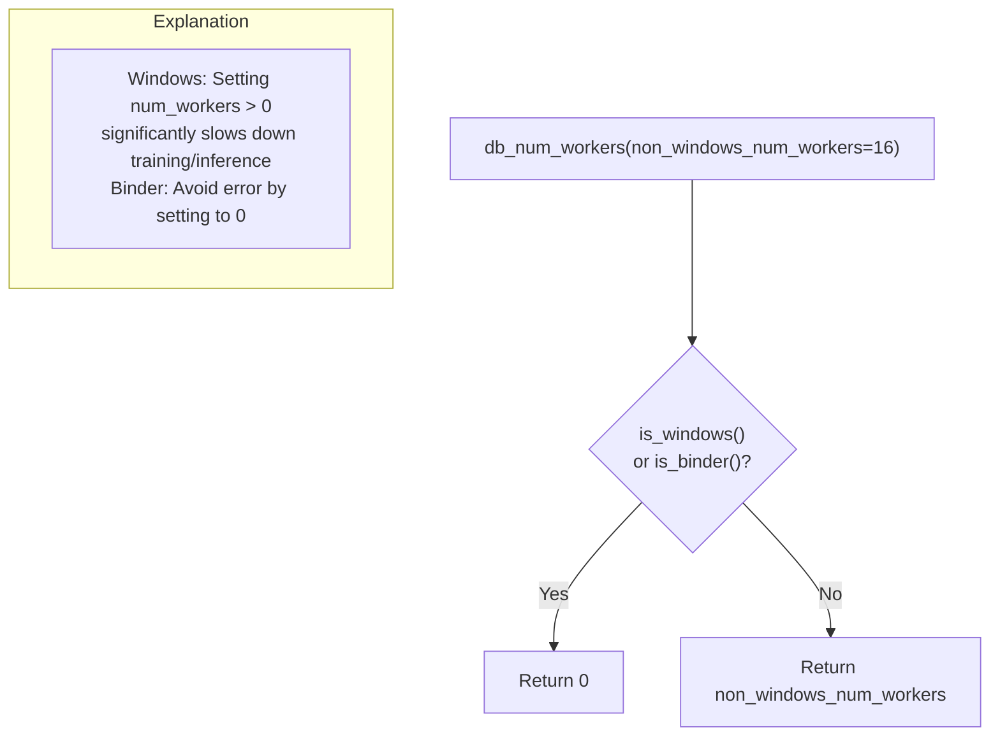
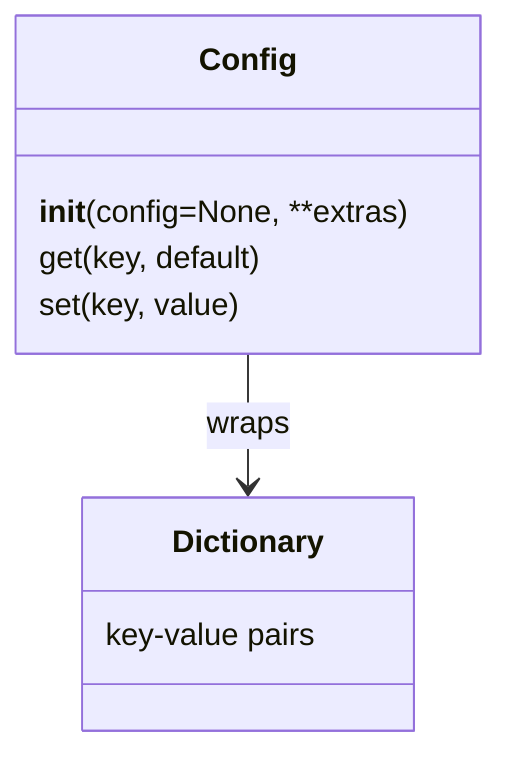
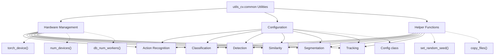

<!-- source: DeepWiki mcp.deepwiki.com · repo microsoft/computervision-recipes · page 3.1 Common Utilities · fetched 2026-10-26 -->

# Common Utilities

<details>
<summary>Relevant source files</summary>

The following files were used as context for generating this wiki page:

- [scenarios/action_recognition/00_webcam.ipynb](scenarios/action_recognition/00_webcam.ipynb)
- [scenarios/action_recognition/01_training_introduction.ipynb](scenarios/action_recognition/01_training_introduction.ipynb)
- [scenarios/action_recognition/02_training_hmdb.ipynb](scenarios/action_recognition/02_training_hmdb.ipynb)
- [scenarios/action_recognition/10_video_transformation.ipynb](scenarios/action_recognition/10_video_transformation.ipynb)
- [scenarios/action_recognition/data/kinetics400/label_map.txt](scenarios/action_recognition/data/kinetics400/label_map.txt)
- [tests/integration/similarity/test_integration_similarity_notebooks.py](tests/integration/similarity/test_integration_similarity_notebooks.py)
- [tests/unit/action_recognition/test_action_recognition_data.py](tests/unit/action_recognition/test_action_recognition_data.py)
- [tests/unit/action_recognition/test_action_recognition_dataset.py](tests/unit/action_recognition/test_action_recognition_dataset.py)
- [tests/unit/action_recognition/test_action_recognition_model.py](tests/unit/action_recognition/test_action_recognition_model.py)
- [tests/unit/action_recognition/test_action_recognition_notebooks.py](tests/unit/action_recognition/test_action_recognition_notebooks.py)
- [tests/unit/classification/test_classification_notebooks.py](tests/unit/classification/test_classification_notebooks.py)
- [tests/unit/common/test_common_gpu.py](tests/unit/common/test_common_gpu.py)
- [tests/unit/similarity/test_similarity_notebooks.py](tests/unit/similarity/test_similarity_notebooks.py)
- [utils_cv/action_recognition/data.py](utils_cv/action_recognition/data.py)
- [utils_cv/action_recognition/dataset.py](utils_cv/action_recognition/dataset.py)
- [utils_cv/action_recognition/model.py](utils_cv/action_recognition/model.py)
- [utils_cv/common/gpu.py](utils_cv/common/gpu.py)
- [utils_cv/common/misc.py](utils_cv/common/misc.py)

</details>


This page documents the common utility functions and classes provided in the Computer Vision Recipes repository. These utilities serve as fundamental building blocks used throughout the codebase to handle hardware detection (especially GPUs), system configurations, file operations, and other shared functionality.

For information about specific computer vision tasks, please see the respective pages under [Core Scenarios](#2).

## Overview

The common utilities provide the foundation for the Computer Vision Recipes repository, enabling consistent handling of hardware resources, configuration management, and other shared functions across different CV tasks. These utilities are organized into two main modules:

- GPU utilities: Functions for hardware detection and management
- Miscellaneous utilities: Functions for configuration, file operations, and other helpers

### Common Utilities Architecture



Sources: [utils_cv/common/gpu.py:1-81](), [utils_cv/common/misc.py:1-121]()

## GPU Utilities

The GPU utilities module provides functions for detecting and managing hardware resources, particularly GPUs, which are critical for efficient computer vision tasks.

### Hardware Detection Functions

- `which_processor()`: Checks and prints whether PyTorch is using GPU or CPU
- `torch_device()`: Returns the appropriate torch device (CUDA if available, otherwise CPU)
- `num_devices()`: Returns the number of available devices based on CPU/GPU availability
- `system_info()`: Displays detailed information about Python, PyTorch, and available hardware

### OS Detection Functions

- `is_linux()`: Returns whether the machine is running Linux
- `is_windows()`: Returns whether the machine is running Windows
- `linux_with_gpu()`: Returns whether the machine is running Linux and has a GPU
- `is_binder()`: Returns whether the code is running in a Binder environment

### Worker Management Functions

- `db_num_workers()`: Determines the optimal number of workers for data loading based on the operating system

#### DataLoader Worker Optimization



Sources: [utils_cv/common/gpu.py:13-79](), [tests/unit/common/test_common_gpu.py:5-46]()

### Usage Examples

The GPU utilities are used extensively throughout the codebase, particularly in model training and evaluation:

```python
# Get appropriate device for PyTorch
device = torch_device()
model.to(device)

# Determine the number of workers for data loading
workers = db_num_workers()
data_loader = DataLoader(dataset, batch_size=32, num_workers=workers)

# Display system information
system_info()
```

In the Action Recognition module, these utilities are used to ensure models are placed on the correct device:

```python
# Move model to gpu before constructing optimizers
device = torch_device()
self.model.to(device)
count_devices = num_devices()
torch.backends.cudnn.benchmark = True
```

Sources: [utils_cv/action_recognition/model.py:180-184](), [scenarios/action_recognition/00_webcam.ipynb:70-101]()

## Miscellaneous Utilities

The miscellaneous utilities module provides various helper functions for configuration management, random seed setting, file operations, and font handling.

### Configuration Management

The `Config` class provides a flexible wrapper for configuration dictionaries, allowing access to configuration parameters as attributes.

```python
# Example usage
cfg = Config({'lr': 0.01}, momentum=0.95)
print(cfg.lr, cfg.momentum)  # 0.01 0.95

# Get with default value
value = cfg.get('batch_size', 32)

# Set a new value
cfg.set('lr', 0.001)
```

#### Config Class Structure



Sources: [utils_cv/common/misc.py:91-120]()

### Random Seed Setting

The `set_random_seed()` function ensures reproducibility by setting the random seed for Python, NumPy, and PyTorch:

```python
def set_random_seed(s: int):
    """Set random seed
    """
    np.random.seed(s)
    random.seed(s)

    try:
        import torch
        torch.manual_seed(s)
        if torch.cuda.is_available():
            torch.cuda.manual_seed(s)
            torch.cuda.manual_seed_all(s)
            torch.backends.cudnn.deterministic = True
            torch.backends.cudnn.benchmark = False
    except ImportError:
        pass
```

Sources: [utils_cv/common/misc.py:15-31]()

### File Operations

The `copy_files()` function provides flexible file copying capabilities:

```python
def copy_files(
    fpaths: Union[str, List[str]],
    dst_dir: str,
    infer_subdir: bool = False,
    remove: bool = False,
):
    """Copy list of files into destination
    Args:
        fpaths: File path to copy
        dst_dir: Destination directory
        infer_subdir: If True, try to infer directory structure of the files and copy.
            Otherwise, just copy the files to dst
        remove: Remove copied files from the original directory
    """
```

Sources: [utils_cv/common/misc.py:34-65]()

### Font Handling

The `get_font()` function attempts to find a suitable font for text rendering across different operating systems:

```python
def get_font(size: int = 12) -> ImageFont:
    """ Gets a font object. 
        Tries different fonts and lower/upper case to be compatible with both Linux and Windows.
    """
```

Sources: [utils_cv/common/misc.py:68-88]()

## Integration with Computer Vision Tasks

The common utilities provide the foundation for various computer vision tasks in the repository. The diagram below illustrates how these utilities are integrated with different components:



Sources: [utils_cv/action_recognition/model.py:180-184](), [tests/integration/similarity/test_integration_similarity_notebooks.py:1-78](), [tests/unit/similarity/test_similarity_notebooks.py:1-102](), [tests/unit/classification/test_classification_notebooks.py:1-150]()

### Usage in Unit Tests

The common utilities are extensively tested to ensure they work correctly across different environments:

```python
def test_db_num_workers():
    if is_windows():
        assert db_num_workers() == 0
        assert db_num_workers(non_windows_num_workers=7) == 0
    else:
        assert db_num_workers() == 16
        assert db_num_workers(non_windows_num_workers=7) == 7
```

Sources: [tests/unit/common/test_common_gpu.py:36-42]()

## Summary

The common utilities provide essential functionality that is used throughout the Computer Vision Recipes repository:

| Utility Category | Key Functions | Purpose |
|------------------|---------------|---------|
| Hardware Detection | `torch_device()`, `num_devices()`, `which_processor()` | Detect and utilize available hardware |
| OS Detection | `is_linux()`, `is_windows()`, `linux_with_gpu()`, `is_binder()` | Identify operating system and environment |
| Worker Management | `db_num_workers()` | Optimize data loading based on OS |
| Configuration | `Config` class | Flexible parameter management |
| Random Seed | `set_random_seed()` | Ensure reproducibility |
| File Operations | `copy_files()` | Convenient file handling |
| Font Handling | `get_font()` | Cross-platform text rendering |

These utilities ensure consistent behavior across different computer vision tasks and enable efficient utilization of available hardware resources.

---

