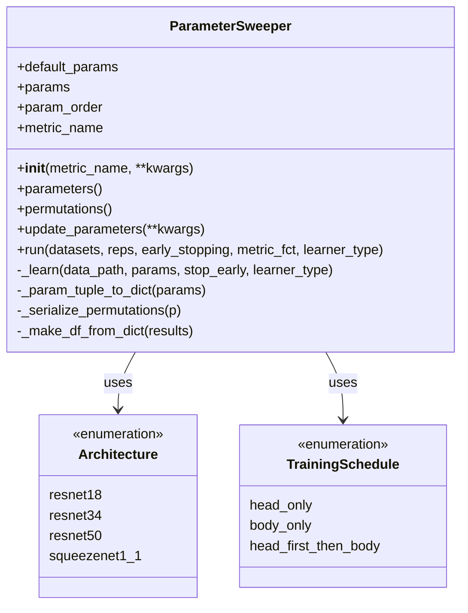
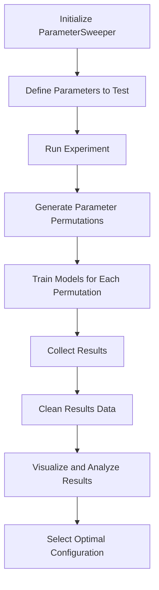
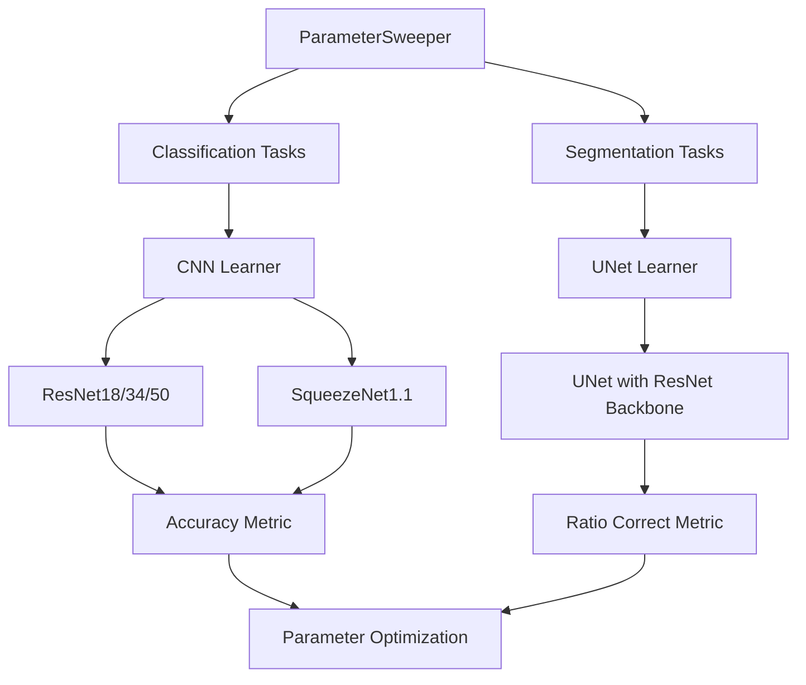
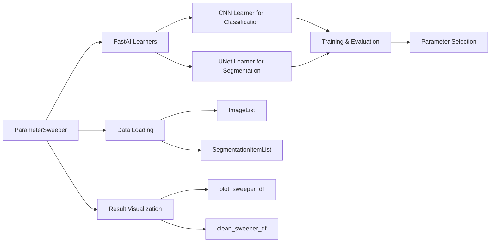

<!-- source: DeepWiki mcp.deepwiki.com · repo microsoft/computervision-recipes · page 3.2 Parameter Sweeping · fetched 2026-10-26 -->

# Parameter Sweeping

<details>
<summary>Relevant source files</summary>

The following files were used as context for generating this wiki page:

- [scenarios/segmentation/01_training_introduction.ipynb](scenarios/segmentation/01_training_introduction.ipynb)
- [tests/unit/segmentation/test_segmentation_model.py](tests/unit/segmentation/test_segmentation_model.py)
- [utils_cv/classification/parameter_sweeper.py](utils_cv/classification/parameter_sweeper.py)
- [utils_cv/segmentation/data.py](utils_cv/segmentation/data.py)
- [utils_cv/segmentation/model.py](utils_cv/segmentation/model.py)
- [utils_cv/segmentation/plot.py](utils_cv/segmentation/plot.py)

</details>


Parameter sweeping is a systematic approach to hyperparameter optimization that tests various combinations of model parameters to find the optimal configuration. In the Computer Vision Recipes repository, the `ParameterSweeper` class provides a framework for automating this process across classification and segmentation tasks. This functionality allows users to efficiently experiment with different hyperparameters such as learning rate, batch size, model architecture, and training schedules to maximize model performance.

## Parameter Sweeper Framework

The `ParameterSweeper` class in the Computer Vision Recipes repository enables systematic testing of multiple hyperparameter combinations. It handles the creation of learners, training, validation, and result collection across different parameter permutations.

### Core Components



Sources: [utils_cv/classification/parameter_sweeper.py:41-45](), [utils_cv/classification/parameter_sweeper.py:47-51](), [utils_cv/classification/parameter_sweeper.py:183-229]()

The diagram illustrates the main components of the `ParameterSweeper` class and its relationship with supporting enumeration classes. The `Architecture` enum represents different model architectures that can be tested, while the `TrainingSchedule` enum defines different training strategies.

### Default Parameters

The `ParameterSweeper` includes a set of default parameters that can be overridden when initializing the sweeper:

| Parameter | Default Value | Description |
|-----------|---------------|-------------|
| learning_rate | 1e-4 | Learning rate for the optimizer |
| epoch | 15 | Number of training epochs |
| batch_size | 16 | Batch size for training |
| im_size | 299 | Input image size |
| architecture | Architecture.resnet18 | Model architecture |
| transform | True | Whether to apply data transformations |
| dropout | 0.5 | Dropout rate for regularization |
| weight_decay | 0.01 | Weight decay for regularization |
| training_schedule | TrainingSchedule.head_first_then_body | Training strategy |
| discriminative_lr | False | Whether to use discriminative learning rates |
| one_cycle_policy | True | Whether to use one-cycle policy |

Sources: [utils_cv/classification/parameter_sweeper.py:192-204]()

## Parameter Sweeping Process

The parameter sweeping workflow consists of several steps:



Sources: [utils_cv/classification/parameter_sweeper.py:486-566]()

This diagram shows the sequential flow of the parameter sweeping process, from initialization to the final selection of optimal parameters.

## Using Parameter Sweeper

### Initialization

To initialize the parameter sweeper, you can specify which parameters to test and their possible values:

```python
from utils_cv.classification.parameter_sweeper import ParameterSweeper, Architecture, TrainingSchedule

# Initialize with default parameters
sweeper = ParameterSweeper()

# Or customize with specific parameter values to test
sweeper = ParameterSweeper(
    learning_rate=[1e-3, 5e-4],
    epochs=[10, 20],
    batch_size=[16, 32],
    architecture=[Architecture.resnet18, Architecture.resnet34],
    transform=[True, False]
)
```

Sources: [utils_cv/classification/parameter_sweeper.py:206-229]()

### Running Experiments

The `run` method executes the parameter sweeping experiment:

```python
# Run parameter sweeping on multiple datasets
results = sweeper.run(
    datasets=[dataset_path1, dataset_path2],  # List of dataset paths
    reps=3,                                   # Number of repetitions for robust results
    early_stopping=True,                      # Whether to use early stopping
    learner_type="cnn"                        # "cnn" for classification or "unet" for segmentation
)
```

Sources: [utils_cv/classification/parameter_sweeper.py:486-566]()

This method:
1. Generates all parameter permutations based on the specified parameters
2. Trains models for each permutation on all provided datasets
3. Collects metrics (accuracy/ratio_correct and duration) for each run
4. Returns results as a multi-indexed dataframe

### Visualizing Results

After running experiments, you can visualize the results using provided functions:

```python
from utils_cv.classification.parameter_sweeper import clean_sweeper_df, plot_sweeper_df

# Clean up the results dataframe
cleaned_df = clean_sweeper_df(results)

# Visualize results, sorted by accuracy
plot_sweeper_df(cleaned_df, sort_by="accuracy", figsize=(12, 8))
```

Sources: [utils_cv/classification/parameter_sweeper.py:58-88](), [utils_cv/classification/parameter_sweeper.py:127-182]()

The `clean_sweeper_df` function removes redundant parameter information, and `plot_sweeper_df` creates visualizations of accuracy and duration metrics for each parameter permutation.

## Supporting Different Learning Tasks

The `ParameterSweeper` can be used for different computer vision tasks by specifying the appropriate `learner_type` when running experiments:



Sources: [utils_cv/classification/parameter_sweeper.py:366-428](), [utils_cv/segmentation/model.py:16-46]()

The diagram shows how the `ParameterSweeper` supports both classification and segmentation tasks with different model architectures and evaluation metrics.

### Classification Tasks

For image classification, the default `learner_type` is "cnn", which creates a `cnn_learner` using FastAI with specified parameters.

```python
# Parameter sweeping for classification
sweeper = ParameterSweeper(
    architecture=[Architecture.resnet18, Architecture.resnet50],
    learning_rate=[1e-3, 1e-4],
    batch_size=[16, 32]
)
results = sweeper.run(datasets=[classification_data_path], learner_type="cnn")
```

Sources: [utils_cv/classification/parameter_sweeper.py:402-410]()

### Segmentation Tasks

For image segmentation, specify `learner_type="unet"`, which creates a `unet_learner` with the specified parameters:

```python
# Parameter sweeping for segmentation
sweeper = ParameterSweeper(
    architecture=[Architecture.resnet18, Architecture.resnet34],
    learning_rate=[1e-3, 1e-4],
    batch_size=[8, 16]  # Often smaller for segmentation due to memory requirements
)
results = sweeper.run(datasets=[segmentation_data_path], learner_type="unet")
```

Sources: [utils_cv/classification/parameter_sweeper.py:413-424](), [utils_cv/segmentation/model.py:16-46]()

When using the UNet learner type, the sweeper automatically uses the ratio_correct metric instead of accuracy to evaluate segmentation performance.

## Integration with Other Components

The Parameter Sweeper is designed to integrate with other components in the Computer Vision Recipes repository:



Sources: [utils_cv/classification/parameter_sweeper.py:243-301](), [utils_cv/classification/parameter_sweeper.py:127-182]()

The parameter sweeper works alongside data loading utilities, model creation components, and visualization tools to provide an end-to-end workflow for hyperparameter optimization.

## Practical Example

An end-to-end example of parameter sweeping for image segmentation is demonstrated in the repository's segmentation notebook:

```python
# Load dataset
from utils_cv.common.data import unzip_url
from utils_cv.segmentation.data import Urls
data_path = unzip_url(Urls.fridge_objects_path)

# Setup parameter sweeper
from utils_cv.classification.parameter_sweeper import ParameterSweeper, Architecture
sweeper = ParameterSweeper(
    im_size=[200, 300],  # Try different image sizes
    architecture=[Architecture.resnet18, Architecture.resnet34],  # Try different architectures
    learning_rate=[3e-4, 1e-3],  # Try different learning rates
    batch_size=[8, 16]  # Try different batch sizes
)

# Run parameter sweeping for segmentation
results = sweeper.run(
    datasets=[data_path],
    reps=2,  # Run each configuration twice for stability
    early_stopping=True,  # Use early stopping to save time
    learner_type="unet"  # Use UNet for segmentation
)

# Analyze results
from utils_cv.classification.parameter_sweeper import clean_sweeper_df, plot_sweeper_df
cleaned_results = clean_sweeper_df(results)
plot_sweeper_df(cleaned_results, sort_by="ratio_correct")
```

Sources: [scenarios/segmentation/01_training_introduction.ipynb:1-146]()

This example demonstrates how to use parameter sweeping to find the optimal configuration for a segmentation model on the fridge objects dataset.

## Benefits and Best Practices

### Benefits of Parameter Sweeping
- Systematically explores the hyperparameter space
- Provides objective comparison between different configurations
- Automates the repetitive process of training and evaluation
- Helps identify parameter interactions that affect performance

### Best Practices
1. Define a focused set of parameters to test to avoid combinatorial explosion
2. Use multiple repetitions (`reps > 1`) to ensure robust results
3. Start with a wide range of values, then narrow down to refine optimal settings
4. Consider using early stopping to reduce experiment duration
5. Analyze both accuracy and training duration to find the best trade-off

Sources: [utils_cv/classification/parameter_sweeper.py:183-566]()

## Conclusion

The Parameter Sweeping functionality in the Computer Vision Recipes repository provides a powerful framework for hyperparameter optimization across classification and segmentation tasks. By systematically exploring different parameter combinations, researchers and practitioners can find optimal configurations for their specific datasets and requirements. The integration with FastAI's learners and the flexible architecture support make it a valuable tool for computer vision model development.

For other utilities that support model training in the Computer Vision Recipes repository, see [Common Utilities](#3.1).

---

