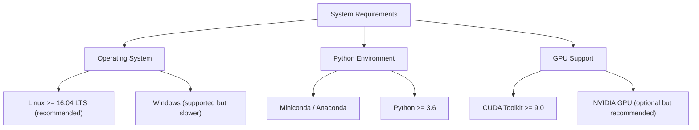
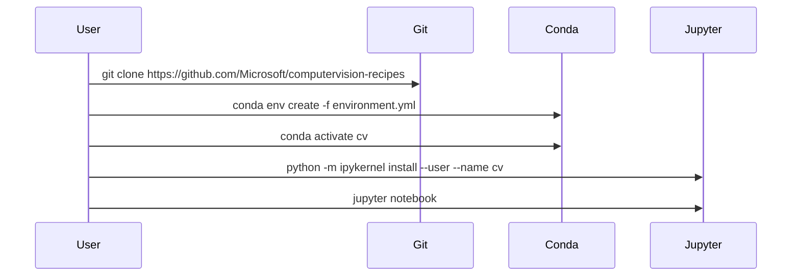
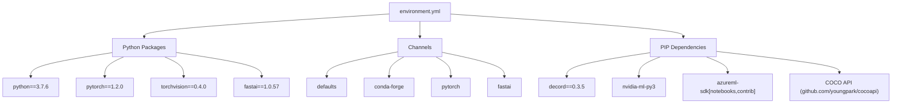
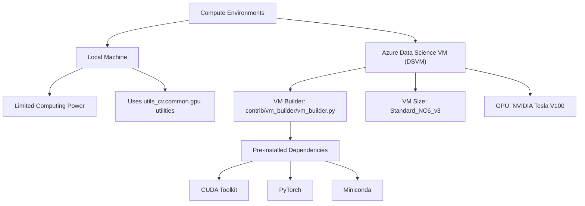
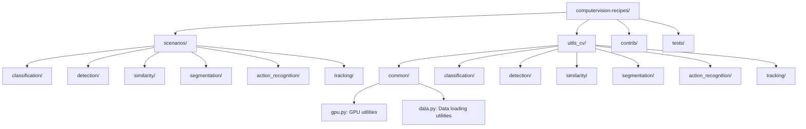
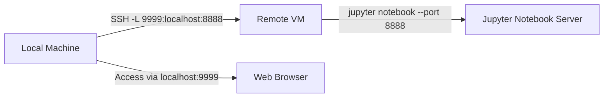

<!-- source: DeepWiki mcp.deepwiki.com · repo microsoft/computervision-recipes · page 4 Setup and Environment · fetched 2026-10-26 -->

# Setup and Environment

<details>
<summary>Relevant source files</summary>

The following files were used as context for generating this wiki page:

- [AUTHORS.md](AUTHORS.md)
- [CONTRIBUTING.md](CONTRIBUTING.md)
- [README.md](README.md)
- [SETUP.md](SETUP.md)
- [environment.yml](environment.yml)
- [scenarios/README.md](scenarios/README.md)
- [scenarios/classification/README.md](scenarios/classification/README.md)
- [scenarios/media/figures.pptx](scenarios/media/figures.pptx)
- [scenarios/media/intro_ic_vis.jpg](scenarios/media/intro_ic_vis.jpg)
- [scenarios/media/intro_is_vis.jpg](scenarios/media/intro_is_vis.jpg)
- [scenarios/media/intro_iseg_vis.jpg](scenarios/media/intro_iseg_vis.jpg)
- [scenarios/media/intro_kp_vis.jpg](scenarios/media/intro_kp_vis.jpg)
- [scenarios/media/intro_od_vis.jpg](scenarios/media/intro_od_vis.jpg)

</details>


This page provides a comprehensive guide to setting up your development environment for the Microsoft Computer Vision Recipes repository. It covers system requirements, environment configuration, installation steps, and compute environment options to help you get started quickly. For information on Azure integration and deployment, please see [Azure Integration](#5).

## System Requirements

Before setting up the repository, ensure your system meets these minimum requirements:



Note that PyTorch runs slower on Windows than on Linux. This is a known [issue](https://github.com/pytorch/pytorch/issues/12831) which affects model training due to parallelized data loading. For compute-heavy training tasks (e.g., Object Detection) on standard GPUs, this difference is typically below 10%. However, for image classification with fast GPUs (e.g., V100) and large images, training on Windows can be multiple times slower than on Linux.

To check if CUDA is properly installed:

```bash
nvcc --version
```

Sources: [SETUP.md:49-69](), [README.md:35-40]()

## Installation Steps

Follow these steps to set up your environment:



1. Clone the repository:
   ```bash
   git clone https://github.com/Microsoft/computervision-recipes
   ```

2. Create the conda environment using the provided environment.yml file:
   ```bash
   cd computervision-recipes
   conda env create -f environment.yml
   ```

3. Activate the environment and register it with Jupyter:
   ```bash
   conda activate cv
   python -m ipykernel install --user --name cv --display-name "Python (cv)"
   ```

4. Start Jupyter notebook:
   ```bash
   jupyter notebook
   ```

5. Navigate to the `scenarios` folder and start exploring the notebooks.

### Alternative Installation with Pip

If you only want to install the `utils_cv` library without creating a new conda environment, you can use pip:

```bash
pip install git+https://github.com/microsoft/ComputerVision.git@master#egg=utils_cv
```

Note that this approach does not download the notebooks and examples.

Sources: [SETUP.md:14-38](), [README.md:37-40]()

## Environment Details

The repository uses a conda environment defined in the `environment.yml` file. This environment includes all the necessary dependencies for running the computer vision notebooks and utilities.



The key components of the environment include:

| Component | Version/Description |
|-----------|---------------------|
| Python | 3.7.6 |
| PyTorch | 1.2.0 |
| torchvision | 0.4.0 |
| fastai | 1.0.57 |
| CUDA | >= 9.0 (required for GPU acceleration) |
| AzureML SDK | For Azure integration and deployment |

To update an existing environment:

```bash
conda env update -f environment.yml
```

Sources: [environment.yml:1-46]()

## Compute Environments

Running computer vision models, especially during training, can be computationally intensive. The repository supports two main compute environment options:



### Local Machine

You can run the repository on your local machine if it has sufficient resources, particularly a modern NVIDIA GPU.

### Azure Data Science Virtual Machine (DSVM)

For better performance, we recommend using the Azure Data Science Virtual Machine. This VM comes pre-installed with all system requirements needed to run the notebooks.

When creating your Azure DSVM:
- Select an Ubuntu VM
- Choose the size `Standard_NC6_v3`, which uses the NVIDIA Tesla V100 GPU
- For users new to Azure, you may need to request a quota increase for GPU VMs

There are several ways to create a DSVM:
1. Through the Azure portal
2. Using the Azure CLI
3. Using the VM Builder tool located at `contrib/vm_builder/vm_builder.py`

Sources: [SETUP.md:71-97](), [README.md:34-40]()

## Repository Structure and Components

Understanding the repository structure helps navigate the codebase efficiently:



The repository is organized into:

| Directory | Purpose |
|-----------|---------|
| `scenarios/` | Jupyter notebooks demonstrating different CV tasks |
| `utils_cv/` | Python utility libraries supporting the scenarios |
| `contrib/` | Community contributions and additional tools |
| `tests/` | Unit and integration tests |

After setting up, we recommend starting with the classification notebooks as they introduce concepts used by other scenarios. Navigate to the `scenarios/classification` folder and open introductory notebooks like `01_training_introduction.ipynb`.

Sources: [README.md:9-14](), [README.md:47-61](), [scenarios/README.md:1-49]()

## Remote Access through Tunneling

If running the repository on a remote VM, you can access Jupyter notebooks from your local machine using SSH tunneling:



The general syntax for SSH tunneling is:

```bash
ssh -L local_port:remote_address:remote_port <username>@<server-ip>
```

For example, to access a Jupyter notebook server running on port 8888 on your VM:

```bash
ssh -L 9999:localhost:8888 <username>@<server-ip>
```

This command allows your local machine to access Jupyter at `localhost:9999`, which forwards to port 8888 on your VM.

Sources: [SETUP.md:100-117]()

## Troubleshooting

If you encounter issues with your setup:

1. Ensure conda is up to date:
   ```bash
   conda update -n base -c defaults conda
   ```

2. Verify CUDA is properly installed:
   ```bash
   nvcc --version
   ```

3. Check if PyTorch can detect your GPU:
   ```python
   import torch
   print(torch.cuda.is_available())
   print(torch.cuda.device_count())
   ```

4. For GPU-related utilities, the repository provides helper functions in `utils_cv/common/gpu.py`:
   ```python
   from utils_cv.common.gpu import torch_device, db_num_workers, which_processor
   
   # Get appropriate device (CUDA or CPU)
   device = torch_device()
   
   # Check what processor is being used
   processor_type = which_processor()
   ```

5. If you've created the conda environment before, try updating it:
   ```bash
   conda env update -f environment.yml
   ```

6. For contributors using pre-commit hooks:
   ```bash
   pip install pre-commit
   pre-commit install
   ```

Sources: [SETUP.md:54-69](), [CONTRIBUTING.md:30-48]()

## Getting Started

After successfully setting up your environment, it's time to start exploring the repository:

1. Begin with the classification notebooks as they introduce fundamental concepts
2. Navigate to `scenarios/classification/01_training_introduction.ipynb`
3. Explore other scenarios based on your interests (object detection, similarity, etc.)

Each scenario folder contains README files with additional details and guidance.

Sources: [README.md:39-40](), [scenarios/classification/README.md:1-53]()

---

