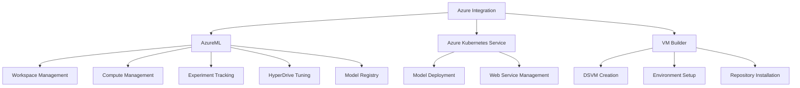
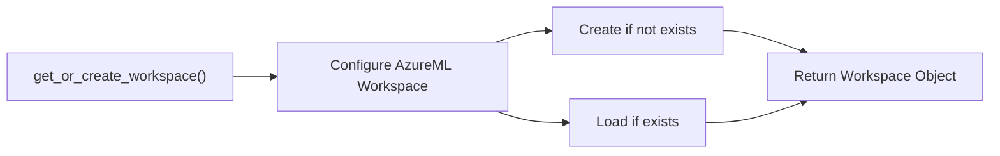
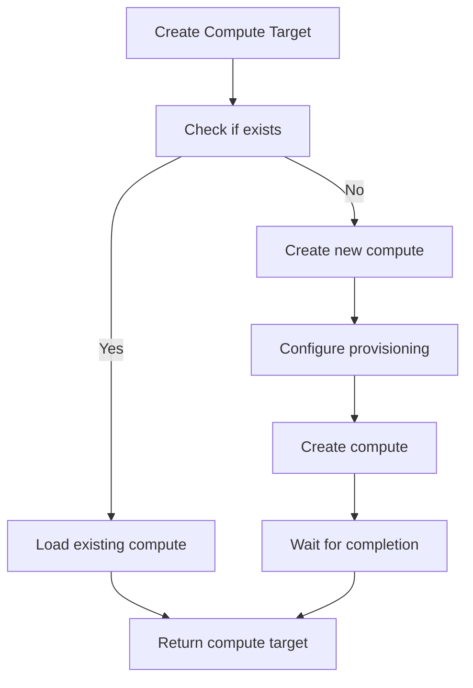
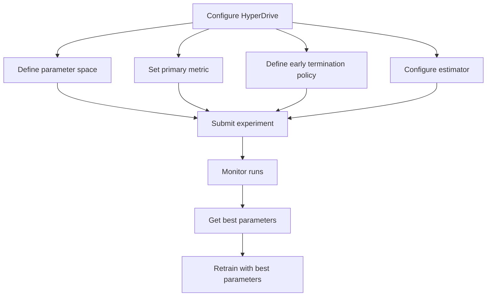
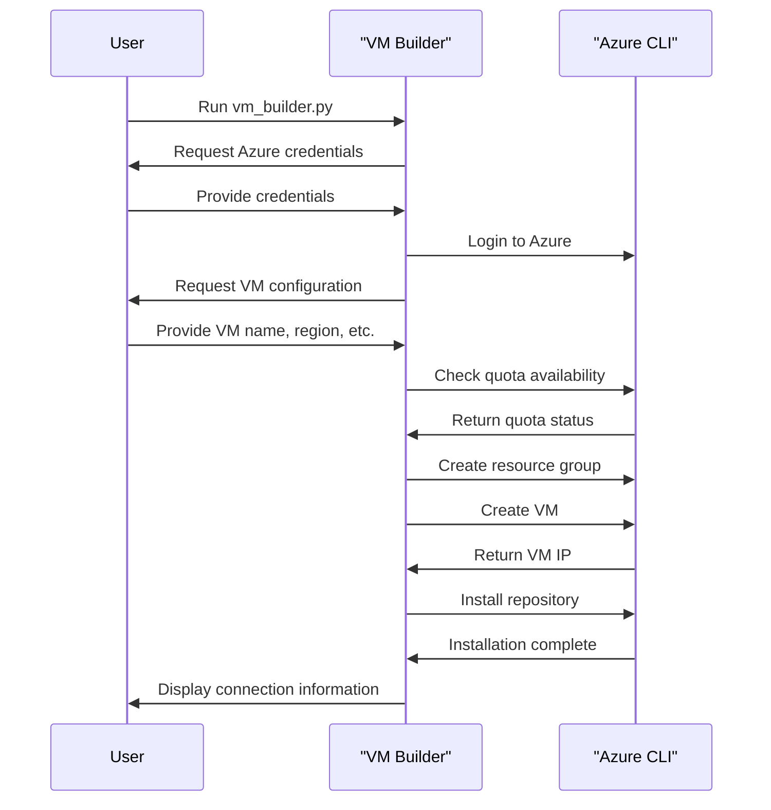
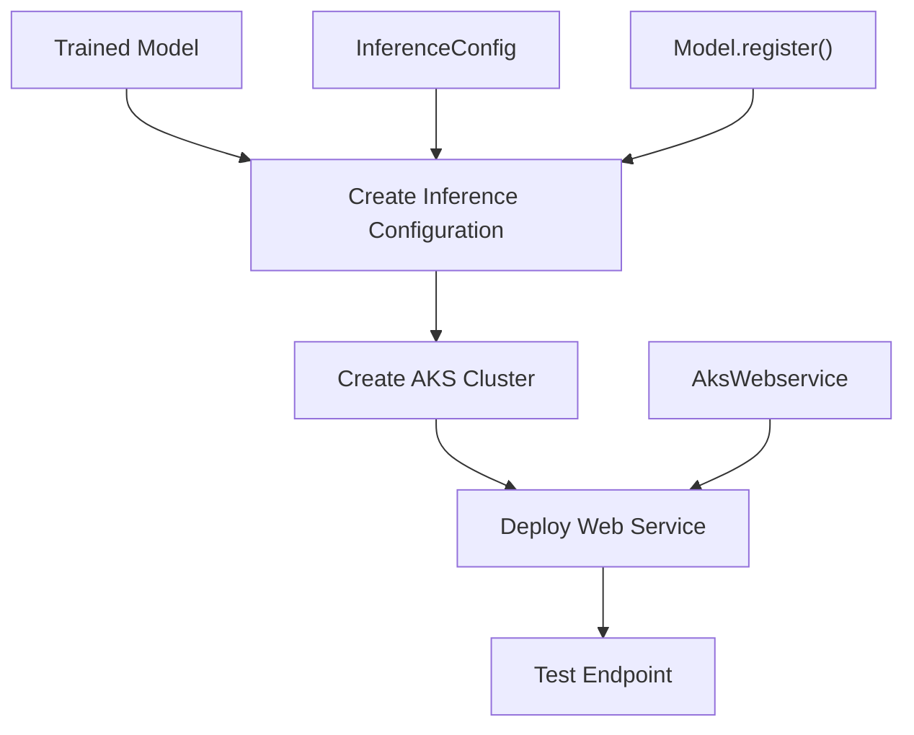
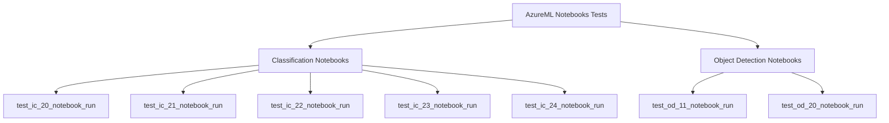

<!-- source: DeepWiki mcp.deepwiki.com · repo microsoft/computervision-recipes · page 5 Azure Integration · fetched 2026-10-26 -->

# Azure Integration

<details>
<summary>Relevant source files</summary>

The following files were used as context for generating this wiki page:

- [.flake8](.flake8)
- [.gitignore](.gitignore)
- [.pre-commit-config.yaml](.pre-commit-config.yaml)
- [contrib/vm_builder/README.md](contrib/vm_builder/README.md)
- [contrib/vm_builder/vm_builder.py](contrib/vm_builder/vm_builder.py)
- [scenarios/detection/11_exploring_hyperparameters_on_azureml.ipynb](scenarios/detection/11_exploring_hyperparameters_on_azureml.ipynb)
- [scenarios/detection/12_hard_negative_sampling.ipynb](scenarios/detection/12_hard_negative_sampling.ipynb)
- [scenarios/detection/20_deployment_on_kubernetes.ipynb](scenarios/detection/20_deployment_on_kubernetes.ipynb)
- [scenarios/detection/media/hyperdrive_cluster.jpg](scenarios/detection/media/hyperdrive_cluster.jpg)
- [tests/smoke/test_azureml_notebooks.py](tests/smoke/test_azureml_notebooks.py)
- [tests/unit/detection/test_detection_mask.py](tests/unit/detection/test_detection_mask.py)

</details>


This page provides an overview of Azure integration capabilities within the Computer Vision Recipes repository. It covers how the repository integrates with various Azure services including AzureML for training and deployment, Azure Kubernetes Service (AKS) for model serving, and Azure Virtual Machines (VMs) for development environments.

For more detailed information on VM setup specifically, see [VM Setup](#5.1). For information about deploying models to Azure services, see [Model Deployment](#5.2).

## Overview

The Computer Vision Recipes repository provides several integration points with Azure to facilitate the development, training, and deployment of computer vision models:



Sources:
- [tests/smoke/test_azureml_notebooks.py:15-190]()
- [scenarios/detection/11_exploring_hyperparameters_on_azureml.ipynb]()
- [scenarios/detection/20_deployment_on_kubernetes.ipynb]()
- [contrib/vm_builder/README.md:1-24]()

## AzureML Integration

AzureML is used for training, hyperparameter optimization, and model deployment. The repository provides utilities to streamline interaction with AzureML services.

### Workspace Configuration

Before using AzureML, you need to set up a workspace. The repository provides helper functions for creating or accessing an AzureML workspace:



The workspace serves as the central point for managing AzureML resources including:
- Compute resources
- Experiments
- Models
- Deployments

Example workspace configuration:

```python
from utils_cv.common.azureml import get_or_create_workspace

ws = get_or_create_workspace(
    subscription_id, 
    resource_group, 
    workspace_name, 
    workspace_region
)
```

Sources:
- [scenarios/detection/11_exploring_hyperparameters_on_azureml.ipynb:150-162]()
- [scenarios/detection/20_deployment_on_kubernetes.ipynb:99-104]()

### Compute Resources

AzureML provides several compute options for training and deployment:

1. **AmlCompute** (formerly Batch AI) - For training workloads
2. **AKS** (Azure Kubernetes Service) - For deployment and serving
3. **Local compute** - For testing and development

Example compute resource creation:



Sources:
- [scenarios/detection/11_exploring_hyperparameters_on_azureml.ipynb:192-213]()
- [scenarios/detection/20_deployment_on_kubernetes.ipynb:52-54]()

### Hyperparameter Tuning with HyperDrive

HyperDrive is AzureML's tool for hyperparameter optimization. It allows efficient parallel exploration of the hyperparameter space:



Key components for HyperDrive configuration:

1. **Parameter sampling**: Defines how to sample from the parameter space
   - Random sampling
   - Grid sampling
   - Bayesian sampling

2. **Primary metric**: The metric to optimize 

3. **Termination policy**: Rules for early termination of underperforming runs

4. **Estimator**: Defines the training script and environment

Example HyperDrive configuration:

```python
hyperdrive_run_config = HyperDriveConfig(
    estimator=est,
    hyperparameter_sampling=param_sampling,
    policy=None,  # No early termination
    primary_metric_name="accuracy",
    primary_metric_goal=PrimaryMetricGoal.MAXIMIZE,
    max_total_runs=None,  # Run all parameter combinations
    max_concurrent_runs=MAX_NODES,
)
```

Sources:
- [scenarios/detection/11_exploring_hyperparameters_on_azureml.ipynb:421-425]()
- [scenarios/detection/11_exploring_hyperparameters_on_azureml.ipynb:476-486]()

## VM Builder

The repository includes a VM Builder tool to help set up an Azure Data Science Virtual Machine (DSVM) with the Computer Vision repository pre-installed.



Key features of the VM Builder:

1. Interactive setup process
2. Option for CPU or GPU VMs
3. Automatic repository installation
4. Jupyter Notebook configuration

To use the VM Builder:

```bash
python vm_builder.py
```

After setup, you can connect to the VM with:

```bash
ssh -L 8899:localhost:8899 <username>@<ip-address>
```

Sources:
- [contrib/vm_builder/README.md:1-24]()
- [contrib/vm_builder/vm_builder.py:9-624]()

## Kubernetes Deployment

The repository provides tools and examples for deploying trained models to Azure Kubernetes Service (AKS). This enables serving models as web services with high scalability and reliability.



Deployment workflow:

1. Register a trained model with AzureML
2. Create an inference configuration with entry script
3. Create or get an AKS cluster
4. Deploy the model as a web service
5. Test the endpoint

Example code structure:

```python
# Register model
model = Model.register(workspace=ws, model_path="model.pt", model_name="my_model")

# Define inference config
inference_config = InferenceConfig(
    entry_script="score.py",
    environment=env
)

# Create or get AKS cluster
aks_target = AksCompute(workspace=ws, name="aks-cluster")

# Deploy model
aks_service = Model.deploy(
    workspace=ws,
    name="my-service",
    models=[model],
    inference_config=inference_config,
    deployment_target=aks_target
)

# Wait for deployment
aks_service.wait_for_deployment(True)
```

Sources:
- [scenarios/detection/20_deployment_on_kubernetes.ipynb:15-188]()

## Testing and Integration with Azure Services

The repository includes automated tests for validating AzureML notebooks:



These tests execute notebooks using `papermill` to validate they run correctly with AzureML:

```python
pm.execute_notebook(
    notebook_path,
    OUTPUT_NOTEBOOK,
    parameters=dict(
        PM_VERSION=pm.__version__,
        subscription_id=subscription_id,
        resource_group=resource_group,
        workspace_name=workspace_name,
        workspace_region=workspace_region,
    ),
    kernel_name=KERNEL_NAME,
)
```

Sources:
- [tests/smoke/test_azureml_notebooks.py:15-190]()

## Cost Management Considerations

When using Azure services, it's important to consider cost implications:

| Resource Type | Cost Considerations | Best Practices |
|---------------|---------------------|----------------|
| AzureML Compute | Charged per hour of active use | Set minimum nodes to 0 to scale down when not in use |
| Azure Kubernetes Service | Charged for underlying VMs | Use appropriate VM size for workload |
| Data Science VM | Charged per hour of uptime | Stop VM when not in use |
| Storage | Charged based on volume and transactions | Clean up unnecessary data |

Sources:
- [scenarios/detection/11_exploring_hyperparameters_on_azureml.ipynb:203-205]()
- [contrib/vm_builder/vm_builder.py:557-562]()

## Summary

The Computer Vision Recipes repository provides comprehensive Azure integration for various phases of the computer vision workflow:

1. **Development and training**:
   - Data Science VMs for development environments
   - AzureML for training and experiment tracking
   - HyperDrive for hyperparameter optimization

2. **Deployment and serving**:
   - Azure Kubernetes Service for scalable model serving
   - AzureML model registry for versioning and management
   - Web service monitoring and management

These integrations enable efficient development and deployment of computer vision models at scale, leveraging Azure's cloud infrastructure for compute-intensive tasks and reliable model serving.

---

