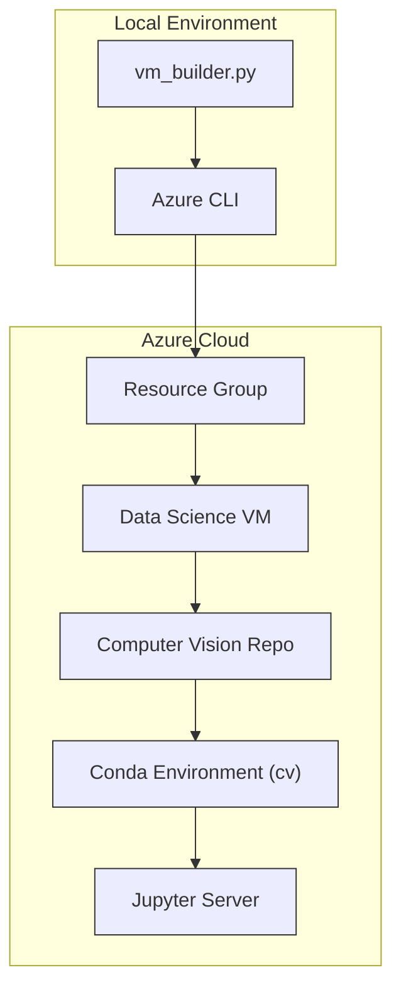
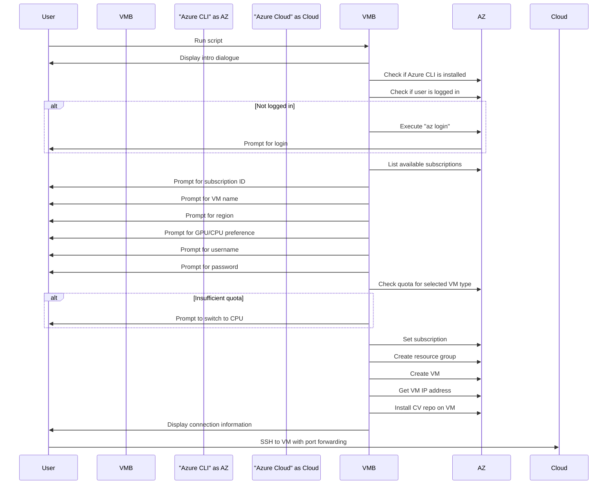
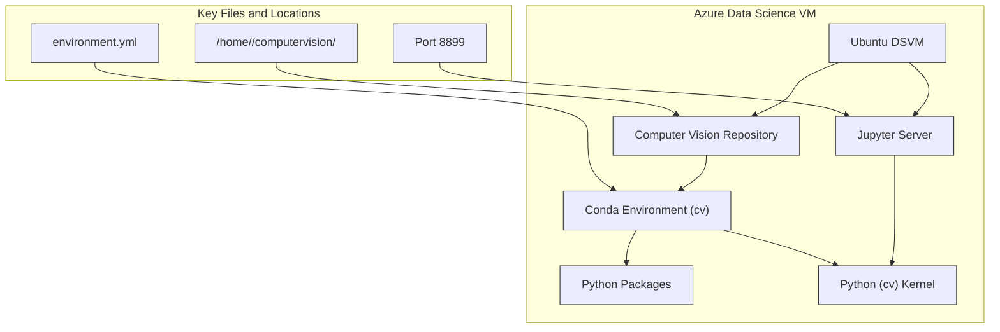

<!-- source: DeepWiki mcp.deepwiki.com · repo microsoft/computervision-recipes · page 5.1 VM Setup · fetched 2026-10-26 -->

# VM Setup

<details>
<summary>Relevant source files</summary>

The following files were used as context for generating this wiki page:

- [.flake8](.flake8)
- [.gitignore](.gitignore)
- [.pre-commit-config.yaml](.pre-commit-config.yaml)
- [contrib/vm_builder/README.md](contrib/vm_builder/README.md)
- [contrib/vm_builder/vm_builder.py](contrib/vm_builder/vm_builder.py)

</details>


## Purpose and Scope

This document details the VM Builder tool provided in the Computer Vision Recipes repository. The tool automates the creation and configuration of an Azure Virtual Machine with the Computer Vision repository pre-installed and ready for use. This streamlines the process of setting up a suitable environment for running computer vision workloads.

For information about deploying models to Azure services after development, see [Model Deployment](#5.2).

Sources: [contrib/vm_builder/README.md:1-24]()

## Overview

The VM Builder is a Python utility that guides users through setting up an Azure Data Science Virtual Machine (DSVM) with the Computer Vision Recipes repository pre-installed. It provides an interactive command-line experience to configure VM specifications, handle authentication, and automate the installation process.



**VM Builder System Architecture**

Sources: [contrib/vm_builder/vm_builder.py:10-17](), [contrib/vm_builder/vm_builder.py:569-624]()

## Requirements

### Platform Support
- The VM Builder tool works only on Linux or macOS systems
- Windows is not currently supported

### Prerequisites
- Azure CLI must be installed on your local machine
- Valid Azure subscription
- Python environment with the `prompt_toolkit` package

Sources: [contrib/vm_builder/README.md:3-3](), [contrib/vm_builder/vm_builder.py:365-376]()

## VM Options

The VM Builder offers two types of virtual machines to accommodate different computational needs:

| VM Type | Size | Family | Cores | GPU | Description |
|---------|------|--------|-------|-----|-------------|
| GPU VM | Standard_NC6s_v3 | NCSv3 | 6 | NVIDIA Tesla V100 | Suitable for deep learning and GPU-accelerated computer vision tasks |
| CPU VM | Standard_DS3_v2 | DSv2 | 4 | None | Cost-effective option for less computationally intensive tasks |

The tool checks your subscription's quota in the selected region to ensure you have sufficient resources available for your chosen VM type.

Sources: [contrib/vm_builder/vm_builder.py:14-17](), [contrib/vm_builder/vm_builder.py:308-322]()

## Setup Process

The VM setup process consists of several sequential steps, as illustrated in the diagram below:



**VM Setup Process Flow**

Sources: [contrib/vm_builder/vm_builder.py:569-624]()

### Running the VM Builder

To start the VM setup process, navigate to the `contrib/vm_builder` directory and run:

```
python vm_builder.py
```

This initiates an interactive session that guides you through the setup process.

Sources: [contrib/vm_builder/README.md:8-11]()

### Interactive Session Details

The VM Builder script prompts you for the following information:

1. **Subscription ID**: Select from your available Azure subscriptions
2. **VM Name**: Provide a name for your virtual machine (alphanumeric characters and hyphens only)
3. **Region**: Specify an Azure region (e.g., 'eastus')
4. **VM Type**: Choose between GPU or CPU VM
5. **Username**: Set an admin username for the VM
6. **Password**: Create a secure password (must meet Azure complexity requirements)

During this process, the script automatically validates your inputs and checks for resource availability.

Sources: [contrib/vm_builder/vm_builder.py:156-296]()

### Password Requirements

The VM password must meet the following requirements:
- Between 12 and 123 characters
- Contain at least one lowercase letter
- Contain at least one uppercase letter
- Contain at least one digit
- Contain at least one special character

Sources: [contrib/vm_builder/vm_builder.py:66-119]()

## Resource Creation and Installation

After collecting the necessary information, the VM Builder performs the following actions:

1. **Resource Group Creation**: Creates a resource group named `{vm_name}-rg` in the specified region
2. **VM Deployment**: Deploys an Ubuntu Data Science VM with specified parameters
3. **Repository Installation**: Executes a script to:
   - Clone the Computer Vision repository from GitHub
   - Create a Conda environment named 'cv' using the repository's environment.yml
   - Configure Jupyter with the 'cv' kernel
   - Start a Jupyter server on port 8899

The entire process takes several minutes to complete, with most of the time spent on VM creation and repository installation.

Sources: [contrib/vm_builder/vm_builder.py:441-526]()

## Accessing and Managing the VM

### Connecting to the VM

After setup completion, you can connect to your VM using SSH with port forwarding:

```
ssh -L 8899:localhost:8899 <username>@<ip-address>
```

This creates a tunnel that forwards your local port 8899 to the VM's port 8899, allowing you to access the Jupyter notebook server by visiting `localhost:8899` in your browser.

Sources: [contrib/vm_builder/vm_builder.py:529-566](), [contrib/vm_builder/README.md:16-22]()

### VM Management

The VM Builder displays management commands after setup completion:

| Action | Command |
|--------|---------|
| Start VM | `az vm start -g <vm_name>-rg -n <vm_name>` |
| Stop VM | `az vm stop -g <vm_name>-rg -n <vm_name>` |
| Delete VM | `az group delete -n <vm_name>-rg` |

**Important:** Remember to stop your VM when not in use to minimize costs. Virtual machines incur charges on your Azure subscription as long as they are running.

Sources: [contrib/vm_builder/vm_builder.py:529-566]()

## VM Configuration Details

The following diagram shows the key components installed on the virtual machine:



**VM Configuration Components**

Sources: [contrib/vm_builder/vm_builder.py:497-527]()

## Troubleshooting

### Common Issues

#### Quota Limitations
If your Azure subscription doesn't have sufficient quota for the selected VM type in the specified region, the VM Builder offers to switch to a CPU VM instead. Alternatively, you can:

1. Choose a different region
2. Request a quota increase through the Azure portal
3. Use a different subscription with higher quota limits

#### Connection Problems
If you cannot connect to the Jupyter server after VM creation:

1. Verify the VM is running using `az vm show -d --resource-group <vm_name>-rg --name <vm_name>`
2. Ensure you're using the correct SSH command with port forwarding
3. Check if port 8899 is already in use on your local machine

Sources: [contrib/vm_builder/vm_builder.py:414-438]()

## Implementation Details

The VM Builder tool uses several key components of the Azure CLI to automate the VM setup process:

1. **Authentication**: `az login` for Azure authentication
2. **Subscription Management**: `az account set -s <subscription_id>` to select the subscription
3. **Resource Management**: `az group create` and `az vm create` to provision resources
4. **VM Command Execution**: `az vm run-command invoke` to run setup scripts on the VM

The tool validates user inputs, checks resource availability, and provides feedback throughout the process to ensure a successful setup.

Sources: [contrib/vm_builder/vm_builder.py:20-42]()

---

