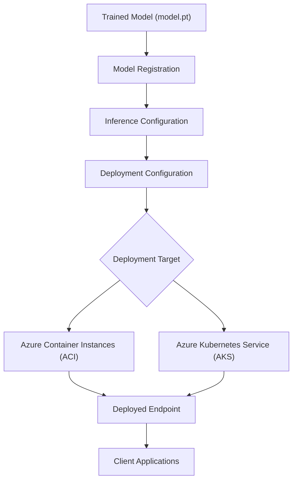
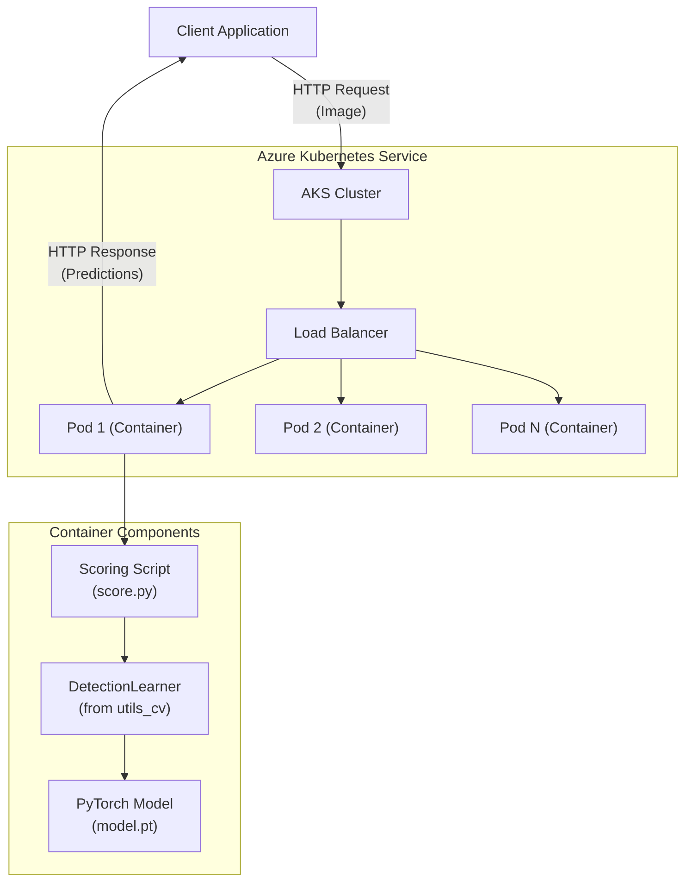
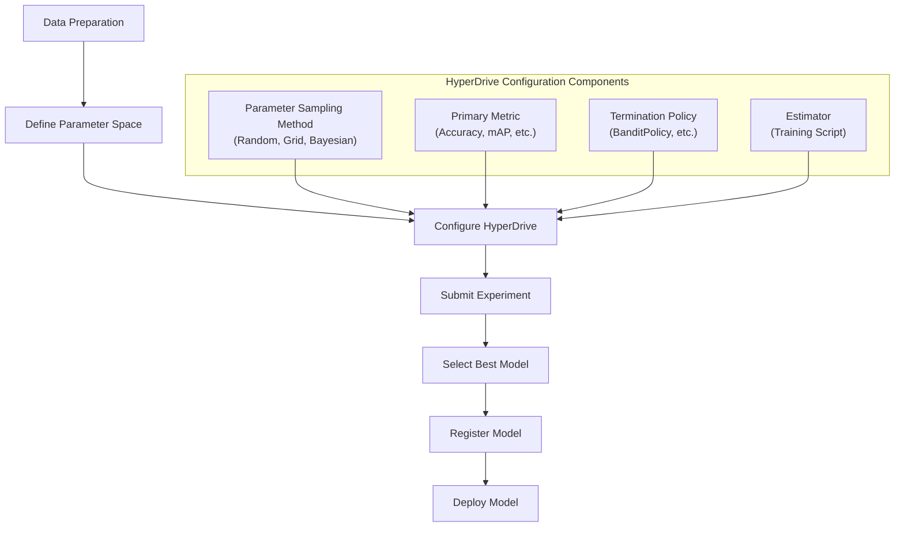

<!-- source: DeepWiki mcp.deepwiki.com · repo microsoft/computervision-recipes · page 5.2 Model Deployment · fetched 2026-10-26 -->

# Model Deployment

<details>
<summary>Relevant source files</summary>

The following files were used as context for generating this wiki page:

- [scenarios/detection/11_exploring_hyperparameters_on_azureml.ipynb](scenarios/detection/11_exploring_hyperparameters_on_azureml.ipynb)
- [scenarios/detection/12_hard_negative_sampling.ipynb](scenarios/detection/12_hard_negative_sampling.ipynb)
- [scenarios/detection/20_deployment_on_kubernetes.ipynb](scenarios/detection/20_deployment_on_kubernetes.ipynb)
- [scenarios/detection/media/hyperdrive_cluster.jpg](scenarios/detection/media/hyperdrive_cluster.jpg)
- [tests/__init__.py](tests/__init__.py)
- [tests/smoke/test_azureml_notebooks.py](tests/smoke/test_azureml_notebooks.py)
- [tests/unit/detection/test_detection_mask.py](tests/unit/detection/test_detection_mask.py)

</details>


This page provides a comprehensive guide to deploying computer vision models trained with the Computer Vision Recipes library to production environments. This document focuses on the process of taking a trained model and deploying it as a service that can be consumed by applications. For information about model training and evaluation, see [Core Scenarios](#2) or [Parameter Sweeping](#3.2).

## Introduction to Model Deployment

Model deployment is the process of integrating machine learning models into production environments where they can generate predictions in real-time or batch processes. For computer vision models, deployment usually involves exposing the model as an API endpoint that can accept images as input and return predictions.

The Computer Vision Recipes repository supports two primary deployment options:
1. Azure Container Instances (ACI) - for development, testing, and low-throughput scenarios
2. Azure Kubernetes Service (AKS) - for production workloads requiring scalability and reliability

### Deployment Workflow



Sources: [scenarios/detection/20_deployment_on_kubernetes.ipynb]()

## Prerequisites

Before deploying a model, you need:

1. A trained model saved in the appropriate format
2. An Azure subscription
3. An Azure ML workspace
4. Azure CLI with ML extension (for certain deployment options)

```python
# Example configuration parameters
subscription_id = "YOUR_SUBSCRIPTION_ID"
resource_group = "YOUR_RESOURCE_GROUP_NAME"  
workspace_name = "YOUR_WORKSPACE_NAME"  
workspace_region = "YOUR_WORKSPACE_REGION"
```

Sources: [scenarios/detection/20_deployment_on_kubernetes.ipynb:91-104]()

## Preparing a Model for Deployment

### Model Loading and Verification

Before deployment, it's important to verify that your saved model can be properly loaded and used for inference locally. This helps identify any issues before the deployment process.

```python
# Load a saved model locally
detector = DetectionLearner.from_saved_model(
    name="my_drink_detector", 
    path=data_path()/"odFridgeObjects"/"models"
)

# Test inference on a sample image
rand_im_path = Path(data_path()/"odFridgeObjects"/"images"/"1.jpg")
rand_im = Image.open(rand_im_path)
detections = detector.predict(rand_im, threshold=0.5)
```

Sources: [scenarios/detection/20_deployment_on_kubernetes.ipynb:124-201]()

### Model Files

When saving a model for deployment, the library creates two essential files:
- `model.pt` - Contains the model weights and architecture
- `meta.json` - Contains metadata about the model, including class labels

These files are packaged together during the deployment process.

## Deployment Architecture

The following diagram illustrates the architecture of a model deployed to Azure Kubernetes Service:



Sources: [scenarios/detection/20_deployment_on_kubernetes.ipynb]()

## Azure Workspace Setup

Before deployment, you need to set up an Azure ML workspace:

```python
ws = get_or_create_workspace(
    subscription_id, resource_group, workspace_name, workspace_region
)
```

This workspace serves as a central place for managing all ML assets including models, deployments, and compute resources.

Sources: [scenarios/detection/11_exploring_hyperparameters_on_azureml.ipynb:149-162]()

## Deployment to Azure Kubernetes Service

### Creating an AKS Cluster

```python
# Create an AKS compute target
aks_target = ComputeTarget.create(
    workspace=ws,
    name=KUBERNETES_CLUSTER_NAME,
    provisioning_configuration=AksCompute.provisioning_configuration(
        vm_size=VM_SIZE,
        agent_count=NODES
    )
)

aks_target.wait_for_completion(show_output=True)
```

The AKS cluster serves as the compute target where your model will be deployed and run.

Sources: [scenarios/detection/20_deployment_on_kubernetes.ipynb](), [scenarios/detection/11_exploring_hyperparameters_on_azureml.ipynb:192-213]()

### Creating a Scoring Script

A scoring script (`score.py`) is required to define how input is processed and how the model generates predictions. This script will:

1. Initialize the model when the container starts
2. Define an entry point for receiving HTTP requests
3. Process incoming images and return predictions

```python
# Sample structure of a scoring script
def init():
    # Load the model
    global detector
    detector = DetectionLearner.from_saved_model(name="model", path=".")

def run(input_data):
    # Process input and make prediction
    img = Image.open(io.BytesIO(base64.b64decode(input_data)))
    results = detector.predict(img)
    return json.dumps(results)
```

Sources: [scenarios/detection/20_deployment_on_kubernetes.ipynb]()

### Model Registration and Deployment

```python
# Register the model in Azure ML
model = Model.register(
    model_path="./model_folder",
    model_name=MODEL_NAME,
    description="Object detection model",
    workspace=ws
)

# Define inference configuration
inference_config = InferenceConfig(
    entry_script="score.py",
    source_directory="./deployment",
    conda_file="env.yml"
)

# Define deployment configuration
deployment_config = AksWebservice.deploy_configuration(
    cpu_cores=1,
    memory_gb=1,
    auth_enabled=True,
    enable_app_insights=True
)

# Deploy the model
service = Model.deploy(
    workspace=ws,
    name=DEPLOYMENT_SERVICE_NAME,
    models=[model],
    inference_config=inference_config,
    deployment_config=deployment_config,
    deployment_target=aks_target
)

service.wait_for_deployment(show_output=True)
```

The deployment process may take several minutes to complete. Once deployed, Azure ML provides an endpoint URL that can be used to make requests to your model.

Sources: [scenarios/detection/20_deployment_on_kubernetes.ipynb]()

## Model Optimization Options

Before deployment, you can optimize your model's performance using tools like AzureML HyperDrive.



Sources: [scenarios/detection/11_exploring_hyperparameters_on_azureml.ipynb:384-485]()

### HyperDrive for Parameter Tuning

HyperDrive allows you to automatically tune hyperparameters before deployment:

```python
param_sampling = GridParameterSampling(
    {"--learning_rate": choice(LEARNING_RATES), "--max_size": choice(IM_MAX_SIZES)}
)

hyperdrive_run_config = HyperDriveConfig(
    estimator=est,
    hyperparameter_sampling=param_sampling,
    policy=None,
    primary_metric_name="accuracy",
    primary_metric_goal=PrimaryMetricGoal.MAXIMIZE,
    max_total_runs=None,
    max_concurrent_runs=MAX_NODES,
)

hyperdrive_run = exp.submit(config=hyperdrive_run_config)
```

The best model from HyperDrive experiments can be registered and deployed as described above.

Sources: [scenarios/detection/11_exploring_hyperparameters_on_azureml.ipynb:421-498]()

## Testing the Deployed Model

Once deployed, you can test your model by sending requests to the endpoint:

```python
# Get the scoring URI and primary key
scoring_uri = service.scoring_uri
primary_key = service.get_keys()[0]

# Prepare an image for scoring
image_data = base64.b64encode(open("test_image.jpg", "rb").read()).decode()

# Create request headers
headers = {
    'Content-Type': 'application/json',
    'Authorization': f'Bearer {primary_key}'
}

# Send the request
response = requests.post(scoring_uri, json=image_data, headers=headers)
predictions = json.loads(response.text)
```

Sources: [scenarios/detection/20_deployment_on_kubernetes.ipynb]()

## Monitoring and Management

After deployment, you can monitor the performance and usage of your model through:

1. Azure Application Insights - for telemetry data
2. Azure ML Studio - for endpoint management
3. Azure Portal - for overall resource monitoring

### Key Metrics to Monitor

- Latency (response time)
- Throughput (requests per second)
- CPU and memory utilization
- Error rates

## Cost Management

AKS deployments incur costs even when not handling requests. Consider using:

1. Azure Container Instances for development/testing
2. AKS node scaling for production
3. Shutting down or deleting resources when not in use

## Best Practices

1. **Versioning**: Maintain version control of your models and deployment scripts
2. **A/B Testing**: Deploy multiple model versions to evaluate performance
3. **Monitoring**: Set up alerts for performance degradation or errors
4. **Security**: Enable authentication and use secure networking
5. **CI/CD**: Automate deployment workflow with CI/CD pipelines
6. **Documentation**: Document the deployment process and API specifications

Sources: [scenarios/detection/20_deployment_on_kubernetes.ipynb](), [scenarios/detection/11_exploring_hyperparameters_on_azureml.ipynb]()

---

