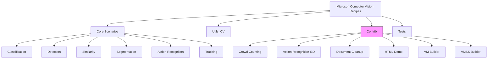
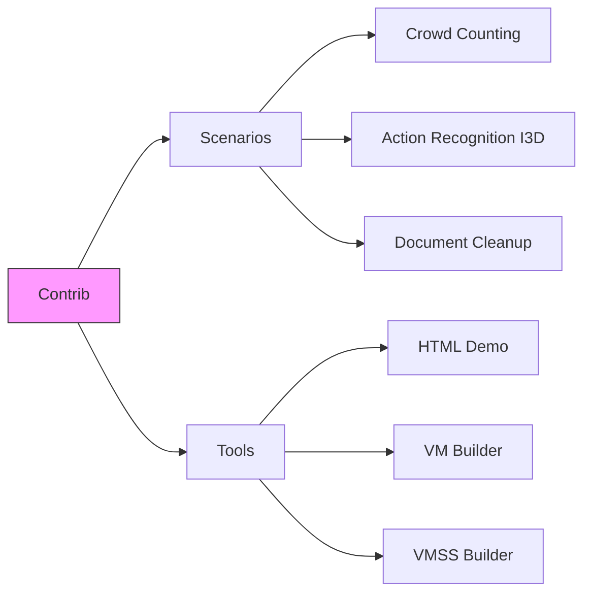
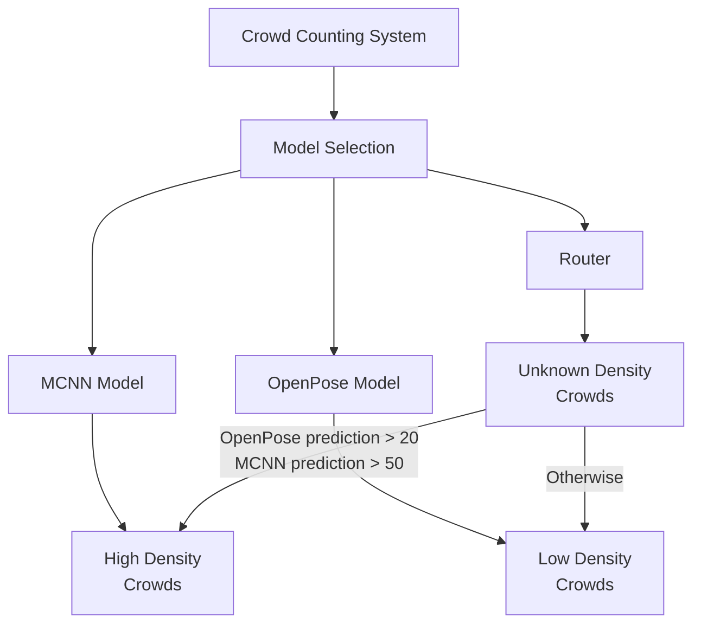
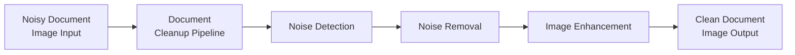
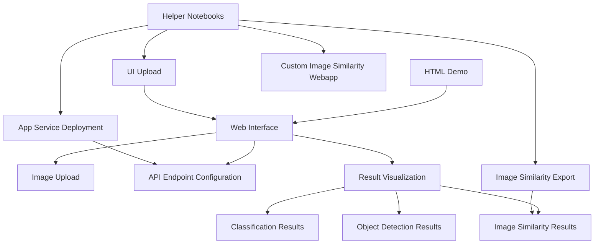
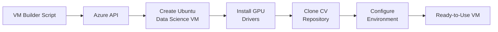
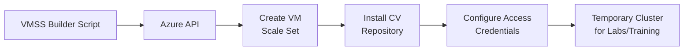

<!-- source: DeepWiki mcp.deepwiki.com · repo microsoft/computervision-recipes · page 6 Contrib Projects · fetched 2026-10-26 -->

# Contrib Projects

<details>
<summary>Relevant source files</summary>

The following files were used as context for generating this wiki page:

- [contrib/README.md](contrib/README.md)
- [contrib/action_recognition/README.md](contrib/action_recognition/README.md)
- [contrib/action_recognition/media/action_recognition.gif](contrib/action_recognition/media/action_recognition.gif)
- [contrib/crowd_counting/README.md](contrib/crowd_counting/README.md)
- [contrib/crowd_counting/crowdcounting/examples/tutorial.ipynb](contrib/crowd_counting/crowdcounting/examples/tutorial.ipynb)
- [contrib/html_demo/JupyterCode/1_image_similarity_export.ipynb](contrib/html_demo/JupyterCode/1_image_similarity_export.ipynb)
- [contrib/html_demo/JupyterCode/readme.md](contrib/html_demo/JupyterCode/readme.md)
- [scenarios/classification/FAQ.md](scenarios/classification/FAQ.md)
- [scenarios/similarity/12_fast_retrieval.ipynb](scenarios/similarity/12_fast_retrieval.ipynb)

</details>


The Contrib directory contains code which is not part of the main Computer Vision repository but is deemed to be of interest and aligned with the repository's goals. These contributions are not subject to the same strict coding guidelines as the main repository, and they are not tested via the devops pipeline. As such, they might be experimental, buggy, or not regularly maintained, but they provide additional functionality and examples that complement the main repository.

This page summarizes the various projects available in the Contrib section, their purposes, and how they can be used.

## Relationship to Main Repository

The Contrib section serves as an extension to the main repository, providing additional scenarios and tools that users might find useful. Unlike the core scenarios and utilities, which are production-ready and thoroughly tested, the Contrib projects offer experimental or specialized functionality.



*Relationship of Contrib to the Main Repository*

Sources: [contrib/README.md:1-22]()

## Projects Overview

The Contrib directory contains two types of projects:

1. **Scenarios**: Computer vision application examples that solve specific problems
2. **Tools**: Utilities to help with development, deployment, or visualization



*Organization of the Contrib Directory*

Sources: [contrib/README.md:8-21]()

## Scenarios

### Crowd Counting

The Crowd Counting project provides production-ready versions of crowd counting algorithms, unified under a set of consistent APIs. It addresses the challenge of counting people in both low-density (fewer than 10 people) and high-density (thousands of people) scenarios.



*Crowd Counting Decision Flow*

Key features:
- Support for both high-density and low-density scenarios
- Two model options:
  - Multi Column CNN (MCNN) for high-density crowds
  - OpenPose for low-density crowds
  - Router approach that combines both models based on density thresholds
- Fast inference for near real-time reporting

Sample usage:
```python
from crowdcounting import CrowdCountModelPose, CrowdCountModelMCNN, Router

# Use OpenPose model for low density crowds
model = CrowdCountModelPose(gpu_id)

# Use MCNN model for high density crowds
# model = CrowdCountModelMCNN(gpu_id, model_path=mcnn_model_path)

# Use Router that combines both models
# model = Router(gpu_id, mcnn_model_path=mcnn_model_path, cutoff_pose=20, cutoff_mcnn=50)

with open(img, 'rb') as image:
    b = image.read()
    result = model.score(b, return_image=True, img_dim=1750)
```

Performance results:

| Crowd Density | MCNN | OpenPose | Router |
|---------------|------|----------|--------|
| Low | 51.95 | 0.56 | 0.63 |
| High | 151.11 | 442.15 | 195.93 |

Sources: [contrib/crowd_counting/README.md:1-67](), [contrib/crowd_counting/crowdcounting/examples/tutorial.ipynb:1-127]()

### Action Recognition with I3D

This project contains resources for building video-based action recognition systems that can identify actions performed in video or webcam footage (e.g., "running", "opening a bottle") and their respective start/end times.

The implementation uses the I3D (Inflated 3D ConvNet) approach, which is a state-of-the-art method for action recognition. The project includes example notebooks for scoring webcam footage or fine-tuning on datasets like HMDB-51.


*Action Recognition I3D Pipeline*

Key features:
- State-of-the-art I3D implementation
- Scripts for fine-tuning on the HMDB-51 dataset
- Comparable performance to results reported in papers
- Ability to process webcam footage or video files

Performance comparison:

| Model | Reported in paper | Results in this implementation |
|-------|-------------------|--------------------------------|
| I3D RGB | 74.8% | 73.7% |
| I3D Optical flow | 77.1% | 77.5% |
| I3D Two-Stream | 80.7% | 81.2% |

**Note**: For production use cases, it's recommended to use the R(2+1)D model available under the main [Action Recognition](#2.6) scenario due to its competitive accuracy, faster inference speed, and fewer dependencies.

Sources: [contrib/action_recognition/README.md:1-27]()

### Document Image Cleanup

This project addresses the challenge of improving the readability and visibility of noisy document images. Given an input document with visual noise elements, it aims to clean up the image to enhance readability.



*Document Image Cleanup Pipeline*

Sources: [contrib/README.md:13]()

## Tools

### HTML Demo

The HTML Demo provides a web-based interface for visualizing the output of deployed computer vision DNN models. This tool helps users improve and gain insights from their models by uploading query/test images and examining the results.



*HTML Demo Architecture*

Key components:
1. **Web Interface**: HTML/CSS/JavaScript files for the user interface
2. **Helper Notebooks**:
   - `1_image_similarity_export.ipynb`: Exports computed reference image features
   - `2_upload_ui.ipynb`: Uploads web page files to Azure Blob storage
   - `3_deployment_to_azure_app_service.ipynb`: Deploys models as Azure app services
   - `4_train_and_deploy_custom_image_similarity_webapp.ipynb`: Fine-tunes and deploys a custom image similarity webapp

The HTML Demo supports visualizing results for three types of models:
- Image classification
- Object detection
- Image similarity

For image similarity, the system uses a multi-step approach:
1. Compute DNN features for reference images using a pre-trained model
2. Export these features to compressed files
3. Upload the features and UI files to Azure Blob storage
4. Deploy a model to compute features for query images
5. Compare query image features with reference features to find similarities

Sample workflow for image similarity:
```
1. Execute notebook to generate reference image features
2. Upload HTML UI and supporting files to Azure Blob storage
3. Deploy model for generating query image features
4. Open the index.html from Blob storage in a browser
5. Enter API endpoint URL and upload a query image
```

Sources: [contrib/html_demo/JupyterCode/readme.md:1-44](), [contrib/html_demo/JupyterCode/1_image_similarity_export.ipynb:1-366]()

### VM Builder

The VM Builder is a script that helps users create a single Ubuntu Data Science Virtual Machine with a GPU and the Computer Vision recipes repository pre-installed and ready to use. This tool simplifies the setup process for users who want to experiment with the recipes without configuring their own environment.



*VM Builder Process Flow*

If the script becomes outdated, users can alternatively create the VM using the Azure portal or Azure CLI tool with a few additional steps.

Sources: [contrib/README.md:19-20]()

### VMSS Builder

The VMSS (Virtual Machine Scale Set) Builder script helps set up a cluster of virtual machines with the Computer Vision recipes repository pre-installed using Azure Virtual Machine Scale Sets. This tool is designed for temporary cluster deployments, such as hands-on lab sessions when multiple VM environments are needed for a short period.



*VMSS Builder Process Flow*

Key features:
- Creates a temporary cluster of VMs with consistent setup
- Pre-installs the Computer Vision repository
- Provides username/password/IP for accessing the cluster
- Designed to be spun up and torn down for short-term use

Sources: [contrib/README.md:21]()

## How to Contribute

Each project in the Contrib directory lives in its own subdirectory (`/contrib/<project>`) and contains a README.md file with detailed description of what the project does and how to use it.

If you want to add a new project to the Contrib section:
1. Create a subdirectory for your project
2. Include a comprehensive README.md
3. Add a brief description to the table in the main Contrib README.md

Note that contributions to this section don't need to follow the strict coding guidelines of the main repository, but they should be aligned with the goals of the Computer Vision repository.

Sources: [contrib/README.md:3-7]()

---

