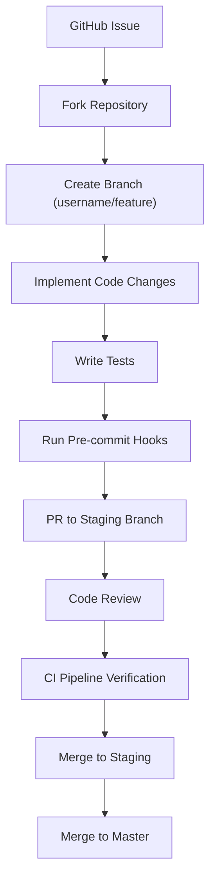
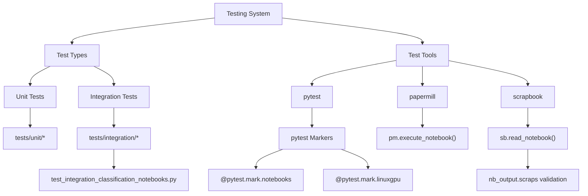
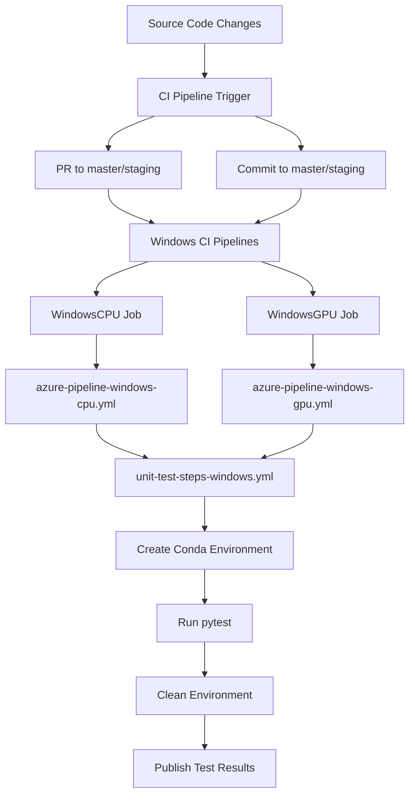

<!-- source: DeepWiki mcp.deepwiki.com · repo microsoft/computervision-recipes · page 7 Development and Testing · fetched 2026-10-26 -->

# Development and Testing

<details>
<summary>Relevant source files</summary>

The following files were used as context for generating this wiki page:

- [AUTHORS.md](AUTHORS.md)
- [CONTRIBUTING.md](CONTRIBUTING.md)
- [SETUP.md](SETUP.md)
- [tests/.ci/azure-pipeline-windows-cpu.yml](tests/.ci/azure-pipeline-windows-cpu.yml)
- [tests/.ci/azure-pipeline-windows-gpu.yml](tests/.ci/azure-pipeline-windows-gpu.yml)
- [tests/.ci/templates/unit-test-steps-windows.yml](tests/.ci/templates/unit-test-steps-windows.yml)
- [tests/integration/classification/test_integration_classification_notebooks.py](tests/integration/classification/test_integration_classification_notebooks.py)

</details>


This document provides comprehensive guidance on the development workflow, testing framework, and CI/CD pipeline for the Microsoft Computer Vision Recipes repository. It is intended for developers who want to contribute to the repository or understand how the codebase is tested and maintained.

For information about setting up your environment, see [Setup and Environment](#4).

## Development Workflow

The diagram below illustrates the standard development workflow for contributing to the repository:



Sources: [CONTRIBUTING.md:21-53]()

### Contribution Process

1. **Identify or Create an Issue**: Use [open issues](https://github.com/Microsoft/ComputerVision/issues) to discuss proposed changes.
2. **Fork the Repository**: Create your own fork to make and test local changes.
3. **Create a Feature Branch**: Name your branch with your username and a descriptive title (e.g., `username/update_feature`).
4. **Implement Code Changes**: Make your changes following the coding guidelines.
5. **Write Tests**: Create tests to verify your changes work as expected.
6. **Run Pre-commit Hooks**: Ensure code formatting and linting standards are met.
7. **Submit PR to Staging**: Create a pull request against the staging branch.
8. **Code Review**: Address feedback from reviewers.
9. **CI Pipeline Verification**: Ensure all tests pass in the CI pipeline.
10. **Merge**: After approval, changes are merged to staging and eventually to master.

Sources: [CONTRIBUTING.md:21-53]()

### Coding Guidelines

The repository follows these coding guidelines:

1. **Google Docstring Format**: All functions and classes should use Google-style docstrings:

   ```python
   def function(param1, param2):
       """
       Function description.

       Args:
           param1: Description of param1
           param2: Description of param2

       Returns:
           Description of return value
       """
   ```

2. **Variable Naming Conventions**: Follow the fast.ai abbreviation guide:

   | Abbreviation | Description |
   | ------------ | ----------- |
   | `im` | Image |
   | `fig` | Figure |
   | `pt` | 2D point (column,row) |
   | `rect` | Rectangle (left, top, right, bottom) |
   | `width`, `height`, `w`, `h` | Image dimensions |
   | `scale` | Image up/down scaling factor |
   | `angle` | Rotation angle in degree |
   | `table` | 2D row/column matrix |
   | `row`, `list1D` | Single row in a table |
   | `line`, `string` | Single string |
   | `lines`, `strings` | List of strings |
   | `-s` | Plural (append to abbreviation) |

3. **Code Style**: The repository uses `black` formatter and `flake8` linter to enforce code style.

Sources: [CONTRIBUTING.md:66-108]()

### Pre-commit Setup

Pre-commit hooks automatically run black formatter and flake8 linting on each commit:

1. Install pre-commit:
   ```
   pip install pre-commit
   ```

2. Set up pre-commit in the repository:
   ```
   pre-commit install
   ```

3. When you commit, pre-commit will run automatically. If issues are found, fix them and stage the changes again.

4. Run pre-commit manually on all files:
   ```
   pre-commit run --all-files
   ```

Sources: [CONTRIBUTING.md:30-48]()

### Working with Notebooks

When working with Jupyter notebooks, you may encounter merge conflicts. The tool `nbdime` can help resolve these conflicts:

1. Install nbdime:
   ```
   pip install ndime
   ```

2. Compare notebooks:
   ```
   nbdiff notebook_1.ipynb notebook_2.ipynb
   ```

Sources: [CONTRIBUTING.md:54-64]()

## Testing Framework

The diagram below shows the structure and tools used for testing in the Computer Vision Recipes repository:



Sources: [tests/integration/classification/test_integration_classification_notebooks.py:1-107]()

### Test Categories

1. **Unit Tests**: Test individual functions and classes
   - Located in `tests/unit/`

2. **Integration Tests**: Test interactions between components, often using notebooks
   - Located in `tests/integration/`
   - Example: `tests/integration/classification/test_integration_classification_notebooks.py`

### Test Markers

Tests use pytest markers to categorize and selectively run tests:

1. `@pytest.mark.notebooks`: Marks tests for notebooks
2. `@pytest.mark.linuxgpu`: Marks tests that require Linux with GPU

Sources: [tests/integration/classification/test_integration_classification_notebooks.py:13-14]()

### Notebook Testing

Notebooks are tested using two main tools:

1. **papermill**: Executes notebooks with parameters
   ```python
   pm.execute_notebook(
       notebook_path,
       OUTPUT_NOTEBOOK,
       parameters=dict(PM_VERSION=pm.__version__),
       kernel_name=KERNEL_NAME,
   )
   ```

2. **scrapbook**: Validates notebook outputs
   ```python
   nb_output = sb.read_notebook(OUTPUT_NOTEBOOK)
   assert nb_output.scraps["validation_accuracy"].data > 0.70
   ```

Example test from `test_integration_classification_notebooks.py`:
The test executes a notebook and then validates that the training and validation accuracies meet certain thresholds.

Sources: [tests/integration/classification/test_integration_classification_notebooks.py:15-26]()

### Running Tests

To run tests locally:

```
pytest --durations 100 tests -m "not azuremlnotebooks and not linuxgpu"
```

This runs all tests except those marked as requiring Azure ML notebooks or Linux GPU.

Sources: [tests/.ci/templates/unit-test-steps-windows.yml:21-23]()

## CI/CD Pipeline

The following diagram illustrates how the CI/CD pipeline is structured:



Sources: [tests/.ci/azure-pipeline-windows-cpu.yml:1-26](), [tests/.ci/azure-pipeline-windows-gpu.yml:1-26](), [tests/.ci/templates/unit-test-steps-windows.yml:1-57]()

### Pipeline Triggers

The CI pipeline is triggered by:
- Pull requests to `master` and `staging` branches
- Commits to `master` and `staging` branches

Sources: [tests/.ci/azure-pipeline-windows-cpu.yml:4-12](), [tests/.ci/azure-pipeline-windows-gpu.yml:4-12]()

### Pipeline Jobs

1. **Windows CPU Job**:
   - Defined in `tests/.ci/azure-pipeline-windows-cpu.yml`
   - Runs unit tests on Windows without GPU

2. **Windows GPU Job**:
   - Defined in `tests/.ci/azure-pipeline-windows-gpu.yml`
   - Runs unit and GPU-specific tests on Windows with GPU

Sources: [tests/.ci/azure-pipeline-windows-cpu.yml:14-17](), [tests/.ci/azure-pipeline-windows-gpu.yml:14-17]()

### Test Steps

The test steps are defined in `tests/.ci/templates/unit-test-steps-windows.yml`:

1. Set up the conda environment:
   ```
   conda env create -f environment.yml
   ```

2. Run pytest with specific markers excluded:
   ```
   pytest --durations 100 tests --junitxml=junit/test-unitttest.xml -m "not azuremlnotebooks and not linuxgpu"
   ```

3. Clean up the conda environment:
   ```
   conda remove -n cv --all -q --force -y
   ```

4. Publish test results using the `PublishTestResults@2` task.

Sources: [tests/.ci/templates/unit-test-steps-windows.yml:1-57]()

## Code of Conduct and Review Guidelines

The project has adopted the Microsoft Open Source Code of Conduct. Additionally, the following guidelines should be followed during code review:

1. **Be constructive**: Focus on the code, not the person. For example, say "This method is missing docstrings" instead of "YOU forgot to put docstrings".

2. **Provide evidence-based feedback**: Support suggestions with documentation or standards. For example, refer to scikit-learn or tensorflow implementations when suggesting changes.

3. **Ask questions instead of giving answers**: Use phrases like "Would it make more sense if...?" or "Have you considered this...?"

Sources: [CONTRIBUTING.md:110-126]()