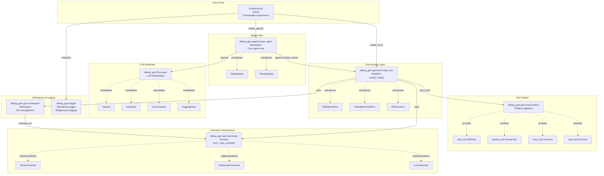
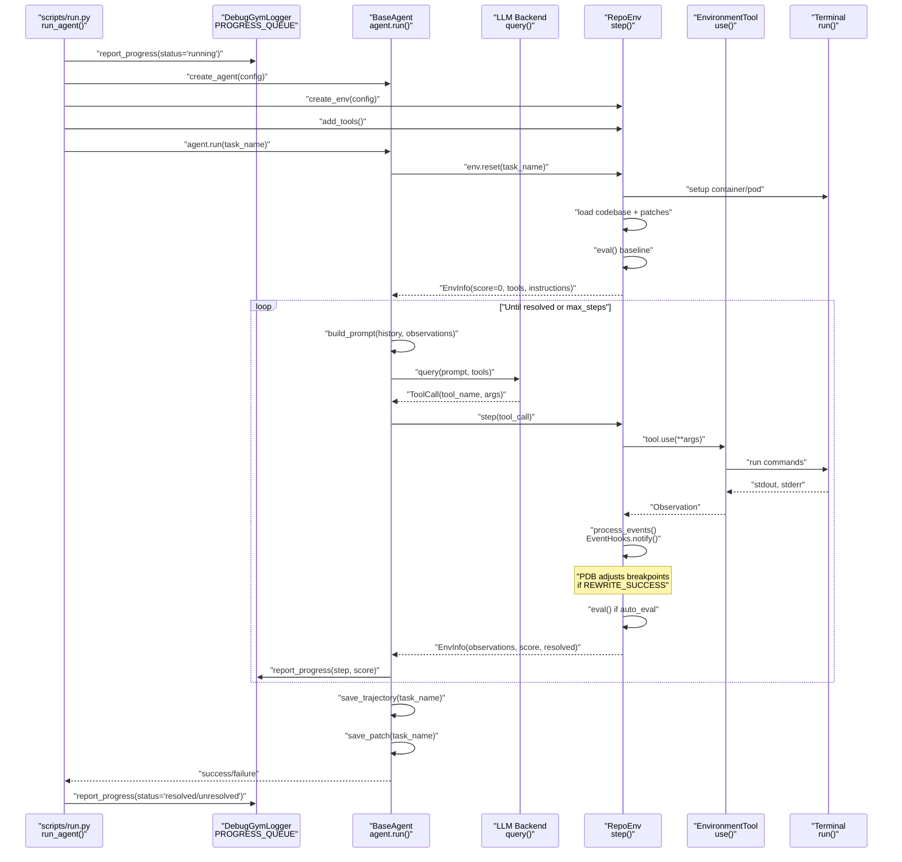
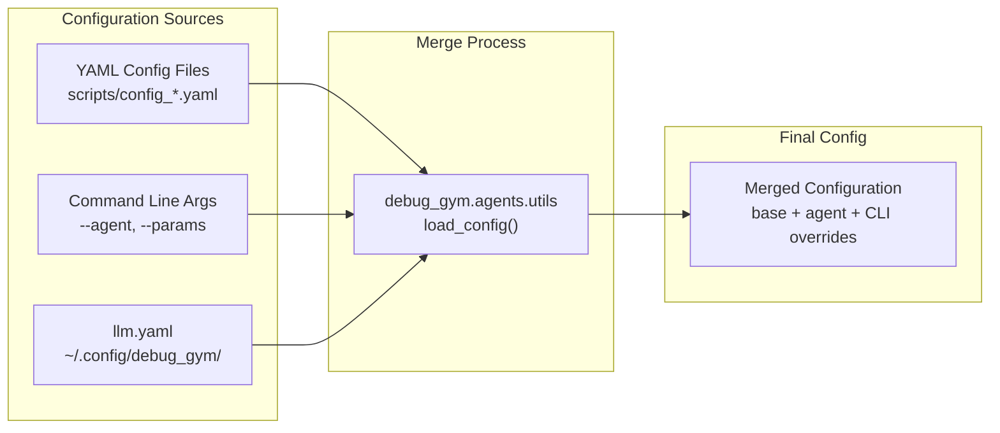
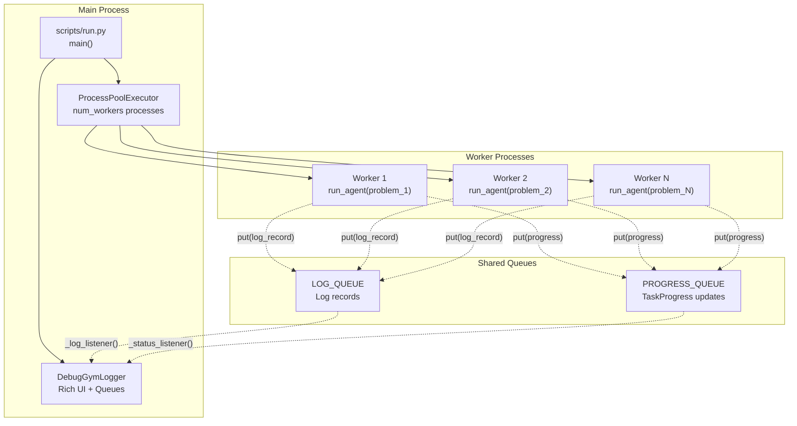
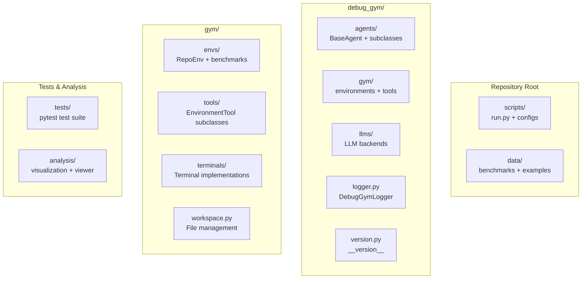

<!-- source: DeepWiki mcp.deepwiki.com · repo microsoft/debug-gym · page 1 Overview · fetched 2026-10-26 -->

# Overview

<details>
<summary>Relevant source files</summary>

The following files were used as context for generating this wiki page:

- [CHANGELOG.md](CHANGELOG.md)
- [README.md](README.md)
- [RESPONSIBLE_AI.md](RESPONSIBLE_AI.md)
- [debug_gym/__init__.py](debug_gym/__init__.py)
- [debug_gym/logger.py](debug_gym/logger.py)
- [debug_gym/version.py](debug_gym/version.py)
- [requirements.txt](requirements.txt)
- [scripts/run.py](scripts/run.py)
- [tests/test_logger.py](tests/test_logger.py)

</details>


## Purpose and Scope

`debug-gym` is a text-based interactive debugging framework designed for training and evaluating LLM-based agents on Python debugging tasks. The framework enables agents to interact with codebases through a tool-based architecture, using capabilities like interactive debuggers (`pdb`), code viewers, test execution, and code modification tools. This page provides a high-level overview of the system architecture and how the major components work together.

For details on specific subsystems:
- Core architecture components: see [Core Architecture](#2)
- Individual tools and their implementation: see [Tool System](#3)
- Available benchmarks: see [Benchmarks and Environments](#4)
- Running experiments: see [Configuration and Execution](#5)

**Sources:** [README.md:1-8](), [RESPONSIBLE_AI.md:1-13]()

---

## What is debug-gym

`debug-gym` is a Gymnasium-style environment that simulates repository-level debugging tasks. Unlike static debugging approaches where agents only see error messages, `debug-gym` enables **interactive debugging** where agents can:

- Set breakpoints and inspect runtime state via the `pdb` tool
- View and modify source files
- Execute tests and observe outputs
- Search codebases for patterns
- Navigate directory structures

The framework is built around three core abstractions:

1. **Environments** (`RepoEnv` and subclasses): Manage debugging tasks, tool integration, and evaluation
2. **Agents** (`BaseAgent` and subclasses): LLM-driven entities that interact with environments to solve debugging tasks
3. **Tools** (`EnvironmentTool` subclasses): Extensible modules that augment agent capabilities

**System Architecture Diagram**



**Sources:** [README.md:51-73](), [scripts/run.py:1-20](), [High-level diagrams - Diagram 1]()

---

## Core Components

### Environment System

The `RepoEnv` base class implements the Gymnasium paradigm with `reset()` and `step()` methods. Environments manage:

- **Task lifecycle**: Loading codebases, applying patches, running tests
- **Tool integration**: Dynamically registering and orchestrating tools via `Toolbox`
- **Event system**: `EventHooks` for inter-tool communication (e.g., PDB adjusting breakpoints after code rewrites)
- **Evaluation**: Automatic test execution and scoring

Benchmark-specific subclasses include `SWEBenchEnv`, `AiderBenchmarkEnv`, `R2EGymEnv`, `MiniNightmareEnv`, and `SWESmithEnv`.

**Reference:** For detailed environment documentation, see [Environment System (RepoEnv)](#2.1)

**Sources:** [README.md:75-93](), [debug_gym/gym/envs/](path exists in diagrams)

### Agent Framework

`BaseAgent` implements the core agent loop:
1. Query LLM for next action (tool call)
2. Execute tool via `env.step()`
3. Receive observations
4. Update history
5. Repeat until task resolved or max steps reached

Specialized agents include `DebugAgent` (uses `pdb`), `RewriteAgent` (code modification only), and `Debug_5_Agent` (staged debugging approach).

**Reference:** For agent implementation details, see [Agent Framework](#2.2)

**Sources:** [README.md:96-107](), [scripts/run.py:102-111]()

### LLM Integration

The `LLM` base class provides a unified interface for multiple backends:
- **OpenAI**: GPT-4, GPT-4o, etc.
- **Anthropic**: Claude models
- **Azure OpenAI**: Enterprise deployments
- **HuggingFace/vLLM**: Open-source models with OpenAI-compatible endpoints
- **Human**: Manual interaction mode
- **Copilot**: GitHub Copilot integration

Configuration is managed via `llm.yaml` files.

**Reference:** For LLM backend details, see [LLM Integration](#2.3)

**Sources:** [README.md:31-48](), [README.md:67-69]()

### Tool System

Tools extend agent capabilities through the `EnvironmentTool` interface. The `Toolbox` registry uses the `@Toolbox.register()` decorator for registration:

| Tool | Primary Class | Purpose |
|------|---------------|---------|
| `pdb` | `PDBTool` | Interactive debugger with persistent breakpoints |
| `rewrite` | `RewriteTool` | Code modification with diff generation |
| `view` | `ViewTool` | File viewing with line numbers |
| `eval` | `EvalTool` | Test execution and scoring |
| `grep` | `GrepTool` | Pattern searching in codebases |
| `bash` | `BashTool` | Shell command execution |
| `listdir` | `ListdirTool` | Directory tree browsal |

**Reference:** For tool implementation and usage, see [Tool System](#3)

**Sources:** [README.md:79-89]()

### Execution Infrastructure

The `Terminal` abstraction provides isolated execution environments:

- **`DockerTerminal`**: Container-based isolation (recommended default)
- **`KubernetesTerminal`**: Scalable pod-based execution for large benchmarks
- **`LocalTerminal`**: Direct host execution (development only)

All terminals support shell sessions via PTY for interactive tools like `pdb`.

The `Workspace` class manages file operations with access control through `.debugignore` and `.debugreadonly` files.

**Reference:** For infrastructure details, see [Execution Infrastructure](#2.4)

**Sources:** [README.md:127-149]()

---

## Execution Flow

The following diagram illustrates a complete debugging session from initialization to completion:

**Agent-Environment Interaction Flow**



**Key execution stages:**

1. **Initialization** ([scripts/run.py:43-109]()):
   - `run_agent()` creates `DebugGymLogger`, agent, and environment
   - `add_tools()` registers tools from config via `Toolbox`
   - `env.reset()` loads the codebase and runs baseline evaluation

2. **Agent Loop** ([debug_gym/agents/base_agent]()):
   - Agent builds prompt from history and current observations
   - LLM generates tool call (function calling format)
   - Environment executes tool and returns observations

3. **Event Processing**:
   - Tools trigger events (e.g., `REWRITE_SUCCESS`)
   - `EventHooks` notifies subscribed tools
   - PDB adjusts breakpoints after code modifications

4. **Completion** ([scripts/run.py:143-148]()):
   - Agent saves trajectory (`.jsonl`) and patch (`.diff`)
   - Final progress reported to logger

**Sources:** [scripts/run.py:43-177](), [High-level diagrams - Diagram 2]()

---

## Configuration and Orchestration

### Configuration Loading

Configuration flows through a three-tier merge hierarchy:



**Example override:**
```bash
python scripts/run.py scripts/config_aider.yaml \
    --agent debug_agent \
    -p debug_agent.llm_name="gpt-4o" \
    -p base.num_workers=8
```

**Sources:** [README.md:173-181](), [scripts/run.py:241-243](), [High-level diagrams - Diagram 6]()

### Parallel Execution

The orchestrator `run.py` uses `ProcessPoolExecutor` for parallel problem solving:



Each worker process:
- Creates its own agent and environment instances
- Logs to individual files via `DebugGymLogger`
- Reports progress through `PROGRESS_QUEUE`
- Main process displays live Rich UI with progress bars

**Sources:** [scripts/run.py:277-312](), [debug_gym/logger.py:500-507]()

---

## Key Design Principles

### Interactive Debugging

Unlike static approaches that only use error messages, `debug-gym` enables runtime inspection:

- **Persistent breakpoints**: PDB breakpoints survive across test executions
- **Auto-listing**: Automatically shows code context at breakpoints
- **Event-driven updates**: Breakpoints adjust line numbers after code modifications

**Sources:** [README.md:86](), [RESPONSIBLE_AI.md:7-10]()

### Tool-Based Extensibility

The `@Toolbox.register()` decorator enables custom tools:

```python
@Toolbox.register(name="my_tool")
class MyTool(EnvironmentTool):
    def use(self, **kwargs):
        # Tool implementation
        return observation
```

Tools automatically integrate:
- Action/observation spaces merge into environment
- Instructions appear in agent prompts
- Can subscribe to events via `EventHooks`

**Sources:** [README.md:79-91](), [README.md:253-254]()

### Isolation and Safety

All code execution occurs in isolated containers/pods:

- **Docker/Kubernetes**: File system isolation from host
- **`.debugignore`**: Hide files from agents (e.g., test files)
- **`.debugreadonly`**: Prevent modification of specific files
- **PTY-based shells**: Interactive sessions without host access

**Sources:** [RESPONSIBLE_AI.md:11](), [README.md:92-93]()

### Multiprocess-Safe Logging

`DebugGymLogger` uses shared queues for coordination:

- **`LOG_QUEUE`**: Worker logs → main process Rich handler
- **`PROGRESS_QUEUE`**: Progress updates → live UI display
- **Background threads**: `_log_listener()` and `_status_listener()` process queues
- **Per-problem files**: Each problem logs to `<problem_id>.log`

**Reference:** For logging implementation, see [Logging and Progress Reporting](#5.3)

**Sources:** [debug_gym/logger.py:500-620](), [scripts/run.py:55-60]()

---

## Directory Structure

**Code Organization by Module**



| Directory | Purpose | Key Files |
|-----------|---------|-----------|
| `scripts/` | Entry points and configs | `run.py`, `config_*.yaml` |
| `debug_gym/agents/` | Agent implementations | `base_agent.py`, `debug_agent.py` |
| `debug_gym/gym/envs/` | Environment classes | `repo_env.py`, `swebench_env.py` |
| `debug_gym/gym/tools/` | Tool implementations | `pdb_tool.py`, `rewrite_tool.py` |
| `debug_gym/gym/terminals/` | Execution backends | `docker_terminal.py`, `k8s_terminal.py` |
| `debug_gym/llms/` | LLM integrations | `openai_llm.py`, `anthropic_llm.py` |
| `data/` | Benchmark data | `mini_nightmare/`, `pytorch/` |
| `tests/` | Unit tests (85%+ coverage) | `test_*.py` |
| `analysis/` | Result analysis | `json_log_viewer/` |

**Sources:** [README.md:54-63](), File paths from provided files

---

## Getting Started

To run a debugging experiment:

```bash
# Install debug-gym
pip install debug-gym

# Configure LLM credentials
python -m debug_gym.llms.configure

# Edit ~/.config/debug_gym/llm.yaml with API keys

# Run an agent on a benchmark
python scripts/run.py scripts/config_aider.yaml --agent debug_agent
```

**Key command-line options:**

| Flag | Purpose |
|------|---------|
| `--agent <name>` | Specify agent type (e.g., `debug_agent`, `rewrite_agent`) |
| `--num-workers <n>` | Parallel worker processes |
| `-p <key>=<value>` | Override config values |
| `-v` / `--debug` | Verbose logging / debug mode |
| `--list` | List available problems and agents |

**Reference:** For detailed configuration and execution, see [Configuration and Execution](#5)

**Sources:** [README.md:9-29](), [README.md:152-181]()

---

## Output Artifacts

Each debugging run produces:

| File | Location | Contents |
|------|----------|----------|
| `trajectory.json` | `<output_path>/<uuid>/<problem>/` | Complete interaction history (LLM queries, tool calls, observations) |
| `debug_gym.patch` | `<output_path>/<uuid>/<problem>/` | Final code modifications as unified diff |
| `<problem>.log` | `<output_path>/<uuid>/<problem>/` | Timestamped execution logs |
| `<problem>_status.json` | `<output_path>/<uuid>/<problem>/` | Final task status (resolved/unresolved, score) |
| `experiment_info.jsonl` | `<output_path>/<uuid>/` | Experiment metadata (config, git hash, timestamp) |

The `analysis/json_log_viewer/` directory contains a Flask app for visualizing trajectories in a web browser.

**Sources:** [scripts/run.py:144-148](), [scripts/run.py:204-238](), [README.md:256-260]()

---

## Version and Requirements

**Current version:** `1.2.0` ([debug_gym/version.py:1]())

**Core dependencies:**

| Package | Purpose |
|---------|---------|
| `openai>=1.99.9` | OpenAI API integration |
| `anthropic>=0.51.0` | Anthropic API integration |
| `docker>=7.1.0` | Docker container management |
| `kubernetes>=33.1.0` | Kubernetes pod orchestration |
| `rich>=14.0.0` | Terminal UI and logging |
| `datasets>=3.6.0` | Benchmark dataset loading |
| `swebench>=4.0.3` | SWE-Bench integration |
| `pytest>=8.3.5` | Testing framework |

**Python requirement:** `>=3.12`

**Platform support:**
- **Linux**: Full support (recommended)
- **macOS/Windows**: Limited PTY support (interactive `pdb` tool unavailable)

**Sources:** [requirements.txt:1-19](), [README.md:11-12](), [README.md:70-72]()

---

