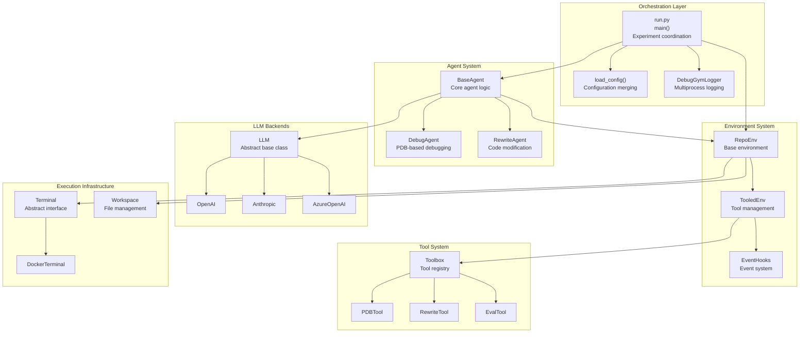
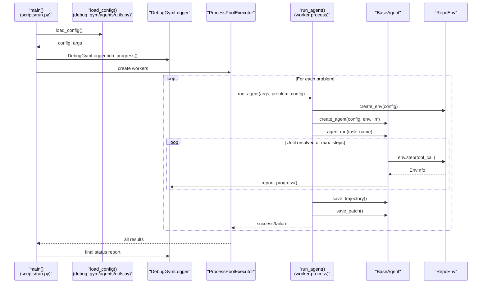
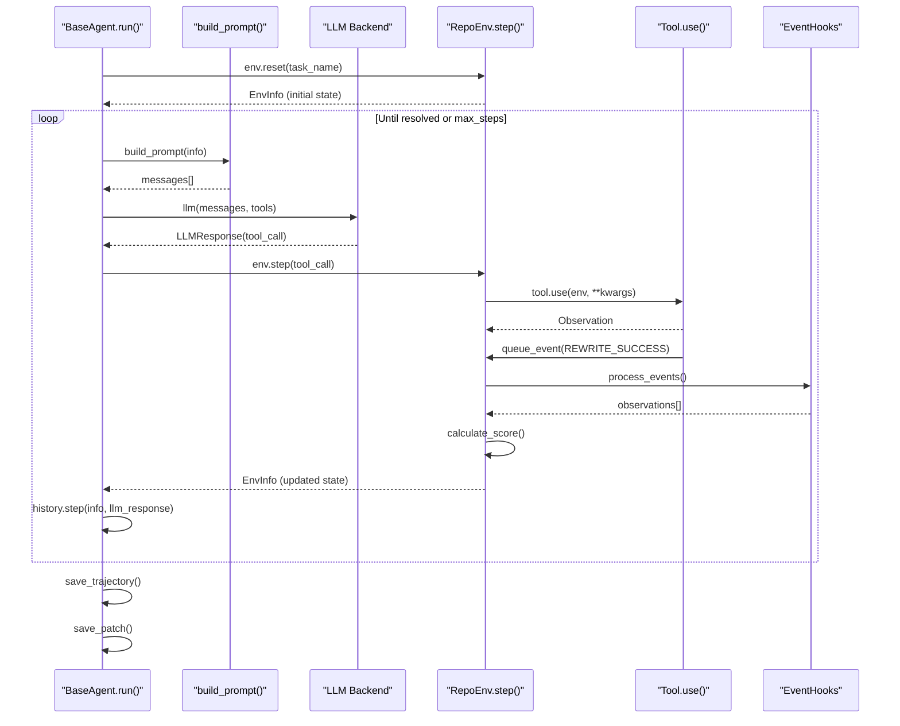
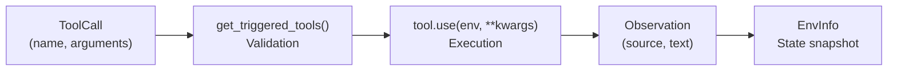
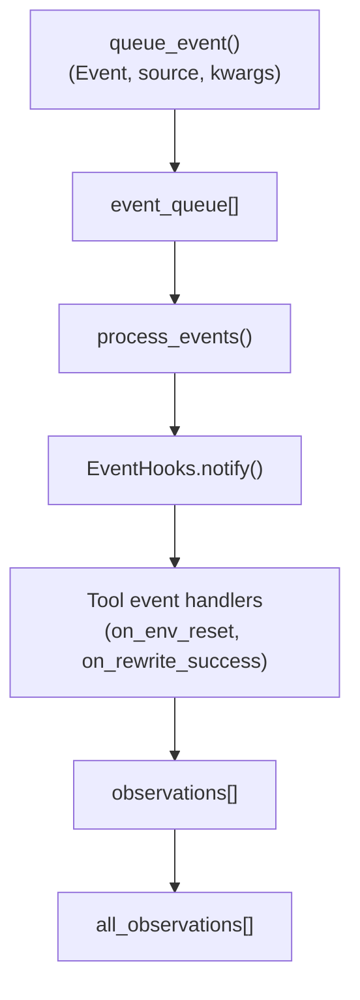
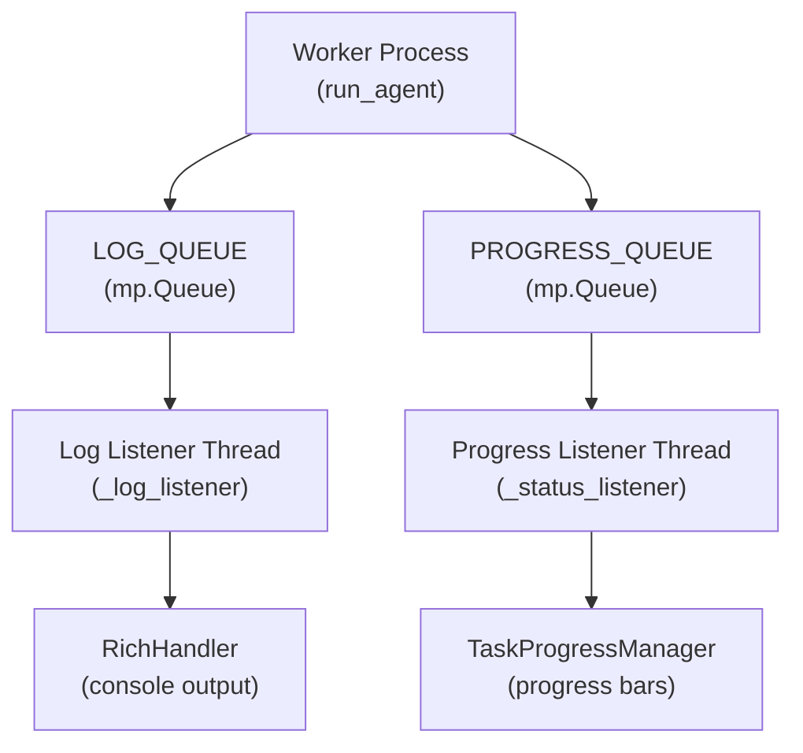
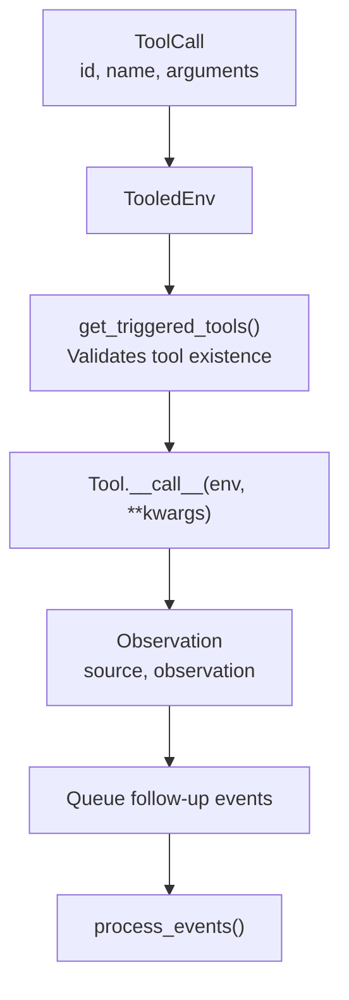
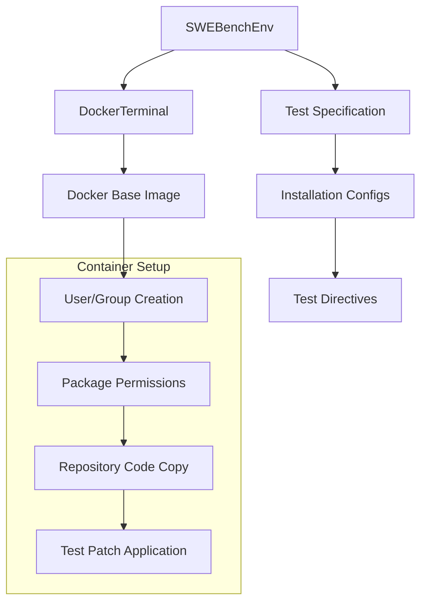

<!-- source: DeepWiki mcp.deepwiki.com · repo microsoft/debug-gym · page 2 Core Architecture · fetched 2026-10-26 -->

# Core Architecture

<details>
<summary>Relevant source files</summary>

The following files were used as context for generating this wiki page:

- [CHANGELOG.md](CHANGELOG.md)
- [README.md](README.md)
- [RESPONSIBLE_AI.md](RESPONSIBLE_AI.md)
- [debug_gym/__init__.py](debug_gym/__init__.py)
- [debug_gym/agents/base_agent.py](debug_gym/agents/base_agent.py)
- [debug_gym/agents/debug_agent.py](debug_gym/agents/debug_agent.py)
- [debug_gym/agents/rewrite_agent.py](debug_gym/agents/rewrite_agent.py)
- [debug_gym/agents/solution_agent.py](debug_gym/agents/solution_agent.py)
- [debug_gym/gym/envs/env.py](debug_gym/gym/envs/env.py)
- [debug_gym/gym/tools/pdb.py](debug_gym/gym/tools/pdb.py)
- [debug_gym/logger.py](debug_gym/logger.py)
- [debug_gym/version.py](debug_gym/version.py)
- [requirements.txt](requirements.txt)
- [scripts/run.py](scripts/run.py)
- [tests/gym/envs/test_env.py](tests/gym/envs/test_env.py)
- [tests/gym/tools/test_pdb.py](tests/gym/tools/test_pdb.py)
- [tests/test_logger.py](tests/test_logger.py)

</details>


This document provides a high-level overview of the debug-gym system architecture, explaining how the orchestration layer, agents, LLMs, environments, tools, and execution infrastructure work together to enable interactive debugging workflows.

For detailed information about specific components, see:
- [Environment System](#2.1) for environment internals
- [Agent Framework](#2.2) for agent implementations  
- [LLM Integration](#2.3) for LLM provider details
- [Execution Infrastructure](#2.4) for terminal abstractions
- [Tool System](#3) for tool documentation

## System Architecture Overview

Debug-gym follows a layered architecture where each layer has distinct responsibilities. The orchestration layer (`run.py`) coordinates parallel execution, agents implement debugging strategies, LLMs provide decision-making capabilities, environments manage repository state and tool execution, and the infrastructure layer provides isolated execution contexts.

**High-Level System Architecture**



Sources: [scripts/run.py:1-317](), [debug_gym/agents/base_agent.py:1-394](), [debug_gym/gym/envs/env.py:1-522](), [debug_gym/gym/tools/toolbox.py]()

## Orchestration and Execution Flow

The orchestration layer coordinates all system components through `run.py`, which serves as the main entry point. It handles configuration loading, parallel execution, and progress reporting.

**Main Execution Flow**



Sources: [scripts/run.py:241-313](), [scripts/run.py:43-176]()

### Configuration System

Configuration flows through a three-tier hierarchy managed by `load_config()`:

| Priority | Source | Purpose |
|----------|--------|---------|
| 1 (Highest) | Command-line `-p` flags | Runtime overrides |
| 2 | Agent-specific YAML section | Per-agent customization |
| 3 (Lowest) | Base YAML configuration | Default settings |

The configuration structure includes:
- **Base settings**: `benchmark`, `output_path`, `uuid`, `max_steps`, `max_rewrite_steps`
- **Environment kwargs**: `path`, `entrypoint`, `debug_entrypoint`, `terminal`, `tools`
- **Agent settings**: `agent_type`, `llm_name`, `system_prompt`, `memory_size`
- **LLM configuration**: External `llm.yaml` with API keys and model parameters

Sources: [debug_gym/agents/utils.py](), [scripts/run.py:241-249]()

## Agent-Environment Interaction Pattern

Agents interact with environments through a standardized cycle that separates decision-making from execution.

**Agent Interaction Lifecycle**



Sources: [debug_gym/agents/base_agent.py:223-319](), [debug_gym/gym/envs/env.py:444-505]()

### EnvInfo State Representation

The `EnvInfo` dataclass encapsulates complete environment state after each step:

```python
@dataclass
class EnvInfo:
    step_observation: Observation        # Primary tool output
    all_observations: list[Observation]  # Including event-triggered
    eval_observation: Observation | None # Last test result
    dir_tree: str                        # Repository structure
    current_breakpoints: str             # Active breakpoints
    action_reasoning: str | None         # Agent's reasoning
    action_content: str | None           # Agent's response
    action_tool_call: ToolCall | None    # Executed action
    instructions: dict                   # Task instructions
    score: int                           # Current score
    max_score: int                       # Maximum possible score
    terminated: bool                     # Task completion flag
    resolved: bool                       # Success flag
    rewrite_counter: int                 # Number of code rewrites
    tools: list[EnvironmentTool]         # Available tools
```

Sources: [debug_gym/gym/envs/env.py:14-32]()

## Component Communication Patterns

The system uses three primary communication mechanisms to coordinate between components.

### 1. Synchronous Tool Execution

Tools are invoked synchronously through the `TooledEnv.step()` method:



Sources: [debug_gym/gym/envs/env.py:444-476]()

### 2. Event-Driven Communication

The event system enables asynchronous responses to environment changes:



Event types defined in the system:
- `ENV_RESET`: Triggered when environment is reset, tools can initialize state
- `REWRITE_SUCCESS`: Triggered after successful code modification, e.g., PDB adjusts breakpoints
- `REWRITE_FAIL`: Triggered when code modification fails

Sources: [debug_gym/gym/envs/env.py:188-205](), [debug_gym/gym/entities.py]()

### 3. Multiprocess Logging

Workers communicate with the main process through shared queues:



Sources: [debug_gym/logger.py:500-700]()

## Layer Responsibilities

Each architectural layer has well-defined responsibilities and interfaces.

### Orchestration Layer (run.py)

**Responsibilities:**
- Load and merge configuration from YAML files and CLI arguments
- Spawn parallel worker processes via `ProcessPoolExecutor`
- Collect and aggregate progress reports from workers
- Display live progress UI using Rich library
- Persist experiment metadata and results

**Key Functions:**
| Function | Purpose | Location |
|----------|---------|----------|
| `main()` | Entry point, orchestrates entire workflow | [scripts/run.py:241-313]() |
| `run_agent()` | Worker function, runs single problem | [scripts/run.py:43-176]() |
| `create_env()` | Factory for environment instances | [scripts/run.py:179-188]() |
| `add_tools()` | Registers tools with environment | [scripts/run.py:191-202]() |

Sources: [scripts/run.py:1-317]()

### Agent Layer (BaseAgent)

**Responsibilities:**
- Implement debugging strategies and decision logic
- Build prompts incorporating environment state and history
- Query LLM backends for next actions
- Maintain conversation history with memory management
- Save execution trajectories and patches

**Key Methods:**
| Method | Purpose | Location |
|--------|---------|----------|
| `run()` | Main execution loop | [debug_gym/agents/base_agent.py:223-319]() |
| `build_prompt()` | Construct LLM input messages | [debug_gym/agents/base_agent.py:216-221]() |
| `build_system_prompt()` | Generate system prompt from template or default | [debug_gym/agents/base_agent.py:200-208]() |
| `save_trajectory()` | Persist execution history | [debug_gym/agents/base_agent.py:352-373]() |

Sources: [debug_gym/agents/base_agent.py:29-394]()

### LLM Layer (LLM Base)

**Responsibilities:**
- Abstract different LLM provider APIs (OpenAI, Anthropic, Azure, etc.)
- Handle tool calling format conversion
- Manage context windows and token counting
- Implement retry logic and error handling

**Provider Implementations:**
- `OpenAI`: OpenAI API client ([debug_gym/llms/openai.py]())
- `Anthropic`: Anthropic Claude API ([debug_gym/llms/anthropic.py]())
- `AzureOpenAI`: Azure OpenAI Service ([debug_gym/llms/azure_openai.py]())
- `Human`: Interactive human-in-the-loop mode ([debug_gym/llms/human.py]())

Sources: [debug_gym/llms/base.py]()

### Environment Layer (RepoEnv)

**Responsibilities:**
- Manage repository workspace and file operations
- Execute tools and collect observations
- Process events and notify subscribed tools
- Calculate scores from test execution results
- Track breakpoints and code modifications

**Core Classes:**
| Class | Purpose | Location |
|-------|---------|----------|
| `TooledEnv` | Base tool management and event system | [debug_gym/gym/envs/env.py:128-206]() |
| `RepoEnv` | Repository operations and lifecycle | [debug_gym/gym/envs/env.py:208-522]() |
| `EventHooks` | Event subscription and notification | [debug_gym/gym/envs/env.py:91-126]() |

Sources: [debug_gym/gym/envs/env.py:1-522]()

### Tool Layer (Toolbox)

**Responsibilities:**
- Provide debugging and code manipulation capabilities
- Register with environments via `@Toolbox.register()` decorator
- Subscribe to relevant events (e.g., `REWRITE_SUCCESS`)
- Return observations from tool execution

**Tool Categories:**
- **Inspection**: `ViewTool`, `GrepTool`, `ListdirTool`
- **Modification**: `RewriteTool`, `BashTool`
- **Validation**: `EvalTool`, `SubmitTool`
- **Debugging**: `PDBTool` (interactive debugger)

Sources: [debug_gym/gym/tools/toolbox.py](), [debug_gym/gym/tools/tool.py]()

### Infrastructure Layer (Terminal)

**Responsibilities:**
- Abstract command execution across different backends
- Provide isolated execution environments
- Support interactive shell sessions for PDB
- Manage container/pod lifecycle

**Terminal Implementations:**
| Implementation | Purpose | Location |
|----------------|---------|----------|
| `LocalTerminal` | Direct host execution | [debug_gym/gym/terminals/local.py]() |
| `DockerTerminal` | Container-based isolation | [debug_gym/gym/terminals/docker.py]() |
| `KubernetesTerminal` | Scalable pod execution | [debug_gym/gym/terminals/kubernetes.py]() |

Sources: [debug_gym/gym/terminals/terminal.py](), [debug_gym/gym/workspace.py]()

## Tool Integration System

Tools integrate with environments through a registration system that provides type safety and automatic discovery. The `Toolbox` class serves as a global registry using decorator-based registration.

### Tool Registration and Execution



Key integration points:
- **Tool Registration**: Tools use the `@register` decorator to automatically add themselves to the `Toolbox`
- **Argument Validation**: `get_triggered_tools()` validates tool names and argument structures before execution
- **Error Handling**: Tool execution errors are captured and converted to error observations
- **Event Integration**: Tools can subscribe to events and queue new events during execution

The `EnvInfo` dataclass provides a complete snapshot of environment state after each step:

| Field | Type | Purpose |
|-------|------|---------|
| `step_observation` | `Observation` | Primary result from the executed tool |
| `all_observations` | `list[Observation]` | All observations including event-triggered ones |
| `eval_observation` | `Observation` | Most recent evaluation result |
| `current_breakpoints` | `str` | Formatted breakpoint status |
| `tools` | `list[EnvironmentTool]` | Available tools for the current environment |

Sources: [debug_gym/gym/envs/env.py:19-34](), [debug_gym/gym/envs/env.py:104-120](), [debug_gym/gym/tools/toolbox.py]()

## Specialized Environment Extensions  

Benchmark-specific environments like `SWEBenchEnv` extend the base architecture to handle complex deployment scenarios:

### SWEBench Docker Integration



The `SWEBenchEnv` demonstrates how the core architecture can be extended while maintaining compatibility with the base tool and event systems. It overrides key methods like `calculate_score()` to implement benchmark-specific evaluation logic while preserving the standard environment interface.

Sources: [debug_gym/gym/envs/swe_bench.py:25-294](), [debug_gym/gym/envs/swe_bench.py:154-168](), [debug_gym/gym/envs/swe_bench.py:170-244]()

---

