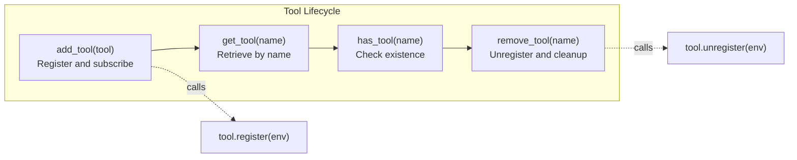
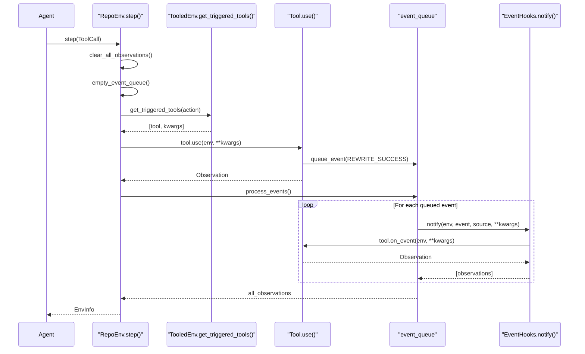
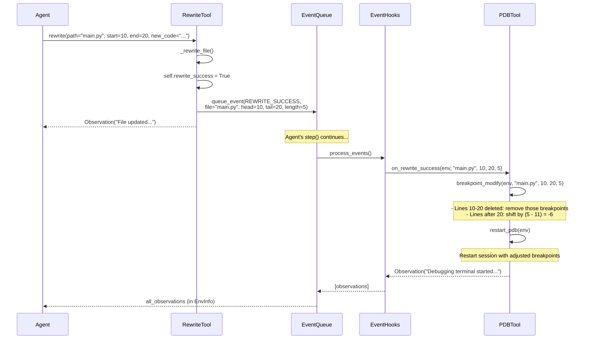
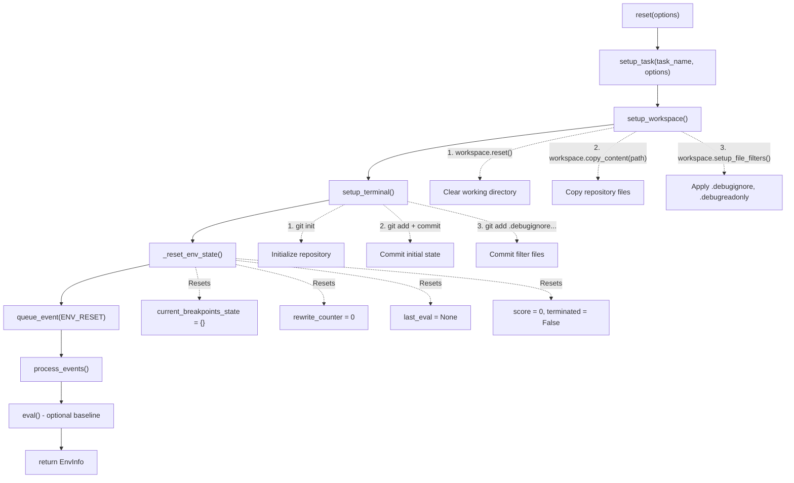
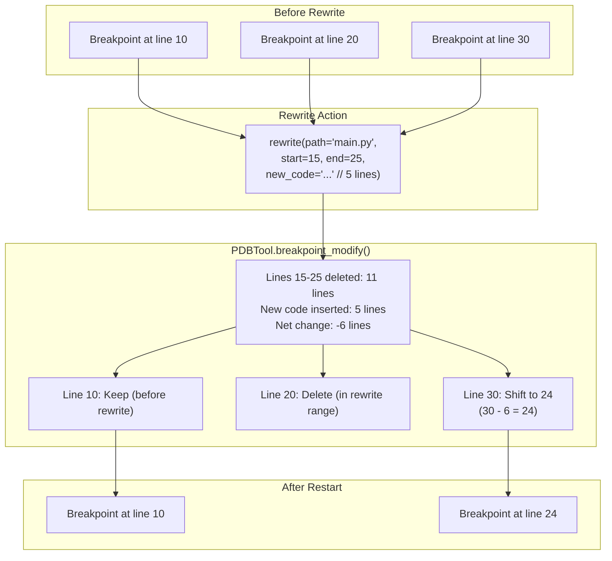

<!-- source: DeepWiki mcp.deepwiki.com · repo microsoft/debug-gym · page 2.1 Environment System (RepoEnv) · fetched 2026-10-26 -->

# Environment System (RepoEnv)

<details>
<summary>Relevant source files</summary>

The following files were used as context for generating this wiki page:

- [debug_gym/gym/envs/env.py](debug_gym/gym/envs/env.py)
- [debug_gym/gym/tools/pdb.py](debug_gym/gym/tools/pdb.py)
- [debug_gym/gym/tools/rewrite.py](debug_gym/gym/tools/rewrite.py)
- [debug_gym/gym/tools/view.py](debug_gym/gym/tools/view.py)
- [debug_gym/gym/utils.py](debug_gym/gym/utils.py)
- [tests/gym/envs/test_env.py](tests/gym/envs/test_env.py)
- [tests/gym/test_utils.py](tests/gym/test_utils.py)
- [tests/gym/tools/test_pdb.py](tests/gym/tools/test_pdb.py)
- [tests/gym/tools/test_rewrite.py](tests/gym/tools/test_rewrite.py)
- [tests/gym/tools/test_view.py](tests/gym/tools/test_view.py)

</details>


## Purpose and Scope

This document covers the environment system in debug-gym, specifically the `RepoEnv` base class and related components that provide the execution context for debugging agents. The environment system manages task setup, tool integration, event coordination, and state tracking throughout the debugging process.

For information about specific benchmark environments (SWE-Bench, Aider, etc.), see [Benchmarks and Environments](#4). For execution infrastructure details (terminals and workspaces), see [Execution Infrastructure](#2.4). For the tool system itself, see [Tool System](#3).

---

## Core Architecture Overview

The environment system consists of four primary classes that work together to provide a complete debugging environment:

```mermaid
graph TB
    subgraph "Core Environment Classes"
        RepoEnv["RepoEnv<br/>Base Environment<br/>debug_gym/gym/envs/env.py:208-522"]
        TooledEnv["TooledEnv<br/>Tool Registry Pattern<br/>debug_gym/gym/envs/env.py:128-206"]
        EventHooks["EventHooks<br/>Observer Pattern<br/>debug_gym/gym/envs/env.py:91-126"]
        EnvInfo["EnvInfo<br/>State Snapshot<br/>debug_gym/gym/envs/env.py:14-89"]
    end
    
    subgraph "Infrastructure (see 2.4)"
        Workspace["Workspace<br/>File Management"]
        Terminal["Terminal<br/>Command Execution"]
    end
    
    subgraph "Tools (see 3)"
        PDBTool["PDBTool"]
        RewriteTool["RewriteTool"]
        ViewTool["ViewTool"]
        EvalTool["EvalTool"]
    end
    
    RepoEnv --|"inherits from"| TooledEnv
    RepoEnv --|"uses"| Workspace
    RepoEnv --|"uses"| Terminal
    RepoEnv --|"returns"| EnvInfo
    
    TooledEnv --|"contains"| EventHooks
    TooledEnv --|"manages"| PDBTool
    TooledEnv --|"manages"| RewriteTool
    TooledEnv --|"manages"| ViewTool
    TooledEnv --|"manages"| EvalTool
    
    EventHooks --|"notifies"| PDBTool
    EventHooks --|"notifies"| RewriteTool
```

**Sources:** [debug_gym/gym/envs/env.py:1-522]()

---

## RepoEnv: Base Environment Class

`RepoEnv` is the foundational environment class that all benchmark-specific environments inherit from. It manages the complete debugging task lifecycle including workspace setup, terminal configuration, tool integration, and state tracking.

### Class Structure

| Component | Type | Purpose |
|-----------|------|---------|
| `path` | `str \| None` | Source repository path |
| `workspace` | `Workspace` | File operations and access control |
| `terminal` | `Terminal` | Command execution (Docker/K8s/Local) |
| `entrypoint` | `str` | Test execution command |
| `debug_entrypoint` | `str` | PDB-enabled test command |
| `max_score` | `int` | Maximum achievable score |
| `current_breakpoints_state` | `dict` | Persistent breakpoint tracking |
| `rewrite_counter` | `int` | Number of code modifications |
| `last_eval` | `EvalOutput` | Most recent evaluation result |

**Sources:** [debug_gym/gym/envs/env.py:208-251]()

### Initialization

```python
RepoEnv(
    path: str | None = None,
    entrypoint: str = "python -m pytest -sq .",
    debug_entrypoint: str | None = None,
    max_score: int | None = None,
    run_timeout: int | None = None,
    dir_tree_depth: int = 1,
    persistent_breakpoints: bool = True,
    auto_list: bool = True,
    terminal: Terminal | None = None,
    logger: DebugGymLogger | None = None,
    problems: str | list[str] | None = None,
    **kwargs,
)
```

The constructor creates a workspace, loads the dataset, and prepares entrypoints. If no terminal is provided, it defaults to `LocalTerminal` (though `DockerTerminal` is recommended for production). The `_prepare_entrypoint` method handles special cases for package managers like `uv` and ensures proper Python interpreter paths.

**Sources:** [debug_gym/gym/envs/env.py:210-251](), [debug_gym/gym/envs/env.py:275-295]()

---

## TooledEnv: Tool Registry Pattern

`TooledEnv` provides the infrastructure for registering and managing tools within an environment. It implements a dictionary-based registry with event-driven coordination.

### Tool Management Methods



**Key Properties:**
- `tools` - List of registered tool instances
- `tool_names` - Comma-separated string of tool names
- `event_hooks` - Event coordination system
- `event_queue` - Queued events awaiting processing
- `all_observations` - Accumulated observations from tools

**Sources:** [debug_gym/gym/envs/env.py:128-206]()

### Tool Execution Flow

When an agent calls a tool via `env.step()`, the following sequence occurs:



The `get_triggered_tools` method parses the `ToolCall` and validates that the requested tool exists. It returns either an error message or a tuple of `[tool_instance, kwargs]`.

**Sources:** [debug_gym/gym/envs/env.py:444-505](), [debug_gym/gym/envs/env.py:159-176]()

---

## EventHooks: Observer Pattern Implementation

`EventHooks` implements the observer pattern to coordinate tool behavior when environment events occur. This is crucial for maintaining debugging state across code modifications.

### Event Types

The system defines three core events (from `debug_gym.gym.entities.Event`):

| Event | Handler Method | Triggered When | Typical Subscribers |
|-------|----------------|----------------|---------------------|
| `ENV_RESET` | `on_env_reset()` | Environment is reset for new task | All tools (for state initialization) |
| `REWRITE_SUCCESS` | `on_rewrite_success(env, file, head, tail, length)` | Code is successfully modified | PDBTool (to adjust breakpoints) |
| `REWRITE_FAIL` | `on_rewrite_fail(env, message)` | Code modification fails | Tools needing failure handling |

**Sources:** [debug_gym/gym/entities.py](), [debug_gym/gym/envs/env.py:91-126]()

### Event Subscription and Notification

```python
# EventHooks initialization
event_hooks = EventHooks()
# Creates listeners dict: {Event.ENV_RESET: [], Event.REWRITE_SUCCESS: [], ...}

# Tool subscribes to events during registration
event_hooks.subscribe(Event.REWRITE_SUCCESS, pdb_tool)
# Validates: (1) event exists, (2) tool has handler method, (3) not already subscribed

# Tool queues event during execution
environment.queue_event(Event.REWRITE_SUCCESS, source=rewrite_tool, file="main.py", ...)

# Environment processes queued events
observations = environment.process_events()
# For each event: notify all subscribed tools, collect observations
```

The `notify` method skips the source tool to avoid infinite loops. If an exception occurs in a handler, it catches it and returns an error observation instead of crashing.

**Sources:** [debug_gym/gym/envs/env.py:91-126](), [debug_gym/gym/envs/env.py:188-205]()

### Event-Driven Breakpoint Management Example

The most important use of the event system is maintaining breakpoint state when code changes:



This event-driven approach allows tools to react to environment changes without tight coupling. When `RewriteTool` modifies code, it doesn't need to know about `PDBTool` - it just queues an event. `PDBTool` autonomously adjusts breakpoints based on the line number changes.

**Sources:** [debug_gym/gym/tools/rewrite.py:123-132](), [debug_gym/gym/tools/pdb.py:134-140](), [debug_gym/gym/tools/pdb.py:294-340]()

---

## EnvInfo: Environment State Snapshot

`EnvInfo` is a dataclass returned by `reset()` and `step()` that encapsulates the complete environment state at a given moment. Agents use this to observe the results of their actions and decide what to do next.

### Data Structure

```python
@dataclass
class EnvInfo:
    step_observation: Observation          # Primary observation from triggered tool
    all_observations: list[Observation]    # step_observation + event-triggered observations
    eval_observation: Observation | None   # Last test evaluation result
    dir_tree: str                          # Directory structure (from workspace.display_files)
    current_breakpoints: str               # Formatted breakpoint list
    action_reasoning: str | None           # Agent's reasoning for the action
    action_content: str | None             # Action description
    action_tool_call: ToolCall | None      # The actual tool call made
    instructions: dict                     # Task-specific instructions
    score: int                             # Current test score
    max_score: int                         # Maximum possible score
    terminated: bool                       # Task finished running
    resolved: bool                         # Task successfully solved
    rewrite_counter: int                   # Number of code modifications
    tools: list[EnvironmentTool]           # Available tools
```

**Sources:** [debug_gym/gym/envs/env.py:14-32]()

### Pretty Printing

`EnvInfo` includes a `__str__` method that formats the state for display:

```
======================================================================
                    DEBUG GYM ENVIRONMENT INFO
======================================================================
📊 Status: ✅ (TERMINATED)	🎯 Score: 10/10	✏️ Rewrites: 3
🔧 Last Action:
   Tool: rewrite
   Reasoning: Fixing off-by-one error in loop

👁️ Observation:
```
The file `calculator.py` has been updated successfully.

Diff: ...
```

🛠️  Available Tools (5):
   pdb, view, rewrite, eval, submit

🔴 Breakpoints:
   • line 42 in calculator.py
   • line 67 in calculator.py

📁 Directory Structure:
   /workspace/
   |-- calculator.py
   |-- test_calculator.py
   ...
======================================================================
```

**Sources:** [debug_gym/gym/envs/env.py:33-89]()

---

## Environment Lifecycle

### Reset: Task Initialization

The `reset()` method prepares the environment for a new debugging task:



**Sources:** [debug_gym/gym/envs/env.py:335-377](), [debug_gym/gym/envs/env.py:253-264](), [debug_gym/gym/envs/env.py:307-318](), [debug_gym/gym/envs/env.py:319-334]()

### Step: Action Execution

The `step()` method executes an agent's action and returns updated environment state:

```python
def step(
    self,
    action_tool_call: ToolCall,
    action_content: str | None = None,
    action_reasoning: str | None = None,
) -> EnvInfo:
```

**Execution Phases:**

1. **Clear State**: Reset `all_observations` and `event_queue`
2. **Parse Action**: Extract tool name and arguments from `ToolCall`
3. **Validate Tool**: Check tool exists in registry
4. **Execute Tool**: Call `tool.use(env, **kwargs)`
5. **Handle Errors**: Catch exceptions and return error observations
6. **Process Events**: Trigger event handlers for queued events
7. **Calculate Scores**: Update `score`, `max_score`, `terminated`, `resolved` from `last_eval`
8. **Build EnvInfo**: Package observations and state into return value

**Sources:** [debug_gym/gym/envs/env.py:444-505]()

### Eval: Test Execution

The `eval()` method runs tests and updates the environment's evaluation state:

```python
def eval(self, **kwargs) -> EvalOutput:
    """Evaluates the current code using the provided entrypoint.
    Sets the last_eval and returns it."""
    success, output = self.terminal.run(self.entrypoint, timeout=self.run_timeout)
    self.last_eval = EvalOutput(success, output)
    return self.last_eval
```

Subclasses override `calculate_score()`, `calculate_max_score()`, `calculate_resolved()`, and `calculate_terminated()` to implement benchmark-specific scoring logic. The default implementation uses binary success (0 or 1).

**Sources:** [debug_gym/gym/envs/env.py:403-409](), [debug_gym/gym/envs/env.py:383-401]()

---

## Breakpoint State Management

`RepoEnv` maintains persistent breakpoint state across PDB sessions, enabling agents to set breakpoints once and have them automatically restored when the debugger restarts.

### Breakpoint State Structure

Breakpoints are stored in `current_breakpoints_state` as a dictionary:

```python
current_breakpoints_state = {
    "/workspace/main.py|||42": "b /workspace/main.py:42",
    "/workspace/utils.py|||15": "b /workspace/utils.py:15",
}
```

**Key format**: `"{absolute_path}|||{line_number}"`  
**Value format**: PDB command to restore the breakpoint

**Sources:** [debug_gym/gym/envs/env.py:256]()

### Breakpoint Query Methods

| Method | Purpose | Return Type |
|--------|---------|-------------|
| `has_breakpoint(file_path, line_number)` | Check if breakpoint exists at location | `bool` |
| `current_breakpoints()` | Format breakpoints for display | `str` |

```python
# Example usage in ViewTool
def show_line_number(code_string, code_path, environment, start_index):
    for i, line in enumerate(code_line):
        line_number = start_index + i
        has_breakpoint = environment.has_breakpoint(code_path, line_number)
        prefix = "B" if has_breakpoint else " "
        output.append(f"{prefix} {line_number:4d} {line}")
```

**Sources:** [debug_gym/gym/envs/env.py:411-432](), [debug_gym/gym/utils.py:24-54]()

### Breakpoint Lifecycle with Code Changes



**Algorithm** (from `PDBTool.breakpoint_modify`):
- Breakpoints **before** `rewrite_head`: unchanged
- Breakpoints **between** `rewrite_head` and `rewrite_tail`: deleted
- Breakpoints **after** `rewrite_tail`: shifted by `new_code_length - (rewrite_tail - rewrite_head + 1)`

**Sources:** [debug_gym/gym/tools/pdb.py:294-340]()

---

## Patch Generation

`RepoEnv` provides a `patch` property that generates a git diff of all changes made during the debugging session:

```python
@property
def patch(self):
    success, output = self.terminal.run("git diff", strip_output=False, raises=True)
    return output
```

This works because `setup_terminal()` initializes a git repository and commits the initial state. All subsequent modifications via `RewriteTool` are tracked as uncommitted changes.

**Example output:**
```diff
diff --git a/calculator.py b/calculator.py
index e69de29..b45ef6f 100644
--- a/calculator.py
+++ b/calculator.py
@@ -1,5 +1,5 @@
 def add(a, b):
-    return a + b + 1  # Bug: off-by-one
+    return a + b       # Fixed
```

**Sources:** [debug_gym/gym/envs/env.py:434-437](), [debug_gym/gym/envs/env.py:319-334]()

---

## Subclass Extension Points

Benchmark-specific environments override these methods to customize behavior:

| Method | Default Behavior | Override Purpose |
|--------|------------------|------------------|
| `setup_task(task_name, options)` | No-op | Load task-specific data (test patches, bug descriptions) |
| `setup_workspace()` | Copy `path` to workspace | Apply custom file filters, inject patches |
| `setup_terminal()` | Git init + commit | Install dependencies, configure environment |
| `instructions` property | Empty string | Return task instructions for agent |
| `calculate_score(eval_output)` | `eval_output.success` (0 or 1) | Parse test output for score |
| `calculate_max_score(eval_output)` | `self.max_score` | Extract max score from test output |
| `calculate_resolved(eval_output)` | `score == max_score` | Custom success criteria |
| `calculate_terminated(eval_output)` | Same as `calculate_resolved` | Custom termination logic |
| `load_dataset(problems)` | `{"custom": None}` | Load benchmark-specific dataset |

**Example from SWE-Bench:**
```python
class SWEBenchEnv(RepoEnv):
    def setup_task(self, task_name: str, options: dict = None):
        self.task_instance = self.dataset[task_name]
        self.instructions = self.task_instance["problem_statement"]
        # ... load test patches, gold patches, etc.
    
    def setup_workspace(self):
        super().setup_workspace()
        # Apply test patch to reveal failing tests
        self.workspace.write_file("test_patch.diff", self.task_instance["test_patch"])
        self.terminal.run("git apply test_patch.diff")
```

**Sources:** [debug_gym/gym/envs/env.py:297-318](), [debug_gym/gym/envs/swebench.py]()

---

## Key Design Patterns

### 1. Template Method Pattern
`RepoEnv` defines the skeleton of environment lifecycle (`reset()`, `step()`, `eval()`) with customizable hooks for subclasses.

### 2. Observer Pattern
`EventHooks` decouples event producers (tools) from consumers (other tools), enabling reactive behavior without tight coupling.

### 3. Registry Pattern
`TooledEnv` maintains a dictionary-based tool registry with validation, enabling dynamic tool management.

### 4. Snapshot Pattern
`EnvInfo` captures complete environment state at a point in time, providing immutable observations to agents.

**Sources:** [debug_gym/gym/envs/env.py:1-522]()

---

## Usage Example

```python
from debug_gym.gym.envs.env import RepoEnv
from debug_gym.gym.terminals.docker import DockerTerminal
from debug_gym.gym.tools.toolbox import Toolbox

# Create environment
terminal = DockerTerminal(base_image="python:3.12-slim")
env = RepoEnv(
    path="path/to/repository",
    entrypoint="python -m pytest -sq test_calculator.py",
    terminal=terminal,
    run_timeout=30
)

# Add tools
env.add_tool(Toolbox.get_tool("pdb"))
env.add_tool(Toolbox.get_tool("view"))
env.add_tool(Toolbox.get_tool("rewrite"))
env.add_tool(Toolbox.get_tool("eval"))

# Initialize task
info = env.reset(options={"task_name": "fix_calculator_bug"})
print(f"Instructions: {info.instructions}")
print(f"Initial score: {info.score}/{info.max_score}")

# Agent loop
while not info.terminated:
    # Agent decides on action
    tool_call = agent.decide(info)
    
    # Execute action
    info = env.step(tool_call, action_content="...", action_reasoning="...")
    
    # Check progress
    print(f"Score: {info.score}/{info.max_score}")
    print(f"Observation: {info.step_observation}")

# Save patch
patch = env.patch
with open("solution.patch", "w") as f:
    f.write(patch)

# Cleanup
env.close()
```

**Sources:** [debug_gym/gym/envs/env.py:208-522](), [tests/gym/envs/test_env.py:209-240]()

---

