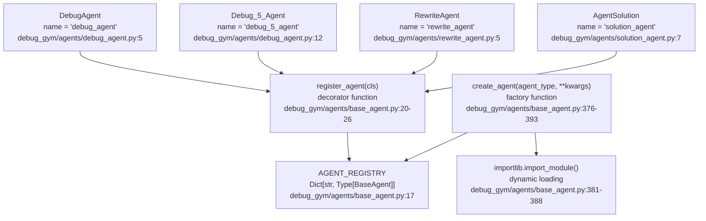
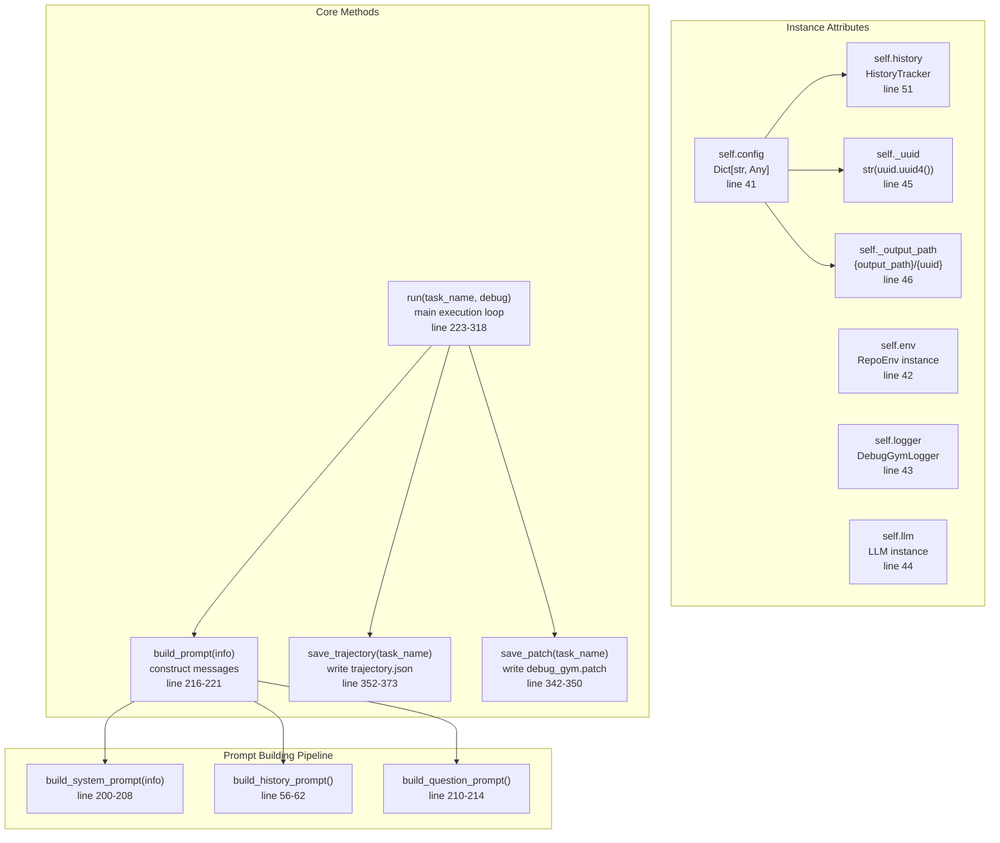
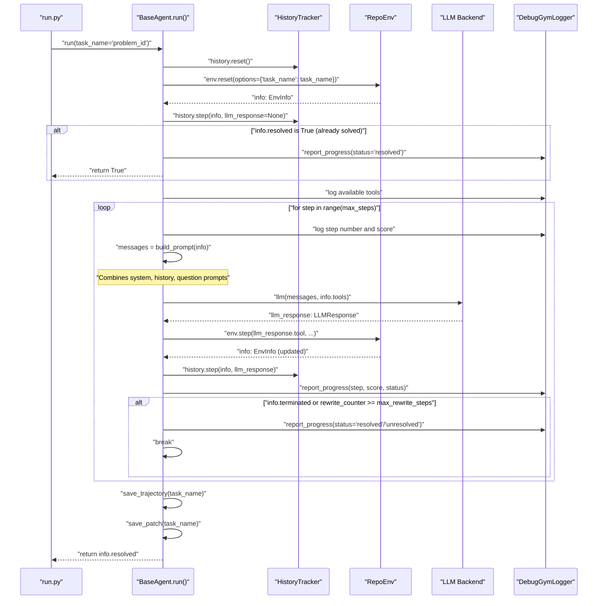
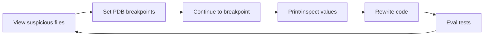
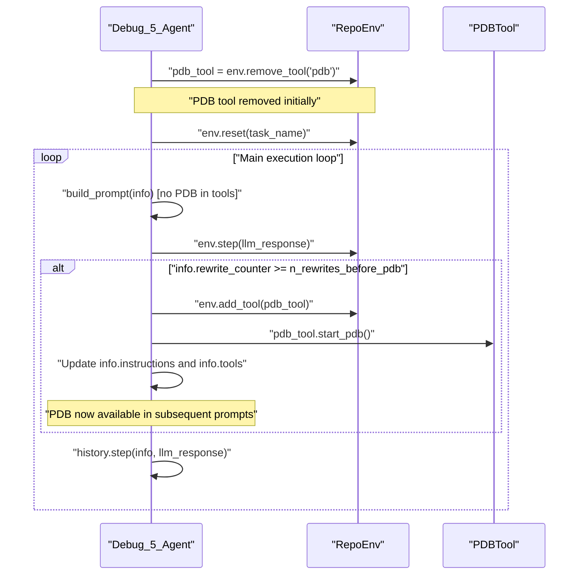
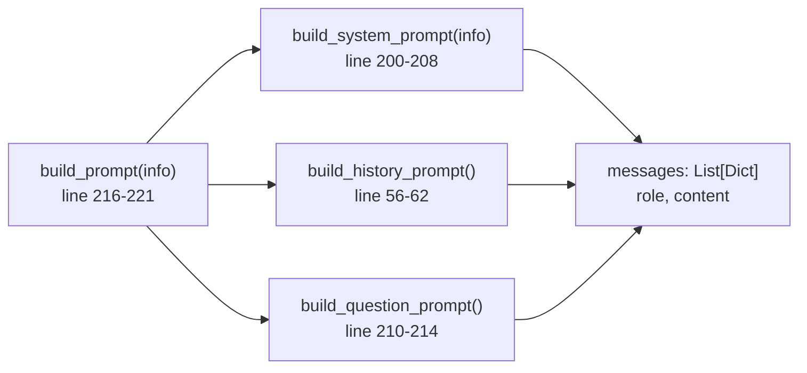
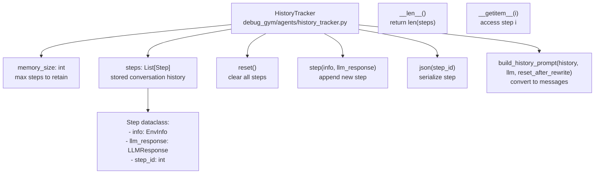
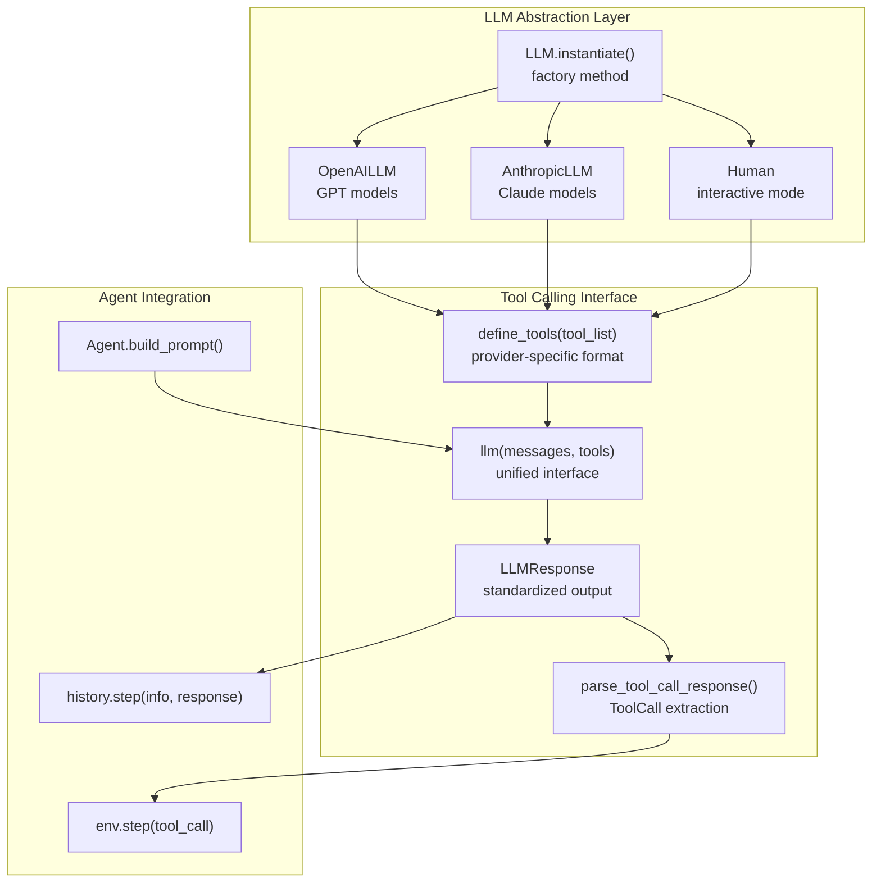

<!-- source: DeepWiki mcp.deepwiki.com · repo microsoft/debug-gym · page 2.2 Agent Framework · fetched 2026-10-26 -->

# Agent Framework

Relevant source files

The following files were used as context for generating this wiki page:

- [debug_gym/agents/base_agent.py](debug_gym/agents/base_agent.py)
- [debug_gym/agents/debug_agent.py](debug_gym/agents/debug_agent.py)
- [debug_gym/agents/rewrite_agent.py](debug_gym/agents/rewrite_agent.py)
- [debug_gym/agents/solution_agent.py](debug_gym/agents/solution_agent.py)
- [debug_gym/agents/utils.py](debug_gym/agents/utils.py)
- [debug_gym/llms/__init__.py](debug_gym/llms/__init__.py)
- [tests/agents/conftest.py](tests/agents/conftest.py)
- [tests/agents/test_utils.py](tests/agents/test_utils.py)

The agent framework provides the core orchestration logic for LLM-based debugging agents in debug-gym. Agents coordinate between LLM backends (see [LLM Integration](#2.3)), environment tooling (see [Environment System](#2.1)), and execution infrastructure to solve debugging tasks. The framework consists of the `BaseAgent` class, a registry system for agent discovery, specialized agent implementations for different debugging strategies, and a history tracking system for managing conversation context.

## Agent Registry and Factory System

The framework uses a registration pattern for agent discovery and instantiation. The `AGENT_REGISTRY` global dictionary [debug_gym/agents/base_agent.py:17]() maps agent names (strings) to agent classes. Agents self-register using the `@register_agent` decorator [debug_gym/agents/base_agent.py:20-26](), which validates that the class is a `BaseAgent` subclass and has a non-null `name` attribute.

**Registration Pattern:**

The `create_agent()` factory function [debug_gym/agents/base_agent.py:376-393]() supports two lookup mechanisms:
1. **Registry lookup**: If `agent_type` is a registered name (e.g., `"debug_agent"`), retrieve from `AGENT_REGISTRY`
2. **Dynamic import**: If `agent_type` contains a dot (e.g., `"my_module.CustomAgent"`), use `importlib` to dynamically load the class

**Sources:** [debug_gym/agents/base_agent.py:17-27](), [debug_gym/agents/base_agent.py:376-393](), [debug_gym/agents/debug_agent.py:4-5](), [debug_gym/agents/rewrite_agent.py:4-5](), [debug_gym/agents/solution_agent.py:6-7]()

## BaseAgent Class Architecture

The `BaseAgent` class [debug_gym/agents/base_agent.py:29]() is the abstract base for all agents. It defines three class attributes that subclasses must override:
- `name`: String identifier for registry lookup
- `system_prompt`: High-level task description for the LLM
- `action_prompt`: Optional follow-up prompt requesting the next action

**BaseAgent Core Components:**

**Initialization:** The `__init__` method [debug_gym/agents/base_agent.py:34-51]() performs:
1. Store `config`, `env`, `logger`, and `llm` instances
2. Generate unique UUID from config or create new one
3. Create output directory at `{config['output_path']}/{uuid}`
4. Set random seed via `np.random.seed(config['random_seed'])`
5. Initialize `HistoryTracker` with `config['memory_size']`

**Sources:** [debug_gym/agents/base_agent.py:29-62](), [debug_gym/agents/base_agent.py:216-221](), [debug_gym/agents/base_agent.py:223-318](), [debug_gym/agents/base_agent.py:342-373]()

## Agent Execution Lifecycle

The `run()` method [debug_gym/agents/base_agent.py:223-318]() orchestrates the agent's main execution loop. It implements a step-based interaction pattern where the agent alternates between prompting the LLM and executing tools in the environment.

**Execution Flow:**

**Key Loop Variables:**
| Variable | Type | Purpose |
|----------|------|---------|
| `step` | int | Current iteration (0 to `max_steps - 1`) |
| `info` | `EnvInfo` | Environment state including observations, score, tools, termination flags |
| `messages` | `List[Dict]` | LLM input messages (system + history + question) |
| `llm_response` | `LLMResponse` | LLM output containing tool call, reasoning, and response text |
| `highscore` | int | Best score achieved so far (for logging) |

**Termination Conditions** [debug_gym/agents/base_agent.py:269-288]():
1. `info.terminated == True`: Task solved (test passes)
2. `info.rewrite_counter >= config['max_rewrite_steps']`: Too many code modifications
3. Loop completes `max_steps` iterations

**Sources:** [debug_gym/agents/base_agent.py:223-318](), [debug_gym/agents/base_agent.py:216-221]()

## Specialized Agent Implementations

The framework provides four built-in agent types, each optimized for different debugging workflows.

| Agent Class | Name | System Prompt Strategy | Key Behavior |
|-------------|------|----------------------|--------------|
| `DebugAgent` | `"debug_agent"` | Emphasizes PDB investigation before patching | Full tool access from start |
| `Debug_5_Agent` | `"debug_5_agent"` | Same as `DebugAgent` | Delays PDB access until N rewrites |
| `RewriteAgent` | `"rewrite_agent"` | Focus on direct code modification | Simpler prompt, less PDB emphasis |
| `AgentSolution` | `"solution_agent"` | No LLM prompting | Validates gold patches (oracle) |

### DebugAgent

The `DebugAgent` [debug_gym/agents/debug_agent.py:4-8]() is the standard debugging agent with full tool access. Its `system_prompt` instructs the LLM to:
1. Use PDB to investigate suspicious code locations
2. Set breakpoints and inspect values before proposing patches
3. Call the `eval` tool after each rewrite to verify fixes

**DebugAgent Workflow:**

### Debug_5_Agent

The `Debug_5_Agent` [debug_gym/agents/debug_agent.py:11-118]() implements a hybrid strategy where PDB access is delayed. This forces the agent to attempt code modifications first, only gaining debugging capabilities after making `n_rewrites_before_pdb` rewrite attempts.

**Debug_5_Agent Custom `run()` Logic:**

The conditional re-introduction of PDB [debug_gym/agents/debug_agent.py:59-67]() checks:
- `info.rewrite_counter >= config['n_rewrites_before_pdb']`
- `pdb_tool.name not in self.env.tools` (avoid double-adding)

When triggered, the agent calls `pdb_tool.start_pdb()` to initialize the debugger and updates `info.instructions` and `info.tools` so subsequent prompts include PDB documentation.

### RewriteAgent

The `RewriteAgent` [debug_gym/agents/rewrite_agent.py:4-9]() uses a simpler `system_prompt` that de-emphasizes PDB. It still has access to all tools but encourages more direct code modification.

### AgentSolution (Oracle Agent)

The `AgentSolution` [debug_gym/agents/solution_agent.py:6-83]() is a special agent for validating gold patches. It does not use LLM prompting. Instead, it:
1. Validates the environment implements `apply_gold_patch()` [debug_gym/agents/solution_agent.py:19-30]()
2. Makes basic PDB sanity checks (help command, continue command) [debug_gym/agents/solution_agent.py:42-62]()
3. Applies the gold patch via `env.apply_gold_patch()` [debug_gym/agents/solution_agent.py:64]()
4. Submits the solution [debug_gym/agents/solution_agent.py:69-70]()
5. Asserts `info.resolved == True` [debug_gym/agents/solution_agent.py:75-78]()

This agent is used to verify that benchmark datasets have correct gold patches and that the environment's evaluation logic works correctly.

**Sources:** [debug_gym/agents/debug_agent.py:4-8](), [debug_gym/agents/debug_agent.py:11-118](), [debug_gym/agents/rewrite_agent.py:4-9](), [debug_gym/agents/solution_agent.py:6-83]()

## Prompt Building System

The `build_prompt()` method [debug_gym/agents/base_agent.py:216-221]() constructs the complete message list for LLM input by concatenating three components:

### System Prompt Construction

The `build_system_prompt()` method [debug_gym/agents/base_agent.py:200-208]() generates the initial system message containing task context. It supports two modes:

**1. Jinja2 Template Mode** [debug_gym/agents/base_agent.py:149-168]():
- If `config['system_prompt_template_file']` is set, load the template
- Create Jinja2 environment with custom filters: `to_pretty_json`, `trim_message`
- Render template with `agent=self` and `info=info`
- Allows full customization of system prompt structure

**2. Default JSON Mode** [debug_gym/agents/base_agent.py:170-198]():
- Build a dictionary with standardized fields
- Convert to pretty-printed JSON
- Fields included based on configuration flags

**Default System Prompt Fields:**
| Field | Condition | Source | Token Limit |
|-------|-----------|--------|-------------|
| `"Overall task"` | Always | `self.system_prompt` | None |
| `"Instructions"` | Always | `info.instructions` (tool documentation) | None |
| `"Repo directory tree"` | `show_directory_tree=True` | `info.dir_tree` | 10% of context |
| `"Current breakpoints"` | `show_current_breakpoints=True` | `info.current_breakpoints` | None |
| `"Evaluation output of current code"` | `auto_eval_on_rewrite=True` | `info.eval_observation.observation` | 80% of context |
| `"Shortcut features"` | If any enabled | `self.shortcut_features()` | None |

The `shortcut_features()` method [debug_gym/agents/base_agent.py:87-116]() detects environment capabilities and returns a list of feature descriptions:
- Auto-evaluation after rewrites (`_auto_eval_on_rewrite()`)
- Directory tree display (`_show_directory_tree()`)
- Current breakpoints display (`_show_current_breakpoints()`)
- Persistent breakpoints across rewrites
- Auto-listing after PDB commands

### History Prompt Construction

The `build_history_prompt()` method [debug_gym/agents/base_agent.py:56-62]() delegates to `build_history_prompt()` from `debug_gym/agents/history_tracker.py`. It converts the `HistoryTracker`'s stored steps into LLM message format, optionally resetting history after rewrites based on `config['reset_prompt_history_after_rewrite']`.

### Question Prompt Construction

The `build_question_prompt()` method [debug_gym/agents/base_agent.py:210-214]() appends the agent's `action_prompt` if defined. For example, this could be "What tool would you like to call next?"

### Token Management

The `trim_message()` method [debug_gym/agents/base_agent.py:123-147]() ensures messages fit within token limits:
- Filters non-UTF8 characters via `filter_non_utf8()`
- Counts tokens using `llm.count_tokens` (typically tiktoken)
- Trims to `max_length` (absolute) or `max_length_percentage` (relative to `llm.context_length`)
- `where` parameter controls trim location: `"start"`, `"middle"`, or `"end"`

**Sources:** [debug_gym/agents/base_agent.py:56-62](), [debug_gym/agents/base_agent.py:87-116](), [debug_gym/agents/base_agent.py:123-147](), [debug_gym/agents/base_agent.py:149-214](), [debug_gym/agents/base_agent.py:216-221]()

## History Tracking

The `HistoryTracker` class manages conversation history with sliding window memory and support for history resets after rewrites.

**HistoryTracker Architecture:**

**Step Storage:** Each step records:
- `info`: `EnvInfo` object with environment state, observations, score
- `llm_response`: `LLMResponse` object with tool call, reasoning, raw response
- `step_id`: Integer step number

**Memory Management:** When `len(steps) > memory_size`, oldest steps are dropped to maintain the sliding window [debug_gym/agents/history_tracker.py].

**History Reset Logic** [debug_gym/agents/history_tracker.py]: The `build_history_prompt()` function can reset history after code rewrites if `reset_after_rewrite=True`. This is useful when large code changes make prior debugging context obsolete. The reset only affects the prompt construction, not the stored trajectory.

**Sources:** [debug_gym/agents/history_tracker.py](), [debug_gym/agents/base_agent.py:51](), [debug_gym/agents/base_agent.py:56-62]()

## LLM Integration Pattern

Agents interact with LLMs through a standardized interface that supports multiple providers and tool-calling formats.

**Sources:** [debug_gym/agents/base_agent.py:43-47](), [debug_gym/llms/openai.py:104-123](), [debug_gym/llms/anthropic.py:70-86](), [debug_gym/llms/human.py:480-493]()

---

