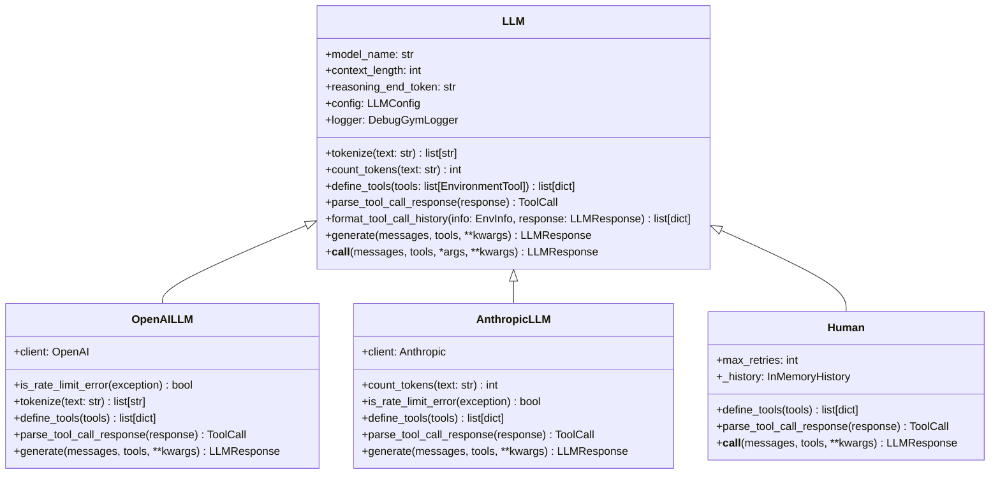
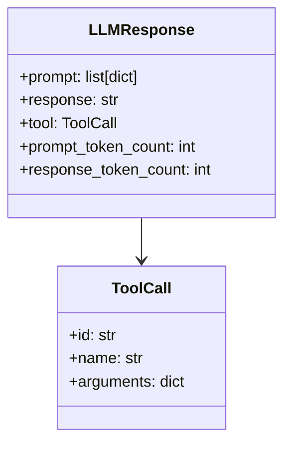
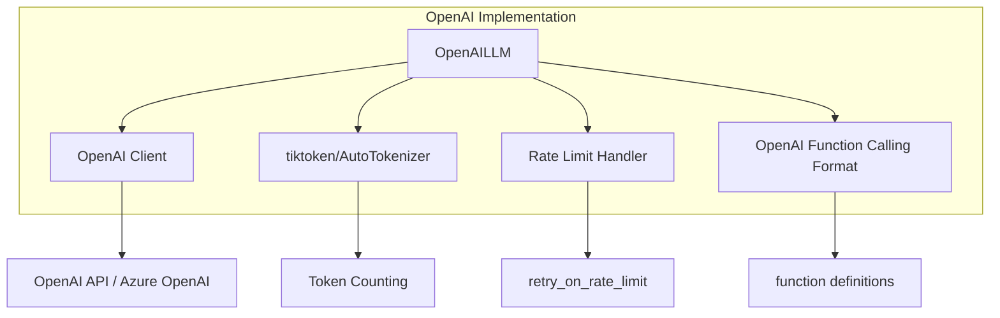
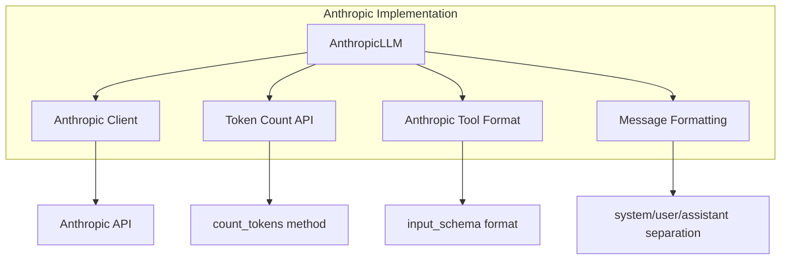
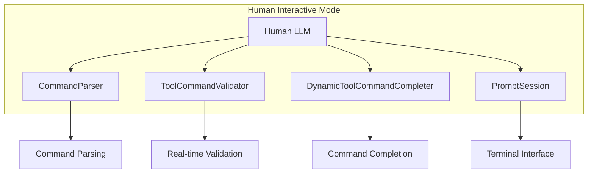
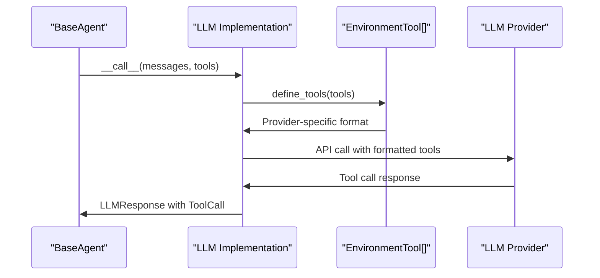
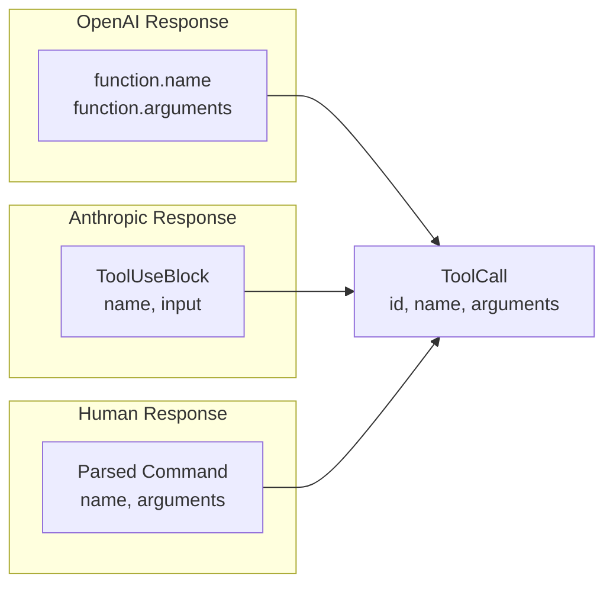
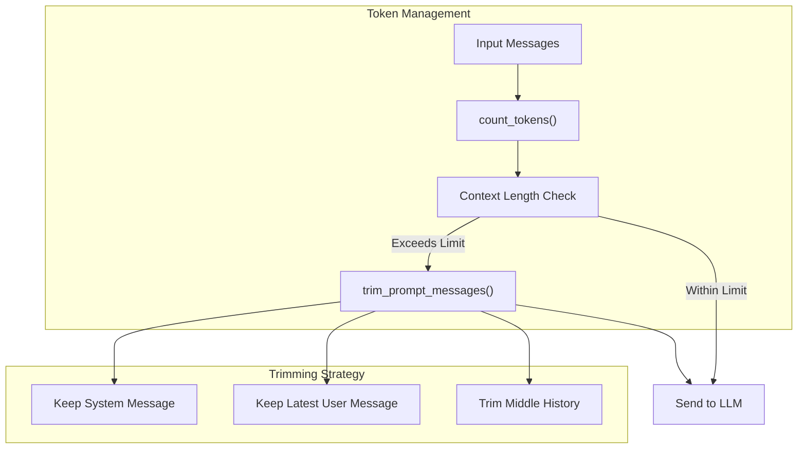
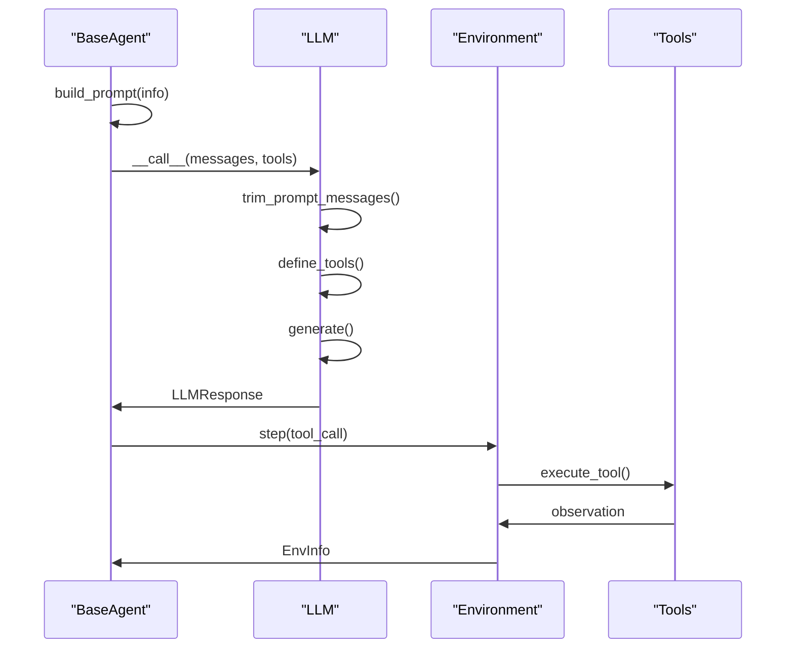
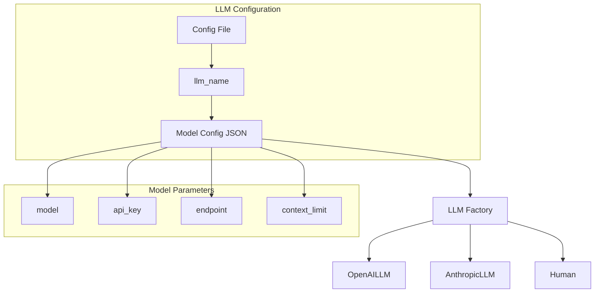

<!-- source: DeepWiki mcp.deepwiki.com · repo microsoft/debug-gym · page 2.3 LLM Integration · fetched 2026-10-26 -->

# LLM Integration

Relevant source files

The following files were used as context for generating this wiki page:

- [.gitignore](.gitignore)
- [analysis/json_log_viewer/templates/index.html](analysis/json_log_viewer/templates/index.html)
- [debug_gym/llms/anthropic.py](debug_gym/llms/anthropic.py)
- [debug_gym/llms/base.py](debug_gym/llms/base.py)
- [debug_gym/llms/copilot.py](debug_gym/llms/copilot.py)
- [debug_gym/llms/human.py](debug_gym/llms/human.py)
- [debug_gym/llms/openai.py](debug_gym/llms/openai.py)
- [tests/llms/test_copilot.py](tests/llms/test_copilot.py)
- [tests/llms/test_human.py](tests/llms/test_human.py)
- [tests/llms/test_openai.py](tests/llms/test_openai.py)

This document covers the LLM (Large Language Model) abstraction layer in debug-gym, which provides a unified interface for interacting with different LLM providers including OpenAI, Anthropic, and human operators. The integration enables agents to generate tool calls and responses through a consistent API regardless of the underlying provider.

For information about how agents use LLMs in their execution loops, see [Agent Framework](#2.2). For details on the tool system that LLMs interact with, see [Tool System](#3).

## LLM Abstraction Layer

The system provides a unified interface through the base `LLM` class that abstracts away provider-specific implementations. This enables agents to work with any supported LLM provider without modification.

### Base LLM Interface

**Sources:** [debug_gym/llms/openai.py:24-212](), [debug_gym/llms/anthropic.py:8-206](), [debug_gym/llms/human.py:460-596]()

### LLM Response Format

All LLM implementations return responses through a standardized `LLMResponse` object:

**Sources:** [debug_gym/llms/openai.py:204-211](), [debug_gym/llms/anthropic.py:197-205](), [debug_gym/llms/human.py:589-595]()

## Provider Implementations

### OpenAI Integration

The `OpenAILLM` class handles integration with OpenAI's API, including GPT models and Azure OpenAI deployments:

Key features:
- **Token Management**: Uses `tiktoken` for OpenAI models or `AutoTokenizer` for other models [debug_gym/llms/openai.py:44-59]()
- **Rate Limiting**: Handles various OpenAI API errors with retry logic [debug_gym/llms/openai.py:61-102]()
- **Tool Definition**: Converts tools to OpenAI function calling format [debug_gym/llms/openai.py:104-123]()
- **Azure Support**: Configurable endpoint for Azure OpenAI deployments [debug_gym/llms/openai.py:27-42]()

**Sources:** [debug_gym/llms/openai.py:24-212]()

### Anthropic Integration

The `AnthropicLLM` class provides integration with Claude models:

Key features:
- **Token Counting**: Uses Anthropic's API for accurate token counting [debug_gym/llms/anthropic.py:25-51]()
- **Tool Schema**: Converts tools to Anthropic's `input_schema` format [debug_gym/llms/anthropic.py:70-86]()
- **Message Processing**: Handles system/user/assistant message separation [debug_gym/llms/anthropic.py:143-165]()
- **Error Handling**: Specific handling for Anthropic rate limits and overload errors [debug_gym/llms/anthropic.py:53-68]()

**Sources:** [debug_gym/llms/anthropic.py:8-206]()

### Human Interactive Mode

The `Human` class enables human operators to act as an LLM through an interactive command-line interface:

Key features:
- **Command Parsing**: Parses tool calls from human input [debug_gym/llms/human.py:48-219]()
- **Real-time Validation**: Validates commands as they're typed [debug_gym/llms/human.py:221-321]()
- **Auto-completion**: Provides intelligent completion for commands and arguments [debug_gym/llms/human.py:323-458]()
- **Error Recovery**: Allows retry on invalid input up to max retries [debug_gym/llms/human.py:542-587]()

**Sources:** [debug_gym/llms/human.py:460-596]()

## Tool Calling System

All LLM implementations support tool calling through a unified interface, with provider-specific formatting:

### Tool Definition Process

### Provider-Specific Tool Formats

| Provider | Format | Key Fields |
|----------|--------|------------|
| OpenAI | Function calling | `type: "function"`, `function.name`, `function.parameters` |
| Anthropic | Tool use | `name`, `description`, `input_schema` |
| Human | Interactive commands | `name`, `arguments`, `description` |

**Sources:** [debug_gym/llms/openai.py:104-123](), [debug_gym/llms/anthropic.py:70-86](), [debug_gym/llms/human.py:480-493]()

### Tool Call Parsing

Each provider parses tool call responses into the unified `ToolCall` format:

**Sources:** [debug_gym/llms/openai.py:125-147](), [debug_gym/llms/anthropic.py:88-106](), [debug_gym/llms/human.py:530-577]()

## Token Management and Context Handling

The system provides sophisticated token management to handle context length limitations:

### Context Length Management

**Sources:** [debug_gym/agents/utils.py:39-97]()

### Prompt Trimming Algorithm

The `trim_prompt_messages` function implements a sophisticated trimming strategy:

1. **Preserve Critical Messages**: Always keep system prompt and latest user message [debug_gym/agents/utils.py:64-75]()
2. **Trim from Middle**: Remove older conversation history while preserving recent context [debug_gym/agents/utils.py:86-96]()
3. **Smart Text Trimming**: When individual messages are too long, trim from the middle with ellipsis [debug_gym/agents/utils.py:8-36]()

**Sources:** [debug_gym/agents/utils.py:39-97](), [debug_gym/agents/utils.py:8-36]()

## Agent Integration

LLMs integrate with agents through the `BaseAgent` class, which manages the LLM lifecycle and tool calling:

### LLM Selection and Configuration

Agents initialize LLMs based on configuration:

**Sources:** [debug_gym/agents/debug_agent.py:36-37](), [tests/agents/conftest.py:40-58]()

## Configuration and Setup

LLM configuration is managed through JSON configuration files that specify model parameters and API credentials:

### Configuration Structure

| Field | Description | Example |
|-------|-------------|---------|
| `model` | Model identifier | `"gpt-4o"`, `"claude-3-5-sonnet-20241022"` |
| `tokenizer` | Tokenizer for counting | `"gpt-4o"`, `"claude-3-5-sonnet-20241022"` |
| `context_limit` | Maximum context length | `128000` |
| `api_key` | Provider API key | `"sk-..."` |
| `endpoint` | API endpoint URL | `"https://api.openai.com/v1"` |
| `tags` | Provider tags | `["azure openai"]` |

### Error Handling and Resilience

The system includes comprehensive error handling:
- **Rate Limiting**: Automatic retry with exponential backoff [debug_gym/llms/openai.py:61-102]()
- **Context Overflow**: Dynamic prompt trimming when context limit exceeded [debug_gym/agents/utils.py:39-97]()
- **API Failures**: Provider-specific error detection and recovery [debug_gym/llms/anthropic.py:53-68]()
- **Validation**: Input validation for human mode with helpful error messages [debug_gym/llms/human.py:221-321]()

**Sources:** [debug_gym/llms/openai.py:61-102](), [debug_gym/llms/anthropic.py:53-68](), [debug_gym/agents/utils.py:39-97](), [debug_gym/llms/human.py:221-321]()

---

