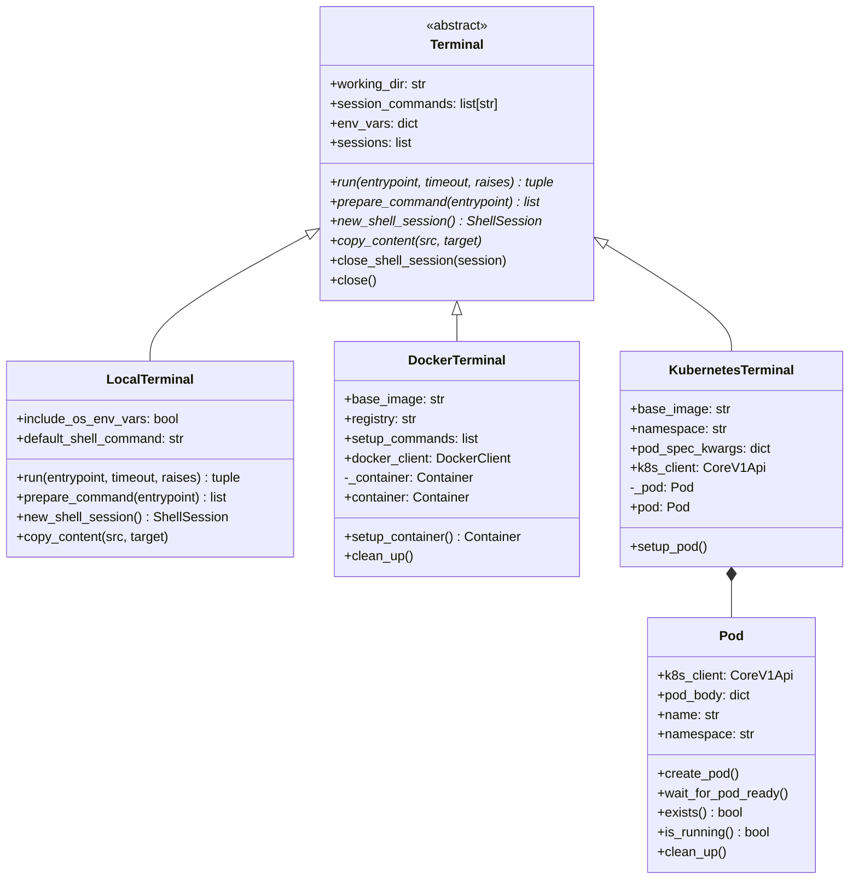
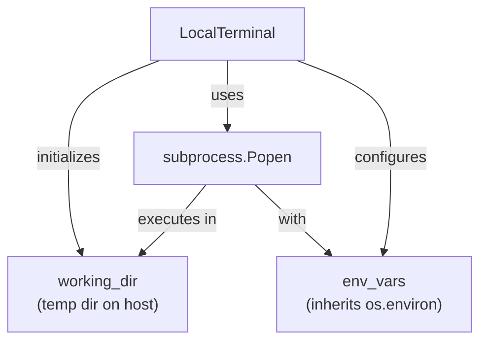
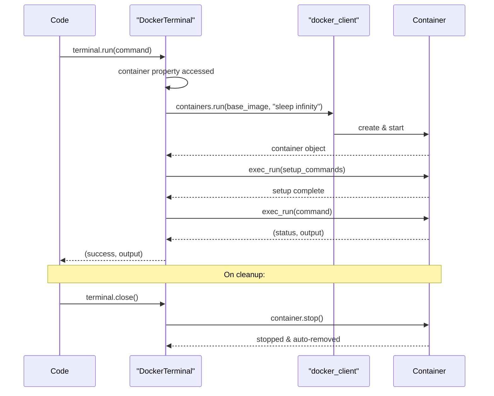
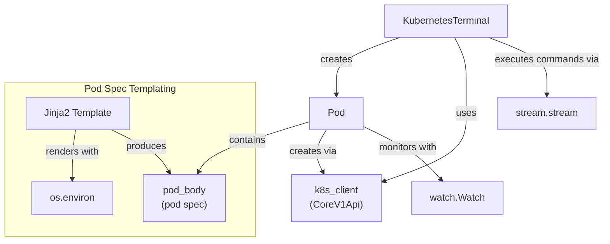
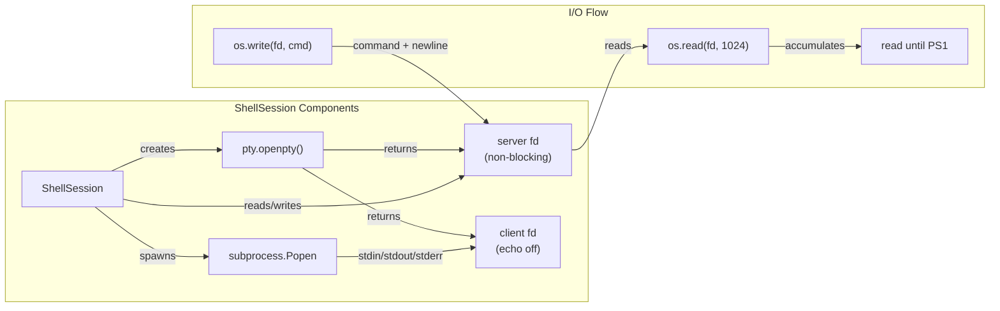
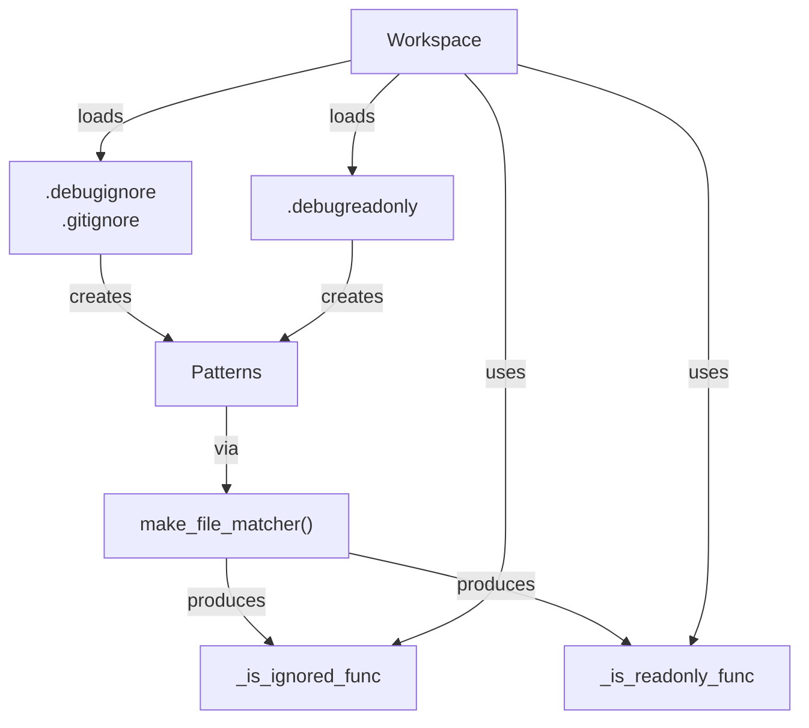
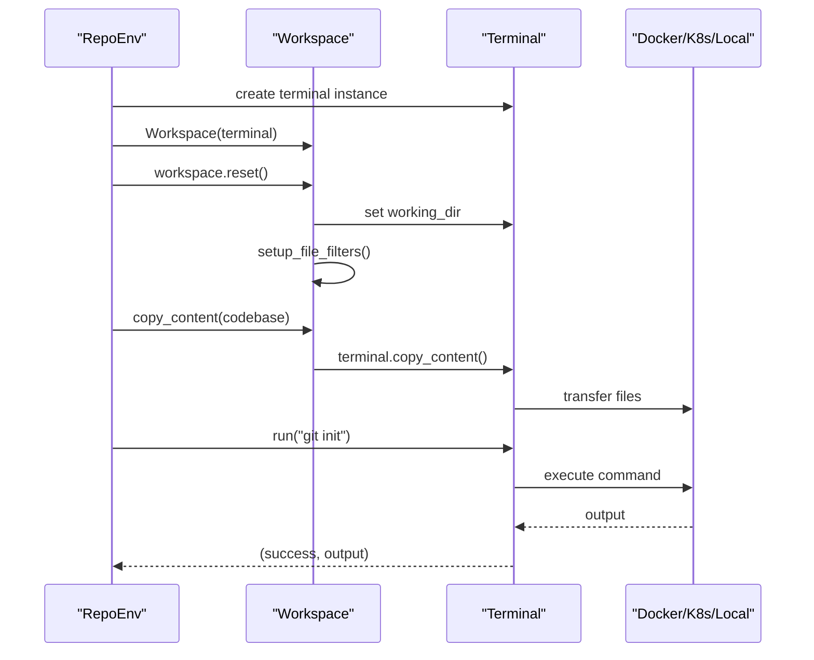

<!-- source: DeepWiki mcp.deepwiki.com · repo microsoft/debug-gym · page 2.4 Execution Infrastructure · fetched 2026-10-26 -->

# Execution Infrastructure

<details>
<summary>Relevant source files</summary>

The following files were used as context for generating this wiki page:

- [.gitignore](.gitignore)
- [debug_gym/gym/envs/aider.py](debug_gym/gym/envs/aider.py)
- [debug_gym/gym/envs/mini_nightmare.py](debug_gym/gym/envs/mini_nightmare.py)
- [debug_gym/gym/terminals/__init__.py](debug_gym/gym/terminals/__init__.py)
- [debug_gym/gym/terminals/docker.py](debug_gym/gym/terminals/docker.py)
- [debug_gym/gym/terminals/kubernetes.py](debug_gym/gym/terminals/kubernetes.py)
- [debug_gym/gym/terminals/local.py](debug_gym/gym/terminals/local.py)
- [debug_gym/gym/terminals/shell_session.py](debug_gym/gym/terminals/shell_session.py)
- [debug_gym/gym/terminals/terminal.py](debug_gym/gym/terminals/terminal.py)
- [debug_gym/gym/workspace.py](debug_gym/gym/workspace.py)
- [debug_gym/llms/copilot.py](debug_gym/llms/copilot.py)
- [tests/gym/envs/test_aider.py](tests/gym/envs/test_aider.py)
- [tests/gym/terminals/test_docker.py](tests/gym/terminals/test_docker.py)
- [tests/gym/terminals/test_kubernetes.py](tests/gym/terminals/test_kubernetes.py)
- [tests/gym/test_workspace.py](tests/gym/test_workspace.py)
- [tests/llms/test_copilot.py](tests/llms/test_copilot.py)

</details>


The execution infrastructure provides isolated command execution and file management for debug-gym environments. It abstracts terminal operations across local, Docker, and Kubernetes execution contexts, ensuring agents can run commands and manipulate files consistently regardless of the underlying infrastructure. For information about how environments use this infrastructure, see [Environment System (RepoEnv)](#2.1). For orchestration and parallel execution details, see [Orchestration and Execution](#5.2).

## Terminal Abstraction

The `Terminal` abstract base class defines the interface for command execution across different isolation backends. All terminal implementations provide:

- **Command execution**: `run()` method executes shell commands and returns status and output
- **Interactive sessions**: `new_shell_session()` creates persistent PTY-based shells for tools like PDB
- **File transfer**: `copy_content()` transfers files from host to execution environment
- **Working directory management**: Lazy initialization of isolated working directories
- **Environment configuration**: Standardized environment variables for clean output

The base class enforces a clean output environment by setting environment variables like `NO_COLOR=1`, `PS1=DEBUG_GYM_PS1`, and `PYTHONDONTWRITEBYTECODE=1` to prevent terminal colors, custom prompts, and Python bytecode files from interfering with output parsing.

**Terminal Class Hierarchy**



Sources: [debug_gym/gym/terminals/terminal.py:12-93](), [debug_gym/gym/terminals/local.py:11-137](), [debug_gym/gym/terminals/docker.py:15-225](), [debug_gym/gym/terminals/kubernetes.py:215-573]()

## Terminal Implementations

### LocalTerminal

`LocalTerminal` executes commands directly on the host machine using Python's `subprocess` module. It provides no isolation and is primarily used for development and testing.

**Key characteristics:**
- Inherits host OS environment variables by default (`include_os_env_vars=True`)
- Creates temporary working directories with `tempfile.TemporaryDirectory`
- Uses `/bin/bash --noprofile --norc --noediting` as the shell
- File copying uses `cp -r` command
- No resource limits or cleanup requirements



Sources: [debug_gym/gym/terminals/local.py:11-137](), [tests/gym/test_workspace.py:28-65]()

### DockerTerminal

`DockerTerminal` provides container isolation using Docker. It is the recommended default for running benchmarks as it balances isolation with ease of setup.

**Container lifecycle:**
1. Lazy initialization via `container` property
2. `docker_client.containers.run()` creates container with `sleep infinity` command
3. Setup commands execute after container starts
4. Container auto-removed on cleanup via `atexit` registration
5. `exec_run()` executes commands in running container

**Key features:**
- Base image specification with optional registry
- Working directory defaults to `/testbed`
- Setup commands for package installation
- File transfer using tar archives via `put_archive()`
- Resource limits: 16GB memory (`mem_limit="16G"`)
- Host networking mode (`network_mode="host"`)



Sources: [debug_gym/gym/terminals/docker.py:15-225](), [debug_gym/gym/envs/aider.py:69-76](), [tests/gym/terminals/test_docker.py:13-200]()

### KubernetesTerminal

`KubernetesTerminal` provides scalable execution on Kubernetes clusters, enabling parallel execution of hundreds of tasks. It is used for large-scale benchmarks like SWE-Bench.

**Pod lifecycle:**
1. Lazy initialization via `pod` property
2. `Pod` object created with pod specification
3. Pod waits for `Running` status using Kubernetes watch API
4. Commands executed via `kubectl exec` or `stream.stream()`
5. Cleanup deletes pod with grace period

**Key features:**
- Pod specification templating with Jinja2 (environment variable substitution)
- Custom pod specs: tolerations, affinity, node selectors via `pod_spec_kwargs`
- Retry logic with exponential backoff for transient failures (tenacity library)
- Resource requests: 0.5 CPU, 1GB memory; limits: 2 CPU, 8GB memory
- File transfer via `kubectl cp` subprocess
- HMAC authentication for secure clusters
- Multiple Kubernetes context support

**Pod specification structure:**

| Field | Default Value | Description |
|-------|---------------|-------------|
| `restartPolicy` | `"Never"` | Pods never restart on failure |
| `activeDeadlineSeconds` | `86400` (24h) | Maximum pod lifetime |
| `command` | `["/bin/bash"]` | Container entrypoint |
| `args` | `["-c", "sleep infinity"]` | Keep pod alive |
| `imagePullPolicy` | `"IfNotPresent"` | Pull image only if not cached |



Sources: [debug_gym/gym/terminals/kubernetes.py:215-573](), [debug_gym/gym/terminals/kubernetes.py:39-213](), [tests/gym/terminals/test_kubernetes.py:34-325]()

## ShellSession: Interactive Command Execution

`ShellSession` provides persistent, interactive shell sessions using pseudo-terminals (PTY). This is essential for interactive debugging tools like PDB that require maintaining state across multiple commands.

**Architecture:**
- Creates PTY pair using `pty.openpty()`
- Spawns subprocess with stdin/stdout/stderr connected to PTY
- Non-blocking I/O with `fcntl.fcntl()` and `os.O_NONBLOCK`
- Disables terminal echo with `termios.tcsetattr()`
- Reads output until PS1 sentinel or timeout

**Key capabilities:**
- Environment persistence: variables and working directory maintained between commands
- Session commands: prepended to every session initialization
- Timeout handling: `DEFAULT_TIMEOUT = 300` seconds
- Automatic retry on `ProcessNotRunningError` with exponential backoff



**Usage pattern for PDB:**
```
1. terminal.new_shell_session() creates session
2. session.start() or session.run(cmd) initializes
3. PDB commands sent via session.run()
4. Output read until PS1 sentinel appears
5. Session persists for subsequent commands
6. terminal.close_shell_session() cleans up
```

Sources: [debug_gym/gym/terminals/shell_session.py:36-218](), [debug_gym/gym/terminals/docker.py:78-87](), [tests/gym/terminals/test_docker.py:89-114]()

## Workspace: File Management Abstraction

`Workspace` provides a high-level interface for file operations within environments, abstracting terminal-specific file access and enforcing access control policies.

**Core responsibilities:**
- Path resolution: converts relative paths to absolute based on working directory
- File filtering: implements `.debugignore` and `.debugreadonly` patterns
- Directory visualization: generates tree views with read-only annotations
- File I/O: read and write operations via terminal commands

**File filtering mechanism:**



**Key methods:**

| Method | Purpose | Terminal Command Used |
|--------|---------|----------------------|
| `resolve_path(filepath, raises=False)` | Convert relative→absolute path | `realpath -s` + `test -e` |
| `read_file(filepath)` | Read file contents | `cat filepath` |
| `write_file(filepath, content)` | Write content to file | `cat <<'EOF' ... EOF > filepath` |
| `directory_tree(root, max_depth=1)` | Generate directory tree | `tree --charset=ASCII -a -v -F -f -l -L depth` |
| `copy_content(src, target)` | Copy directory contents | `terminal.copy_content()` |

**Write file implementation detail:**
To handle large files and preserve trailing newlines, `write_file()` uses a heredoc with a sentinel delimiter:
```bash
CONTENT=$(cat <<'DEBUGGYM_EOF'
[content]DEBUGGYM_DEL
DEBUGGYM_EOF
); echo -n "${CONTENT%DEBUGGYM_DEL}" > filepath
```
Content is split into 32KB chunks to avoid command length limits.

Sources: [debug_gym/gym/workspace.py:12-214](), [tests/gym/test_workspace.py:1-335]()

## Terminal Selection and Configuration

The `select_terminal()` factory function instantiates the appropriate terminal based on configuration. It is used by environments during initialization.

**Configuration structure:**
```python
terminal_config = {
    "type": "docker" | "kubernetes" | "local",
    "base_image": "ubuntu:latest",  # Docker/K8s only
    "registry": "myregistry.io/",   # Optional
    "setup_commands": ["pip install pytest"],  # Optional
    "namespace": "default",         # K8s only
    "pod_spec_kwargs": {...},       # K8s only
    # ... other backend-specific params
}
```

**Selection logic:**

```mermaid
graph TD
    Select["select_terminal(config)"]
    Type{config['type']}
    
    Select --> Type
    Type -->|"docker"| Docker["DockerTerminal"]
    Type -->|"kubernetes"| K8s["KubernetesTerminal"]
    Type -->|"local"| Local["LocalTerminal"]
    Type -->|"unknown"| Error["ValueError"]
    
    Docker -->|"returns"| Terminal["Terminal instance"]
    K8s -->|"returns"| Terminal
    Local -->|"returns"| Terminal
```

**Default behavior by environment:**
- `AiderBenchmarkEnv`: Docker with `debug-gym:aider` image
- `MiniNightmareEnv`: Docker with `debug-gym:mini-nightmare` image
- `SWEBenchEnv`: Docker or Kubernetes with `swebench/*` images
- Development/testing: `LocalTerminal` for fast iteration

Sources: [debug_gym/gym/terminals/__init__.py:8-33](), [debug_gym/gym/envs/aider.py:63-76](), [tests/gym/terminals/test_docker.py:145-151]()

## Integration with Environments

Environments use the execution infrastructure through a two-layer architecture: `Workspace` for file operations and `Terminal` for command execution.

**Initialization sequence:**



**Environment responsibilities vs. infrastructure responsibilities:**

| Responsibility | Layer | Implementation |
|---------------|-------|----------------|
| Task setup | Environment | `setup_task()`, `setup_workspace()` |
| File filtering | Workspace | `.debugignore`, `.debugreadonly` patterns |
| Command execution | Terminal | `run()`, `new_shell_session()` |
| Isolation | Terminal Backend | Docker container, K8s pod, or local process |
| File transfer | Terminal Backend | tar archives, kubectl cp, or cp command |
| Cleanup | Terminal Backend | Container/pod deletion, temp dir cleanup |

**Working directory conventions:**
- Docker/Kubernetes: `/testbed` (hard-coded in container/pod)
- Local: Temporary directory with `DebugGym-` prefix in `/tmp`

Sources: [debug_gym/gym/workspace.py:26-43](), [debug_gym/gym/envs/aider.py:99-124](), [debug_gym/gym/envs/mini_nightmare.py:115-140]()

## Error Handling and Resilience

The execution infrastructure implements multiple layers of error handling to ensure robustness during long-running benchmark evaluations.

**Retry mechanisms:**

| Component | Retry Strategy | Configuration |
|-----------|---------------|---------------|
| `KubernetesTerminal.run()` | Fixed retry loop | `NB_RETRIES_RUN = 50` attempts |
| `Pod.create_pod()` | Exponential backoff | 30 attempts, 1-240s wait (tenacity) |
| `ShellSession.start()` | Exponential backoff | 30 attempts, 0.1-2s wait (tenacity) |

**Cleanup guarantees:**
- `atexit` registration ensures cleanup even on abnormal termination
- Docker: `auto_remove=True` removes containers when stopped
- Kubernetes: Grace period of 5 seconds before force deletion
- Local: `tempfile.TemporaryDirectory` auto-cleanup

**Resource limits:**
```python
# DockerTerminal
container = client.containers.run(
    ...,
    mem_limit="16G",
    network_mode="host"
)

# KubernetesTerminal
pod_spec = {
    "spec": {
        "activeDeadlineSeconds": 86400,  # 24 hour max lifetime
        "containers": [{
            "resources": {
                "requests": {"cpu": "0.5", "memory": "1Gi"},
                "limits": {"cpu": "2", "memory": "8Gi"}
            }
        }]
    }
}
```

Sources: [debug_gym/gym/terminals/kubernetes.py:54-90](), [debug_gym/gym/terminals/kubernetes.py:385-432](), [debug_gym/gym/terminals/docker.py:134-160](), [debug_gym/gym/terminals/shell_session.py:67-131]()

---

