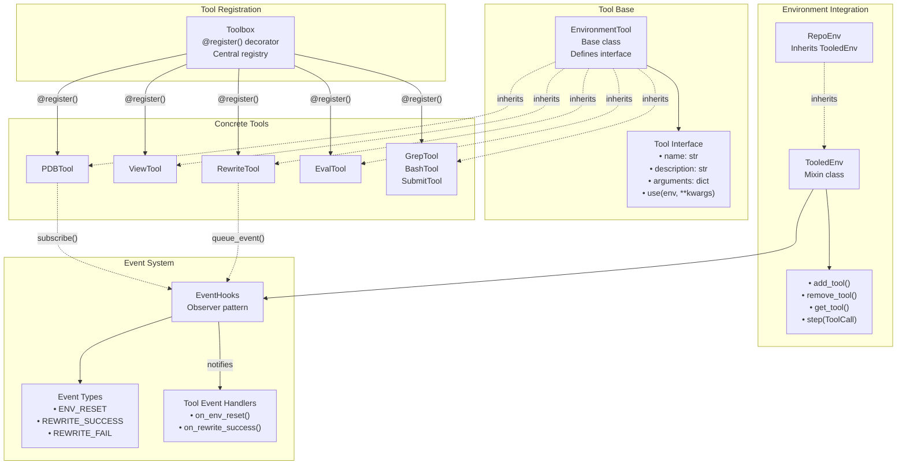
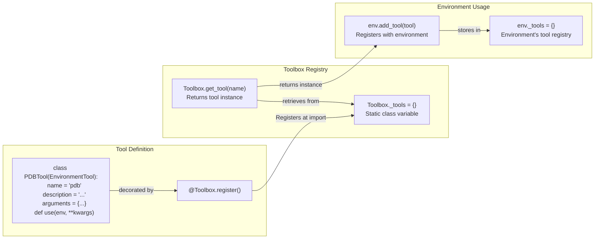
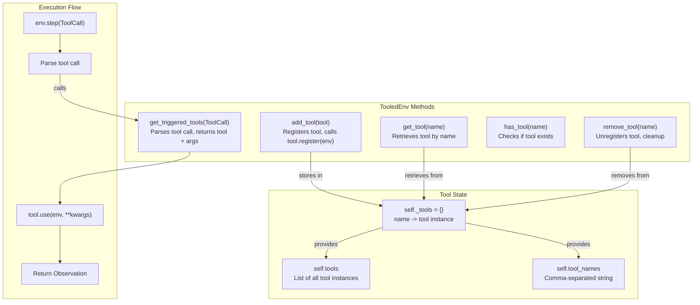
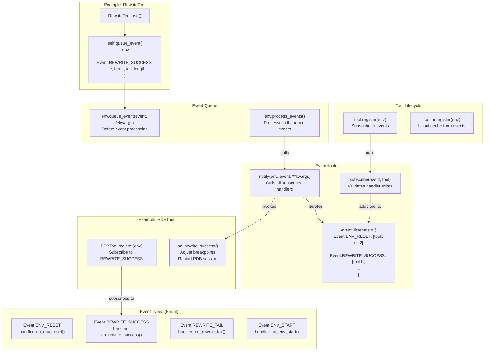
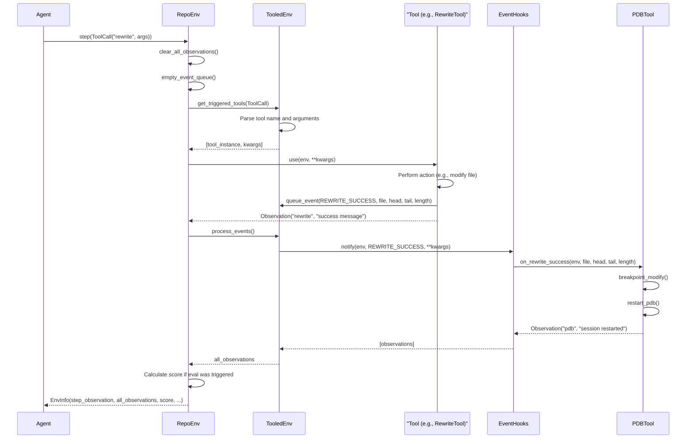

<!-- source: DeepWiki mcp.deepwiki.com · repo microsoft/debug-gym · page 3 Tool System · fetched 2026-10-26 -->

# Tool System

<details>
<summary>Relevant source files</summary>

The following files were used as context for generating this wiki page:

- [debug_gym/gym/envs/env.py](debug_gym/gym/envs/env.py)
- [debug_gym/gym/tools/pdb.py](debug_gym/gym/tools/pdb.py)
- [debug_gym/gym/tools/rewrite.py](debug_gym/gym/tools/rewrite.py)
- [debug_gym/gym/tools/view.py](debug_gym/gym/tools/view.py)
- [debug_gym/gym/utils.py](debug_gym/gym/utils.py)
- [tests/gym/envs/test_env.py](tests/gym/envs/test_env.py)
- [tests/gym/test_utils.py](tests/gym/test_utils.py)
- [tests/gym/tools/test_pdb.py](tests/gym/tools/test_pdb.py)
- [tests/gym/tools/test_rewrite.py](tests/gym/tools/test_rewrite.py)
- [tests/gym/tools/test_view.py](tests/gym/tools/test_view.py)

</details>


## Purpose and Scope

The Tool System provides the extensible framework through which agents interact with code repositories and debugging environments. Tools are discrete capabilities that agents can invoke through the LLM's tool calling interface, enabling actions such as viewing files, modifying code, setting breakpoints, running tests, and executing shell commands. The system uses a registry pattern for tool registration and an event-driven architecture to maintain consistency across tools as the environment state changes.

For details on how agents use tools, see [Agent Framework](#2.2). For specific environment implementations that configure available tools, see [Benchmarks and Environments](#4).

---

## Architecture Overview

The tool system consists of three main components: (1) a **registry** (`Toolbox`) that manages tool registration and discovery, (2) a **base class** (`EnvironmentTool`) that defines the tool interface, and (3) an **event system** (`EventHooks`) that enables tools to react to environment changes. Tools are integrated into environments through the `TooledEnv` mixin class, which provides methods for adding, removing, and invoking tools.



**Diagram: Tool System Architecture** - Shows the relationship between tool registration (`Toolbox`), the base interface (`EnvironmentTool`), environment integration (`TooledEnv`), and the event system (`EventHooks`).

Sources: [debug_gym/gym/tools/toolbox.py](), [debug_gym/gym/tools/tool.py](), [debug_gym/gym/envs/env.py:91-206]()

---

## Tool Registration with Toolbox

Tools are registered with the `Toolbox` class using the `@Toolbox.register()` decorator. This enables centralized tool discovery and instantiation. The decorator pattern allows tools to be automatically discovered at import time.



**Diagram: Tool Registration Flow** - Shows how tools are registered with `Toolbox` using decorators and then added to environments.

The `Toolbox` maintains a static registry of all decorated tool classes. Environments can retrieve tool instances using `Toolbox.get_tool(name)` and then register them with `env.add_tool(tool)`.

Sources: [debug_gym/gym/tools/toolbox.py](), [debug_gym/gym/tools/pdb.py:10](), [debug_gym/gym/tools/view.py:7](), [debug_gym/gym/tools/rewrite.py:8]()

---

## EnvironmentTool Base Class

All tools inherit from the `EnvironmentTool` base class, which defines the standard interface that environments and agents interact with. Each tool must specify:

| Attribute | Type | Description |
|-----------|------|-------------|
| `name` | `str` | Unique identifier for the tool (e.g., "pdb", "view", "rewrite") |
| `description` | `str` | Natural language description shown to the LLM, including usage examples |
| `arguments` | `dict` | JSON schema defining the tool's parameters and their types |
| `use()` | method | Main execution method that takes `environment` and tool-specific kwargs |

The `use()` method is the primary interface. It receives the environment instance and any arguments specified in the tool call, performs the action, and returns an `Observation` object containing the result.

**Tool Argument Schema Example** (from `ViewTool`):

```python
arguments = {
    "path": {
        "type": ["string"],
        "description": "The path to the file to be viewed...",
    },
    "start": {
        "type": ["number", "null"],
        "description": "The starting line number (1-based, inclusive)...",
    },
    "end": {
        "type": ["number", "null"],
        "description": "The ending line number (1-based, inclusive)...",
    },
}
```

Sources: [debug_gym/gym/tools/tool.py](), [debug_gym/gym/tools/view.py:22-39](), [debug_gym/gym/tools/pdb.py:27-36](), [debug_gym/gym/tools/rewrite.py:22-39]()

---

## Tool Integration with TooledEnv

The `TooledEnv` mixin class provides the infrastructure for managing tools within environments. It maintains an internal tool registry (`_tools` dict) and provides methods for tool lifecycle management.



**Diagram: TooledEnv Tool Management** - Shows the internal state and methods that `TooledEnv` provides for managing tools.

When a tool is added via `add_tool(tool)`, the environment calls `tool.register(env)`, which allows the tool to subscribe to events and perform any initialization needed. When removed via `remove_tool(name)`, the tool's `unregister(env)` method is called for cleanup.

**Tool Execution Flow**: When an agent calls a tool through `env.step(ToolCall)`, the environment:
1. Parses the `ToolCall` to extract tool name and arguments using `get_triggered_tools()`
2. Retrieves the tool instance from `_tools`
3. Invokes `tool.use(environment, **arguments)`
4. Returns the resulting `Observation` to the agent

Sources: [debug_gym/gym/envs/env.py:128-206](), [tests/gym/envs/test_env.py:33-110]()

---

## Event-Driven Architecture

The event system enables loose coupling between tools, allowing them to react to environment changes without direct dependencies. The `EventHooks` class implements the observer pattern.



**Diagram: Event System Flow** - Shows how tools subscribe to events and how the event queue processes notifications.

**Key Event System Components**:

| Component | Location | Description |
|-----------|----------|-------------|
| `EventHooks` | [debug_gym/gym/envs/env.py:91-126]() | Manages event subscriptions and notifications |
| `Event` enum | [debug_gym/gym/entities.py]() | Defines available event types and handler names |
| `queue_event()` | [debug_gym/gym/envs/env.py:188-190]() | Adds events to the processing queue |
| `process_events()` | [debug_gym/gym/envs/env.py:192-201]() | Processes all queued events and returns observations |

**Event-Driven Breakpoint Management Example**:

When `RewriteTool` successfully modifies code, it queues a `REWRITE_SUCCESS` event with parameters `file`, `head`, `tail`, and `length` (indicating which lines were changed). The `PDBTool`, which has subscribed to this event, receives a notification and automatically:
1. Adjusts breakpoint line numbers using `breakpoint_modify()` to account for code insertions/deletions
2. Restarts the PDB session with `restart_pdb()` to load the new code
3. Restores all adjusted breakpoints

This maintains debugging state across code modifications without requiring the `RewriteTool` to know about the `PDBTool`.

Sources: [debug_gym/gym/envs/env.py:91-206](), [debug_gym/gym/tools/pdb.py:134-145](), [debug_gym/gym/tools/rewrite.py:78-133](), [tests/gym/envs/test_env.py:312-428]()

---

## Tool Execution in env.step()

The complete flow from agent tool call to observation demonstrates how all components interact:



**Diagram: Complete Tool Execution Sequence** - Shows the full flow from agent tool call through event processing to final observations.

The `all_observations` list includes both the primary tool's observation (from `step_observation`) and any observations generated by event-triggered tools. This allows agents to see the cascading effects of their actions.

Sources: [debug_gym/gym/envs/env.py:444-505](), [tests/gym/envs/test_env.py:175-207]()

---

## Tool Categories

Tools in debug-gym fall into four functional categories:

### Inspection Tools
- **ViewTool** - Display file contents with line numbers and breakpoint annotations
- **GrepTool** - Search for patterns across the codebase
- **ListdirTool** - Browse directory structures (SWE-Bench specific)

### Modification Tools
- **RewriteTool** - Modify code files with diff generation, triggers `REWRITE_SUCCESS` events
- **BashTool** - Execute arbitrary shell commands (available in swe_agent mode)

### Validation Tools
- **EvalTool** - Execute test suites and calculate scores
- **SubmitTool** - Submit solutions for final validation

### Debugging Tools
- **PDBTool** - Interactive Python debugger with persistent breakpoints, event-driven breakpoint adjustment, and auto-listing

Each tool is documented in detail in the following subsections:
- [Tool Framework and Registry](#3.1) - Toolbox mechanics and EnvironmentTool interface
- [Interactive Debugging (PDB Tool)](#3.2) - PDBTool deep dive
- [Code Manipulation Tools](#3.3) - ViewTool and RewriteTool
- [Environment Interaction Tools](#3.4) - EvalTool, GrepTool, BashTool, and others

Sources: [debug_gym/gym/tools/pdb.py:10-11](), [debug_gym/gym/tools/view.py:7-9](), [debug_gym/gym/tools/rewrite.py:8-10]()

---

## Tool Observations

All tool executions return an `Observation` object that encapsulates the result:

```python
@dataclass
class Observation:
    source: str      # Tool name (e.g., "pdb", "view", "rewrite")
    observation: str # Human-readable output for the agent
```

The `observation` string is formatted to be informative for LLM agents, often including:
- Success/failure status
- Output data (e.g., file contents, test results)
- Error messages with context
- Diffs for code changes
- Current environment state (e.g., breakpoints, current frame)

Observations are accumulated in `EnvInfo.all_observations` during `env.step()`, allowing agents to see both the primary action result and any cascading effects from triggered events.

Sources: [debug_gym/gym/entities.py](), [debug_gym/gym/envs/env.py:14-32]()

---

## Summary

The Tool System provides a modular, extensible architecture for agent-environment interaction through:
1. **Registry Pattern** - `Toolbox` with decorator-based registration
2. **Standard Interface** - `EnvironmentTool` base class with `name`, `description`, `arguments`, and `use()` method
3. **Environment Integration** - `TooledEnv` mixin providing lifecycle management
4. **Event-Driven Coordination** - `EventHooks` enabling tools to react to environment changes
5. **Observation Protocol** - Structured feedback through `Observation` objects

This design allows new tools to be added by simply inheriting from `EnvironmentTool`, decorating with `@Toolbox.register()`, and implementing the `use()` method, with automatic integration into the agent-environment loop.

---

