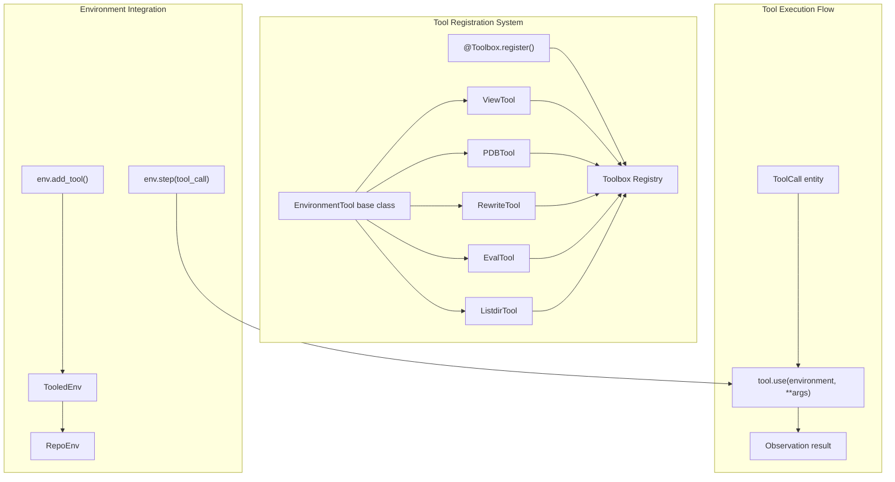
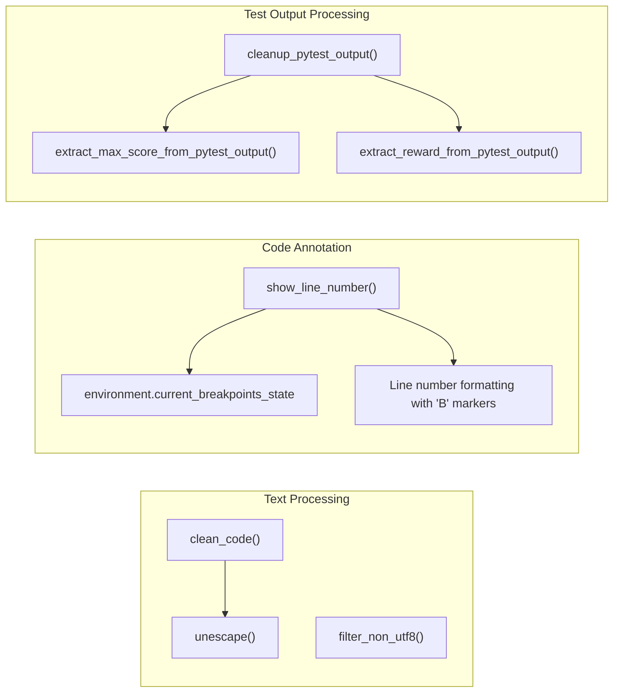
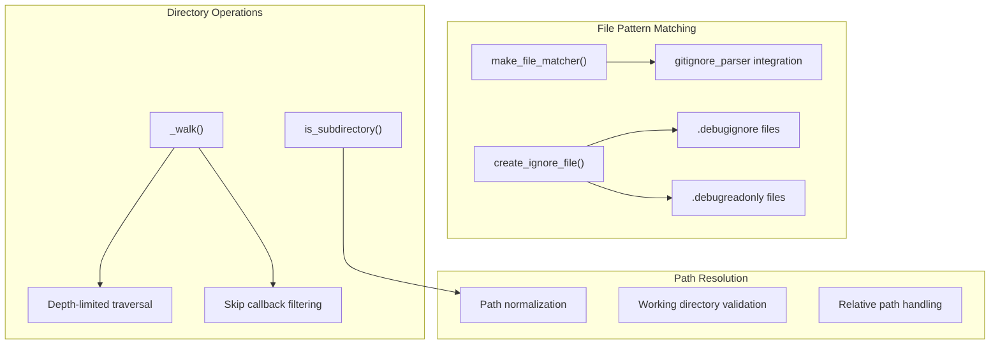
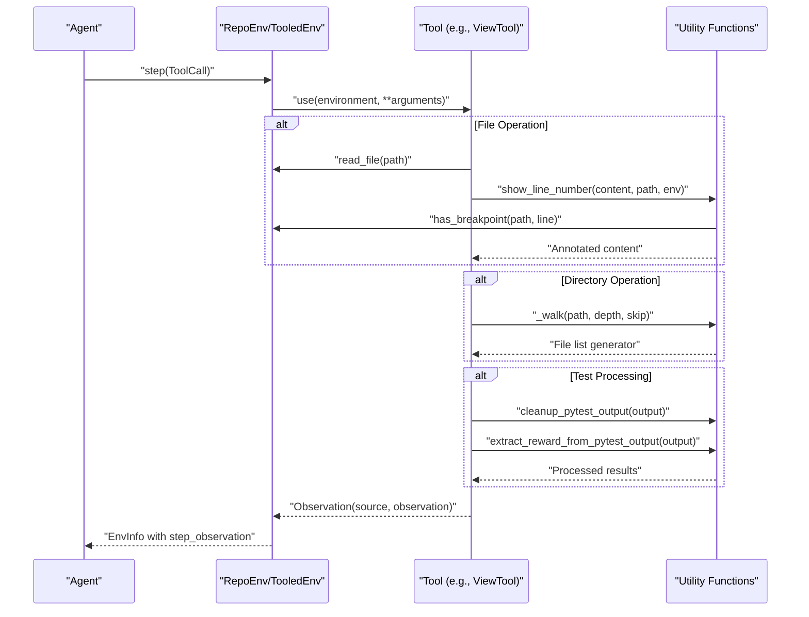

<!-- source: DeepWiki mcp.deepwiki.com · repo microsoft/debug-gym · page 3.1 Tool Framework and Registry · fetched 2026-10-26 -->

# Tool Framework and Utilities

Relevant source files

The following files were used as context for generating this wiki page:

- [debug_gym/gym/envs/env.py](debug_gym/gym/envs/env.py)
- [debug_gym/gym/tools/pdb.py](debug_gym/gym/tools/pdb.py)
- [debug_gym/gym/tools/rewrite.py](debug_gym/gym/tools/rewrite.py)
- [debug_gym/gym/tools/view.py](debug_gym/gym/tools/view.py)
- [debug_gym/gym/utils.py](debug_gym/gym/utils.py)
- [tests/gym/envs/test_env.py](tests/gym/envs/test_env.py)
- [tests/gym/test_utils.py](tests/gym/test_utils.py)
- [tests/gym/tools/test_pdb.py](tests/gym/tools/test_pdb.py)
- [tests/gym/tools/test_rewrite.py](tests/gym/tools/test_rewrite.py)
- [tests/gym/tools/test_view.py](tests/gym/tools/test_view.py)

This document covers the foundational framework for tool registration, integration, and execution within the debug-gym environment, along with common utility functions that support tool operations. The tool framework provides a modular system for extending agent capabilities through standardized interfaces and event-driven communication.

For information about specific debugging tools, see [Interactive Debugging (PDB Tool)](#3.2). For code manipulation capabilities, see [Code Manipulation Tools](#3.3). For environment interaction tools, see [Environment Interaction Tools](#3.4).

## Tool Registration and Integration Framework

The tool system in debug-gym uses a decorator-based registration pattern that allows tools to be automatically discovered and integrated into environments. Tools inherit from base classes and implement standardized interfaces for consistent execution.

### Tool Registration Architecture

**Sources:** [debug_gym/gym/tools/view.py:7-8](), [debug_gym/gym/tools/view.py:41-48]()

### Tool Interface Specification

Tools in the framework implement a standardized interface with metadata and execution methods:

| Component | Purpose | Required Attributes |
|-----------|---------|-------------------|
| `name` | Tool identifier for registration | String identifier |
| `description` | Human-readable tool purpose | Multi-line description with examples |
| `arguments` | JSON schema for tool parameters | Dict with type and description |
| `examples` | Usage examples for LLM context | List of example calls |
| `use()` | Main execution method | Returns `Observation` object |

**Sources:** [debug_gym/gym/tools/view.py:9-39]()

## Common Utilities

The `debug_gym.gym.utils` module provides essential utility functions that support tool operations, file handling, and output processing across the framework.

### Code Processing Utilities

**Sources:** [debug_gym/gym/utils.py:9-35](), [debug_gym/gym/utils.py:37-67](), [debug_gym/gym/utils.py:171-209]()

### File System Utilities

The framework provides sophisticated file system utilities for directory traversal, file filtering, and path management:

**Sources:** [debug_gym/gym/utils.py:70-120](), [debug_gym/gym/utils.py:122-146](), [debug_gym/gym/utils.py:148-169]()

## Tool Execution Model

Tools execute within a structured request-response cycle that integrates with the environment's event system and state management.

### Execution Flow

**Sources:** [debug_gym/gym/tools/view.py:41-112](), [tests/gym/tools/test_view.py:37-53]()

### State Integration

Tools integrate with environment state through several mechanisms:

| Integration Point | Purpose | Implementation |
|------------------|---------|----------------|
| Breakpoint State | Show active breakpoints in code views | `environment.current_breakpoints_state` |
| File Permissions | Respect read-only file designations | `environment.is_editable()` |
| Path Resolution | Resolve relative to working directory | `environment.resolve_path()` |
| Event Publishing | Notify environment of tool actions | Event system hooks |

**Sources:** [debug_gym/gym/tools/view.py:95-99](), [debug_gym/gym/tools/view.py:105-107](), [debug_gym/gym/utils.py:37-67]()

## Utility Function Categories

The utility functions are organized into functional categories that support different aspects of tool operation:

### Code Display and Formatting

- `show_line_number()`: Annotates code with line numbers and breakpoint markers
- `clean_code()`: Removes trailing whitespace and normalizes line endings  
- `unescape()`: Safely processes escaped strings with UTF-8 validation
- `filter_non_utf8()`: Ensures text compatibility with JSON serialization

### File System Operations

- `make_file_matcher()`: Creates gitignore-style pattern matching functions
- `create_ignore_file()`: Generates `.debugignore` and `.debugreadonly` files
- `_walk()`: Recursively traverses directories with depth and filtering control
- `is_subdirectory()`: Validates paths are within working directory boundaries

### Test Output Processing

- `cleanup_pytest_output()`: Normalizes pytest output for consistent LLM processing
- `extract_max_score_from_pytest_output()`: Extracts total test count from pytest runs
- `extract_reward_from_pytest_output()`: Extracts passed test count for scoring

**Sources:** [debug_gym/gym/utils.py:1-209](), [tests/gym/test_utils.py:1-713]()

---

