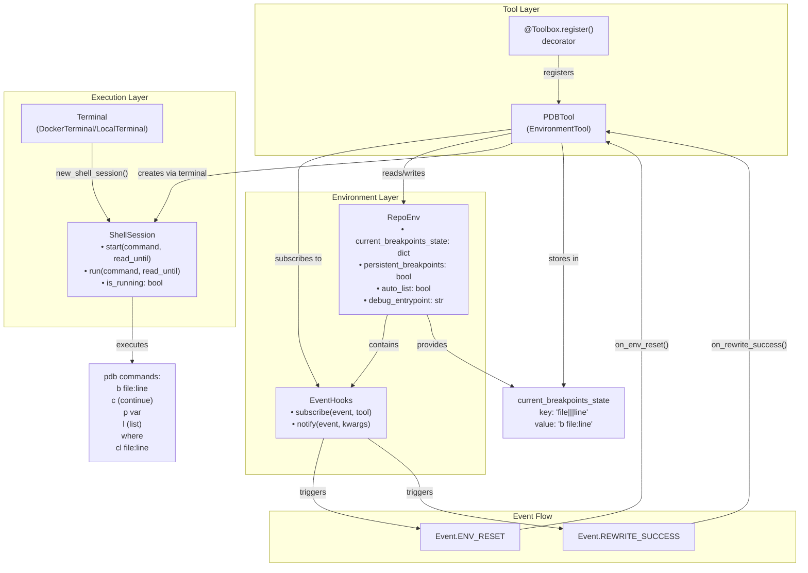
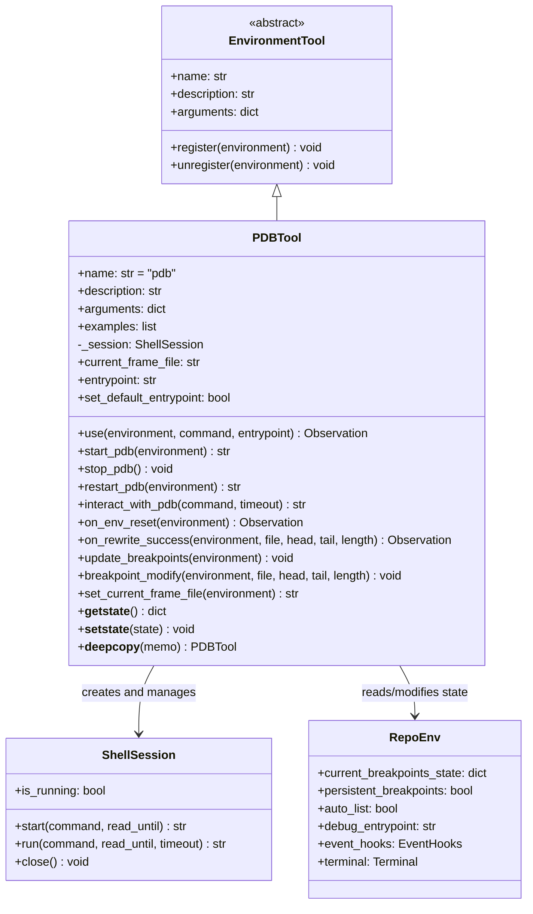
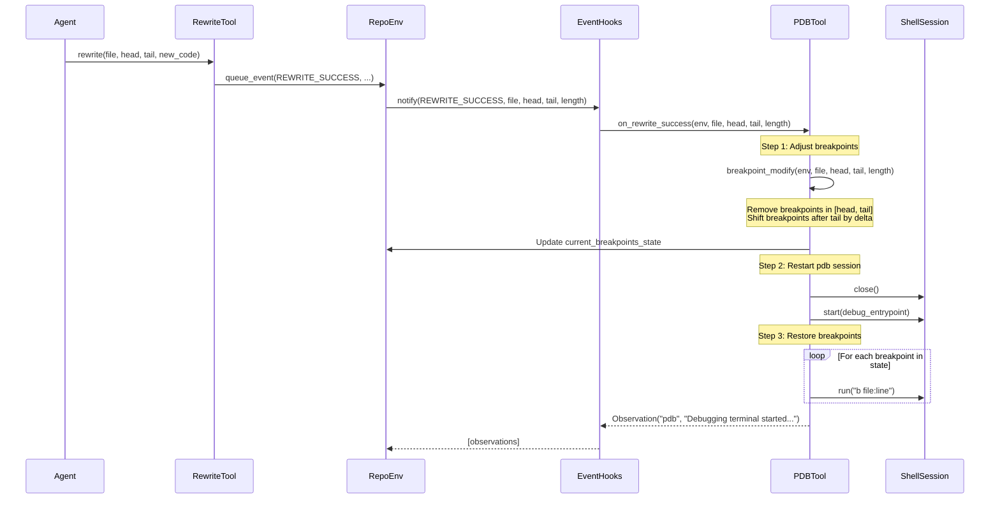
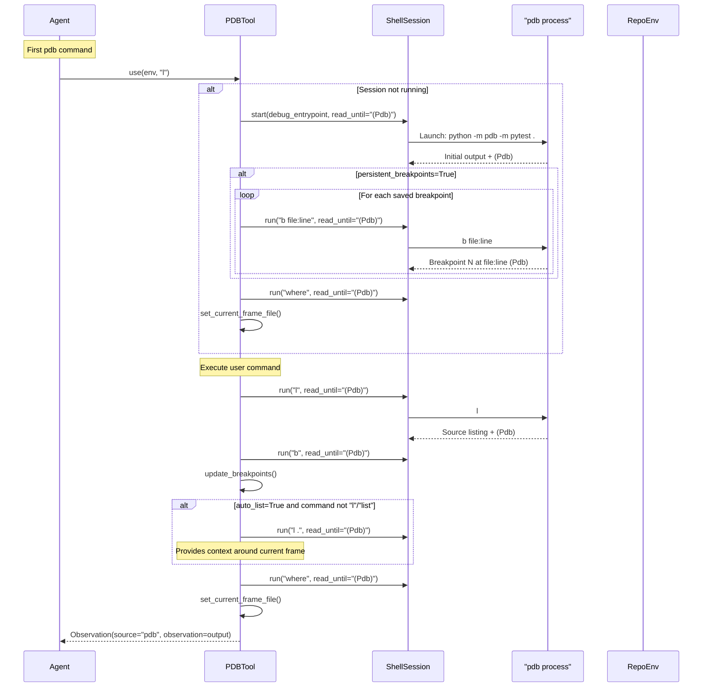
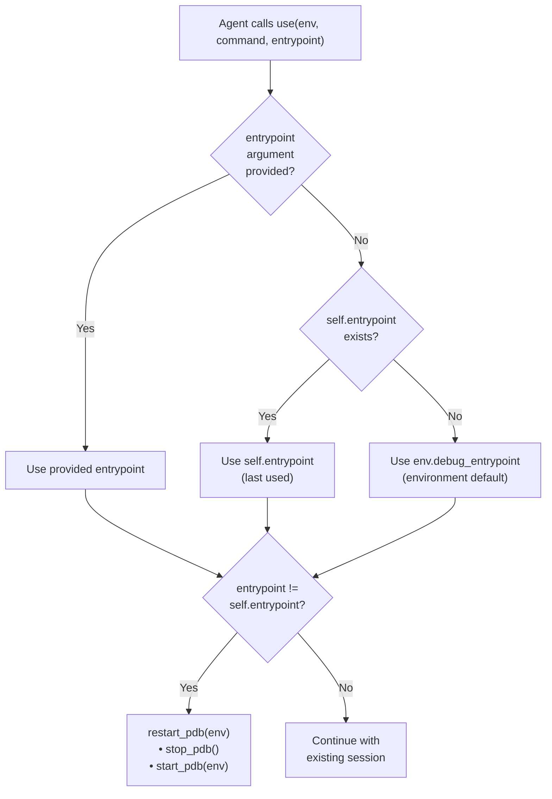
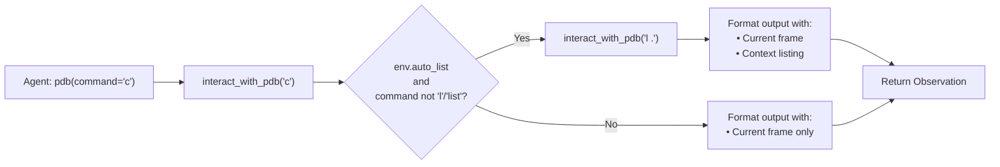
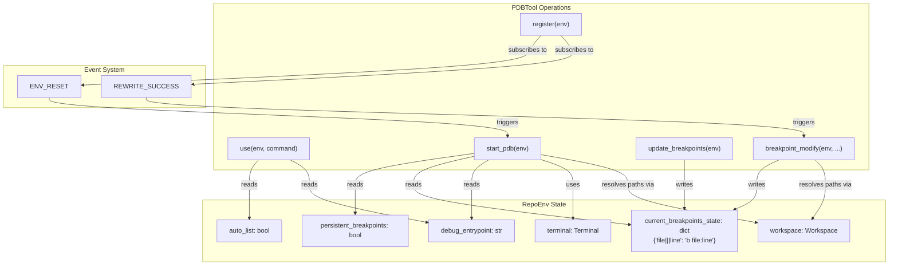

<!-- source: DeepWiki mcp.deepwiki.com · repo microsoft/debug-gym · page 3.2 Interactive Debugging (PDB Tool) · fetched 2026-10-26 -->

# Interactive Debugging (PDB Tool)

<details>
<summary>Relevant source files</summary>

The following files were used as context for generating this wiki page:

- [debug_gym/gym/envs/env.py](debug_gym/gym/envs/env.py)
- [debug_gym/gym/tools/pdb.py](debug_gym/gym/tools/pdb.py)
- [tests/gym/envs/test_env.py](tests/gym/envs/test_env.py)
- [tests/gym/tools/test_pdb.py](tests/gym/tools/test_pdb.py)

</details>


This document describes the `PDBTool` class, which provides an interactive interface to Python's `pdb` debugger within the debug-gym framework. This tool enables LLM agents to set breakpoints, inspect program state, and step through code execution during debugging tasks.

For information about the broader tool system architecture and tool registration, see [Tool Framework and Registry](#3.1). For other environment interaction tools like `EvalTool` and `SubmitTool`, see [Environment Interaction Tools](#3.4).

## Overview

The `PDBTool` is a specialized `EnvironmentTool` that wraps Python's built-in debugger (`pdb`) in an event-driven architecture. It maintains persistent breakpoint state across code modifications and automatically restarts debugging sessions when code is rewritten. The tool is registered in the `Toolbox` and integrates with `RepoEnv` through the event system.

**Key capabilities:**
- Interactive `pdb` command execution through `ShellSession`
- Persistent breakpoint tracking in `current_breakpoints_state` dictionary
- Automatic breakpoint line number adjustment on code rewrites
- Session management with automatic restart on entrypoint changes
- Context-aware code listing with `auto_list` feature

Sources: [debug_gym/gym/tools/pdb.py:10-401]()

## Architecture



**Core relationships:**
- `PDBTool` is registered via `@Toolbox.register()` decorator
- Subscribes to `Event.ENV_RESET` and `Event.REWRITE_SUCCESS` in `register()`
- Uses `Terminal.new_shell_session()` to create interactive `ShellSession` 
- Manages `RepoEnv.current_breakpoints_state` dictionary for persistence
- Coordinates with `RepoEnv` flags: `persistent_breakpoints`, `auto_list`, `debug_entrypoint`

Sources: [debug_gym/gym/tools/pdb.py:10-11](), [debug_gym/gym/tools/pdb.py:89-145](), [debug_gym/gym/envs/env.py:128-206]()

## PDBTool Class Structure



**Key attributes:**

| Attribute | Type | Purpose |
|-----------|------|---------|
| `_session` | `ShellSession` | Interactive PTY session for pdb communication |
| `current_frame_file` | `str` | Path to file where execution is currently paused |
| `entrypoint` | `str` | Command used to start pdb session (e.g., `"python -m pdb -m pytest ."`) |
| `set_default_entrypoint` | `bool` | Whether to use environment's default or require explicit entrypoint |

**Key methods:**

| Method | Return | Purpose |
|--------|--------|---------|
| `use(environment, command, entrypoint)` | `Observation` | Main entry point for executing pdb commands |
| `start_pdb(environment)` | `str` | Starts new pdb session via `ShellSession.start()` |
| `interact_with_pdb(command, timeout)` | `str` | Sends command to pdb, strips `(Pdb)` prompt from output |
| `update_breakpoints(environment)` | `void` | Parses `b` command output to sync `current_breakpoints_state` |
| `breakpoint_modify(environment, ...)` | `void` | Adjusts breakpoint line numbers after code rewrites |

Sources: [debug_gym/gym/tools/pdb.py:10-88](), [debug_gym/gym/tools/pdb.py:147-263]()

## Event-Driven Breakpoint Management

The PDBTool's key innovation is its event-driven architecture that maintains breakpoint consistency across code modifications. When code is rewritten, breakpoints are automatically adjusted to track their logical positions.



**Breakpoint adjustment algorithm** ([debug_gym/gym/tools/pdb.py:294-340]()):

```
For each breakpoint at (file, line):
    if file != rewritten_file:
        keep unchanged
    else if rewrite_head is None:
        remove all breakpoints in file  # Full file rewrite
    else if rewrite_head <= line <= rewrite_tail:
        remove breakpoint  # Breakpoint was in rewritten region
    else if line > rewrite_tail:
        new_line = line + new_length - (tail - head + 1)
        move breakpoint to new_line
    else:  # line < rewrite_head
        keep unchanged  # Breakpoint before rewritten region
```

**Event handlers:**

| Event | Handler | Behavior |
|-------|---------|----------|
| `ENV_RESET` | `on_env_reset()` | Calls `start_pdb()`, restores persistent breakpoints |
| `REWRITE_SUCCESS` | `on_rewrite_success()` | Calls `breakpoint_modify()` + `restart_pdb()` |

Sources: [debug_gym/gym/tools/pdb.py:129-145](), [debug_gym/gym/tools/pdb.py:294-340](), [tests/gym/tools/test_pdb.py:314-367]()

## Breakpoint State Management

Breakpoints are stored in `RepoEnv.current_breakpoints_state` as a dictionary with composite keys:

```python
# Structure: {key: command}
current_breakpoints_state = {
    "/path/to/file.py|||10": "b /path/to/file.py:10",
    "/path/to/file.py|||20": "b /path/to/file.py:20",
    "/path/to/other.py|||5": "b /path/to/other.py:5"
}
```

**Key format:** `"absolute_path|||line_number"` - Uses `|||` as delimiter to avoid conflicts with `:` in file paths.

**Value format:** Full pdb breakpoint command that can be re-executed to restore the breakpoint.

### Breakpoint Persistence Flow

```mermaid
graph LR
    SetBreakpoint["Agent: pdb(command='b file:10')"]
    ExecuteCommand["PDBTool.use()"]
    InteractPDB["interact_with_pdb('b file:10')"]
    UpdateState["update_breakpoints()"]
    ParseOutput["Parse 'b' command output"]
    StoreState["Store in current_breakpoints_state"]
    
    SetBreakpoint --> ExecuteCommand
    ExecuteCommand --> InteractPDB
    InteractPDB --> UpdateState
    UpdateState --> ParseOutput
    ParseOutput --> StoreState
    
    RestoreOnReset["on_env_reset()"]
    StartPDB["start_pdb()"]
    RestoreLoop["For each breakpoint:<br/>interact_with_pdb(command)"]
    
    StoreState -.->|persistent_breakpoints=True| RestoreOnReset
    RestoreOnReset --> StartPDB
    StartPDB --> RestoreLoop
```



**Breakpoint synchronization** ([debug_gym/gym/tools/pdb.py:342-374]()):

1. After any pdb command, `update_breakpoints()` is called
2. Executes hidden `b` command to list all active breakpoints
3. Parses output using regex pattern: `r"^\s*\d+\s+breakpoint\s+keep\s+yes\s+at\s+(.+):(\d+)$"`
4. Rebuilds `current_breakpoints_state` dictionary from scratch
5. Ensures state matches actual pdb session

Sources: [debug_gym/gym/tools/pdb.py:342-374](), [debug_gym/gym/envs/env.py:411-432](), [tests/gym/tools/test_pdb.py:248-297]()

## Interactive Debugging Session Flow



**Session lifecycle stages:**

1. **Initialization** - `start_pdb()` launches pdb process via `ShellSession.start()`
2. **Restoration** - Persistent breakpoints re-applied using stored commands
3. **Frame tracking** - Hidden `where` command determines `current_frame_file`
4. **Command execution** - User command sent via `interact_with_pdb()`
5. **State synchronization** - Hidden `b` command updates `current_breakpoints_state`
6. **Context listing** - Optional `l .` provides code around current line
7. **Output formatting** - Strips `(Pdb)` prompts, adds current frame info

Sources: [debug_gym/gym/tools/pdb.py:106-127](), [debug_gym/gym/tools/pdb.py:147-263](), [tests/gym/tools/test_pdb.py:77-103]()

## Command Interface

The `use()` method accepts pdb commands through a structured interface:

**Arguments schema:**
```python
arguments = {
    "command": {
        "type": ["string"],
        "description": "Valid PDB command. See https://docs.python.org/3/library/pdb.html"
    },
    "entrypoint": {
        "type": ["string", "null"],
        "description": "Entrypoint to start pdb session. If null, uses last or default."
    }
}
```

### Supported Commands

| Command | Aliases | Behavior | Example |
|---------|---------|----------|---------|
| `b file:line` | `break` | Set breakpoint at file:line | `b src/main.py:42` |
| `b` | `break` | List all breakpoints | `b` |
| `cl file:line` | `clear` | Clear specific breakpoint | `cl src/main.py:42` |
| `cl` | `clear` | Clear all breakpoints | `cl` |
| `c` | `continue`, `cont` | Continue execution | `c` |
| `n` | `next` | Execute next line (over) | `n` |
| `s` | `step` | Step into function | `s` |
| `l` | `list` | List source code | `l` |
| `l .` | | List around current line | `l .` |
| `p var` | `print` | Print variable value | `p x` |
| `pp var` | | Pretty-print variable | `pp data` |
| `where` | `w`, `bt` | Show stack trace | `where` |

**Special handling:**

- **Empty commands** ([debug_gym/gym/tools/pdb.py:150-153]()): Return failure observation
- **Multiple commands** ([debug_gym/gym/tools/pdb.py:179-183]()): Only first command executed (except for `p`/`pp`)
- **Print commands** ([debug_gym/gym/tools/pdb.py:179]()): Allow semicolons and newlines for complex expressions
- **Breakpoint commands**: Automatically call `update_breakpoints()` to sync state
- **List all** ([debug_gym/gym/tools/pdb.py:193-198]()): `b` returns formatted breakpoint list from env
- **Clear all** ([debug_gym/gym/tools/pdb.py:199-203]()): `cl` clears state dictionary and restarts session

### Path Resolution

Breakpoint commands accept both relative and absolute paths:

```python
# Relative path - resolved via workspace.resolve_path()
pdb(command="b test_file.py:10")
# → /working_dir/test_file.py:10

# Absolute path - used directly
pdb(command="b /working_dir/test_file.py:10")
# → /working_dir/test_file.py:10

# During active session - can omit file if in same file
pdb(command="b 2")  # Sets breakpoint at line 2 in current_frame_file
```

Sources: [debug_gym/gym/tools/pdb.py:13-26](), [debug_gym/gym/tools/pdb.py:147-263](), [tests/gym/tools/test_pdb.py:143-164]()

## Entrypoint Management

The PDBTool supports flexible entrypoint configuration with a three-tier priority system:



**Priority order:** Tool argument → Last entrypoint → Environment default

**Entrypoint format examples:**
```bash
# Pytest with pdb
"python -m pdb -m pytest -sv ."

# Direct script debugging
"python -m pdb src/main.py"

# Custom test file
"python -m pdb -m pytest test_specific.py"

# With virtual environment
"uv run python -m pdb -m pytest ."
```

### Configuration Modes

**1. Default mode** (`set_default_entrypoint=True`):
- Allows `entrypoint=None` in `use()` calls
- Falls back to `env.debug_entrypoint`
- Suitable for standard debugging workflows

**2. Explicit mode** (`set_default_entrypoint=False`):
- Requires `entrypoint` argument in every `use()` call
- Modifies `arguments` schema to remove `"null"` from type
- Updates description to indicate requirement
- Useful when agents need explicit control over debugging context

Sources: [debug_gym/gym/tools/pdb.py:38-57](), [debug_gym/gym/tools/pdb.py:155-174](), [tests/gym/tools/test_pdb.py:817-880]()

## Auto-List Feature

When `RepoEnv.auto_list=True`, PDBTool automatically executes `l .` (list around current line) after each command, providing context without requiring explicit list commands.



**Output format with auto-list:**
```
Pdb command output:
> /path/to/file.py(10)function_name()
-> x = compute_value()

Current frame:
/path/to/file.py

Context around the current frame:
  5  	def function_name():
  6  	    setup()
  7  	    result = []
  8  	    for i in range(10):
  9  	        value = i * 2
 10 B->	        x = compute_value()
 11  	        result.append(x)
 12  	    return result
```

**Indentation normalization** ([debug_gym/gym/tools/pdb.py:265-292]()): The `_indent_first_line()` method ensures consistent spacing in multi-digit line numbers by analyzing the second line's indentation and adjusting the first line accordingly.

Sources: [debug_gym/gym/tools/pdb.py:254-262](), [debug_gym/gym/tools/pdb.py:265-292](), [tests/gym/tools/test_pdb.py:691-763]()

## State Serialization

PDBTool implements custom serialization to handle non-picklable `ShellSession` objects:

```python
def __getstate__(self):
    """Handles serialisation (pickle) without un-picklable attributes"""
    state = self.__dict__.copy()
    for k in ["_session", "current_frame_file"]:
        del state[k]
    return state

def __setstate__(self, state):
    """Handles de-serialisation (pickle) without un-picklable attributes"""
    self.__dict__.update(state)
    self.current_frame_file = None
    self._session = None

def __deepcopy__(self, memo):
    """Create deep copy with _session set to None"""
    result = type(self).__new__(self.__class__)
    memo[id(self)] = result
    for k, v in self.__dict__.items():
        if k in ["_session", "current_frame_file"]:
            setattr(result, k, None)
        else:
            setattr(result, k, copy.deepcopy(v, memo))
    return result
```

**Rationale:** `ShellSession` contains PTY file descriptors and process handles that cannot be serialized. When PDBTool is pickled (e.g., for multiprocessing), these attributes are stripped and set to `None`. The next `use()` call will automatically call `start_pdb()` to recreate the session.

**Preserved state:**
- `name`, `description`, `arguments`, `examples` - Class metadata
- `set_default_entrypoint` - Configuration flag
- `entrypoint` - Last used entrypoint string

**Dropped state:**
- `_session` - ShellSession instance
- `current_frame_file` - Current execution location

Sources: [debug_gym/gym/tools/pdb.py:59-87](), [tests/gym/tools/test_pdb.py:797-815](), [tests/gym/tools/test_pdb.py:420-427]()

## Error Handling

PDBTool implements robust error handling for various failure modes:

### Session Startup Failures

```python
# In use() method
if entrypoint != self.entrypoint:
    try:
        self.entrypoint = entrypoint
        self.restart_pdb(environment)
    except ProcessNotRunningError as e:
        return Observation(
            self.name,
            f"Provided entrypoint failed to start a pdb session:\n{e.output}"
        )
```

**Causes:**
- Invalid entrypoint command
- Missing dependencies in execution environment
- Syntax errors in target code preventing pdb startup

### Invalid Breakpoint Locations

```python
if pdb_out in ("End of file", "Blank or comment", "*** Blank or comment"):
    success = False
    output = f"Invalid line number: {pdb_out}."
```

**Examples:**
- Setting breakpoint at line number beyond file length
- Setting breakpoint at blank line or comment
- Setting breakpoint in non-existent file

### Command Timeout

```python
def interact_with_pdb(self, command: str, timeout: int | None = None) -> str:
    try:
        output = self._session.run(command, read_until="(Pdb)", timeout=timeout)
    except TimeoutError as e:
        output = f"The command `{command}` has timed out. {e!r}"
    return output.replace("(Pdb)", "").strip()
```

**Timeout handling:**
- Uses `RepoEnv.run_timeout` if specified
- Returns timeout message instead of hanging
- Sets `pdb_is_running=False` to trigger restart on next command

### Program Exit Detection

```python
if "The program exited via sys.exit()." in output:
    start_index = output.rfind("The program exited via sys.exit().")
    end_index = output.find("\n", start_index) + 1
    output = (
        output[:start_index]
        + "\nReached the end of the program. Restarting the debugging session.\n"
        + output[end_index:]
    )
```

**Behavior:** When program execution completes, pdb automatically restarts. PDBTool detects this and formats the output to make it clear to the agent.

Sources: [debug_gym/gym/tools/pdb.py:93-99](), [debug_gym/gym/tools/pdb.py:206-227](), [debug_gym/gym/tools/pdb.py:233-241](), [tests/gym/tools/test_pdb.py:369-407]()

## Integration with RepoEnv

The PDBTool tightly integrates with `RepoEnv` through shared state and event subscriptions:



**Configuration flags:**

| Flag | Type | Default | Purpose |
|------|------|---------|---------|
| `persistent_breakpoints` | `bool` | `True` | Whether to restore breakpoints after restart |
| `auto_list` | `bool` | `True` | Whether to show code context after each command |
| `debug_entrypoint` | `str` | Derived from `entrypoint` | Command to start pdb session |
| `run_timeout` | `int` | `None` | Timeout for pdb commands in seconds |

**Path resolution:** All file paths in breakpoint commands are resolved to absolute paths using `workspace.resolve_path()` to ensure consistency across relative and absolute references.

**Current frame tracking:** The `current_frame_file` attribute caches the last known execution location, enabling efficient breakpoint validation with `has_breakpoint(file, line)`.

Sources: [debug_gym/gym/envs/env.py:210-251](), [debug_gym/gym/envs/env.py:411-432](), [debug_gym/gym/tools/pdb.py:234-246]()

## Testing Infrastructure

The test suite demonstrates PDBTool capabilities across different execution environments:

### Test Categories

**Basic functionality** ([tests/gym/tools/test_pdb.py:77-103]()):
- Session startup and command execution
- Breakpoint setting and clearing
- Program completion handling

**Docker integration** ([tests/gym/tools/test_pdb.py:192-225]()):
- PDBTool with `DockerTerminal`
- Container-based isolation
- Image configuration with pytest

**Breakpoint management** ([tests/gym/tools/test_pdb.py:248-367]()):
- Adding/removing breakpoints
- Persistence across restarts
- Line number adjustment after rewrites

**Entrypoint handling** ([tests/gym/tools/test_pdb.py:817-926]()):
- Priority system validation
- Session restart on entrypoint change
- Explicit vs. default modes

**Edge cases** ([tests/gym/tools/test_pdb.py:369-408]()):
- Timeout handling
- Program crashes
- Invalid commands

### Test Fixtures

```python
@pytest.fixture
def setup_pdb_repo_env(setup_test_repo, setup_breakpoints_state):
    def _setup_pdb_repo_env(base_dir):
        test_repo = setup_test_repo(base_dir)
        env = RepoEnv(path=str(test_repo))
        pdb_tool = PDBTool()
        pdb_tool.register(env)
        env.reset()
        breakpoints = setup_breakpoints_state(env.working_dir)
        env.current_breakpoints_state = breakpoints
        env.persistent_breakpoints = True
        env.auto_list = True
        pdb_tool.start_pdb(env)
        return pdb_tool, env
    return _setup_pdb_repo_env
```

**Purpose:** Creates fully initialized PDBTool with active session and pre-configured breakpoints for testing complex scenarios.

Sources: [tests/gym/tools/test_pdb.py:46-74]()

---

