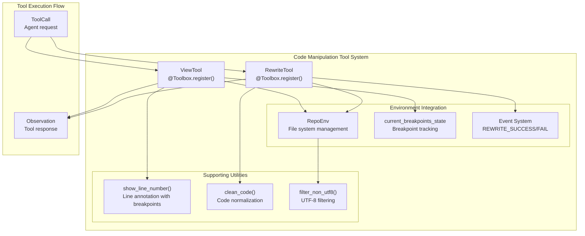
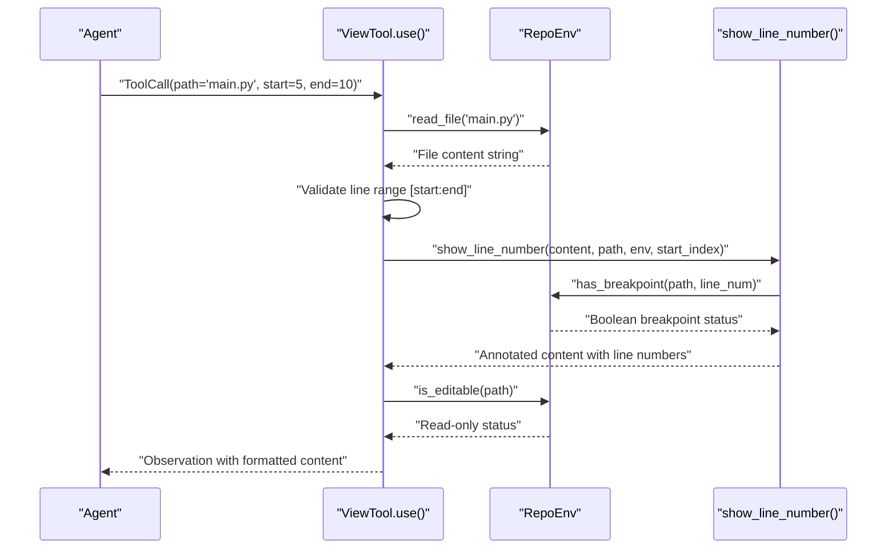
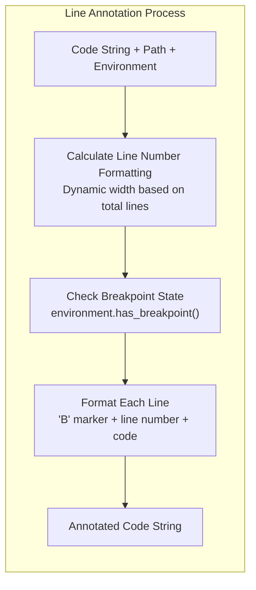
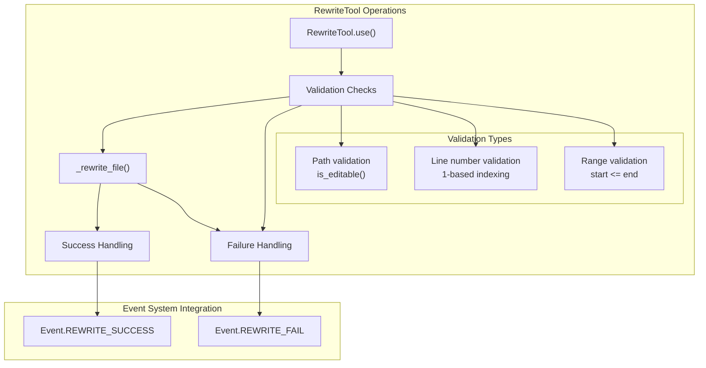
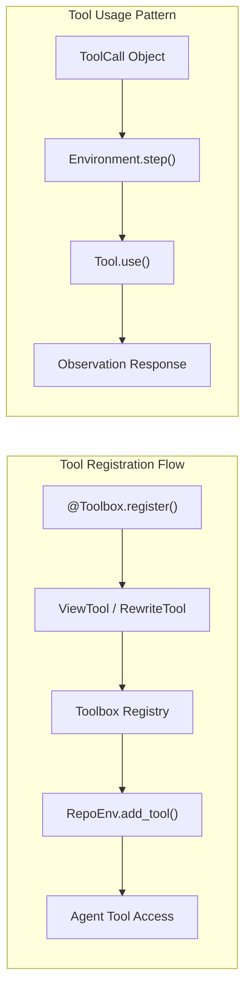

<!-- source: DeepWiki mcp.deepwiki.com · repo microsoft/debug-gym · page 3.3 Code Manipulation Tools · fetched 2026-10-26 -->

# Code Manipulation Tools

Relevant source files

The following files were used as context for generating this wiki page:

- [debug_gym/gym/tools/rewrite.py](debug_gym/gym/tools/rewrite.py)
- [debug_gym/gym/tools/view.py](debug_gym/gym/tools/view.py)
- [debug_gym/gym/utils.py](debug_gym/gym/utils.py)
- [tests/gym/test_utils.py](tests/gym/test_utils.py)
- [tests/gym/tools/test_rewrite.py](tests/gym/tools/test_rewrite.py)
- [tests/gym/tools/test_view.py](tests/gym/tools/test_view.py)

This document covers the code manipulation tools within debug-gym's tool system, specifically the `ViewTool` and `RewriteTool` classes that provide code inspection and modification capabilities. These tools enable agents to examine source code files and make targeted modifications during debugging sessions.

For information about the broader tool framework and registration system, see [Tool Framework and Utilities](#3.1). For details about interactive debugging capabilities, see [Interactive Debugging (PDB Tool)](#3.2).

## Overview

The code manipulation tools form a core part of debug-gym's debugging capabilities, providing agents with the ability to inspect and modify source code files within repository environments. The system consists of two primary tools:

- **ViewTool**: Provides code inspection with line numbers, breakpoint annotations, and range-based viewing
- **RewriteTool**: Enables targeted code modifications with diff generation and validation

Both tools integrate with the environment system's file management, breakpoint tracking, and event notification mechanisms.

## Tool Architecture and Integration

Sources: [debug_gym/gym/tools/view.py:7-9](), [debug_gym/gym/tools/rewrite.py:9-11](), [debug_gym/gym/utils.py:37-67](), [debug_gym/gym/utils.py:9-13]()

## ViewTool - Code Inspection

The `ViewTool` class provides comprehensive code inspection capabilities, allowing agents to examine source files with configurable formatting and range selection.

### Core Functionality

| Feature | Description | Parameters |
|---------|-------------|------------|
| File Viewing | Display file contents with optional line numbers | `path`, `include_line_numbers_and_breakpoints` |
| Range Selection | View specific line ranges | `start`, `end` |
| Breakpoint Annotation | Show breakpoints with 'B' markers | Automatic when breakpoints exist |
| Read-only Detection | Indicate non-editable files | Automatic based on environment settings |

### ViewTool Implementation Details

The `ViewTool.use()` method [debug_gym/gym/tools/view.py:41-112]() handles file validation, range checking, and content formatting. Key validation steps include:

- Path validation and file existence checking [debug_gym/gym/tools/view.py:49-60]()
- Line range validation with 1-based indexing [debug_gym/gym/tools/view.py:64-82]()
- Breakpoint annotation integration [debug_gym/gym/tools/view.py:88-98]()

Sources: [debug_gym/gym/tools/view.py:41-112](), [debug_gym/gym/utils.py:37-67](), [tests/gym/tools/test_view.py:37-54]()

### Line Number and Breakpoint Display

The `show_line_number()` utility function [debug_gym/gym/utils.py:37-67]() provides sophisticated line annotation:

The line numbering system dynamically calculates display width [debug_gym/gym/utils.py:55-56]() and integrates breakpoint markers [debug_gym/gym/utils.py:58-66]().

Sources: [debug_gym/gym/utils.py:37-67](), [tests/gym/test_utils.py:54-133]()

## RewriteTool - Code Modification

The `RewriteTool` class enables precise code modifications with comprehensive validation and diff generation capabilities.

### Rewrite Operations and Validation

### Rewrite Modes and Parameters

| Mode | Parameters | Behavior |
|------|------------|----------|
| Full File Rewrite | `path`, `new_code` | Replace entire file content |
| Single Line Rewrite | `path`, `start`, `new_code` | Replace one line (`end` defaults to `start`) |
| Range Rewrite | `path`, `start`, `end`, `new_code` | Replace line range `[start:end]` |

The rewrite implementation [debug_gym/gym/tools/rewrite.py:46-79]() handles three distinct modes:

1. **Full rewrite** when `start=None` [debug_gym/gym/tools/rewrite.py:52-54]()
2. **Range rewrite** with line splicing [debug_gym/gym/tools/rewrite.py:57-66]()
3. **Diff generation** using `difflib.unified_diff` [debug_gym/gym/tools/rewrite.py:68-79]()

Sources: [debug_gym/gym/tools/rewrite.py:91-136](), [debug_gym/gym/tools/rewrite.py:46-79](), [tests/gym/tools/test_rewrite.py:48-84]()

### Code Cleaning and Normalization

The `clean_code()` function [debug_gym/gym/utils.py:9-13]() performs essential normalization:

- Unicode escape sequence processing via `unescape()` [debug_gym/gym/utils.py:23-34]()
- Trailing whitespace removal [debug_gym/gym/utils.py:12-13]()
- UTF-8 compatibility handling [debug_gym/gym/utils.py:16-20]()

Sources: [debug_gym/gym/utils.py:9-13](), [debug_gym/gym/utils.py:23-34](), [tests/gym/test_utils.py:21-32]()

## Tool Registration and Environment Integration

Both tools use the `@Toolbox.register()` decorator pattern for automatic registration:

The registration system enables automatic tool discovery and integration with the broader environment framework. Tools inherit from `EnvironmentTool` base class and implement the standard `use()` method interface.

Sources: [debug_gym/gym/tools/view.py:7-8](), [debug_gym/gym/tools/rewrite.py:9-10](), [debug_gym/gym/tools/toolbox.py]()

## Error Handling and Validation

Both tools implement comprehensive error handling with consistent patterns:

### ViewTool Error Cases
- Invalid or empty file paths [debug_gym/gym/tools/view.py:50-53]()
- File not found or outside working directory [debug_gym/gym/tools/view.py:58-60]()
- Invalid line range specifications [debug_gym/gym/tools/view.py:68-82]()

### RewriteTool Error Cases
- Null file paths [debug_gym/gym/tools/rewrite.py:100-101]()
- Non-editable files [debug_gym/gym/tools/rewrite.py:102-103]()
- Invalid line numbers (0-based or negative) [debug_gym/gym/tools/rewrite.py:111-114]()
- Invalid line ranges (start > end) [debug_gym/gym/tools/rewrite.py:106-110]()

All error conditions return structured `Observation` objects with descriptive error messages, maintaining consistent interfaces for agent consumption.

Sources: [debug_gym/gym/tools/view.py:50-82](), [debug_gym/gym/tools/rewrite.py:81-114](), [tests/gym/tools/test_view.py:186-226](), [tests/gym/tools/test_rewrite.py:147-204]()

---

