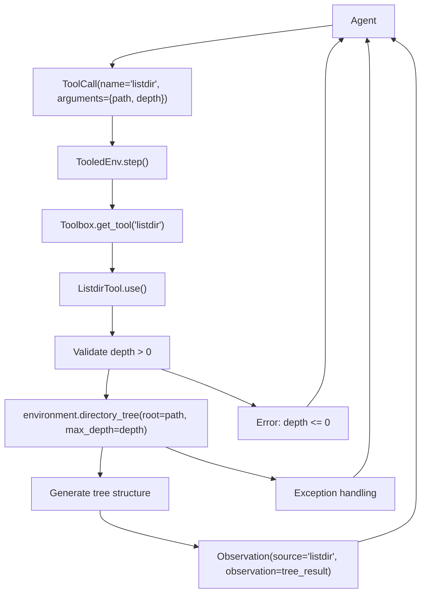
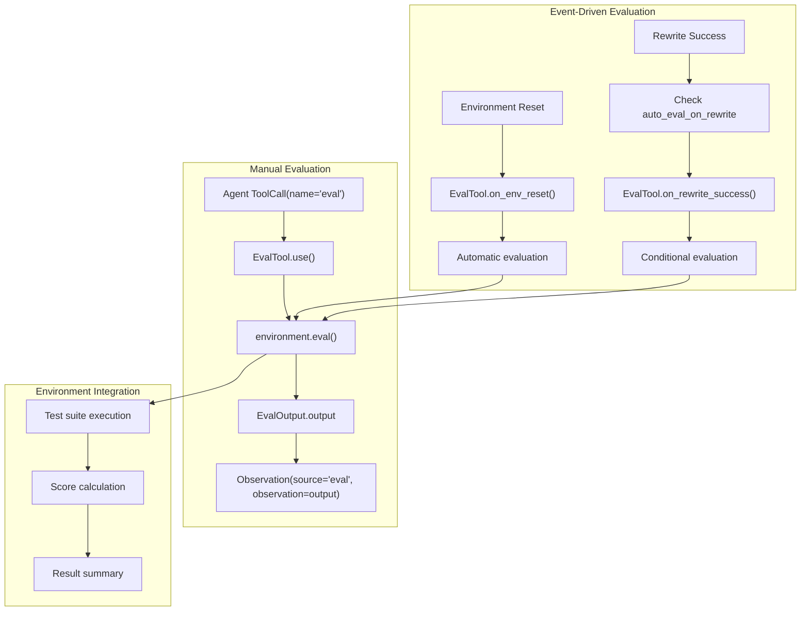
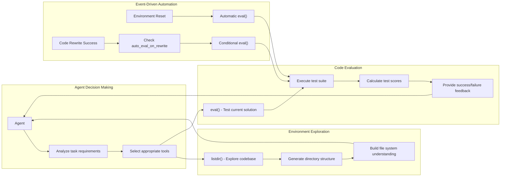

<!-- source: DeepWiki mcp.deepwiki.com · repo microsoft/debug-gym · page 3.4 Environment Interaction Tools · fetched 2026-10-26 -->

# Environment Interaction Tools

<details>
<summary>Relevant source files</summary>

The following files were used as context for generating this wiki page:

- [debug_gym/gym/envs/env.py](debug_gym/gym/envs/env.py)
- [debug_gym/gym/tools/pdb.py](debug_gym/gym/tools/pdb.py)
- [debug_gym/gym/tools/rewrite.py](debug_gym/gym/tools/rewrite.py)
- [debug_gym/gym/tools/view.py](debug_gym/gym/tools/view.py)
- [debug_gym/gym/utils.py](debug_gym/gym/utils.py)
- [tests/gym/envs/test_env.py](tests/gym/envs/test_env.py)
- [tests/gym/test_utils.py](tests/gym/test_utils.py)
- [tests/gym/tools/test_pdb.py](tests/gym/tools/test_pdb.py)
- [tests/gym/tools/test_rewrite.py](tests/gym/tools/test_rewrite.py)
- [tests/gym/tools/test_view.py](tests/gym/tools/test_view.py)

</details>


This document covers the environment interaction tools in debug-gym, which provide agents with capabilities to navigate the file system, evaluate code against test cases, and interact with the execution environment. These tools complement the interactive debugging tools (covered in [Interactive Debugging (PDB Tool)](#3.2)) and code manipulation tools (covered in [Code Manipulation Tools](#3.3)) by providing essential environment awareness and evaluation capabilities.

## Overview

Environment interaction tools enable agents to understand and evaluate their working environment during debugging sessions. The primary tools in this category are:

- **ListdirTool** - Directory navigation and file system exploration
- **EvalTool** - Test execution and code evaluation against predefined test cases

These tools integrate with the broader tool framework through the `@Toolbox.register()` decorator system and inherit from `EnvironmentTool` base class, providing consistent interfaces for agent interaction.

## Directory Navigation with ListdirTool

The `ListdirTool` provides file system navigation capabilities, allowing agents to explore the repository structure and understand the codebase layout.

### Tool Configuration

The `ListdirTool` class is defined in [debug_gym/gym/tools/listdir.py:7-41]() with the following key properties:

| Property | Value | Description |
|----------|-------|-------------|
| `name` | "listdir" | Tool identifier for agent calls |
| `arguments` | `path`, `depth` | Optional path and traversal depth |
| `description` | Directory listing functionality | Tool usage instructions |

### Usage Parameters

The tool accepts two optional parameters:

- **path** (string, nullable): Relative path within working directory (defaults to ".")
- **depth** (number, nullable): Maximum traversal depth (defaults to 1)

### Implementation Details

The core functionality is implemented in the `use` method [debug_gym/gym/tools/listdir.py:32-41]():

```python
def use(self, environment, path: str = ".", depth: int = 1) -> Observation:
    if depth <= 0:
        return Observation(self.name, f"Depth must be 1 or greater, got `depth={depth}`")
    try:
        result = environment.directory_tree(root=path, max_depth=depth)
    except Exception as e:
        result = f"Error listing directory '{path}': {str(e)}"
    return Observation(self.name, result)
```

The tool delegates to the environment's `directory_tree` method, which generates a tree-like representation of the directory structure.

**Tool Registration and Directory Navigation Flow**



Sources: [debug_gym/gym/tools/listdir.py:1-42](), [tests/gym/envs/test_swe_bench.py:94-116](), [tests/gym/envs/test_swe_smith.py:142-165]()

## Test Evaluation with EvalTool

The `EvalTool` provides automated test execution capabilities, allowing agents to evaluate their code changes against predefined test cases and receive immediate feedback on solution correctness.

### Tool Configuration

The `EvalTool` class is defined in [debug_gym/gym/tools/eval.py:6-24]() with minimal configuration:

| Property | Value | Description |
|----------|-------|-------------|
| `name` | "eval" | Tool identifier |
| `arguments` | `{}` | No arguments required |
| `description` | "Evaluate the current code against pre-defined test cases." | Purpose description |

### Event-Driven Behavior

The `EvalTool` implements event handlers that automatically trigger evaluations in response to environment changes:

- **on_env_reset**: Automatically runs evaluation when environment resets [debug_gym/gym/tools/eval.py:16-18]()
- **on_rewrite_success**: Conditionally runs evaluation after successful code rewrites [debug_gym/gym/tools/eval.py:20-23]()

The automatic evaluation behavior is controlled by the environment's `auto_eval_on_rewrite` flag.

### Implementation Details

The core evaluation logic delegates to the environment's `eval()` method:

```python
def use(self, environment) -> Observation:
    eval_output = environment.eval()
    return Observation(self.name, eval_output.output)
```

**Evaluation Tool Flow and Event Integration**



Sources: [debug_gym/gym/tools/eval.py:1-24](), [tests/gym/tools/test_eval.py:1-64]()

## Tool Integration Architecture

Environment interaction tools integrate with the broader debug-gym architecture through several key mechanisms:

### Registration and Discovery

Tools are registered using the `@Toolbox.register()` decorator, making them discoverable by environments and agents. The registration system allows for dynamic tool loading and configuration.

### Environment Integration

Both tools inherit from `EnvironmentTool` and interact with the environment through standardized interfaces:

- **ListdirTool**: Uses `environment.directory_tree()` for file system operations
- **EvalTool**: Uses `environment.eval()` for test execution

### Event System Integration

The `EvalTool` demonstrates sophisticated event-driven behavior, automatically responding to environment state changes. This integration allows for streamlined debugging workflows where evaluations happen automatically at appropriate times.

**Environment Interaction Tools in Agent Workflows**



Sources: [debug_gym/gym/tools/toolbox.py](), [debug_gym/gym/tools/tool.py](), [debug_gym/gym/envs/env.py]()

## Usage in Benchmark Environments

Environment interaction tools are essential components in all major benchmark environments, providing consistent interfaces for file system navigation and code evaluation.

### SWE-Bench Integration

In SWE-Bench environments, these tools enable agents to:

- Navigate complex repository structures using `listdir`
- Evaluate solutions against real-world test suites using `eval`
- Automatically track progress through event-driven evaluation

Example usage from test suite [tests/gym/envs/test_swe_bench.py:94-116]():

```python
tool_call = ToolCall(id="listdir_id", name="listdir", arguments={})
env_info = swe_env.step(tool_call)
# Returns directory structure starting with working directory
```

### Configuration Integration

The tools are consistently configured across different agent types in configuration files:

- **rewrite_agent**: `["view", "rewrite", "listdir", "eval"]` [scripts/config_swesmith.yaml:35]()
- **debug_agent**: `["pdb", "view", "rewrite", "listdir", "eval"]` [scripts/config_swesmith.yaml:37-38]()
- **debug_5_agent**: `["pdb", "view", "rewrite", "listdir", "eval"]` [scripts/config_swesmith.yaml:41-42]()

This consistent tool availability ensures that agents can reliably use environment interaction capabilities regardless of their primary debugging strategy.

Sources: [tests/gym/envs/test_swe_bench.py:94-116](), [tests/gym/envs/test_swe_smith.py:142-165](), [scripts/config_swesmith.yaml:35-42](), [debug_gym/agents/solution_agent.py:53-54]()

---

