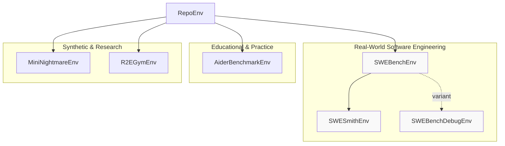
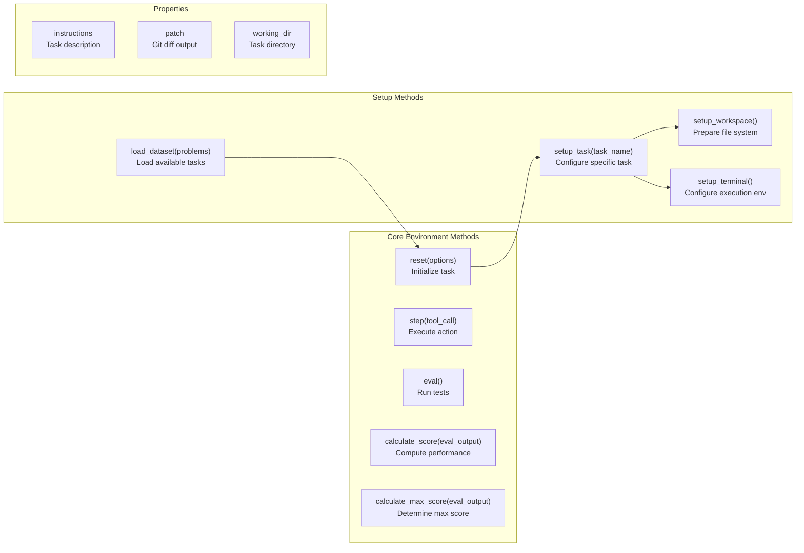
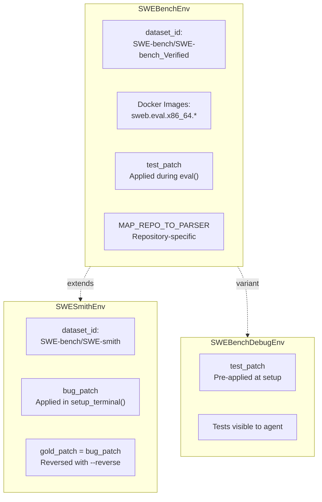
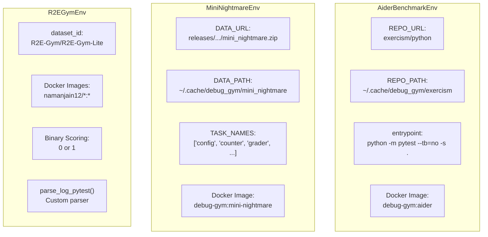
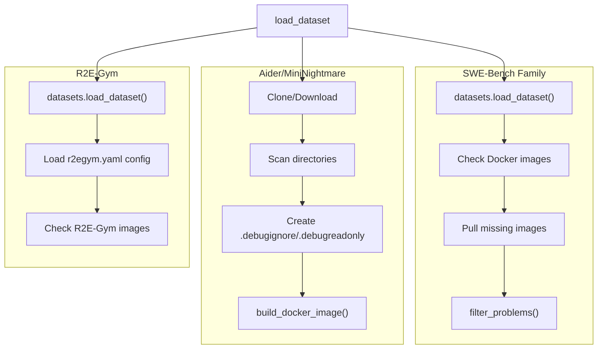
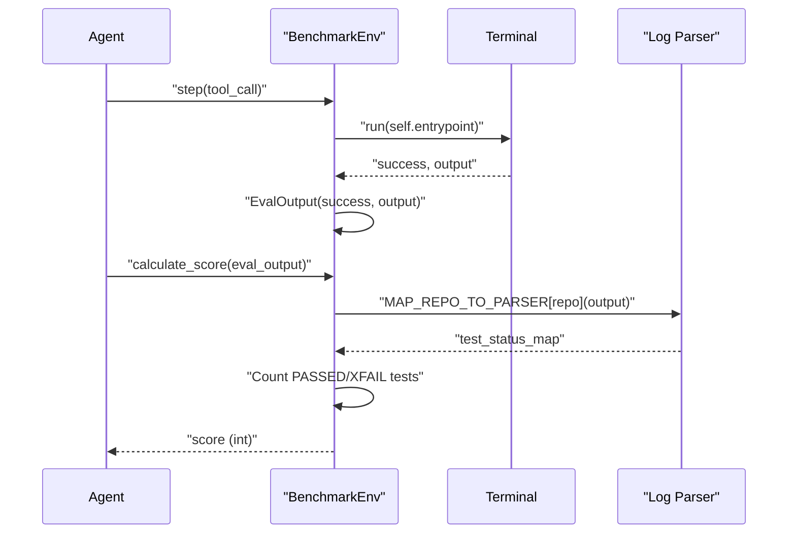
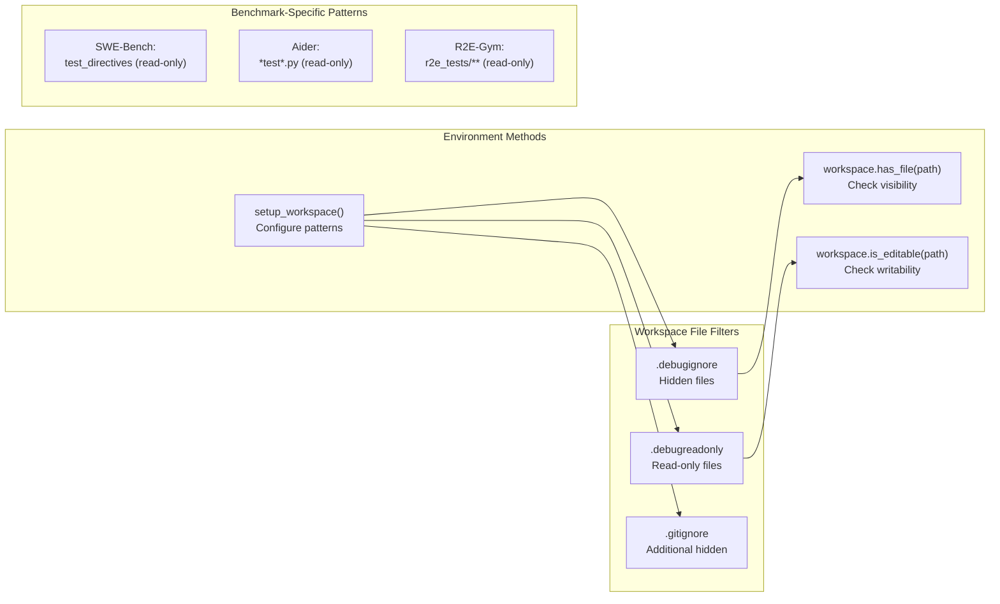

<!-- source: DeepWiki mcp.deepwiki.com · repo microsoft/debug-gym · page 4 Benchmarks and Environments · fetched 2026-10-26 -->

# Benchmarks and Environments

Relevant source files

The following files were used as context for generating this wiki page:

- [.github/actions/test-if-changes/action.yml](.github/actions/test-if-changes/action.yml)
- [debug_gym/gym/envs/__init__.py](debug_gym/gym/envs/__init__.py)
- [debug_gym/gym/envs/aider.py](debug_gym/gym/envs/aider.py)
- [debug_gym/gym/envs/mini_nightmare.py](debug_gym/gym/envs/mini_nightmare.py)
- [debug_gym/gym/envs/r2egym.py](debug_gym/gym/envs/r2egym.py)
- [debug_gym/gym/envs/swe_bench.py](debug_gym/gym/envs/swe_bench.py)
- [debug_gym/gym/envs/swe_smith.py](debug_gym/gym/envs/swe_smith.py)
- [debug_gym/gym/workspace.py](debug_gym/gym/workspace.py)
- [scripts/config_r2egym.yaml](scripts/config_r2egym.yaml)
- [tests/gym/envs/conftest.py](tests/gym/envs/conftest.py)
- [tests/gym/envs/test_aider.py](tests/gym/envs/test_aider.py)
- [tests/gym/envs/test_mini_nightmare.py](tests/gym/envs/test_mini_nightmare.py)
- [tests/gym/envs/test_r2egym.py](tests/gym/envs/test_r2egym.py)
- [tests/gym/envs/test_swe_bench.py](tests/gym/envs/test_swe_bench.py)
- [tests/gym/envs/test_swe_smith.py](tests/gym/envs/test_swe_smith.py)
- [tests/gym/terminals/test_docker.py](tests/gym/terminals/test_docker.py)
- [tests/gym/test_workspace.py](tests/gym/test_workspace.py)

This page provides an overview of the benchmark environments available for agent evaluation in debug-gym. These environments provide diverse debugging challenges ranging from educational programming exercises to real-world software engineering tasks. Debug-gym currently supports six benchmark environments:

- **SWE-Bench Suite** - Real-world GitHub issues from popular Python repositories (see [SWE-Bench Suite](#4.1))
- **Aider Benchmark** - Educational programming exercises from Exercism (see [Aider Benchmark](#4.2))
- **Synthetic Benchmarks** - Curated debugging tasks and research benchmarks (see [Synthetic Benchmarks](#4.3))

For information about the underlying environment framework and `RepoEnv` base class, see [Environment System](#2.1).

Sources: [debug_gym/gym/envs/__init__.py:1-28]()

## Benchmark Environment Architecture

Debug-gym provides a modular benchmark system built on the `RepoEnv` base class, with each benchmark implementing specialized task loading, evaluation, and scoring mechanisms. All environments share common interfaces while providing benchmark-specific implementations.

### Benchmark Environment Hierarchy

**Environment Selection via `select_env()`**

The `select_env()` function maps string identifiers to environment classes:

| String Identifier | Environment Class | File |
|------------------|-------------------|------|
| `"swebench"` | `SWEBenchEnv` | [debug_gym/gym/envs/swe_bench.py:19-217]() |
| `"swesmith"` | `SWESmithEnv` | [debug_gym/gym/envs/swe_smith.py:23-221]() |
| `"swebench-debug"` | `SWEBenchDebugEnv` | [debug_gym/gym/envs/swe_bench_debug.py]() |
| `"aider"` | `AiderBenchmarkEnv` | [debug_gym/gym/envs/aider.py:59-171]() |
| `"mini_nightmare"` | `MiniNightmareEnv` | [debug_gym/gym/envs/mini_nightmare.py:59-167]() |
| `"r2egym"` | `R2EGymEnv` | [debug_gym/gym/envs/r2egym.py:62-315]() |

Sources: [debug_gym/gym/envs/__init__.py:10-28](), [debug_gym/gym/envs/swe_bench.py:19-42](), [debug_gym/gym/envs/swe_smith.py:23-43](), [debug_gym/gym/envs/aider.py:59-76](), [debug_gym/gym/envs/mini_nightmare.py:59-88](), [debug_gym/gym/envs/r2egym.py:62-85]()

### Common Environment Interface

All benchmark environments implement these core methods:

**Key Method Implementations**

| Method | Purpose | Return Type |
|--------|---------|-------------|
| `load_dataset()` | Load and filter available tasks | `dict[str, int]` (task_name → index) |
| `setup_task()` | Configure environment for specific task | `None` |
| `setup_workspace()` | Initialize workspace with file filters | `None` |
| `setup_terminal()` | Configure terminal environment and dependencies | `None` |
| `eval()` | Execute test suite and capture output | `EvalOutput` |
| `calculate_score()` | Parse test results and compute score | `int` |
| `calculate_max_score()` | Determine maximum achievable score | `int` |

Sources: [debug_gym/gym/envs/swe_bench.py:43-217](), [debug_gym/gym/envs/aider.py:78-171](), [debug_gym/gym/envs/mini_nightmare.py:90-167](), [debug_gym/gym/envs/r2egym.py:87-315]()

## Available Benchmarks

Debug-gym includes six benchmark environments, each designed for different aspects of debugging evaluation:

| Benchmark | Type | Dataset Source | Task Count | Supported Terminals |
|-----------|------|----------------|------------|---------------------|
| **SWE-Bench** | Real-world SE | SWE-bench/SWE-bench_Verified | 500 (verified) | Docker, Kubernetes |
| **SWE-Smith** | Real-world SE | SWE-bench/SWE-smith | ~25,000 | Docker, Kubernetes |
| **SWE-Bench-Debug** | Real-world SE (variant) | SWE-bench/SWE-bench_Verified | 500 (verified) | Docker, Kubernetes |
| **Aider** | Educational | exercism/python | 133 | Docker, Local |
| **Mini Nightmare** | Synthetic | Hand-crafted | 10 | Docker, Local |
| **R2E-Gym** | Research | R2E-Gym/R2E-Gym-Lite | varies | Docker, Kubernetes |

**Terminal Requirements**

- **Docker/Kubernetes only**: SWE-Bench family, R2E-Gym (require pre-built images)
- **Flexible**: Aider, Mini Nightmare (build custom images or use local execution)

Sources: [debug_gym/gym/envs/swe_bench.py:22-41](), [debug_gym/gym/envs/swe_smith.py:29-43](), [debug_gym/gym/envs/aider.py:59-76](), [debug_gym/gym/envs/mini_nightmare.py:59-88](), [debug_gym/gym/envs/r2egym.py:62-85]()

### Benchmark-Specific Characteristics

**SWE-Bench Family**

**Educational & Synthetic Benchmarks**

Sources: [debug_gym/gym/envs/swe_bench.py:19-42](), [debug_gym/gym/envs/swe_smith.py:23-43](), [debug_gym/gym/envs/aider.py:59-76](), [debug_gym/gym/envs/mini_nightmare.py:59-73](), [debug_gym/gym/envs/r2egym.py:62-85]()

## Dataset Loading and Task Selection

Each benchmark environment implements `load_dataset()` to discover and filter available tasks:

**Dataset Loading Pattern**

**Dataset Filtering**

The `filter_problems()` utility supports flexible task selection:

- **All tasks**: `problems="all"`
- **Specific tasks**: `problems=["task1", "task2"]`
- **Custom splits**: Uses YAML config files (e.g., `swe_smith.yaml`, `r2egym.yaml`)
- **Excluded tasks**: Configured via `excluded` key in YAML

Sources: [debug_gym/gym/envs/swe_bench.py:47-77](), [debug_gym/gym/envs/swe_smith.py:45-96](), [debug_gym/gym/envs/aider.py:125-171](), [debug_gym/gym/envs/mini_nightmare.py:141-167](), [debug_gym/gym/envs/r2egym.py:97-146]()

## Evaluation and Scoring

All benchmark environments implement standardized evaluation and scoring:

**Evaluation Flow**

**Environment-Specific Scoring**

| Environment | Scoring Logic | Max Score Calculation |
|-------------|---------------|----------------------|
| **SWEBenchEnv** | Count tests in `fail_to_pass` that pass | `len(self.fail_to_pass)` |
| **SWESmithEnv** | Count tests in `fail_to_pass` that pass | `len(self.fail_to_pass)` |
| **AiderBenchmarkEnv** | Extract from pytest output | Extract from pytest output |
| **MiniNightmareEnv** | Extract from pytest output | Extract from pytest output |
| **R2EGymEnv** | Binary: all tests match expected or 0 | Always `1` |

Sources: [debug_gym/gym/envs/swe_bench.py:183-217](), [debug_gym/gym/envs/swe_smith.py:191-221](), [debug_gym/gym/envs/aider.py:82-92](), [debug_gym/gym/envs/mini_nightmare.py:98-108](), [debug_gym/gym/envs/r2egym.py:276-315]()

## File Access Control

Benchmark environments use the `Workspace` class to control file visibility and editability:

**File Filter Mechanisms**

**Common Patterns**

- **Hidden from agents**: Test files, configuration files, hidden directories (`**/.*`)
- **Read-only**: Test files that agents can view but not modify
- **Environment reset**: `ENV_RESET` event triggers workspace cleanup

Sources: [debug_gym/gym/envs/swe_bench.py:136-143](), [debug_gym/gym/envs/aider.py:99-107](), [debug_gym/gym/envs/r2egym.py:197-204](), [debug_gym/gym/workspace.py:26-90](), [tests/gym/envs/test_aider.py:45-61]()

## Environment Configuration

Benchmark environments integrate with the configuration system to allow customization of behavior, tool sets, and evaluation parameters. Each environment can be configured through YAML files that specify:

- Entrypoint commands for test execution
- Timeout values for operations
- Tool availability and permissions
- Auto-evaluation settings
- Task filtering and selection criteria

The modular design allows researchers to create custom benchmark environments by extending `RepoEnv` and implementing the required interface methods for their specific evaluation needs.

Sources: [debug_gym/gym/envs/aider.py:62-77](), [debug_gym/gym/envs/mini_nightmare.py:63-68]()

---

