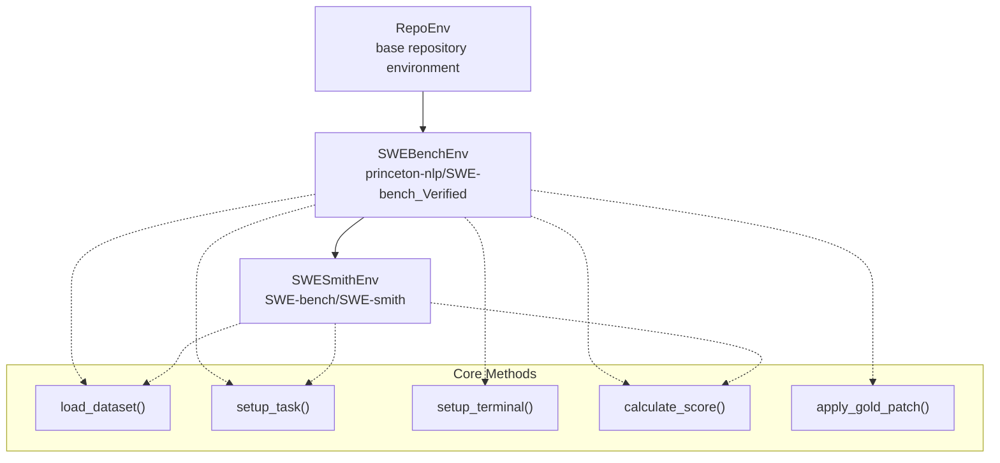
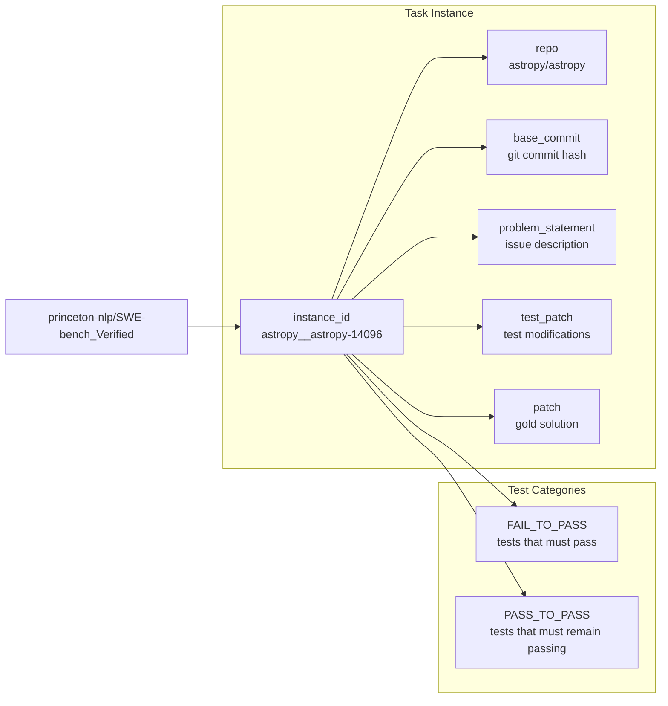
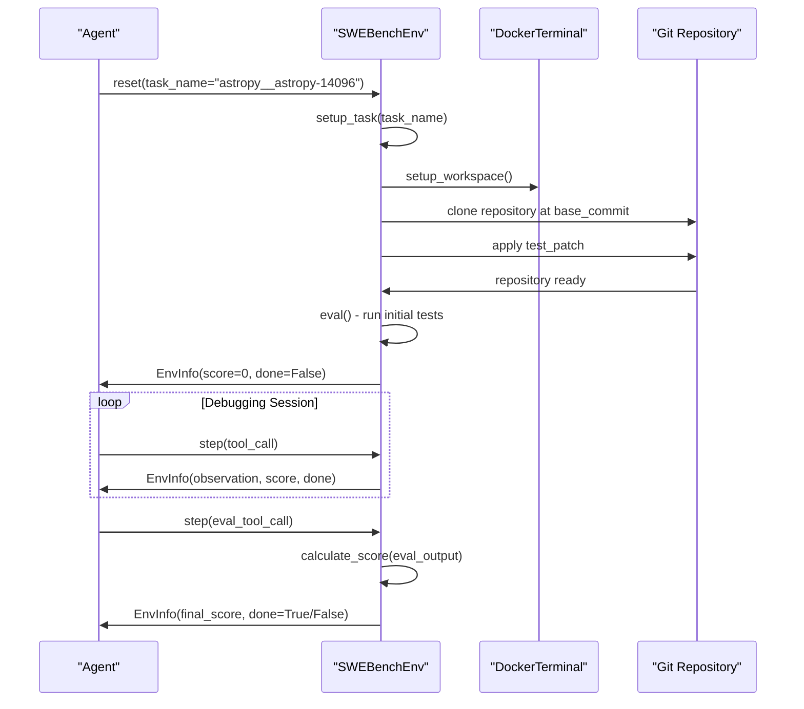
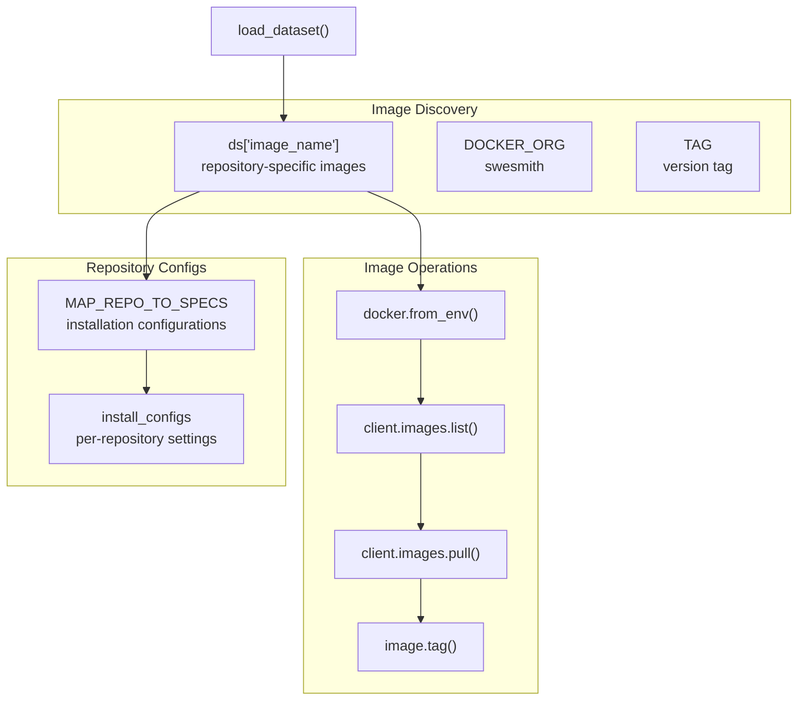
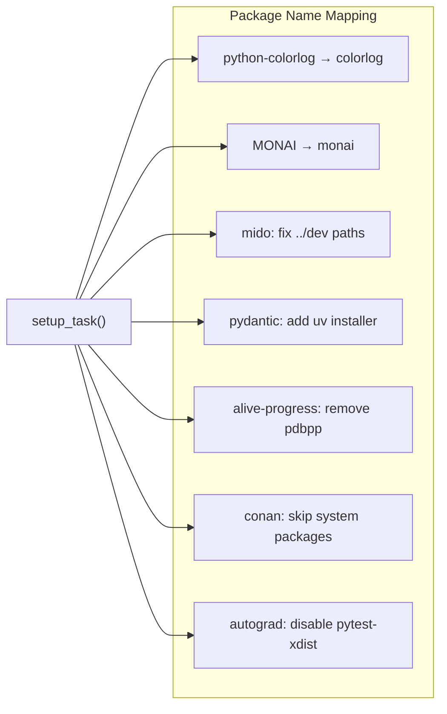
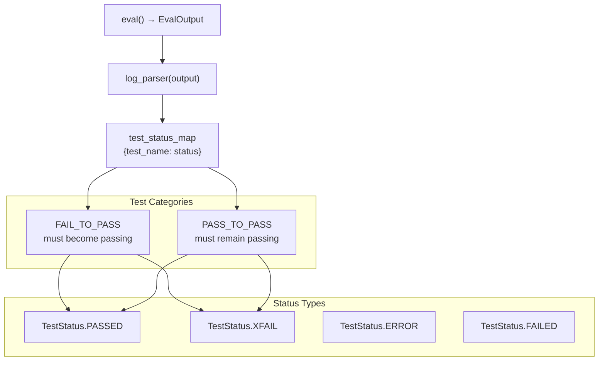
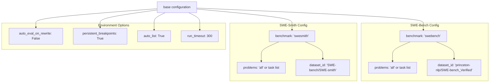

<!-- source: DeepWiki mcp.deepwiki.com · repo microsoft/debug-gym · page 4.1 SWE-Bench Suite · fetched 2026-10-26 -->

# SWE-Bench Suite

<details>
<summary>Relevant source files</summary>

The following files were used as context for generating this wiki page:

- [debug_gym/gym/envs/swe_bench.py](debug_gym/gym/envs/swe_bench.py)
- [debug_gym/gym/envs/swe_smith.py](debug_gym/gym/envs/swe_smith.py)
- [tests/gym/envs/test_swe_bench.py](tests/gym/envs/test_swe_bench.py)
- [tests/gym/envs/test_swe_smith.py](tests/gym/envs/test_swe_smith.py)

</details>


The SWE-Bench Suite provides environments for debugging real-world GitHub issues from open-source Python repositories. This suite consists of two primary environments: `SWEBenchEnv` for the original SWE-Bench dataset and `SWESmithEnv` for the curated SWE-Smith dataset. Both environments simulate realistic debugging scenarios where agents must understand problem statements, explore codebases, and implement fixes that pass existing test suites.

For information about other benchmark environments like Exercism tasks, see [Aider Benchmark](#4.1). For synthetic debugging scenarios, see [Test Data and Mini Nightmare](#4.3).

## Environment Architecture

The SWE-Bench Suite implements a two-tier architecture where `SWESmithEnv` extends `SWEBenchEnv` with specialized functionality for the SWE-Smith dataset.

### Class Hierarchy



Sources: [debug_gym/gym/envs/swe_smith.py:22-43](), [tests/gym/envs/test_swe_bench.py:54-73](), [tests/gym/envs/test_swe_smith.py:55-73]()

## SWEBenchEnv Implementation

`SWEBenchEnv` serves as the base implementation for debugging tasks from the SWE-Bench Verified dataset. It manages Docker-based repository environments and provides core functionality for task setup, evaluation, and scoring.

### Dataset Structure



The dataset contains these key features as validated in the test suite:

| Feature | Purpose | Required |
|---------|---------|----------|
| `repo` | Repository identifier | Yes |
| `instance_id` | Unique task identifier | Yes |
| `base_commit` | Starting git commit | Yes |
| `problem_statement` | Issue description | Yes |
| `test_patch` | Test modifications | Yes |
| `patch` | Gold solution patch | No |
| `FAIL_TO_PASS` | Tests that should pass after fix | Yes |
| `PASS_TO_PASS` | Tests that should remain passing | Yes |

Sources: [tests/gym/envs/test_swe_bench.py:58-72](), [tests/gym/envs/test_swe_bench.py:189-204]()

### Task Lifecycle



Sources: [tests/gym/envs/test_swe_bench.py:84-117](), [tests/gym/envs/test_swe_bench.py:207-246]()

## SWESmithEnv Specialized Implementation

`SWESmithEnv` extends `SWEBenchEnv` with Docker image management and repository-specific configurations for the SWE-Smith dataset.

### Key Differences from SWEBenchEnv

| Aspect | SWEBenchEnv | SWESmithEnv |
|--------|-------------|-------------|
| Dataset | `princeton-nlp/SWE-bench_Verified` | `SWE-bench/SWE-smith` |
| Docker Images | Generic base images | Pre-built repository-specific images |
| Instance IDs | `astropy__astropy-14096` | `john-kurkowski__tldextract.3d1bf184.combine_file__1vnuqpt4` |
| Configuration | Standard setup | Repository-specific tweaks via `MAP_REPO_TO_SPECS` |

### Docker Image Management



Sources: [debug_gym/gym/envs/swe_smith.py:75-90](), [debug_gym/gym/envs/swe_smith.py:124-126]()

### Repository-Specific Configurations

The `SWESmithEnv` applies repository-specific modifications to handle edge cases:



Sources: [debug_gym/gym/envs/swe_smith.py:133-166]()

## Scoring and Evaluation

Both environments use test-based scoring where agents must fix failing tests while maintaining passing tests.

### Score Calculation Logic



The scoring algorithm counts tests in `FAIL_TO_PASS` that achieve `TestStatus.PASSED` or `TestStatus.XFAIL` status:

```python
score = sum(
    1 for test in self.fail_to_pass
    if test_status_map.get(test, TestStatus.ERROR.value) 
    in (TestStatus.PASSED.value, TestStatus.XFAIL.value)
)
```

Sources: [debug_gym/gym/envs/swe_smith.py:210-234](), [tests/gym/envs/test_swe_bench.py:300-312]()

## Integration with Agent Framework

The SWE-Bench environments integrate with the broader debug-gym agent framework through standardized interfaces and configuration files.

### Configuration Integration



### Agent Tool Integration

Both environments support the standard debug-gym tool ecosystem:

| Tool | Purpose | Usage in SWE-Bench |
|------|---------|-------------------|
| `pdb` | Interactive debugging | Set breakpoints, inspect variables |
| `view` | Code inspection | Examine source files |
| `rewrite` | Code modification | Apply fixes to source code |
| `listdir` | File navigation | Explore repository structure |
| `eval` | Test execution | Run test suites and calculate scores |

Sources: [scripts/config_swesmith.yaml:34-46](), [tests/gym/envs/test_swe_bench.py:94-116](), [tests/gym/envs/test_swe_smith.py:142-166]()

---

