<!-- source: DeepWiki mcp.deepwiki.com · repo microsoft/debug-gym · page 4.2 Aider Benchmark · fetched 2026-10-26 -->

# Aider Benchmark

<details>
<summary>Relevant source files</summary>

The following files were used as context for generating this wiki page:

- [debug_gym/gym/envs/aider.py](debug_gym/gym/envs/aider.py)
- [debug_gym/gym/envs/mini_nightmare.py](debug_gym/gym/envs/mini_nightmare.py)
- [debug_gym/gym/workspace.py](debug_gym/gym/workspace.py)
- [tests/gym/envs/test_aider.py](tests/gym/envs/test_aider.py)
- [tests/gym/terminals/test_docker.py](tests/gym/terminals/test_docker.py)
- [tests/gym/test_workspace.py](tests/gym/test_workspace.py)

</details>


## Purpose and Scope

The Aider Benchmark environment provides an educational debugging and code completion benchmark based on Exercism Python practice exercises. This environment presents 133 well-defined programming problems with clear specifications and test suites, making it suitable for validating agent capabilities on structured, self-contained tasks with moderate complexity.

This page documents the `AiderBenchmarkEnv` class, its dataset structure, workspace management, and evaluation mechanisms. For information about the base environment functionality, see [Environment System (RepoEnv)](#2.1). For real-world software engineering benchmarks, see [SWE-Bench Suite](#4.1). For other synthetic benchmarks, see [Synthetic Benchmarks](#4.3).

## Dataset Structure

### Exercism Repository

The Aider Benchmark uses the Exercism Python repository as its data source. The environment clones the repository from `https://github.com/exercism/python` into a local cache directory.

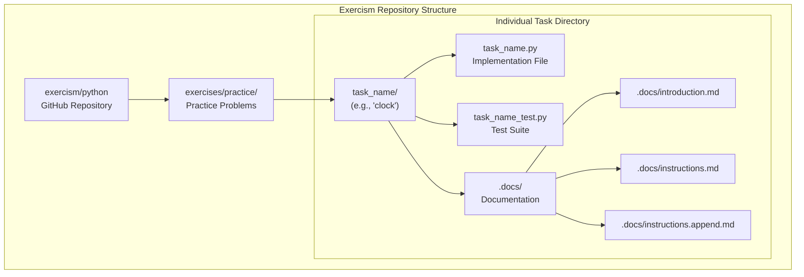

Sources: [debug_gym/gym/envs/aider.py:60-61](), [debug_gym/gym/envs/aider.py:129-170]()

### Dataset Loading

The `load_dataset()` method processes the Exercism repository to create a structured dataset:

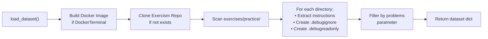

Each task in the dataset is represented as a dictionary with the following structure:

| Field | Type | Description |
|-------|------|-------------|
| `codebase` | `Path` | Path to the task directory containing all files |
| `instructions` | `str` | Concatenated content from `.docs/` markdown files |
| `filename` | `str` | Name of the implementation file (e.g., `clock.py`) |

Sources: [debug_gym/gym/envs/aider.py:125-170]()

### File Filtering Patterns

The environment automatically creates `.debugignore` and `.debugreadonly` files for each task to control visibility and editability:

**`.debugignore` patterns** (files hidden from agents):
- `.?*` - All hidden files and directories except current directory `.`
- `__pycache__/` - Python cache directories
- `*.pyc` - Compiled Python files

**`.debugreadonly` patterns** (files visible but not editable):
- `*test*.py` - All test files to prevent agents from modifying tests

Sources: [debug_gym/gym/envs/aider.py:148-160]()

## AiderBenchmarkEnv Class

### Class Definition and Initialization

```mermaid
classDiagram
    class RepoEnv {
        <<abstract>>
        +terminal: Terminal
        +workspace: Workspace
        +dataset: dict
        +current_task: dict
        +reset(options)
        +step(tool_call)
        +eval()
    }
    
    class AiderBenchmarkEnv {
        +REPO_URL: str = "github.com/exercism/python"
        +REPO_PATH: Path = "cache/exercism"
        +entrypoint: str = "python -m pytest --tb=no -s ."
        +__init__(entrypoint, terminal, kwargs)
        +instructions: str
        +calculate_max_score(eval_output)
        +calculate_score(eval_output)
        +eval()
        +setup_task(task_name, options)
        +setup_workspace()
        +setup_terminal()
        +load_dataset(problems)
    }
    
    class DockerTerminal {
        +base_image: str
        +run(command)
        +copy_content(src, target)
    }
    
    RepoEnv <|-- AiderBenchmarkEnv
    AiderBenchmarkEnv --> DockerTerminal: uses
    AiderBenchmarkEnv --> "build_docker_image()"
```

The `AiderBenchmarkEnv` class extends `RepoEnv` and provides:

- **Default Terminal**: Uses `DockerTerminal` with the `debug-gym:aider` image
- **Default Entrypoint**: `python -m pytest --tb=no -s .` runs all tests in the current directory
- **Repository Management**: Clones and caches Exercism repository locally

Sources: [debug_gym/gym/envs/aider.py:59-76]()

### Key Methods

| Method | Purpose | Returns |
|--------|---------|---------|
| `instructions` | Property returning task instructions from `.docs/` files | `str` |
| `calculate_max_score()` | Extracts total number of tests from pytest output | `int` |
| `calculate_score()` | Extracts number of passing tests from pytest output | `int` |
| `eval()` | Runs pytest and parses output | `EvalOutput` |
| `setup_task()` | Loads task data from dataset | `None` |
| `setup_workspace()` | Copies task files to workspace and applies filters | `None` |
| `setup_terminal()` | Initializes git repository in workspace | `None` |

Sources: [debug_gym/gym/envs/aider.py:78-124]()

## Environment Lifecycle

### Reset Flow

The environment reset process follows this sequence:

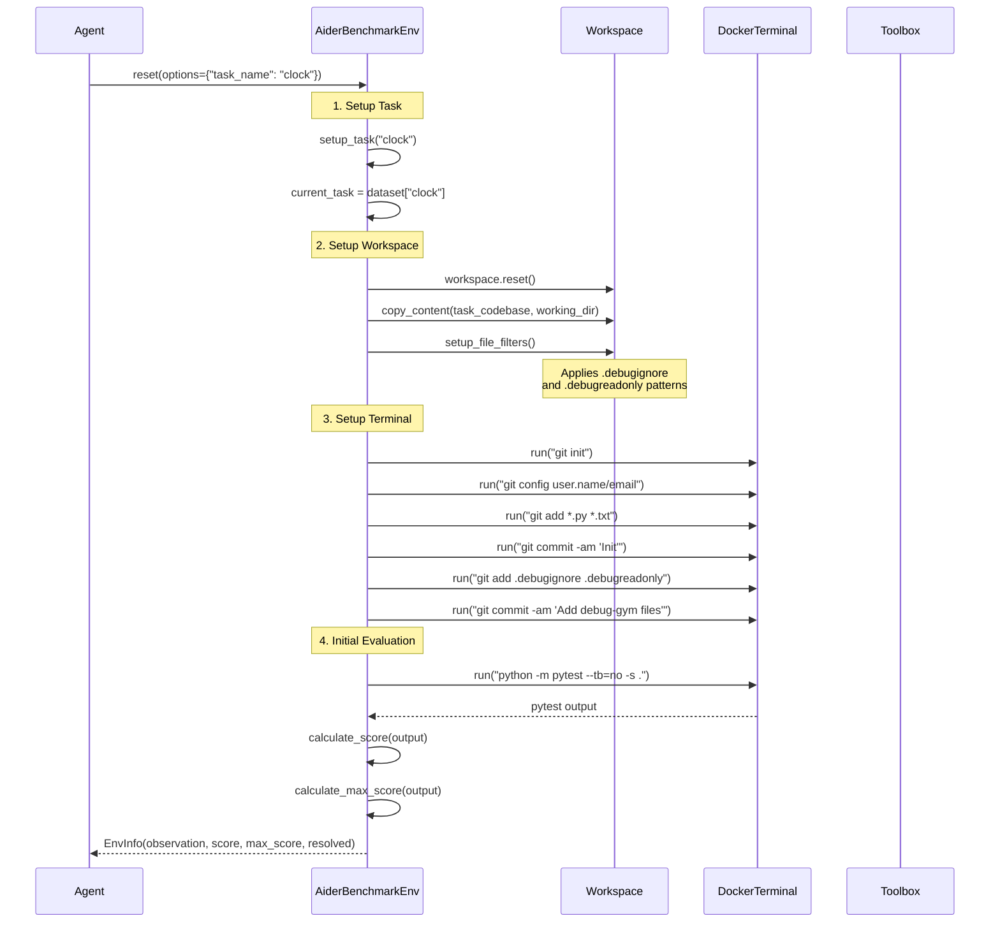

Sources: [debug_gym/gym/envs/aider.py:94-123](), [tests/gym/envs/test_aider.py:111-122]()

### Workspace File Visibility

The workspace applies file filtering to control what agents can see and edit:

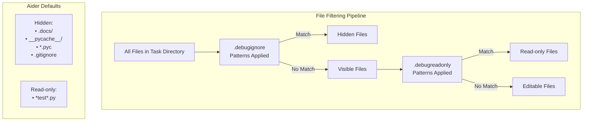

**Example: `clock` task file visibility**

| File | Visible | Editable | Reason |
|------|---------|----------|--------|
| `clock.py` | ✓ | ✓ | Python implementation file |
| `clock_test.py` | ✓ | ✗ | Matches `*test*.py` readonly pattern |
| `.docs/instructions.md` | ✗ | ✗ | Matches `.?*` ignore pattern |
| `__pycache__/` | ✗ | ✗ | Matches `__pycache__/` ignore pattern |
| `.debugignore` | ✗ | ✗ | Special debug-gym file, always hidden |

Sources: [debug_gym/gym/envs/aider.py:99-106](), [debug_gym/gym/envs/aider.py:148-160](), [tests/gym/envs/test_aider.py:45-61]()

## Evaluation and Scoring

### Pytest Integration

The Aider environment uses pytest for test execution and score calculation:

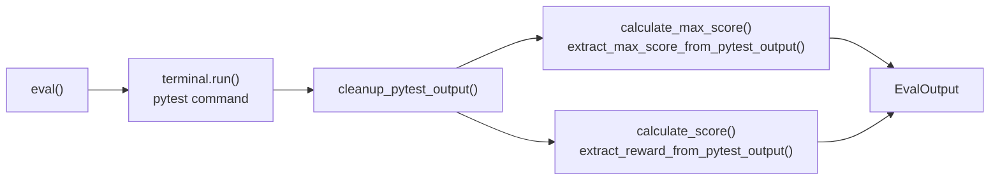

**Pytest Command**: `python -m pytest --tb=no -s .`
- `--tb=no` - Disables traceback output for cleaner results
- `-s` - Disables output capturing, shows print statements
- `.` - Runs all tests in current directory

**Score Calculation**:
- `max_score`: Total number of tests extracted from pytest summary
- `score`: Number of passing tests extracted from pytest summary
- Resolution criteria: `score == max_score`

Sources: [debug_gym/gym/envs/aider.py:82-92]()

### Example Test Execution

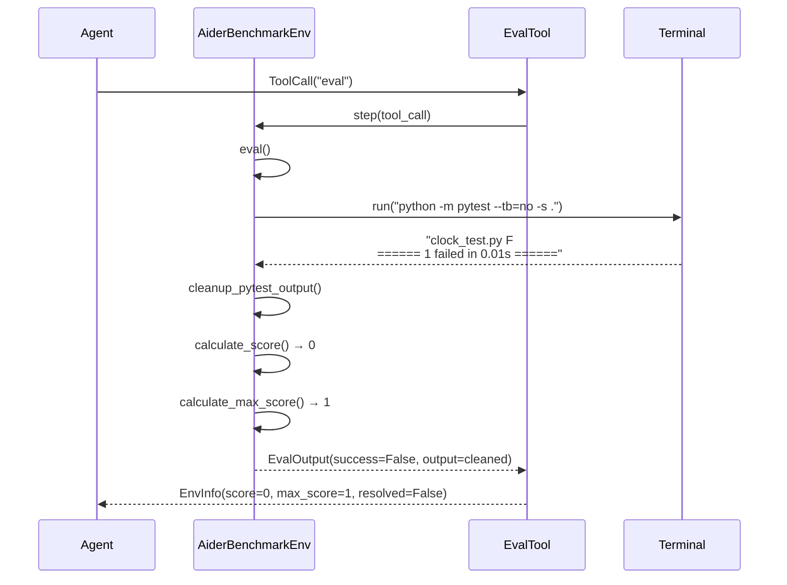

Sources: [tests/gym/envs/test_aider.py:63-97]()

## Docker Image Setup

### Image Building

The environment automatically builds a Docker image if it doesn't exist:

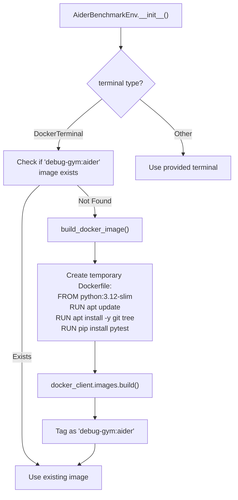

**Image Specification**:
- **Base Image**: `python:3.12-slim`
- **System Packages**: `git`, `tree`
- **Python Packages**: `pytest`
- **Image Name**: `debug-gym:aider`

Sources: [debug_gym/gym/envs/aider.py:16-57](), [debug_gym/gym/envs/aider.py:126-127]()

### Terminal Configuration

When using `DockerTerminal`, the environment configures the terminal with specific settings:

| Setting | Value | Purpose |
|---------|-------|---------|
| `base_image` | `debug-gym:aider` | Custom image with dependencies |
| `working_dir` | `/testbed` | Standardized workspace location |
| `env_vars['NO_COLOR']` | `1` | Disable ANSI color codes |
| `env_vars['PYTHONDONTWRITEBYTECODE']` | `1` | Prevent `.pyc` file generation |

Sources: [debug_gym/gym/envs/aider.py:63-76]()

## Task Instructions

The `instructions` property aggregates documentation from the `.docs/` directory:

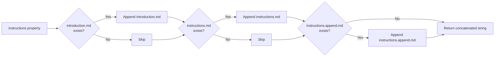

This concatenated string provides the task description and requirements to agents during the `reset()` call.

Sources: [debug_gym/gym/envs/aider.py:78-80](), [debug_gym/gym/envs/aider.py:139-146]()

## Testing Infrastructure

### Test Fixtures

The test suite uses a session-scoped fixture to set up a minimal Aider repository:

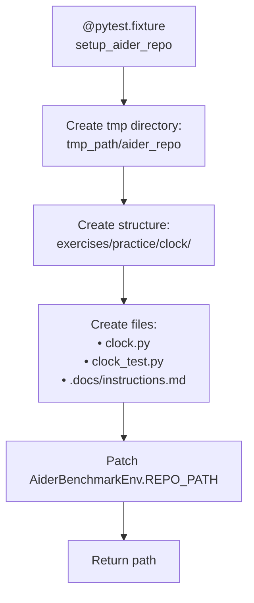

**Test Task Structure** (`clock` example):

```python
# clock.py
def current_time():  # returns a message with the current time
    return 'It is 10:00 a.m.'

# clock_test.py
import clock

def test_clock():
    assert clock.current_time() == 'It is 12:00 a.m.'
```

Sources: [tests/gym/envs/test_aider.py:12-43]()

### Test Coverage

The test suite verifies key functionality:

| Test | Validates |
|------|-----------|
| `test_ignored_files()` | Files matching `.debugignore` are hidden |
| `test_is_editable_files()` | Test files are read-only, implementation files are editable |
| `test_steps()` | Eval and rewrite tools work correctly, auto-eval triggers |
| `test_instructions()` | Instructions are loaded from `.docs/` directory |
| `test_build_docker_image()` | Docker image building is triggered when needed |
| `test_reset_with_docker_terminal()` | Reset works with Docker terminal, initial eval runs |

Sources: [tests/gym/envs/test_aider.py:45-122]()

## Integration with RepoEnv

The `AiderBenchmarkEnv` inherits core functionality from `RepoEnv`:

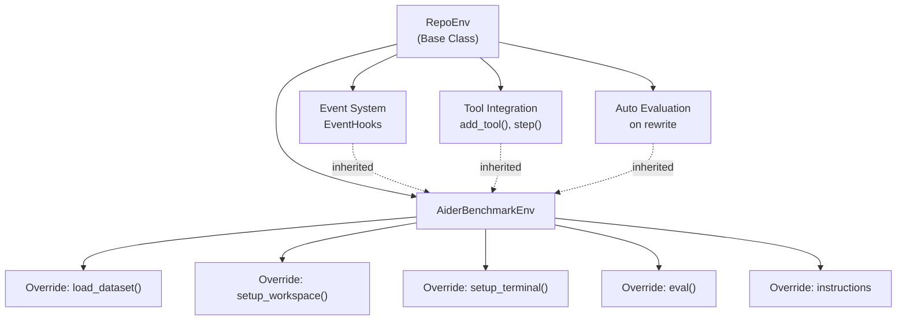

**Inherited Capabilities**:
- Event-driven tool reactions (e.g., PDB breakpoint adjustment)
- Tool registration and execution via `step()`
- Automatic evaluation after code rewrites (when `auto_eval_on_rewrite=True`)
- Terminal and workspace management abstractions

Sources: [debug_gym/gym/envs/aider.py:59-76]()

## Usage Example

A typical agent interaction with the Aider environment:

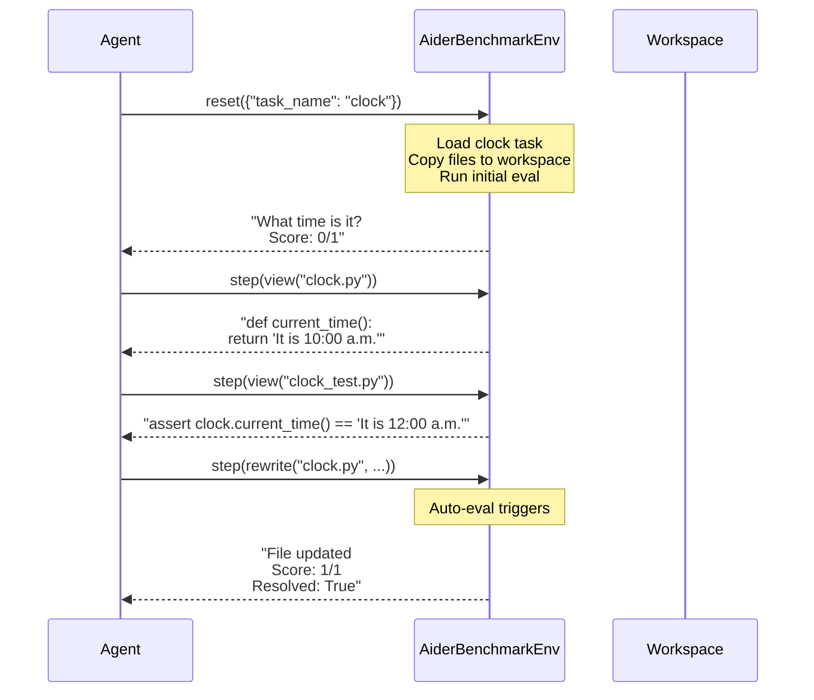

Sources: [tests/gym/envs/test_aider.py:63-97]()

---

