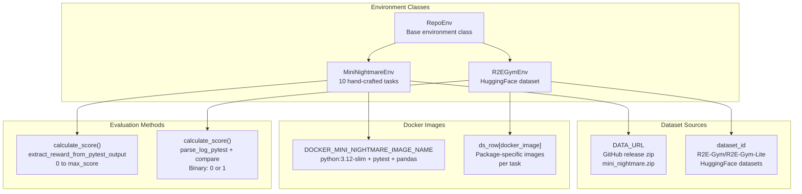
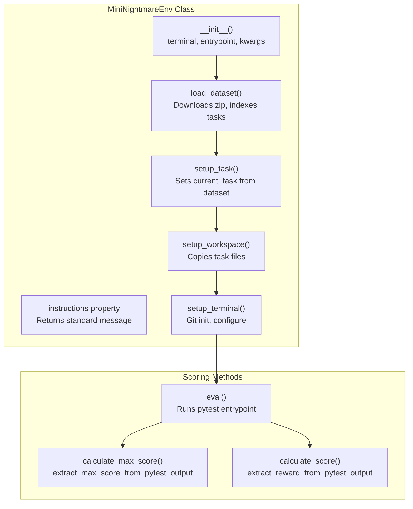
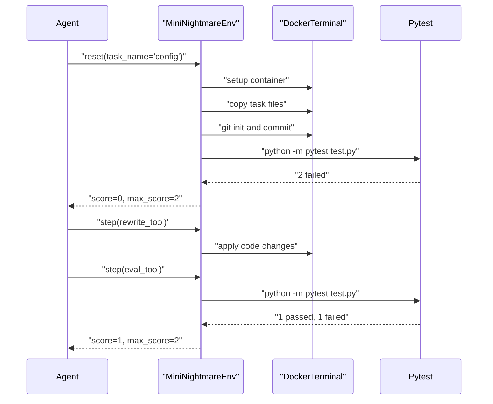
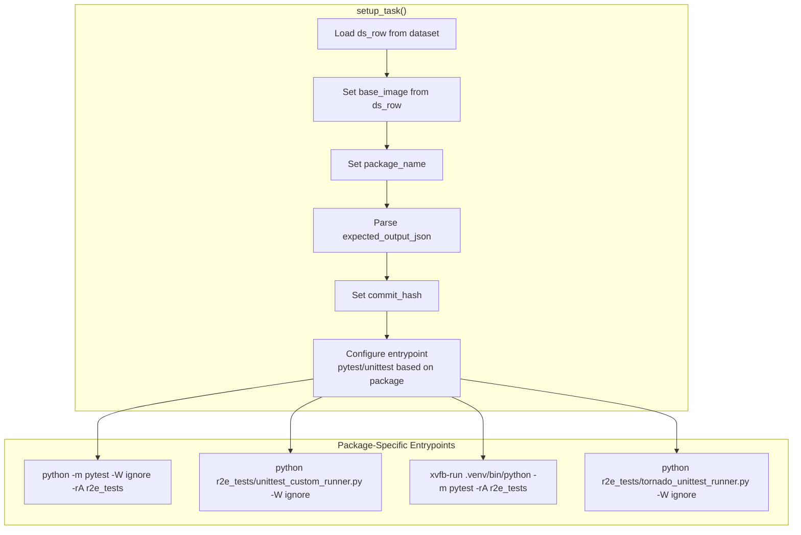
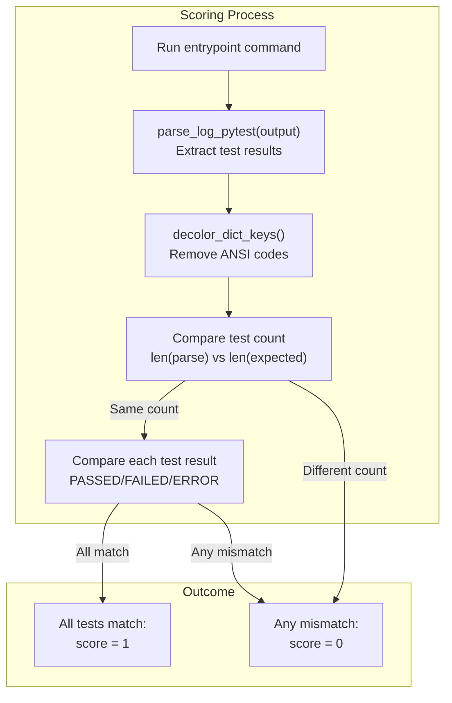
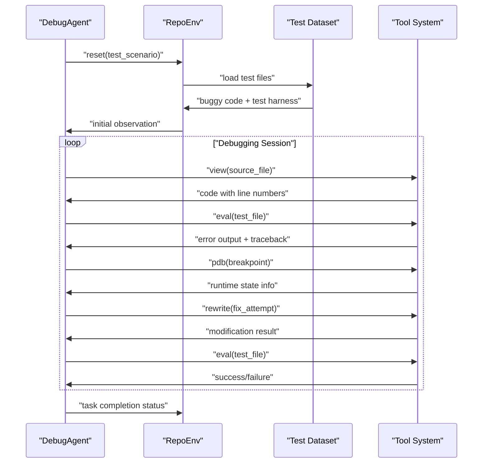

<!-- source: DeepWiki mcp.deepwiki.com · repo microsoft/debug-gym · page 4.3 Synthetic Benchmarks · fetched 2026-10-26 -->

# Synthetic Benchmarks

<details>
<summary>Relevant source files</summary>

The following files were used as context for generating this wiki page:

- [.github/actions/test-if-changes/action.yml](.github/actions/test-if-changes/action.yml)
- [debug_gym/gym/envs/__init__.py](debug_gym/gym/envs/__init__.py)
- [debug_gym/gym/envs/aider.py](debug_gym/gym/envs/aider.py)
- [debug_gym/gym/envs/mini_nightmare.py](debug_gym/gym/envs/mini_nightmare.py)
- [debug_gym/gym/envs/r2egym.py](debug_gym/gym/envs/r2egym.py)
- [debug_gym/gym/workspace.py](debug_gym/gym/workspace.py)
- [scripts/config_r2egym.yaml](scripts/config_r2egym.yaml)
- [tests/gym/envs/conftest.py](tests/gym/envs/conftest.py)
- [tests/gym/envs/test_aider.py](tests/gym/envs/test_aider.py)
- [tests/gym/envs/test_mini_nightmare.py](tests/gym/envs/test_mini_nightmare.py)
- [tests/gym/envs/test_r2egym.py](tests/gym/envs/test_r2egym.py)
- [tests/gym/terminals/test_docker.py](tests/gym/terminals/test_docker.py)
- [tests/gym/test_workspace.py](tests/gym/test_workspace.py)

</details>


This page documents the synthetic benchmark environments in debug-gym: MiniNightmareEnv and R2EGymEnv. These benchmarks provide controlled debugging scenarios for agent evaluation, with MiniNightmare offering 10 hand-crafted teaching examples and R2E-Gym providing a research benchmark with binary scoring.

For real-world benchmarks, see [Aider Benchmark](#4.2) and [SWE-Bench Suite](#4.1). For configuration details, see [Configuration System](#5.1).

## Overview

Debug-gym includes two synthetic benchmark environments designed for agent evaluation and teaching:

| Benchmark | Tasks | Scoring | Primary Use Case |
|-----------|-------|---------|------------------|
| **MiniNightmareEnv** | 10 hand-crafted scenarios | Pytest-based (0 to N tests) | Quick validation, teaching examples |
| **R2EGymEnv** | Research benchmark from HuggingFace | Binary (0 or 1) | Research evaluation, exact match required |

Both environments inherit from `RepoEnv` and support the standard tool system. They differ primarily in dataset source, complexity, and scoring methodology.

Sources: [debug_gym/gym/envs/mini_nightmare.py:59-167](), [debug_gym/gym/envs/r2egym.py:62-315](), [debug_gym/gym/envs/__init__.py:1-28]()

## Benchmark Environment Architecture

Both synthetic benchmarks follow the standard `RepoEnv` pattern with specialized dataset loading and scoring implementations.

**System Architecture: Synthetic Benchmark Environments**



Sources: [debug_gym/gym/envs/mini_nightmare.py:59-167](), [debug_gym/gym/envs/r2egym.py:62-315](), [debug_gym/gym/envs/env.py:1-50]()

## MiniNightmareEnv

The `MiniNightmareEnv` class provides 10 hand-crafted debugging scenarios designed for quick validation and teaching. Each task is a self-contained Python project with a single `test.py` file and implementation code.

### Dataset Structure

The dataset is downloaded from a GitHub release and cached locally. The `TASK_NAMES` constant [debug_gym/gym/envs/mini_nightmare.py:62-73]() defines the 10 available scenarios:

| Task Name | Focus Area | Test File Pattern |
|-----------|------------|-------------------|
| `config` | Dynamic attributes, class vs instance caching | `test.py` |
| `counter` | Threading, race conditions | `test.py` |
| `grader` | Data structures, nested data handling | `test.py` |
| `pandas_dataframe` | DataFrame operations, column names | `test.py` |
| `patcher` | Boundary conditions, indexing | `test.py` |
| `purr` | Logic conditions, control flow | `test.py` |
| `scientific_calculator` | String processing, variable names | `test.py` |
| `shopping_cart` | State management, discount logic | `test.py` |
| `sum_tree` | Graph algorithms, cycle detection | `test.py` |
| `tomorrow_date` | Edge cases, date arithmetic | `test.py` |

Each task directory contains:
- Implementation file: `{task_name}_code.py` [debug_gym/gym/envs/mini_nightmare.py:159-162]()
- Test file: `test.py` [debug_gym/gym/envs/mini_nightmare.py:154]()
- Filter files: `.debugignore` and `.debugreadonly` [debug_gym/gym/envs/mini_nightmare.py:156-157]()

Sources: [debug_gym/gym/envs/mini_nightmare.py:59-167](), [tests/gym/envs/test_mini_nightmare.py:20-26]()

### Implementation Details

**Class Definition and Initialization**



The constructor [debug_gym/gym/envs/mini_nightmare.py:75-88]() sets up:
- Default entrypoint: `"python -m pytest --tb=no -s test.py"` [debug_gym/gym/envs/mini_nightmare.py:77]()
- Docker terminal with base image `debug-gym:mini-nightmare` [debug_gym/gym/envs/mini_nightmare.py:81-86]()
- Image contains: Python 3.12, git, tree, pytest, pandas [debug_gym/gym/envs/mini_nightmare.py:33-39]()

The `instructions` property [debug_gym/gym/envs/mini_nightmare.py:90-96]() returns a generic debugging prompt, consistent across all tasks.

Sources: [debug_gym/gym/envs/mini_nightmare.py:75-96](), [debug_gym/gym/envs/mini_nightmare.py:14-57]()

### Evaluation and Scoring

The environment uses pytest output parsing for scoring:

1. **Evaluation** [debug_gym/gym/envs/mini_nightmare.py:104-108](): Runs the entrypoint command with timeout
2. **Score Calculation** [debug_gym/gym/envs/mini_nightmare.py:101-102](): Extracts number of passed tests
3. **Max Score** [debug_gym/gym/envs/mini_nightmare.py:98-99](): Extracts total number of tests

This allows partial credit: a task with 2 tests can have scores of 0, 1, or 2.

**Example Test Execution Flow**



Sources: [debug_gym/gym/envs/mini_nightmare.py:98-108](), [tests/gym/envs/test_mini_nightmare.py:44-52]()

### Workspace and File Filters

The environment sets up Git tracking and file filters [debug_gym/gym/envs/mini_nightmare.py:124-139]():
- Initializes Git repository [debug_gym/gym/envs/mini_nightmare.py:127-134]()
- Commits Python and text files [debug_gym/gym/envs/mini_nightmare.py:131-134]()
- Commits `.debugignore` and `.debugreadonly` files separately [debug_gym/gym/envs/mini_nightmare.py:136-139]()

This Git setup is required for the `rewrite` tool to generate diffs.

Sources: [debug_gym/gym/envs/mini_nightmare.py:115-139]()

## R2EGymEnv

The `R2EGymEnv` class provides a research benchmark based on the R2E-Gym dataset from HuggingFace. It implements a strict binary scoring system where agents must exactly match the expected test outcomes.

### Dataset Structure

The environment loads from HuggingFace datasets [debug_gym/gym/envs/r2egym.py:97-146]():

```python
# Default dataset configuration
dataset_id = "R2E-Gym/R2E-Gym-Lite"
dataset_revision = "8d3163011f01f9393bb3dc7700497a79a8686ae5"
split = "train"
```

Each dataset row contains [tests/gym/envs/test_r2egym.py:16-33]():
- `docker_image`: Package-specific Docker image
- `commit_hash`: Target commit to debug
- `expected_output_json`: Expected test results
- `problem_statement`: Issue description (may include `[ISSUE]` tags)
- `repo_name`: Repository name
- `modified_files`: Files changed in the fix
- `r2e_tests/`: Test directory (read-only)

Sources: [debug_gym/gym/envs/r2egym.py:62-146](), [tests/gym/envs/test_r2egym.py:12-33]()

### Implementation Details

**Class Definition and Terminal Requirements**

The environment [debug_gym/gym/envs/r2egym.py:66-85]() has strict requirements:
- Only supports `DockerTerminal` or `KubernetesTerminal` [debug_gym/gym/envs/r2egym.py:74-78]()
- Uses package-specific Docker images from the dataset [debug_gym/gym/envs/r2egym.py:157-158]()
- Each task may have different Python environments and dependencies

**Task-Specific Setup Flow**



The `setup_task()` method [debug_gym/gym/envs/r2egym.py:148-194]() handles package-specific configurations:
- **Pillow**: Uses unittest runner if tests contain unittest [debug_gym/gym/envs/r2egym.py:169-174]()
- **Orange3**: Uses xvfb-run for GUI tests [debug_gym/gym/envs/r2egym.py:175-177]()
- **Tornado**: Uses custom unittest runner [debug_gym/gym/envs/r2egym.py:180]()
- **Scrapy**: Sets socket timeout environment variable [debug_gym/gym/envs/r2egym.py:182-185]()

Sources: [debug_gym/gym/envs/r2egym.py:148-194](), [tests/gym/envs/test_r2egym.py:45-57]()

### Terminal Setup and Environment Configuration

The `setup_terminal()` method [debug_gym/gym/envs/r2egym.py:206-269]() performs extensive configuration:

1. **Install utilities** [debug_gym/gym/envs/r2egym.py:210](): Installs tree for listdir tool
2. **Create symlinks** [debug_gym/gym/envs/r2egym.py:219-229](): Links `.venv` and Python executables
3. **Clean cache** [debug_gym/gym/envs/r2egym.py:233-238](): Removes `__pycache__` and `.pyc` files
4. **Move test files** [debug_gym/gym/envs/r2egym.py:241-254](): Relocates `r2e_tests` to `/root` and creates symlink
5. **Activate virtualenv** [debug_gym/gym/envs/r2egym.py:256](): Adds activation to session commands
6. **Configure Git** [debug_gym/gym/envs/r2egym.py:258-259](): Sets user name and email
7. **Capture gold patch** [debug_gym/gym/envs/r2egym.py:262-264](): Saves the correct fix as diff
8. **Remove remote** [debug_gym/gym/envs/r2egym.py:268](): Prevents agent from accessing newer commits

Sources: [debug_gym/gym/envs/r2egym.py:206-269](), [tests/gym/envs/test_r2egym.py:60-68]()

### Binary Scoring System

R2E-Gym uses strict binary scoring [debug_gym/gym/envs/r2egym.py:288-314]():

**Score Calculation Logic**



The scoring algorithm [debug_gym/gym/envs/r2egym.py:292-314]():
1. Parses pytest output using `parse_log_pytest()` [debug_gym/gym/envs/r2egym.py:27-59]()
2. Removes ANSI color codes [debug_gym/gym/envs/r2egym.py:20-24]()
3. Compares test count: if different, score = 0 [debug_gym/gym/envs/r2egym.py:298-299]()
4. Compares each test result: if ANY mismatch, score = 0 [debug_gym/gym/envs/r2egym.py:301-312]()
5. Only if ALL tests match exactly: score = 1 [debug_gym/gym/envs/r2egym.py:312]()

The `calculate_max_score()` always returns 1 [debug_gym/gym/envs/r2egym.py:288-290](), enforcing binary scoring.

Sources: [debug_gym/gym/envs/r2egym.py:276-314](), [debug_gym/gym/envs/r2egym.py:20-59]()

### Workspace Configuration

The environment sets up workspace with specific filters [debug_gym/gym/envs/r2egym.py:197-204]():
- **Ignore patterns**: `["**/.*"]` - hides all dotfiles and dot directories [debug_gym/gym/envs/r2egym.py:202]()
- **Readonly patterns**: `["r2e_tests/**"]` - prevents modification of test files [debug_gym/gym/envs/r2egym.py:202]()

The `listdir` tool will show test files as `(read-only)` [tests/gym/envs/test_r2egym.py:129-157]().

Sources: [debug_gym/gym/envs/r2egym.py:197-204](), [tests/gym/envs/test_r2egym.py:129-157]()

## Integration with Debug-Gym Framework

The test datasets integrate with the debug-gym framework through the standard environment and agent interfaces:

### Repository Environment Setup

Test datasets are loaded into `RepoEnv` instances, providing agents with:
- Working directory containing buggy code
- Test execution capabilities via `eval` tool
- Code inspection via `view` tool
- Interactive debugging via `pdb` tool

### Agent Evaluation Workflow



### Configuration and Execution

Test datasets can be specified in YAML configuration files and executed through the standard `run.py` orchestration system. The controlled nature of the test data enables systematic evaluation of agent debugging capabilities across known bug categories.

Sources: [data/pytorch/pytorch_code.py:1-123](), [data/mini_nightmare/mini_nightmare.md:1-82](), [data/mini_nightmare/pandas_dataframe/test.py:1-9](), [data/pytorch/test.py:1-9]()

---

