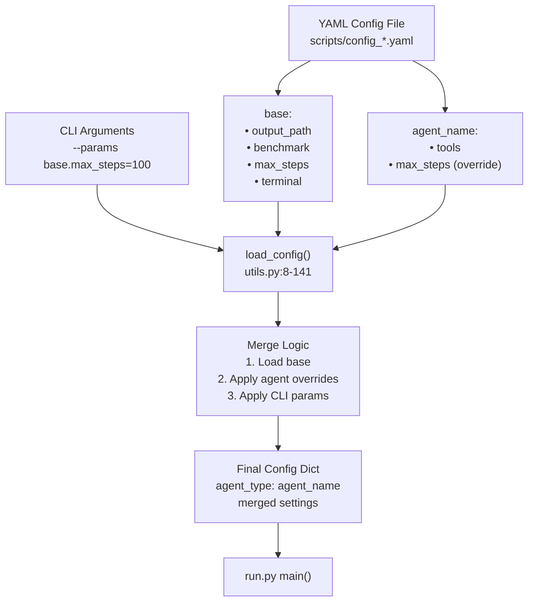
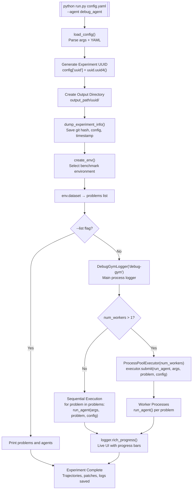
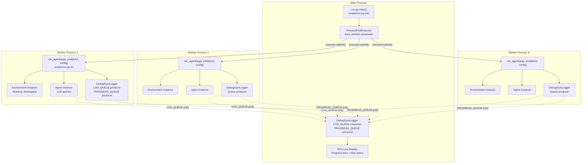
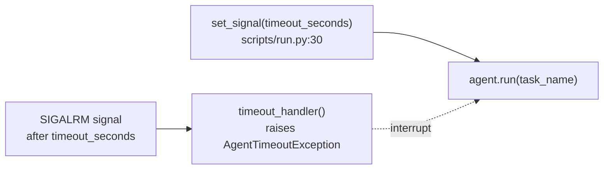
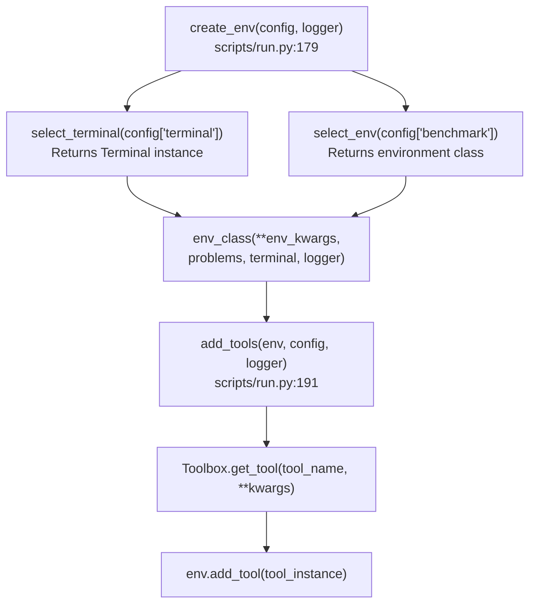
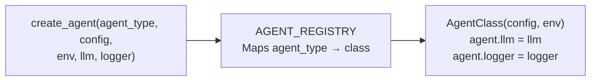
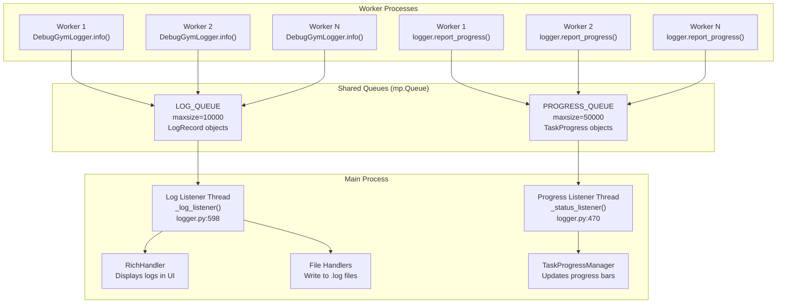
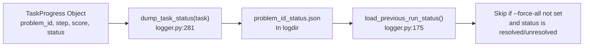

<!-- source: DeepWiki mcp.deepwiki.com · repo microsoft/debug-gym · page 5 Configuration and Execution · fetched 2026-10-26 -->

# Configuration and Execution

<details>
<summary>Relevant source files</summary>

The following files were used as context for generating this wiki page:

- [debug_gym/agents/utils.py](debug_gym/agents/utils.py)
- [debug_gym/llms/__init__.py](debug_gym/llms/__init__.py)
- [debug_gym/logger.py](debug_gym/logger.py)
- [scripts/config.yaml](scripts/config.yaml)
- [scripts/config_aider.yaml](scripts/config_aider.yaml)
- [scripts/config_mini_nightmare.yaml](scripts/config_mini_nightmare.yaml)
- [scripts/config_swebench.yaml](scripts/config_swebench.yaml)
- [scripts/config_swesmith.yaml](scripts/config_swesmith.yaml)
- [scripts/run.py](scripts/run.py)
- [tests/agents/conftest.py](tests/agents/conftest.py)
- [tests/agents/test_utils.py](tests/agents/test_utils.py)
- [tests/test_logger.py](tests/test_logger.py)

</details>


## Purpose and Scope

This page provides an overview of how debug-gym experiments are configured and executed. It covers the configuration hierarchy (YAML files, CLI arguments, and overrides), the orchestration flow through [scripts/run.py](), parallel execution using multiprocessing, and the logging infrastructure that enables multiprocess-safe progress tracking. 

For detailed information about specific subsystems, see:
- **Configuration System** ([#5.1](#5.1)) - YAML structure, `load_config()` merging, and parameter overrides
- **Orchestration and Execution** ([#5.2](#5.2)) - The `run_agent()` lifecycle, experiment metadata, and timeout handling
- **Logging and Progress Reporting** ([#5.3](#5.3)) - `DebugGymLogger`, queue-based architecture, and Rich UI

This document focuses on the high-level architecture and how these components work together to enable scalable evaluation of debugging agents across benchmarks.

---

## Configuration Architecture

Debug-gym uses a three-tier configuration hierarchy that allows users to define base settings, agent-specific overrides, and runtime parameter adjustments. Configuration files are written in YAML and located in the `scripts/` directory.

### Configuration File Structure

Configuration files follow a hierarchical structure with a `base` section containing shared settings and agent-specific sections that inherit and override base values:

```yaml
base:
    output_path: "exps/aider"
    benchmark: "aider"
    max_steps: 50
    llm_name: "gpt-4o"
    terminal:
        type: "docker"
    
debug_agent:
    tools:
        - grep
        - pdb
        - view
        - rewrite
        - eval

rewrite_agent:
    max_steps: 30  # Override base
    tools:
        - grep
        - view
        - rewrite
```

The [debug_gym/agents/utils.py:8-141]() `load_config()` function implements the merging logic:

1. **Base defaults**: Settings in `base` section apply to all agents
2. **Agent-specific**: Agent sections override base settings
3. **CLI overrides**: Command-line `--params` override both

**Configuration Merging Flow**



**Sources**: [scripts/config_aider.yaml:1-56](), [debug_gym/agents/utils.py:8-141]()

### Configuration Categories

| Category | Keys | Description |
|----------|------|-------------|
| **Environment** | `benchmark`, `problems`, `env_kwargs`, `terminal` | Benchmark selection, problem filtering, execution environment |
| **LLM** | `llm_name`, `llm_config_file_path` | Model selection and API configuration |
| **Agent** | `max_steps`, `max_rewrite_steps`, `memory_size`, `random_seed` | Agent behavior parameters |
| **Tools** | `tools` | List of tools available to the agent |
| **Output** | `output_path`, `save_patch` | Result storage configuration |
| **Shortcuts** | `show_current_breakpoints`, `persistent_breakpoints`, `auto_list` | Convenience features in `env_kwargs` |

**Sources**: [scripts/config_aider.yaml:1-56](), [scripts/config_swebench.yaml:1-77](), [scripts/config_mini_nightmare.yaml:1-57]()

---

## Execution Orchestration

The [scripts/run.py]() file serves as the main entrypoint for debug-gym experiments. It coordinates configuration loading, parallel execution, and result collection.

### Main Execution Flow



**Sources**: [scripts/run.py:241-313]()

### Experiment Metadata Capture

The [scripts/run.py:204-238]() `dump_experiment_info()` function captures comprehensive metadata for reproducibility:

```python
{
    "debug_gym_version": "0.1.0",
    "datetime": "2024-01-15T10:30:00",
    "git_hash": "abc123def456",
    "git_diff": "...",  # Any uncommitted changes
    "config": {...},     # Full merged config
    "args": {...},       # CLI arguments
    "python_version": "3.10.0"
}
```

This information is written to `output_path/uuid/experiment_info.jsonl` with one line per experiment run, enabling tracking of configuration evolution over time.

**Sources**: [scripts/run.py:204-238]()

---

## Parallel Execution Architecture

Debug-gym supports parallel execution of agent runs across multiple problems using Python's `ProcessPoolExecutor`. This architecture enables efficient evaluation on large benchmarks like SWE-Bench.

### Multiprocess Architecture



**Sources**: [scripts/run.py:241-313](), [debug_gym/logger.py:500-700]()

### Worker Process Lifecycle

Each worker process executes [scripts/run.py:43-176]() `run_agent()` which performs the following steps:

1. **Timeout Setup**: Configure SIGALRM signal for timeout handling [scripts/run.py:30-41]()
2. **Previous Run Check**: Load status from previous run and skip if already completed [scripts/run.py:62-82]()
3. **Environment Creation**: Call `create_env()` to instantiate benchmark environment [scripts/run.py:179-188]()
4. **Tool Registration**: Add tools from config via `add_tools()` [scripts/run.py:191-201]()
5. **LLM Instantiation**: Create LLM backend via `LLM.instantiate()` [scripts/run.py:96-100]()
6. **Agent Creation**: Instantiate agent via `create_agent()` [scripts/run.py:102-108]()
7. **Agent Execution**: Call `agent.run(task_name)` [scripts/run.py:111]()
8. **Result Saving**: Save trajectory and optional patch [scripts/run.py:143-148]()
9. **Cleanup**: Close environment and cancel timeout [scripts/run.py:173-175]()

**Sources**: [scripts/run.py:43-176]()

### Timeout Mechanism

Debug-gym implements per-problem timeouts using Unix signals:



The [scripts/run.py:22-27]() `AgentTimeoutException` inherits from `BaseException` (not `Exception`) to prevent agent exception handlers from catching it. This ensures timeouts always propagate correctly.

**Sources**: [scripts/run.py:22-41]()

---

## Environment and Agent Instantiation

The orchestration layer creates fresh environment and agent instances for each problem, ensuring isolation between runs.

### Environment Creation Pipeline



The [scripts/run.py:179-188]() `create_env()` function:
1. Selects appropriate terminal (Docker/Kubernetes/Local) based on config
2. Selects environment class based on benchmark name
3. Passes `env_kwargs`, problem list, terminal, and logger to constructor

The [scripts/run.py:191-201]() `add_tools()` function:
1. Iterates through `config['tools']` list
2. Handles both simple tool names (strings) and tool-with-config (dicts)
3. Uses `Toolbox.get_tool()` to instantiate each tool
4. Adds tools to environment via `env.add_tool()`

**Sources**: [scripts/run.py:179-201]()

### Agent Creation



The agent creation logic:
1. Looks up agent class in `AGENT_REGISTRY` by `agent_type` string
2. Instantiates with config dictionary and environment
3. Assigns LLM and logger after construction

**Sources**: Referenced in [scripts/run.py:102-108]()

---

## Logging and Progress Communication

Debug-gym implements a multiprocess-safe logging architecture using shared queues to communicate between worker processes and the main process.

### Queue-Based Logging Architecture



**Sources**: [debug_gym/logger.py:500-700]()

### TaskProgress Data Structure

The [debug_gym/logger.py:31-117]() `TaskProgress` dataclass communicates progress information between processes:

| Field | Type | Description |
|-------|------|-------------|
| `problem_id` | `str` | Unique identifier for the problem |
| `step` | `int` | Current step number |
| `total_steps` | `int` | Total steps (may change with early stopping) |
| `score` | `int` | Current test score |
| `max_score` | `int \| None` | Maximum possible score (None until first eval) |
| `status` | `str` | One of: `pending`, `running`, `resolved`, `unresolved`, `skip-resolved`, `skip-unresolved`, `error` |
| `logdir` | `str` | Directory for logs (used to construct file paths) |

**Sources**: [debug_gym/logger.py:31-117]()

### Status Persistence

Worker processes persist task status to JSON files for crash recovery and incremental execution:



The [scripts/run.py:62-82]() logic in `run_agent()`:
1. Checks for existing `{problem_id}_status.json` file
2. If found and status is terminal (`resolved`, `unresolved`), skips execution unless `--force-all` or `--force-failed` flags are set
3. Reports progress with `skip-resolved` or `skip-unresolved` status

**Sources**: [debug_gym/logger.py:175-182](), [debug_gym/logger.py:281-292](), [scripts/run.py:62-82]()

---

## Command-Line Interface

Debug-gym provides extensive CLI options for controlling execution behavior:

### Execution Control

| Argument | Type | Default | Description |
|----------|------|---------|-------------|
| `config_file` | positional | required | Path to YAML configuration file |
| `--agent` | string | first agent in config | Agent type to run |
| `--num-workers`, `-n` | int | 1 | Number of parallel worker processes |
| `--timeout`, `-t` | int | 0 | Timeout in seconds per problem (0 = no timeout) |
| `--debug` | flag | false | Single-threaded mode with breakpoints |

### Output Control

| Argument | Type | Default | Description |
|----------|------|---------|-------------|
| `--force-all` | flag | false | Re-run all problems, ignoring previous results |
| `--force-failed` | flag | false | Re-run only failed problems |
| `--list` | flag | false | List available agents and problems, then exit |

### Logging Control

| Argument | Type | Default | Description |
|----------|------|---------|-------------|
| `--verbose`, `-v` | flag | WARNING | Set logging level to INFO |
| `--very-verbose`, `-vv` | flag | WARNING | Set logging level to DEBUG |
| `--logging-level` | choice | WARNING | Explicit logging level (DEBUG, INFO, WARNING, ERROR, CRITICAL) |
| `--no-live-display` | flag | false | Disable Rich live progress display |

### UI Control

| Argument | Type | Default | Description |
|----------|------|---------|-------------|
| `--max-display` | int | 20 | Maximum number of tasks to show in progress UI |
| `--keep-completed-tasks` | flag | false | Keep showing completed tasks in UI |

### Configuration Overrides

| Argument | Description | Example |
|----------|-------------|---------|
| `--params`, `-p` | Override any config value using dot notation | `-p base.max_steps=100 debug_agent.tools="['pdb','view']"` |

**Sources**: [debug_gym/agents/utils.py:8-102]()

---

## Output Structure

Debug-gym organizes experiment outputs in a hierarchical directory structure:

```
output_path/
└── {uuid}/
    ├── experiment_info.jsonl          # Experiment metadata
    ├── {problem_1}/
    │   ├── debug_gym.log              # Detailed execution log
    │   ├── {problem_1}.trajectory     # Full interaction trace
    │   ├── {problem_1}_status.json    # Final status
    │   └── debug_gym.patch            # Generated code patch (if save_patch=True)
    ├── {problem_2}/
    │   └── ...
    └── {problem_N}/
        └── ...
```

### Key Output Files

| File | Format | Content |
|------|--------|---------|
| `experiment_info.jsonl` | JSONL | One line per run with config, git hash, timestamp |
| `debug_gym.log` | Text | Complete execution log with timestamps |
| `{problem}.trajectory` | JSON | Agent actions, observations, LLM queries/responses |
| `{problem}_status.json` | JSON | Final TaskProgress state (step, score, status) |
| `debug_gym.patch` | Unified diff | Code changes made by agent (if enabled) |

**Sources**: [scripts/run.py:204-238](), [debug_gym/logger.py:156-172]()

---

## Configuration Examples

### Basic Sequential Execution

```bash
python scripts/run.py scripts/config_aider.yaml --agent debug_agent -v
```

This runs the `debug_agent` on all Aider problems sequentially with INFO-level logging.

### Parallel Execution on SWE-Bench

```bash
python scripts/run.py scripts/config_swebench.yaml \
    --agent debug_agent \
    --num-workers 16 \
    -p "base.problems=['astropy__astropy-12907', 'django__django-11099']"
```

This runs 16 parallel workers on a specific subset of SWE-Bench problems.

### Override Multiple Parameters

```bash
python scripts/run.py scripts/config_aider.yaml \
    --agent rewrite_agent \
    --params base.max_steps=100 \
             base.llm_name=gpt-4-turbo \
             rewrite_agent.tools="['grep','view','rewrite','eval']" \
    --force-all
```

This overrides multiple configuration parameters and forces re-execution of all problems.

### Debug Mode

```bash
python scripts/run.py scripts/config_mini_nightmare.yaml \
    --agent debug_agent \
    --debug \
    -p "base.problems=['config']"
```

This runs a single problem in debug mode (sequential, with breakpoint support).

**Sources**: [debug_gym/agents/utils.py:8-141](), [scripts/run.py:241-313]()

---

