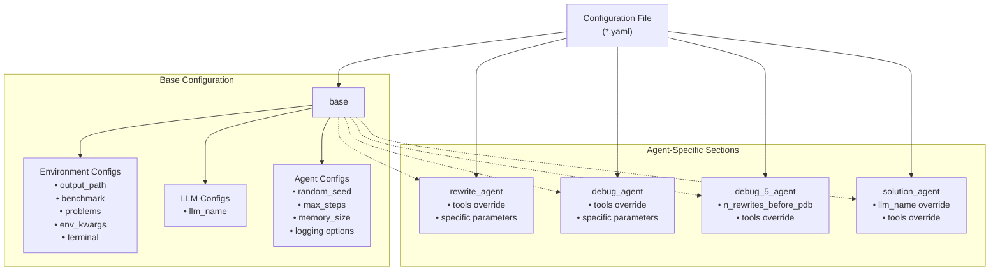
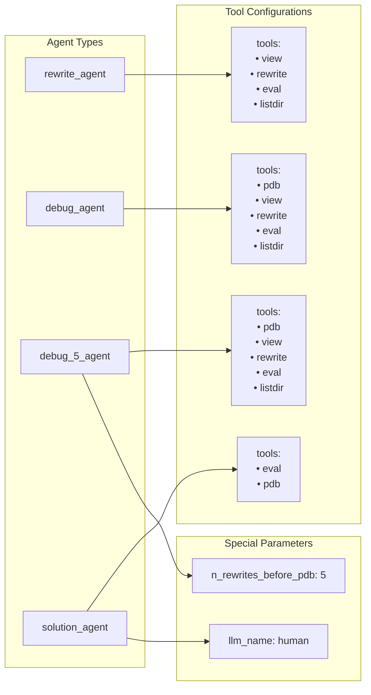
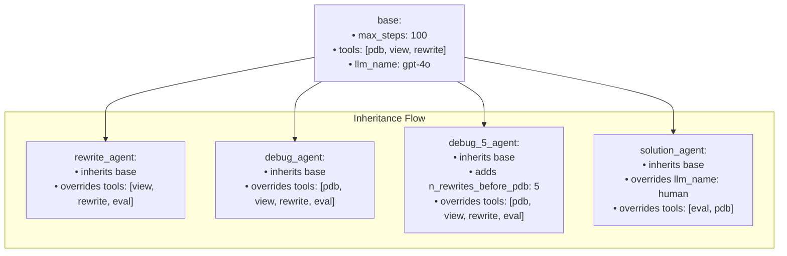

<!-- source: DeepWiki mcp.deepwiki.com · repo microsoft/debug-gym · page 5.1 Configuration System · fetched 2026-10-26 -->

# Configuration System

<details>
<summary>Relevant source files</summary>

The following files were used as context for generating this wiki page:

- [debug_gym/agents/utils.py](debug_gym/agents/utils.py)
- [debug_gym/llms/__init__.py](debug_gym/llms/__init__.py)
- [scripts/config.yaml](scripts/config.yaml)
- [scripts/config_aider.yaml](scripts/config_aider.yaml)
- [scripts/config_mini_nightmare.yaml](scripts/config_mini_nightmare.yaml)
- [scripts/config_swebench.yaml](scripts/config_swebench.yaml)
- [scripts/config_swesmith.yaml](scripts/config_swesmith.yaml)
- [tests/agents/conftest.py](tests/agents/conftest.py)
- [tests/agents/test_utils.py](tests/agents/test_utils.py)

</details>


## Purpose and Scope

The Configuration System in debug-gym provides a YAML-based approach for defining experiment parameters, agent behaviors, environment settings, and benchmark configurations. This system enables reproducible experiments by centralizing all configuration options in structured files that can be version controlled and shared.

This document covers the configuration file structure, inheritance patterns, and available configuration options. For information about how configurations are loaded and used during execution, see [Execution and Orchestration](#5.2). For details about specific agent types referenced in configurations, see [Agent Framework](#2.2).

## Configuration File Structure

The configuration system uses a hierarchical YAML structure with a `base` section containing common settings and agent-specific sections that inherit and override base settings.



**Sources:** [scripts/config_aider.yaml:1-46](), [scripts/config_swebench.yaml:1-46](), [scripts/config_mini_nightmare.yaml:1-47](), [scripts/config.yaml:1-48]()

## Base Configuration Options

### Environment Configuration

The environment configuration section defines the benchmark, problem selection, and environment behavior:

| Parameter | Type | Description | Example |
|-----------|------|-------------|---------|
| `output_path` | string | Directory for experiment outputs | `"exps/aider"` |
| `benchmark` | string | Benchmark name to use | `"aider"`, `"swebench"`, `"mini_nightmare"` |
| `problems` | string/list | Problem selection | `"all"` or `["wordy", "leap"]` |
| `env_kwargs` | object | Environment-specific parameters | See Environment Parameters |

### Environment Parameters (`env_kwargs`)

| Parameter | Type | Default | Description |
|-----------|------|---------|-------------|
| `entrypoint` | string | varies | Command to run tests |
| `dir_tree_depth` | integer | 1 | Directory traversal depth |
| `run_timeout` | integer | varies | Timeout for command execution |
| `auto_eval_on_rewrite` | boolean | false | Auto-evaluate after rewrites |
| `persistent_breakpoints` | boolean | true | Maintain breakpoints across PDB sessions |
| `auto_list` | boolean | true | Auto-show code after PDB commands |
| `dataset_id` | string | varies | Dataset identifier for SWE-bench |

### Terminal Configuration

The terminal configuration controls the execution environment:

```yaml
terminal:
  type: "docker"  # or "local"
  base_image: "python:3.12-slim"
  setup_commands: ["pip install pytest"]
  session_commands: ["conda activate env"]
```

### LLM Configuration

| Parameter | Description | Values |
|-----------|-------------|--------|
| `llm_name` | LLM model to use | `"gpt-4o"`, `"claude-3-sonnet-20240229"`, `"human"` |

### Agent Configuration

| Parameter | Type | Default | Description |
|-----------|------|---------|-------------|
| `random_seed` | integer | 42 | Random seed for reproducibility |
| `max_steps` | integer | 100 | Maximum steps per episode |
| `max_rewrite_steps` | integer | 10 | Maximum rewrite attempts |
| `memory_size` | integer | 20 | Agent memory buffer size |
| `save_patch` | boolean | true | Save code patches |
| `log_prompt_response_pairs` | boolean | true | Log LLM interactions |
| `reset_prompt_history_after_rewrite` | boolean | true | Clear history after rewrites |
| `system_prompt_template_file` | string | optional | Custom system prompt template |

**Sources:** [scripts/config_aider.yaml:3-37](), [scripts/config_swebench.yaml:3-32](), [scripts/config_mini_nightmare.yaml:3-36](), [scripts/config.yaml:3-37]()

## Agent-Specific Configurations

Each agent type can override base settings and specify its own tool configuration:



### Tool Configurations by Agent

| Agent Type | Available Tools | Purpose |
|------------|----------------|---------|
| `rewrite_agent` | `view`, `rewrite`, `eval`, `listdir` | Code modification without debugging |
| `debug_agent` | `pdb`, `view`, `rewrite`, `eval`, `listdir` | Full debugging capabilities |
| `debug_5_agent` | `pdb`, `view`, `rewrite`, `eval`, `listdir` | Hybrid approach with rewrite limit |
| `solution_agent` | `eval`, `pdb` | Human-in-the-loop debugging |

### Special Agent Parameters

| Agent | Parameter | Description |
|-------|-----------|-------------|
| `debug_5_agent` | `n_rewrites_before_pdb` | Number of rewrite attempts before enabling PDB |
| `solution_agent` | `llm_name: "human"` | Uses human input instead of LLM |

**Sources:** [scripts/config_aider.yaml:38-46](), [scripts/config_swebench.yaml:33-46](), [scripts/config_mini_nightmare.yaml:38-47](), [scripts/config.yaml:39-48]()

## Benchmark-Specific Configurations

Different benchmarks require specific configuration adaptations:

```mermaid
graph TB
    subgraph "Aider Benchmark"
        AiderConfig["config_aider.yaml"]
        AiderSettings["• benchmark: aider<br/>• entrypoint: python -m pytest -s .<br/>• run_timeout: 20<br/>• base_image: python:3.12-slim<br/>• setup: pip install pytest"]
    end
    
    subgraph "SWE-Bench"
        SWEConfig["config_swebench.yaml"]
        SWESettings["• benchmark: swebench<br/>• dataset_id: princeton-nlp/SWE-bench_lite<br/>• run_timeout: 300<br/>• type: docker<br/>• includes listdir tool"]
    end
    
    subgraph "Mini Nightmare"
        MiniConfig["config_mini_nightmare.yaml"]
        MiniSettings["• benchmark: mini_nightmare<br/>• entrypoint: python -m pytest -s test.py<br/>• run_timeout: 30<br/>• setup: pip install pytest pandas"]
    end
    
    subgraph "PyTorch Test Data"
        PyTorchConfig["config.yaml"]
        PyTorchSettings["• path: data/pytorch<br/>• entrypoint: python -m pytest -sv test.py<br/>• debug_entrypoint: python -m pdb -m pytest -s test.py<br/>• run_timeout: 10"]
    end
    
    AiderConfig --> AiderSettings
    SWEConfig --> SWESettings
    MiniConfig --> MiniSettings
    PyTorchConfig --> PyTorchSettings
```



### Benchmark Comparison

| Benchmark | Timeout | Special Features | Docker Setup |
|-----------|---------|------------------|--------------|
| Aider | 20s | Simple Python tasks | `python:3.12-slim` + pytest |
| SWE-Bench | 300s | Real GitHub issues, dataset_id | Docker required |
| Mini Nightmare | 30s | Synthetic scenarios | `python:3.12-slim` + pytest + pandas |
| PyTorch | 10s | Local data path, debug_entrypoint | `python:3.12-slim` + pytest |

**Sources:** [scripts/config_aider.yaml:1-46](), [scripts/config_swebench.yaml:1-46](), [scripts/config_mini_nightmare.yaml:1-47](), [scripts/config.yaml:1-48]()

## Configuration Inheritance and Overrides

The configuration system follows a hierarchical inheritance pattern where agent-specific sections inherit from the `base` section and can override specific parameters:



### Override Precedence

1. **Agent-specific settings** override base settings
2. **Command-line arguments** override configuration file settings
3. **Environment variables** can override specific parameters
4. **Default values** are used when not specified

**Sources:** [scripts/config_aider.yaml:1-46](), [scripts/config_swebench.yaml:1-46](), [scripts/config_mini_nightmare.yaml:1-47](), [scripts/config.yaml:1-48]()

## Configuration Usage Patterns

### Standard Agent Configuration

```yaml
base:
  output_path: "exps/my_experiment"
  benchmark: "aider"
  problems: "all"
  llm_name: "gpt-4o"
  max_steps: 50

debug_agent:
  tools: ["pdb", "view", "rewrite", "eval"]
```

### Custom Tool Configuration

```yaml
base:
  # ... base configuration

custom_agent:
  tools: ["view", "rewrite"]  # Minimal tool set
  max_steps: 25              # Reduced step limit
  memory_size: 10            # Smaller memory
```

### Multi-Environment Configuration

```yaml
base:
  llm_name: "gpt-4o"
  random_seed: 42

# Different agents for different complexity levels
simple_agent:
  tools: ["view", "rewrite"]
  max_steps: 20

complex_agent:
  tools: ["pdb", "view", "rewrite", "eval", "listdir"]
  max_steps: 100
```

**Sources:** [scripts/config_aider.yaml:1-46](), [scripts/config_swebench.yaml:1-46](), [scripts/config_mini_nightmare.yaml:1-47](), [scripts/config.yaml:1-48]()

---

