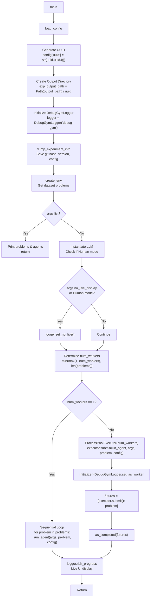
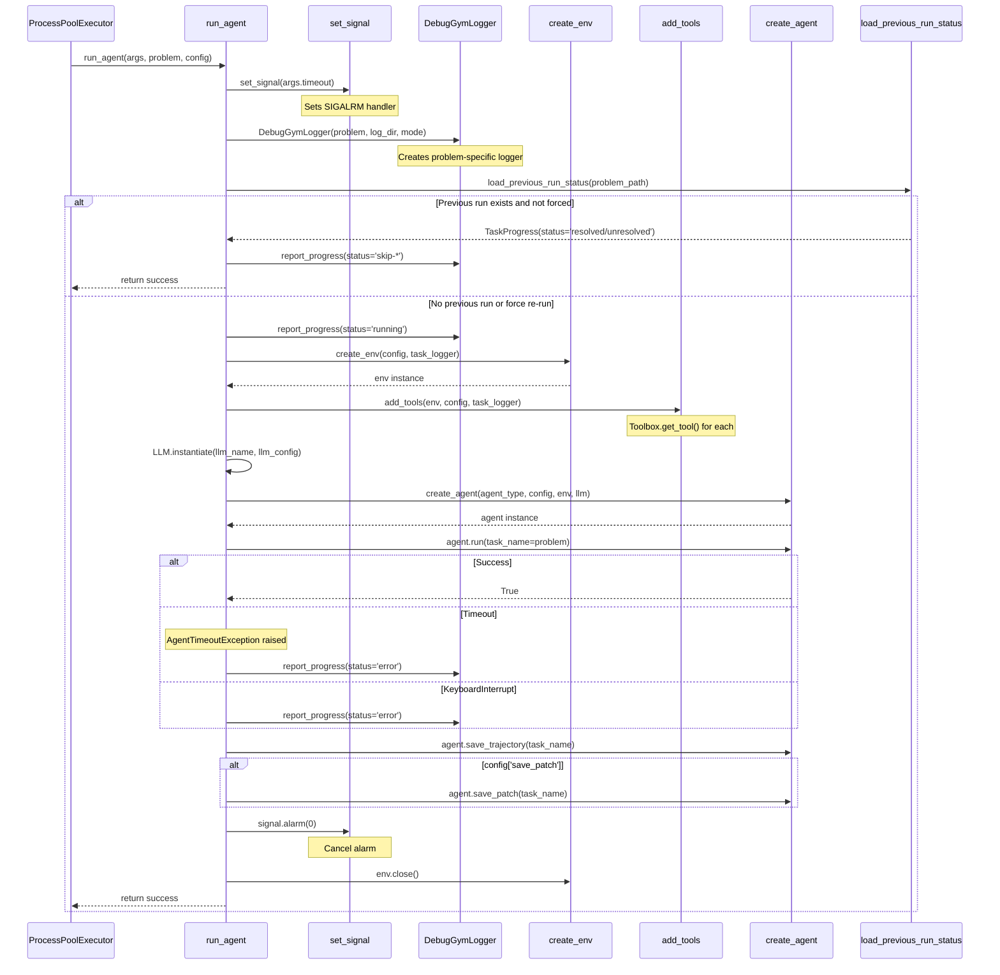
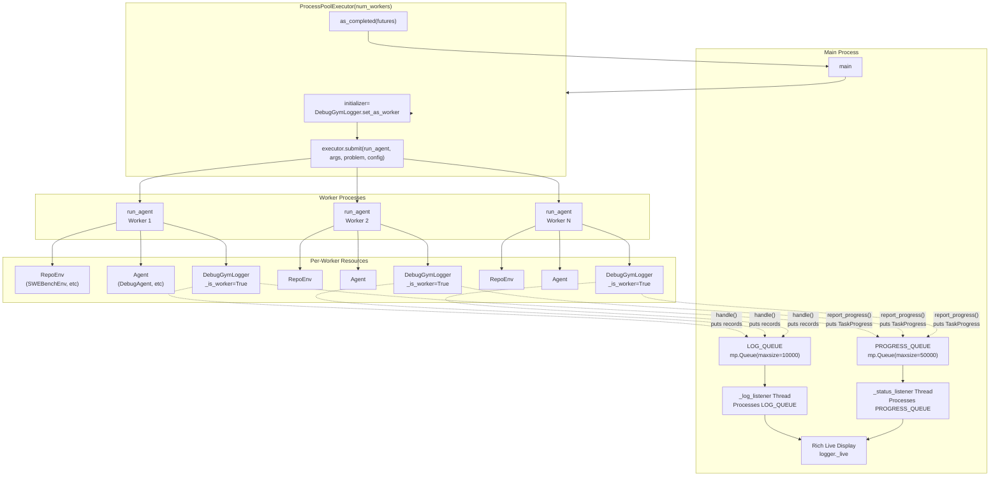
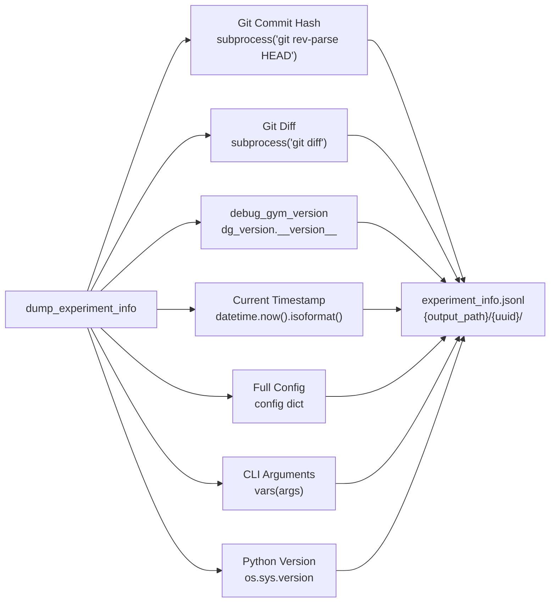
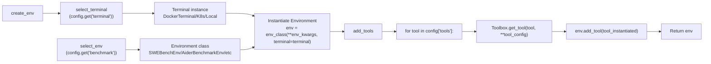
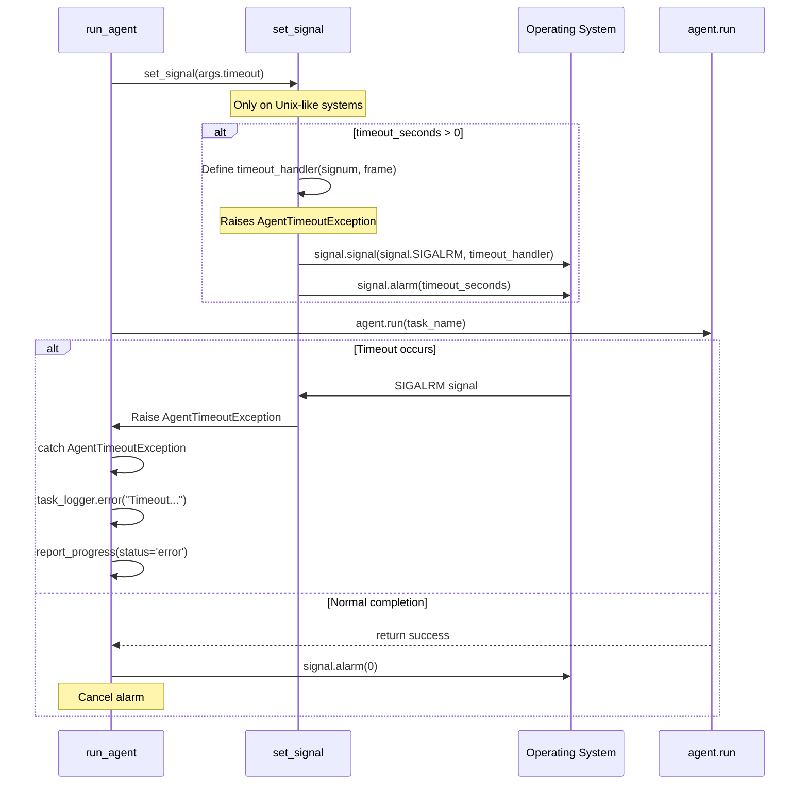
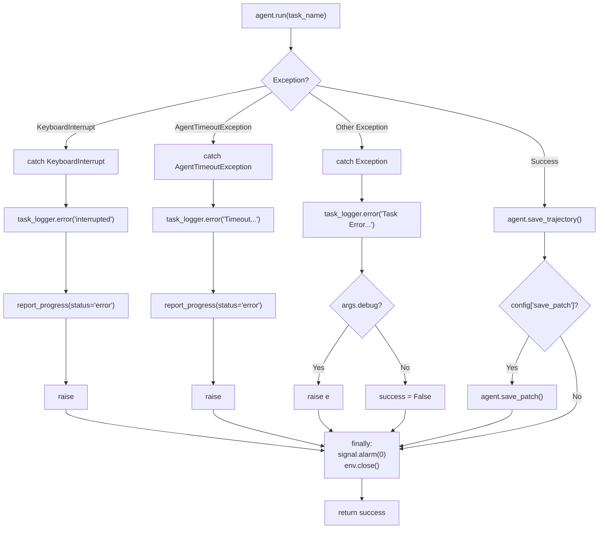

<!-- source: DeepWiki mcp.deepwiki.com · repo microsoft/debug-gym · page 5.2 Orchestration and Execution · fetched 2026-10-26 -->

# Orchestration and Execution

<details>
<summary>Relevant source files</summary>

The following files were used as context for generating this wiki page:

- [debug_gym/logger.py](debug_gym/logger.py)
- [scripts/run.py](scripts/run.py)
- [tests/test_logger.py](tests/test_logger.py)

</details>


This document covers the orchestration and execution system of debug-gym, which manages experiment execution through the main [scripts/run.py]() entrypoint. The system handles parallel task execution using `ProcessPoolExecutor`, coordinates multiprocess-safe logging through shared queues, and manages the complete lifecycle of agent runs from initialization to result persistence. For configuration details, see [Configuration System](#5.1). For logging and progress reporting, see [Logging and Progress Reporting](#5.3).

## Overview

The orchestration system is implemented in [scripts/run.py](), which serves as the main entrypoint for running debug-gym experiments. The system provides:

- **Parallel Execution**: Uses `ProcessPoolExecutor` to run multiple agent tasks concurrently
- **Unique Experiment IDs**: Generates UUID for each experiment run with metadata capture
- **Multiprocess-Safe Logging**: Coordinates logging across worker processes via shared queues
- **Timeout Management**: Implements signal-based timeout handling for agent execution
- **Progress Tracking**: Real-time progress display through `DebugGymLogger` with Rich UI
- **Result Persistence**: Saves trajectories, patches, and status for each task

The core execution flow is: `main()` → create experiment → spawn workers → `run_agent()` per problem → collect results.

Sources: [scripts/run.py:1-316]()

## Main Execution Flow

The `main()` function in [scripts/run.py:241-313]() orchestrates the entire execution pipeline:

### Main Execution Pipeline



Sources: [scripts/run.py:241-313]()

## run_agent Lifecycle

The `run_agent()` function in [scripts/run.py:43-176]() manages the complete lifecycle of a single agent task:

### run_agent Execution Flow



Sources: [scripts/run.py:43-176]()

### run_agent Key Components

| Component | Purpose | Implementation |
|-----------|---------|----------------|
| `set_signal()` | Timeout enforcement | Sets `SIGALRM` handler that raises `AgentTimeoutException` [scripts/run.py:30-40]() |
| Previous run detection | Skip completed tasks | `load_previous_run_status()` checks for `*_status.json` [scripts/run.py:62-82]() |
| Task-specific logger | Isolated logging | `DebugGymLogger(problem, log_dir=problem_path)` [scripts/run.py:55-60]() |
| Progress reporting | Status updates | `task_logger.report_progress()` puts updates in `PROGRESS_QUEUE` [scripts/run.py:84-91]() |
| Resource cleanup | Graceful shutdown | `finally` block cancels alarm and closes environment [scripts/run.py:172-176]() |

Sources: [scripts/run.py:43-176]()

## Parallel Execution with ProcessPoolExecutor

The system uses `ProcessPoolExecutor` for parallel task execution with multiprocess-safe logging:

### Parallel Execution Architecture



Sources: [scripts/run.py:295-312](), [debug_gym/logger.py:505-506](), [debug_gym/logger.py:570-577](), [debug_gym/logger.py:405-410]()

### Worker Initialization and Coordination

The executor initializes workers with `DebugGymLogger.set_as_worker()` to enable queue-based logging:

| Aspect | Implementation | Location |
|--------|---------------|----------|
| Worker initialization | `initializer=DebugGymLogger.set_as_worker` | [scripts/run.py:296]() |
| Worker flag | Sets `_is_worker = True` class variable | [debug_gym/logger.py:518-521]() |
| Log routing | Worker loggers put records in `LOG_QUEUE` | [debug_gym/logger.py:594-596]() |
| Progress routing | Worker loggers put `TaskProgress` in `PROGRESS_QUEUE` | [debug_gym/logger.py:666-679]() |
| Main listener | Background thread processes queues | [debug_gym/logger.py:598-611]() |
| Worker count | `min(max(1, num_workers), len(problems))` | [scripts/run.py:277-282]() |

Sources: [scripts/run.py:295-312](), [debug_gym/logger.py:500-700]()

## Experiment Metadata Capture

The `dump_experiment_info()` function in [scripts/run.py:204-238]() captures comprehensive metadata for reproducibility:

### Metadata Collection



Sources: [scripts/run.py:204-238]()

### Experiment Directory Structure

Each experiment creates a unique directory hierarchy:

```
{output_path}/{uuid}/
├── experiment_info.jsonl        # Metadata from dump_experiment_info()
├── {problem_1}/
│   ├── debug_gym.log           # Task-specific logs
│   ├── {problem_1}_status.json # Final TaskProgress state
│   ├── trajectory.json         # Agent action history
│   └── debug_gym.patch         # Solution patch (if save_patch=True)
├── {problem_2}/
│   └── ...
└── ...
```

Sources: [scripts/run.py:52-54](), [scripts/run.py:204-238](), [scripts/run.py:243-245](), [debug_gym/logger.py:281-292]()

| Metadata Field | Source | Purpose |
|---------------|--------|---------|
| `uuid` | `str(uuid.uuid4())` | Unique experiment identifier |
| `git_hash` | `git rev-parse HEAD` | Code version tracking |
| `git_diff` | `git diff` | Uncommitted changes |
| `debug_gym_version` | `dg_version.__version__` | Package version |
| `datetime` | `datetime.now().isoformat()` | Execution timestamp |
| `config` | Full config dict | Complete configuration snapshot |
| `args` | `vars(args)` | CLI arguments used |
| `python_version` | `os.sys.version` | Python environment |

Sources: [scripts/run.py:204-238]()

## Environment and Tool Creation

The `create_env()` and `add_tools()` functions handle environment setup:

### Environment Creation Flow



Sources: [scripts/run.py:179-202]()

### create_env Parameters

| Parameter | Type | Source | Purpose |
|-----------|------|--------|---------|
| `config` | `dict` | Configuration system | Full config dictionary |
| `logger` | `DebugGymLogger` | Task logger | For environment logging |
| Return | `RepoEnv` | Environment instance | Initialized with terminal and tools |

The function [scripts/run.py:179-188]():
1. Calls `select_terminal(config.get("terminal"))` to get terminal implementation
2. Calls `select_env(config.get("benchmark"))` to get environment class
3. Instantiates environment with `**config["env_kwargs"]`, terminal, and logger
4. Returns the environment instance

### add_tools Configuration

Tools can be specified as strings or dicts in the config:

```python
# Simple string specification
tools: ["view", "rewrite", "pdb", "eval"]

# With configuration
tools:
  - view
  - rewrite: 
      max_lines: 1000
  - pdb:
      auto_list: true
```

The function [scripts/run.py:191-201]():
1. Iterates through `config["tools"]`
2. Extracts tool name and optional config from dict entries
3. Calls `Toolbox.get_tool(tool, **tool_config)` to instantiate
4. Adds to environment with `env.add_tool(tool_instantiated)`

Sources: [scripts/run.py:179-202]()

## Timeout and Signal Handling

The system implements Unix signal-based timeout enforcement:

### Signal Handling Mechanism



Sources: [scripts/run.py:30-40](), [scripts/run.py:44](), [scripts/run.py:124-138](), [scripts/run.py:173]()

### AgentTimeoutException

The custom exception class [scripts/run.py:22-27]() inherits from `BaseException` rather than `Exception`:

```python
class AgentTimeoutException(BaseException):
    """Custom exception to handle timeouts in agent
    execution. Inherits from BaseException to ensure
    it is not caught by agent exception handling."""
    pass
```

This design ensures timeouts are not accidentally caught by general exception handlers within the agent, allowing the timeout to propagate to `run_agent()` for proper handling.

Sources: [scripts/run.py:22-27](), [scripts/run.py:30-40]()

## Error Handling and Recovery

The system implements multi-level error handling:

### Error Handling Levels

| Level | Location | Exceptions Caught | Action |
|-------|----------|------------------|--------|
| Task execution | [scripts/run.py:110-141]() | `KeyboardInterrupt`, `AgentTimeoutException` | Report error, re-raise |
| Task wrapper | [scripts/run.py:150-169]() | Generic `Exception` | Log error, report progress, return `False` |
| Sequential loop | [scripts/run.py:287-293]() | `AgentTimeoutException`, `KeyboardInterrupt`, `Exception` | Pass timeouts, re-raise others |
| Parallel executor | [scripts/run.py:302-312]() | `AgentTimeoutException`, `KeyboardInterrupt`, `Exception` | Shutdown executor, re-raise |

### Exception Flow



Sources: [scripts/run.py:110-176]()

### Resource Cleanup

The `finally` block in [scripts/run.py:172-176]() ensures:
1. **Cancel alarm**: `signal.alarm(0)` prevents spurious timeouts
2. **Close environment**: `env.close()` releases terminal/container resources
3. **Executes on all paths**: Runs even after exceptions or returns

Sources: [scripts/run.py:172-176]()

## Logging and Output Management

Each task execution creates isolated logging through `DebugGymLogger`:

### Logging Structure

| Component | Path Pattern | Purpose |
|-----------|-------------|---------|
| Experiment Directory | `{output_path}/{uuid}/` | Unique experiment identifier |
| Task Directory | `{exp_path}/{problem}/` | Individual task workspace |
| Log File | `debug_gym.jsonl` | Structured task execution log |
| Debug Log | Task-specific debug output | Detailed execution traces |

The logging system supports:
- **Force Modes**: `--force-all` and `--force-failed` for re-running tasks
- **Previous Run Detection**: Automatic skip of completed successful tasks  
- **Structured Output**: JSON Lines format for trajectory analysis
- **Hierarchical Logging**: Different verbosity levels for debugging

Sources: [scripts/run.py:25-42](), [scripts/run.py:58-59](), [scripts/run.py:78-79]()

---

