<!-- source: DeepWiki mcp.deepwiki.com · repo microsoft/debug-gym · page 5.3 Logging and Progress Reporting · fetched 2026-10-26 -->

# Logging and Progress Reporting

<details>
<summary>Relevant source files</summary>

The following files were used as context for generating this wiki page:

- [debug_gym/logger.py](debug_gym/logger.py)
- [scripts/run.py](scripts/run.py)
- [tests/test_logger.py](tests/test_logger.py)

</details>


## Purpose and Scope

This document describes the logging and progress reporting infrastructure in debug-gym. The `DebugGymLogger` class provides multiprocess-safe logging with integrated Rich UI progress reporting, enabling parallel agent execution while maintaining a unified console display and persistent status tracking.

For information about the overall orchestration and execution flow, see [Orchestration and Execution](#5.2). For configuration of logging levels and output paths, see [Configuration System](#5.1).

---

## Architecture Overview

Debug-gym uses a queue-based multiprocess architecture to coordinate logging and progress reporting across parallel worker processes. This design allows multiple agents to run concurrently while maintaining a clean, unified console display.

### Multiprocess Communication Model

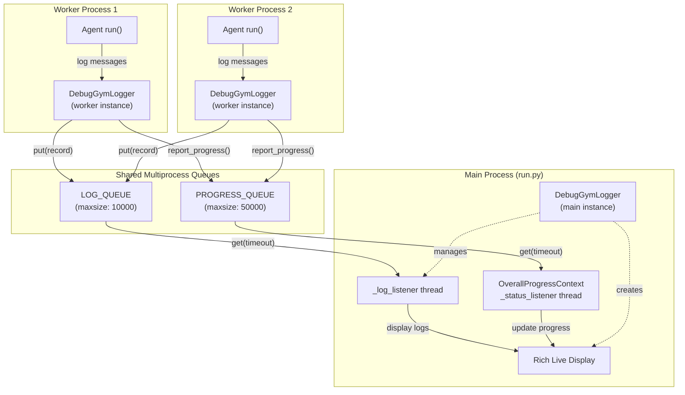

**Sources:** [debug_gym/logger.py:500-688](), [scripts/run.py:43-176]()

### Process Roles

| Role | Description | Initialization |
|------|-------------|----------------|
| **Main Process** | Orchestrates execution, displays Rich UI, listens to queues | `DebugGymLogger._is_worker = False` (default) |
| **Worker Process** | Executes agents, sends logs/progress to queues | `DebugGymLogger.set_as_worker()` called via `ProcessPoolExecutor` initializer |

The main process creates a `DebugGymLogger` instance that initializes Rich handlers and background listener threads. Worker processes create their own `DebugGymLogger` instances that write to shared queues instead of directly to the console.

**Sources:** [debug_gym/logger.py:509-521](), [scripts/run.py:295-297]()

---

## Core Components

### DebugGymLogger Class

The `DebugGymLogger` class extends Python's `logging.Logger` to provide multiprocess-safe logging with Rich UI integration.

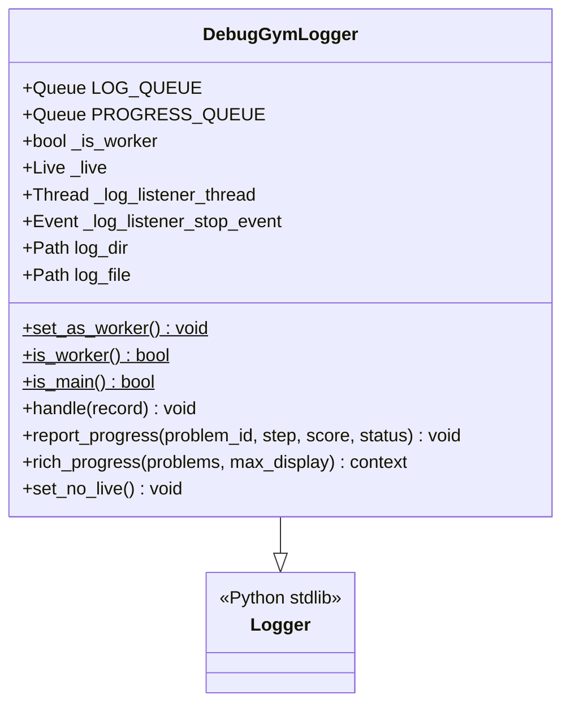

**Key Class Variables:**

- `LOG_QUEUE`: Shared `multiprocessing.Queue` for log records (max 10,000 items)
- `PROGRESS_QUEUE`: Shared `multiprocessing.Queue` for progress updates (max 50,000 items)
- `_is_worker`: Class-level flag indicating worker vs main process mode

**Sources:** [debug_gym/logger.py:500-588]()

#### Main Process Initialization

When `_is_worker = False`, the logger initializes Rich handlers and background threads:

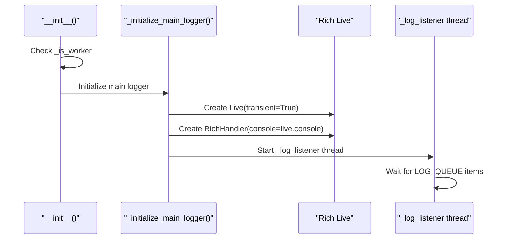

**Sources:** [debug_gym/logger.py:551-577]()

#### Worker Process Initialization

When `_is_worker = True`, the logger skips Rich initialization and only sets up file handlers:

**Sources:** [debug_gym/logger.py:589-597]()

#### Log Record Handling

The `handle()` method routes log records differently based on process role:

| Process Type | Behavior |
|--------------|----------|
| Worker | `LOG_QUEUE.put(record)` → File handler writes locally |
| Main | File handler + Rich handler display directly |

**Sources:** [debug_gym/logger.py:589-597]()

### TaskProgress Dataclass

The `TaskProgress` dataclass encapsulates all progress information for a single task:

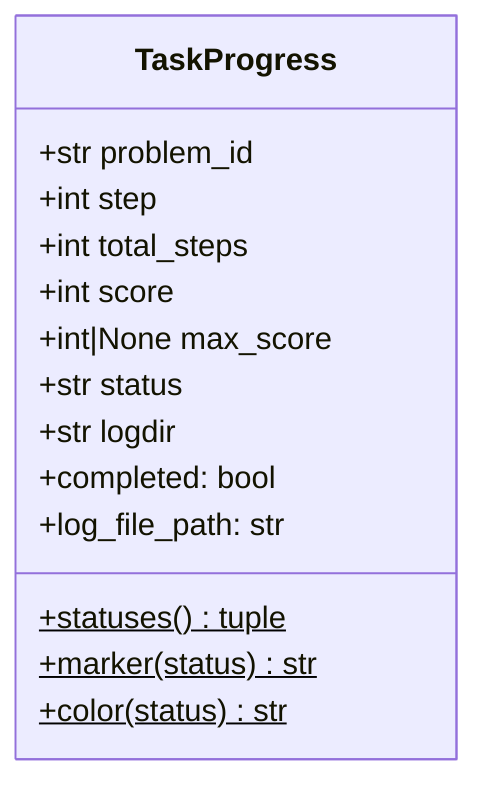

**Status Values:**

| Status | Meaning | Marker | Color |
|--------|---------|--------|-------|
| `pending` | Not yet started | `⠋` | yellow |
| `running` | Currently executing | `⠋` | blue |
| `resolved` | Successfully completed | `✓` | green |
| `unresolved` | Failed to resolve | `✗` | red |
| `skip-resolved` | Skipped (previously resolved) | `✓` | yellow |
| `skip-unresolved` | Skipped (previously failed) | `✗` | yellow |
| `error` | Exception occurred | `!` | red |

**Sources:** [debug_gym/logger.py:31-118]()

### TaskProgressManager

Manages progress display for multiple tasks with visibility control:

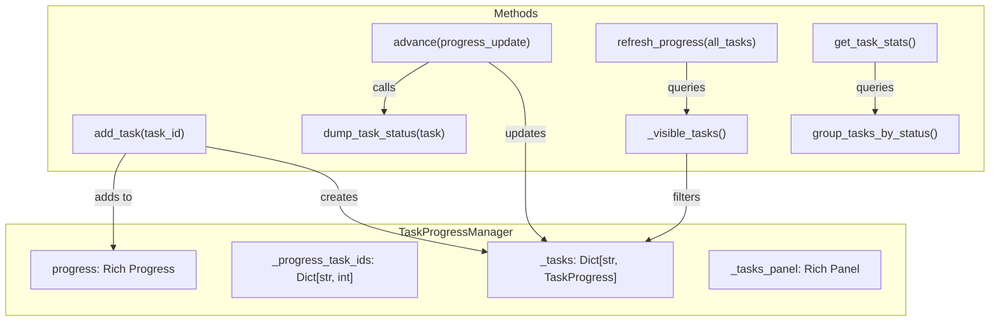

**Visibility Management:**

The manager limits displayed tasks based on `max_display` parameter, prioritizing:
1. Pending/running tasks first
2. Completed tasks second
3. Hidden tasks (exceeding max_display)

**Sources:** [debug_gym/logger.py:185-354]()

#### Status Persistence

When a task completes, `dump_task_status()` writes a JSON file:

```
{log_dir}/{problem_id}_status.json
```

This enables skip logic on subsequent runs:

**Sources:** [debug_gym/logger.py:281-293](), [debug_gym/logger.py:175-182]()

### OverallProgressContext

Context manager for overall progress tracking across all tasks:

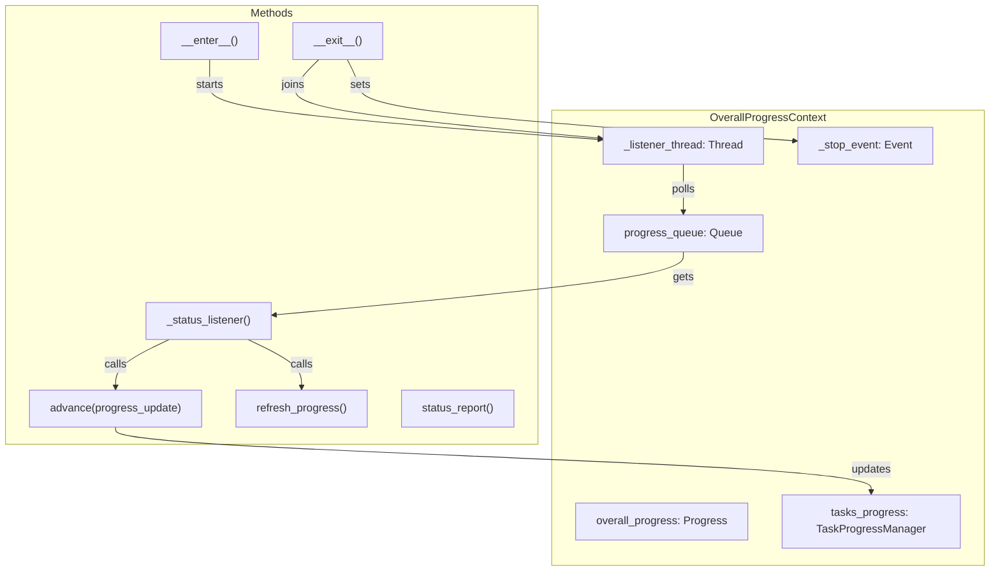

**Background Listener Thread:**

The `_status_listener()` method runs in a daemon thread, polling `PROGRESS_QUEUE` every 100ms and updating the UI periodically to avoid overwhelming the display:

**Sources:** [debug_gym/logger.py:470-498]()

---

## Queue-Based Communication

### LOG_QUEUE Flow

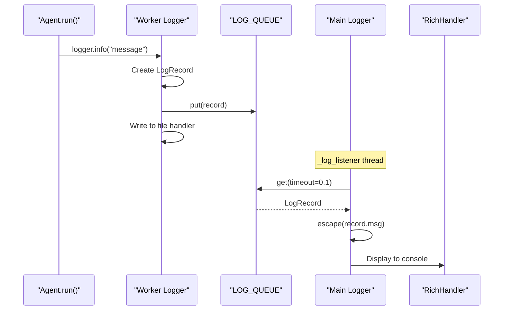

**Sources:** [debug_gym/logger.py:589-597](), [debug_gym/logger.py:598-611]()

### PROGRESS_QUEUE Flow

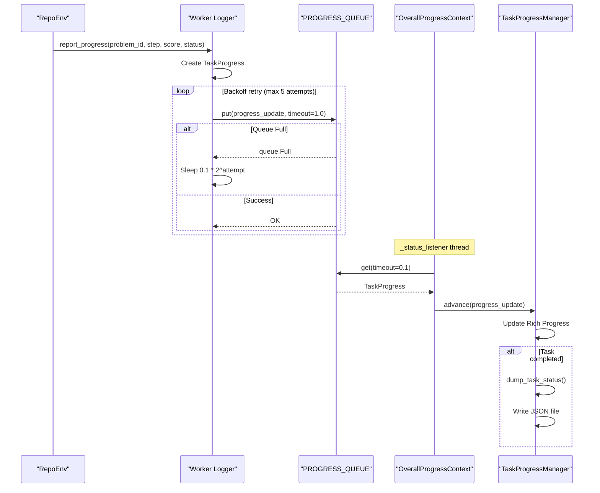

**Backoff Strategy:**

The `report_progress()` method uses exponential backoff to handle queue congestion:

| Attempt | Timeout | Sleep on Failure |
|---------|---------|------------------|
| 1 | 1.0s | 0.1s |
| 2 | 1.0s | 0.2s |
| 3 | 1.0s | 0.4s |
| 4 | 1.0s | 0.8s |
| 5 | 1.0s | None (final) |

**Sources:** [debug_gym/logger.py:654-688]()

---

## Rich UI Integration

### UI Component Hierarchy

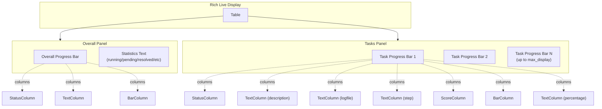

**Sources:** [debug_gym/logger.py:200-216](), [debug_gym/logger.py:375-403]()

### Custom Rich Columns

#### StatusColumn

Displays status-specific markers with colors:

- Running: Animated spinner (blue)
- Resolved: `✓` (green)
- Unresolved: `✗` (red)
- Error: `!` (red)
- Skip-resolved: `✓` (yellow)
- Skip-unresolved: `✗` (yellow)

**Sources:** [debug_gym/logger.py:120-141]()

#### ScoreColumn

Displays score with proper None handling:

- Known max_score: `Score:  50/ 100`
- Unknown max_score: `Score:  50/   ?`

**Sources:** [debug_gym/logger.py:143-154]()

### Live Display Control

The `set_no_live()` method disables live updates for human mode or debugging:

**Sources:** [debug_gym/logger.py:621-623](), [scripts/run.py:272-275]()

---

## Usage in run.py

### Main Process Setup

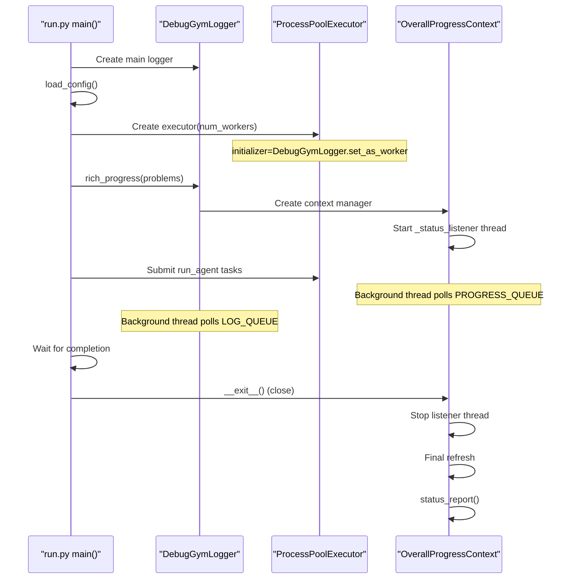

**Sources:** [scripts/run.py:241-313]()

### Worker Process Execution

Each worker process executes `run_agent()` with its own logger instance:

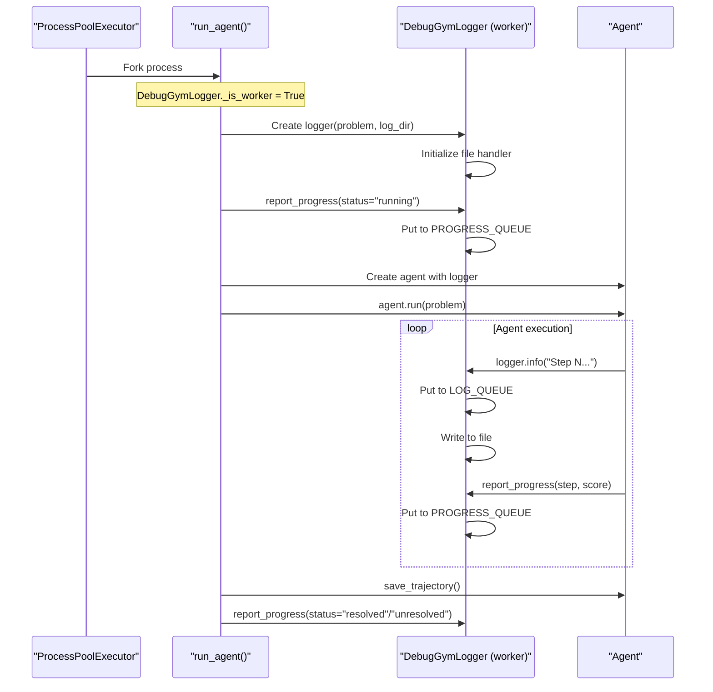

**Sources:** [scripts/run.py:43-176]()

### Progress Reporting Points

Agents report progress at key lifecycle events:

| Event | Status | Location |
|-------|--------|----------|
| Task start | `running` | [scripts/run.py:84-91]() |
| Each step | `running` | Agent implementations (via env) |
| Task success | `resolved` | Agent implementations |
| Task failure | `unresolved` | Agent implementations |
| Exception | `error` | [scripts/run.py:114-121](), [scripts/run.py:158-166]() |
| Skip (previous success) | `skip-resolved` | [scripts/run.py:72-82]() |
| Skip (previous failure) | `skip-unresolved` | [scripts/run.py:72-82]() |

**Sources:** [scripts/run.py:43-176]()

---

## Status Persistence and Resume Logic

### Status File Format

Each completed task writes a JSON file:

```
{output_path}/{uuid}/{problem_id}_status.json
```

Example content:

```json
{
  "problem_id": "pytest__pytest-12345",
  "step": 25,
  "total_steps": 30,
  "score": 1,
  "max_score": 1,
  "status": "resolved",
  "logdir": "/path/to/logs"
}
```

**Sources:** [debug_gym/logger.py:281-293]()

### Resume Logic

On subsequent runs, `run_agent()` loads previous status:

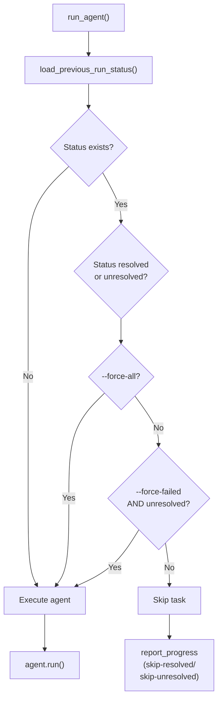

**Command-line flags:**

- `--force-all`: Rerun all tasks, ignoring previous status
- `--force-failed`: Rerun only failed tasks (unresolved/error)

**Sources:** [scripts/run.py:62-82]()

---

## Multiprocess Safety Considerations

### Thread Safety

The logger uses threading for background listeners but relies on Python's GIL and queue thread-safety:

- `LOG_QUEUE` and `PROGRESS_QUEUE` are thread-safe `multiprocessing.Queue` instances
- Background threads use `queue.get(timeout=0.1)` with proper exception handling
- Stop events use `threading.Event()` for clean shutdown

**Sources:** [debug_gym/logger.py:470-498](), [debug_gym/logger.py:598-611]()

### File Handler Isolation

Each worker process writes to its own log file:

```
{log_dir}/{problem_id}.log
```

The main process writes to:

```
{log_dir}/debug_gym.log
```

This prevents file lock contention across processes.

**Sources:** [debug_gym/logger.py:156-168](), [debug_gym/logger.py:579-588]()

### Queue Size Considerations

Queue sizes are tuned based on expected load:

| Queue | Size | Rationale |
|-------|------|-----------|
| `LOG_QUEUE` | 10,000 | Log messages are relatively infrequent |
| `PROGRESS_QUEUE` | 50,000 | Progress updates occur at every agent step (high frequency) |

If queues fill, the backoff strategy prevents data loss.

**Sources:** [debug_gym/logger.py:505-506]()

---

