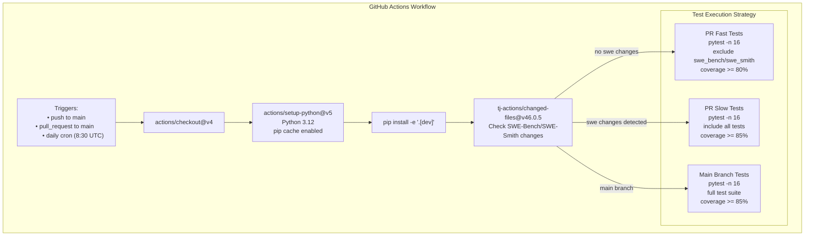
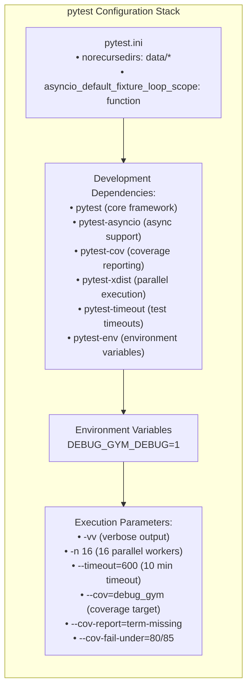
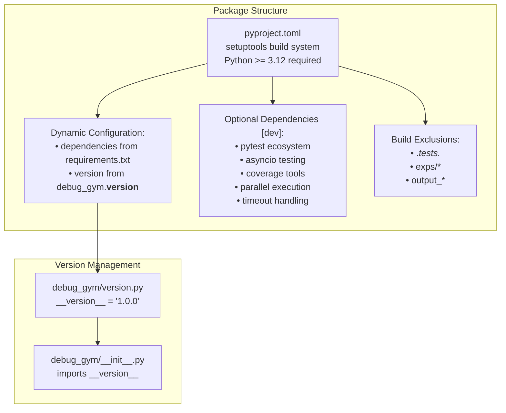
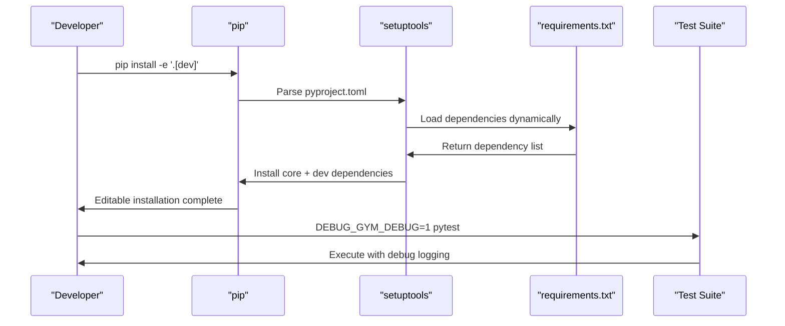
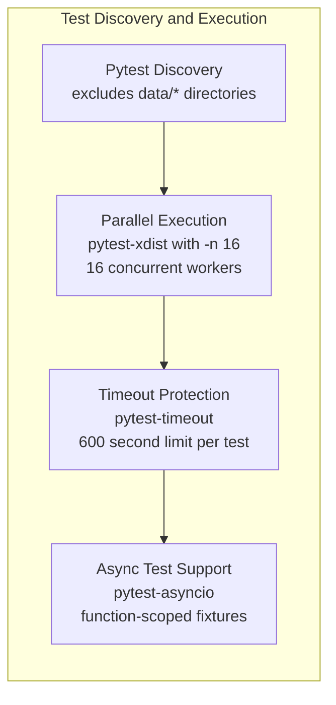

<!-- source: DeepWiki mcp.deepwiki.com · repo microsoft/debug-gym · page 6 Development and Testing · fetched 2026-10-26 -->

# Development and Analysis

Relevant source files

The following files were used as context for generating this wiki page:

- [.github/workflows/release.yml](.github/workflows/release.yml)
- [.github/workflows/tests.yml](.github/workflows/tests.yml)
- [pyproject.toml](pyproject.toml)
- [pytest.ini](pytest.ini)

This document provides resources and guidance for developers and researchers working with debug-gym. It covers the testing infrastructure, development environment setup, quality assurance processes, and analysis tools available for understanding experiment results and system behavior.

For detailed information about configuration and running experiments, see [Configuration and Execution](#5). For specific analysis tools and visualization capabilities, see [Result Analysis and Visualization](#6.2).

## Testing Infrastructure

The debug-gym project employs a comprehensive testing strategy built around pytest with multiple execution modes, coverage requirements, and continuous integration workflows.

### CI/CD Workflow Architecture

The workflow uses conditional testing strategies based on changed files to optimize CI execution time while maintaining comprehensive coverage for critical components.

**Sources:** [.github/workflows/tests.yml:1-52]()

### Testing Framework Configuration

The testing framework leverages pytest-xdist for parallel execution across 16 workers, with comprehensive coverage reporting and timeout protection for long-running tests.

**Sources:** [pytest.ini:1-4](), [pyproject.toml:25-33](), [.github/workflows/tests.yml:43-47]()

### Test Execution Strategies

| Test Mode | Trigger | Coverage Threshold | Included Tests | Execution Time |
|-----------|---------|-------------------|----------------|----------------|
| PR Fast | Pull request (no SWE changes) | 80% | Excludes `test_swe_bench`, `test_swe_smith` | Optimized |
| PR Slow | Pull request (SWE changes detected) | 85% | Full test suite | Extended |
| Main Branch | Push to main, scheduled | 85% | Full test suite | Extended |

The testing strategy uses `tj-actions/changed-files@v46.0.5` to detect changes in SWE-Bench related files ([debug_gym/gym/envs/swe_*.py:1-238](), [tests/gym/envs/test_swe_*.py]()) and conditionally runs comprehensive tests only when necessary.

**Sources:** [.github/workflows/tests.yml:33-51]()

## Development Environment Setup

### Package Configuration Architecture

The package uses setuptools with dynamic configuration, automatically excluding test directories and experimental outputs from distribution packages.

**Sources:** [pyproject.toml:1-33](), [debug_gym/version.py:1-2](), [debug_gym/__init__.py:1-2]()

### Installation and Development Workflow

The development setup uses editable installation (`-e`) to enable live code changes during development, with the `[dev]` extra providing comprehensive testing capabilities.

**Sources:** [.github/workflows/tests.yml:30-32](), [pyproject.toml:25-33]()

## Quality Assurance Standards

### Coverage Requirements and Enforcement

The project maintains strict coverage thresholds that vary based on the testing context:

- **Pull Request (Fast Mode):** 80% minimum coverage with focused test subset
- **Pull Request (Slow Mode):** 85% minimum coverage with full test suite  
- **Main Branch:** 85% minimum coverage with full test suite and scheduled validation

Coverage reporting uses `pytest-cov` with `--cov-report=term-missing` to highlight uncovered lines, and `--cov-fail-under` to enforce thresholds automatically.

**Sources:** [.github/workflows/tests.yml:43-51]()

### Test Organization and Execution

Test execution leverages pytest's plugin ecosystem for robust parallel testing with comprehensive timeout and async support.

**Sources:** [pytest.ini:1-4](), [pyproject.toml:26-33]()

## Development Tools and Analysis

### Environment Variable Configuration

The testing infrastructure uses `DEBUG_GYM_DEBUG=1` to enable detailed logging during test execution, providing developers with comprehensive debugging information when tests fail or exhibit unexpected behavior.

**Sources:** [.github/workflows/tests.yml:43-51]()

### Continuous Integration Monitoring

The CI system includes scheduled daily runs (`cron: '30 8 * * *'`) to catch regressions and environment-specific issues that might not appear in pull request testing.

**Sources:** [.github/workflows/tests.yml:9-10]()

For detailed information about result analysis tools, log viewers, and performance metrics, see [Result Analysis and Visualization](#6.2). For comprehensive testing of specific environments like SWE-Bench, see [SWE-Bench Suite](#4.2).

---

