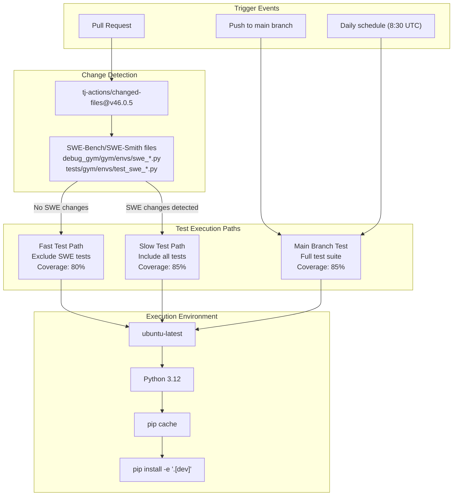
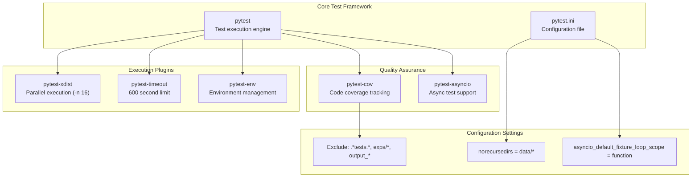
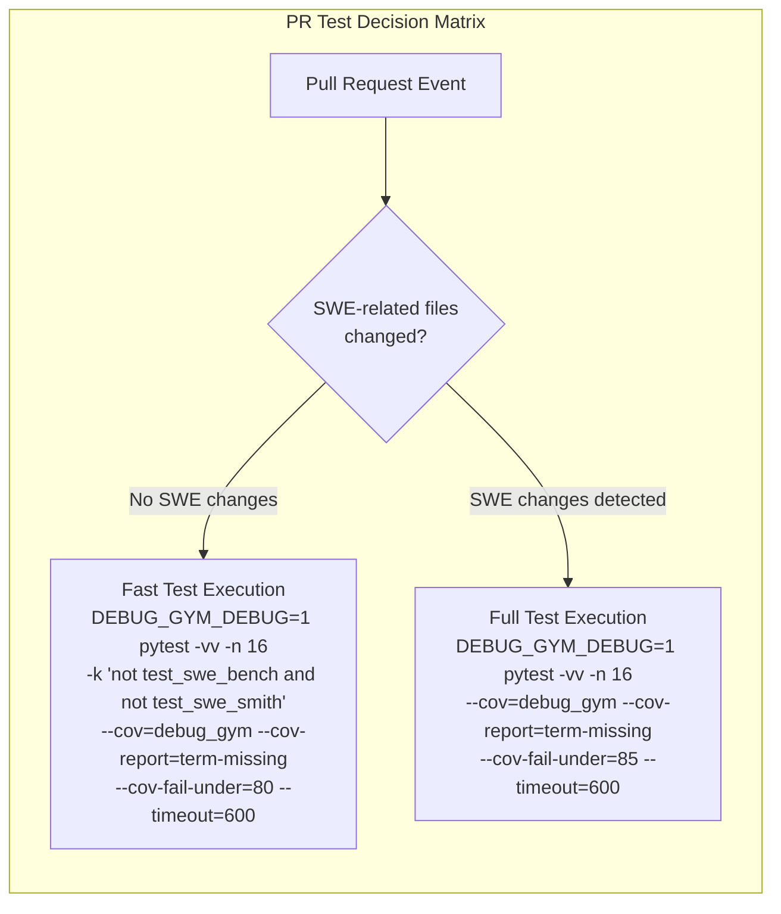
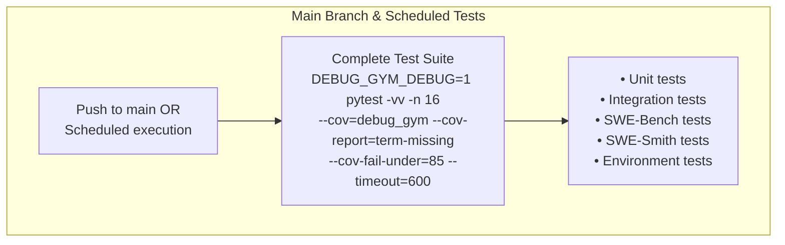
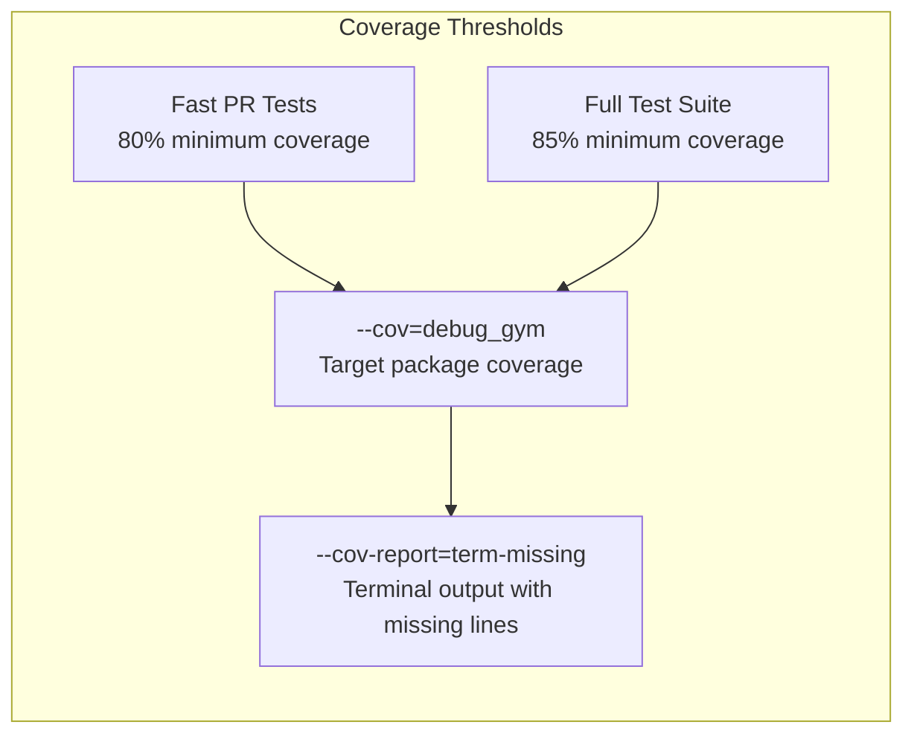
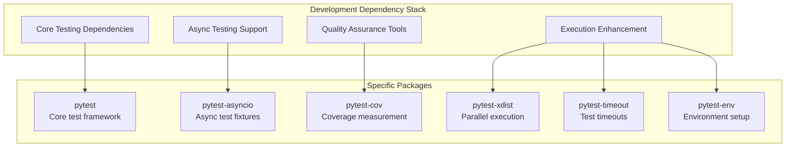
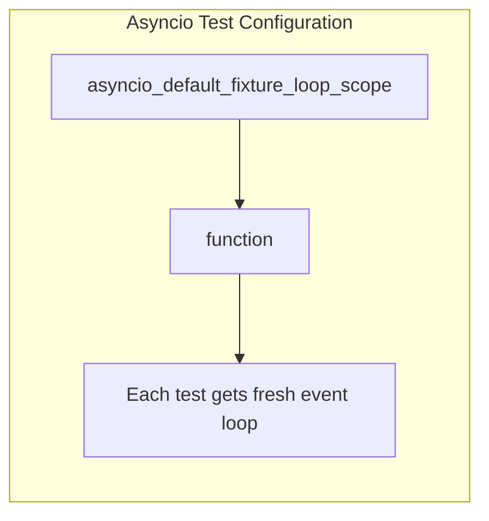

<!-- source: DeepWiki mcp.deepwiki.com · repo microsoft/debug-gym · page 6.1 Testing Infrastructure · fetched 2026-10-26 -->

# Testing Infrastructure

Relevant source files

The following files were used as context for generating this wiki page:

- [.github/workflows/release.yml](.github/workflows/release.yml)
- [.github/workflows/tests.yml](.github/workflows/tests.yml)
- [pyproject.toml](pyproject.toml)
- [pytest.ini](pytest.ini)

This document covers the comprehensive testing system used in debug-gym, including the CI/CD pipeline, test framework configuration, execution strategies, and quality assurance processes. The testing infrastructure ensures code quality, reliability, and compatibility across different execution scenarios.

For information about result analysis and performance metrics after test execution, see [Result Analysis and Visualization](#6.2).

## CI/CD Pipeline Architecture

The debug-gym project uses GitHub Actions to provide automated testing across different scenarios and environments. The CI/CD system is designed to balance thorough testing with execution efficiency.

**Sources:** [.github/workflows/tests.yml:1-52]()

## Test Framework Configuration

The testing system is built around pytest with multiple specialized plugins to handle the complex requirements of debugging environment simulation.

**Sources:** [pyproject.toml:25-33](), [pytest.ini:1-4]()

## Test Execution Strategies

The testing infrastructure implements intelligent execution strategies based on the scope of changes and the execution context.

### Pull Request Testing Strategy

### Main Branch Testing Strategy

**Sources:** [.github/workflows/tests.yml:40-51]()

## Test Environment Configuration

The testing system uses specific environment variables and runtime configurations to ensure consistent behavior across different execution contexts.

| Configuration | Value | Purpose |
|---------------|-------|---------|
| `DEBUG_GYM_DEBUG` | `1` | Enable debug logging during tests |
| `python-version` | `3.12` | Standardized Python runtime |
| `fail-fast` | `false` | Continue testing on failures |
| `timeout` | `600` seconds | Prevent hanging tests |
| `parallel-workers` | `16` | Concurrent test execution |

### Coverage Requirements

**Sources:** [.github/workflows/tests.yml:43-47]()

## Development Dependencies

The testing infrastructure relies on a comprehensive set of development dependencies that provide specialized testing capabilities.

**Sources:** [pyproject.toml:25-33]()

## Test Discovery and Exclusions

The testing system implements specific rules for test discovery and exclusion to optimize execution and avoid interference with data files.

### Directory Exclusions

The system excludes several directory patterns from both test discovery and package distribution:

| Pattern | Context | Purpose |
|---------|---------|---------|
| `data/*` | pytest discovery | Avoid scanning data directories |
| `.*tests.*` | Package exclusion | Exclude test files from distribution |
| `exps/*` | Package exclusion | Exclude experimental code |
| `output_*` | Package exclusion | Exclude generated output directories |

### Asyncio Configuration

The testing framework configures asyncio behavior specifically for the complex async operations in debug-gym:

**Sources:** [pytest.ini:2-3](), [pyproject.toml:23]()

---

