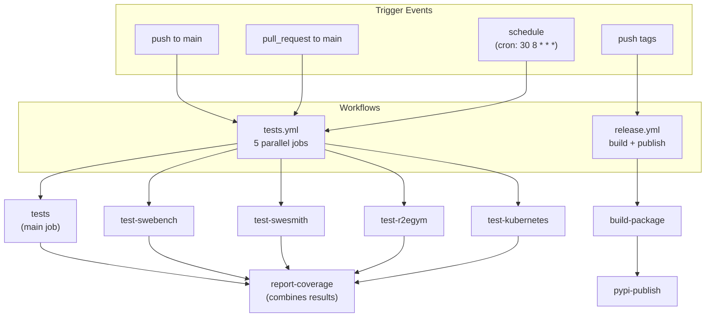
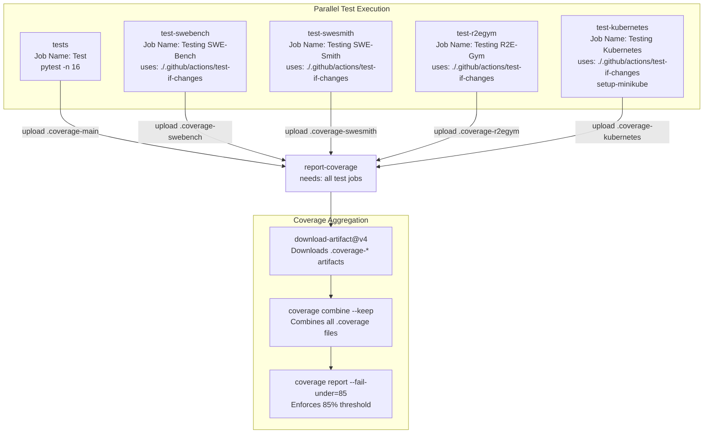
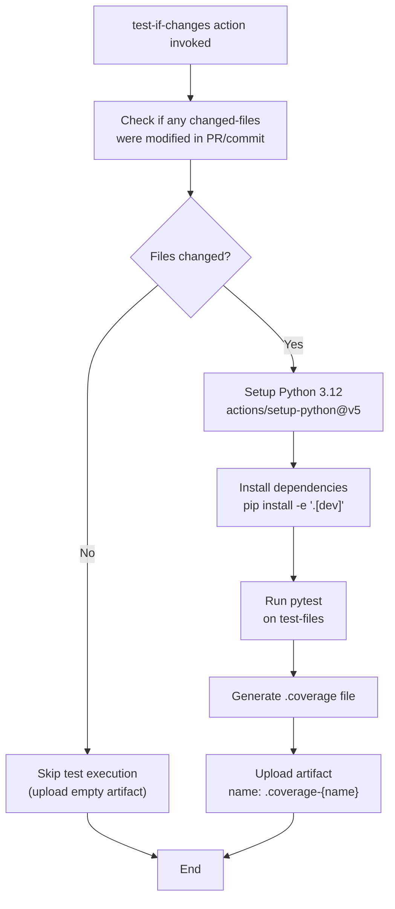
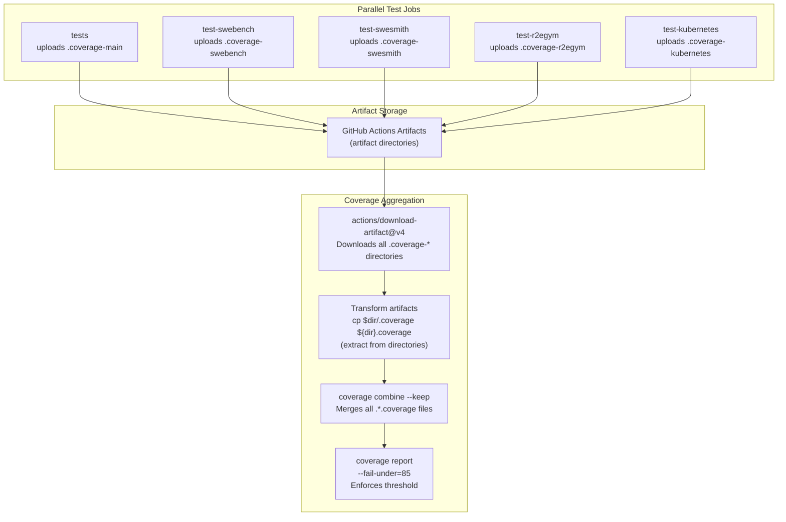
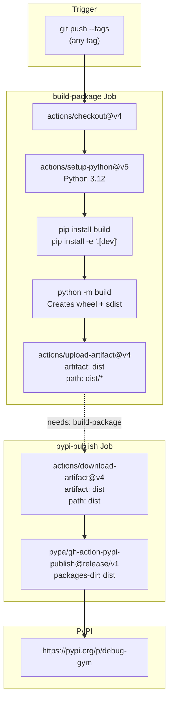

<!-- source: DeepWiki mcp.deepwiki.com · repo microsoft/debug-gym · page 6.2 CI/CD Pipelines · fetched 2026-10-26 -->

# CI/CD Pipelines

<details>
<summary>Relevant source files</summary>

The following files were used as context for generating this wiki page:

- [.github/workflows/release.yml](.github/workflows/release.yml)
- [.github/workflows/tests.yml](.github/workflows/tests.yml)
- [pyproject.toml](pyproject.toml)
- [pytest.ini](pytest.ini)

</details>


## Purpose and Scope

This document describes the continuous integration and continuous deployment (CI/CD) infrastructure for debug-gym. The CI/CD system uses GitHub Actions to automatically test code changes, enforce coverage requirements, and publish releases to PyPI. 

The pipeline implements a smart test execution strategy that runs expensive environment-specific tests (SWE-Bench, SWE-Smith, R2E-Gym, Kubernetes) only when relevant files change, while always running fast unit tests in parallel. All test results are aggregated to compute combined coverage, which must meet an 85% threshold.

For details about the test suite structure, fixtures, and testing strategies, see [Testing Infrastructure](#6.1). For information about how tests are executed via orchestration, see [Orchestration and Execution](#5.2).

**Sources:** [.github/workflows/tests.yml:1-157](), [.github/workflows/release.yml:1-54]()

---

## CI/CD Architecture Overview

The debug-gym CI/CD system consists of two primary workflows: **tests.yml** for continuous testing and **release.yml** for PyPI publishing. The testing workflow uses a composite action pattern to conditionally execute expensive integration tests based on file changes.

### Workflow Trigger Points



**Diagram: CI/CD Workflow Trigger and Execution Flow**

The testing workflow triggers on three events: pushes to main, pull requests targeting main, and a daily schedule at 8:30 UTC. The release workflow triggers only on tag pushes. Tests execute in five parallel jobs that converge into a coverage reporting step.

**Sources:** [.github/workflows/tests.yml:3-11](), [.github/workflows/release.yml:3-6]()

---

## Main Test Workflow (tests.yml)

The test workflow [.github/workflows/tests.yml:1-157]() implements a parallel execution strategy with conditional environment-specific tests.

### Job Structure and Dependencies



**Diagram: Test Job Parallel Execution and Coverage Aggregation**

Five test jobs execute independently, each producing a `.coverage` artifact. The `report-coverage` job depends on all five jobs (`needs: [tests, test-swebench, test-swesmith, test-r2egym, test-kubernetes]`) and combines their coverage data.

**Sources:** [.github/workflows/tests.yml:94-157](), [.github/workflows/tests.yml:129-131]()

### Main Tests Job

The `tests` job [.github/workflows/tests.yml:94-128]() runs the bulk of the test suite in parallel, excluding expensive environment-specific tests.

| Configuration | Value |
|--------------|-------|
| **Job Name** | `Test` |
| **Matrix** | `os: [ubuntu-latest]`, `language: ["python"]` |
| **Python Version** | `3.12` |
| **Parallel Workers** | `16` (via `pytest -n 16`) |
| **Timeout** | `600` seconds per test |
| **Coverage Artifact** | `.coverage-main` |

The test execution command:
```bash
pytest -vv -n 16 -k "not test_swe_bench and not test_swe_smith and not test_r2egym and not test_kubernetes" --timeout=600 --cov=debug_gym --cov-report=term-missing
```

This command:
- Uses `pytest-xdist` (`-n 16`) to run tests across 16 workers
- Excludes expensive integration tests via `-k` filter
- Sets a 10-minute timeout per test
- Generates coverage data with `--cov=debug_gym`

**Environment Variables:**
- `ALLOW_LOCAL_TERMINAL=true` - Permits `LocalTerminal` usage in tests [.github/workflows/tests.yml:117]()
- `DEBUG_GYM_DEBUG=1` - Enables debug logging [.github/workflows/tests.yml:118]()

**Sources:** [.github/workflows/tests.yml:94-128](), [.github/workflows/tests.yml:115-120]()

### Environment-Specific Test Jobs

Four specialized test jobs handle environment-specific integration tests. Each follows the same pattern but tests different components:

| Job Name | Test File | Changed Files Monitored |
|----------|-----------|-------------------------|
| `test-swebench` | `tests/gym/envs/test_swe_bench.py` | `debug_gym/gym/envs/swe_bench.py`<br/>`tests/gym/envs/test_swe_bench.py` |
| `test-swesmith` | `tests/gym/envs/test_swe_smith.py` | `debug_gym/gym/envs/swe_smith.py`<br/>`tests/gym/envs/test_swe_smith.py` |
| `test-r2egym` | `tests/gym/envs/test_r2egym.py` | `debug_gym/gym/envs/r2egym.py`<br/>`tests/gym/envs/test_r2egym.py` |
| `test-kubernetes` | `tests/gym/terminals/test_kubernetes.py` | `debug_gym/gym/terminals/kubernetes.py`<br/>`tests/gym/terminals/test_kubernetes.py` |

All four jobs use the composite action `./.github/actions/test-if-changes` [.github/workflows/tests.yml:24]() which conditionally executes tests only when relevant files have changed (see next section).

**Sources:** [.github/workflows/tests.yml:13-92]()

### Kubernetes Test Job Special Setup

The `test-kubernetes` job [.github/workflows/tests.yml:70-92]() requires additional infrastructure setup before running tests:

```yaml
- name: start minikube
  id: minikube
  uses: medyagh/setup-minikube@latest
- name: kubectl
  run: kubectl get pods -A
```

This job uses the `medyagh/setup-minikube` action to provision a local Kubernetes cluster, then verifies connectivity with `kubectl get pods -A` before executing tests. This ensures `KubernetesTerminal` tests can create and manage pods.

**Sources:** [.github/workflows/tests.yml:81-85]()

---

## The test-if-changes Composite Action

The `test-if-changes` composite action (referenced at `./.github/actions/test-if-changes`) implements conditional test execution by detecting file changes. This action is not present in the provided files, but its interface is evident from usage.

### Action Interface

Each environment-specific job invokes the action with three parameters:

```yaml
- uses: ./.github/actions/test-if-changes
  with:
    name: <test-name>
    test-files: <pytest test file path>
    changed-files: |
      <source-file-1>
      <test-file>
```

**Parameters:**

| Parameter | Purpose | Example |
|-----------|---------|---------|
| `name` | Identifier for coverage artifact naming | `"swebench"` → generates `.coverage-swebench` |
| `test-files` | Specific test files to execute | `"tests/gym/envs/test_swe_bench.py"` |
| `changed-files` | Files that trigger test execution | `debug_gym/gym/envs/swe_bench.py`<br/>`tests/gym/envs/test_swe_bench.py` |

### Execution Logic

The composite action implements the following behavior:



**Diagram: test-if-changes Conditional Execution Logic**

This design optimizes CI runtime by skipping expensive environment tests when they're not needed. For example, if a PR only modifies `debug_gym/gym/agents/debug_agent.py`, the SWE-Bench, SWE-Smith, R2E-Gym, and Kubernetes test jobs will skip execution.

**Sources:** [.github/workflows/tests.yml:22-30](), [.github/workflows/tests.yml:42-49](), [.github/workflows/tests.yml:61-68](), [.github/workflows/tests.yml:86-92]()

---

## Coverage Reporting

The `report-coverage` job [.github/workflows/tests.yml:129-157]() aggregates coverage from all test jobs and enforces the 85% threshold.

### Coverage Collection Flow



**Diagram: Coverage Data Collection and Aggregation**

The coverage workflow handles a quirk of GitHub Actions artifacts: `actions/upload-artifact@v4` uploads files, but `actions/download-artifact@v4` downloads them as directories. The transformation step [.github/workflows/tests.yml:149-154]() extracts `.coverage` files from these directories:

```bash
for dir in .coverage-*; do
  if [ -d "$dir" ] && [ -f "$dir/.coverage" ]; then
    cp "$dir/.coverage" "${dir}.coverage"
    echo "Moved coverage file from $dir to ${dir}.coverage"
  fi
done
```

After extraction, `coverage combine --keep .*.coverage` [.github/workflows/tests.yml:156]() merges all coverage data, and `coverage report --fail-under=85` [.github/workflows/tests.yml:157]() enforces the minimum threshold.

**Coverage Threshold:** The workflow fails if combined coverage falls below **85%**. This threshold is explicitly set in the workflow, separate from any pytest configuration.

**Sources:** [.github/workflows/tests.yml:129-157]()

---

## Release Automation

The release workflow [.github/workflows/release.yml:1-54]() automates the process of building and publishing debug-gym to PyPI when version tags are pushed.

### Release Pipeline



**Diagram: PyPI Release Pipeline**

The release process consists of two jobs:

### build-package Job

[.github/workflows/release.yml:9-33]()

| Step | Command | Purpose |
|------|---------|---------|
| Checkout | `actions/checkout@v4` | Clone repository at tagged commit |
| Setup Python | `actions/setup-python@v5` | Install Python 3.12 |
| Install dependencies | `pip install build`<br/>`pip install -e '.[dev]'` | Install build tools and dev dependencies |
| Build package | `python -m build` | Create wheel and source distribution in `dist/` |
| Upload artifact | `actions/upload-artifact@v4` | Store `dist/*` for publishing job |

The build uses the standard `python -m build` command, which respects the `pyproject.toml` configuration [pyproject.toml:1-40]().

**Sources:** [.github/workflows/release.yml:9-33]()

### pypi-publish Job

[.github/workflows/release.yml:35-54]()

This job depends on `build-package` completing successfully (`needs: build-package`) and publishes to PyPI using trusted publishing (OIDC).

**Key Configuration:**

- **Environment:** `pypi-release` [.github/workflows/release.yml:38-40]()
- **Permissions:** `id-token: write` [.github/workflows/release.yml:42]() for OIDC authentication
- **Publisher:** `pypa/gh-action-pypi-publish@release/v1` [.github/workflows/release.yml:50-53]()

The workflow uses GitHub's trusted publishing feature, which eliminates the need for API tokens by using OIDC tokens to authenticate with PyPI. The environment URL points to the published package at `https://pypi.org/p/debug-gym`.

**Sources:** [.github/workflows/release.yml:35-54]()

---

## Configuration and Dependencies

### Package Configuration (pyproject.toml)

The `pyproject.toml` [pyproject.toml:1-40]() defines the project metadata and build configuration:

| Section | Configuration |
|---------|---------------|
| **Build System** | `setuptools>=61.0` with `setuptools.build_meta` backend |
| **Project Name** | `debug-gym` |
| **Python Version** | `>=3.12` |
| **Version** | Dynamic from `debug_gym.__version__` |
| **Dependencies** | Dynamic from `requirements.txt` |
| **Dev Dependencies** | `pytest`, `pytest-asyncio`, `pytest-cov`, `pytest-xdist`, `pytest-timeout`, `pytest-env`, `isort`, `black` |

The `project.optional-dependencies.dev` section [pyproject.toml:30-40]() lists all test dependencies:

- **pytest** - Test framework
- **pytest-asyncio** - Async test support
- **pytest-cov** - Coverage reporting
- **pytest-xdist** - Parallel test execution (`-n 16`)
- **pytest-timeout** - Per-test timeouts (`--timeout=600`)
- **pytest-env** - Environment variable management
- **isort, black** - Code formatting (used in development)

**Sources:** [pyproject.toml:1-40]()

### Pytest Configuration (pytest.ini)

The `pytest.ini` [pytest.ini:1-7]() provides pytest-specific configuration:

```ini
[pytest]
norecursedirs = data/*
asyncio_default_fixture_loop_scope = function
env =
    BASH_SILENCE_DEPRECATION_WARNING=1
markers =
    hf_tokenizer: tests that require downloading a Hugging Face tokenizer and may be slow
```

**Configuration Details:**

- `norecursedirs = data/*` - Excludes `data/` directories from test discovery [pytest.ini:2]()
- `asyncio_default_fixture_loop_scope = function` - Sets async fixture scope [pytest.ini:3]()
- `env` section - Suppresses bash deprecation warnings in macOS [pytest.ini:4-5]()
- `markers` - Defines `hf_tokenizer` marker for tests requiring Hugging Face tokenizer downloads [pytest.ini:6-7]()

Note that the `ALLOW_LOCAL_TERMINAL` and `DEBUG_GYM_DEBUG` environment variables used in CI are **not** defined in `pytest.ini` - they are set directly in the workflow [.github/workflows/tests.yml:117-118]().

**Sources:** [pytest.ini:1-7]()

---

## CI/CD Best Practices

The debug-gym CI/CD pipeline implements several best practices:

### Optimization Strategies

1. **Conditional Testing** - The `test-if-changes` action skips expensive integration tests when irrelevant files change, reducing CI runtime.

2. **Parallel Execution** - The main test job uses `pytest -n 16` to distribute tests across 16 workers, significantly speeding up test execution.

3. **Job Parallelization** - All five test jobs run concurrently, with the coverage job waiting only for completion rather than running sequentially.

4. **Artifact Caching** - Python dependencies are cached using `actions/setup-python` with `cache: 'pip'` [.github/workflows/tests.yml:110]().

### Quality Enforcement

1. **Coverage Threshold** - The 85% coverage requirement ensures comprehensive testing. The workflow fails if coverage drops below this threshold.

2. **Test Timeouts** - Each test has a 600-second timeout to prevent hanging tests from blocking CI.

3. **Fail-Fast Disabled** - The matrix strategy uses `fail-fast: false` [.github/workflows/tests.yml:17]() to allow all jobs to complete even if one fails, providing complete diagnostic information.

### Security

1. **Trusted Publishing** - The release workflow uses OIDC-based trusted publishing instead of long-lived API tokens, following PyPI's recommended security practices.

2. **Environment Protection** - The `pypi-release` environment [.github/workflows/release.yml:39]() can be configured with protection rules to require manual approval before publishing.

**Sources:** [.github/workflows/tests.yml:1-157](), [.github/workflows/release.yml:1-54]()

---

## Summary

The debug-gym CI/CD infrastructure provides:

- **Automated Testing** - Five parallel test jobs covering fast unit tests and environment-specific integration tests
- **Smart Execution** - Conditional test execution based on file changes to optimize CI runtime
- **Coverage Enforcement** - 85% coverage threshold with combined reporting across all test jobs
- **Kubernetes Testing** - Dedicated job with minikube setup for testing `KubernetesTerminal`
- **Automated Releases** - Tag-triggered builds and PyPI publishing with trusted publishing
- **Scheduled Testing** - Daily test runs at 8:30 UTC to catch environment drift

The system balances comprehensive testing with execution efficiency through parallel execution, conditional testing, and dependency caching.

**Sources:** [.github/workflows/tests.yml:1-157](), [.github/workflows/release.yml:1-54](), [pyproject.toml:1-40](), [pytest.ini:1-7]()