# Page: Overview

# Overview

<details>
<summary>Relevant source files</summary>

The following files were used as context for generating this wiki page:

- [CHANGELOG.md](CHANGELOG.md)
- [README.md](README.md)
- [RESPONSIBLE_AI.md](RESPONSIBLE_AI.md)
- [debug_gym/__init__.py](debug_gym/__init__.py)
- [debug_gym/logger.py](debug_gym/logger.py)
- [debug_gym/version.py](debug_gym/version.py)
- [requirements.txt](requirements.txt)
- [scripts/run.py](scripts/run.py)
- [tests/test_logger.py](tests/test_logger.py)

</details>


## Purpose and Scope

`debug-gym` is a text-based interactive debugging framework designed for training and evaluating LLM-based agents on Python debugging tasks. The framework enables agents to interact with codebases through a tool-based architecture, using capabilities like interactive debuggers (`pdb`), code viewers, test execution, and code modification tools. This page provides a high-level overview of the system architecture and how the major components work together.

For details on specific subsystems:
- Core architecture components: see [Core Architecture](#2)
- Individual tools and their implementation: see [Tool System](#3)
- Available benchmarks: see [Benchmarks and Environments](#4)
- Running experiments: see [Configuration and Execution](#5)

**Sources:** [README.md:1-8](), [RESPONSIBLE_AI.md:1-13]()

---

## What is debug-gym

`debug-gym` is a Gymnasium-style environment that simulates repository-level debugging tasks. Unlike static debugging approaches where agents only see error messages, `debug-gym` enables **interactive debugging** where agents can:

- Set breakpoints and inspect runtime state via the `pdb` tool
- View and modify source files
- Execute tests and observe outputs
- Search codebases for patterns
- Navigate directory structures

The framework is built around three core abstractions:

1. **Environments** (`RepoEnv` and subclasses): Manage debugging tasks, tool integration, and evaluation
2. **Agents** (`BaseAgent` and subclasses): LLM-driven entities that interact with environments to solve debugging tasks
3. **Tools** (`EnvironmentTool` subclasses): Extensible modules that augment agent capabilities

**System Architecture Diagram**

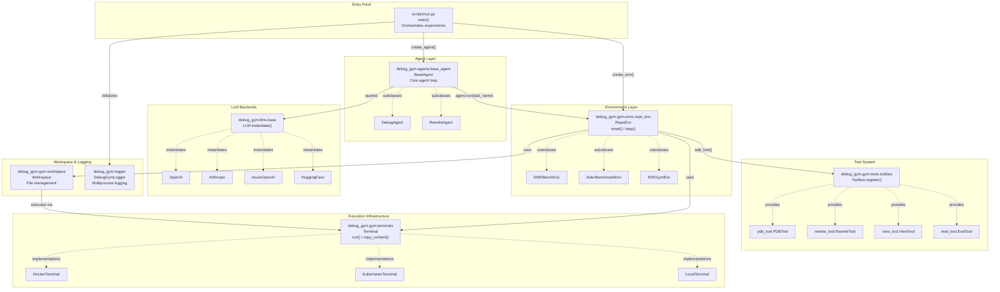

**Sources:** [README.md:51-73](), [scripts/run.py:1-20](), [High-level diagrams - Diagram 1]()

---

## Core Components

### Environment System

The `RepoEnv` base class implements the Gymnasium paradigm with `reset()` and `step()` methods. Environments manage:

- **Task lifecycle**: Loading codebases, applying patches, running tests
- **Tool integration**: Dynamically registering and orchestrating tools via `Toolbox`
- **Event system**: `EventHooks` for inter-tool communication (e.g., PDB adjusting breakpoints after code rewrites)
- **Evaluation**: Automatic test execution and scoring

Benchmark-specific subclasses include `SWEBenchEnv`, `AiderBenchmarkEnv`, `R2EGymEnv`, `MiniNightmareEnv`, and `SWESmithEnv`.

**Reference:** For detailed environment documentation, see [Environment System (RepoEnv)](#2.1)

**Sources:** [README.md:75-93](), [debug_gym/gym/envs/](path exists in diagrams)

### Agent Framework

`BaseAgent` implements the core agent loop:
1. Query LLM for next action (tool call)
2. Execute tool via `env.step()`
3. Receive observations
4. Update history
5. Repeat until task resolved or max steps reached

Specialized agents include `DebugAgent` (uses `pdb`), `RewriteAgent` (code modification only), and `Debug_5_Agent` (staged debugging approach).

**Reference:** For agent implementation details, see [Agent Framework](#2.2)

**Sources:** [README.md:96-107](), [scripts/run.py:102-111]()

### LLM Integration

The `LLM` base class provides a unified interface for multiple backends:
- **OpenAI**: GPT-4, GPT-4o, etc.
- **Anthropic**: Claude models
- **Azure OpenAI**: Enterprise deployments
- **HuggingFace/vLLM**: Open-source models with OpenAI-compatible endpoints
- **Human**: Manual interaction mode
- **Copilot**: GitHub Copilot integration

Configuration is managed via `llm.yaml` files.

**Reference:** For LLM backend details, see [LLM Integration](#2.3)

**Sources:** [README.md:31-48](), [README.md:67-69]()

### Tool System

Tools extend agent capabilities through the `EnvironmentTool` interface. The `Toolbox` registry uses the `@Toolbox.register()` decorator for registration:

| Tool | Primary Class | Purpose |
|------|---------------|---------|
| `pdb` | `PDBTool` | Interactive debugger with persistent breakpoints |
| `rewrite` | `RewriteTool` | Code modification with diff generation |
| `view` | `ViewTool` | File viewing with line numbers |
| `eval` | `EvalTool` | Test execution and scoring |
| `grep` | `GrepTool` | Pattern searching in codebases |
| `bash` | `BashTool` | Shell command execution |
| `listdir` | `ListdirTool` | Directory tree browsal |

**Reference:** For tool implementation and usage, see [Tool System](#3)

**Sources:** [README.md:79-89]()

### Execution Infrastructure

The `Terminal` abstraction provides isolated execution environments:

- **`DockerTerminal`**: Container-based isolation (recommended default)
- **`KubernetesTerminal`**: Scalable pod-based execution for large benchmarks
- **`LocalTerminal`**: Direct host execution (development only)

All terminals support shell sessions via PTY for interactive tools like `pdb`.

The `Workspace` class manages file operations with access control through `.debugignore` and `.debugreadonly` files.

**Reference:** For infrastructure details, see [Execution Infrastructure](#2.4)

**Sources:** [README.md:127-149]()

---

## Execution Flow

The following diagram illustrates a complete debugging session from initialization to completion:

**Agent-Environment Interaction Flow**

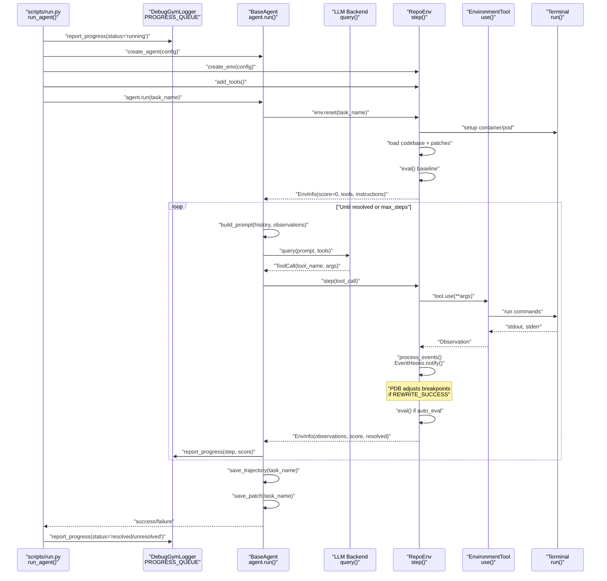

**Key execution stages:**

1. **Initialization** ([scripts/run.py:43-109]()):
   - `run_agent()` creates `DebugGymLogger`, agent, and environment
   - `add_tools()` registers tools from config via `Toolbox`
   - `env.reset()` loads the codebase and runs baseline evaluation

2. **Agent Loop** ([debug_gym/agents/base_agent]()):
   - Agent builds prompt from history and current observations
   - LLM generates tool call (function calling format)
   - Environment executes tool and returns observations

3. **Event Processing**:
   - Tools trigger events (e.g., `REWRITE_SUCCESS`)
   - `EventHooks` notifies subscribed tools
   - PDB adjusts breakpoints after code modifications

4. **Completion** ([scripts/run.py:143-148]()):
   - Agent saves trajectory (`.jsonl`) and patch (`.diff`)
   - Final progress reported to logger

**Sources:** [scripts/run.py:43-177](), [High-level diagrams - Diagram 2]()

---

## Configuration and Orchestration

### Configuration Loading

Configuration flows through a three-tier merge hierarchy:

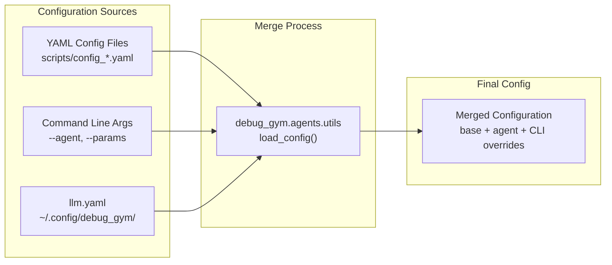

**Example override:**
```bash
python scripts/run.py scripts/config_aider.yaml \
    --agent debug_agent \
    -p debug_agent.llm_name="gpt-4o" \
    -p base.num_workers=8
```

**Sources:** [README.md:173-181](), [scripts/run.py:241-243](), [High-level diagrams - Diagram 6]()

### Parallel Execution

The orchestrator `run.py` uses `ProcessPoolExecutor` for parallel problem solving:

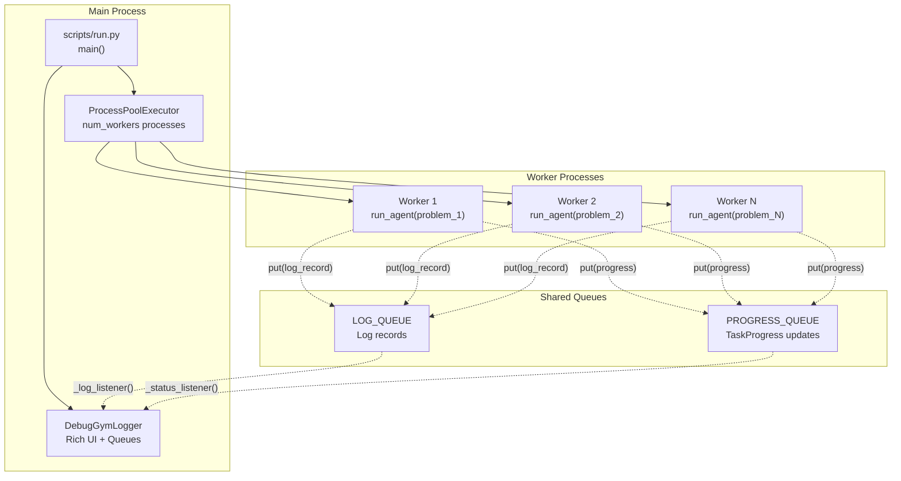

Each worker process:
- Creates its own agent and environment instances
- Logs to individual files via `DebugGymLogger`
- Reports progress through `PROGRESS_QUEUE`
- Main process displays live Rich UI with progress bars

**Sources:** [scripts/run.py:277-312](), [debug_gym/logger.py:500-507]()

---

## Key Design Principles

### Interactive Debugging

Unlike static approaches that only use error messages, `debug-gym` enables runtime inspection:

- **Persistent breakpoints**: PDB breakpoints survive across test executions
- **Auto-listing**: Automatically shows code context at breakpoints
- **Event-driven updates**: Breakpoints adjust line numbers after code modifications

**Sources:** [README.md:86](), [RESPONSIBLE_AI.md:7-10]()

### Tool-Based Extensibility

The `@Toolbox.register()` decorator enables custom tools:

```python
@Toolbox.register(name="my_tool")
class MyTool(EnvironmentTool):
    def use(self, **kwargs):
        # Tool implementation
        return observation
```

Tools automatically integrate:
- Action/observation spaces merge into environment
- Instructions appear in agent prompts
- Can subscribe to events via `EventHooks`

**Sources:** [README.md:79-91](), [README.md:253-254]()

### Isolation and Safety

All code execution occurs in isolated containers/pods:

- **Docker/Kubernetes**: File system isolation from host
- **`.debugignore`**: Hide files from agents (e.g., test files)
- **`.debugreadonly`**: Prevent modification of specific files
- **PTY-based shells**: Interactive sessions without host access

**Sources:** [RESPONSIBLE_AI.md:11](), [README.md:92-93]()

### Multiprocess-Safe Logging

`DebugGymLogger` uses shared queues for coordination:

- **`LOG_QUEUE`**: Worker logs → main process Rich handler
- **`PROGRESS_QUEUE`**: Progress updates → live UI display
- **Background threads**: `_log_listener()` and `_status_listener()` process queues
- **Per-problem files**: Each problem logs to `<problem_id>.log`

**Reference:** For logging implementation, see [Logging and Progress Reporting](#5.3)

**Sources:** [debug_gym/logger.py:500-620](), [scripts/run.py:55-60]()

---

## Directory Structure

**Code Organization by Module**

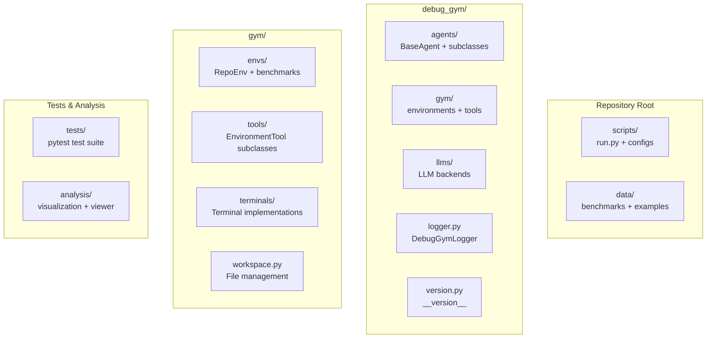

| Directory | Purpose | Key Files |
|-----------|---------|-----------|
| `scripts/` | Entry points and configs | `run.py`, `config_*.yaml` |
| `debug_gym/agents/` | Agent implementations | `base_agent.py`, `debug_agent.py` |
| `debug_gym/gym/envs/` | Environment classes | `repo_env.py`, `swebench_env.py` |
| `debug_gym/gym/tools/` | Tool implementations | `pdb_tool.py`, `rewrite_tool.py` |
| `debug_gym/gym/terminals/` | Execution backends | `docker_terminal.py`, `k8s_terminal.py` |
| `debug_gym/llms/` | LLM integrations | `openai_llm.py`, `anthropic_llm.py` |
| `data/` | Benchmark data | `mini_nightmare/`, `pytorch/` |
| `tests/` | Unit tests (85%+ coverage) | `test_*.py` |
| `analysis/` | Result analysis | `json_log_viewer/` |

**Sources:** [README.md:54-63](), File paths from provided files

---

## Getting Started

To run a debugging experiment:

```bash
# Install debug-gym
pip install debug-gym

# Configure LLM credentials
python -m debug_gym.llms.configure

# Edit ~/.config/debug_gym/llm.yaml with API keys

# Run an agent on a benchmark
python scripts/run.py scripts/config_aider.yaml --agent debug_agent
```

**Key command-line options:**

| Flag | Purpose |
|------|---------|
| `--agent <name>` | Specify agent type (e.g., `debug_agent`, `rewrite_agent`) |
| `--num-workers <n>` | Parallel worker processes |
| `-p <key>=<value>` | Override config values |
| `-v` / `--debug` | Verbose logging / debug mode |
| `--list` | List available problems and agents |

**Reference:** For detailed configuration and execution, see [Configuration and Execution](#5)

**Sources:** [README.md:9-29](), [README.md:152-181]()

---

## Output Artifacts

Each debugging run produces:

| File | Location | Contents |
|------|----------|----------|
| `trajectory.json` | `<output_path>/<uuid>/<problem>/` | Complete interaction history (LLM queries, tool calls, observations) |
| `debug_gym.patch` | `<output_path>/<uuid>/<problem>/` | Final code modifications as unified diff |
| `<problem>.log` | `<output_path>/<uuid>/<problem>/` | Timestamped execution logs |
| `<problem>_status.json` | `<output_path>/<uuid>/<problem>/` | Final task status (resolved/unresolved, score) |
| `experiment_info.jsonl` | `<output_path>/<uuid>/` | Experiment metadata (config, git hash, timestamp) |

The `analysis/json_log_viewer/` directory contains a Flask app for visualizing trajectories in a web browser.

**Sources:** [scripts/run.py:144-148](), [scripts/run.py:204-238](), [README.md:256-260]()

---

## Version and Requirements

**Current version:** `1.2.0` ([debug_gym/version.py:1]())

**Core dependencies:**

| Package | Purpose |
|---------|---------|
| `openai>=1.99.9` | OpenAI API integration |
| `anthropic>=0.51.0` | Anthropic API integration |
| `docker>=7.1.0` | Docker container management |
| `kubernetes>=33.1.0` | Kubernetes pod orchestration |
| `rich>=14.0.0` | Terminal UI and logging |
| `datasets>=3.6.0` | Benchmark dataset loading |
| `swebench>=4.0.3` | SWE-Bench integration |
| `pytest>=8.3.5` | Testing framework |

**Python requirement:** `>=3.12`

**Platform support:**
- **Linux**: Full support (recommended)
- **macOS/Windows**: Limited PTY support (interactive `pdb` tool unavailable)

**Sources:** [requirements.txt:1-19](), [README.md:11-12](), [README.md:70-72]()

---

# Page: Core Architecture

# Core Architecture

<details>
<summary>Relevant source files</summary>

The following files were used as context for generating this wiki page:

- [CHANGELOG.md](CHANGELOG.md)
- [README.md](README.md)
- [RESPONSIBLE_AI.md](RESPONSIBLE_AI.md)
- [debug_gym/__init__.py](debug_gym/__init__.py)
- [debug_gym/agents/base_agent.py](debug_gym/agents/base_agent.py)
- [debug_gym/agents/debug_agent.py](debug_gym/agents/debug_agent.py)
- [debug_gym/agents/rewrite_agent.py](debug_gym/agents/rewrite_agent.py)
- [debug_gym/agents/solution_agent.py](debug_gym/agents/solution_agent.py)
- [debug_gym/gym/envs/env.py](debug_gym/gym/envs/env.py)
- [debug_gym/gym/tools/pdb.py](debug_gym/gym/tools/pdb.py)
- [debug_gym/logger.py](debug_gym/logger.py)
- [debug_gym/version.py](debug_gym/version.py)
- [requirements.txt](requirements.txt)
- [scripts/run.py](scripts/run.py)
- [tests/gym/envs/test_env.py](tests/gym/envs/test_env.py)
- [tests/gym/tools/test_pdb.py](tests/gym/tools/test_pdb.py)
- [tests/test_logger.py](tests/test_logger.py)

</details>


This document provides a high-level overview of the debug-gym system architecture, explaining how the orchestration layer, agents, LLMs, environments, tools, and execution infrastructure work together to enable interactive debugging workflows.

For detailed information about specific components, see:
- [Environment System](#2.1) for environment internals
- [Agent Framework](#2.2) for agent implementations  
- [LLM Integration](#2.3) for LLM provider details
- [Execution Infrastructure](#2.4) for terminal abstractions
- [Tool System](#3) for tool documentation

## System Architecture Overview

Debug-gym follows a layered architecture where each layer has distinct responsibilities. The orchestration layer (`run.py`) coordinates parallel execution, agents implement debugging strategies, LLMs provide decision-making capabilities, environments manage repository state and tool execution, and the infrastructure layer provides isolated execution contexts.

**High-Level System Architecture**

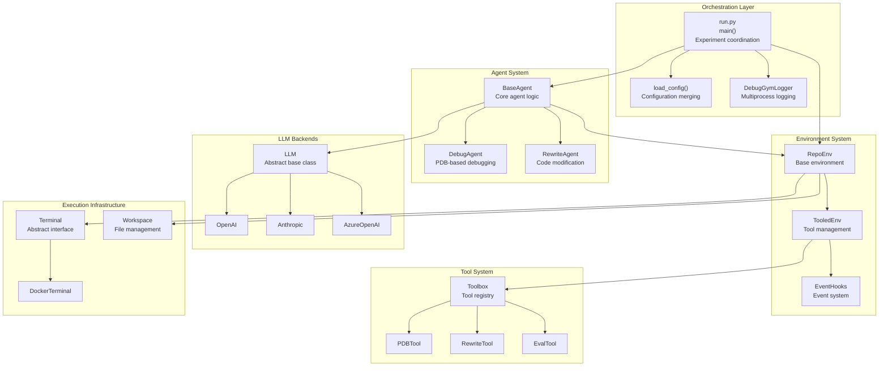

Sources: [scripts/run.py:1-317](), [debug_gym/agents/base_agent.py:1-394](), [debug_gym/gym/envs/env.py:1-522](), [debug_gym/gym/tools/toolbox.py]()

## Orchestration and Execution Flow

The orchestration layer coordinates all system components through `run.py`, which serves as the main entry point. It handles configuration loading, parallel execution, and progress reporting.

**Main Execution Flow**

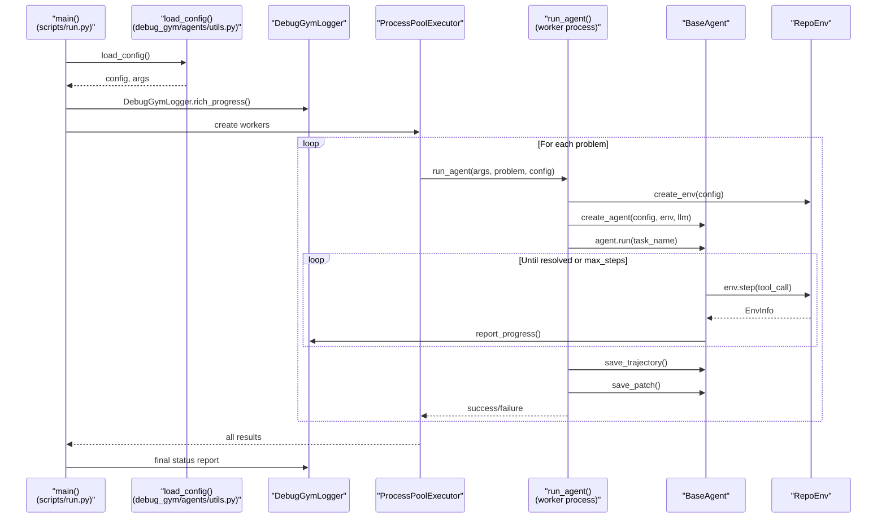

Sources: [scripts/run.py:241-313](), [scripts/run.py:43-176]()

### Configuration System

Configuration flows through a three-tier hierarchy managed by `load_config()`:

| Priority | Source | Purpose |
|----------|--------|---------|
| 1 (Highest) | Command-line `-p` flags | Runtime overrides |
| 2 | Agent-specific YAML section | Per-agent customization |
| 3 (Lowest) | Base YAML configuration | Default settings |

The configuration structure includes:
- **Base settings**: `benchmark`, `output_path`, `uuid`, `max_steps`, `max_rewrite_steps`
- **Environment kwargs**: `path`, `entrypoint`, `debug_entrypoint`, `terminal`, `tools`
- **Agent settings**: `agent_type`, `llm_name`, `system_prompt`, `memory_size`
- **LLM configuration**: External `llm.yaml` with API keys and model parameters

Sources: [debug_gym/agents/utils.py](), [scripts/run.py:241-249]()

## Agent-Environment Interaction Pattern

Agents interact with environments through a standardized cycle that separates decision-making from execution.

**Agent Interaction Lifecycle**

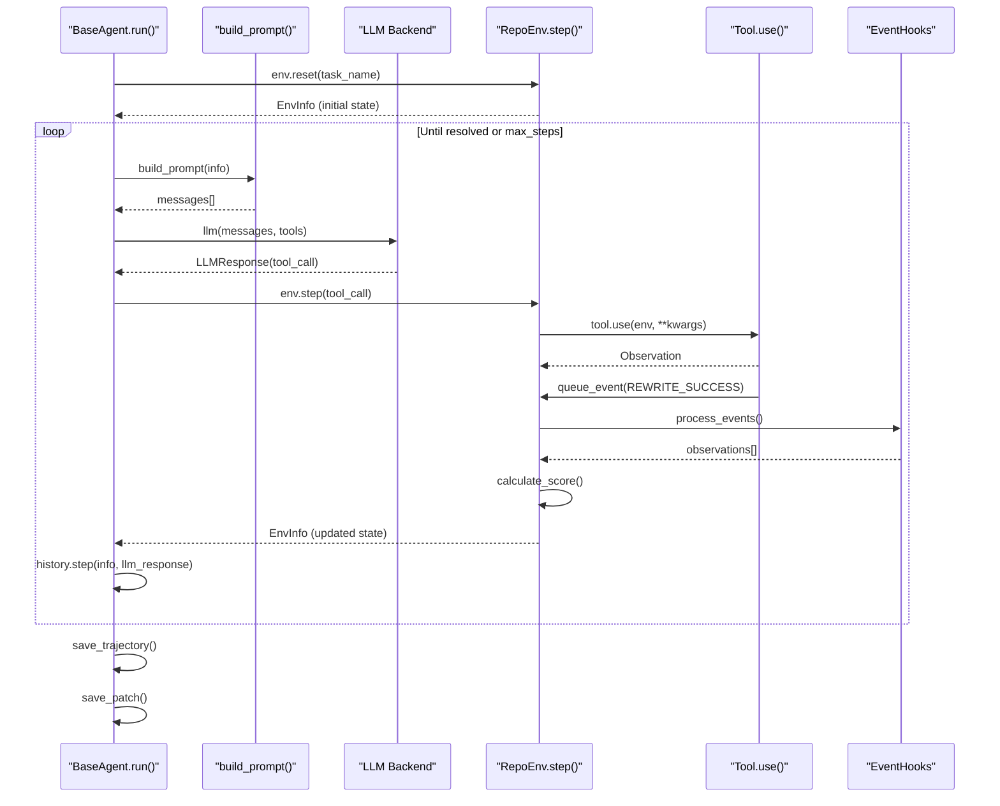

Sources: [debug_gym/agents/base_agent.py:223-319](), [debug_gym/gym/envs/env.py:444-505]()

### EnvInfo State Representation

The `EnvInfo` dataclass encapsulates complete environment state after each step:

```python
@dataclass
class EnvInfo:
    step_observation: Observation        # Primary tool output
    all_observations: list[Observation]  # Including event-triggered
    eval_observation: Observation | None # Last test result
    dir_tree: str                        # Repository structure
    current_breakpoints: str             # Active breakpoints
    action_reasoning: str | None         # Agent's reasoning
    action_content: str | None           # Agent's response
    action_tool_call: ToolCall | None    # Executed action
    instructions: dict                   # Task instructions
    score: int                           # Current score
    max_score: int                       # Maximum possible score
    terminated: bool                     # Task completion flag
    resolved: bool                       # Success flag
    rewrite_counter: int                 # Number of code rewrites
    tools: list[EnvironmentTool]         # Available tools
```

Sources: [debug_gym/gym/envs/env.py:14-32]()

## Component Communication Patterns

The system uses three primary communication mechanisms to coordinate between components.

### 1. Synchronous Tool Execution

Tools are invoked synchronously through the `TooledEnv.step()` method:

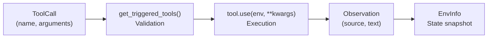

Sources: [debug_gym/gym/envs/env.py:444-476]()

### 2. Event-Driven Communication

The event system enables asynchronous responses to environment changes:

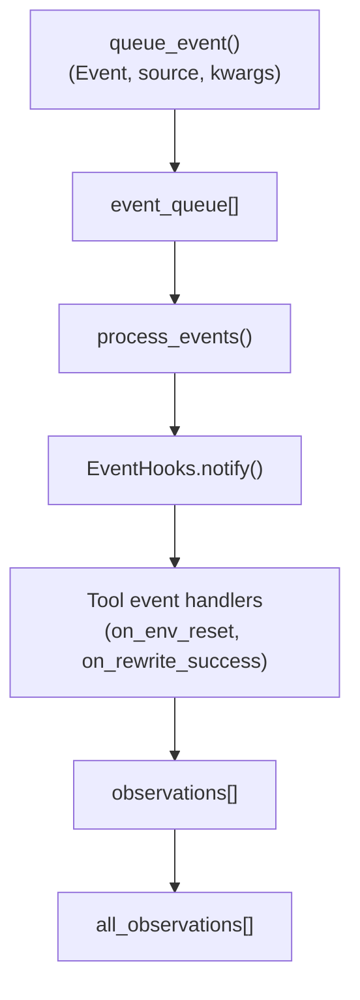

Event types defined in the system:
- `ENV_RESET`: Triggered when environment is reset, tools can initialize state
- `REWRITE_SUCCESS`: Triggered after successful code modification, e.g., PDB adjusts breakpoints
- `REWRITE_FAIL`: Triggered when code modification fails

Sources: [debug_gym/gym/envs/env.py:188-205](), [debug_gym/gym/entities.py]()

### 3. Multiprocess Logging

Workers communicate with the main process through shared queues:

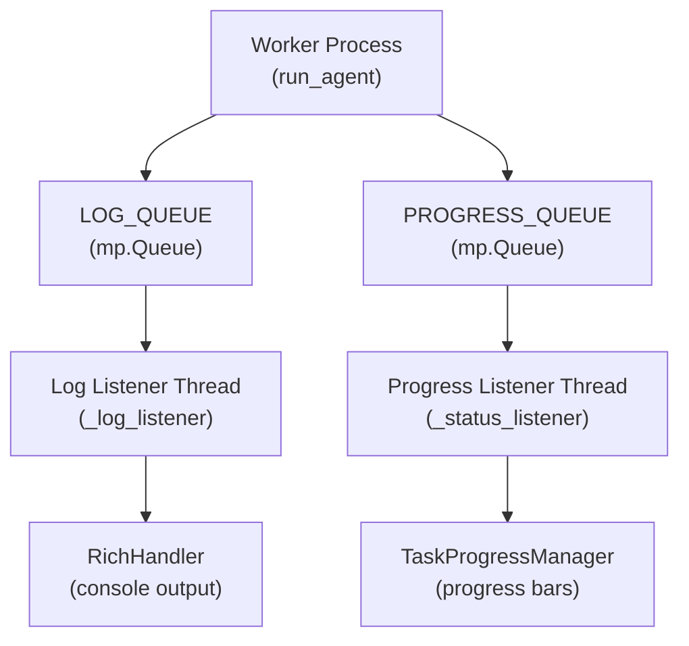

Sources: [debug_gym/logger.py:500-700]()

## Layer Responsibilities

Each architectural layer has well-defined responsibilities and interfaces.

### Orchestration Layer (run.py)

**Responsibilities:**
- Load and merge configuration from YAML files and CLI arguments
- Spawn parallel worker processes via `ProcessPoolExecutor`
- Collect and aggregate progress reports from workers
- Display live progress UI using Rich library
- Persist experiment metadata and results

**Key Functions:**
| Function | Purpose | Location |
|----------|---------|----------|
| `main()` | Entry point, orchestrates entire workflow | [scripts/run.py:241-313]() |
| `run_agent()` | Worker function, runs single problem | [scripts/run.py:43-176]() |
| `create_env()` | Factory for environment instances | [scripts/run.py:179-188]() |
| `add_tools()` | Registers tools with environment | [scripts/run.py:191-202]() |

Sources: [scripts/run.py:1-317]()

### Agent Layer (BaseAgent)

**Responsibilities:**
- Implement debugging strategies and decision logic
- Build prompts incorporating environment state and history
- Query LLM backends for next actions
- Maintain conversation history with memory management
- Save execution trajectories and patches

**Key Methods:**
| Method | Purpose | Location |
|--------|---------|----------|
| `run()` | Main execution loop | [debug_gym/agents/base_agent.py:223-319]() |
| `build_prompt()` | Construct LLM input messages | [debug_gym/agents/base_agent.py:216-221]() |
| `build_system_prompt()` | Generate system prompt from template or default | [debug_gym/agents/base_agent.py:200-208]() |
| `save_trajectory()` | Persist execution history | [debug_gym/agents/base_agent.py:352-373]() |

Sources: [debug_gym/agents/base_agent.py:29-394]()

### LLM Layer (LLM Base)

**Responsibilities:**
- Abstract different LLM provider APIs (OpenAI, Anthropic, Azure, etc.)
- Handle tool calling format conversion
- Manage context windows and token counting
- Implement retry logic and error handling

**Provider Implementations:**
- `OpenAI`: OpenAI API client ([debug_gym/llms/openai.py]())
- `Anthropic`: Anthropic Claude API ([debug_gym/llms/anthropic.py]())
- `AzureOpenAI`: Azure OpenAI Service ([debug_gym/llms/azure_openai.py]())
- `Human`: Interactive human-in-the-loop mode ([debug_gym/llms/human.py]())

Sources: [debug_gym/llms/base.py]()

### Environment Layer (RepoEnv)

**Responsibilities:**
- Manage repository workspace and file operations
- Execute tools and collect observations
- Process events and notify subscribed tools
- Calculate scores from test execution results
- Track breakpoints and code modifications

**Core Classes:**
| Class | Purpose | Location |
|-------|---------|----------|
| `TooledEnv` | Base tool management and event system | [debug_gym/gym/envs/env.py:128-206]() |
| `RepoEnv` | Repository operations and lifecycle | [debug_gym/gym/envs/env.py:208-522]() |
| `EventHooks` | Event subscription and notification | [debug_gym/gym/envs/env.py:91-126]() |

Sources: [debug_gym/gym/envs/env.py:1-522]()

### Tool Layer (Toolbox)

**Responsibilities:**
- Provide debugging and code manipulation capabilities
- Register with environments via `@Toolbox.register()` decorator
- Subscribe to relevant events (e.g., `REWRITE_SUCCESS`)
- Return observations from tool execution

**Tool Categories:**
- **Inspection**: `ViewTool`, `GrepTool`, `ListdirTool`
- **Modification**: `RewriteTool`, `BashTool`
- **Validation**: `EvalTool`, `SubmitTool`
- **Debugging**: `PDBTool` (interactive debugger)

Sources: [debug_gym/gym/tools/toolbox.py](), [debug_gym/gym/tools/tool.py]()

### Infrastructure Layer (Terminal)

**Responsibilities:**
- Abstract command execution across different backends
- Provide isolated execution environments
- Support interactive shell sessions for PDB
- Manage container/pod lifecycle

**Terminal Implementations:**
| Implementation | Purpose | Location |
|----------------|---------|----------|
| `LocalTerminal` | Direct host execution | [debug_gym/gym/terminals/local.py]() |
| `DockerTerminal` | Container-based isolation | [debug_gym/gym/terminals/docker.py]() |
| `KubernetesTerminal` | Scalable pod execution | [debug_gym/gym/terminals/kubernetes.py]() |

Sources: [debug_gym/gym/terminals/terminal.py](), [debug_gym/gym/workspace.py]()

## Tool Integration System

Tools integrate with environments through a registration system that provides type safety and automatic discovery. The `Toolbox` class serves as a global registry using decorator-based registration.

### Tool Registration and Execution

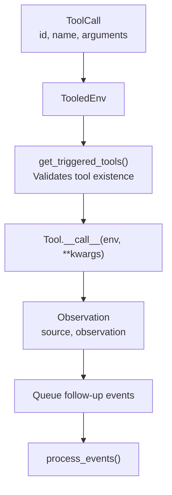

Key integration points:
- **Tool Registration**: Tools use the `@register` decorator to automatically add themselves to the `Toolbox`
- **Argument Validation**: `get_triggered_tools()` validates tool names and argument structures before execution
- **Error Handling**: Tool execution errors are captured and converted to error observations
- **Event Integration**: Tools can subscribe to events and queue new events during execution

The `EnvInfo` dataclass provides a complete snapshot of environment state after each step:

| Field | Type | Purpose |
|-------|------|---------|
| `step_observation` | `Observation` | Primary result from the executed tool |
| `all_observations` | `list[Observation]` | All observations including event-triggered ones |
| `eval_observation` | `Observation` | Most recent evaluation result |
| `current_breakpoints` | `str` | Formatted breakpoint status |
| `tools` | `list[EnvironmentTool]` | Available tools for the current environment |

Sources: [debug_gym/gym/envs/env.py:19-34](), [debug_gym/gym/envs/env.py:104-120](), [debug_gym/gym/tools/toolbox.py]()

## Specialized Environment Extensions  

Benchmark-specific environments like `SWEBenchEnv` extend the base architecture to handle complex deployment scenarios:

### SWEBench Docker Integration

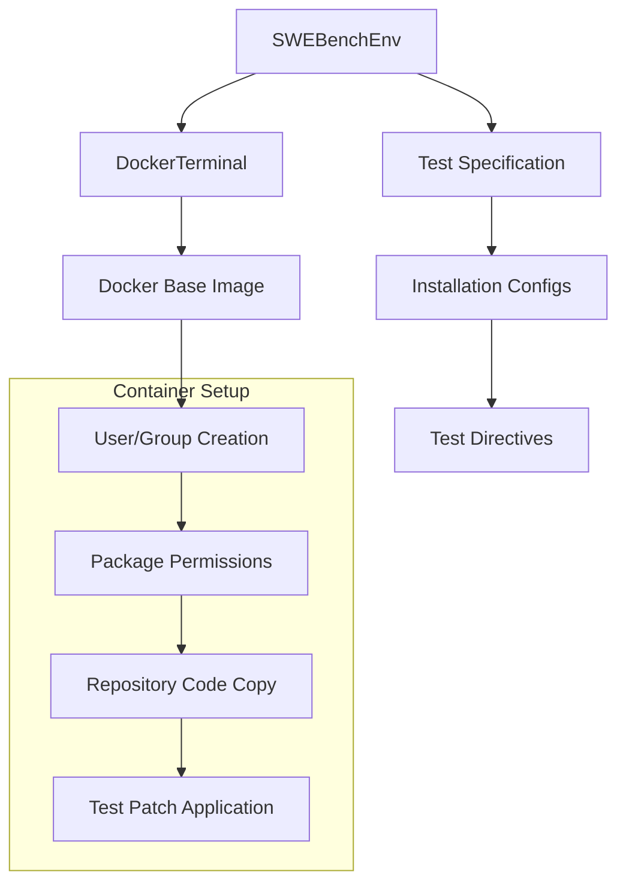

The `SWEBenchEnv` demonstrates how the core architecture can be extended while maintaining compatibility with the base tool and event systems. It overrides key methods like `calculate_score()` to implement benchmark-specific evaluation logic while preserving the standard environment interface.

Sources: [debug_gym/gym/envs/swe_bench.py:25-294](), [debug_gym/gym/envs/swe_bench.py:154-168](), [debug_gym/gym/envs/swe_bench.py:170-244]()

---

# Page: Environment System (RepoEnv)

# Environment System (RepoEnv)

<details>
<summary>Relevant source files</summary>

The following files were used as context for generating this wiki page:

- [debug_gym/gym/envs/env.py](debug_gym/gym/envs/env.py)
- [debug_gym/gym/tools/pdb.py](debug_gym/gym/tools/pdb.py)
- [debug_gym/gym/tools/rewrite.py](debug_gym/gym/tools/rewrite.py)
- [debug_gym/gym/tools/view.py](debug_gym/gym/tools/view.py)
- [debug_gym/gym/utils.py](debug_gym/gym/utils.py)
- [tests/gym/envs/test_env.py](tests/gym/envs/test_env.py)
- [tests/gym/test_utils.py](tests/gym/test_utils.py)
- [tests/gym/tools/test_pdb.py](tests/gym/tools/test_pdb.py)
- [tests/gym/tools/test_rewrite.py](tests/gym/tools/test_rewrite.py)
- [tests/gym/tools/test_view.py](tests/gym/tools/test_view.py)

</details>


## Purpose and Scope

This document covers the environment system in debug-gym, specifically the `RepoEnv` base class and related components that provide the execution context for debugging agents. The environment system manages task setup, tool integration, event coordination, and state tracking throughout the debugging process.

For information about specific benchmark environments (SWE-Bench, Aider, etc.), see [Benchmarks and Environments](#4). For execution infrastructure details (terminals and workspaces), see [Execution Infrastructure](#2.4). For the tool system itself, see [Tool System](#3).

---

## Core Architecture Overview

The environment system consists of four primary classes that work together to provide a complete debugging environment:

```mermaid
graph TB
    subgraph "Core Environment Classes"
        RepoEnv["RepoEnv<br/>Base Environment<br/>debug_gym/gym/envs/env.py:208-522"]
        TooledEnv["TooledEnv<br/>Tool Registry Pattern<br/>debug_gym/gym/envs/env.py:128-206"]
        EventHooks["EventHooks<br/>Observer Pattern<br/>debug_gym/gym/envs/env.py:91-126"]
        EnvInfo["EnvInfo<br/>State Snapshot<br/>debug_gym/gym/envs/env.py:14-89"]
    end
    
    subgraph "Infrastructure (see 2.4)"
        Workspace["Workspace<br/>File Management"]
        Terminal["Terminal<br/>Command Execution"]
    end
    
    subgraph "Tools (see 3)"
        PDBTool["PDBTool"]
        RewriteTool["RewriteTool"]
        ViewTool["ViewTool"]
        EvalTool["EvalTool"]
    end
    
    RepoEnv --|"inherits from"| TooledEnv
    RepoEnv --|"uses"| Workspace
    RepoEnv --|"uses"| Terminal
    RepoEnv --|"returns"| EnvInfo
    
    TooledEnv --|"contains"| EventHooks
    TooledEnv --|"manages"| PDBTool
    TooledEnv --|"manages"| RewriteTool
    TooledEnv --|"manages"| ViewTool
    TooledEnv --|"manages"| EvalTool
    
    EventHooks --|"notifies"| PDBTool
    EventHooks --|"notifies"| RewriteTool
```

**Sources:** [debug_gym/gym/envs/env.py:1-522]()

---

## RepoEnv: Base Environment Class

`RepoEnv` is the foundational environment class that all benchmark-specific environments inherit from. It manages the complete debugging task lifecycle including workspace setup, terminal configuration, tool integration, and state tracking.

### Class Structure

| Component | Type | Purpose |
|-----------|------|---------|
| `path` | `str \| None` | Source repository path |
| `workspace` | `Workspace` | File operations and access control |
| `terminal` | `Terminal` | Command execution (Docker/K8s/Local) |
| `entrypoint` | `str` | Test execution command |
| `debug_entrypoint` | `str` | PDB-enabled test command |
| `max_score` | `int` | Maximum achievable score |
| `current_breakpoints_state` | `dict` | Persistent breakpoint tracking |
| `rewrite_counter` | `int` | Number of code modifications |
| `last_eval` | `EvalOutput` | Most recent evaluation result |

**Sources:** [debug_gym/gym/envs/env.py:208-251]()

### Initialization

```python
RepoEnv(
    path: str | None = None,
    entrypoint: str = "python -m pytest -sq .",
    debug_entrypoint: str | None = None,
    max_score: int | None = None,
    run_timeout: int | None = None,
    dir_tree_depth: int = 1,
    persistent_breakpoints: bool = True,
    auto_list: bool = True,
    terminal: Terminal | None = None,
    logger: DebugGymLogger | None = None,
    problems: str | list[str] | None = None,
    **kwargs,
)
```

The constructor creates a workspace, loads the dataset, and prepares entrypoints. If no terminal is provided, it defaults to `LocalTerminal` (though `DockerTerminal` is recommended for production). The `_prepare_entrypoint` method handles special cases for package managers like `uv` and ensures proper Python interpreter paths.

**Sources:** [debug_gym/gym/envs/env.py:210-251](), [debug_gym/gym/envs/env.py:275-295]()

---

## TooledEnv: Tool Registry Pattern

`TooledEnv` provides the infrastructure for registering and managing tools within an environment. It implements a dictionary-based registry with event-driven coordination.

### Tool Management Methods

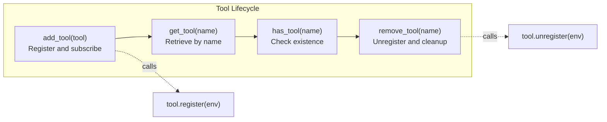

**Key Properties:**
- `tools` - List of registered tool instances
- `tool_names` - Comma-separated string of tool names
- `event_hooks` - Event coordination system
- `event_queue` - Queued events awaiting processing
- `all_observations` - Accumulated observations from tools

**Sources:** [debug_gym/gym/envs/env.py:128-206]()

### Tool Execution Flow

When an agent calls a tool via `env.step()`, the following sequence occurs:

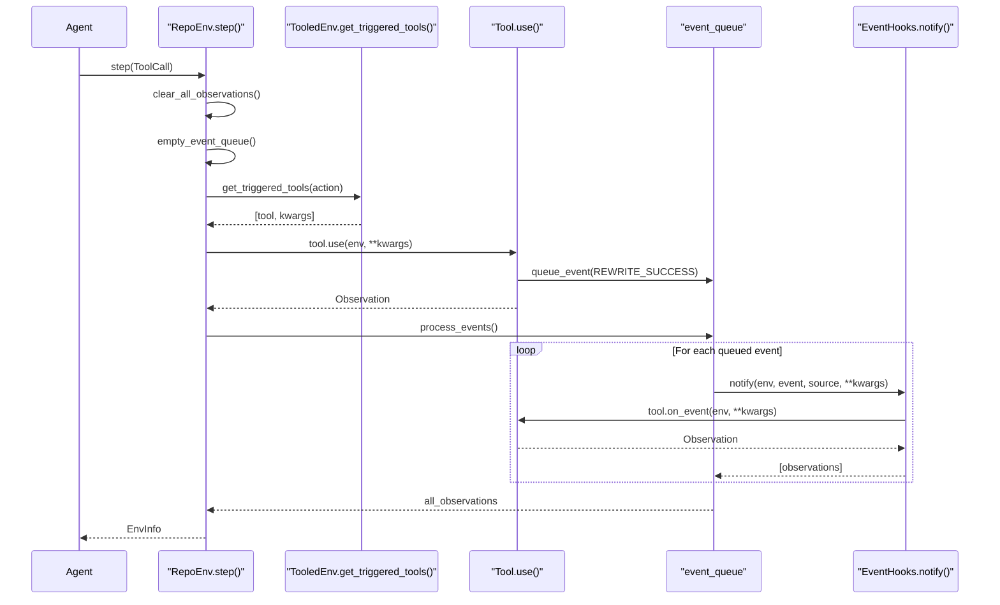

The `get_triggered_tools` method parses the `ToolCall` and validates that the requested tool exists. It returns either an error message or a tuple of `[tool_instance, kwargs]`.

**Sources:** [debug_gym/gym/envs/env.py:444-505](), [debug_gym/gym/envs/env.py:159-176]()

---

## EventHooks: Observer Pattern Implementation

`EventHooks` implements the observer pattern to coordinate tool behavior when environment events occur. This is crucial for maintaining debugging state across code modifications.

### Event Types

The system defines three core events (from `debug_gym.gym.entities.Event`):

| Event | Handler Method | Triggered When | Typical Subscribers |
|-------|----------------|----------------|---------------------|
| `ENV_RESET` | `on_env_reset()` | Environment is reset for new task | All tools (for state initialization) |
| `REWRITE_SUCCESS` | `on_rewrite_success(env, file, head, tail, length)` | Code is successfully modified | PDBTool (to adjust breakpoints) |
| `REWRITE_FAIL` | `on_rewrite_fail(env, message)` | Code modification fails | Tools needing failure handling |

**Sources:** [debug_gym/gym/entities.py](), [debug_gym/gym/envs/env.py:91-126]()

### Event Subscription and Notification

```python
# EventHooks initialization
event_hooks = EventHooks()
# Creates listeners dict: {Event.ENV_RESET: [], Event.REWRITE_SUCCESS: [], ...}

# Tool subscribes to events during registration
event_hooks.subscribe(Event.REWRITE_SUCCESS, pdb_tool)
# Validates: (1) event exists, (2) tool has handler method, (3) not already subscribed

# Tool queues event during execution
environment.queue_event(Event.REWRITE_SUCCESS, source=rewrite_tool, file="main.py", ...)

# Environment processes queued events
observations = environment.process_events()
# For each event: notify all subscribed tools, collect observations
```

The `notify` method skips the source tool to avoid infinite loops. If an exception occurs in a handler, it catches it and returns an error observation instead of crashing.

**Sources:** [debug_gym/gym/envs/env.py:91-126](), [debug_gym/gym/envs/env.py:188-205]()

### Event-Driven Breakpoint Management Example

The most important use of the event system is maintaining breakpoint state when code changes:

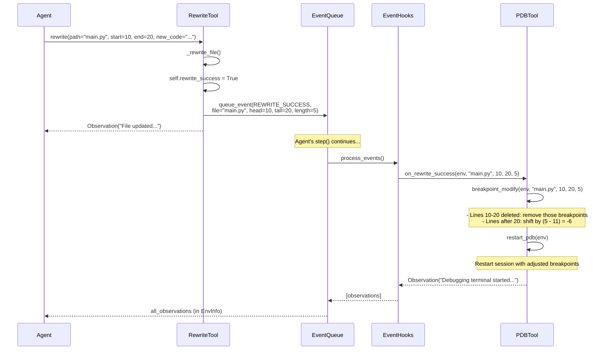

This event-driven approach allows tools to react to environment changes without tight coupling. When `RewriteTool` modifies code, it doesn't need to know about `PDBTool` - it just queues an event. `PDBTool` autonomously adjusts breakpoints based on the line number changes.

**Sources:** [debug_gym/gym/tools/rewrite.py:123-132](), [debug_gym/gym/tools/pdb.py:134-140](), [debug_gym/gym/tools/pdb.py:294-340]()

---

## EnvInfo: Environment State Snapshot

`EnvInfo` is a dataclass returned by `reset()` and `step()` that encapsulates the complete environment state at a given moment. Agents use this to observe the results of their actions and decide what to do next.

### Data Structure

```python
@dataclass
class EnvInfo:
    step_observation: Observation          # Primary observation from triggered tool
    all_observations: list[Observation]    # step_observation + event-triggered observations
    eval_observation: Observation | None   # Last test evaluation result
    dir_tree: str                          # Directory structure (from workspace.display_files)
    current_breakpoints: str               # Formatted breakpoint list
    action_reasoning: str | None           # Agent's reasoning for the action
    action_content: str | None             # Action description
    action_tool_call: ToolCall | None      # The actual tool call made
    instructions: dict                     # Task-specific instructions
    score: int                             # Current test score
    max_score: int                         # Maximum possible score
    terminated: bool                       # Task finished running
    resolved: bool                         # Task successfully solved
    rewrite_counter: int                   # Number of code modifications
    tools: list[EnvironmentTool]           # Available tools
```

**Sources:** [debug_gym/gym/envs/env.py:14-32]()

### Pretty Printing

`EnvInfo` includes a `__str__` method that formats the state for display:

```
======================================================================
                    DEBUG GYM ENVIRONMENT INFO
======================================================================
📊 Status: ✅ (TERMINATED)	🎯 Score: 10/10	✏️ Rewrites: 3
🔧 Last Action:
   Tool: rewrite
   Reasoning: Fixing off-by-one error in loop

👁️ Observation:
```
The file `calculator.py` has been updated successfully.

Diff: ...
```

🛠️  Available Tools (5):
   pdb, view, rewrite, eval, submit

🔴 Breakpoints:
   • line 42 in calculator.py
   • line 67 in calculator.py

📁 Directory Structure:
   /workspace/
   |-- calculator.py
   |-- test_calculator.py
   ...
======================================================================
```

**Sources:** [debug_gym/gym/envs/env.py:33-89]()

---

## Environment Lifecycle

### Reset: Task Initialization

The `reset()` method prepares the environment for a new debugging task:

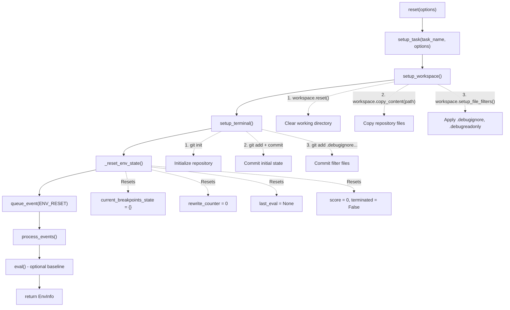

**Sources:** [debug_gym/gym/envs/env.py:335-377](), [debug_gym/gym/envs/env.py:253-264](), [debug_gym/gym/envs/env.py:307-318](), [debug_gym/gym/envs/env.py:319-334]()

### Step: Action Execution

The `step()` method executes an agent's action and returns updated environment state:

```python
def step(
    self,
    action_tool_call: ToolCall,
    action_content: str | None = None,
    action_reasoning: str | None = None,
) -> EnvInfo:
```

**Execution Phases:**

1. **Clear State**: Reset `all_observations` and `event_queue`
2. **Parse Action**: Extract tool name and arguments from `ToolCall`
3. **Validate Tool**: Check tool exists in registry
4. **Execute Tool**: Call `tool.use(env, **kwargs)`
5. **Handle Errors**: Catch exceptions and return error observations
6. **Process Events**: Trigger event handlers for queued events
7. **Calculate Scores**: Update `score`, `max_score`, `terminated`, `resolved` from `last_eval`
8. **Build EnvInfo**: Package observations and state into return value

**Sources:** [debug_gym/gym/envs/env.py:444-505]()

### Eval: Test Execution

The `eval()` method runs tests and updates the environment's evaluation state:

```python
def eval(self, **kwargs) -> EvalOutput:
    """Evaluates the current code using the provided entrypoint.
    Sets the last_eval and returns it."""
    success, output = self.terminal.run(self.entrypoint, timeout=self.run_timeout)
    self.last_eval = EvalOutput(success, output)
    return self.last_eval
```

Subclasses override `calculate_score()`, `calculate_max_score()`, `calculate_resolved()`, and `calculate_terminated()` to implement benchmark-specific scoring logic. The default implementation uses binary success (0 or 1).

**Sources:** [debug_gym/gym/envs/env.py:403-409](), [debug_gym/gym/envs/env.py:383-401]()

---

## Breakpoint State Management

`RepoEnv` maintains persistent breakpoint state across PDB sessions, enabling agents to set breakpoints once and have them automatically restored when the debugger restarts.

### Breakpoint State Structure

Breakpoints are stored in `current_breakpoints_state` as a dictionary:

```python
current_breakpoints_state = {
    "/workspace/main.py|||42": "b /workspace/main.py:42",
    "/workspace/utils.py|||15": "b /workspace/utils.py:15",
}
```

**Key format**: `"{absolute_path}|||{line_number}"`  
**Value format**: PDB command to restore the breakpoint

**Sources:** [debug_gym/gym/envs/env.py:256]()

### Breakpoint Query Methods

| Method | Purpose | Return Type |
|--------|---------|-------------|
| `has_breakpoint(file_path, line_number)` | Check if breakpoint exists at location | `bool` |
| `current_breakpoints()` | Format breakpoints for display | `str` |

```python
# Example usage in ViewTool
def show_line_number(code_string, code_path, environment, start_index):
    for i, line in enumerate(code_line):
        line_number = start_index + i
        has_breakpoint = environment.has_breakpoint(code_path, line_number)
        prefix = "B" if has_breakpoint else " "
        output.append(f"{prefix} {line_number:4d} {line}")
```

**Sources:** [debug_gym/gym/envs/env.py:411-432](), [debug_gym/gym/utils.py:24-54]()

### Breakpoint Lifecycle with Code Changes

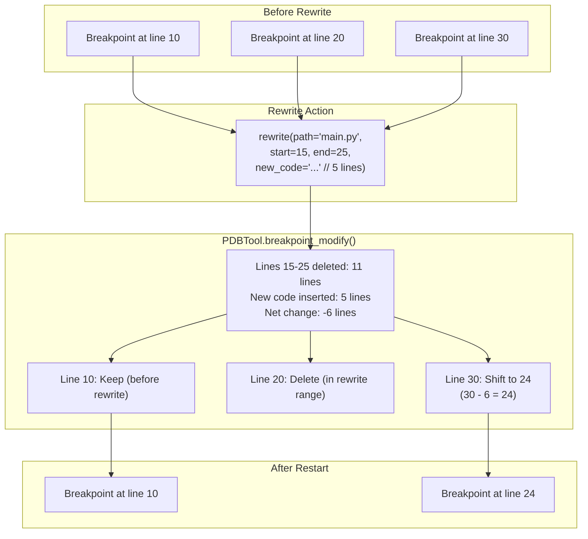

**Algorithm** (from `PDBTool.breakpoint_modify`):
- Breakpoints **before** `rewrite_head`: unchanged
- Breakpoints **between** `rewrite_head` and `rewrite_tail`: deleted
- Breakpoints **after** `rewrite_tail`: shifted by `new_code_length - (rewrite_tail - rewrite_head + 1)`

**Sources:** [debug_gym/gym/tools/pdb.py:294-340]()

---

## Patch Generation

`RepoEnv` provides a `patch` property that generates a git diff of all changes made during the debugging session:

```python
@property
def patch(self):
    success, output = self.terminal.run("git diff", strip_output=False, raises=True)
    return output
```

This works because `setup_terminal()` initializes a git repository and commits the initial state. All subsequent modifications via `RewriteTool` are tracked as uncommitted changes.

**Example output:**
```diff
diff --git a/calculator.py b/calculator.py
index e69de29..b45ef6f 100644
--- a/calculator.py
+++ b/calculator.py
@@ -1,5 +1,5 @@
 def add(a, b):
-    return a + b + 1  # Bug: off-by-one
+    return a + b       # Fixed
```

**Sources:** [debug_gym/gym/envs/env.py:434-437](), [debug_gym/gym/envs/env.py:319-334]()

---

## Subclass Extension Points

Benchmark-specific environments override these methods to customize behavior:

| Method | Default Behavior | Override Purpose |
|--------|------------------|------------------|
| `setup_task(task_name, options)` | No-op | Load task-specific data (test patches, bug descriptions) |
| `setup_workspace()` | Copy `path` to workspace | Apply custom file filters, inject patches |
| `setup_terminal()` | Git init + commit | Install dependencies, configure environment |
| `instructions` property | Empty string | Return task instructions for agent |
| `calculate_score(eval_output)` | `eval_output.success` (0 or 1) | Parse test output for score |
| `calculate_max_score(eval_output)` | `self.max_score` | Extract max score from test output |
| `calculate_resolved(eval_output)` | `score == max_score` | Custom success criteria |
| `calculate_terminated(eval_output)` | Same as `calculate_resolved` | Custom termination logic |
| `load_dataset(problems)` | `{"custom": None}` | Load benchmark-specific dataset |

**Example from SWE-Bench:**
```python
class SWEBenchEnv(RepoEnv):
    def setup_task(self, task_name: str, options: dict = None):
        self.task_instance = self.dataset[task_name]
        self.instructions = self.task_instance["problem_statement"]
        # ... load test patches, gold patches, etc.
    
    def setup_workspace(self):
        super().setup_workspace()
        # Apply test patch to reveal failing tests
        self.workspace.write_file("test_patch.diff", self.task_instance["test_patch"])
        self.terminal.run("git apply test_patch.diff")
```

**Sources:** [debug_gym/gym/envs/env.py:297-318](), [debug_gym/gym/envs/swebench.py]()

---

## Key Design Patterns

### 1. Template Method Pattern
`RepoEnv` defines the skeleton of environment lifecycle (`reset()`, `step()`, `eval()`) with customizable hooks for subclasses.

### 2. Observer Pattern
`EventHooks` decouples event producers (tools) from consumers (other tools), enabling reactive behavior without tight coupling.

### 3. Registry Pattern
`TooledEnv` maintains a dictionary-based tool registry with validation, enabling dynamic tool management.

### 4. Snapshot Pattern
`EnvInfo` captures complete environment state at a point in time, providing immutable observations to agents.

**Sources:** [debug_gym/gym/envs/env.py:1-522]()

---

## Usage Example

```python
from debug_gym.gym.envs.env import RepoEnv
from debug_gym.gym.terminals.docker import DockerTerminal
from debug_gym.gym.tools.toolbox import Toolbox

# Create environment
terminal = DockerTerminal(base_image="python:3.12-slim")
env = RepoEnv(
    path="path/to/repository",
    entrypoint="python -m pytest -sq test_calculator.py",
    terminal=terminal,
    run_timeout=30
)

# Add tools
env.add_tool(Toolbox.get_tool("pdb"))
env.add_tool(Toolbox.get_tool("view"))
env.add_tool(Toolbox.get_tool("rewrite"))
env.add_tool(Toolbox.get_tool("eval"))

# Initialize task
info = env.reset(options={"task_name": "fix_calculator_bug"})
print(f"Instructions: {info.instructions}")
print(f"Initial score: {info.score}/{info.max_score}")

# Agent loop
while not info.terminated:
    # Agent decides on action
    tool_call = agent.decide(info)
    
    # Execute action
    info = env.step(tool_call, action_content="...", action_reasoning="...")
    
    # Check progress
    print(f"Score: {info.score}/{info.max_score}")
    print(f"Observation: {info.step_observation}")

# Save patch
patch = env.patch
with open("solution.patch", "w") as f:
    f.write(patch)

# Cleanup
env.close()
```

**Sources:** [debug_gym/gym/envs/env.py:208-522](), [tests/gym/envs/test_env.py:209-240]()

---

# Page: Agent Framework

# Agent Framework

<details>
<summary>Relevant source files</summary>

The following files were used as context for generating this wiki page:

- [debug_gym/agents/base_agent.py](debug_gym/agents/base_agent.py)
- [debug_gym/agents/debug_agent.py](debug_gym/agents/debug_agent.py)
- [debug_gym/agents/rewrite_agent.py](debug_gym/agents/rewrite_agent.py)
- [debug_gym/agents/solution_agent.py](debug_gym/agents/solution_agent.py)
- [debug_gym/agents/utils.py](debug_gym/agents/utils.py)
- [debug_gym/llms/__init__.py](debug_gym/llms/__init__.py)
- [tests/agents/conftest.py](tests/agents/conftest.py)
- [tests/agents/test_utils.py](tests/agents/test_utils.py)

</details>


The agent framework provides the core orchestration logic for LLM-based debugging agents in debug-gym. Agents coordinate between LLM backends (see [LLM Integration](#2.3)), environment tooling (see [Environment System](#2.1)), and execution infrastructure to solve debugging tasks. The framework consists of the `BaseAgent` class, a registry system for agent discovery, specialized agent implementations for different debugging strategies, and a history tracking system for managing conversation context.

## Agent Registry and Factory System

The framework uses a registration pattern for agent discovery and instantiation. The `AGENT_REGISTRY` global dictionary [debug_gym/agents/base_agent.py:17]() maps agent names (strings) to agent classes. Agents self-register using the `@register_agent` decorator [debug_gym/agents/base_agent.py:20-26](), which validates that the class is a `BaseAgent` subclass and has a non-null `name` attribute.

**Registration Pattern:**
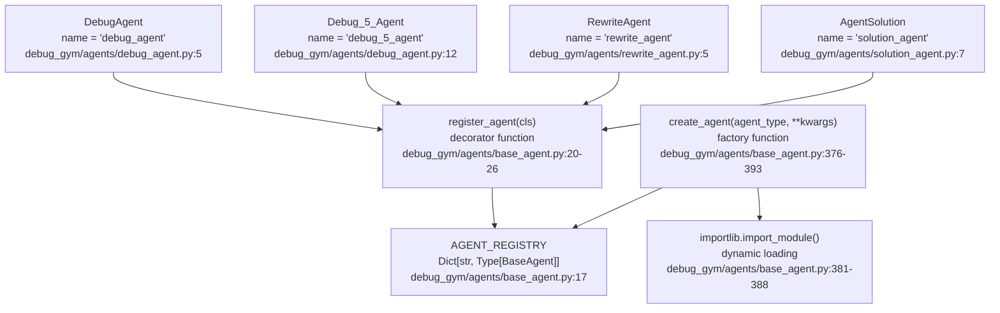

The `create_agent()` factory function [debug_gym/agents/base_agent.py:376-393]() supports two lookup mechanisms:
1. **Registry lookup**: If `agent_type` is a registered name (e.g., `"debug_agent"`), retrieve from `AGENT_REGISTRY`
2. **Dynamic import**: If `agent_type` contains a dot (e.g., `"my_module.CustomAgent"`), use `importlib` to dynamically load the class

**Sources:** [debug_gym/agents/base_agent.py:17-27](), [debug_gym/agents/base_agent.py:376-393](), [debug_gym/agents/debug_agent.py:4-5](), [debug_gym/agents/rewrite_agent.py:4-5](), [debug_gym/agents/solution_agent.py:6-7]()

## BaseAgent Class Architecture

The `BaseAgent` class [debug_gym/agents/base_agent.py:29]() is the abstract base for all agents. It defines three class attributes that subclasses must override:
- `name`: String identifier for registry lookup
- `system_prompt`: High-level task description for the LLM
- `action_prompt`: Optional follow-up prompt requesting the next action

**BaseAgent Core Components:**
```mermaid
graph TB
    subgraph "Instance Attributes"
        config["self.config<br/>Dict[str, Any]<br/>line 41"]
        env["self.env<br/>RepoEnv instance<br/>line 42"]
        logger["self.logger<br/>DebugGymLogger<br/>line 43"]
        llm["self.llm<br/>LLM instance<br/>line 44"]
        history["self.history<br/>HistoryTracker<br/>line 51"]
        uuid["self._uuid<br/>str(uuid.uuid4())<br/>line 45"]
        output_path["self._output_path<br/>{output_path}/{uuid}<br/>line 46"]
    end
    
    subgraph "Core Methods"
        run["run(task_name, debug)<br/>main execution loop<br/>line 223-318"]
        build_prompt["build_prompt(info)<br/>construct messages<br/>line 216-221"]
        save_trajectory["save_trajectory(task_name)<br/>write trajectory.json<br/>line 352-373"]
        save_patch["save_patch(task_name)<br/>write debug_gym.patch<br/>line 342-350"]
    end
    
    subgraph "Prompt Building Pipeline"
        build_system["build_system_prompt(info)<br/>line 200-208"]
        build_history["build_history_prompt()<br/>line 56-62"]
        build_question["build_question_prompt()<br/>line 210-214"]
    end
    
    config --> history
    config --> uuid
    config --> output_path
    
    run --> build_prompt
    build_prompt --> build_system
    build_prompt --> build_history
    build_prompt --> build_question
    
    run --> save_trajectory
    run --> save_patch
```

**Initialization:** The `__init__` method [debug_gym/agents/base_agent.py:34-51]() performs:
1. Store `config`, `env`, `logger`, and `llm` instances
2. Generate unique UUID from config or create new one
3. Create output directory at `{config['output_path']}/{uuid}`
4. Set random seed via `np.random.seed(config['random_seed'])`
5. Initialize `HistoryTracker` with `config['memory_size']`

**Sources:** [debug_gym/agents/base_agent.py:29-62](), [debug_gym/agents/base_agent.py:216-221](), [debug_gym/agents/base_agent.py:223-318](), [debug_gym/agents/base_agent.py:342-373]()

## Agent Execution Lifecycle

The `run()` method [debug_gym/agents/base_agent.py:223-318]() orchestrates the agent's main execution loop. It implements a step-based interaction pattern where the agent alternates between prompting the LLM and executing tools in the environment.

**Execution Flow:**
```mermaid
sequenceDiagram
    participant Caller as "run.py"
    participant Agent as "BaseAgent.run()"
    participant History as "HistoryTracker"
    participant Env as "RepoEnv"
    participant LLM as "LLM Backend"
    participant Logger as "DebugGymLogger"
    
    Caller->>Agent: "run(task_name='problem_id')"
    Agent->>History: "history.reset()"
    Agent->>Env: "env.reset(options={'task_name': task_name})"
    Env-->>Agent: "info: EnvInfo"
    Agent->>History: "history.step(info, llm_response=None)"
    
    alt "info.resolved is True (already solved)"
        Agent->>Logger: "report_progress(status='resolved')"
        Agent-->>Caller: "return True"
    end
    
    Agent->>Logger: "log available tools"
    
    loop "for step in range(max_steps)"
        Agent->>Logger: "log step number and score"
        
        Agent->>Agent: "messages = build_prompt(info)"
        Note over Agent: "Combines system, history, question prompts"
        
        Agent->>LLM: "llm(messages, info.tools)"
        LLM-->>Agent: "llm_response: LLMResponse"
        
        Agent->>Env: "env.step(llm_response.tool, ...)"
        Env-->>Agent: "info: EnvInfo (updated)"
        
        Agent->>History: "history.step(info, llm_response)"
        
        Agent->>Logger: "report_progress(step, score, status)"
        
        alt "info.terminated or rewrite_counter >= max_rewrite_steps"
            Agent->>Logger: "report_progress(status='resolved'/'unresolved')"
            Agent->>Agent: "break"
        end
    end
    
    Agent->>Agent: "save_trajectory(task_name)"
    Agent->>Agent: "save_patch(task_name)"
    Agent-->>Caller: "return info.resolved"
```

**Key Loop Variables:**
| Variable | Type | Purpose |
|----------|------|---------|
| `step` | int | Current iteration (0 to `max_steps - 1`) |
| `info` | `EnvInfo` | Environment state including observations, score, tools, termination flags |
| `messages` | `List[Dict]` | LLM input messages (system + history + question) |
| `llm_response` | `LLMResponse` | LLM output containing tool call, reasoning, and response text |
| `highscore` | int | Best score achieved so far (for logging) |

**Termination Conditions** [debug_gym/agents/base_agent.py:269-288]():
1. `info.terminated == True`: Task solved (test passes)
2. `info.rewrite_counter >= config['max_rewrite_steps']`: Too many code modifications
3. Loop completes `max_steps` iterations

**Sources:** [debug_gym/agents/base_agent.py:223-318](), [debug_gym/agents/base_agent.py:216-221]()

## Specialized Agent Implementations

The framework provides four built-in agent types, each optimized for different debugging workflows.

| Agent Class | Name | System Prompt Strategy | Key Behavior |
|-------------|------|----------------------|--------------|
| `DebugAgent` | `"debug_agent"` | Emphasizes PDB investigation before patching | Full tool access from start |
| `Debug_5_Agent` | `"debug_5_agent"` | Same as `DebugAgent` | Delays PDB access until N rewrites |
| `RewriteAgent` | `"rewrite_agent"` | Focus on direct code modification | Simpler prompt, less PDB emphasis |
| `AgentSolution` | `"solution_agent"` | No LLM prompting | Validates gold patches (oracle) |

### DebugAgent

The `DebugAgent` [debug_gym/agents/debug_agent.py:4-8]() is the standard debugging agent with full tool access. Its `system_prompt` instructs the LLM to:
1. Use PDB to investigate suspicious code locations
2. Set breakpoints and inspect values before proposing patches
3. Call the `eval` tool after each rewrite to verify fixes

**DebugAgent Workflow:**
```mermaid
graph LR
    View["View suspicious files"]
    SetBP["Set PDB breakpoints"]
    Continue["Continue to breakpoint"]
    Print["Print/inspect values"]
    Rewrite["Rewrite code"]
    Eval["Eval tests"]
    
    View --> SetBP
    SetBP --> Continue
    Continue --> Print
    Print --> Rewrite
    Rewrite --> Eval
    Eval --> View
```

### Debug_5_Agent

The `Debug_5_Agent` [debug_gym/agents/debug_agent.py:11-118]() implements a hybrid strategy where PDB access is delayed. This forces the agent to attempt code modifications first, only gaining debugging capabilities after making `n_rewrites_before_pdb` rewrite attempts.

**Debug_5_Agent Custom `run()` Logic:**
```mermaid
sequenceDiagram
    participant Agent as "Debug_5_Agent"
    participant Env as "RepoEnv"
    participant PDBTool as "PDBTool"
    
    Agent->>Env: "pdb_tool = env.remove_tool('pdb')"
    Note over Agent,Env: "PDB tool removed initially"
    
    Agent->>Env: "env.reset(task_name)"
    
    loop "Main execution loop"
        Agent->>Agent: "build_prompt(info) [no PDB in tools]"
        Agent->>Env: "env.step(llm_response)"
        
        alt "info.rewrite_counter >= n_rewrites_before_pdb"
            Agent->>Env: "env.add_tool(pdb_tool)"
            Agent->>PDBTool: "pdb_tool.start_pdb()"
            Agent->>Agent: "Update info.instructions and info.tools"
            Note over Agent: "PDB now available in subsequent prompts"
        end
        
        Agent->>Agent: "history.step(info, llm_response)"
    end
```

The conditional re-introduction of PDB [debug_gym/agents/debug_agent.py:59-67]() checks:
- `info.rewrite_counter >= config['n_rewrites_before_pdb']`
- `pdb_tool.name not in self.env.tools` (avoid double-adding)

When triggered, the agent calls `pdb_tool.start_pdb()` to initialize the debugger and updates `info.instructions` and `info.tools` so subsequent prompts include PDB documentation.

### RewriteAgent

The `RewriteAgent` [debug_gym/agents/rewrite_agent.py:4-9]() uses a simpler `system_prompt` that de-emphasizes PDB. It still has access to all tools but encourages more direct code modification.

### AgentSolution (Oracle Agent)

The `AgentSolution` [debug_gym/agents/solution_agent.py:6-83]() is a special agent for validating gold patches. It does not use LLM prompting. Instead, it:
1. Validates the environment implements `apply_gold_patch()` [debug_gym/agents/solution_agent.py:19-30]()
2. Makes basic PDB sanity checks (help command, continue command) [debug_gym/agents/solution_agent.py:42-62]()
3. Applies the gold patch via `env.apply_gold_patch()` [debug_gym/agents/solution_agent.py:64]()
4. Submits the solution [debug_gym/agents/solution_agent.py:69-70]()
5. Asserts `info.resolved == True` [debug_gym/agents/solution_agent.py:75-78]()

This agent is used to verify that benchmark datasets have correct gold patches and that the environment's evaluation logic works correctly.

**Sources:** [debug_gym/agents/debug_agent.py:4-8](), [debug_gym/agents/debug_agent.py:11-118](), [debug_gym/agents/rewrite_agent.py:4-9](), [debug_gym/agents/solution_agent.py:6-83]()

## Prompt Building System

The `build_prompt()` method [debug_gym/agents/base_agent.py:216-221]() constructs the complete message list for LLM input by concatenating three components:

```mermaid
graph LR
    build_prompt["build_prompt(info)<br/>line 216-221"]
    
    build_system["build_system_prompt(info)<br/>line 200-208"]
    build_history["build_history_prompt()<br/>line 56-62"]
    build_question["build_question_prompt()<br/>line 210-214"]
    
    messages["messages: List[Dict]<br/>role, content"]
    
    build_prompt --> build_system
    build_prompt --> build_history
    build_prompt --> build_question
    
    build_system --> messages
    build_history --> messages
    build_question --> messages
```

### System Prompt Construction

The `build_system_prompt()` method [debug_gym/agents/base_agent.py:200-208]() generates the initial system message containing task context. It supports two modes:

**1. Jinja2 Template Mode** [debug_gym/agents/base_agent.py:149-168]():
- If `config['system_prompt_template_file']` is set, load the template
- Create Jinja2 environment with custom filters: `to_pretty_json`, `trim_message`
- Render template with `agent=self` and `info=info`
- Allows full customization of system prompt structure

**2. Default JSON Mode** [debug_gym/agents/base_agent.py:170-198]():
- Build a dictionary with standardized fields
- Convert to pretty-printed JSON
- Fields included based on configuration flags

**Default System Prompt Fields:**
| Field | Condition | Source | Token Limit |
|-------|-----------|--------|-------------|
| `"Overall task"` | Always | `self.system_prompt` | None |
| `"Instructions"` | Always | `info.instructions` (tool documentation) | None |
| `"Repo directory tree"` | `show_directory_tree=True` | `info.dir_tree` | 10% of context |
| `"Current breakpoints"` | `show_current_breakpoints=True` | `info.current_breakpoints` | None |
| `"Evaluation output of current code"` | `auto_eval_on_rewrite=True` | `info.eval_observation.observation` | 80% of context |
| `"Shortcut features"` | If any enabled | `self.shortcut_features()` | None |

The `shortcut_features()` method [debug_gym/agents/base_agent.py:87-116]() detects environment capabilities and returns a list of feature descriptions:
- Auto-evaluation after rewrites (`_auto_eval_on_rewrite()`)
- Directory tree display (`_show_directory_tree()`)
- Current breakpoints display (`_show_current_breakpoints()`)
- Persistent breakpoints across rewrites
- Auto-listing after PDB commands

### History Prompt Construction

The `build_history_prompt()` method [debug_gym/agents/base_agent.py:56-62]() delegates to `build_history_prompt()` from `debug_gym/agents/history_tracker.py`. It converts the `HistoryTracker`'s stored steps into LLM message format, optionally resetting history after rewrites based on `config['reset_prompt_history_after_rewrite']`.

### Question Prompt Construction

The `build_question_prompt()` method [debug_gym/agents/base_agent.py:210-214]() appends the agent's `action_prompt` if defined. For example, this could be "What tool would you like to call next?"

### Token Management

The `trim_message()` method [debug_gym/agents/base_agent.py:123-147]() ensures messages fit within token limits:
- Filters non-UTF8 characters via `filter_non_utf8()`
- Counts tokens using `llm.count_tokens` (typically tiktoken)
- Trims to `max_length` (absolute) or `max_length_percentage` (relative to `llm.context_length`)
- `where` parameter controls trim location: `"start"`, `"middle"`, or `"end"`

**Sources:** [debug_gym/agents/base_agent.py:56-62](), [debug_gym/agents/base_agent.py:87-116](), [debug_gym/agents/base_agent.py:123-147](), [debug_gym/agents/base_agent.py:149-214](), [debug_gym/agents/base_agent.py:216-221]()

## History Tracking

The `HistoryTracker` class manages conversation history with sliding window memory and support for history resets after rewrites.

**HistoryTracker Architecture:**
```mermaid
graph TB
    HistoryTracker["HistoryTracker<br/>debug_gym/agents/history_tracker.py"]
    
    memory_size["memory_size: int<br/>max steps to retain"]
    steps["steps: List[Step]<br/>stored conversation history"]
    
    reset["reset()<br/>clear all steps"]
    step["step(info, llm_response)<br/>append new step"]
    json["json(step_id)<br/>serialize step"]
    len["__len__()<br/>return len(steps)"]
    getitem["__getitem__(i)<br/>access step i"]
    
    Step["Step dataclass:<br/>- info: EnvInfo<br/>- llm_response: LLMResponse<br/>- step_id: int"]
    
    build_history_prompt["build_history_prompt(history, llm, reset_after_rewrite)<br/>convert to messages"]
    
    HistoryTracker --> memory_size
    HistoryTracker --> steps
    HistoryTracker --> reset
    HistoryTracker --> step
    HistoryTracker --> json
    
    steps --> Step
    HistoryTracker --> build_history_prompt
```

**Step Storage:** Each step records:
- `info`: `EnvInfo` object with environment state, observations, score
- `llm_response`: `LLMResponse` object with tool call, reasoning, raw response
- `step_id`: Integer step number

**Memory Management:** When `len(steps) > memory_size`, oldest steps are dropped to maintain the sliding window [debug_gym/agents/history_tracker.py].

**History Reset Logic** [debug_gym/agents/history_tracker.py]: The `build_history_prompt()` function can reset history after code rewrites if `reset_after_rewrite=True`. This is useful when large code changes make prior debugging context obsolete. The reset only affects the prompt construction, not the stored trajectory.

**Sources:** [debug_gym/agents/history_tracker.py](), [debug_gym/agents/base_agent.py:51](), [debug_gym/agents/base_agent.py:56-62]()

## LLM Integration Pattern

Agents interact with LLMs through a standardized interface that supports multiple providers and tool-calling formats.

```mermaid
graph TB
    subgraph "LLM Abstraction Layer"
        llm_base["LLM.instantiate()<br/>factory method"]
        openai_llm["OpenAILLM<br/>GPT models"]
        anthropic_llm["AnthropicLLM<br/>Claude models"]
        human_llm["Human<br/>interactive mode"]
    end
    
    subgraph "Tool Calling Interface"
        define_tools["define_tools(tool_list)<br/>provider-specific format"]
        llm_call["llm(messages, tools)<br/>unified interface"]
        llm_response["LLMResponse<br/>standardized output"]
        parse_tool_call["parse_tool_call_response()<br/>ToolCall extraction"]
    end
    
    subgraph "Agent Integration"
        build_prompt_agent["Agent.build_prompt()"]
        step_env["env.step(tool_call)"]
        history_update["history.step(info, response)"]
    end
    
    llm_base --> openai_llm
    llm_base --> anthropic_llm
    llm_base --> human_llm
    
    openai_llm --> define_tools
    anthropic_llm --> define_tools
    human_llm --> define_tools
    
    define_tools --> llm_call
    llm_call --> llm_response
    llm_response --> parse_tool_call
    
    build_prompt_agent --> llm_call
    parse_tool_call --> step_env
    llm_response --> history_update
```

**Sources:** [debug_gym/agents/base_agent.py:43-47](), [debug_gym/llms/openai.py:104-123](), [debug_gym/llms/anthropic.py:70-86](), [debug_gym/llms/human.py:480-493]()

---

# Page: LLM Integration

# LLM Integration

<details>
<summary>Relevant source files</summary>

The following files were used as context for generating this wiki page:

- [.gitignore](.gitignore)
- [analysis/json_log_viewer/templates/index.html](analysis/json_log_viewer/templates/index.html)
- [debug_gym/llms/anthropic.py](debug_gym/llms/anthropic.py)
- [debug_gym/llms/base.py](debug_gym/llms/base.py)
- [debug_gym/llms/copilot.py](debug_gym/llms/copilot.py)
- [debug_gym/llms/human.py](debug_gym/llms/human.py)
- [debug_gym/llms/openai.py](debug_gym/llms/openai.py)
- [tests/llms/test_copilot.py](tests/llms/test_copilot.py)
- [tests/llms/test_human.py](tests/llms/test_human.py)
- [tests/llms/test_openai.py](tests/llms/test_openai.py)

</details>


This document covers the LLM (Large Language Model) abstraction layer in debug-gym, which provides a unified interface for interacting with different LLM providers including OpenAI, Anthropic, and human operators. The integration enables agents to generate tool calls and responses through a consistent API regardless of the underlying provider.

For information about how agents use LLMs in their execution loops, see [Agent Framework](#2.2). For details on the tool system that LLMs interact with, see [Tool System](#3).

## LLM Abstraction Layer

The system provides a unified interface through the base `LLM` class that abstracts away provider-specific implementations. This enables agents to work with any supported LLM provider without modification.

### Base LLM Interface

```mermaid
classDiagram
    class LLM {
        +model_name: str
        +context_length: int
        +reasoning_end_token: str
        +config: LLMConfig
        +logger: DebugGymLogger
        +tokenize(text: str) list[str]
        +count_tokens(text: str) int
        +define_tools(tools: list[EnvironmentTool]) list[dict]
        +parse_tool_call_response(response) ToolCall
        +format_tool_call_history(info: EnvInfo, response: LLMResponse) list[dict]
        +generate(messages, tools, **kwargs) LLMResponse
        +__call__(messages, tools, *args, **kwargs) LLMResponse
    }
    
    class OpenAILLM {
        +client: OpenAI
        +is_rate_limit_error(exception) bool
        +tokenize(text: str) list[str]
        +define_tools(tools) list[dict]
        +parse_tool_call_response(response) ToolCall
        +generate(messages, tools, **kwargs) LLMResponse
    }
    
    class AnthropicLLM {
        +client: Anthropic
        +count_tokens(text: str) int
        +is_rate_limit_error(exception) bool
        +define_tools(tools) list[dict]
        +parse_tool_call_response(response) ToolCall
        +generate(messages, tools, **kwargs) LLMResponse
    }
    
    class Human {
        +max_retries: int
        +_history: InMemoryHistory
        +define_tools(tools) list[dict]
        +parse_tool_call_response(response) ToolCall
        +__call__(messages, tools, **kwargs) LLMResponse
    }
    
    LLM <|-- OpenAILLM
    LLM <|-- AnthropicLLM
    LLM <|-- Human
```

**Sources:** [debug_gym/llms/openai.py:24-212](), [debug_gym/llms/anthropic.py:8-206](), [debug_gym/llms/human.py:460-596]()

### LLM Response Format

All LLM implementations return responses through a standardized `LLMResponse` object:

```mermaid
classDiagram
    class LLMResponse {
        +prompt: list[dict]
        +response: str
        +tool: ToolCall
        +prompt_token_count: int
        +response_token_count: int
    }
    
    class ToolCall {
        +id: str
        +name: str
        +arguments: dict
    }
    
    LLMResponse --> ToolCall
```

**Sources:** [debug_gym/llms/openai.py:204-211](), [debug_gym/llms/anthropic.py:197-205](), [debug_gym/llms/human.py:589-595]()

## Provider Implementations

### OpenAI Integration

The `OpenAILLM` class handles integration with OpenAI's API, including GPT models and Azure OpenAI deployments:

```mermaid
graph TB
    subgraph "OpenAI Implementation"
        OpenAILLM["OpenAILLM"]
        Client["OpenAI Client"]
        Tokenizer["tiktoken/AutoTokenizer"]
        RateLimit["Rate Limit Handler"]
        ToolFormat["OpenAI Function Calling Format"]
    end
    
    OpenAILLM --> Client
    OpenAILLM --> Tokenizer
    OpenAILLM --> RateLimit
    OpenAILLM --> ToolFormat
    
    Client --> API["OpenAI API / Azure OpenAI"]
    Tokenizer --> TokenCount["Token Counting"]
    RateLimit --> Retry["retry_on_rate_limit"]
    ToolFormat --> Functions["function definitions"]
```

Key features:
- **Token Management**: Uses `tiktoken` for OpenAI models or `AutoTokenizer` for other models [debug_gym/llms/openai.py:44-59]()
- **Rate Limiting**: Handles various OpenAI API errors with retry logic [debug_gym/llms/openai.py:61-102]()
- **Tool Definition**: Converts tools to OpenAI function calling format [debug_gym/llms/openai.py:104-123]()
- **Azure Support**: Configurable endpoint for Azure OpenAI deployments [debug_gym/llms/openai.py:27-42]()

**Sources:** [debug_gym/llms/openai.py:24-212]()

### Anthropic Integration

The `AnthropicLLM` class provides integration with Claude models:

```mermaid
graph TB
    subgraph "Anthropic Implementation"
        AnthropicLLM["AnthropicLLM"]
        Client["Anthropic Client"]
        TokenAPI["Token Count API"]
        ToolFormat["Anthropic Tool Format"]
        MessageFormat["Message Formatting"]
    end
    
    AnthropicLLM --> Client
    AnthropicLLM --> TokenAPI
    AnthropicLLM --> ToolFormat
    AnthropicLLM --> MessageFormat
    
    Client --> API["Anthropic API"]
    TokenAPI --> Counting["count_tokens method"]
    ToolFormat --> Schema["input_schema format"]
    MessageFormat --> SystemUser["system/user/assistant separation"]
```

Key features:
- **Token Counting**: Uses Anthropic's API for accurate token counting [debug_gym/llms/anthropic.py:25-51]()
- **Tool Schema**: Converts tools to Anthropic's `input_schema` format [debug_gym/llms/anthropic.py:70-86]()
- **Message Processing**: Handles system/user/assistant message separation [debug_gym/llms/anthropic.py:143-165]()
- **Error Handling**: Specific handling for Anthropic rate limits and overload errors [debug_gym/llms/anthropic.py:53-68]()

**Sources:** [debug_gym/llms/anthropic.py:8-206]()

### Human Interactive Mode

The `Human` class enables human operators to act as an LLM through an interactive command-line interface:

```mermaid
graph TB
    subgraph "Human Interactive Mode"
        Human["Human LLM"]
        Parser["CommandParser"]
        Validator["ToolCommandValidator"]
        Completer["DynamicToolCommandCompleter"]
        Session["PromptSession"]
    end
    
    Human --> Parser
    Human --> Validator
    Human --> Completer
    Human --> Session
    
    Parser --> Commands["Command Parsing"]
    Validator --> Validation["Real-time Validation"]
    Completer --> Autocomplete["Command Completion"]
    Session --> Terminal["Terminal Interface"]
```

Key features:
- **Command Parsing**: Parses tool calls from human input [debug_gym/llms/human.py:48-219]()
- **Real-time Validation**: Validates commands as they're typed [debug_gym/llms/human.py:221-321]()
- **Auto-completion**: Provides intelligent completion for commands and arguments [debug_gym/llms/human.py:323-458]()
- **Error Recovery**: Allows retry on invalid input up to max retries [debug_gym/llms/human.py:542-587]()

**Sources:** [debug_gym/llms/human.py:460-596]()

## Tool Calling System

All LLM implementations support tool calling through a unified interface, with provider-specific formatting:

### Tool Definition Process

```mermaid
sequenceDiagram
    participant Agent as "BaseAgent"
    participant LLM as "LLM Implementation"
    participant Tools as "EnvironmentTool[]"
    participant Provider as "LLM Provider"
    
    Agent->>LLM: __call__(messages, tools)
    LLM->>Tools: define_tools(tools)
    Tools->>LLM: Provider-specific format
    LLM->>Provider: API call with formatted tools
    Provider->>LLM: Tool call response
    LLM->>Agent: LLMResponse with ToolCall
```

### Provider-Specific Tool Formats

| Provider | Format | Key Fields |
|----------|--------|------------|
| OpenAI | Function calling | `type: "function"`, `function.name`, `function.parameters` |
| Anthropic | Tool use | `name`, `description`, `input_schema` |
| Human | Interactive commands | `name`, `arguments`, `description` |

**Sources:** [debug_gym/llms/openai.py:104-123](), [debug_gym/llms/anthropic.py:70-86](), [debug_gym/llms/human.py:480-493]()

### Tool Call Parsing

Each provider parses tool call responses into the unified `ToolCall` format:

```mermaid
graph LR
    subgraph "OpenAI Response"
        OpenAIResp["function.name<br/>function.arguments"]
    end
    
    subgraph "Anthropic Response"
        AnthropicResp["ToolUseBlock<br/>name, input"]
    end
    
    subgraph "Human Response"
        HumanResp["Parsed Command<br/>name, arguments"]
    end
    
    OpenAIResp --> ToolCall["ToolCall<br/>id, name, arguments"]
    AnthropicResp --> ToolCall
    HumanResp --> ToolCall
```

**Sources:** [debug_gym/llms/openai.py:125-147](), [debug_gym/llms/anthropic.py:88-106](), [debug_gym/llms/human.py:530-577]()

## Token Management and Context Handling

The system provides sophisticated token management to handle context length limitations:

### Context Length Management

```mermaid
graph TB
    subgraph "Token Management"
        Messages["Input Messages"]
        Counter["count_tokens()"]
        Trimmer["trim_prompt_messages()"]
        ContextCheck["Context Length Check"]
    end
    
    Messages --> Counter
    Counter --> ContextCheck
    ContextCheck -->|"Exceeds Limit"| Trimmer
    ContextCheck -->|"Within Limit"| Send["Send to LLM"]
    Trimmer --> Send
    
    subgraph "Trimming Strategy"
        System["Keep System Message"]
        Latest["Keep Latest User Message"]
        History["Trim Middle History"]
    end
    
    Trimmer --> System
    Trimmer --> Latest
    Trimmer --> History
```

**Sources:** [debug_gym/agents/utils.py:39-97]()

### Prompt Trimming Algorithm

The `trim_prompt_messages` function implements a sophisticated trimming strategy:

1. **Preserve Critical Messages**: Always keep system prompt and latest user message [debug_gym/agents/utils.py:64-75]()
2. **Trim from Middle**: Remove older conversation history while preserving recent context [debug_gym/agents/utils.py:86-96]()
3. **Smart Text Trimming**: When individual messages are too long, trim from the middle with ellipsis [debug_gym/agents/utils.py:8-36]()

**Sources:** [debug_gym/agents/utils.py:39-97](), [debug_gym/agents/utils.py:8-36]()

## Agent Integration

LLMs integrate with agents through the `BaseAgent` class, which manages the LLM lifecycle and tool calling:

```mermaid
sequenceDiagram
    participant Agent as "BaseAgent"
    participant LLM as "LLM"
    participant Env as "Environment"
    participant Tools as "Tools"
    
    Agent->>Agent: build_prompt(info)
    Agent->>LLM: __call__(messages, tools)
    LLM->>LLM: trim_prompt_messages()
    LLM->>LLM: define_tools()
    LLM->>LLM: generate()
    LLM->>Agent: LLMResponse
    Agent->>Env: step(tool_call)
    Env->>Tools: execute_tool()
    Tools->>Env: observation
    Env->>Agent: EnvInfo
```

### LLM Selection and Configuration

Agents initialize LLMs based on configuration:

```mermaid
graph TB
    subgraph "LLM Configuration"
        Config["Config File"]
        LLMName["llm_name"]
        ModelConfig["Model Config JSON"]
    end
    
    Config --> LLMName
    LLMName --> ModelConfig
    ModelConfig --> Factory["LLM Factory"]
    
    Factory --> OpenAI["OpenAILLM"]
    Factory --> Anthropic["AnthropicLLM"] 
    Factory --> Human["Human"]
    
    subgraph "Model Parameters"
        Model["model"]
        APIKey["api_key"]
        Endpoint["endpoint"]
        ContextLimit["context_limit"]
    end
    
    ModelConfig --> Model
    ModelConfig --> APIKey
    ModelConfig --> Endpoint
    ModelConfig --> ContextLimit
```

**Sources:** [debug_gym/agents/debug_agent.py:36-37](), [tests/agents/conftest.py:40-58]()

## Configuration and Setup

LLM configuration is managed through JSON configuration files that specify model parameters and API credentials:

### Configuration Structure

| Field | Description | Example |
|-------|-------------|---------|
| `model` | Model identifier | `"gpt-4o"`, `"claude-3-5-sonnet-20241022"` |
| `tokenizer` | Tokenizer for counting | `"gpt-4o"`, `"claude-3-5-sonnet-20241022"` |
| `context_limit` | Maximum context length | `128000` |
| `api_key` | Provider API key | `"sk-..."` |
| `endpoint` | API endpoint URL | `"https://api.openai.com/v1"` |
| `tags` | Provider tags | `["azure openai"]` |

### Error Handling and Resilience

The system includes comprehensive error handling:
- **Rate Limiting**: Automatic retry with exponential backoff [debug_gym/llms/openai.py:61-102]()
- **Context Overflow**: Dynamic prompt trimming when context limit exceeded [debug_gym/agents/utils.py:39-97]()
- **API Failures**: Provider-specific error detection and recovery [debug_gym/llms/anthropic.py:53-68]()
- **Validation**: Input validation for human mode with helpful error messages [debug_gym/llms/human.py:221-321]()

**Sources:** [debug_gym/llms/openai.py:61-102](), [debug_gym/llms/anthropic.py:53-68](), [debug_gym/agents/utils.py:39-97](), [debug_gym/llms/human.py:221-321]()

---

# Page: Execution Infrastructure

# Execution Infrastructure

<details>
<summary>Relevant source files</summary>

The following files were used as context for generating this wiki page:

- [.gitignore](.gitignore)
- [debug_gym/gym/envs/aider.py](debug_gym/gym/envs/aider.py)
- [debug_gym/gym/envs/mini_nightmare.py](debug_gym/gym/envs/mini_nightmare.py)
- [debug_gym/gym/terminals/__init__.py](debug_gym/gym/terminals/__init__.py)
- [debug_gym/gym/terminals/docker.py](debug_gym/gym/terminals/docker.py)
- [debug_gym/gym/terminals/kubernetes.py](debug_gym/gym/terminals/kubernetes.py)
- [debug_gym/gym/terminals/local.py](debug_gym/gym/terminals/local.py)
- [debug_gym/gym/terminals/shell_session.py](debug_gym/gym/terminals/shell_session.py)
- [debug_gym/gym/terminals/terminal.py](debug_gym/gym/terminals/terminal.py)
- [debug_gym/gym/workspace.py](debug_gym/gym/workspace.py)
- [debug_gym/llms/copilot.py](debug_gym/llms/copilot.py)
- [tests/gym/envs/test_aider.py](tests/gym/envs/test_aider.py)
- [tests/gym/terminals/test_docker.py](tests/gym/terminals/test_docker.py)
- [tests/gym/terminals/test_kubernetes.py](tests/gym/terminals/test_kubernetes.py)
- [tests/gym/test_workspace.py](tests/gym/test_workspace.py)
- [tests/llms/test_copilot.py](tests/llms/test_copilot.py)

</details>


The execution infrastructure provides isolated command execution and file management for debug-gym environments. It abstracts terminal operations across local, Docker, and Kubernetes execution contexts, ensuring agents can run commands and manipulate files consistently regardless of the underlying infrastructure. For information about how environments use this infrastructure, see [Environment System (RepoEnv)](#2.1). For orchestration and parallel execution details, see [Orchestration and Execution](#5.2).

## Terminal Abstraction

The `Terminal` abstract base class defines the interface for command execution across different isolation backends. All terminal implementations provide:

- **Command execution**: `run()` method executes shell commands and returns status and output
- **Interactive sessions**: `new_shell_session()` creates persistent PTY-based shells for tools like PDB
- **File transfer**: `copy_content()` transfers files from host to execution environment
- **Working directory management**: Lazy initialization of isolated working directories
- **Environment configuration**: Standardized environment variables for clean output

The base class enforces a clean output environment by setting environment variables like `NO_COLOR=1`, `PS1=DEBUG_GYM_PS1`, and `PYTHONDONTWRITEBYTECODE=1` to prevent terminal colors, custom prompts, and Python bytecode files from interfering with output parsing.

**Terminal Class Hierarchy**

```mermaid
classDiagram
    class Terminal {
        <<abstract>>
        +working_dir: str
        +session_commands: list[str]
        +env_vars: dict
        +sessions: list
        +run(entrypoint, timeout, raises)* tuple
        +prepare_command(entrypoint)* list
        +new_shell_session()* ShellSession
        +copy_content(src, target)*
        +close_shell_session(session)
        +close()
    }
    
    class LocalTerminal {
        +include_os_env_vars: bool
        +run(entrypoint, timeout, raises) tuple
        +prepare_command(entrypoint) list
        +new_shell_session() ShellSession
        +copy_content(src, target)
        +default_shell_command: str
    }
    
    class DockerTerminal {
        +base_image: str
        +registry: str
        +setup_commands: list
        +docker_client: DockerClient
        -_container: Container
        +container: Container
        +setup_container() Container
        +clean_up()
    }
    
    class KubernetesTerminal {
        +base_image: str
        +namespace: str
        +pod_spec_kwargs: dict
        +k8s_client: CoreV1Api
        -_pod: Pod
        +pod: Pod
        +setup_pod()
    }
    
    class Pod {
        +k8s_client: CoreV1Api
        +pod_body: dict
        +name: str
        +namespace: str
        +create_pod()
        +wait_for_pod_ready()
        +exists() bool
        +is_running() bool
        +clean_up()
    }
    
    Terminal <|-- LocalTerminal
    Terminal <|-- DockerTerminal
    Terminal <|-- KubernetesTerminal
    KubernetesTerminal *-- Pod
```

Sources: [debug_gym/gym/terminals/terminal.py:12-93](), [debug_gym/gym/terminals/local.py:11-137](), [debug_gym/gym/terminals/docker.py:15-225](), [debug_gym/gym/terminals/kubernetes.py:215-573]()

## Terminal Implementations

### LocalTerminal

`LocalTerminal` executes commands directly on the host machine using Python's `subprocess` module. It provides no isolation and is primarily used for development and testing.

**Key characteristics:**
- Inherits host OS environment variables by default (`include_os_env_vars=True`)
- Creates temporary working directories with `tempfile.TemporaryDirectory`
- Uses `/bin/bash --noprofile --norc --noediting` as the shell
- File copying uses `cp -r` command
- No resource limits or cleanup requirements

```mermaid
graph TD
    LT["LocalTerminal"]
    WD["working_dir<br/>(temp dir on host)"]
    SP["subprocess.Popen"]
    ENV["env_vars<br/>(inherits os.environ)"]
    
    LT -->|"initializes"| WD
    LT -->|"uses"| SP
    LT -->|"configures"| ENV
    SP -->|"executes in"| WD
    SP -->|"with"| ENV
```

Sources: [debug_gym/gym/terminals/local.py:11-137](), [tests/gym/test_workspace.py:28-65]()

### DockerTerminal

`DockerTerminal` provides container isolation using Docker. It is the recommended default for running benchmarks as it balances isolation with ease of setup.

**Container lifecycle:**
1. Lazy initialization via `container` property
2. `docker_client.containers.run()` creates container with `sleep infinity` command
3. Setup commands execute after container starts
4. Container auto-removed on cleanup via `atexit` registration
5. `exec_run()` executes commands in running container

**Key features:**
- Base image specification with optional registry
- Working directory defaults to `/testbed`
- Setup commands for package installation
- File transfer using tar archives via `put_archive()`
- Resource limits: 16GB memory (`mem_limit="16G"`)
- Host networking mode (`network_mode="host"`)

```mermaid
sequenceDiagram
    participant Code
    participant DT as "DockerTerminal"
    participant DC as "docker_client"
    participant Container
    
    Code->>DT: terminal.run(command)
    DT->>DT: container property accessed
    DT->>DC: containers.run(base_image, "sleep infinity")
    DC->>Container: create & start
    Container-->>DT: container object
    DT->>Container: exec_run(setup_commands)
    Container-->>DT: setup complete
    DT->>Container: exec_run(command)
    Container-->>DT: (status, output)
    DT-->>Code: (success, output)
    
    Note over Code,Container: On cleanup:
    Code->>DT: terminal.close()
    DT->>Container: container.stop()
    Container-->>DT: stopped & auto-removed
```

Sources: [debug_gym/gym/terminals/docker.py:15-225](), [debug_gym/gym/envs/aider.py:69-76](), [tests/gym/terminals/test_docker.py:13-200]()

### KubernetesTerminal

`KubernetesTerminal` provides scalable execution on Kubernetes clusters, enabling parallel execution of hundreds of tasks. It is used for large-scale benchmarks like SWE-Bench.

**Pod lifecycle:**
1. Lazy initialization via `pod` property
2. `Pod` object created with pod specification
3. Pod waits for `Running` status using Kubernetes watch API
4. Commands executed via `kubectl exec` or `stream.stream()`
5. Cleanup deletes pod with grace period

**Key features:**
- Pod specification templating with Jinja2 (environment variable substitution)
- Custom pod specs: tolerations, affinity, node selectors via `pod_spec_kwargs`
- Retry logic with exponential backoff for transient failures (tenacity library)
- Resource requests: 0.5 CPU, 1GB memory; limits: 2 CPU, 8GB memory
- File transfer via `kubectl cp` subprocess
- HMAC authentication for secure clusters
- Multiple Kubernetes context support

**Pod specification structure:**

| Field | Default Value | Description |
|-------|---------------|-------------|
| `restartPolicy` | `"Never"` | Pods never restart on failure |
| `activeDeadlineSeconds` | `86400` (24h) | Maximum pod lifetime |
| `command` | `["/bin/bash"]` | Container entrypoint |
| `args` | `["-c", "sleep infinity"]` | Keep pod alive |
| `imagePullPolicy` | `"IfNotPresent"` | Pull image only if not cached |

```mermaid
graph TB
    KT["KubernetesTerminal"]
    K8S["k8s_client<br/>(CoreV1Api)"]
    Pod["Pod"]
    PodBody["pod_body<br/>(pod spec)"]
    Watch["watch.Watch"]
    Stream["stream.stream"]
    
    KT -->|"creates"| Pod
    KT -->|"uses"| K8S
    Pod -->|"contains"| PodBody
    Pod -->|"creates via"| K8S
    Pod -->|"monitors with"| Watch
    KT -->|"executes commands via"| Stream
    
    subgraph "Pod Spec Templating"
        Jinja["Jinja2 Template"]
        EnvVars["os.environ"]
        Jinja -->|"renders with"| EnvVars
        Jinja -->|"produces"| PodBody
    end
```

Sources: [debug_gym/gym/terminals/kubernetes.py:215-573](), [debug_gym/gym/terminals/kubernetes.py:39-213](), [tests/gym/terminals/test_kubernetes.py:34-325]()

## ShellSession: Interactive Command Execution

`ShellSession` provides persistent, interactive shell sessions using pseudo-terminals (PTY). This is essential for interactive debugging tools like PDB that require maintaining state across multiple commands.

**Architecture:**
- Creates PTY pair using `pty.openpty()`
- Spawns subprocess with stdin/stdout/stderr connected to PTY
- Non-blocking I/O with `fcntl.fcntl()` and `os.O_NONBLOCK`
- Disables terminal echo with `termios.tcsetattr()`
- Reads output until PS1 sentinel or timeout

**Key capabilities:**
- Environment persistence: variables and working directory maintained between commands
- Session commands: prepended to every session initialization
- Timeout handling: `DEFAULT_TIMEOUT = 300` seconds
- Automatic retry on `ProcessNotRunningError` with exponential backoff

```mermaid
graph LR
    subgraph "ShellSession Components"
        Session["ShellSession"]
        PTY["pty.openpty()"]
        Server["server fd<br/>(non-blocking)"]
        Client["client fd<br/>(echo off)"]
        Process["subprocess.Popen"]
        
        Session -->|"creates"| PTY
        PTY -->|"returns"| Server
        PTY -->|"returns"| Client
        Session -->|"spawns"| Process
        Process -->|"stdin/stdout/stderr"| Client
        Session -->|"reads/writes"| Server
    end
    
    subgraph "I/O Flow"
        Write["os.write(fd, cmd)"]
        Read["os.read(fd, 1024)"]
        Sentinel["read until PS1"]
        
        Write -->|"command + newline"| Server
        Server -->|"reads"| Read
        Read -->|"accumulates"| Sentinel
    end
```

**Usage pattern for PDB:**
```
1. terminal.new_shell_session() creates session
2. session.start() or session.run(cmd) initializes
3. PDB commands sent via session.run()
4. Output read until PS1 sentinel appears
5. Session persists for subsequent commands
6. terminal.close_shell_session() cleans up
```

Sources: [debug_gym/gym/terminals/shell_session.py:36-218](), [debug_gym/gym/terminals/docker.py:78-87](), [tests/gym/terminals/test_docker.py:89-114]()

## Workspace: File Management Abstraction

`Workspace` provides a high-level interface for file operations within environments, abstracting terminal-specific file access and enforcing access control policies.

**Core responsibilities:**
- Path resolution: converts relative paths to absolute based on working directory
- File filtering: implements `.debugignore` and `.debugreadonly` patterns
- Directory visualization: generates tree views with read-only annotations
- File I/O: read and write operations via terminal commands

**File filtering mechanism:**

```mermaid
graph TD
    WS["Workspace"]
    Patterns["Patterns"]
    Ignore[".debugignore<br/>.gitignore"]
    ReadOnly[".debugreadonly"]
    Matcher["make_file_matcher()"]
    
    WS -->|"loads"| Ignore
    WS -->|"loads"| ReadOnly
    Ignore -->|"creates"| Patterns
    ReadOnly -->|"creates"| Patterns
    Patterns -->|"via"| Matcher
    Matcher -->|"produces"| IsIgnored["_is_ignored_func"]
    Matcher -->|"produces"| IsReadOnly["_is_readonly_func"]
    
    WS -->|"uses"| IsIgnored
    WS -->|"uses"| IsReadOnly
```

**Key methods:**

| Method | Purpose | Terminal Command Used |
|--------|---------|----------------------|
| `resolve_path(filepath, raises=False)` | Convert relative→absolute path | `realpath -s` + `test -e` |
| `read_file(filepath)` | Read file contents | `cat filepath` |
| `write_file(filepath, content)` | Write content to file | `cat <<'EOF' ... EOF > filepath` |
| `directory_tree(root, max_depth=1)` | Generate directory tree | `tree --charset=ASCII -a -v -F -f -l -L depth` |
| `copy_content(src, target)` | Copy directory contents | `terminal.copy_content()` |

**Write file implementation detail:**
To handle large files and preserve trailing newlines, `write_file()` uses a heredoc with a sentinel delimiter:
```bash
CONTENT=$(cat <<'DEBUGGYM_EOF'
[content]DEBUGGYM_DEL
DEBUGGYM_EOF
); echo -n "${CONTENT%DEBUGGYM_DEL}" > filepath
```
Content is split into 32KB chunks to avoid command length limits.

Sources: [debug_gym/gym/workspace.py:12-214](), [tests/gym/test_workspace.py:1-335]()

## Terminal Selection and Configuration

The `select_terminal()` factory function instantiates the appropriate terminal based on configuration. It is used by environments during initialization.

**Configuration structure:**
```python
terminal_config = {
    "type": "docker" | "kubernetes" | "local",
    "base_image": "ubuntu:latest",  # Docker/K8s only
    "registry": "myregistry.io/",   # Optional
    "setup_commands": ["pip install pytest"],  # Optional
    "namespace": "default",         # K8s only
    "pod_spec_kwargs": {...},       # K8s only
    # ... other backend-specific params
}
```

**Selection logic:**

```mermaid
graph TD
    Select["select_terminal(config)"]
    Type{config['type']}
    
    Select --> Type
    Type -->|"docker"| Docker["DockerTerminal"]
    Type -->|"kubernetes"| K8s["KubernetesTerminal"]
    Type -->|"local"| Local["LocalTerminal"]
    Type -->|"unknown"| Error["ValueError"]
    
    Docker -->|"returns"| Terminal["Terminal instance"]
    K8s -->|"returns"| Terminal
    Local -->|"returns"| Terminal
```

**Default behavior by environment:**
- `AiderBenchmarkEnv`: Docker with `debug-gym:aider` image
- `MiniNightmareEnv`: Docker with `debug-gym:mini-nightmare` image
- `SWEBenchEnv`: Docker or Kubernetes with `swebench/*` images
- Development/testing: `LocalTerminal` for fast iteration

Sources: [debug_gym/gym/terminals/__init__.py:8-33](), [debug_gym/gym/envs/aider.py:63-76](), [tests/gym/terminals/test_docker.py:145-151]()

## Integration with Environments

Environments use the execution infrastructure through a two-layer architecture: `Workspace` for file operations and `Terminal` for command execution.

**Initialization sequence:**

```mermaid
sequenceDiagram
    participant Env as "RepoEnv"
    participant WS as "Workspace"
    participant Term as "Terminal"
    participant Backend as "Docker/K8s/Local"
    
    Env->>Term: create terminal instance
    Env->>WS: Workspace(terminal)
    
    Env->>WS: workspace.reset()
    WS->>Term: set working_dir
    WS->>WS: setup_file_filters()
    
    Env->>WS: copy_content(codebase)
    WS->>Term: terminal.copy_content()
    Term->>Backend: transfer files
    
    Env->>Term: run("git init")
    Term->>Backend: execute command
    Backend-->>Term: output
    Term-->>Env: (success, output)
```

**Environment responsibilities vs. infrastructure responsibilities:**

| Responsibility | Layer | Implementation |
|---------------|-------|----------------|
| Task setup | Environment | `setup_task()`, `setup_workspace()` |
| File filtering | Workspace | `.debugignore`, `.debugreadonly` patterns |
| Command execution | Terminal | `run()`, `new_shell_session()` |
| Isolation | Terminal Backend | Docker container, K8s pod, or local process |
| File transfer | Terminal Backend | tar archives, kubectl cp, or cp command |
| Cleanup | Terminal Backend | Container/pod deletion, temp dir cleanup |

**Working directory conventions:**
- Docker/Kubernetes: `/testbed` (hard-coded in container/pod)
- Local: Temporary directory with `DebugGym-` prefix in `/tmp`

Sources: [debug_gym/gym/workspace.py:26-43](), [debug_gym/gym/envs/aider.py:99-124](), [debug_gym/gym/envs/mini_nightmare.py:115-140]()

## Error Handling and Resilience

The execution infrastructure implements multiple layers of error handling to ensure robustness during long-running benchmark evaluations.

**Retry mechanisms:**

| Component | Retry Strategy | Configuration |
|-----------|---------------|---------------|
| `KubernetesTerminal.run()` | Fixed retry loop | `NB_RETRIES_RUN = 50` attempts |
| `Pod.create_pod()` | Exponential backoff | 30 attempts, 1-240s wait (tenacity) |
| `ShellSession.start()` | Exponential backoff | 30 attempts, 0.1-2s wait (tenacity) |

**Cleanup guarantees:**
- `atexit` registration ensures cleanup even on abnormal termination
- Docker: `auto_remove=True` removes containers when stopped
- Kubernetes: Grace period of 5 seconds before force deletion
- Local: `tempfile.TemporaryDirectory` auto-cleanup

**Resource limits:**
```python
# DockerTerminal
container = client.containers.run(
    ...,
    mem_limit="16G",
    network_mode="host"
)

# KubernetesTerminal
pod_spec = {
    "spec": {
        "activeDeadlineSeconds": 86400,  # 24 hour max lifetime
        "containers": [{
            "resources": {
                "requests": {"cpu": "0.5", "memory": "1Gi"},
                "limits": {"cpu": "2", "memory": "8Gi"}
            }
        }]
    }
}
```

Sources: [debug_gym/gym/terminals/kubernetes.py:54-90](), [debug_gym/gym/terminals/kubernetes.py:385-432](), [debug_gym/gym/terminals/docker.py:134-160](), [debug_gym/gym/terminals/shell_session.py:67-131]()

---

# Page: Tool System

# Tool System

<details>
<summary>Relevant source files</summary>

The following files were used as context for generating this wiki page:

- [debug_gym/gym/envs/env.py](debug_gym/gym/envs/env.py)
- [debug_gym/gym/tools/pdb.py](debug_gym/gym/tools/pdb.py)
- [debug_gym/gym/tools/rewrite.py](debug_gym/gym/tools/rewrite.py)
- [debug_gym/gym/tools/view.py](debug_gym/gym/tools/view.py)
- [debug_gym/gym/utils.py](debug_gym/gym/utils.py)
- [tests/gym/envs/test_env.py](tests/gym/envs/test_env.py)
- [tests/gym/test_utils.py](tests/gym/test_utils.py)
- [tests/gym/tools/test_pdb.py](tests/gym/tools/test_pdb.py)
- [tests/gym/tools/test_rewrite.py](tests/gym/tools/test_rewrite.py)
- [tests/gym/tools/test_view.py](tests/gym/tools/test_view.py)

</details>


## Purpose and Scope

The Tool System provides the extensible framework through which agents interact with code repositories and debugging environments. Tools are discrete capabilities that agents can invoke through the LLM's tool calling interface, enabling actions such as viewing files, modifying code, setting breakpoints, running tests, and executing shell commands. The system uses a registry pattern for tool registration and an event-driven architecture to maintain consistency across tools as the environment state changes.

For details on how agents use tools, see [Agent Framework](#2.2). For specific environment implementations that configure available tools, see [Benchmarks and Environments](#4).

---

## Architecture Overview

The tool system consists of three main components: (1) a **registry** (`Toolbox`) that manages tool registration and discovery, (2) a **base class** (`EnvironmentTool`) that defines the tool interface, and (3) an **event system** (`EventHooks`) that enables tools to react to environment changes. Tools are integrated into environments through the `TooledEnv` mixin class, which provides methods for adding, removing, and invoking tools.

```mermaid
graph TB
    subgraph "Tool Registration"
        Toolbox["Toolbox<br/>@register() decorator<br/>Central registry"]
    end
    
    subgraph "Tool Base"
        EnvironmentTool["EnvironmentTool<br/>Base class<br/>Defines interface"]
        ToolInterface["Tool Interface<br/>• name: str<br/>• description: str<br/>• arguments: dict<br/>• use(env, **kwargs)"]
    end
    
    subgraph "Environment Integration"
        TooledEnv["TooledEnv<br/>Mixin class"]
        Methods["• add_tool()<br/>• remove_tool()<br/>• get_tool()<br/>• step(ToolCall)"]
        RepoEnv["RepoEnv<br/>Inherits TooledEnv"]
    end
    
    subgraph "Event System"
        EventHooks["EventHooks<br/>Observer pattern"]
        EventTypes["Event Types<br/>• ENV_RESET<br/>• REWRITE_SUCCESS<br/>• REWRITE_FAIL"]
        Handlers["Tool Event Handlers<br/>• on_env_reset()<br/>• on_rewrite_success()"]
    end
    
    subgraph "Concrete Tools"
        PDBTool["PDBTool"]
        ViewTool["ViewTool"]
        RewriteTool["RewriteTool"]
        EvalTool["EvalTool"]
        OtherTools["GrepTool<br/>BashTool<br/>SubmitTool"]
    end
    
    Toolbox -->|"@register()"| PDBTool
    Toolbox -->|"@register()"| ViewTool
    Toolbox -->|"@register()"| RewriteTool
    Toolbox -->|"@register()"| EvalTool
    Toolbox -->|"@register()"| OtherTools
    
    EnvironmentTool -.->|inherits| PDBTool
    EnvironmentTool -.->|inherits| ViewTool
    EnvironmentTool -.->|inherits| RewriteTool
    EnvironmentTool -.->|inherits| EvalTool
    EnvironmentTool -.->|inherits| OtherTools
    
    EnvironmentTool --> ToolInterface
    
    TooledEnv --> Methods
    TooledEnv --> EventHooks
    RepoEnv -.->|inherits| TooledEnv
    
    PDBTool -.->|"subscribe()"| EventHooks
    RewriteTool -.->|"queue_event()"| EventHooks
    
    EventHooks --> EventTypes
    EventHooks -->|notifies| Handlers
```

**Diagram: Tool System Architecture** - Shows the relationship between tool registration (`Toolbox`), the base interface (`EnvironmentTool`), environment integration (`TooledEnv`), and the event system (`EventHooks`).

Sources: [debug_gym/gym/tools/toolbox.py](), [debug_gym/gym/tools/tool.py](), [debug_gym/gym/envs/env.py:91-206]()

---

## Tool Registration with Toolbox

Tools are registered with the `Toolbox` class using the `@Toolbox.register()` decorator. This enables centralized tool discovery and instantiation. The decorator pattern allows tools to be automatically discovered at import time.

```mermaid
graph LR
    subgraph "Tool Definition"
        Decorator["@Toolbox.register()"]
        ToolClass["class PDBTool(EnvironmentTool):<br/>    name = 'pdb'<br/>    description = '...'<br/>    arguments = {...}<br/>    def use(env, **kwargs)"]
    end
    
    subgraph "Toolbox Registry"
        Registry["Toolbox._tools = {}<br/>Static class variable"]
        GetTool["Toolbox.get_tool(name)<br/>Returns tool instance"]
    end
    
    subgraph "Environment Usage"
        AddTool["env.add_tool(tool)<br/>Registers with environment"]
        ToolDict["env._tools = {}<br/>Environment's tool registry"]
    end
    
    Decorator -->|"Registers at import"| Registry
    ToolClass -->|decorated by| Decorator
    GetTool -->|"retrieves from"| Registry
    GetTool -->|"returns instance"| AddTool
    AddTool -->|"stores in"| ToolDict
```

**Diagram: Tool Registration Flow** - Shows how tools are registered with `Toolbox` using decorators and then added to environments.

The `Toolbox` maintains a static registry of all decorated tool classes. Environments can retrieve tool instances using `Toolbox.get_tool(name)` and then register them with `env.add_tool(tool)`.

Sources: [debug_gym/gym/tools/toolbox.py](), [debug_gym/gym/tools/pdb.py:10](), [debug_gym/gym/tools/view.py:7](), [debug_gym/gym/tools/rewrite.py:8]()

---

## EnvironmentTool Base Class

All tools inherit from the `EnvironmentTool` base class, which defines the standard interface that environments and agents interact with. Each tool must specify:

| Attribute | Type | Description |
|-----------|------|-------------|
| `name` | `str` | Unique identifier for the tool (e.g., "pdb", "view", "rewrite") |
| `description` | `str` | Natural language description shown to the LLM, including usage examples |
| `arguments` | `dict` | JSON schema defining the tool's parameters and their types |
| `use()` | method | Main execution method that takes `environment` and tool-specific kwargs |

The `use()` method is the primary interface. It receives the environment instance and any arguments specified in the tool call, performs the action, and returns an `Observation` object containing the result.

**Tool Argument Schema Example** (from `ViewTool`):

```python
arguments = {
    "path": {
        "type": ["string"],
        "description": "The path to the file to be viewed...",
    },
    "start": {
        "type": ["number", "null"],
        "description": "The starting line number (1-based, inclusive)...",
    },
    "end": {
        "type": ["number", "null"],
        "description": "The ending line number (1-based, inclusive)...",
    },
}
```

Sources: [debug_gym/gym/tools/tool.py](), [debug_gym/gym/tools/view.py:22-39](), [debug_gym/gym/tools/pdb.py:27-36](), [debug_gym/gym/tools/rewrite.py:22-39]()

---

## Tool Integration with TooledEnv

The `TooledEnv` mixin class provides the infrastructure for managing tools within environments. It maintains an internal tool registry (`_tools` dict) and provides methods for tool lifecycle management.

```mermaid
graph TB
    subgraph "TooledEnv Methods"
        AddTool["add_tool(tool)<br/>Registers tool, calls tool.register(env)"]
        RemoveTool["remove_tool(name)<br/>Unregisters tool, cleanup"]
        GetTool["get_tool(name)<br/>Retrieves tool by name"]
        HasTool["has_tool(name)<br/>Checks if tool exists"]
        GetTriggered["get_triggered_tools(ToolCall)<br/>Parses tool call, returns tool + args"]
    end
    
    subgraph "Tool State"
        ToolsDict["self._tools = {}<br/>name -> tool instance"]
        ToolList["self.tools<br/>List of all tool instances"]
        ToolNames["self.tool_names<br/>Comma-separated string"]
    end
    
    subgraph "Execution Flow"
        Step["env.step(ToolCall)"]
        Parse["Parse tool call"]
        Execute["tool.use(env, **kwargs)"]
        Return["Return Observation"]
    end
    
    AddTool -->|"stores in"| ToolsDict
    GetTool -->|"retrieves from"| ToolsDict
    RemoveTool -->|"removes from"| ToolsDict
    
    ToolsDict -->|"provides"| ToolList
    ToolsDict -->|"provides"| ToolNames
    
    Step --> Parse
    Parse -->|"calls"| GetTriggered
    GetTriggered --> Execute
    Execute --> Return
```

**Diagram: TooledEnv Tool Management** - Shows the internal state and methods that `TooledEnv` provides for managing tools.

When a tool is added via `add_tool(tool)`, the environment calls `tool.register(env)`, which allows the tool to subscribe to events and perform any initialization needed. When removed via `remove_tool(name)`, the tool's `unregister(env)` method is called for cleanup.

**Tool Execution Flow**: When an agent calls a tool through `env.step(ToolCall)`, the environment:
1. Parses the `ToolCall` to extract tool name and arguments using `get_triggered_tools()`
2. Retrieves the tool instance from `_tools`
3. Invokes `tool.use(environment, **arguments)`
4. Returns the resulting `Observation` to the agent

Sources: [debug_gym/gym/envs/env.py:128-206](), [tests/gym/envs/test_env.py:33-110]()

---

## Event-Driven Architecture

The event system enables loose coupling between tools, allowing them to react to environment changes without direct dependencies. The `EventHooks` class implements the observer pattern.

```mermaid
graph TB
    subgraph "Event Types (Enum)"
        EnvReset["Event.ENV_RESET<br/>handler: on_env_reset()"]
        RewriteSuccess["Event.REWRITE_SUCCESS<br/>handler: on_rewrite_success()"]
        RewriteFail["Event.REWRITE_FAIL<br/>handler: on_rewrite_fail()"]
        EnvStart["Event.ENV_START<br/>handler: on_env_start()"]
    end
    
    subgraph "EventHooks"
        Listeners["event_listeners = {<br/>  Event.ENV_RESET: [tool1, tool2],<br/>  Event.REWRITE_SUCCESS: [tool1],<br/>  ...<br/>}"]
        Subscribe["subscribe(event, tool)<br/>Validates handler exists"]
        Notify["notify(env, event, **kwargs)<br/>Calls all subscribed handlers"]
    end
    
    subgraph "Tool Lifecycle"
        Register["tool.register(env)<br/>Subscribe to events"]
        Unregister["tool.unregister(env)<br/>Unsubscribe from events"]
    end
    
    subgraph "Event Queue"
        QueueEvent["env.queue_event(event, **kwargs)<br/>Defers event processing"]
        ProcessEvents["env.process_events()<br/>Processes all queued events"]
    end
    
    subgraph "Example: RewriteTool"
        Rewrite["RewriteTool.use()"]
        Queue["self.queue_event(<br/>  env,<br/>  Event.REWRITE_SUCCESS,<br/>  file, head, tail, length<br/>)"]
    end
    
    subgraph "Example: PDBTool"
        PDBSubscribe["PDBTool.register(env)<br/>Subscribe to REWRITE_SUCCESS"]
        PDBHandler["on_rewrite_success()<br/>Adjust breakpoints<br/>Restart PDB session"]
    end
    
    Register -->|calls| Subscribe
    Subscribe -->|"adds tool to"| Listeners
    
    Rewrite --> Queue
    Queue --> QueueEvent
    ProcessEvents -->|"calls"| Notify
    Notify -->|"iterates"| Listeners
    Notify -->|"invokes"| PDBHandler
    
    PDBSubscribe -->|"subscribes to"| RewriteSuccess
```

**Diagram: Event System Flow** - Shows how tools subscribe to events and how the event queue processes notifications.

**Key Event System Components**:

| Component | Location | Description |
|-----------|----------|-------------|
| `EventHooks` | [debug_gym/gym/envs/env.py:91-126]() | Manages event subscriptions and notifications |
| `Event` enum | [debug_gym/gym/entities.py]() | Defines available event types and handler names |
| `queue_event()` | [debug_gym/gym/envs/env.py:188-190]() | Adds events to the processing queue |
| `process_events()` | [debug_gym/gym/envs/env.py:192-201]() | Processes all queued events and returns observations |

**Event-Driven Breakpoint Management Example**:

When `RewriteTool` successfully modifies code, it queues a `REWRITE_SUCCESS` event with parameters `file`, `head`, `tail`, and `length` (indicating which lines were changed). The `PDBTool`, which has subscribed to this event, receives a notification and automatically:
1. Adjusts breakpoint line numbers using `breakpoint_modify()` to account for code insertions/deletions
2. Restarts the PDB session with `restart_pdb()` to load the new code
3. Restores all adjusted breakpoints

This maintains debugging state across code modifications without requiring the `RewriteTool` to know about the `PDBTool`.

Sources: [debug_gym/gym/envs/env.py:91-206](), [debug_gym/gym/tools/pdb.py:134-145](), [debug_gym/gym/tools/rewrite.py:78-133](), [tests/gym/envs/test_env.py:312-428]()

---

## Tool Execution in env.step()

The complete flow from agent tool call to observation demonstrates how all components interact:

```mermaid
sequenceDiagram
    participant Agent
    participant Environment as RepoEnv
    participant TooledEnv
    participant Tool as "Tool (e.g., RewriteTool)"
    participant EventHooks
    participant PDBTool
    
    Agent->>Environment: step(ToolCall("rewrite", args))
    Environment->>Environment: clear_all_observations()
    Environment->>Environment: empty_event_queue()
    Environment->>TooledEnv: get_triggered_tools(ToolCall)
    TooledEnv->>TooledEnv: Parse tool name and arguments
    TooledEnv-->>Environment: [tool_instance, kwargs]
    
    Environment->>Tool: use(env, **kwargs)
    Tool->>Tool: Perform action (e.g., modify file)
    Tool->>TooledEnv: queue_event(REWRITE_SUCCESS, file, head, tail, length)
    Tool-->>Environment: Observation("rewrite", "success message")
    
    Environment->>TooledEnv: process_events()
    TooledEnv->>EventHooks: notify(env, REWRITE_SUCCESS, **kwargs)
    EventHooks->>PDBTool: on_rewrite_success(env, file, head, tail, length)
    PDBTool->>PDBTool: breakpoint_modify()
    PDBTool->>PDBTool: restart_pdb()
    PDBTool-->>EventHooks: Observation("pdb", "session restarted")
    EventHooks-->>TooledEnv: [observations]
    TooledEnv-->>Environment: all_observations
    
    Environment->>Environment: Calculate score if eval was triggered
    Environment-->>Agent: EnvInfo(step_observation, all_observations, score, ...)
```

**Diagram: Complete Tool Execution Sequence** - Shows the full flow from agent tool call through event processing to final observations.

The `all_observations` list includes both the primary tool's observation (from `step_observation`) and any observations generated by event-triggered tools. This allows agents to see the cascading effects of their actions.

Sources: [debug_gym/gym/envs/env.py:444-505](), [tests/gym/envs/test_env.py:175-207]()

---

## Tool Categories

Tools in debug-gym fall into four functional categories:

### Inspection Tools
- **ViewTool** - Display file contents with line numbers and breakpoint annotations
- **GrepTool** - Search for patterns across the codebase
- **ListdirTool** - Browse directory structures (SWE-Bench specific)

### Modification Tools
- **RewriteTool** - Modify code files with diff generation, triggers `REWRITE_SUCCESS` events
- **BashTool** - Execute arbitrary shell commands (available in swe_agent mode)

### Validation Tools
- **EvalTool** - Execute test suites and calculate scores
- **SubmitTool** - Submit solutions for final validation

### Debugging Tools
- **PDBTool** - Interactive Python debugger with persistent breakpoints, event-driven breakpoint adjustment, and auto-listing

Each tool is documented in detail in the following subsections:
- [Tool Framework and Registry](#3.1) - Toolbox mechanics and EnvironmentTool interface
- [Interactive Debugging (PDB Tool)](#3.2) - PDBTool deep dive
- [Code Manipulation Tools](#3.3) - ViewTool and RewriteTool
- [Environment Interaction Tools](#3.4) - EvalTool, GrepTool, BashTool, and others

Sources: [debug_gym/gym/tools/pdb.py:10-11](), [debug_gym/gym/tools/view.py:7-9](), [debug_gym/gym/tools/rewrite.py:8-10]()

---

## Tool Observations

All tool executions return an `Observation` object that encapsulates the result:

```python
@dataclass
class Observation:
    source: str      # Tool name (e.g., "pdb", "view", "rewrite")
    observation: str # Human-readable output for the agent
```

The `observation` string is formatted to be informative for LLM agents, often including:
- Success/failure status
- Output data (e.g., file contents, test results)
- Error messages with context
- Diffs for code changes
- Current environment state (e.g., breakpoints, current frame)

Observations are accumulated in `EnvInfo.all_observations` during `env.step()`, allowing agents to see both the primary action result and any cascading effects from triggered events.

Sources: [debug_gym/gym/entities.py](), [debug_gym/gym/envs/env.py:14-32]()

---

## Summary

The Tool System provides a modular, extensible architecture for agent-environment interaction through:
1. **Registry Pattern** - `Toolbox` with decorator-based registration
2. **Standard Interface** - `EnvironmentTool` base class with `name`, `description`, `arguments`, and `use()` method
3. **Environment Integration** - `TooledEnv` mixin providing lifecycle management
4. **Event-Driven Coordination** - `EventHooks` enabling tools to react to environment changes
5. **Observation Protocol** - Structured feedback through `Observation` objects

This design allows new tools to be added by simply inheriting from `EnvironmentTool`, decorating with `@Toolbox.register()`, and implementing the `use()` method, with automatic integration into the agent-environment loop.

---

# Page: Tool Framework and Registry

# Tool Framework and Utilities

<details>
<summary>Relevant source files</summary>

The following files were used as context for generating this wiki page:

- [debug_gym/gym/envs/env.py](debug_gym/gym/envs/env.py)
- [debug_gym/gym/tools/pdb.py](debug_gym/gym/tools/pdb.py)
- [debug_gym/gym/tools/rewrite.py](debug_gym/gym/tools/rewrite.py)
- [debug_gym/gym/tools/view.py](debug_gym/gym/tools/view.py)
- [debug_gym/gym/utils.py](debug_gym/gym/utils.py)
- [tests/gym/envs/test_env.py](tests/gym/envs/test_env.py)
- [tests/gym/test_utils.py](tests/gym/test_utils.py)
- [tests/gym/tools/test_pdb.py](tests/gym/tools/test_pdb.py)
- [tests/gym/tools/test_rewrite.py](tests/gym/tools/test_rewrite.py)
- [tests/gym/tools/test_view.py](tests/gym/tools/test_view.py)

</details>


This document covers the foundational framework for tool registration, integration, and execution within the debug-gym environment, along with common utility functions that support tool operations. The tool framework provides a modular system for extending agent capabilities through standardized interfaces and event-driven communication.

For information about specific debugging tools, see [Interactive Debugging (PDB Tool)](#3.2). For code manipulation capabilities, see [Code Manipulation Tools](#3.3). For environment interaction tools, see [Environment Interaction Tools](#3.4).

## Tool Registration and Integration Framework

The tool system in debug-gym uses a decorator-based registration pattern that allows tools to be automatically discovered and integrated into environments. Tools inherit from base classes and implement standardized interfaces for consistent execution.

### Tool Registration Architecture

```mermaid
graph TB
    subgraph "Tool Registration System"
        Toolbox["Toolbox Registry"]
        register["@Toolbox.register()"]
        EnvironmentTool["EnvironmentTool base class"]
        ViewTool["ViewTool"]
        PDBTool["PDBTool"] 
        RewriteTool["RewriteTool"]
        EvalTool["EvalTool"]
        ListdirTool["ListdirTool"]
    end
    
    subgraph "Tool Execution Flow"
        ToolCall["ToolCall entity"]
        use_method["tool.use(environment, **args)"]
        Observation["Observation result"]
    end
    
    subgraph "Environment Integration"
        TooledEnv["TooledEnv"]
        RepoEnv["RepoEnv"]
        add_tool["env.add_tool()"]
        step_method["env.step(tool_call)"]
    end
    
    register --> Toolbox
    EnvironmentTool --> ViewTool
    EnvironmentTool --> PDBTool
    EnvironmentTool --> RewriteTool
    EnvironmentTool --> EvalTool
    EnvironmentTool --> ListdirTool
    
    ViewTool --> Toolbox
    PDBTool --> Toolbox
    RewriteTool --> Toolbox
    EvalTool --> Toolbox
    ListdirTool --> Toolbox
    
    ToolCall --> use_method
    use_method --> Observation
    
    TooledEnv --> RepoEnv
    add_tool --> TooledEnv
    step_method --> use_method
```

**Sources:** [debug_gym/gym/tools/view.py:7-8](), [debug_gym/gym/tools/view.py:41-48]()

### Tool Interface Specification

Tools in the framework implement a standardized interface with metadata and execution methods:

| Component | Purpose | Required Attributes |
|-----------|---------|-------------------|
| `name` | Tool identifier for registration | String identifier |
| `description` | Human-readable tool purpose | Multi-line description with examples |
| `arguments` | JSON schema for tool parameters | Dict with type and description |
| `examples` | Usage examples for LLM context | List of example calls |
| `use()` | Main execution method | Returns `Observation` object |

**Sources:** [debug_gym/gym/tools/view.py:9-39]()

## Common Utilities

The `debug_gym.gym.utils` module provides essential utility functions that support tool operations, file handling, and output processing across the framework.

### Code Processing Utilities

```mermaid
graph LR
    subgraph "Text Processing"
        clean_code["clean_code()"]
        unescape["unescape()"]
        filter_non_utf8["filter_non_utf8()"]
    end
    
    subgraph "Code Annotation"
        show_line_number["show_line_number()"]
        breakpoint_state["environment.current_breakpoints_state"]
        line_formatting["Line number formatting with 'B' markers"]
    end
    
    subgraph "Test Output Processing"
        cleanup_pytest_output["cleanup_pytest_output()"]
        extract_max_score["extract_max_score_from_pytest_output()"]
        extract_reward["extract_reward_from_pytest_output()"]
    end
    
    clean_code --> unescape
    show_line_number --> breakpoint_state
    show_line_number --> line_formatting
    cleanup_pytest_output --> extract_max_score
    cleanup_pytest_output --> extract_reward
```

**Sources:** [debug_gym/gym/utils.py:9-35](), [debug_gym/gym/utils.py:37-67](), [debug_gym/gym/utils.py:171-209]()

### File System Utilities

The framework provides sophisticated file system utilities for directory traversal, file filtering, and path management:

```mermaid
graph TB
    subgraph "File Pattern Matching"
        make_file_matcher["make_file_matcher()"]
        gitignore_parser["gitignore_parser integration"]
        create_ignore_file["create_ignore_file()"]
        debugignore[".debugignore files"]
        debugreadonly[".debugreadonly files"]
    end
    
    subgraph "Directory Operations"
        walk_function["_walk()"]
        depth_control["Depth-limited traversal"]
        skip_callback["Skip callback filtering"]
        is_subdirectory["is_subdirectory()"]
    end
    
    subgraph "Path Resolution"
        path_normalization["Path normalization"]
        working_dir_validation["Working directory validation"]
        relative_path_handling["Relative path handling"]
    end
    
    make_file_matcher --> gitignore_parser
    create_ignore_file --> debugignore
    create_ignore_file --> debugreadonly
    walk_function --> depth_control
    walk_function --> skip_callback
    is_subdirectory --> path_normalization
```

**Sources:** [debug_gym/gym/utils.py:70-120](), [debug_gym/gym/utils.py:122-146](), [debug_gym/gym/utils.py:148-169]()

## Tool Execution Model

Tools execute within a structured request-response cycle that integrates with the environment's event system and state management.

### Execution Flow

```mermaid
sequenceDiagram
    participant Agent as "Agent"
    participant Env as "RepoEnv/TooledEnv"
    participant Tool as "Tool (e.g., ViewTool)"
    participant Utils as "Utility Functions"
    
    Agent->>Env: "step(ToolCall)"
    Env->>Tool: "use(environment, **arguments)"
    
    alt File Operation
        Tool->>Env: "read_file(path)"
        Tool->>Utils: "show_line_number(content, path, env)"
        Utils->>Env: "has_breakpoint(path, line)"
        Utils-->>Tool: "Annotated content"
    end
    
    alt Directory Operation
        Tool->>Utils: "_walk(path, depth, skip)"
        Utils-->>Tool: "File list generator"
    end
    
    alt Test Processing
        Tool->>Utils: "cleanup_pytest_output(output)"
        Tool->>Utils: "extract_reward_from_pytest_output(output)"
        Utils-->>Tool: "Processed results"
    end
    
    Tool-->>Env: "Observation(source, observation)"
    Env-->>Agent: "EnvInfo with step_observation"
```

**Sources:** [debug_gym/gym/tools/view.py:41-112](), [tests/gym/tools/test_view.py:37-53]()

### State Integration

Tools integrate with environment state through several mechanisms:

| Integration Point | Purpose | Implementation |
|------------------|---------|----------------|
| Breakpoint State | Show active breakpoints in code views | `environment.current_breakpoints_state` |
| File Permissions | Respect read-only file designations | `environment.is_editable()` |
| Path Resolution | Resolve relative to working directory | `environment.resolve_path()` |
| Event Publishing | Notify environment of tool actions | Event system hooks |

**Sources:** [debug_gym/gym/tools/view.py:95-99](), [debug_gym/gym/tools/view.py:105-107](), [debug_gym/gym/utils.py:37-67]()

## Utility Function Categories

The utility functions are organized into functional categories that support different aspects of tool operation:

### Code Display and Formatting

- `show_line_number()`: Annotates code with line numbers and breakpoint markers
- `clean_code()`: Removes trailing whitespace and normalizes line endings  
- `unescape()`: Safely processes escaped strings with UTF-8 validation
- `filter_non_utf8()`: Ensures text compatibility with JSON serialization

### File System Operations

- `make_file_matcher()`: Creates gitignore-style pattern matching functions
- `create_ignore_file()`: Generates `.debugignore` and `.debugreadonly` files
- `_walk()`: Recursively traverses directories with depth and filtering control
- `is_subdirectory()`: Validates paths are within working directory boundaries

### Test Output Processing

- `cleanup_pytest_output()`: Normalizes pytest output for consistent LLM processing
- `extract_max_score_from_pytest_output()`: Extracts total test count from pytest runs
- `extract_reward_from_pytest_output()`: Extracts passed test count for scoring

**Sources:** [debug_gym/gym/utils.py:1-209](), [tests/gym/test_utils.py:1-713]()

---

# Page: Interactive Debugging (PDB Tool)

# Interactive Debugging (PDB Tool)

<details>
<summary>Relevant source files</summary>

The following files were used as context for generating this wiki page:

- [debug_gym/gym/envs/env.py](debug_gym/gym/envs/env.py)
- [debug_gym/gym/tools/pdb.py](debug_gym/gym/tools/pdb.py)
- [tests/gym/envs/test_env.py](tests/gym/envs/test_env.py)
- [tests/gym/tools/test_pdb.py](tests/gym/tools/test_pdb.py)

</details>


This document describes the `PDBTool` class, which provides an interactive interface to Python's `pdb` debugger within the debug-gym framework. This tool enables LLM agents to set breakpoints, inspect program state, and step through code execution during debugging tasks.

For information about the broader tool system architecture and tool registration, see [Tool Framework and Registry](#3.1). For other environment interaction tools like `EvalTool` and `SubmitTool`, see [Environment Interaction Tools](#3.4).

## Overview

The `PDBTool` is a specialized `EnvironmentTool` that wraps Python's built-in debugger (`pdb`) in an event-driven architecture. It maintains persistent breakpoint state across code modifications and automatically restarts debugging sessions when code is rewritten. The tool is registered in the `Toolbox` and integrates with `RepoEnv` through the event system.

**Key capabilities:**
- Interactive `pdb` command execution through `ShellSession`
- Persistent breakpoint tracking in `current_breakpoints_state` dictionary
- Automatic breakpoint line number adjustment on code rewrites
- Session management with automatic restart on entrypoint changes
- Context-aware code listing with `auto_list` feature

Sources: [debug_gym/gym/tools/pdb.py:10-401]()

## Architecture

```mermaid
graph TB
    subgraph "Tool Layer"
        PDBTool["PDBTool<br/>(EnvironmentTool)"]
        Toolbox["@Toolbox.register()<br/>decorator"]
    end
    
    subgraph "Environment Layer"
        RepoEnv["RepoEnv<br/>• current_breakpoints_state: dict<br/>• persistent_breakpoints: bool<br/>• auto_list: bool<br/>• debug_entrypoint: str"]
        EventHooks["EventHooks<br/>• subscribe(event, tool)<br/>• notify(event, kwargs)"]
    end
    
    subgraph "Execution Layer"
        Terminal["Terminal<br/>(DockerTerminal/LocalTerminal)"]
        ShellSession["ShellSession<br/>• start(command, read_until)<br/>• run(command, read_until)<br/>• is_running: bool"]
    end
    
    subgraph "Event Flow"
        ENV_RESET["Event.ENV_RESET"]
        REWRITE_SUCCESS["Event.REWRITE_SUCCESS"]
    end
    
    Toolbox -->|"registers"| PDBTool
    PDBTool -->|"subscribes to"| EventHooks
    RepoEnv -->|"contains"| EventHooks
    PDBTool -->|"reads/writes"| RepoEnv
    
    EventHooks -->|"triggers"| ENV_RESET
    EventHooks -->|"triggers"| REWRITE_SUCCESS
    
    ENV_RESET -->|"on_env_reset()"| PDBTool
    REWRITE_SUCCESS -->|"on_rewrite_success()"| PDBTool
    
    PDBTool -->|"creates via terminal"| ShellSession
    Terminal -->|"new_shell_session()"| ShellSession
    ShellSession -->|"executes"| PDBCommands["pdb commands:<br/>b file:line<br/>c (continue)<br/>p var<br/>l (list)<br/>where<br/>cl file:line"]
    
    PDBTool -->|"stores in"| BreakpointState["current_breakpoints_state<br/>key: 'file|||line'<br/>value: 'b file:line'"]
    RepoEnv -->|"provides"| BreakpointState
```

**Core relationships:**
- `PDBTool` is registered via `@Toolbox.register()` decorator
- Subscribes to `Event.ENV_RESET` and `Event.REWRITE_SUCCESS` in `register()`
- Uses `Terminal.new_shell_session()` to create interactive `ShellSession` 
- Manages `RepoEnv.current_breakpoints_state` dictionary for persistence
- Coordinates with `RepoEnv` flags: `persistent_breakpoints`, `auto_list`, `debug_entrypoint`

Sources: [debug_gym/gym/tools/pdb.py:10-11](), [debug_gym/gym/tools/pdb.py:89-145](), [debug_gym/gym/envs/env.py:128-206]()

## PDBTool Class Structure

```mermaid
classDiagram
    class PDBTool {
        +name: str = "pdb"
        +description: str
        +arguments: dict
        +examples: list
        -_session: ShellSession
        +current_frame_file: str
        +entrypoint: str
        +set_default_entrypoint: bool
        
        +use(environment, command, entrypoint) Observation
        +start_pdb(environment) str
        +stop_pdb() void
        +restart_pdb(environment) str
        +interact_with_pdb(command, timeout) str
        
        +on_env_reset(environment) Observation
        +on_rewrite_success(environment, file, head, tail, length) Observation
        
        +update_breakpoints(environment) void
        +breakpoint_modify(environment, file, head, tail, length) void
        +set_current_frame_file(environment) str
        
        +__getstate__() dict
        +__setstate__(state) void
        +__deepcopy__(memo) PDBTool
    }
    
    class EnvironmentTool {
        <<abstract>>
        +name: str
        +description: str
        +arguments: dict
        +register(environment) void
        +unregister(environment) void
    }
    
    class ShellSession {
        +start(command, read_until) str
        +run(command, read_until, timeout) str
        +close() void
        +is_running: bool
    }
    
    class RepoEnv {
        +current_breakpoints_state: dict
        +persistent_breakpoints: bool
        +auto_list: bool
        +debug_entrypoint: str
        +event_hooks: EventHooks
        +terminal: Terminal
    }
    
    EnvironmentTool <|-- PDBTool
    PDBTool --> ShellSession : creates and manages
    PDBTool --> RepoEnv : reads/modifies state
```

**Key attributes:**

| Attribute | Type | Purpose |
|-----------|------|---------|
| `_session` | `ShellSession` | Interactive PTY session for pdb communication |
| `current_frame_file` | `str` | Path to file where execution is currently paused |
| `entrypoint` | `str` | Command used to start pdb session (e.g., `"python -m pdb -m pytest ."`) |
| `set_default_entrypoint` | `bool` | Whether to use environment's default or require explicit entrypoint |

**Key methods:**

| Method | Return | Purpose |
|--------|--------|---------|
| `use(environment, command, entrypoint)` | `Observation` | Main entry point for executing pdb commands |
| `start_pdb(environment)` | `str` | Starts new pdb session via `ShellSession.start()` |
| `interact_with_pdb(command, timeout)` | `str` | Sends command to pdb, strips `(Pdb)` prompt from output |
| `update_breakpoints(environment)` | `void` | Parses `b` command output to sync `current_breakpoints_state` |
| `breakpoint_modify(environment, ...)` | `void` | Adjusts breakpoint line numbers after code rewrites |

Sources: [debug_gym/gym/tools/pdb.py:10-88](), [debug_gym/gym/tools/pdb.py:147-263]()

## Event-Driven Breakpoint Management

The PDBTool's key innovation is its event-driven architecture that maintains breakpoint consistency across code modifications. When code is rewritten, breakpoints are automatically adjusted to track their logical positions.

```mermaid
sequenceDiagram
    participant Agent
    participant RewriteTool
    participant RepoEnv
    participant EventHooks
    participant PDBTool
    participant ShellSession
    
    Agent->>RewriteTool: rewrite(file, head, tail, new_code)
    RewriteTool->>RepoEnv: queue_event(REWRITE_SUCCESS, ...)
    RepoEnv->>EventHooks: notify(REWRITE_SUCCESS, file, head, tail, length)
    EventHooks->>PDBTool: on_rewrite_success(env, file, head, tail, length)
    
    Note over PDBTool: Step 1: Adjust breakpoints
    PDBTool->>PDBTool: breakpoint_modify(env, file, head, tail, length)
    Note over PDBTool: Remove breakpoints in [head, tail]<br/>Shift breakpoints after tail by delta
    PDBTool->>RepoEnv: Update current_breakpoints_state
    
    Note over PDBTool: Step 2: Restart pdb session
    PDBTool->>ShellSession: close()
    PDBTool->>ShellSession: start(debug_entrypoint)
    
    Note over PDBTool: Step 3: Restore breakpoints
    loop For each breakpoint in state
        PDBTool->>ShellSession: run("b file:line")
    end
    
    PDBTool-->>EventHooks: Observation("pdb", "Debugging terminal started...")
    EventHooks-->>RepoEnv: [observations]
```

**Breakpoint adjustment algorithm** ([debug_gym/gym/tools/pdb.py:294-340]()):

```
For each breakpoint at (file, line):
    if file != rewritten_file:
        keep unchanged
    else if rewrite_head is None:
        remove all breakpoints in file  # Full file rewrite
    else if rewrite_head <= line <= rewrite_tail:
        remove breakpoint  # Breakpoint was in rewritten region
    else if line > rewrite_tail:
        new_line = line + new_length - (tail - head + 1)
        move breakpoint to new_line
    else:  # line < rewrite_head
        keep unchanged  # Breakpoint before rewritten region
```

**Event handlers:**

| Event | Handler | Behavior |
|-------|---------|----------|
| `ENV_RESET` | `on_env_reset()` | Calls `start_pdb()`, restores persistent breakpoints |
| `REWRITE_SUCCESS` | `on_rewrite_success()` | Calls `breakpoint_modify()` + `restart_pdb()` |

Sources: [debug_gym/gym/tools/pdb.py:129-145](), [debug_gym/gym/tools/pdb.py:294-340](), [tests/gym/tools/test_pdb.py:314-367]()

## Breakpoint State Management

Breakpoints are stored in `RepoEnv.current_breakpoints_state` as a dictionary with composite keys:

```python
# Structure: {key: command}
current_breakpoints_state = {
    "/path/to/file.py|||10": "b /path/to/file.py:10",
    "/path/to/file.py|||20": "b /path/to/file.py:20",
    "/path/to/other.py|||5": "b /path/to/other.py:5"
}
```

**Key format:** `"absolute_path|||line_number"` - Uses `|||` as delimiter to avoid conflicts with `:` in file paths.

**Value format:** Full pdb breakpoint command that can be re-executed to restore the breakpoint.

### Breakpoint Persistence Flow

```mermaid
graph LR
    SetBreakpoint["Agent: pdb(command='b file:10')"]
    ExecuteCommand["PDBTool.use()"]
    InteractPDB["interact_with_pdb('b file:10')"]
    UpdateState["update_breakpoints()"]
    ParseOutput["Parse 'b' command output"]
    StoreState["Store in current_breakpoints_state"]
    
    SetBreakpoint --> ExecuteCommand
    ExecuteCommand --> InteractPDB
    InteractPDB --> UpdateState
    UpdateState --> ParseOutput
    ParseOutput --> StoreState
    
    RestoreOnReset["on_env_reset()"]
    StartPDB["start_pdb()"]
    RestoreLoop["For each breakpoint:<br/>interact_with_pdb(command)"]
    
    StoreState -.->|persistent_breakpoints=True| RestoreOnReset
    RestoreOnReset --> StartPDB
    StartPDB --> RestoreLoop
```

**Breakpoint synchronization** ([debug_gym/gym/tools/pdb.py:342-374]()):

1. After any pdb command, `update_breakpoints()` is called
2. Executes hidden `b` command to list all active breakpoints
3. Parses output using regex pattern: `r"^\s*\d+\s+breakpoint\s+keep\s+yes\s+at\s+(.+):(\d+)$"`
4. Rebuilds `current_breakpoints_state` dictionary from scratch
5. Ensures state matches actual pdb session

Sources: [debug_gym/gym/tools/pdb.py:342-374](), [debug_gym/gym/envs/env.py:411-432](), [tests/gym/tools/test_pdb.py:248-297]()

## Interactive Debugging Session Flow

```mermaid
sequenceDiagram
    participant Agent
    participant PDBTool
    participant ShellSession
    participant PDB as "pdb process"
    participant RepoEnv
    
    Note over Agent: First pdb command
    Agent->>PDBTool: use(env, "l")
    
    alt Session not running
        PDBTool->>ShellSession: start(debug_entrypoint, read_until="(Pdb)")
        ShellSession->>PDB: Launch: python -m pdb -m pytest .
        PDB-->>ShellSession: Initial output + (Pdb)
        
        alt persistent_breakpoints=True
            loop For each saved breakpoint
                PDBTool->>ShellSession: run("b file:line", read_until="(Pdb)")
                ShellSession->>PDB: b file:line
                PDB-->>ShellSession: Breakpoint N at file:line (Pdb)
            end
        end
        
        PDBTool->>ShellSession: run("where", read_until="(Pdb)")
        PDBTool->>PDBTool: set_current_frame_file()
    end
    
    Note over PDBTool: Execute user command
    PDBTool->>ShellSession: run("l", read_until="(Pdb)")
    ShellSession->>PDB: l
    PDB-->>ShellSession: Source listing + (Pdb)
    
    PDBTool->>ShellSession: run("b", read_until="(Pdb)")
    PDBTool->>PDBTool: update_breakpoints()
    
    alt auto_list=True and command not "l"/"list"
        PDBTool->>ShellSession: run("l .", read_until="(Pdb)")
        Note over PDBTool: Provides context around current frame
    end
    
    PDBTool->>ShellSession: run("where", read_until="(Pdb)")
    PDBTool->>PDBTool: set_current_frame_file()
    
    PDBTool-->>Agent: Observation(source="pdb", observation=output)
```

**Session lifecycle stages:**

1. **Initialization** - `start_pdb()` launches pdb process via `ShellSession.start()`
2. **Restoration** - Persistent breakpoints re-applied using stored commands
3. **Frame tracking** - Hidden `where` command determines `current_frame_file`
4. **Command execution** - User command sent via `interact_with_pdb()`
5. **State synchronization** - Hidden `b` command updates `current_breakpoints_state`
6. **Context listing** - Optional `l .` provides code around current line
7. **Output formatting** - Strips `(Pdb)` prompts, adds current frame info

Sources: [debug_gym/gym/tools/pdb.py:106-127](), [debug_gym/gym/tools/pdb.py:147-263](), [tests/gym/tools/test_pdb.py:77-103]()

## Command Interface

The `use()` method accepts pdb commands through a structured interface:

**Arguments schema:**
```python
arguments = {
    "command": {
        "type": ["string"],
        "description": "Valid PDB command. See https://docs.python.org/3/library/pdb.html"
    },
    "entrypoint": {
        "type": ["string", "null"],
        "description": "Entrypoint to start pdb session. If null, uses last or default."
    }
}
```

### Supported Commands

| Command | Aliases | Behavior | Example |
|---------|---------|----------|---------|
| `b file:line` | `break` | Set breakpoint at file:line | `b src/main.py:42` |
| `b` | `break` | List all breakpoints | `b` |
| `cl file:line` | `clear` | Clear specific breakpoint | `cl src/main.py:42` |
| `cl` | `clear` | Clear all breakpoints | `cl` |
| `c` | `continue`, `cont` | Continue execution | `c` |
| `n` | `next` | Execute next line (over) | `n` |
| `s` | `step` | Step into function | `s` |
| `l` | `list` | List source code | `l` |
| `l .` | | List around current line | `l .` |
| `p var` | `print` | Print variable value | `p x` |
| `pp var` | | Pretty-print variable | `pp data` |
| `where` | `w`, `bt` | Show stack trace | `where` |

**Special handling:**

- **Empty commands** ([debug_gym/gym/tools/pdb.py:150-153]()): Return failure observation
- **Multiple commands** ([debug_gym/gym/tools/pdb.py:179-183]()): Only first command executed (except for `p`/`pp`)
- **Print commands** ([debug_gym/gym/tools/pdb.py:179]()): Allow semicolons and newlines for complex expressions
- **Breakpoint commands**: Automatically call `update_breakpoints()` to sync state
- **List all** ([debug_gym/gym/tools/pdb.py:193-198]()): `b` returns formatted breakpoint list from env
- **Clear all** ([debug_gym/gym/tools/pdb.py:199-203]()): `cl` clears state dictionary and restarts session

### Path Resolution

Breakpoint commands accept both relative and absolute paths:

```python
# Relative path - resolved via workspace.resolve_path()
pdb(command="b test_file.py:10")
# → /working_dir/test_file.py:10

# Absolute path - used directly
pdb(command="b /working_dir/test_file.py:10")
# → /working_dir/test_file.py:10

# During active session - can omit file if in same file
pdb(command="b 2")  # Sets breakpoint at line 2 in current_frame_file
```

Sources: [debug_gym/gym/tools/pdb.py:13-26](), [debug_gym/gym/tools/pdb.py:147-263](), [tests/gym/tools/test_pdb.py:143-164]()

## Entrypoint Management

The PDBTool supports flexible entrypoint configuration with a three-tier priority system:

```mermaid
graph TD
    UseCall["Agent calls use(env, command, entrypoint)"]
    
    CheckArg{"entrypoint<br/>argument<br/>provided?"}
    UseArg["Use provided entrypoint"]
    
    CheckLast{"self.entrypoint<br/>exists?"}
    UseLast["Use self.entrypoint<br/>(last used)"]
    
    UseDefault["Use env.debug_entrypoint<br/>(environment default)"]
    
    CheckChange{"entrypoint !=<br/>self.entrypoint?"}
    Restart["restart_pdb(env)<br/>• stop_pdb()<br/>• start_pdb(env)"]
    Continue["Continue with<br/>existing session"]
    
    UseCall --> CheckArg
    CheckArg -->|Yes| UseArg
    CheckArg -->|No| CheckLast
    CheckLast -->|Yes| UseLast
    CheckLast -->|No| UseDefault
    
    UseArg --> CheckChange
    UseLast --> CheckChange
    UseDefault --> CheckChange
    
    CheckChange -->|Yes| Restart
    CheckChange -->|No| Continue
```

**Priority order:** Tool argument → Last entrypoint → Environment default

**Entrypoint format examples:**
```bash
# Pytest with pdb
"python -m pdb -m pytest -sv ."

# Direct script debugging
"python -m pdb src/main.py"

# Custom test file
"python -m pdb -m pytest test_specific.py"

# With virtual environment
"uv run python -m pdb -m pytest ."
```

### Configuration Modes

**1. Default mode** (`set_default_entrypoint=True`):
- Allows `entrypoint=None` in `use()` calls
- Falls back to `env.debug_entrypoint`
- Suitable for standard debugging workflows

**2. Explicit mode** (`set_default_entrypoint=False`):
- Requires `entrypoint` argument in every `use()` call
- Modifies `arguments` schema to remove `"null"` from type
- Updates description to indicate requirement
- Useful when agents need explicit control over debugging context

Sources: [debug_gym/gym/tools/pdb.py:38-57](), [debug_gym/gym/tools/pdb.py:155-174](), [tests/gym/tools/test_pdb.py:817-880]()

## Auto-List Feature

When `RepoEnv.auto_list=True`, PDBTool automatically executes `l .` (list around current line) after each command, providing context without requiring explicit list commands.

```mermaid
graph LR
    Command["Agent: pdb(command='c')"]
    Execute["interact_with_pdb('c')"]
    CheckAutoList{"env.auto_list<br/>and<br/>command not 'l'/'list'?"}
    ExecuteList["interact_with_pdb('l .')"]
    Format["Format output with:<br/>• Current frame<br/>• Context listing"]
    NoList["Format output with:<br/>• Current frame only"]
    Return["Return Observation"]
    
    Command --> Execute
    Execute --> CheckAutoList
    CheckAutoList -->|Yes| ExecuteList
    CheckAutoList -->|No| NoList
    ExecuteList --> Format
    Format --> Return
    NoList --> Return
```

**Output format with auto-list:**
```
Pdb command output:
> /path/to/file.py(10)function_name()
-> x = compute_value()

Current frame:
/path/to/file.py

Context around the current frame:
  5  	def function_name():
  6  	    setup()
  7  	    result = []
  8  	    for i in range(10):
  9  	        value = i * 2
 10 B->	        x = compute_value()
 11  	        result.append(x)
 12  	    return result
```

**Indentation normalization** ([debug_gym/gym/tools/pdb.py:265-292]()): The `_indent_first_line()` method ensures consistent spacing in multi-digit line numbers by analyzing the second line's indentation and adjusting the first line accordingly.

Sources: [debug_gym/gym/tools/pdb.py:254-262](), [debug_gym/gym/tools/pdb.py:265-292](), [tests/gym/tools/test_pdb.py:691-763]()

## State Serialization

PDBTool implements custom serialization to handle non-picklable `ShellSession` objects:

```python
def __getstate__(self):
    """Handles serialisation (pickle) without un-picklable attributes"""
    state = self.__dict__.copy()
    for k in ["_session", "current_frame_file"]:
        del state[k]
    return state

def __setstate__(self, state):
    """Handles de-serialisation (pickle) without un-picklable attributes"""
    self.__dict__.update(state)
    self.current_frame_file = None
    self._session = None

def __deepcopy__(self, memo):
    """Create deep copy with _session set to None"""
    result = type(self).__new__(self.__class__)
    memo[id(self)] = result
    for k, v in self.__dict__.items():
        if k in ["_session", "current_frame_file"]:
            setattr(result, k, None)
        else:
            setattr(result, k, copy.deepcopy(v, memo))
    return result
```

**Rationale:** `ShellSession` contains PTY file descriptors and process handles that cannot be serialized. When PDBTool is pickled (e.g., for multiprocessing), these attributes are stripped and set to `None`. The next `use()` call will automatically call `start_pdb()` to recreate the session.

**Preserved state:**
- `name`, `description`, `arguments`, `examples` - Class metadata
- `set_default_entrypoint` - Configuration flag
- `entrypoint` - Last used entrypoint string

**Dropped state:**
- `_session` - ShellSession instance
- `current_frame_file` - Current execution location

Sources: [debug_gym/gym/tools/pdb.py:59-87](), [tests/gym/tools/test_pdb.py:797-815](), [tests/gym/tools/test_pdb.py:420-427]()

## Error Handling

PDBTool implements robust error handling for various failure modes:

### Session Startup Failures

```python
# In use() method
if entrypoint != self.entrypoint:
    try:
        self.entrypoint = entrypoint
        self.restart_pdb(environment)
    except ProcessNotRunningError as e:
        return Observation(
            self.name,
            f"Provided entrypoint failed to start a pdb session:\n{e.output}"
        )
```

**Causes:**
- Invalid entrypoint command
- Missing dependencies in execution environment
- Syntax errors in target code preventing pdb startup

### Invalid Breakpoint Locations

```python
if pdb_out in ("End of file", "Blank or comment", "*** Blank or comment"):
    success = False
    output = f"Invalid line number: {pdb_out}."
```

**Examples:**
- Setting breakpoint at line number beyond file length
- Setting breakpoint at blank line or comment
- Setting breakpoint in non-existent file

### Command Timeout

```python
def interact_with_pdb(self, command: str, timeout: int | None = None) -> str:
    try:
        output = self._session.run(command, read_until="(Pdb)", timeout=timeout)
    except TimeoutError as e:
        output = f"The command `{command}` has timed out. {e!r}"
    return output.replace("(Pdb)", "").strip()
```

**Timeout handling:**
- Uses `RepoEnv.run_timeout` if specified
- Returns timeout message instead of hanging
- Sets `pdb_is_running=False` to trigger restart on next command

### Program Exit Detection

```python
if "The program exited via sys.exit()." in output:
    start_index = output.rfind("The program exited via sys.exit().")
    end_index = output.find("\n", start_index) + 1
    output = (
        output[:start_index]
        + "\nReached the end of the program. Restarting the debugging session.\n"
        + output[end_index:]
    )
```

**Behavior:** When program execution completes, pdb automatically restarts. PDBTool detects this and formats the output to make it clear to the agent.

Sources: [debug_gym/gym/tools/pdb.py:93-99](), [debug_gym/gym/tools/pdb.py:206-227](), [debug_gym/gym/tools/pdb.py:233-241](), [tests/gym/tools/test_pdb.py:369-407]()

## Integration with RepoEnv

The PDBTool tightly integrates with `RepoEnv` through shared state and event subscriptions:

```mermaid
graph TB
    subgraph "RepoEnv State"
        CBS["current_breakpoints_state: dict<br/>{'file|||line': 'b file:line'}"]
        PB["persistent_breakpoints: bool"]
        AL["auto_list: bool"]
        DE["debug_entrypoint: str"]
        WS["workspace: Workspace"]
        Term["terminal: Terminal"]
    end
    
    subgraph "PDBTool Operations"
        Register["register(env)"]
        Use["use(env, command)"]
        StartPDB["start_pdb(env)"]
        UpdateBP["update_breakpoints(env)"]
        ModifyBP["breakpoint_modify(env, ...)"]
    end
    
    subgraph "Event System"
        Reset["ENV_RESET"]
        Rewrite["REWRITE_SUCCESS"]
    end
    
    Register -->|"subscribes to"| Reset
    Register -->|"subscribes to"| Rewrite
    
    Reset -->|"triggers"| StartPDB
    Rewrite -->|"triggers"| ModifyBP
    
    StartPDB -->|"reads"| PB
    StartPDB -->|"reads"| CBS
    StartPDB -->|"reads"| DE
    StartPDB -->|"uses"| Term
    
    Use -->|"reads"| AL
    Use -->|"reads"| DE
    
    UpdateBP -->|"writes"| CBS
    ModifyBP -->|"writes"| CBS
    
    StartPDB -->|"resolves paths via"| WS
    ModifyBP -->|"resolves paths via"| WS
```

**Configuration flags:**

| Flag | Type | Default | Purpose |
|------|------|---------|---------|
| `persistent_breakpoints` | `bool` | `True` | Whether to restore breakpoints after restart |
| `auto_list` | `bool` | `True` | Whether to show code context after each command |
| `debug_entrypoint` | `str` | Derived from `entrypoint` | Command to start pdb session |
| `run_timeout` | `int` | `None` | Timeout for pdb commands in seconds |

**Path resolution:** All file paths in breakpoint commands are resolved to absolute paths using `workspace.resolve_path()` to ensure consistency across relative and absolute references.

**Current frame tracking:** The `current_frame_file` attribute caches the last known execution location, enabling efficient breakpoint validation with `has_breakpoint(file, line)`.

Sources: [debug_gym/gym/envs/env.py:210-251](), [debug_gym/gym/envs/env.py:411-432](), [debug_gym/gym/tools/pdb.py:234-246]()

## Testing Infrastructure

The test suite demonstrates PDBTool capabilities across different execution environments:

### Test Categories

**Basic functionality** ([tests/gym/tools/test_pdb.py:77-103]()):
- Session startup and command execution
- Breakpoint setting and clearing
- Program completion handling

**Docker integration** ([tests/gym/tools/test_pdb.py:192-225]()):
- PDBTool with `DockerTerminal`
- Container-based isolation
- Image configuration with pytest

**Breakpoint management** ([tests/gym/tools/test_pdb.py:248-367]()):
- Adding/removing breakpoints
- Persistence across restarts
- Line number adjustment after rewrites

**Entrypoint handling** ([tests/gym/tools/test_pdb.py:817-926]()):
- Priority system validation
- Session restart on entrypoint change
- Explicit vs. default modes

**Edge cases** ([tests/gym/tools/test_pdb.py:369-408]()):
- Timeout handling
- Program crashes
- Invalid commands

### Test Fixtures

```python
@pytest.fixture
def setup_pdb_repo_env(setup_test_repo, setup_breakpoints_state):
    def _setup_pdb_repo_env(base_dir):
        test_repo = setup_test_repo(base_dir)
        env = RepoEnv(path=str(test_repo))
        pdb_tool = PDBTool()
        pdb_tool.register(env)
        env.reset()
        breakpoints = setup_breakpoints_state(env.working_dir)
        env.current_breakpoints_state = breakpoints
        env.persistent_breakpoints = True
        env.auto_list = True
        pdb_tool.start_pdb(env)
        return pdb_tool, env
    return _setup_pdb_repo_env
```

**Purpose:** Creates fully initialized PDBTool with active session and pre-configured breakpoints for testing complex scenarios.

Sources: [tests/gym/tools/test_pdb.py:46-74]()

---

# Page: Code Manipulation Tools

# Code Manipulation Tools

<details>
<summary>Relevant source files</summary>

The following files were used as context for generating this wiki page:

- [debug_gym/gym/tools/rewrite.py](debug_gym/gym/tools/rewrite.py)
- [debug_gym/gym/tools/view.py](debug_gym/gym/tools/view.py)
- [debug_gym/gym/utils.py](debug_gym/gym/utils.py)
- [tests/gym/test_utils.py](tests/gym/test_utils.py)
- [tests/gym/tools/test_rewrite.py](tests/gym/tools/test_rewrite.py)
- [tests/gym/tools/test_view.py](tests/gym/tools/test_view.py)

</details>


This document covers the code manipulation tools within debug-gym's tool system, specifically the `ViewTool` and `RewriteTool` classes that provide code inspection and modification capabilities. These tools enable agents to examine source code files and make targeted modifications during debugging sessions.

For information about the broader tool framework and registration system, see [Tool Framework and Utilities](#3.1). For details about interactive debugging capabilities, see [Interactive Debugging (PDB Tool)](#3.2).

## Overview

The code manipulation tools form a core part of debug-gym's debugging capabilities, providing agents with the ability to inspect and modify source code files within repository environments. The system consists of two primary tools:

- **ViewTool**: Provides code inspection with line numbers, breakpoint annotations, and range-based viewing
- **RewriteTool**: Enables targeted code modifications with diff generation and validation

Both tools integrate with the environment system's file management, breakpoint tracking, and event notification mechanisms.

## Tool Architecture and Integration

```mermaid
graph TD
    subgraph "Code Manipulation Tool System"
        ViewTool["ViewTool<br/>@Toolbox.register()"]
        RewriteTool["RewriteTool<br/>@Toolbox.register()"]
        
        subgraph "Supporting Utilities"
            show_line_number["show_line_number()<br/>Line annotation with breakpoints"]
            clean_code["clean_code()<br/>Code normalization"]
            filter_non_utf8["filter_non_utf8()<br/>UTF-8 filtering"]
        end
        
        subgraph "Environment Integration"
            RepoEnv["RepoEnv<br/>File system management"]
            BreakpointState["current_breakpoints_state<br/>Breakpoint tracking"]
            EventSystem["Event System<br/>REWRITE_SUCCESS/FAIL"]
        end
        
        ViewTool --> show_line_number
        ViewTool --> RepoEnv
        ViewTool --> BreakpointState
        
        RewriteTool --> clean_code
        RewriteTool --> RepoEnv
        RewriteTool --> EventSystem
        
        RepoEnv --> filter_non_utf8
    end
    
    subgraph "Tool Execution Flow"
        ToolCall["ToolCall<br/>Agent request"]
        Observation["Observation<br/>Tool response"]
        
        ToolCall --> ViewTool
        ToolCall --> RewriteTool
        ViewTool --> Observation
        RewriteTool --> Observation
    end
```

Sources: [debug_gym/gym/tools/view.py:7-9](), [debug_gym/gym/tools/rewrite.py:9-11](), [debug_gym/gym/utils.py:37-67](), [debug_gym/gym/utils.py:9-13]()

## ViewTool - Code Inspection

The `ViewTool` class provides comprehensive code inspection capabilities, allowing agents to examine source files with configurable formatting and range selection.

### Core Functionality

| Feature | Description | Parameters |
|---------|-------------|------------|
| File Viewing | Display file contents with optional line numbers | `path`, `include_line_numbers_and_breakpoints` |
| Range Selection | View specific line ranges | `start`, `end` |
| Breakpoint Annotation | Show breakpoints with 'B' markers | Automatic when breakpoints exist |
| Read-only Detection | Indicate non-editable files | Automatic based on environment settings |

### ViewTool Implementation Details

```mermaid
sequenceDiagram
    participant Agent as "Agent"
    participant ViewTool as "ViewTool.use()"
    participant RepoEnv as "RepoEnv"
    participant Utils as "show_line_number()"
    
    Agent->>ViewTool: "ToolCall(path='main.py', start=5, end=10)"
    ViewTool->>RepoEnv: "read_file('main.py')"
    RepoEnv-->>ViewTool: "File content string"
    
    ViewTool->>ViewTool: "Validate line range [start:end]"
    ViewTool->>Utils: "show_line_number(content, path, env, start_index)"
    Utils->>RepoEnv: "has_breakpoint(path, line_num)"
    RepoEnv-->>Utils: "Boolean breakpoint status"
    Utils-->>ViewTool: "Annotated content with line numbers"
    
    ViewTool->>RepoEnv: "is_editable(path)"
    RepoEnv-->>ViewTool: "Read-only status"
    ViewTool-->>Agent: "Observation with formatted content"
```

The `ViewTool.use()` method [debug_gym/gym/tools/view.py:41-112]() handles file validation, range checking, and content formatting. Key validation steps include:

- Path validation and file existence checking [debug_gym/gym/tools/view.py:49-60]()
- Line range validation with 1-based indexing [debug_gym/gym/tools/view.py:64-82]()
- Breakpoint annotation integration [debug_gym/gym/tools/view.py:88-98]()

Sources: [debug_gym/gym/tools/view.py:41-112](), [debug_gym/gym/utils.py:37-67](), [tests/gym/tools/test_view.py:37-54]()

### Line Number and Breakpoint Display

The `show_line_number()` utility function [debug_gym/gym/utils.py:37-67]() provides sophisticated line annotation:

```mermaid
graph LR
    subgraph "Line Annotation Process"
        Input["Code String + Path + Environment"]
        LineNumbers["Calculate Line Number Formatting<br/>Dynamic width based on total lines"]
        BreakpointCheck["Check Breakpoint State<br/>environment.has_breakpoint()"]
        Format["Format Each Line<br/>'B' marker + line number + code"]
        Output["Annotated Code String"]
    end
    
    Input --> LineNumbers
    LineNumbers --> BreakpointCheck
    BreakpointCheck --> Format
    Format --> Output
```

The line numbering system dynamically calculates display width [debug_gym/gym/utils.py:55-56]() and integrates breakpoint markers [debug_gym/gym/utils.py:58-66]().

Sources: [debug_gym/gym/utils.py:37-67](), [tests/gym/test_utils.py:54-133]()

## RewriteTool - Code Modification

The `RewriteTool` class enables precise code modifications with comprehensive validation and diff generation capabilities.

### Rewrite Operations and Validation

```mermaid
graph TD
    subgraph "RewriteTool Operations"
        use["RewriteTool.use()"]
        validate["Validation Checks"]
        rewrite["_rewrite_file()"]
        success["Success Handling"]
        failure["Failure Handling"]
        
        use --> validate
        validate --> rewrite
        validate --> failure
        rewrite --> success
        rewrite --> failure
        
        subgraph "Validation Types"
            path_check["Path validation<br/>is_editable()"]
            line_check["Line number validation<br/>1-based indexing"]
            range_check["Range validation<br/>start <= end"]
        end
        
        validate --> path_check
        validate --> line_check
        validate --> range_check
    end
    
    subgraph "Event System Integration"
        success --> rewrite_success["Event.REWRITE_SUCCESS"]
        failure --> rewrite_fail["Event.REWRITE_FAIL"]
    end
```

### Rewrite Modes and Parameters

| Mode | Parameters | Behavior |
|------|------------|----------|
| Full File Rewrite | `path`, `new_code` | Replace entire file content |
| Single Line Rewrite | `path`, `start`, `new_code` | Replace one line (`end` defaults to `start`) |
| Range Rewrite | `path`, `start`, `end`, `new_code` | Replace line range `[start:end]` |

The rewrite implementation [debug_gym/gym/tools/rewrite.py:46-79]() handles three distinct modes:

1. **Full rewrite** when `start=None` [debug_gym/gym/tools/rewrite.py:52-54]()
2. **Range rewrite** with line splicing [debug_gym/gym/tools/rewrite.py:57-66]()
3. **Diff generation** using `difflib.unified_diff` [debug_gym/gym/tools/rewrite.py:68-79]()

Sources: [debug_gym/gym/tools/rewrite.py:91-136](), [debug_gym/gym/tools/rewrite.py:46-79](), [tests/gym/tools/test_rewrite.py:48-84]()

### Code Cleaning and Normalization

The `clean_code()` function [debug_gym/gym/utils.py:9-13]() performs essential normalization:

- Unicode escape sequence processing via `unescape()` [debug_gym/gym/utils.py:23-34]()
- Trailing whitespace removal [debug_gym/gym/utils.py:12-13]()
- UTF-8 compatibility handling [debug_gym/gym/utils.py:16-20]()

Sources: [debug_gym/gym/utils.py:9-13](), [debug_gym/gym/utils.py:23-34](), [tests/gym/test_utils.py:21-32]()

## Tool Registration and Environment Integration

Both tools use the `@Toolbox.register()` decorator pattern for automatic registration:

```mermaid
graph LR
    subgraph "Tool Registration Flow"
        Decorator["@Toolbox.register()"]
        ToolClass["ViewTool / RewriteTool"]
        Toolbox["Toolbox Registry"]
        Environment["RepoEnv.add_tool()"]
        AgentAccess["Agent Tool Access"]
        
        Decorator --> ToolClass
        ToolClass --> Toolbox
        Toolbox --> Environment
        Environment --> AgentAccess
    end
    
    subgraph "Tool Usage Pattern"
        ToolCall["ToolCall Object"]
        EnvironmentStep["Environment.step()"]
        ToolExecution["Tool.use()"]
        ObservationReturn["Observation Response"]
        
        ToolCall --> EnvironmentStep
        EnvironmentStep --> ToolExecution
        ToolExecution --> ObservationReturn
    end
```

The registration system enables automatic tool discovery and integration with the broader environment framework. Tools inherit from `EnvironmentTool` base class and implement the standard `use()` method interface.

Sources: [debug_gym/gym/tools/view.py:7-8](), [debug_gym/gym/tools/rewrite.py:9-10](), [debug_gym/gym/tools/toolbox.py]()

## Error Handling and Validation

Both tools implement comprehensive error handling with consistent patterns:

### ViewTool Error Cases
- Invalid or empty file paths [debug_gym/gym/tools/view.py:50-53]()
- File not found or outside working directory [debug_gym/gym/tools/view.py:58-60]()
- Invalid line range specifications [debug_gym/gym/tools/view.py:68-82]()

### RewriteTool Error Cases
- Null file paths [debug_gym/gym/tools/rewrite.py:100-101]()
- Non-editable files [debug_gym/gym/tools/rewrite.py:102-103]()
- Invalid line numbers (0-based or negative) [debug_gym/gym/tools/rewrite.py:111-114]()
- Invalid line ranges (start > end) [debug_gym/gym/tools/rewrite.py:106-110]()

All error conditions return structured `Observation` objects with descriptive error messages, maintaining consistent interfaces for agent consumption.

Sources: [debug_gym/gym/tools/view.py:50-82](), [debug_gym/gym/tools/rewrite.py:81-114](), [tests/gym/tools/test_view.py:186-226](), [tests/gym/tools/test_rewrite.py:147-204]()

---

# Page: Environment Interaction Tools

# Environment Interaction Tools

<details>
<summary>Relevant source files</summary>

The following files were used as context for generating this wiki page:

- [debug_gym/gym/envs/env.py](debug_gym/gym/envs/env.py)
- [debug_gym/gym/tools/pdb.py](debug_gym/gym/tools/pdb.py)
- [debug_gym/gym/tools/rewrite.py](debug_gym/gym/tools/rewrite.py)
- [debug_gym/gym/tools/view.py](debug_gym/gym/tools/view.py)
- [debug_gym/gym/utils.py](debug_gym/gym/utils.py)
- [tests/gym/envs/test_env.py](tests/gym/envs/test_env.py)
- [tests/gym/test_utils.py](tests/gym/test_utils.py)
- [tests/gym/tools/test_pdb.py](tests/gym/tools/test_pdb.py)
- [tests/gym/tools/test_rewrite.py](tests/gym/tools/test_rewrite.py)
- [tests/gym/tools/test_view.py](tests/gym/tools/test_view.py)

</details>


This document covers the environment interaction tools in debug-gym, which provide agents with capabilities to navigate the file system, evaluate code against test cases, and interact with the execution environment. These tools complement the interactive debugging tools (covered in [Interactive Debugging (PDB Tool)](#3.2)) and code manipulation tools (covered in [Code Manipulation Tools](#3.3)) by providing essential environment awareness and evaluation capabilities.

## Overview

Environment interaction tools enable agents to understand and evaluate their working environment during debugging sessions. The primary tools in this category are:

- **ListdirTool** - Directory navigation and file system exploration
- **EvalTool** - Test execution and code evaluation against predefined test cases

These tools integrate with the broader tool framework through the `@Toolbox.register()` decorator system and inherit from `EnvironmentTool` base class, providing consistent interfaces for agent interaction.

## Directory Navigation with ListdirTool

The `ListdirTool` provides file system navigation capabilities, allowing agents to explore the repository structure and understand the codebase layout.

### Tool Configuration

The `ListdirTool` class is defined in [debug_gym/gym/tools/listdir.py:7-41]() with the following key properties:

| Property | Value | Description |
|----------|-------|-------------|
| `name` | "listdir" | Tool identifier for agent calls |
| `arguments` | `path`, `depth` | Optional path and traversal depth |
| `description` | Directory listing functionality | Tool usage instructions |

### Usage Parameters

The tool accepts two optional parameters:

- **path** (string, nullable): Relative path within working directory (defaults to ".")
- **depth** (number, nullable): Maximum traversal depth (defaults to 1)

### Implementation Details

The core functionality is implemented in the `use` method [debug_gym/gym/tools/listdir.py:32-41]():

```python
def use(self, environment, path: str = ".", depth: int = 1) -> Observation:
    if depth <= 0:
        return Observation(self.name, f"Depth must be 1 or greater, got `depth={depth}`")
    try:
        result = environment.directory_tree(root=path, max_depth=depth)
    except Exception as e:
        result = f"Error listing directory '{path}': {str(e)}"
    return Observation(self.name, result)
```

The tool delegates to the environment's `directory_tree` method, which generates a tree-like representation of the directory structure.

**Tool Registration and Directory Navigation Flow**

```mermaid
graph TB
    Agent["Agent"] --> ToolCall["ToolCall(name='listdir', arguments={path, depth})"]
    ToolCall --> TooledEnv["TooledEnv.step()"]
    TooledEnv --> Toolbox["Toolbox.get_tool('listdir')"]
    Toolbox --> ListdirTool["ListdirTool.use()"]
    
    ListdirTool --> ValidateDepth["Validate depth > 0"]
    ValidateDepth --> EnvDirTree["environment.directory_tree(root=path, max_depth=depth)"]
    EnvDirTree --> TreeResult["Generate tree structure"]
    TreeResult --> Observation["Observation(source='listdir', observation=tree_result)"]
    
    ValidateDepth --> ErrorResult["Error: depth <= 0"] 
    EnvDirTree --> ExceptionResult["Exception handling"]
    
    Observation --> Agent
    ErrorResult --> Agent
    ExceptionResult --> Agent
```

Sources: [debug_gym/gym/tools/listdir.py:1-42](), [tests/gym/envs/test_swe_bench.py:94-116](), [tests/gym/envs/test_swe_smith.py:142-165]()

## Test Evaluation with EvalTool

The `EvalTool` provides automated test execution capabilities, allowing agents to evaluate their code changes against predefined test cases and receive immediate feedback on solution correctness.

### Tool Configuration

The `EvalTool` class is defined in [debug_gym/gym/tools/eval.py:6-24]() with minimal configuration:

| Property | Value | Description |
|----------|-------|-------------|
| `name` | "eval" | Tool identifier |
| `arguments` | `{}` | No arguments required |
| `description` | "Evaluate the current code against pre-defined test cases." | Purpose description |

### Event-Driven Behavior

The `EvalTool` implements event handlers that automatically trigger evaluations in response to environment changes:

- **on_env_reset**: Automatically runs evaluation when environment resets [debug_gym/gym/tools/eval.py:16-18]()
- **on_rewrite_success**: Conditionally runs evaluation after successful code rewrites [debug_gym/gym/tools/eval.py:20-23]()

The automatic evaluation behavior is controlled by the environment's `auto_eval_on_rewrite` flag.

### Implementation Details

The core evaluation logic delegates to the environment's `eval()` method:

```python
def use(self, environment) -> Observation:
    eval_output = environment.eval()
    return Observation(self.name, eval_output.output)
```

**Evaluation Tool Flow and Event Integration**

```mermaid
graph TB
    subgraph "Manual Evaluation"
        AgentCall["Agent ToolCall(name='eval')"] --> EvalUse["EvalTool.use()"]
        EvalUse --> EnvEval["environment.eval()"]
        EnvEval --> EvalOutput["EvalOutput.output"]
        EvalOutput --> ObsResult["Observation(source='eval', observation=output)"]
    end
    
    subgraph "Event-Driven Evaluation"
        EnvReset["Environment Reset"] --> OnEnvReset["EvalTool.on_env_reset()"]
        RewriteSuccess["Rewrite Success"] --> CheckAutoEval["Check auto_eval_on_rewrite"]
        CheckAutoEval --> OnRewriteSuccess["EvalTool.on_rewrite_success()"]
        
        OnEnvReset --> AutoEval1["Automatic evaluation"]
        OnRewriteSuccess --> AutoEval2["Conditional evaluation"]
        
        AutoEval1 --> EnvEval
        AutoEval2 --> EnvEval
    end
    
    subgraph "Environment Integration"
        EnvEval --> TestExecution["Test suite execution"]
        TestExecution --> ScoreCalculation["Score calculation"]
        ScoreCalculation --> ResultSummary["Result summary"]
    end
```

Sources: [debug_gym/gym/tools/eval.py:1-24](), [tests/gym/tools/test_eval.py:1-64]()

## Tool Integration Architecture

Environment interaction tools integrate with the broader debug-gym architecture through several key mechanisms:

### Registration and Discovery

Tools are registered using the `@Toolbox.register()` decorator, making them discoverable by environments and agents. The registration system allows for dynamic tool loading and configuration.

### Environment Integration

Both tools inherit from `EnvironmentTool` and interact with the environment through standardized interfaces:

- **ListdirTool**: Uses `environment.directory_tree()` for file system operations
- **EvalTool**: Uses `environment.eval()` for test execution

### Event System Integration

The `EvalTool` demonstrates sophisticated event-driven behavior, automatically responding to environment state changes. This integration allows for streamlined debugging workflows where evaluations happen automatically at appropriate times.

**Environment Interaction Tools in Agent Workflows**

```mermaid
graph LR
    subgraph "Agent Decision Making"
        Agent["Agent"] --> TaskAnalysis["Analyze task requirements"]
        TaskAnalysis --> ToolSelection["Select appropriate tools"]
    end
    
    subgraph "Environment Exploration"
        ToolSelection --> ListdirCall["listdir() - Explore codebase"]
        ListdirCall --> DirectoryTree["Generate directory structure"]
        DirectoryTree --> FileSystemMap["Build file system understanding"]
    end
    
    subgraph "Code Evaluation"
        ToolSelection --> EvalCall["eval() - Test current solution"]
        EvalCall --> TestExecution["Execute test suite"]
        TestExecution --> ScoreCalculation["Calculate test scores"]
        ScoreCalculation --> FeedbackLoop["Provide success/failure feedback"]
    end
    
    subgraph "Event-Driven Automation"
        EnvironmentReset["Environment Reset"] --> AutoEval1["Automatic eval()"]
        CodeRewrite["Code Rewrite Success"] --> AutoEvalCheck["Check auto_eval_on_rewrite"]
        AutoEvalCheck --> AutoEval2["Conditional eval()"]
        
        AutoEval1 --> TestExecution
        AutoEval2 --> TestExecution
    end
    
    FileSystemMap --> Agent
    FeedbackLoop --> Agent
```

Sources: [debug_gym/gym/tools/toolbox.py](), [debug_gym/gym/tools/tool.py](), [debug_gym/gym/envs/env.py]()

## Usage in Benchmark Environments

Environment interaction tools are essential components in all major benchmark environments, providing consistent interfaces for file system navigation and code evaluation.

### SWE-Bench Integration

In SWE-Bench environments, these tools enable agents to:

- Navigate complex repository structures using `listdir`
- Evaluate solutions against real-world test suites using `eval`
- Automatically track progress through event-driven evaluation

Example usage from test suite [tests/gym/envs/test_swe_bench.py:94-116]():

```python
tool_call = ToolCall(id="listdir_id", name="listdir", arguments={})
env_info = swe_env.step(tool_call)
# Returns directory structure starting with working directory
```

### Configuration Integration

The tools are consistently configured across different agent types in configuration files:

- **rewrite_agent**: `["view", "rewrite", "listdir", "eval"]` [scripts/config_swesmith.yaml:35]()
- **debug_agent**: `["pdb", "view", "rewrite", "listdir", "eval"]` [scripts/config_swesmith.yaml:37-38]()
- **debug_5_agent**: `["pdb", "view", "rewrite", "listdir", "eval"]` [scripts/config_swesmith.yaml:41-42]()

This consistent tool availability ensures that agents can reliably use environment interaction capabilities regardless of their primary debugging strategy.

Sources: [tests/gym/envs/test_swe_bench.py:94-116](), [tests/gym/envs/test_swe_smith.py:142-165](), [scripts/config_swesmith.yaml:35-42](), [debug_gym/agents/solution_agent.py:53-54]()

---

# Page: Benchmarks and Environments

# Benchmarks and Environments

<details>
<summary>Relevant source files</summary>

The following files were used as context for generating this wiki page:

- [.github/actions/test-if-changes/action.yml](.github/actions/test-if-changes/action.yml)
- [debug_gym/gym/envs/__init__.py](debug_gym/gym/envs/__init__.py)
- [debug_gym/gym/envs/aider.py](debug_gym/gym/envs/aider.py)
- [debug_gym/gym/envs/mini_nightmare.py](debug_gym/gym/envs/mini_nightmare.py)
- [debug_gym/gym/envs/r2egym.py](debug_gym/gym/envs/r2egym.py)
- [debug_gym/gym/envs/swe_bench.py](debug_gym/gym/envs/swe_bench.py)
- [debug_gym/gym/envs/swe_smith.py](debug_gym/gym/envs/swe_smith.py)
- [debug_gym/gym/workspace.py](debug_gym/gym/workspace.py)
- [scripts/config_r2egym.yaml](scripts/config_r2egym.yaml)
- [tests/gym/envs/conftest.py](tests/gym/envs/conftest.py)
- [tests/gym/envs/test_aider.py](tests/gym/envs/test_aider.py)
- [tests/gym/envs/test_mini_nightmare.py](tests/gym/envs/test_mini_nightmare.py)
- [tests/gym/envs/test_r2egym.py](tests/gym/envs/test_r2egym.py)
- [tests/gym/envs/test_swe_bench.py](tests/gym/envs/test_swe_bench.py)
- [tests/gym/envs/test_swe_smith.py](tests/gym/envs/test_swe_smith.py)
- [tests/gym/terminals/test_docker.py](tests/gym/terminals/test_docker.py)
- [tests/gym/test_workspace.py](tests/gym/test_workspace.py)

</details>


This page provides an overview of the benchmark environments available for agent evaluation in debug-gym. These environments provide diverse debugging challenges ranging from educational programming exercises to real-world software engineering tasks. Debug-gym currently supports six benchmark environments:

- **SWE-Bench Suite** - Real-world GitHub issues from popular Python repositories (see [SWE-Bench Suite](#4.1))
- **Aider Benchmark** - Educational programming exercises from Exercism (see [Aider Benchmark](#4.2))
- **Synthetic Benchmarks** - Curated debugging tasks and research benchmarks (see [Synthetic Benchmarks](#4.3))

For information about the underlying environment framework and `RepoEnv` base class, see [Environment System](#2.1).

Sources: [debug_gym/gym/envs/__init__.py:1-28]()

## Benchmark Environment Architecture

Debug-gym provides a modular benchmark system built on the `RepoEnv` base class, with each benchmark implementing specialized task loading, evaluation, and scoring mechanisms. All environments share common interfaces while providing benchmark-specific implementations.

### Benchmark Environment Hierarchy

```mermaid
graph TB
    RepoEnv[RepoEnv]
    
    subgraph RealWorld["Real-World Software Engineering"]
        SWEBenchEnv[SWEBenchEnv]
        SWESmithEnv[SWESmithEnv]
        SWEBenchDebugEnv[SWEBenchDebugEnv]
    end
    
    subgraph Educational["Educational & Practice"]
        AiderBenchmarkEnv[AiderBenchmarkEnv]
    end
    
    subgraph Synthetic["Synthetic & Research"]
        MiniNightmareEnv[MiniNightmareEnv]
        R2EGymEnv[R2EGymEnv]
    end
    
    RepoEnv --> SWEBenchEnv
    RepoEnv --> AiderBenchmarkEnv
    RepoEnv --> MiniNightmareEnv
    RepoEnv --> R2EGymEnv
    
    SWEBenchEnv --> SWESmithEnv
    SWEBenchEnv -.->|"variant"| SWEBenchDebugEnv
    
    style SWEBenchEnv fill:#f9f9f9
    style SWESmithEnv fill:#f9f9f9
    style SWEBenchDebugEnv fill:#f9f9f9
```

**Environment Selection via `select_env()`**

The `select_env()` function maps string identifiers to environment classes:

| String Identifier | Environment Class | File |
|------------------|-------------------|------|
| `"swebench"` | `SWEBenchEnv` | [debug_gym/gym/envs/swe_bench.py:19-217]() |
| `"swesmith"` | `SWESmithEnv` | [debug_gym/gym/envs/swe_smith.py:23-221]() |
| `"swebench-debug"` | `SWEBenchDebugEnv` | [debug_gym/gym/envs/swe_bench_debug.py]() |
| `"aider"` | `AiderBenchmarkEnv` | [debug_gym/gym/envs/aider.py:59-171]() |
| `"mini_nightmare"` | `MiniNightmareEnv` | [debug_gym/gym/envs/mini_nightmare.py:59-167]() |
| `"r2egym"` | `R2EGymEnv` | [debug_gym/gym/envs/r2egym.py:62-315]() |

Sources: [debug_gym/gym/envs/__init__.py:10-28](), [debug_gym/gym/envs/swe_bench.py:19-42](), [debug_gym/gym/envs/swe_smith.py:23-43](), [debug_gym/gym/envs/aider.py:59-76](), [debug_gym/gym/envs/mini_nightmare.py:59-88](), [debug_gym/gym/envs/r2egym.py:62-85]()

### Common Environment Interface

All benchmark environments implement these core methods:

```mermaid
graph LR
    subgraph CoreMethods["Core Environment Methods"]
        reset["reset(options)<br/>Initialize task"]
        step["step(tool_call)<br/>Execute action"]
        eval["eval()<br/>Run tests"]
        calcScore["calculate_score(eval_output)<br/>Compute performance"]
        calcMax["calculate_max_score(eval_output)<br/>Determine max score"]
    end
    
    subgraph SetupMethods["Setup Methods"]
        loadDataset["load_dataset(problems)<br/>Load available tasks"]
        setupTask["setup_task(task_name)<br/>Configure specific task"]
        setupWorkspace["setup_workspace()<br/>Prepare file system"]
        setupTerminal["setup_terminal()<br/>Configure execution env"]
    end
    
    subgraph Properties["Properties"]
        instructions["instructions<br/>Task description"]
        patch["patch<br/>Git diff output"]
        workingDir["working_dir<br/>Task directory"]
    end
    
    reset --> setupTask
    setupTask --> setupWorkspace
    setupTask --> setupTerminal
    loadDataset --> reset
```

**Key Method Implementations**

| Method | Purpose | Return Type |
|--------|---------|-------------|
| `load_dataset()` | Load and filter available tasks | `dict[str, int]` (task_name → index) |
| `setup_task()` | Configure environment for specific task | `None` |
| `setup_workspace()` | Initialize workspace with file filters | `None` |
| `setup_terminal()` | Configure terminal environment and dependencies | `None` |
| `eval()` | Execute test suite and capture output | `EvalOutput` |
| `calculate_score()` | Parse test results and compute score | `int` |
| `calculate_max_score()` | Determine maximum achievable score | `int` |

Sources: [debug_gym/gym/envs/swe_bench.py:43-217](), [debug_gym/gym/envs/aider.py:78-171](), [debug_gym/gym/envs/mini_nightmare.py:90-167](), [debug_gym/gym/envs/r2egym.py:87-315]()

## Available Benchmarks

Debug-gym includes six benchmark environments, each designed for different aspects of debugging evaluation:

| Benchmark | Type | Dataset Source | Task Count | Supported Terminals |
|-----------|------|----------------|------------|---------------------|
| **SWE-Bench** | Real-world SE | SWE-bench/SWE-bench_Verified | 500 (verified) | Docker, Kubernetes |
| **SWE-Smith** | Real-world SE | SWE-bench/SWE-smith | ~25,000 | Docker, Kubernetes |
| **SWE-Bench-Debug** | Real-world SE (variant) | SWE-bench/SWE-bench_Verified | 500 (verified) | Docker, Kubernetes |
| **Aider** | Educational | exercism/python | 133 | Docker, Local |
| **Mini Nightmare** | Synthetic | Hand-crafted | 10 | Docker, Local |
| **R2E-Gym** | Research | R2E-Gym/R2E-Gym-Lite | varies | Docker, Kubernetes |

**Terminal Requirements**

- **Docker/Kubernetes only**: SWE-Bench family, R2E-Gym (require pre-built images)
- **Flexible**: Aider, Mini Nightmare (build custom images or use local execution)

Sources: [debug_gym/gym/envs/swe_bench.py:22-41](), [debug_gym/gym/envs/swe_smith.py:29-43](), [debug_gym/gym/envs/aider.py:59-76](), [debug_gym/gym/envs/mini_nightmare.py:59-88](), [debug_gym/gym/envs/r2egym.py:62-85]()

### Benchmark-Specific Characteristics

**SWE-Bench Family**

```mermaid
graph TB
    subgraph SWEBench["SWEBenchEnv"]
        SWEDataset["dataset_id:<br/>SWE-bench/SWE-bench_Verified"]
        SWEImage["Docker Images:<br/>sweb.eval.x86_64.*"]
        SWETestPatch["test_patch<br/>Applied during eval()"]
        SWEParsers["MAP_REPO_TO_PARSER<br/>Repository-specific"]
    end
    
    subgraph SWESmith["SWESmithEnv"]
        SmithDataset["dataset_id:<br/>SWE-bench/SWE-smith"]
        SmithBugPatch["bug_patch<br/>Applied in setup_terminal()"]
        SmithGoldPatch["gold_patch = bug_patch<br/>Reversed with --reverse"]
    end
    
    subgraph SWEDebug["SWEBenchDebugEnv"]
        DebugTestPatch["test_patch<br/>Pre-applied at setup"]
        DebugVisible["Tests visible to agent"]
    end
    
    SWEBench -.->|"extends"| SWESmith
    SWEBench -.->|"variant"| SWEDebug
```

**Educational & Synthetic Benchmarks**

```mermaid
graph TB
    subgraph Aider["AiderBenchmarkEnv"]
        AiderRepo["REPO_URL:<br/>exercism/python"]
        AiderCache["REPO_PATH:<br/>~/.cache/debug_gym/exercism"]
        AiderEntry["entrypoint:<br/>python -m pytest --tb=no -s ."]
        AiderImage["Docker Image:<br/>debug-gym:aider"]
    end
    
    subgraph MiniNightmare["MiniNightmareEnv"]
        MiniData["DATA_URL:<br/>releases/.../mini_nightmare.zip"]
        MiniCache["DATA_PATH:<br/>~/.cache/debug_gym/mini_nightmare"]
        MiniTasks["TASK_NAMES:<br/>['config', 'counter', 'grader', ...]"]
        MiniImage["Docker Image:<br/>debug-gym:mini-nightmare"]
    end
    
    subgraph R2EGym["R2EGymEnv"]
        R2EDataset["dataset_id:<br/>R2E-Gym/R2E-Gym-Lite"]
        R2EImages["Docker Images:<br/>namanjain12/*:*"]
        R2EBinary["Binary Scoring:<br/>0 or 1"]
        R2EParser["parse_log_pytest()<br/>Custom parser"]
    end
```

Sources: [debug_gym/gym/envs/swe_bench.py:19-42](), [debug_gym/gym/envs/swe_smith.py:23-43](), [debug_gym/gym/envs/aider.py:59-76](), [debug_gym/gym/envs/mini_nightmare.py:59-73](), [debug_gym/gym/envs/r2egym.py:62-85]()

## Dataset Loading and Task Selection

Each benchmark environment implements `load_dataset()` to discover and filter available tasks:

**Dataset Loading Pattern**

```mermaid
graph TB
    LoadDataset[load_dataset]
    
    subgraph SWEBenchFlow["SWE-Bench Family"]
        HFLoad["datasets.load_dataset()"]
        ImageCheck["Check Docker images"]
        ImagePull["Pull missing images"]
        FilterProblems["filter_problems()"]
    end
    
    subgraph AiderFlow["Aider/MiniNightmare"]
        CloneRepo["Clone/Download"]
        ScanDirs["Scan directories"]
        CreateFilters["Create .debugignore/.debugreadonly"]
        BuildImage["build_docker_image()"]
    end
    
    subgraph R2EGymFlow["R2E-Gym"]
        LoadR2E["datasets.load_dataset()"]
        ParseConfig["Load r2egym.yaml config"]
        CheckImages["Check R2E-Gym images"]
    end
    
    LoadDataset --> HFLoad
    LoadDataset --> CloneRepo
    LoadDataset --> LoadR2E
    
    HFLoad --> ImageCheck
    ImageCheck --> ImagePull
    ImagePull --> FilterProblems
    
    CloneRepo --> ScanDirs
    ScanDirs --> CreateFilters
    CreateFilters --> BuildImage
    
    LoadR2E --> ParseConfig
    ParseConfig --> CheckImages
```

**Dataset Filtering**

The `filter_problems()` utility supports flexible task selection:

- **All tasks**: `problems="all"`
- **Specific tasks**: `problems=["task1", "task2"]`
- **Custom splits**: Uses YAML config files (e.g., `swe_smith.yaml`, `r2egym.yaml`)
- **Excluded tasks**: Configured via `excluded` key in YAML

Sources: [debug_gym/gym/envs/swe_bench.py:47-77](), [debug_gym/gym/envs/swe_smith.py:45-96](), [debug_gym/gym/envs/aider.py:125-171](), [debug_gym/gym/envs/mini_nightmare.py:141-167](), [debug_gym/gym/envs/r2egym.py:97-146]()

## Evaluation and Scoring

All benchmark environments implement standardized evaluation and scoring:

**Evaluation Flow**

```mermaid
sequenceDiagram
    participant Agent
    participant Env as "BenchmarkEnv"
    participant Terminal
    participant Parser as "Log Parser"
    
    Agent->>Env: "step(tool_call)"
    Env->>Terminal: "run(self.entrypoint)"
    Terminal-->>Env: "success, output"
    Env->>Env: "EvalOutput(success, output)"
    
    Agent->>Env: "calculate_score(eval_output)"
    Env->>Parser: "MAP_REPO_TO_PARSER[repo](output)"
    Parser-->>Env: "test_status_map"
    Env->>Env: "Count PASSED/XFAIL tests"
    Env-->>Agent: "score (int)"
```

**Environment-Specific Scoring**

| Environment | Scoring Logic | Max Score Calculation |
|-------------|---------------|----------------------|
| **SWEBenchEnv** | Count tests in `fail_to_pass` that pass | `len(self.fail_to_pass)` |
| **SWESmithEnv** | Count tests in `fail_to_pass` that pass | `len(self.fail_to_pass)` |
| **AiderBenchmarkEnv** | Extract from pytest output | Extract from pytest output |
| **MiniNightmareEnv** | Extract from pytest output | Extract from pytest output |
| **R2EGymEnv** | Binary: all tests match expected or 0 | Always `1` |

Sources: [debug_gym/gym/envs/swe_bench.py:183-217](), [debug_gym/gym/envs/swe_smith.py:191-221](), [debug_gym/gym/envs/aider.py:82-92](), [debug_gym/gym/envs/mini_nightmare.py:98-108](), [debug_gym/gym/envs/r2egym.py:276-315]()

## File Access Control

Benchmark environments use the `Workspace` class to control file visibility and editability:

**File Filter Mechanisms**

```mermaid
graph LR
    subgraph WorkspaceFilters["Workspace File Filters"]
        debugignore[".debugignore<br/>Hidden files"]
        debugreadonly[".debugreadonly<br/>Read-only files"]
        gitignore[".gitignore<br/>Additional hidden"]
    end
    
    subgraph EnvironmentMethods["Environment Methods"]
        setupWorkspace["setup_workspace()<br/>Configure patterns"]
        hasFile["workspace.has_file(path)<br/>Check visibility"]
        isEditable["workspace.is_editable(path)<br/>Check writability"]
    end
    
    subgraph BenchmarkSpecific["Benchmark-Specific Patterns"]
        SWEPatterns["SWE-Bench:<br/>test_directives (read-only)"]
        AiderPatterns["Aider:<br/>*test*.py (read-only)"]
        R2EPatterns["R2E-Gym:<br/>r2e_tests/** (read-only)"]
    end
    
    setupWorkspace --> debugignore
    setupWorkspace --> debugreadonly
    setupWorkspace --> gitignore
    
    debugignore --> hasFile
    debugreadonly --> isEditable
```

**Common Patterns**

- **Hidden from agents**: Test files, configuration files, hidden directories (`**/.*`)
- **Read-only**: Test files that agents can view but not modify
- **Environment reset**: `ENV_RESET` event triggers workspace cleanup

Sources: [debug_gym/gym/envs/swe_bench.py:136-143](), [debug_gym/gym/envs/aider.py:99-107](), [debug_gym/gym/envs/r2egym.py:197-204](), [debug_gym/gym/workspace.py:26-90](), [tests/gym/envs/test_aider.py:45-61]()

## Environment Configuration

Benchmark environments integrate with the configuration system to allow customization of behavior, tool sets, and evaluation parameters. Each environment can be configured through YAML files that specify:

- Entrypoint commands for test execution
- Timeout values for operations
- Tool availability and permissions
- Auto-evaluation settings
- Task filtering and selection criteria

The modular design allows researchers to create custom benchmark environments by extending `RepoEnv` and implementing the required interface methods for their specific evaluation needs.

Sources: [debug_gym/gym/envs/aider.py:62-77](), [debug_gym/gym/envs/mini_nightmare.py:63-68]()

---

# Page: SWE-Bench Suite

# SWE-Bench Suite

<details>
<summary>Relevant source files</summary>

The following files were used as context for generating this wiki page:

- [debug_gym/gym/envs/swe_bench.py](debug_gym/gym/envs/swe_bench.py)
- [debug_gym/gym/envs/swe_smith.py](debug_gym/gym/envs/swe_smith.py)
- [tests/gym/envs/test_swe_bench.py](tests/gym/envs/test_swe_bench.py)
- [tests/gym/envs/test_swe_smith.py](tests/gym/envs/test_swe_smith.py)

</details>


The SWE-Bench Suite provides environments for debugging real-world GitHub issues from open-source Python repositories. This suite consists of two primary environments: `SWEBenchEnv` for the original SWE-Bench dataset and `SWESmithEnv` for the curated SWE-Smith dataset. Both environments simulate realistic debugging scenarios where agents must understand problem statements, explore codebases, and implement fixes that pass existing test suites.

For information about other benchmark environments like Exercism tasks, see [Aider Benchmark](#4.1). For synthetic debugging scenarios, see [Test Data and Mini Nightmare](#4.3).

## Environment Architecture

The SWE-Bench Suite implements a two-tier architecture where `SWESmithEnv` extends `SWEBenchEnv` with specialized functionality for the SWE-Smith dataset.

### Class Hierarchy

```mermaid
graph TB
    RepoEnv["RepoEnv<br/>base repository environment"]
    SWEBenchEnv["SWEBenchEnv<br/>princeton-nlp/SWE-bench_Verified"]
    SWESmithEnv["SWESmithEnv<br/>SWE-bench/SWE-smith"]
    
    RepoEnv --> SWEBenchEnv
    SWEBenchEnv --> SWESmithEnv
    
    subgraph "Core Methods"
        LoadDataset["load_dataset()"]
        SetupTask["setup_task()"]
        SetupTerminal["setup_terminal()"]
        CalculateScore["calculate_score()"]
        ApplyGoldPatch["apply_gold_patch()"]
    end
    
    SWEBenchEnv -.-> LoadDataset
    SWEBenchEnv -.-> SetupTask  
    SWEBenchEnv -.-> SetupTerminal
    SWEBenchEnv -.-> CalculateScore
    SWEBenchEnv -.-> ApplyGoldPatch
    
    SWESmithEnv -.-> LoadDataset
    SWESmithEnv -.-> SetupTask
    SWESmithEnv -.-> CalculateScore
```

Sources: [debug_gym/gym/envs/swe_smith.py:22-43](), [tests/gym/envs/test_swe_bench.py:54-73](), [tests/gym/envs/test_swe_smith.py:55-73]()

## SWEBenchEnv Implementation

`SWEBenchEnv` serves as the base implementation for debugging tasks from the SWE-Bench Verified dataset. It manages Docker-based repository environments and provides core functionality for task setup, evaluation, and scoring.

### Dataset Structure

```mermaid
graph LR
    Dataset["princeton-nlp/SWE-bench_Verified"]
    
    subgraph "Task Instance"
        InstanceID["instance_id<br/>astropy__astropy-14096"]
        Repo["repo<br/>astropy/astropy"]
        BaseCommit["base_commit<br/>git commit hash"]
        ProblemStatement["problem_statement<br/>issue description"]
        TestPatch["test_patch<br/>test modifications"]
        Patch["patch<br/>gold solution"]
    end
    
    subgraph "Test Categories"
        FailToPass["FAIL_TO_PASS<br/>tests that must pass"]
        PassToPass["PASS_TO_PASS<br/>tests that must remain passing"]
    end
    
    Dataset --> InstanceID
    InstanceID --> Repo
    InstanceID --> BaseCommit
    InstanceID --> ProblemStatement
    InstanceID --> TestPatch
    InstanceID --> Patch
    InstanceID --> FailToPass
    InstanceID --> PassToPass
```

The dataset contains these key features as validated in the test suite:

| Feature | Purpose | Required |
|---------|---------|----------|
| `repo` | Repository identifier | Yes |
| `instance_id` | Unique task identifier | Yes |
| `base_commit` | Starting git commit | Yes |
| `problem_statement` | Issue description | Yes |
| `test_patch` | Test modifications | Yes |
| `patch` | Gold solution patch | No |
| `FAIL_TO_PASS` | Tests that should pass after fix | Yes |
| `PASS_TO_PASS` | Tests that should remain passing | Yes |

Sources: [tests/gym/envs/test_swe_bench.py:58-72](), [tests/gym/envs/test_swe_bench.py:189-204]()

### Task Lifecycle

```mermaid
sequenceDiagram
    participant Agent as "Agent"
    participant Env as "SWEBenchEnv"
    participant Docker as "DockerTerminal"
    participant Git as "Git Repository"
    
    Agent->>Env: reset(task_name="astropy__astropy-14096")  
    Env->>Env: setup_task(task_name)
    Env->>Docker: setup_workspace()
    Env->>Git: clone repository at base_commit
    Env->>Git: apply test_patch
    Git->>Env: repository ready
    Env->>Env: eval() - run initial tests
    Env->>Agent: EnvInfo(score=0, done=False)
    
    loop Debugging Session
        Agent->>Env: step(tool_call)
        Env->>Agent: EnvInfo(observation, score, done)
    end
    
    Agent->>Env: step(eval_tool_call)
    Env->>Env: calculate_score(eval_output)
    Env->>Agent: EnvInfo(final_score, done=True/False)
```

Sources: [tests/gym/envs/test_swe_bench.py:84-117](), [tests/gym/envs/test_swe_bench.py:207-246]()

## SWESmithEnv Specialized Implementation

`SWESmithEnv` extends `SWEBenchEnv` with Docker image management and repository-specific configurations for the SWE-Smith dataset.

### Key Differences from SWEBenchEnv

| Aspect | SWEBenchEnv | SWESmithEnv |
|--------|-------------|-------------|
| Dataset | `princeton-nlp/SWE-bench_Verified` | `SWE-bench/SWE-smith` |
| Docker Images | Generic base images | Pre-built repository-specific images |
| Instance IDs | `astropy__astropy-14096` | `john-kurkowski__tldextract.3d1bf184.combine_file__1vnuqpt4` |
| Configuration | Standard setup | Repository-specific tweaks via `MAP_REPO_TO_SPECS` |

### Docker Image Management

```mermaid
graph TB
    LoadDataset["load_dataset()"]
    
    subgraph "Image Discovery"
        ImageNames["ds['image_name']<br/>repository-specific images"]
        DockerOrg["DOCKER_ORG<br/>swesmith"]
        Tag["TAG<br/>version tag"]
    end
    
    subgraph "Image Operations"
        DockerClient["docker.from_env()"]
        ExistingImages["client.images.list()"]
        PullImages["client.images.pull()"]
        TagImages["image.tag()"]
    end
    
    LoadDataset --> ImageNames
    ImageNames --> DockerClient
    DockerClient --> ExistingImages
    ExistingImages --> PullImages
    PullImages --> TagImages
    
    subgraph "Repository Configs"
        MapRepoToSpecs["MAP_REPO_TO_SPECS<br/>installation configurations"]
        InstallConfigs["install_configs<br/>per-repository settings"]
    end
    
    ImageNames --> MapRepoToSpecs
    MapRepoToSpecs --> InstallConfigs
```

Sources: [debug_gym/gym/envs/swe_smith.py:75-90](), [debug_gym/gym/envs/swe_smith.py:124-126]()

### Repository-Specific Configurations

The `SWESmithEnv` applies repository-specific modifications to handle edge cases:

```mermaid
graph LR
    SetupTask["setup_task()"]
    
    subgraph "Package Name Mapping"
        PythonColorlog["python-colorlog → colorlog"]
        MonaiUpper["MONAI → monai"]
        MidoDev["mido: fix ../dev paths"]
        Pydantic["pydantic: add uv installer"] 
        AliveProgress["alive-progress: remove pdbpp"]
        Conan["conan: skip system packages"]
        AutoGrad["autograd: disable pytest-xdist"]
    end
    
    SetupTask --> PythonColorlog
    SetupTask --> MonaiUpper
    SetupTask --> MidoDev
    SetupTask --> Pydantic
    SetupTask --> AliveProgress
    SetupTask --> Conan
    SetupTask --> AutoGrad
```

Sources: [debug_gym/gym/envs/swe_smith.py:133-166]()

## Scoring and Evaluation

Both environments use test-based scoring where agents must fix failing tests while maintaining passing tests.

### Score Calculation Logic

```mermaid
graph TB
    EvalOutput["eval() → EvalOutput"]
    LogParser["log_parser(output)"]
    TestStatusMap["test_status_map<br/>{test_name: status}"]
    
    subgraph "Test Categories"
        FailToPass["FAIL_TO_PASS<br/>must become passing"]
        PassToPass["PASS_TO_PASS<br/>must remain passing"]
    end
    
    subgraph "Status Types"
        Passed["TestStatus.PASSED"]
        XFail["TestStatus.XFAIL"]
        Error["TestStatus.ERROR"]
        Failed["TestStatus.FAILED"]
    end
    
    EvalOutput --> LogParser
    LogParser --> TestStatusMap
    TestStatusMap --> FailToPass
    TestStatusMap --> PassToPass
    
    FailToPass --> Passed
    FailToPass --> XFail
    PassToPass --> Passed
    PassToPass --> XFail
```

The scoring algorithm counts tests in `FAIL_TO_PASS` that achieve `TestStatus.PASSED` or `TestStatus.XFAIL` status:

```python
score = sum(
    1 for test in self.fail_to_pass
    if test_status_map.get(test, TestStatus.ERROR.value) 
    in (TestStatus.PASSED.value, TestStatus.XFAIL.value)
)
```

Sources: [debug_gym/gym/envs/swe_smith.py:210-234](), [tests/gym/envs/test_swe_bench.py:300-312]()

## Integration with Agent Framework

The SWE-Bench environments integrate with the broader debug-gym agent framework through standardized interfaces and configuration files.

### Configuration Integration

```mermaid
graph TB
    BaseConfig["base configuration"]
    
    subgraph "SWE-Bench Config"
        Benchmark["benchmark: 'swebench'"]
        Problems["problems: 'all' or task list"]
        DatasetID["dataset_id: 'princeton-nlp/SWE-bench_Verified'"]
    end
    
    subgraph "SWE-Smith Config"  
        BenchmarkSmith["benchmark: 'swesmith'"]
        ProblemsSmith["problems: 'all' or task list"]
        DatasetIDSmith["dataset_id: 'SWE-bench/SWE-smith'"]
    end
    
    subgraph "Environment Options"
        AutoEval["auto_eval_on_rewrite: False"]
        PersistentBP["persistent_breakpoints: True"]
        AutoList["auto_list: True"]
        RunTimeout["run_timeout: 300"]
    end
    
    BaseConfig --> Benchmark
    BaseConfig --> BenchmarkSmith
    Benchmark --> Problems
    Benchmark --> DatasetID
    BenchmarkSmith --> ProblemsSmith  
    BenchmarkSmith --> DatasetIDSmith
    
    BaseConfig --> AutoEval
    BaseConfig --> PersistentBP
    BaseConfig --> AutoList
    BaseConfig --> RunTimeout
```

### Agent Tool Integration

Both environments support the standard debug-gym tool ecosystem:

| Tool | Purpose | Usage in SWE-Bench |
|------|---------|-------------------|
| `pdb` | Interactive debugging | Set breakpoints, inspect variables |
| `view` | Code inspection | Examine source files |
| `rewrite` | Code modification | Apply fixes to source code |
| `listdir` | File navigation | Explore repository structure |
| `eval` | Test execution | Run test suites and calculate scores |

Sources: [scripts/config_swesmith.yaml:34-46](), [tests/gym/envs/test_swe_bench.py:94-116](), [tests/gym/envs/test_swe_smith.py:142-166]()

---

# Page: Aider Benchmark

# Aider Benchmark

<details>
<summary>Relevant source files</summary>

The following files were used as context for generating this wiki page:

- [debug_gym/gym/envs/aider.py](debug_gym/gym/envs/aider.py)
- [debug_gym/gym/envs/mini_nightmare.py](debug_gym/gym/envs/mini_nightmare.py)
- [debug_gym/gym/workspace.py](debug_gym/gym/workspace.py)
- [tests/gym/envs/test_aider.py](tests/gym/envs/test_aider.py)
- [tests/gym/terminals/test_docker.py](tests/gym/terminals/test_docker.py)
- [tests/gym/test_workspace.py](tests/gym/test_workspace.py)

</details>


## Purpose and Scope

The Aider Benchmark environment provides an educational debugging and code completion benchmark based on Exercism Python practice exercises. This environment presents 133 well-defined programming problems with clear specifications and test suites, making it suitable for validating agent capabilities on structured, self-contained tasks with moderate complexity.

This page documents the `AiderBenchmarkEnv` class, its dataset structure, workspace management, and evaluation mechanisms. For information about the base environment functionality, see [Environment System (RepoEnv)](#2.1). For real-world software engineering benchmarks, see [SWE-Bench Suite](#4.1). For other synthetic benchmarks, see [Synthetic Benchmarks](#4.3).

## Dataset Structure

### Exercism Repository

The Aider Benchmark uses the Exercism Python repository as its data source. The environment clones the repository from `https://github.com/exercism/python` into a local cache directory.

```mermaid
graph TB
    subgraph "Exercism Repository Structure"
        Repo["exercism/python<br/>GitHub Repository"]
        Practice["exercises/practice/<br/>Practice Problems"]
        
        subgraph "Individual Task Directory"
            TaskDir["task_name/<br/>(e.g., 'clock')"]
            Code["task_name.py<br/>Implementation File"]
            Tests["task_name_test.py<br/>Test Suite"]
            Docs[".docs/<br/>Documentation"]
            Intro[".docs/introduction.md"]
            Instr[".docs/instructions.md"]
            InstrAppend[".docs/instructions.append.md"]
        end
    end
    
    Repo --> Practice
    Practice --> TaskDir
    TaskDir --> Code
    TaskDir --> Tests
    TaskDir --> Docs
    Docs --> Intro
    Docs --> Instr
    Docs --> InstrAppend
```

Sources: [debug_gym/gym/envs/aider.py:60-61](), [debug_gym/gym/envs/aider.py:129-170]()

### Dataset Loading

The `load_dataset()` method processes the Exercism repository to create a structured dataset:

```mermaid
graph LR
    Start["load_dataset()"] --> CheckDocker["Build Docker Image<br/>if DockerTerminal"]
    CheckDocker --> Clone["Clone Exercism Repo<br/>if not exists"]
    Clone --> Scan["Scan exercises/practice/"]
    Scan --> Process["For each directory:<br/>• Extract instructions<br/>• Create .debugignore<br/>• Create .debugreadonly"]
    Process --> Filter["Filter by problems<br/>parameter"]
    Filter --> Dataset["Return dataset dict"]
```

Each task in the dataset is represented as a dictionary with the following structure:

| Field | Type | Description |
|-------|------|-------------|
| `codebase` | `Path` | Path to the task directory containing all files |
| `instructions` | `str` | Concatenated content from `.docs/` markdown files |
| `filename` | `str` | Name of the implementation file (e.g., `clock.py`) |

Sources: [debug_gym/gym/envs/aider.py:125-170]()

### File Filtering Patterns

The environment automatically creates `.debugignore` and `.debugreadonly` files for each task to control visibility and editability:

**`.debugignore` patterns** (files hidden from agents):
- `.?*` - All hidden files and directories except current directory `.`
- `__pycache__/` - Python cache directories
- `*.pyc` - Compiled Python files

**`.debugreadonly` patterns** (files visible but not editable):
- `*test*.py` - All test files to prevent agents from modifying tests

Sources: [debug_gym/gym/envs/aider.py:148-160]()

## AiderBenchmarkEnv Class

### Class Definition and Initialization

```mermaid
classDiagram
    class RepoEnv {
        <<abstract>>
        +terminal: Terminal
        +workspace: Workspace
        +dataset: dict
        +current_task: dict
        +reset(options)
        +step(tool_call)
        +eval()
    }
    
    class AiderBenchmarkEnv {
        +REPO_URL: str = "github.com/exercism/python"
        +REPO_PATH: Path = "cache/exercism"
        +entrypoint: str = "python -m pytest --tb=no -s ."
        +__init__(entrypoint, terminal, kwargs)
        +instructions: str
        +calculate_max_score(eval_output)
        +calculate_score(eval_output)
        +eval()
        +setup_task(task_name, options)
        +setup_workspace()
        +setup_terminal()
        +load_dataset(problems)
    }
    
    class DockerTerminal {
        +base_image: str
        +run(command)
        +copy_content(src, target)
    }
    
    RepoEnv <|-- AiderBenchmarkEnv
    AiderBenchmarkEnv --> DockerTerminal: uses
    AiderBenchmarkEnv --> "build_docker_image()"
```

The `AiderBenchmarkEnv` class extends `RepoEnv` and provides:

- **Default Terminal**: Uses `DockerTerminal` with the `debug-gym:aider` image
- **Default Entrypoint**: `python -m pytest --tb=no -s .` runs all tests in the current directory
- **Repository Management**: Clones and caches Exercism repository locally

Sources: [debug_gym/gym/envs/aider.py:59-76]()

### Key Methods

| Method | Purpose | Returns |
|--------|---------|---------|
| `instructions` | Property returning task instructions from `.docs/` files | `str` |
| `calculate_max_score()` | Extracts total number of tests from pytest output | `int` |
| `calculate_score()` | Extracts number of passing tests from pytest output | `int` |
| `eval()` | Runs pytest and parses output | `EvalOutput` |
| `setup_task()` | Loads task data from dataset | `None` |
| `setup_workspace()` | Copies task files to workspace and applies filters | `None` |
| `setup_terminal()` | Initializes git repository in workspace | `None` |

Sources: [debug_gym/gym/envs/aider.py:78-124]()

## Environment Lifecycle

### Reset Flow

The environment reset process follows this sequence:

```mermaid
sequenceDiagram
    participant Agent
    participant Env as AiderBenchmarkEnv
    participant WS as Workspace
    participant Term as DockerTerminal
    participant Tools as Toolbox
    
    Agent->>Env: reset(options={"task_name": "clock"})
    
    Note over Env: 1. Setup Task
    Env->>Env: setup_task("clock")
    Env->>Env: current_task = dataset["clock"]
    
    Note over Env: 2. Setup Workspace
    Env->>WS: workspace.reset()
    Env->>WS: copy_content(task_codebase, working_dir)
    Env->>WS: setup_file_filters()
    Note over WS: Applies .debugignore<br/>and .debugreadonly patterns
    
    Note over Env: 3. Setup Terminal
    Env->>Term: run("git init")
    Env->>Term: run("git config user.name/email")
    Env->>Term: run("git add *.py *.txt")
    Env->>Term: run("git commit -am 'Init'")
    Env->>Term: run("git add .debugignore .debugreadonly")
    Env->>Term: run("git commit -am 'Add debug-gym files'")
    
    Note over Env: 4. Initial Evaluation
    Env->>Term: run("python -m pytest --tb=no -s .")
    Term-->>Env: pytest output
    Env->>Env: calculate_score(output)
    Env->>Env: calculate_max_score(output)
    
    Env-->>Agent: EnvInfo(observation, score, max_score, resolved)
```

Sources: [debug_gym/gym/envs/aider.py:94-123](), [tests/gym/envs/test_aider.py:111-122]()

### Workspace File Visibility

The workspace applies file filtering to control what agents can see and edit:

```mermaid
graph TB
    subgraph "File Filtering Pipeline"
        Files["All Files in Task Directory"]
        DebugIgnore[".debugignore<br/>Patterns Applied"]
        DebugReadonly[".debugreadonly<br/>Patterns Applied"]
        
        Visible["Visible Files"]
        Hidden["Hidden Files"]
        Editable["Editable Files"]
        Readonly["Read-only Files"]
    end
    
    Files --> DebugIgnore
    DebugIgnore -->|"Match"| Hidden
    DebugIgnore -->|"No Match"| Visible
    Visible --> DebugReadonly
    DebugReadonly -->|"Match"| Readonly
    DebugReadonly -->|"No Match"| Editable
    
    subgraph "Aider Defaults"
        HiddenList["Hidden:<br/>• .docs/<br/>• __pycache__/<br/>• *.pyc<br/>• .gitignore"]
        ReadonlyList["Read-only:<br/>• *test*.py"]
    end
```

**Example: `clock` task file visibility**

| File | Visible | Editable | Reason |
|------|---------|----------|--------|
| `clock.py` | ✓ | ✓ | Python implementation file |
| `clock_test.py` | ✓ | ✗ | Matches `*test*.py` readonly pattern |
| `.docs/instructions.md` | ✗ | ✗ | Matches `.?*` ignore pattern |
| `__pycache__/` | ✗ | ✗ | Matches `__pycache__/` ignore pattern |
| `.debugignore` | ✗ | ✗ | Special debug-gym file, always hidden |

Sources: [debug_gym/gym/envs/aider.py:99-106](), [debug_gym/gym/envs/aider.py:148-160](), [tests/gym/envs/test_aider.py:45-61]()

## Evaluation and Scoring

### Pytest Integration

The Aider environment uses pytest for test execution and score calculation:

```mermaid
graph LR
    Eval["eval()"] --> Run["terminal.run()<br/>pytest command"]
    Run --> Parse["cleanup_pytest_output()"]
    Parse --> MaxScore["calculate_max_score()<br/>extract_max_score_from_pytest_output()"]
    Parse --> Score["calculate_score()<br/>extract_reward_from_pytest_output()"]
    MaxScore --> Output["EvalOutput"]
    Score --> Output
```

**Pytest Command**: `python -m pytest --tb=no -s .`
- `--tb=no` - Disables traceback output for cleaner results
- `-s` - Disables output capturing, shows print statements
- `.` - Runs all tests in current directory

**Score Calculation**:
- `max_score`: Total number of tests extracted from pytest summary
- `score`: Number of passing tests extracted from pytest summary
- Resolution criteria: `score == max_score`

Sources: [debug_gym/gym/envs/aider.py:82-92]()

### Example Test Execution

```mermaid
sequenceDiagram
    participant Agent
    participant Env as AiderBenchmarkEnv
    participant Tool as EvalTool
    participant Term as Terminal
    
    Agent->>Tool: ToolCall("eval")
    Tool->>Env: step(tool_call)
    Env->>Env: eval()
    Env->>Term: run("python -m pytest --tb=no -s .")
    Term-->>Env: "clock_test.py F<br/>====== 1 failed in 0.01s ======"
    Env->>Env: cleanup_pytest_output()
    Env->>Env: calculate_score() → 0
    Env->>Env: calculate_max_score() → 1
    Env-->>Tool: EvalOutput(success=False, output=cleaned)
    Tool-->>Agent: EnvInfo(score=0, max_score=1, resolved=False)
```

Sources: [tests/gym/envs/test_aider.py:63-97]()

## Docker Image Setup

### Image Building

The environment automatically builds a Docker image if it doesn't exist:

```mermaid
graph TB
    Init["AiderBenchmarkEnv.__init__()"] --> CheckTerminal{"terminal type?"}
    CheckTerminal -->|DockerTerminal| CheckImage["Check if 'debug-gym:aider'<br/>image exists"]
    CheckTerminal -->|Other| Skip["Use provided terminal"]
    
    CheckImage -->|Exists| UseImage["Use existing image"]
    CheckImage -->|Not Found| Build["build_docker_image()"]
    
    Build --> CreateDockerfile["Create temporary Dockerfile:<br/>FROM python:3.12-slim<br/>RUN apt update<br/>RUN apt install -y git tree<br/>RUN pip install pytest"]
    CreateDockerfile --> BuildImage["docker_client.images.build()"]
    BuildImage --> Tag["Tag as 'debug-gym:aider'"]
    Tag --> UseImage
```

**Image Specification**:
- **Base Image**: `python:3.12-slim`
- **System Packages**: `git`, `tree`
- **Python Packages**: `pytest`
- **Image Name**: `debug-gym:aider`

Sources: [debug_gym/gym/envs/aider.py:16-57](), [debug_gym/gym/envs/aider.py:126-127]()

### Terminal Configuration

When using `DockerTerminal`, the environment configures the terminal with specific settings:

| Setting | Value | Purpose |
|---------|-------|---------|
| `base_image` | `debug-gym:aider` | Custom image with dependencies |
| `working_dir` | `/testbed` | Standardized workspace location |
| `env_vars['NO_COLOR']` | `1` | Disable ANSI color codes |
| `env_vars['PYTHONDONTWRITEBYTECODE']` | `1` | Prevent `.pyc` file generation |

Sources: [debug_gym/gym/envs/aider.py:63-76]()

## Task Instructions

The `instructions` property aggregates documentation from the `.docs/` directory:

```mermaid
graph LR
    Property["instructions property"] --> Check1{"introduction.md<br/>exists?"}
    Check1 -->|Yes| Add1["Append introduction.md"]
    Check1 -->|No| Skip1["Skip"]
    Add1 --> Check2{"instructions.md<br/>exists?"}
    Skip1 --> Check2
    Check2 -->|Yes| Add2["Append instructions.md"]
    Check2 -->|No| Skip2["Skip"]
    Add2 --> Check3{"instructions.append.md<br/>exists?"}
    Skip2 --> Check3
    Check3 -->|Yes| Add3["Append instructions.append.md"]
    Check3 -->|No| Return["Return concatenated string"]
    Add3 --> Return
```

This concatenated string provides the task description and requirements to agents during the `reset()` call.

Sources: [debug_gym/gym/envs/aider.py:78-80](), [debug_gym/gym/envs/aider.py:139-146]()

## Testing Infrastructure

### Test Fixtures

The test suite uses a session-scoped fixture to set up a minimal Aider repository:

```mermaid
graph TB
    Fixture["@pytest.fixture<br/>setup_aider_repo"] --> Create["Create tmp directory:<br/>tmp_path/aider_repo"]
    Create --> Structure["Create structure:<br/>exercises/practice/clock/"]
    Structure --> Files["Create files:<br/>• clock.py<br/>• clock_test.py<br/>• .docs/instructions.md"]
    Files --> Patch["Patch AiderBenchmarkEnv.REPO_PATH"]
    Patch --> Return["Return path"]
```

**Test Task Structure** (`clock` example):

```python
# clock.py
def current_time():  # returns a message with the current time
    return 'It is 10:00 a.m.'

# clock_test.py
import clock

def test_clock():
    assert clock.current_time() == 'It is 12:00 a.m.'
```

Sources: [tests/gym/envs/test_aider.py:12-43]()

### Test Coverage

The test suite verifies key functionality:

| Test | Validates |
|------|-----------|
| `test_ignored_files()` | Files matching `.debugignore` are hidden |
| `test_is_editable_files()` | Test files are read-only, implementation files are editable |
| `test_steps()` | Eval and rewrite tools work correctly, auto-eval triggers |
| `test_instructions()` | Instructions are loaded from `.docs/` directory |
| `test_build_docker_image()` | Docker image building is triggered when needed |
| `test_reset_with_docker_terminal()` | Reset works with Docker terminal, initial eval runs |

Sources: [tests/gym/envs/test_aider.py:45-122]()

## Integration with RepoEnv

The `AiderBenchmarkEnv` inherits core functionality from `RepoEnv`:

```mermaid
graph TB
    RepoEnv["RepoEnv<br/>(Base Class)"] --> EventSystem["Event System<br/>EventHooks"]
    RepoEnv --> ToolIntegration["Tool Integration<br/>add_tool(), step()"]
    RepoEnv --> AutoEval["Auto Evaluation<br/>on rewrite"]
    
    AiderEnv["AiderBenchmarkEnv"] --> Override1["Override: load_dataset()"]
    AiderEnv --> Override2["Override: setup_workspace()"]
    AiderEnv --> Override3["Override: setup_terminal()"]
    AiderEnv --> Override4["Override: eval()"]
    AiderEnv --> Override5["Override: instructions"]
    
    RepoEnv --> AiderEnv
    
    EventSystem -.->|"inherited"| AiderEnv
    ToolIntegration -.->|"inherited"| AiderEnv
    AutoEval -.->|"inherited"| AiderEnv
```

**Inherited Capabilities**:
- Event-driven tool reactions (e.g., PDB breakpoint adjustment)
- Tool registration and execution via `step()`
- Automatic evaluation after code rewrites (when `auto_eval_on_rewrite=True`)
- Terminal and workspace management abstractions

Sources: [debug_gym/gym/envs/aider.py:59-76]()

## Usage Example

A typical agent interaction with the Aider environment:

```mermaid
sequenceDiagram
    participant A as Agent
    participant E as AiderBenchmarkEnv
    participant W as Workspace
    
    A->>E: reset({"task_name": "clock"})
    Note over E: Load clock task<br/>Copy files to workspace<br/>Run initial eval
    E-->>A: "What time is it?<br/>Score: 0/1"
    
    A->>E: step(view("clock.py"))
    E-->>A: "def current_time():<br/>  return 'It is 10:00 a.m.'"
    
    A->>E: step(view("clock_test.py"))
    E-->>A: "assert clock.current_time() == 'It is 12:00 a.m.'"
    
    A->>E: step(rewrite("clock.py", ...))
    Note over E: Auto-eval triggers
    E-->>A: "File updated<br/>Score: 1/1<br/>Resolved: True"
```

Sources: [tests/gym/envs/test_aider.py:63-97]()

---

# Page: Synthetic Benchmarks

# Synthetic Benchmarks

<details>
<summary>Relevant source files</summary>

The following files were used as context for generating this wiki page:

- [.github/actions/test-if-changes/action.yml](.github/actions/test-if-changes/action.yml)
- [debug_gym/gym/envs/__init__.py](debug_gym/gym/envs/__init__.py)
- [debug_gym/gym/envs/aider.py](debug_gym/gym/envs/aider.py)
- [debug_gym/gym/envs/mini_nightmare.py](debug_gym/gym/envs/mini_nightmare.py)
- [debug_gym/gym/envs/r2egym.py](debug_gym/gym/envs/r2egym.py)
- [debug_gym/gym/workspace.py](debug_gym/gym/workspace.py)
- [scripts/config_r2egym.yaml](scripts/config_r2egym.yaml)
- [tests/gym/envs/conftest.py](tests/gym/envs/conftest.py)
- [tests/gym/envs/test_aider.py](tests/gym/envs/test_aider.py)
- [tests/gym/envs/test_mini_nightmare.py](tests/gym/envs/test_mini_nightmare.py)
- [tests/gym/envs/test_r2egym.py](tests/gym/envs/test_r2egym.py)
- [tests/gym/terminals/test_docker.py](tests/gym/terminals/test_docker.py)
- [tests/gym/test_workspace.py](tests/gym/test_workspace.py)

</details>


This page documents the synthetic benchmark environments in debug-gym: MiniNightmareEnv and R2EGymEnv. These benchmarks provide controlled debugging scenarios for agent evaluation, with MiniNightmare offering 10 hand-crafted teaching examples and R2E-Gym providing a research benchmark with binary scoring.

For real-world benchmarks, see [Aider Benchmark](#4.2) and [SWE-Bench Suite](#4.1). For configuration details, see [Configuration System](#5.1).

## Overview

Debug-gym includes two synthetic benchmark environments designed for agent evaluation and teaching:

| Benchmark | Tasks | Scoring | Primary Use Case |
|-----------|-------|---------|------------------|
| **MiniNightmareEnv** | 10 hand-crafted scenarios | Pytest-based (0 to N tests) | Quick validation, teaching examples |
| **R2EGymEnv** | Research benchmark from HuggingFace | Binary (0 or 1) | Research evaluation, exact match required |

Both environments inherit from `RepoEnv` and support the standard tool system. They differ primarily in dataset source, complexity, and scoring methodology.

Sources: [debug_gym/gym/envs/mini_nightmare.py:59-167](), [debug_gym/gym/envs/r2egym.py:62-315](), [debug_gym/gym/envs/__init__.py:1-28]()

## Benchmark Environment Architecture

Both synthetic benchmarks follow the standard `RepoEnv` pattern with specialized dataset loading and scoring implementations.

**System Architecture: Synthetic Benchmark Environments**

```mermaid
graph TB
    subgraph "Environment Classes"
        RepoEnv["RepoEnv<br/>Base environment class"]
        MiniNightmareEnv["MiniNightmareEnv<br/>10 hand-crafted tasks"]
        R2EGymEnv["R2EGymEnv<br/>HuggingFace dataset"]
    end
    
    subgraph "Dataset Sources"
        MiniData["DATA_URL<br/>GitHub release zip<br/>mini_nightmare.zip"]
        R2EData["dataset_id<br/>R2E-Gym/R2E-Gym-Lite<br/>HuggingFace datasets"]
    end
    
    subgraph "Docker Images"
        MiniDocker["DOCKER_MINI_NIGHTMARE_IMAGE_NAME<br/>python:3.12-slim + pytest + pandas"]
        R2EDocker["ds_row[docker_image]<br/>Package-specific images<br/>per task"]
    end
    
    subgraph "Evaluation Methods"
        MiniEval["calculate_score()<br/>extract_reward_from_pytest_output<br/>0 to max_score"]
        R2EEval["calculate_score()<br/>parse_log_pytest + compare<br/>Binary: 0 or 1"]
    end
    
    RepoEnv --> MiniNightmareEnv
    RepoEnv --> R2EGymEnv
    
    MiniNightmareEnv --> MiniData
    MiniNightmareEnv --> MiniDocker
    MiniNightmareEnv --> MiniEval
    
    R2EGymEnv --> R2EData
    R2EGymEnv --> R2EDocker
    R2EGymEnv --> R2EEval
```

Sources: [debug_gym/gym/envs/mini_nightmare.py:59-167](), [debug_gym/gym/envs/r2egym.py:62-315](), [debug_gym/gym/envs/env.py:1-50]()

## MiniNightmareEnv

The `MiniNightmareEnv` class provides 10 hand-crafted debugging scenarios designed for quick validation and teaching. Each task is a self-contained Python project with a single `test.py` file and implementation code.

### Dataset Structure

The dataset is downloaded from a GitHub release and cached locally. The `TASK_NAMES` constant [debug_gym/gym/envs/mini_nightmare.py:62-73]() defines the 10 available scenarios:

| Task Name | Focus Area | Test File Pattern |
|-----------|------------|-------------------|
| `config` | Dynamic attributes, class vs instance caching | `test.py` |
| `counter` | Threading, race conditions | `test.py` |
| `grader` | Data structures, nested data handling | `test.py` |
| `pandas_dataframe` | DataFrame operations, column names | `test.py` |
| `patcher` | Boundary conditions, indexing | `test.py` |
| `purr` | Logic conditions, control flow | `test.py` |
| `scientific_calculator` | String processing, variable names | `test.py` |
| `shopping_cart` | State management, discount logic | `test.py` |
| `sum_tree` | Graph algorithms, cycle detection | `test.py` |
| `tomorrow_date` | Edge cases, date arithmetic | `test.py` |

Each task directory contains:
- Implementation file: `{task_name}_code.py` [debug_gym/gym/envs/mini_nightmare.py:159-162]()
- Test file: `test.py` [debug_gym/gym/envs/mini_nightmare.py:154]()
- Filter files: `.debugignore` and `.debugreadonly` [debug_gym/gym/envs/mini_nightmare.py:156-157]()

Sources: [debug_gym/gym/envs/mini_nightmare.py:59-167](), [tests/gym/envs/test_mini_nightmare.py:20-26]()

### Implementation Details

**Class Definition and Initialization**

```mermaid
graph TB
    subgraph "MiniNightmareEnv Class"
        Init["__init__()<br/>terminal, entrypoint, kwargs"]
        Properties["instructions property<br/>Returns standard message"]
        LoadDataset["load_dataset()<br/>Downloads zip, indexes tasks"]
        SetupTask["setup_task()<br/>Sets current_task from dataset"]
        SetupWorkspace["setup_workspace()<br/>Copies task files"]
        SetupTerminal["setup_terminal()<br/>Git init, configure"]
    end
    
    subgraph "Scoring Methods"
        Eval["eval()<br/>Runs pytest entrypoint"]
        CalcMax["calculate_max_score()<br/>extract_max_score_from_pytest_output"]
        CalcScore["calculate_score()<br/>extract_reward_from_pytest_output"]
    end
    
    Init --> LoadDataset
    LoadDataset --> SetupTask
    SetupTask --> SetupWorkspace
    SetupWorkspace --> SetupTerminal
    SetupTerminal --> Eval
    Eval --> CalcMax
    Eval --> CalcScore
```

The constructor [debug_gym/gym/envs/mini_nightmare.py:75-88]() sets up:
- Default entrypoint: `"python -m pytest --tb=no -s test.py"` [debug_gym/gym/envs/mini_nightmare.py:77]()
- Docker terminal with base image `debug-gym:mini-nightmare` [debug_gym/gym/envs/mini_nightmare.py:81-86]()
- Image contains: Python 3.12, git, tree, pytest, pandas [debug_gym/gym/envs/mini_nightmare.py:33-39]()

The `instructions` property [debug_gym/gym/envs/mini_nightmare.py:90-96]() returns a generic debugging prompt, consistent across all tasks.

Sources: [debug_gym/gym/envs/mini_nightmare.py:75-96](), [debug_gym/gym/envs/mini_nightmare.py:14-57]()

### Evaluation and Scoring

The environment uses pytest output parsing for scoring:

1. **Evaluation** [debug_gym/gym/envs/mini_nightmare.py:104-108](): Runs the entrypoint command with timeout
2. **Score Calculation** [debug_gym/gym/envs/mini_nightmare.py:101-102](): Extracts number of passed tests
3. **Max Score** [debug_gym/gym/envs/mini_nightmare.py:98-99](): Extracts total number of tests

This allows partial credit: a task with 2 tests can have scores of 0, 1, or 2.

**Example Test Execution Flow**

```mermaid
sequenceDiagram
    participant Agent
    participant Env as "MiniNightmareEnv"
    participant Terminal as "DockerTerminal"
    participant Pytest
    
    Agent->>Env: "reset(task_name='config')"
    Env->>Terminal: "setup container"
    Env->>Terminal: "copy task files"
    Env->>Terminal: "git init and commit"
    Env->>Pytest: "python -m pytest test.py"
    Pytest-->>Env: "2 failed"
    Env-->>Agent: "score=0, max_score=2"
    
    Agent->>Env: "step(rewrite_tool)"
    Env->>Terminal: "apply code changes"
    Agent->>Env: "step(eval_tool)"
    Env->>Pytest: "python -m pytest test.py"
    Pytest-->>Env: "1 passed, 1 failed"
    Env-->>Agent: "score=1, max_score=2"
```

Sources: [debug_gym/gym/envs/mini_nightmare.py:98-108](), [tests/gym/envs/test_mini_nightmare.py:44-52]()

### Workspace and File Filters

The environment sets up Git tracking and file filters [debug_gym/gym/envs/mini_nightmare.py:124-139]():
- Initializes Git repository [debug_gym/gym/envs/mini_nightmare.py:127-134]()
- Commits Python and text files [debug_gym/gym/envs/mini_nightmare.py:131-134]()
- Commits `.debugignore` and `.debugreadonly` files separately [debug_gym/gym/envs/mini_nightmare.py:136-139]()

This Git setup is required for the `rewrite` tool to generate diffs.

Sources: [debug_gym/gym/envs/mini_nightmare.py:115-139]()

## R2EGymEnv

The `R2EGymEnv` class provides a research benchmark based on the R2E-Gym dataset from HuggingFace. It implements a strict binary scoring system where agents must exactly match the expected test outcomes.

### Dataset Structure

The environment loads from HuggingFace datasets [debug_gym/gym/envs/r2egym.py:97-146]():

```python
# Default dataset configuration
dataset_id = "R2E-Gym/R2E-Gym-Lite"
dataset_revision = "8d3163011f01f9393bb3dc7700497a79a8686ae5"
split = "train"
```

Each dataset row contains [tests/gym/envs/test_r2egym.py:16-33]():
- `docker_image`: Package-specific Docker image
- `commit_hash`: Target commit to debug
- `expected_output_json`: Expected test results
- `problem_statement`: Issue description (may include `[ISSUE]` tags)
- `repo_name`: Repository name
- `modified_files`: Files changed in the fix
- `r2e_tests/`: Test directory (read-only)

Sources: [debug_gym/gym/envs/r2egym.py:62-146](), [tests/gym/envs/test_r2egym.py:12-33]()

### Implementation Details

**Class Definition and Terminal Requirements**

The environment [debug_gym/gym/envs/r2egym.py:66-85]() has strict requirements:
- Only supports `DockerTerminal` or `KubernetesTerminal` [debug_gym/gym/envs/r2egym.py:74-78]()
- Uses package-specific Docker images from the dataset [debug_gym/gym/envs/r2egym.py:157-158]()
- Each task may have different Python environments and dependencies

**Task-Specific Setup Flow**

```mermaid
graph TB
    subgraph "setup_task()"
        LoadRow["Load ds_row from dataset"]
        SetImage["Set base_image from ds_row"]
        SetPackage["Set package_name"]
        SetExpected["Parse expected_output_json"]
        SetCommit["Set commit_hash"]
        SetEntrypoint["Configure entrypoint<br/>pytest/unittest based on package"]
    end
    
    subgraph "Package-Specific Entrypoints"
        Default["python -m pytest -W ignore -rA r2e_tests"]
        Pillow["python r2e_tests/unittest_custom_runner.py -W ignore"]
        Orange3["xvfb-run .venv/bin/python -m pytest -rA r2e_tests"]
        Tornado["python r2e_tests/tornado_unittest_runner.py -W ignore"]
    end
    
    LoadRow --> SetImage
    SetImage --> SetPackage
    SetPackage --> SetExpected
    SetExpected --> SetCommit
    SetCommit --> SetEntrypoint
    
    SetEntrypoint --> Default
    SetEntrypoint --> Pillow
    SetEntrypoint --> Orange3
    SetEntrypoint --> Tornado
```

The `setup_task()` method [debug_gym/gym/envs/r2egym.py:148-194]() handles package-specific configurations:
- **Pillow**: Uses unittest runner if tests contain unittest [debug_gym/gym/envs/r2egym.py:169-174]()
- **Orange3**: Uses xvfb-run for GUI tests [debug_gym/gym/envs/r2egym.py:175-177]()
- **Tornado**: Uses custom unittest runner [debug_gym/gym/envs/r2egym.py:180]()
- **Scrapy**: Sets socket timeout environment variable [debug_gym/gym/envs/r2egym.py:182-185]()

Sources: [debug_gym/gym/envs/r2egym.py:148-194](), [tests/gym/envs/test_r2egym.py:45-57]()

### Terminal Setup and Environment Configuration

The `setup_terminal()` method [debug_gym/gym/envs/r2egym.py:206-269]() performs extensive configuration:

1. **Install utilities** [debug_gym/gym/envs/r2egym.py:210](): Installs tree for listdir tool
2. **Create symlinks** [debug_gym/gym/envs/r2egym.py:219-229](): Links `.venv` and Python executables
3. **Clean cache** [debug_gym/gym/envs/r2egym.py:233-238](): Removes `__pycache__` and `.pyc` files
4. **Move test files** [debug_gym/gym/envs/r2egym.py:241-254](): Relocates `r2e_tests` to `/root` and creates symlink
5. **Activate virtualenv** [debug_gym/gym/envs/r2egym.py:256](): Adds activation to session commands
6. **Configure Git** [debug_gym/gym/envs/r2egym.py:258-259](): Sets user name and email
7. **Capture gold patch** [debug_gym/gym/envs/r2egym.py:262-264](): Saves the correct fix as diff
8. **Remove remote** [debug_gym/gym/envs/r2egym.py:268](): Prevents agent from accessing newer commits

Sources: [debug_gym/gym/envs/r2egym.py:206-269](), [tests/gym/envs/test_r2egym.py:60-68]()

### Binary Scoring System

R2E-Gym uses strict binary scoring [debug_gym/gym/envs/r2egym.py:288-314]():

**Score Calculation Logic**

```mermaid
graph TB
    subgraph "Scoring Process"
        RunTests["Run entrypoint command"]
        ParseOutput["parse_log_pytest(output)<br/>Extract test results"]
        DecolorKeys["decolor_dict_keys()<br/>Remove ANSI codes"]
        CompareLength["Compare test count<br/>len(parse) vs len(expected)"]
        CompareResults["Compare each test result<br/>PASSED/FAILED/ERROR"]
    end
    
    subgraph "Outcome"
        Success["All tests match:<br/>score = 1"]
        Failure["Any mismatch:<br/>score = 0"]
    end
    
    RunTests --> ParseOutput
    ParseOutput --> DecolorKeys
    DecolorKeys --> CompareLength
    CompareLength -->|Different count| Failure
    CompareLength -->|Same count| CompareResults
    CompareResults -->|All match| Success
    CompareResults -->|Any mismatch| Failure
```

The scoring algorithm [debug_gym/gym/envs/r2egym.py:292-314]():
1. Parses pytest output using `parse_log_pytest()` [debug_gym/gym/envs/r2egym.py:27-59]()
2. Removes ANSI color codes [debug_gym/gym/envs/r2egym.py:20-24]()
3. Compares test count: if different, score = 0 [debug_gym/gym/envs/r2egym.py:298-299]()
4. Compares each test result: if ANY mismatch, score = 0 [debug_gym/gym/envs/r2egym.py:301-312]()
5. Only if ALL tests match exactly: score = 1 [debug_gym/gym/envs/r2egym.py:312]()

The `calculate_max_score()` always returns 1 [debug_gym/gym/envs/r2egym.py:288-290](), enforcing binary scoring.

Sources: [debug_gym/gym/envs/r2egym.py:276-314](), [debug_gym/gym/envs/r2egym.py:20-59]()

### Workspace Configuration

The environment sets up workspace with specific filters [debug_gym/gym/envs/r2egym.py:197-204]():
- **Ignore patterns**: `["**/.*"]` - hides all dotfiles and dot directories [debug_gym/gym/envs/r2egym.py:202]()
- **Readonly patterns**: `["r2e_tests/**"]` - prevents modification of test files [debug_gym/gym/envs/r2egym.py:202]()

The `listdir` tool will show test files as `(read-only)` [tests/gym/envs/test_r2egym.py:129-157]().

Sources: [debug_gym/gym/envs/r2egym.py:197-204](), [tests/gym/envs/test_r2egym.py:129-157]()

## Integration with Debug-Gym Framework

The test datasets integrate with the debug-gym framework through the standard environment and agent interfaces:

### Repository Environment Setup

Test datasets are loaded into `RepoEnv` instances, providing agents with:
- Working directory containing buggy code
- Test execution capabilities via `eval` tool
- Code inspection via `view` tool
- Interactive debugging via `pdb` tool

### Agent Evaluation Workflow

```mermaid
sequenceDiagram
    participant Agent as "DebugAgent"
    participant RepoEnv as "RepoEnv"
    participant TestData as "Test Dataset"
    participant Tools as "Tool System"
    
    Agent->>RepoEnv: "reset(test_scenario)"
    RepoEnv->>TestData: "load test files"
    TestData->>RepoEnv: "buggy code + test harness"
    RepoEnv->>Agent: "initial observation"
    
    loop "Debugging Session"
        Agent->>Tools: "view(source_file)"
        Tools->>Agent: "code with line numbers"
        
        Agent->>Tools: "eval(test_file)"
        Tools->>Agent: "error output + traceback"
        
        Agent->>Tools: "pdb(breakpoint)"
        Tools->>Agent: "runtime state info"
        
        Agent->>Tools: "rewrite(fix_attempt)"
        Tools->>Agent: "modification result"
        
        Agent->>Tools: "eval(test_file)"
        Tools->>Agent: "success/failure"
    end
    
    Agent->>RepoEnv: "task completion status"
```

### Configuration and Execution

Test datasets can be specified in YAML configuration files and executed through the standard `run.py` orchestration system. The controlled nature of the test data enables systematic evaluation of agent debugging capabilities across known bug categories.

Sources: [data/pytorch/pytorch_code.py:1-123](), [data/mini_nightmare/mini_nightmare.md:1-82](), [data/mini_nightmare/pandas_dataframe/test.py:1-9](), [data/pytorch/test.py:1-9]()

---

# Page: Configuration and Execution

# Configuration and Execution

<details>
<summary>Relevant source files</summary>

The following files were used as context for generating this wiki page:

- [debug_gym/agents/utils.py](debug_gym/agents/utils.py)
- [debug_gym/llms/__init__.py](debug_gym/llms/__init__.py)
- [debug_gym/logger.py](debug_gym/logger.py)
- [scripts/config.yaml](scripts/config.yaml)
- [scripts/config_aider.yaml](scripts/config_aider.yaml)
- [scripts/config_mini_nightmare.yaml](scripts/config_mini_nightmare.yaml)
- [scripts/config_swebench.yaml](scripts/config_swebench.yaml)
- [scripts/config_swesmith.yaml](scripts/config_swesmith.yaml)
- [scripts/run.py](scripts/run.py)
- [tests/agents/conftest.py](tests/agents/conftest.py)
- [tests/agents/test_utils.py](tests/agents/test_utils.py)
- [tests/test_logger.py](tests/test_logger.py)

</details>


## Purpose and Scope

This page provides an overview of how debug-gym experiments are configured and executed. It covers the configuration hierarchy (YAML files, CLI arguments, and overrides), the orchestration flow through [scripts/run.py](), parallel execution using multiprocessing, and the logging infrastructure that enables multiprocess-safe progress tracking. 

For detailed information about specific subsystems, see:
- **Configuration System** ([#5.1](#5.1)) - YAML structure, `load_config()` merging, and parameter overrides
- **Orchestration and Execution** ([#5.2](#5.2)) - The `run_agent()` lifecycle, experiment metadata, and timeout handling
- **Logging and Progress Reporting** ([#5.3](#5.3)) - `DebugGymLogger`, queue-based architecture, and Rich UI

This document focuses on the high-level architecture and how these components work together to enable scalable evaluation of debugging agents across benchmarks.

---

## Configuration Architecture

Debug-gym uses a three-tier configuration hierarchy that allows users to define base settings, agent-specific overrides, and runtime parameter adjustments. Configuration files are written in YAML and located in the `scripts/` directory.

### Configuration File Structure

Configuration files follow a hierarchical structure with a `base` section containing shared settings and agent-specific sections that inherit and override base values:

```yaml
base:
    output_path: "exps/aider"
    benchmark: "aider"
    max_steps: 50
    llm_name: "gpt-4o"
    terminal:
        type: "docker"
    
debug_agent:
    tools:
        - grep
        - pdb
        - view
        - rewrite
        - eval

rewrite_agent:
    max_steps: 30  # Override base
    tools:
        - grep
        - view
        - rewrite
```

The [debug_gym/agents/utils.py:8-141]() `load_config()` function implements the merging logic:

1. **Base defaults**: Settings in `base` section apply to all agents
2. **Agent-specific**: Agent sections override base settings
3. **CLI overrides**: Command-line `--params` override both

**Configuration Merging Flow**

```mermaid
graph TB
    YAMLFile["YAML Config File<br/>scripts/config_*.yaml"]
    BaseSection["base:<br/>• output_path<br/>• benchmark<br/>• max_steps<br/>• terminal"]
    AgentSection["agent_name:<br/>• tools<br/>• max_steps (override)"]
    CLIArgs["CLI Arguments<br/>--params base.max_steps=100"]
    
    LoadConfig["load_config()<br/>utils.py:8-141"]
    MergeLogic["Merge Logic<br/>1. Load base<br/>2. Apply agent overrides<br/>3. Apply CLI params"]
    FinalConfig["Final Config Dict<br/>agent_type: agent_name<br/>merged settings"]
    
    YAMLFile --> BaseSection
    YAMLFile --> AgentSection
    CLIArgs --> LoadConfig
    BaseSection --> LoadConfig
    AgentSection --> LoadConfig
    LoadConfig --> MergeLogic
    MergeLogic --> FinalConfig
    
    FinalConfig --> RunPy["run.py main()"]
```

**Sources**: [scripts/config_aider.yaml:1-56](), [debug_gym/agents/utils.py:8-141]()

### Configuration Categories

| Category | Keys | Description |
|----------|------|-------------|
| **Environment** | `benchmark`, `problems`, `env_kwargs`, `terminal` | Benchmark selection, problem filtering, execution environment |
| **LLM** | `llm_name`, `llm_config_file_path` | Model selection and API configuration |
| **Agent** | `max_steps`, `max_rewrite_steps`, `memory_size`, `random_seed` | Agent behavior parameters |
| **Tools** | `tools` | List of tools available to the agent |
| **Output** | `output_path`, `save_patch` | Result storage configuration |
| **Shortcuts** | `show_current_breakpoints`, `persistent_breakpoints`, `auto_list` | Convenience features in `env_kwargs` |

**Sources**: [scripts/config_aider.yaml:1-56](), [scripts/config_swebench.yaml:1-77](), [scripts/config_mini_nightmare.yaml:1-57]()

---

## Execution Orchestration

The [scripts/run.py]() file serves as the main entrypoint for debug-gym experiments. It coordinates configuration loading, parallel execution, and result collection.

### Main Execution Flow

```mermaid
graph TB
    Start[["python run.py config.yaml<br/>--agent debug_agent"]]
    LoadConfig["load_config()<br/>Parse args + YAML"]
    CreateUUID["Generate Experiment UUID<br/>config['uuid'] = uuid.uuid4()"]
    CreateOutputDir["Create Output Directory<br/>output_path/uuid/"]
    DumpInfo["dump_experiment_info()<br/>Save git hash, config, timestamp"]
    
    CreateEnv["create_env()<br/>Select benchmark environment"]
    GetProblems["env.dataset → problems list"]
    
    CheckList{"--list flag?"}
    PrintInfo["Print problems and agents"]
    
    InitLogger["DebugGymLogger('debug-gym')<br/>Main process logger"]
    CheckParallel{"num_workers > 1?"}
    
    Sequential["Sequential Execution<br/>for problem in problems:<br/>    run_agent(args, problem, config)"]
    
    Parallel["ProcessPoolExecutor(num_workers)<br/>executor.submit(run_agent, args, problem, config)"]
    
    Workers["Worker Processes<br/>run_agent() per problem"]
    
    RichProgress["logger.rich_progress()<br/>Live UI with progress bars"]
    
    Complete["Experiment Complete<br/>Trajectories, patches, logs saved"]
    
    Start --> LoadConfig
    LoadConfig --> CreateUUID
    CreateUUID --> CreateOutputDir
    CreateOutputDir --> DumpInfo
    DumpInfo --> CreateEnv
    CreateEnv --> GetProblems
    GetProblems --> CheckList
    CheckList -->|Yes| PrintInfo
    CheckList -->|No| InitLogger
    PrintInfo --> Complete
    InitLogger --> CheckParallel
    CheckParallel -->|No| Sequential
    CheckParallel -->|Yes| Parallel
    Sequential --> RichProgress
    Parallel --> Workers
    Workers --> RichProgress
    RichProgress --> Complete
```

**Sources**: [scripts/run.py:241-313]()

### Experiment Metadata Capture

The [scripts/run.py:204-238]() `dump_experiment_info()` function captures comprehensive metadata for reproducibility:

```python
{
    "debug_gym_version": "0.1.0",
    "datetime": "2024-01-15T10:30:00",
    "git_hash": "abc123def456",
    "git_diff": "...",  # Any uncommitted changes
    "config": {...},     # Full merged config
    "args": {...},       # CLI arguments
    "python_version": "3.10.0"
}
```

This information is written to `output_path/uuid/experiment_info.jsonl` with one line per experiment run, enabling tracking of configuration evolution over time.

**Sources**: [scripts/run.py:204-238]()

---

## Parallel Execution Architecture

Debug-gym supports parallel execution of agent runs across multiple problems using Python's `ProcessPoolExecutor`. This architecture enables efficient evaluation on large benchmarks like SWE-Bench.

### Multiprocess Architecture

```mermaid
graph TB
    subgraph "Main Process"
        MainPy["run.py main()<br/>scripts/run.py:241"]
        Executor["ProcessPoolExecutor<br/>num_workers processes"]
        MainLogger["DebugGymLogger<br/>LOG_QUEUE consumer<br/>PROGRESS_QUEUE consumer"]
        RichUI["Rich Live Display<br/>Progress bars + task status"]
    end
    
    subgraph "Worker Process 1"
        Worker1["run_agent(args, problem1, config)<br/>scripts/run.py:43"]
        Env1["Environment Instance<br/>Terminal, Workspace"]
        Agent1["Agent Instance<br/>LLM queries"]
        TaskLogger1["DebugGymLogger<br/>LOG_QUEUE producer<br/>PROGRESS_QUEUE producer"]
    end
    
    subgraph "Worker Process 2"
        Worker2["run_agent(args, problem2, config)"]
        Env2["Environment Instance"]
        Agent2["Agent Instance"]
        TaskLogger2["DebugGymLogger<br/>Queue producer"]
    end
    
    subgraph "Worker Process N"
        WorkerN["run_agent(args, problemN, config)"]
        EnvN["Environment Instance"]
        AgentN["Agent Instance"]
        TaskLoggerN["DebugGymLogger<br/>Queue producer"]
    end
    
    MainPy --> Executor
    Executor -->|"executor.submit()"| Worker1
    Executor -->|"executor.submit()"| Worker2
    Executor -->|"executor.submit()"| WorkerN
    
    Worker1 --> TaskLogger1
    Worker1 --> Env1
    Worker1 --> Agent1
    
    Worker2 --> TaskLogger2
    Worker2 --> Env2
    Worker2 --> Agent2
    
    WorkerN --> TaskLoggerN
    WorkerN --> EnvN
    WorkerN --> AgentN
    
    TaskLogger1 -.->|"LOG_QUEUE.put()"| MainLogger
    TaskLogger2 -.->|"LOG_QUEUE.put()"| MainLogger
    TaskLoggerN -.->|"LOG_QUEUE.put()"| MainLogger
    
    TaskLogger1 -.->|"PROGRESS_QUEUE.put()"| MainLogger
    TaskLogger2 -.->|"PROGRESS_QUEUE.put()"| MainLogger
    TaskLoggerN -.->|"PROGRESS_QUEUE.put()"| MainLogger
    
    MainLogger --> RichUI
```

**Sources**: [scripts/run.py:241-313](), [debug_gym/logger.py:500-700]()

### Worker Process Lifecycle

Each worker process executes [scripts/run.py:43-176]() `run_agent()` which performs the following steps:

1. **Timeout Setup**: Configure SIGALRM signal for timeout handling [scripts/run.py:30-41]()
2. **Previous Run Check**: Load status from previous run and skip if already completed [scripts/run.py:62-82]()
3. **Environment Creation**: Call `create_env()` to instantiate benchmark environment [scripts/run.py:179-188]()
4. **Tool Registration**: Add tools from config via `add_tools()` [scripts/run.py:191-201]()
5. **LLM Instantiation**: Create LLM backend via `LLM.instantiate()` [scripts/run.py:96-100]()
6. **Agent Creation**: Instantiate agent via `create_agent()` [scripts/run.py:102-108]()
7. **Agent Execution**: Call `agent.run(task_name)` [scripts/run.py:111]()
8. **Result Saving**: Save trajectory and optional patch [scripts/run.py:143-148]()
9. **Cleanup**: Close environment and cancel timeout [scripts/run.py:173-175]()

**Sources**: [scripts/run.py:43-176]()

### Timeout Mechanism

Debug-gym implements per-problem timeouts using Unix signals:

```mermaid
graph LR
    SetSignal["set_signal(timeout_seconds)<br/>scripts/run.py:30"]
    RunAgent["agent.run(task_name)"]
    TimeoutHandler["timeout_handler()<br/>raises AgentTimeoutException"]
    SIGALRM["SIGALRM signal<br/>after timeout_seconds"]
    
    SetSignal --> RunAgent
    SIGALRM --> TimeoutHandler
    TimeoutHandler -.->|"interrupt"| RunAgent
```

The [scripts/run.py:22-27]() `AgentTimeoutException` inherits from `BaseException` (not `Exception`) to prevent agent exception handlers from catching it. This ensures timeouts always propagate correctly.

**Sources**: [scripts/run.py:22-41]()

---

## Environment and Agent Instantiation

The orchestration layer creates fresh environment and agent instances for each problem, ensuring isolation between runs.

### Environment Creation Pipeline

```mermaid
graph TB
    CreateEnv["create_env(config, logger)<br/>scripts/run.py:179"]
    SelectTerminal["select_terminal(config['terminal'])<br/>Returns Terminal instance"]
    SelectEnv["select_env(config['benchmark'])<br/>Returns environment class"]
    InstantiateEnv["env_class(**env_kwargs,<br/>problems, terminal, logger)"]
    
    AddTools["add_tools(env, config, logger)<br/>scripts/run.py:191"]
    GetTool["Toolbox.get_tool(tool_name, **kwargs)"]
    EnvAddTool["env.add_tool(tool_instance)"]
    
    CreateEnv --> SelectTerminal
    CreateEnv --> SelectEnv
    SelectTerminal --> InstantiateEnv
    SelectEnv --> InstantiateEnv
    InstantiateEnv --> AddTools
    AddTools --> GetTool
    GetTool --> EnvAddTool
```

The [scripts/run.py:179-188]() `create_env()` function:
1. Selects appropriate terminal (Docker/Kubernetes/Local) based on config
2. Selects environment class based on benchmark name
3. Passes `env_kwargs`, problem list, terminal, and logger to constructor

The [scripts/run.py:191-201]() `add_tools()` function:
1. Iterates through `config['tools']` list
2. Handles both simple tool names (strings) and tool-with-config (dicts)
3. Uses `Toolbox.get_tool()` to instantiate each tool
4. Adds tools to environment via `env.add_tool()`

**Sources**: [scripts/run.py:179-201]()

### Agent Creation

```mermaid
graph LR
    CreateAgent["create_agent(agent_type, config,<br/>env, llm, logger)"]
    Registry["AGENT_REGISTRY<br/>Maps agent_type → class"]
    Instantiate["AgentClass(config, env)<br/>agent.llm = llm<br/>agent.logger = logger"]
    
    CreateAgent --> Registry
    Registry --> Instantiate
```

The agent creation logic:
1. Looks up agent class in `AGENT_REGISTRY` by `agent_type` string
2. Instantiates with config dictionary and environment
3. Assigns LLM and logger after construction

**Sources**: Referenced in [scripts/run.py:102-108]()

---

## Logging and Progress Communication

Debug-gym implements a multiprocess-safe logging architecture using shared queues to communicate between worker processes and the main process.

### Queue-Based Logging Architecture

```mermaid
graph TB
    subgraph "Worker Processes"
        Worker1Log["Worker 1<br/>DebugGymLogger.info()"]
        Worker2Log["Worker 2<br/>DebugGymLogger.info()"]
        WorkerNLog["Worker N<br/>DebugGymLogger.info()"]
        
        Worker1Prog["Worker 1<br/>logger.report_progress()"]
        Worker2Prog["Worker 2<br/>logger.report_progress()"]
        WorkerNProg["Worker N<br/>logger.report_progress()"]
    end
    
    subgraph "Shared Queues (mp.Queue)"
        LogQueue["LOG_QUEUE<br/>maxsize=10000<br/>LogRecord objects"]
        ProgressQueue["PROGRESS_QUEUE<br/>maxsize=50000<br/>TaskProgress objects"]
    end
    
    subgraph "Main Process"
        LogListener["Log Listener Thread<br/>_log_listener()<br/>logger.py:598"]
        ProgressListener["Progress Listener Thread<br/>_status_listener()<br/>logger.py:470"]
        
        RichHandler["RichHandler<br/>Displays logs in UI"]
        TaskProgressManager["TaskProgressManager<br/>Updates progress bars"]
        
        FileHandlers["File Handlers<br/>Write to .log files"]
    end
    
    Worker1Log --> LogQueue
    Worker2Log --> LogQueue
    WorkerNLog --> LogQueue
    
    Worker1Prog --> ProgressQueue
    Worker2Prog --> ProgressQueue
    WorkerNProg --> ProgressQueue
    
    LogQueue --> LogListener
    ProgressQueue --> ProgressListener
    
    LogListener --> RichHandler
    LogListener --> FileHandlers
    ProgressListener --> TaskProgressManager
```

**Sources**: [debug_gym/logger.py:500-700]()

### TaskProgress Data Structure

The [debug_gym/logger.py:31-117]() `TaskProgress` dataclass communicates progress information between processes:

| Field | Type | Description |
|-------|------|-------------|
| `problem_id` | `str` | Unique identifier for the problem |
| `step` | `int` | Current step number |
| `total_steps` | `int` | Total steps (may change with early stopping) |
| `score` | `int` | Current test score |
| `max_score` | `int \| None` | Maximum possible score (None until first eval) |
| `status` | `str` | One of: `pending`, `running`, `resolved`, `unresolved`, `skip-resolved`, `skip-unresolved`, `error` |
| `logdir` | `str` | Directory for logs (used to construct file paths) |

**Sources**: [debug_gym/logger.py:31-117]()

### Status Persistence

Worker processes persist task status to JSON files for crash recovery and incremental execution:

```mermaid
graph LR
    TaskProgress["TaskProgress Object<br/>problem_id, step, score, status"]
    DumpStatus["dump_task_status(task)<br/>logger.py:281"]
    StatusJSON["problem_id_status.json<br/>In logdir"]
    LoadStatus["load_previous_run_status()<br/>logger.py:175"]
    SkipLogic["Skip if --force-all not set<br/>and status is resolved/unresolved"]
    
    TaskProgress --> DumpStatus
    DumpStatus --> StatusJSON
    StatusJSON --> LoadStatus
    LoadStatus --> SkipLogic
```

The [scripts/run.py:62-82]() logic in `run_agent()`:
1. Checks for existing `{problem_id}_status.json` file
2. If found and status is terminal (`resolved`, `unresolved`), skips execution unless `--force-all` or `--force-failed` flags are set
3. Reports progress with `skip-resolved` or `skip-unresolved` status

**Sources**: [debug_gym/logger.py:175-182](), [debug_gym/logger.py:281-292](), [scripts/run.py:62-82]()

---

## Command-Line Interface

Debug-gym provides extensive CLI options for controlling execution behavior:

### Execution Control

| Argument | Type | Default | Description |
|----------|------|---------|-------------|
| `config_file` | positional | required | Path to YAML configuration file |
| `--agent` | string | first agent in config | Agent type to run |
| `--num-workers`, `-n` | int | 1 | Number of parallel worker processes |
| `--timeout`, `-t` | int | 0 | Timeout in seconds per problem (0 = no timeout) |
| `--debug` | flag | false | Single-threaded mode with breakpoints |

### Output Control

| Argument | Type | Default | Description |
|----------|------|---------|-------------|
| `--force-all` | flag | false | Re-run all problems, ignoring previous results |
| `--force-failed` | flag | false | Re-run only failed problems |
| `--list` | flag | false | List available agents and problems, then exit |

### Logging Control

| Argument | Type | Default | Description |
|----------|------|---------|-------------|
| `--verbose`, `-v` | flag | WARNING | Set logging level to INFO |
| `--very-verbose`, `-vv` | flag | WARNING | Set logging level to DEBUG |
| `--logging-level` | choice | WARNING | Explicit logging level (DEBUG, INFO, WARNING, ERROR, CRITICAL) |
| `--no-live-display` | flag | false | Disable Rich live progress display |

### UI Control

| Argument | Type | Default | Description |
|----------|------|---------|-------------|
| `--max-display` | int | 20 | Maximum number of tasks to show in progress UI |
| `--keep-completed-tasks` | flag | false | Keep showing completed tasks in UI |

### Configuration Overrides

| Argument | Description | Example |
|----------|-------------|---------|
| `--params`, `-p` | Override any config value using dot notation | `-p base.max_steps=100 debug_agent.tools="['pdb','view']"` |

**Sources**: [debug_gym/agents/utils.py:8-102]()

---

## Output Structure

Debug-gym organizes experiment outputs in a hierarchical directory structure:

```
output_path/
└── {uuid}/
    ├── experiment_info.jsonl          # Experiment metadata
    ├── {problem_1}/
    │   ├── debug_gym.log              # Detailed execution log
    │   ├── {problem_1}.trajectory     # Full interaction trace
    │   ├── {problem_1}_status.json    # Final status
    │   └── debug_gym.patch            # Generated code patch (if save_patch=True)
    ├── {problem_2}/
    │   └── ...
    └── {problem_N}/
        └── ...
```

### Key Output Files

| File | Format | Content |
|------|--------|---------|
| `experiment_info.jsonl` | JSONL | One line per run with config, git hash, timestamp |
| `debug_gym.log` | Text | Complete execution log with timestamps |
| `{problem}.trajectory` | JSON | Agent actions, observations, LLM queries/responses |
| `{problem}_status.json` | JSON | Final TaskProgress state (step, score, status) |
| `debug_gym.patch` | Unified diff | Code changes made by agent (if enabled) |

**Sources**: [scripts/run.py:204-238](), [debug_gym/logger.py:156-172]()

---

## Configuration Examples

### Basic Sequential Execution

```bash
python scripts/run.py scripts/config_aider.yaml --agent debug_agent -v
```

This runs the `debug_agent` on all Aider problems sequentially with INFO-level logging.

### Parallel Execution on SWE-Bench

```bash
python scripts/run.py scripts/config_swebench.yaml \
    --agent debug_agent \
    --num-workers 16 \
    -p "base.problems=['astropy__astropy-12907', 'django__django-11099']"
```

This runs 16 parallel workers on a specific subset of SWE-Bench problems.

### Override Multiple Parameters

```bash
python scripts/run.py scripts/config_aider.yaml \
    --agent rewrite_agent \
    --params base.max_steps=100 \
             base.llm_name=gpt-4-turbo \
             rewrite_agent.tools="['grep','view','rewrite','eval']" \
    --force-all
```

This overrides multiple configuration parameters and forces re-execution of all problems.

### Debug Mode

```bash
python scripts/run.py scripts/config_mini_nightmare.yaml \
    --agent debug_agent \
    --debug \
    -p "base.problems=['config']"
```

This runs a single problem in debug mode (sequential, with breakpoint support).

**Sources**: [debug_gym/agents/utils.py:8-141](), [scripts/run.py:241-313]()

---

# Page: Configuration System

# Configuration System

<details>
<summary>Relevant source files</summary>

The following files were used as context for generating this wiki page:

- [debug_gym/agents/utils.py](debug_gym/agents/utils.py)
- [debug_gym/llms/__init__.py](debug_gym/llms/__init__.py)
- [scripts/config.yaml](scripts/config.yaml)
- [scripts/config_aider.yaml](scripts/config_aider.yaml)
- [scripts/config_mini_nightmare.yaml](scripts/config_mini_nightmare.yaml)
- [scripts/config_swebench.yaml](scripts/config_swebench.yaml)
- [scripts/config_swesmith.yaml](scripts/config_swesmith.yaml)
- [tests/agents/conftest.py](tests/agents/conftest.py)
- [tests/agents/test_utils.py](tests/agents/test_utils.py)

</details>


## Purpose and Scope

The Configuration System in debug-gym provides a YAML-based approach for defining experiment parameters, agent behaviors, environment settings, and benchmark configurations. This system enables reproducible experiments by centralizing all configuration options in structured files that can be version controlled and shared.

This document covers the configuration file structure, inheritance patterns, and available configuration options. For information about how configurations are loaded and used during execution, see [Execution and Orchestration](#5.2). For details about specific agent types referenced in configurations, see [Agent Framework](#2.2).

## Configuration File Structure

The configuration system uses a hierarchical YAML structure with a `base` section containing common settings and agent-specific sections that inherit and override base settings.

```mermaid
graph TB
    ConfigFile["Configuration File<br/>(*.yaml)"]
    
    subgraph "Base Configuration"
        BaseSection["base"]
        EnvConfigs["Environment Configs<br/>• output_path<br/>• benchmark<br/>• problems<br/>• env_kwargs<br/>• terminal"]
        LLMConfigs["LLM Configs<br/>• llm_name"]
        AgentConfigs["Agent Configs<br/>• random_seed<br/>• max_steps<br/>• memory_size<br/>• logging options"]
    end
    
    subgraph "Agent-Specific Sections"
        RewriteAgent["rewrite_agent<br/>• tools override<br/>• specific parameters"]
        DebugAgent["debug_agent<br/>• tools override<br/>• specific parameters"]
        Debug5Agent["debug_5_agent<br/>• n_rewrites_before_pdb<br/>• tools override"]
        SolutionAgent["solution_agent<br/>• llm_name override<br/>• tools override"]
    end
    
    ConfigFile --> BaseSection
    BaseSection --> EnvConfigs
    BaseSection --> LLMConfigs
    BaseSection --> AgentConfigs
    
    ConfigFile --> RewriteAgent
    ConfigFile --> DebugAgent
    ConfigFile --> Debug5Agent
    ConfigFile --> SolutionAgent
    
    BaseSection -.-> RewriteAgent
    BaseSection -.-> DebugAgent
    BaseSection -.-> Debug5Agent
    BaseSection -.-> SolutionAgent
```

**Sources:** [scripts/config_aider.yaml:1-46](), [scripts/config_swebench.yaml:1-46](), [scripts/config_mini_nightmare.yaml:1-47](), [scripts/config.yaml:1-48]()

## Base Configuration Options

### Environment Configuration

The environment configuration section defines the benchmark, problem selection, and environment behavior:

| Parameter | Type | Description | Example |
|-----------|------|-------------|---------|
| `output_path` | string | Directory for experiment outputs | `"exps/aider"` |
| `benchmark` | string | Benchmark name to use | `"aider"`, `"swebench"`, `"mini_nightmare"` |
| `problems` | string/list | Problem selection | `"all"` or `["wordy", "leap"]` |
| `env_kwargs` | object | Environment-specific parameters | See Environment Parameters |

### Environment Parameters (`env_kwargs`)

| Parameter | Type | Default | Description |
|-----------|------|---------|-------------|
| `entrypoint` | string | varies | Command to run tests |
| `dir_tree_depth` | integer | 1 | Directory traversal depth |
| `run_timeout` | integer | varies | Timeout for command execution |
| `auto_eval_on_rewrite` | boolean | false | Auto-evaluate after rewrites |
| `persistent_breakpoints` | boolean | true | Maintain breakpoints across PDB sessions |
| `auto_list` | boolean | true | Auto-show code after PDB commands |
| `dataset_id` | string | varies | Dataset identifier for SWE-bench |

### Terminal Configuration

The terminal configuration controls the execution environment:

```yaml
terminal:
  type: "docker"  # or "local"
  base_image: "python:3.12-slim"
  setup_commands: ["pip install pytest"]
  session_commands: ["conda activate env"]
```

### LLM Configuration

| Parameter | Description | Values |
|-----------|-------------|--------|
| `llm_name` | LLM model to use | `"gpt-4o"`, `"claude-3-sonnet-20240229"`, `"human"` |

### Agent Configuration

| Parameter | Type | Default | Description |
|-----------|------|---------|-------------|
| `random_seed` | integer | 42 | Random seed for reproducibility |
| `max_steps` | integer | 100 | Maximum steps per episode |
| `max_rewrite_steps` | integer | 10 | Maximum rewrite attempts |
| `memory_size` | integer | 20 | Agent memory buffer size |
| `save_patch` | boolean | true | Save code patches |
| `log_prompt_response_pairs` | boolean | true | Log LLM interactions |
| `reset_prompt_history_after_rewrite` | boolean | true | Clear history after rewrites |
| `system_prompt_template_file` | string | optional | Custom system prompt template |

**Sources:** [scripts/config_aider.yaml:3-37](), [scripts/config_swebench.yaml:3-32](), [scripts/config_mini_nightmare.yaml:3-36](), [scripts/config.yaml:3-37]()

## Agent-Specific Configurations

Each agent type can override base settings and specify its own tool configuration:

```mermaid
graph LR
    subgraph "Agent Types"
        RewriteAgentConfig["rewrite_agent"]
        DebugAgentConfig["debug_agent"]
        Debug5AgentConfig["debug_5_agent"]
        SolutionAgentConfig["solution_agent"]
    end
    
    subgraph "Tool Configurations"
        RewriteTools["tools:<br/>• view<br/>• rewrite<br/>• eval<br/>• listdir"]
        DebugTools["tools:<br/>• pdb<br/>• view<br/>• rewrite<br/>• eval<br/>• listdir"]
        Debug5Tools["tools:<br/>• pdb<br/>• view<br/>• rewrite<br/>• eval<br/>• listdir"]
        SolutionTools["tools:<br/>• eval<br/>• pdb"]
    end
    
    subgraph "Special Parameters"
        Debug5Params["n_rewrites_before_pdb: 5"]
        SolutionParams["llm_name: human"]
    end
    
    RewriteAgentConfig --> RewriteTools
    DebugAgentConfig --> DebugTools
    Debug5AgentConfig --> Debug5Tools
    Debug5AgentConfig --> Debug5Params
    SolutionAgentConfig --> SolutionTools
    SolutionAgentConfig --> SolutionParams
```

### Tool Configurations by Agent

| Agent Type | Available Tools | Purpose |
|------------|----------------|---------|
| `rewrite_agent` | `view`, `rewrite`, `eval`, `listdir` | Code modification without debugging |
| `debug_agent` | `pdb`, `view`, `rewrite`, `eval`, `listdir` | Full debugging capabilities |
| `debug_5_agent` | `pdb`, `view`, `rewrite`, `eval`, `listdir` | Hybrid approach with rewrite limit |
| `solution_agent` | `eval`, `pdb` | Human-in-the-loop debugging |

### Special Agent Parameters

| Agent | Parameter | Description |
|-------|-----------|-------------|
| `debug_5_agent` | `n_rewrites_before_pdb` | Number of rewrite attempts before enabling PDB |
| `solution_agent` | `llm_name: "human"` | Uses human input instead of LLM |

**Sources:** [scripts/config_aider.yaml:38-46](), [scripts/config_swebench.yaml:33-46](), [scripts/config_mini_nightmare.yaml:38-47](), [scripts/config.yaml:39-48]()

## Benchmark-Specific Configurations

Different benchmarks require specific configuration adaptations:

```mermaid
graph TB
    subgraph "Aider Benchmark"
        AiderConfig["config_aider.yaml"]
        AiderSettings["• benchmark: aider<br/>• entrypoint: python -m pytest -s .<br/>• run_timeout: 20<br/>• base_image: python:3.12-slim<br/>• setup: pip install pytest"]
    end
    
    subgraph "SWE-Bench"
        SWEConfig["config_swebench.yaml"]
        SWESettings["• benchmark: swebench<br/>• dataset_id: princeton-nlp/SWE-bench_lite<br/>• run_timeout: 300<br/>• type: docker<br/>• includes listdir tool"]
    end
    
    subgraph "Mini Nightmare"
        MiniConfig["config_mini_nightmare.yaml"]
        MiniSettings["• benchmark: mini_nightmare<br/>• entrypoint: python -m pytest -s test.py<br/>• run_timeout: 30<br/>• setup: pip install pytest pandas"]
    end
    
    subgraph "PyTorch Test Data"
        PyTorchConfig["config.yaml"]
        PyTorchSettings["• path: data/pytorch<br/>• entrypoint: python -m pytest -sv test.py<br/>• debug_entrypoint: python -m pdb -m pytest -s test.py<br/>• run_timeout: 10"]
    end
    
    AiderConfig --> AiderSettings
    SWEConfig --> SWESettings
    MiniConfig --> MiniSettings
    PyTorchConfig --> PyTorchSettings
```

### Benchmark Comparison

| Benchmark | Timeout | Special Features | Docker Setup |
|-----------|---------|------------------|--------------|
| Aider | 20s | Simple Python tasks | `python:3.12-slim` + pytest |
| SWE-Bench | 300s | Real GitHub issues, dataset_id | Docker required |
| Mini Nightmare | 30s | Synthetic scenarios | `python:3.12-slim` + pytest + pandas |
| PyTorch | 10s | Local data path, debug_entrypoint | `python:3.12-slim` + pytest |

**Sources:** [scripts/config_aider.yaml:1-46](), [scripts/config_swebench.yaml:1-46](), [scripts/config_mini_nightmare.yaml:1-47](), [scripts/config.yaml:1-48]()

## Configuration Inheritance and Overrides

The configuration system follows a hierarchical inheritance pattern where agent-specific sections inherit from the `base` section and can override specific parameters:

```mermaid
graph TD
    BaseConfig["base:<br/>• max_steps: 100<br/>• tools: [pdb, view, rewrite]<br/>• llm_name: gpt-4o"]
    
    subgraph "Inheritance Flow"
        RewriteOverride["rewrite_agent:<br/>• inherits base<br/>• overrides tools: [view, rewrite, eval]"]
        DebugOverride["debug_agent:<br/>• inherits base<br/>• overrides tools: [pdb, view, rewrite, eval]"]
        Debug5Override["debug_5_agent:<br/>• inherits base<br/>• adds n_rewrites_before_pdb: 5<br/>• overrides tools: [pdb, view, rewrite, eval]"]
        SolutionOverride["solution_agent:<br/>• inherits base<br/>• overrides llm_name: human<br/>• overrides tools: [eval, pdb]"]
    end
    
    BaseConfig --> RewriteOverride
    BaseConfig --> DebugOverride
    BaseConfig --> Debug5Override
    BaseConfig --> SolutionOverride
```

### Override Precedence

1. **Agent-specific settings** override base settings
2. **Command-line arguments** override configuration file settings
3. **Environment variables** can override specific parameters
4. **Default values** are used when not specified

**Sources:** [scripts/config_aider.yaml:1-46](), [scripts/config_swebench.yaml:1-46](), [scripts/config_mini_nightmare.yaml:1-47](), [scripts/config.yaml:1-48]()

## Configuration Usage Patterns

### Standard Agent Configuration

```yaml
base:
  output_path: "exps/my_experiment"
  benchmark: "aider"
  problems: "all"
  llm_name: "gpt-4o"
  max_steps: 50

debug_agent:
  tools: ["pdb", "view", "rewrite", "eval"]
```

### Custom Tool Configuration

```yaml
base:
  # ... base configuration

custom_agent:
  tools: ["view", "rewrite"]  # Minimal tool set
  max_steps: 25              # Reduced step limit
  memory_size: 10            # Smaller memory
```

### Multi-Environment Configuration

```yaml
base:
  llm_name: "gpt-4o"
  random_seed: 42

# Different agents for different complexity levels
simple_agent:
  tools: ["view", "rewrite"]
  max_steps: 20

complex_agent:
  tools: ["pdb", "view", "rewrite", "eval", "listdir"]
  max_steps: 100
```

**Sources:** [scripts/config_aider.yaml:1-46](), [scripts/config_swebench.yaml:1-46](), [scripts/config_mini_nightmare.yaml:1-47](), [scripts/config.yaml:1-48]()

---

# Page: Orchestration and Execution

# Orchestration and Execution

<details>
<summary>Relevant source files</summary>

The following files were used as context for generating this wiki page:

- [debug_gym/logger.py](debug_gym/logger.py)
- [scripts/run.py](scripts/run.py)
- [tests/test_logger.py](tests/test_logger.py)

</details>


This document covers the orchestration and execution system of debug-gym, which manages experiment execution through the main [scripts/run.py]() entrypoint. The system handles parallel task execution using `ProcessPoolExecutor`, coordinates multiprocess-safe logging through shared queues, and manages the complete lifecycle of agent runs from initialization to result persistence. For configuration details, see [Configuration System](#5.1). For logging and progress reporting, see [Logging and Progress Reporting](#5.3).

## Overview

The orchestration system is implemented in [scripts/run.py](), which serves as the main entrypoint for running debug-gym experiments. The system provides:

- **Parallel Execution**: Uses `ProcessPoolExecutor` to run multiple agent tasks concurrently
- **Unique Experiment IDs**: Generates UUID for each experiment run with metadata capture
- **Multiprocess-Safe Logging**: Coordinates logging across worker processes via shared queues
- **Timeout Management**: Implements signal-based timeout handling for agent execution
- **Progress Tracking**: Real-time progress display through `DebugGymLogger` with Rich UI
- **Result Persistence**: Saves trajectories, patches, and status for each task

The core execution flow is: `main()` → create experiment → spawn workers → `run_agent()` per problem → collect results.

Sources: [scripts/run.py:1-316]()

## Main Execution Flow

The `main()` function in [scripts/run.py:241-313]() orchestrates the entire execution pipeline:

### Main Execution Pipeline

```mermaid
flowchart TD
    Start[main] --> LoadConfig[load_config]
    LoadConfig --> UUID["Generate UUID<br/>config['uuid'] = str(uuid.uuid4())"]
    UUID --> ExpPath["Create Output Directory<br/>exp_output_path = Path(output_path) / uuid"]
    ExpPath --> InitLogger["Initialize DebugGymLogger<br/>logger = DebugGymLogger('debug-gym')"]
    InitLogger --> DumpInfo["dump_experiment_info<br/>Save git hash, version, config"]
    
    DumpInfo --> CreateEnv["create_env<br/>Get dataset problems"]
    CreateEnv --> CheckList{"args.list?"}
    CheckList -->|Yes| PrintList["Print problems & agents<br/>return"]
    CheckList -->|No| CheckLLM["Instantiate LLM<br/>Check if Human mode"]
    
    CheckLLM --> LiveDisplay{"args.no_live_display<br/>or Human mode?"}
    LiveDisplay -->|Yes| NoLive["logger.set_no_live()"]
    LiveDisplay -->|No| Continue["Continue"]
    NoLive --> Workers
    Continue --> Workers
    
    Workers["Determine num_workers<br/>min(max(1, num_workers), len(problems))"]
    Workers --> WorkerCheck{"num_workers == 1?"}
    
    WorkerCheck -->|Yes| Sequential["Sequential Loop<br/>for problem in problems:<br/>  run_agent(args, problem, config)"]
    WorkerCheck -->|No| Parallel["ProcessPoolExecutor(num_workers)<br/>executor.submit(run_agent, args, problem, config)"]
    
    Sequential --> RichProgress["logger.rich_progress<br/>Live UI display"]
    Parallel --> InitWorkers["initializer=DebugGymLogger.set_as_worker"]
    InitWorkers --> SubmitFutures["futures = {executor.submit(): problem}"]
    SubmitFutures --> WaitComplete["as_completed(futures)"]
    WaitComplete --> RichProgress
    
    RichProgress --> End[Return]
```

Sources: [scripts/run.py:241-313]()

## run_agent Lifecycle

The `run_agent()` function in [scripts/run.py:43-176]() manages the complete lifecycle of a single agent task:

### run_agent Execution Flow

```mermaid
sequenceDiagram
    participant Executor as ProcessPoolExecutor
    participant RunAgent as run_agent
    participant Signal as set_signal
    participant Logger as DebugGymLogger
    participant Env as create_env
    participant Tools as add_tools
    participant Agent as create_agent
    participant Status as load_previous_run_status
    
    Executor->>RunAgent: run_agent(args, problem, config)
    RunAgent->>Signal: set_signal(args.timeout)
    Note over Signal: Sets SIGALRM handler
    
    RunAgent->>Logger: DebugGymLogger(problem, log_dir, mode)
    Note over Logger: Creates problem-specific logger
    
    RunAgent->>Status: load_previous_run_status(problem_path)
    alt Previous run exists and not forced
        Status-->>RunAgent: TaskProgress(status='resolved/unresolved')
        RunAgent->>Logger: report_progress(status='skip-*')
        RunAgent-->>Executor: return success
    else No previous run or force re-run
        RunAgent->>Logger: report_progress(status='running')
        
        RunAgent->>Env: create_env(config, task_logger)
        Env-->>RunAgent: env instance
        
        RunAgent->>Tools: add_tools(env, config, task_logger)
        Note over Tools: Toolbox.get_tool() for each
        
        RunAgent->>RunAgent: LLM.instantiate(llm_name, llm_config)
        RunAgent->>Agent: create_agent(agent_type, config, env, llm)
        Agent-->>RunAgent: agent instance
        
        RunAgent->>Agent: agent.run(task_name=problem)
        alt Success
            Agent-->>RunAgent: True
        else Timeout
            Note over RunAgent: AgentTimeoutException raised
            RunAgent->>Logger: report_progress(status='error')
        else KeyboardInterrupt
            RunAgent->>Logger: report_progress(status='error')
        end
        
        RunAgent->>Agent: agent.save_trajectory(task_name)
        alt config['save_patch']
            RunAgent->>Agent: agent.save_patch(task_name)
        end
        
        RunAgent->>Signal: signal.alarm(0)
        Note over Signal: Cancel alarm
        RunAgent->>Env: env.close()
        RunAgent-->>Executor: return success
    end
```

Sources: [scripts/run.py:43-176]()

### run_agent Key Components

| Component | Purpose | Implementation |
|-----------|---------|----------------|
| `set_signal()` | Timeout enforcement | Sets `SIGALRM` handler that raises `AgentTimeoutException` [scripts/run.py:30-40]() |
| Previous run detection | Skip completed tasks | `load_previous_run_status()` checks for `*_status.json` [scripts/run.py:62-82]() |
| Task-specific logger | Isolated logging | `DebugGymLogger(problem, log_dir=problem_path)` [scripts/run.py:55-60]() |
| Progress reporting | Status updates | `task_logger.report_progress()` puts updates in `PROGRESS_QUEUE` [scripts/run.py:84-91]() |
| Resource cleanup | Graceful shutdown | `finally` block cancels alarm and closes environment [scripts/run.py:172-176]() |

Sources: [scripts/run.py:43-176]()

## Parallel Execution with ProcessPoolExecutor

The system uses `ProcessPoolExecutor` for parallel task execution with multiprocess-safe logging:

### Parallel Execution Architecture

```mermaid
graph TB
    subgraph MainProcess["Main Process"]
        Main[main]
        RichLive["Rich Live Display<br/>logger._live"]
        LogQueue["LOG_QUEUE<br/>mp.Queue(maxsize=10000)"]
        ProgQueue["PROGRESS_QUEUE<br/>mp.Queue(maxsize=50000)"]
        LogListener["_log_listener Thread<br/>Processes LOG_QUEUE"]
        ProgListener["_status_listener Thread<br/>Processes PROGRESS_QUEUE"]
    end
    
    subgraph Executor["ProcessPoolExecutor(num_workers)"]
        Init["initializer=<br/>DebugGymLogger.set_as_worker"]
        Submit["executor.submit(run_agent, args, problem, config)"]
        AsCompleted["as_completed(futures)"]
    end
    
    subgraph Workers["Worker Processes"]
        W1[run_agent<br/>Worker 1]
        W2[run_agent<br/>Worker 2]
        WN[run_agent<br/>Worker N]
    end
    
    subgraph Resources["Per-Worker Resources"]
        E1["RepoEnv<br/>(SWEBenchEnv, etc)"]
        A1["Agent<br/>(DebugAgent, etc)"]
        L1["DebugGymLogger<br/>_is_worker=True"]
        
        E2["RepoEnv"]
        A2["Agent"]
        L2["DebugGymLogger<br/>_is_worker=True"]
        
        EN["RepoEnv"]
        AN["Agent"]
        LN["DebugGymLogger<br/>_is_worker=True"]
    end
    
    Main --> Executor
    Executor --> Init
    Init --> Submit
    Submit --> W1
    Submit --> W2
    Submit --> WN
    
    W1 --> E1
    W1 --> A1
    W1 --> L1
    
    W2 --> E2
    W2 --> A2
    W2 --> L2
    
    WN --> EN
    WN --> AN
    WN --> LN
    
    L1 -.->|"handle()<br/>puts records"| LogQueue
    L2 -.->|"handle()<br/>puts records"| LogQueue
    LN -.->|"handle()<br/>puts records"| LogQueue
    
    L1 -.->|"report_progress()<br/>puts TaskProgress"| ProgQueue
    L2 -.->|"report_progress()<br/>puts TaskProgress"| ProgQueue
    LN -.->|"report_progress()<br/>puts TaskProgress"| ProgQueue
    
    LogQueue --> LogListener
    ProgQueue --> ProgListener
    
    LogListener --> RichLive
    ProgListener --> RichLive
    
    AsCompleted --> Main
```

Sources: [scripts/run.py:295-312](), [debug_gym/logger.py:505-506](), [debug_gym/logger.py:570-577](), [debug_gym/logger.py:405-410]()

### Worker Initialization and Coordination

The executor initializes workers with `DebugGymLogger.set_as_worker()` to enable queue-based logging:

| Aspect | Implementation | Location |
|--------|---------------|----------|
| Worker initialization | `initializer=DebugGymLogger.set_as_worker` | [scripts/run.py:296]() |
| Worker flag | Sets `_is_worker = True` class variable | [debug_gym/logger.py:518-521]() |
| Log routing | Worker loggers put records in `LOG_QUEUE` | [debug_gym/logger.py:594-596]() |
| Progress routing | Worker loggers put `TaskProgress` in `PROGRESS_QUEUE` | [debug_gym/logger.py:666-679]() |
| Main listener | Background thread processes queues | [debug_gym/logger.py:598-611]() |
| Worker count | `min(max(1, num_workers), len(problems))` | [scripts/run.py:277-282]() |

Sources: [scripts/run.py:295-312](), [debug_gym/logger.py:500-700]()

## Experiment Metadata Capture

The `dump_experiment_info()` function in [scripts/run.py:204-238]() captures comprehensive metadata for reproducibility:

### Metadata Collection

```mermaid
graph LR
    DumpInfo[dump_experiment_info]
    DumpInfo --> GitHash["Git Commit Hash<br/>subprocess('git rev-parse HEAD')"]
    DumpInfo --> GitDiff["Git Diff<br/>subprocess('git diff')"]
    DumpInfo --> Version["debug_gym_version<br/>dg_version.__version__"]
    DumpInfo --> DateTime["Current Timestamp<br/>datetime.now().isoformat()"]
    DumpInfo --> Config["Full Config<br/>config dict"]
    DumpInfo --> Args["CLI Arguments<br/>vars(args)"]
    DumpInfo --> PythonVer["Python Version<br/>os.sys.version"]
    
    GitHash --> JSONL
    GitDiff --> JSONL
    Version --> JSONL
    DateTime --> JSONL
    Config --> JSONL
    Args --> JSONL
    PythonVer --> JSONL
    
    JSONL["experiment_info.jsonl<br/>{output_path}/{uuid}/"]
```

Sources: [scripts/run.py:204-238]()

### Experiment Directory Structure

Each experiment creates a unique directory hierarchy:

```
{output_path}/{uuid}/
├── experiment_info.jsonl        # Metadata from dump_experiment_info()
├── {problem_1}/
│   ├── debug_gym.log           # Task-specific logs
│   ├── {problem_1}_status.json # Final TaskProgress state
│   ├── trajectory.json         # Agent action history
│   └── debug_gym.patch         # Solution patch (if save_patch=True)
├── {problem_2}/
│   └── ...
└── ...
```

Sources: [scripts/run.py:52-54](), [scripts/run.py:204-238](), [scripts/run.py:243-245](), [debug_gym/logger.py:281-292]()

| Metadata Field | Source | Purpose |
|---------------|--------|---------|
| `uuid` | `str(uuid.uuid4())` | Unique experiment identifier |
| `git_hash` | `git rev-parse HEAD` | Code version tracking |
| `git_diff` | `git diff` | Uncommitted changes |
| `debug_gym_version` | `dg_version.__version__` | Package version |
| `datetime` | `datetime.now().isoformat()` | Execution timestamp |
| `config` | Full config dict | Complete configuration snapshot |
| `args` | `vars(args)` | CLI arguments used |
| `python_version` | `os.sys.version` | Python environment |

Sources: [scripts/run.py:204-238]()

## Environment and Tool Creation

The `create_env()` and `add_tools()` functions handle environment setup:

### Environment Creation Flow

```mermaid
flowchart LR
    CreateEnv[create_env] --> SelectTerm["select_terminal<br/>(config.get('terminal'))"]
    SelectEnv["select_env<br/>(config.get('benchmark'))"]
    
    SelectTerm --> Terminal["Terminal instance<br/>DockerTerminal/K8s/Local"]
    SelectEnv --> EnvClass["Environment class<br/>SWEBenchEnv/AiderBenchmarkEnv/etc"]
    
    Terminal --> Instantiate
    EnvClass --> Instantiate
    
    Instantiate["Instantiate Environment<br/>env = env_class(**env_kwargs, terminal=terminal)"]
    
    Instantiate --> AddTools[add_tools]
    AddTools --> Loop["for tool in config['tools']:"]
    Loop --> GetTool["Toolbox.get_tool(tool, **tool_config)"]
    GetTool --> EnvAdd["env.add_tool(tool_instantiated)"]
    EnvAdd --> Return["Return env"]
```

Sources: [scripts/run.py:179-202]()

### create_env Parameters

| Parameter | Type | Source | Purpose |
|-----------|------|--------|---------|
| `config` | `dict` | Configuration system | Full config dictionary |
| `logger` | `DebugGymLogger` | Task logger | For environment logging |
| Return | `RepoEnv` | Environment instance | Initialized with terminal and tools |

The function [scripts/run.py:179-188]():
1. Calls `select_terminal(config.get("terminal"))` to get terminal implementation
2. Calls `select_env(config.get("benchmark"))` to get environment class
3. Instantiates environment with `**config["env_kwargs"]`, terminal, and logger
4. Returns the environment instance

### add_tools Configuration

Tools can be specified as strings or dicts in the config:

```python
# Simple string specification
tools: ["view", "rewrite", "pdb", "eval"]

# With configuration
tools:
  - view
  - rewrite: 
      max_lines: 1000
  - pdb:
      auto_list: true
```

The function [scripts/run.py:191-201]():
1. Iterates through `config["tools"]`
2. Extracts tool name and optional config from dict entries
3. Calls `Toolbox.get_tool(tool, **tool_config)` to instantiate
4. Adds to environment with `env.add_tool(tool_instantiated)`

Sources: [scripts/run.py:179-202]()

## Timeout and Signal Handling

The system implements Unix signal-based timeout enforcement:

### Signal Handling Mechanism

```mermaid
sequenceDiagram
    participant RunAgent as run_agent
    participant SetSig as set_signal
    participant OS as Operating System
    participant Agent as agent.run
    
    RunAgent->>SetSig: set_signal(args.timeout)
    Note over SetSig: Only on Unix-like systems
    
    alt timeout_seconds > 0
        SetSig->>SetSig: Define timeout_handler(signum, frame)
        Note over SetSig: Raises AgentTimeoutException
        SetSig->>OS: signal.signal(signal.SIGALRM, timeout_handler)
        SetSig->>OS: signal.alarm(timeout_seconds)
    end
    
    RunAgent->>Agent: agent.run(task_name)
    
    alt Timeout occurs
        OS->>SetSig: SIGALRM signal
        SetSig->>RunAgent: Raise AgentTimeoutException
        RunAgent->>RunAgent: catch AgentTimeoutException
        RunAgent->>RunAgent: task_logger.error("Timeout...")
        RunAgent->>RunAgent: report_progress(status='error')
    else Normal completion
        Agent-->>RunAgent: return success
        RunAgent->>OS: signal.alarm(0)
        Note over RunAgent: Cancel alarm
    end
```

Sources: [scripts/run.py:30-40](), [scripts/run.py:44](), [scripts/run.py:124-138](), [scripts/run.py:173]()

### AgentTimeoutException

The custom exception class [scripts/run.py:22-27]() inherits from `BaseException` rather than `Exception`:

```python
class AgentTimeoutException(BaseException):
    """Custom exception to handle timeouts in agent
    execution. Inherits from BaseException to ensure
    it is not caught by agent exception handling."""
    pass
```

This design ensures timeouts are not accidentally caught by general exception handlers within the agent, allowing the timeout to propagate to `run_agent()` for proper handling.

Sources: [scripts/run.py:22-27](), [scripts/run.py:30-40]()

## Error Handling and Recovery

The system implements multi-level error handling:

### Error Handling Levels

| Level | Location | Exceptions Caught | Action |
|-------|----------|------------------|--------|
| Task execution | [scripts/run.py:110-141]() | `KeyboardInterrupt`, `AgentTimeoutException` | Report error, re-raise |
| Task wrapper | [scripts/run.py:150-169]() | Generic `Exception` | Log error, report progress, return `False` |
| Sequential loop | [scripts/run.py:287-293]() | `AgentTimeoutException`, `KeyboardInterrupt`, `Exception` | Pass timeouts, re-raise others |
| Parallel executor | [scripts/run.py:302-312]() | `AgentTimeoutException`, `KeyboardInterrupt`, `Exception` | Shutdown executor, re-raise |

### Exception Flow

```mermaid
flowchart TD
    Agent["agent.run(task_name)"] --> TryAgent{"Exception?"}
    
    TryAgent -->|KeyboardInterrupt| CatchKI["catch KeyboardInterrupt"]
    TryAgent -->|AgentTimeoutException| CatchTO["catch AgentTimeoutException"]
    TryAgent -->|Other Exception| CatchGen["catch Exception"]
    TryAgent -->|Success| SaveTraj["agent.save_trajectory()"]
    
    CatchKI --> LogKI["task_logger.error('interrupted')"]
    LogKI --> ProgKI["report_progress(status='error')"]
    ProgKI --> ReraiseKI["raise"]
    
    CatchTO --> LogTO["task_logger.error('Timeout...')"]
    LogTO --> ProgTO["report_progress(status='error')"]
    ProgTO --> ReraiseTO["raise"]
    
    CatchGen --> LogGen["task_logger.error('Task Error...')"]
    LogGen --> DebugCheck{"args.debug?"}
    DebugCheck -->|Yes| ReraiseGen["raise e"]
    DebugCheck -->|No| SetFalse["success = False"]
    
    SaveTraj --> CheckPatch{"config['save_patch']?"}
    CheckPatch -->|Yes| SavePatch["agent.save_patch()"]
    CheckPatch -->|No| Finally
    SavePatch --> Finally
    
    SetFalse --> Finally["finally:<br/>signal.alarm(0)<br/>env.close()"]
    ReraiseKI --> Finally
    ReraiseTO --> Finally
    ReraiseGen --> Finally
    
    Finally --> Return["return success"]
```

Sources: [scripts/run.py:110-176]()

### Resource Cleanup

The `finally` block in [scripts/run.py:172-176]() ensures:
1. **Cancel alarm**: `signal.alarm(0)` prevents spurious timeouts
2. **Close environment**: `env.close()` releases terminal/container resources
3. **Executes on all paths**: Runs even after exceptions or returns

Sources: [scripts/run.py:172-176]()

## Logging and Output Management

Each task execution creates isolated logging through `DebugGymLogger`:

### Logging Structure

| Component | Path Pattern | Purpose |
|-----------|-------------|---------|
| Experiment Directory | `{output_path}/{uuid}/` | Unique experiment identifier |
| Task Directory | `{exp_path}/{problem}/` | Individual task workspace |
| Log File | `debug_gym.jsonl` | Structured task execution log |
| Debug Log | Task-specific debug output | Detailed execution traces |

The logging system supports:
- **Force Modes**: `--force-all` and `--force-failed` for re-running tasks
- **Previous Run Detection**: Automatic skip of completed successful tasks  
- **Structured Output**: JSON Lines format for trajectory analysis
- **Hierarchical Logging**: Different verbosity levels for debugging

Sources: [scripts/run.py:25-42](), [scripts/run.py:58-59](), [scripts/run.py:78-79]()

---

# Page: Logging and Progress Reporting

# Logging and Progress Reporting

<details>
<summary>Relevant source files</summary>

The following files were used as context for generating this wiki page:

- [debug_gym/logger.py](debug_gym/logger.py)
- [scripts/run.py](scripts/run.py)
- [tests/test_logger.py](tests/test_logger.py)

</details>


## Purpose and Scope

This document describes the logging and progress reporting infrastructure in debug-gym. The `DebugGymLogger` class provides multiprocess-safe logging with integrated Rich UI progress reporting, enabling parallel agent execution while maintaining a unified console display and persistent status tracking.

For information about the overall orchestration and execution flow, see [Orchestration and Execution](#5.2). For configuration of logging levels and output paths, see [Configuration System](#5.1).

---

## Architecture Overview

Debug-gym uses a queue-based multiprocess architecture to coordinate logging and progress reporting across parallel worker processes. This design allows multiple agents to run concurrently while maintaining a clean, unified console display.

### Multiprocess Communication Model

```mermaid
graph TB
    subgraph MainProcess["Main Process (run.py)"]
        MainLogger["DebugGymLogger<br/>(main instance)"]
        LogListener["_log_listener thread"]
        ProgressListener["OverallProgressContext<br/>_status_listener thread"]
        RichLive["Rich Live Display"]
    end
    
    subgraph WorkerProcess1["Worker Process 1"]
        Worker1Logger["DebugGymLogger<br/>(worker instance)"]
        Worker1Agent["Agent run()"]
    end
    
    subgraph WorkerProcess2["Worker Process 2"]
        Worker2Logger["DebugGymLogger<br/>(worker instance)"]
        Worker2Agent["Agent run()"]
    end
    
    subgraph SharedQueues["Shared Multiprocess Queues"]
        LogQueue["LOG_QUEUE<br/>(maxsize: 10000)"]
        ProgressQueue["PROGRESS_QUEUE<br/>(maxsize: 50000)"]
    end
    
    Worker1Agent -->|"log messages"| Worker1Logger
    Worker1Logger -->|"put(record)"| LogQueue
    Worker1Logger -->|"report_progress()"| ProgressQueue
    
    Worker2Agent -->|"log messages"| Worker2Logger
    Worker2Logger -->|"put(record)"| LogQueue
    Worker2Logger -->|"report_progress()"| ProgressQueue
    
    LogQueue -->|"get(timeout)"| LogListener
    ProgressQueue -->|"get(timeout)"| ProgressListener
    
    LogListener -->|"display logs"| RichLive
    ProgressListener -->|"update progress"| RichLive
    
    MainLogger -.->|"manages"| LogListener
    MainLogger -.->|"creates"| RichLive
```

**Sources:** [debug_gym/logger.py:500-688](), [scripts/run.py:43-176]()

### Process Roles

| Role | Description | Initialization |
|------|-------------|----------------|
| **Main Process** | Orchestrates execution, displays Rich UI, listens to queues | `DebugGymLogger._is_worker = False` (default) |
| **Worker Process** | Executes agents, sends logs/progress to queues | `DebugGymLogger.set_as_worker()` called via `ProcessPoolExecutor` initializer |

The main process creates a `DebugGymLogger` instance that initializes Rich handlers and background listener threads. Worker processes create their own `DebugGymLogger` instances that write to shared queues instead of directly to the console.

**Sources:** [debug_gym/logger.py:509-521](), [scripts/run.py:295-297]()

---

## Core Components

### DebugGymLogger Class

The `DebugGymLogger` class extends Python's `logging.Logger` to provide multiprocess-safe logging with Rich UI integration.

```mermaid
classDiagram
    class DebugGymLogger {
        +Queue LOG_QUEUE
        +Queue PROGRESS_QUEUE
        +bool _is_worker
        +Live _live
        +Thread _log_listener_thread
        +Event _log_listener_stop_event
        +Path log_dir
        +Path log_file
        
        +set_as_worker()$ void
        +is_worker()$ bool
        +is_main()$ bool
        +handle(record) void
        +report_progress(problem_id, step, score, status) void
        +rich_progress(problems, max_display) context
        +set_no_live() void
    }
    
    class Logger {
        <<Python stdlib>>
    }
    
    DebugGymLogger --|> Logger
```

**Key Class Variables:**

- `LOG_QUEUE`: Shared `multiprocessing.Queue` for log records (max 10,000 items)
- `PROGRESS_QUEUE`: Shared `multiprocessing.Queue` for progress updates (max 50,000 items)
- `_is_worker`: Class-level flag indicating worker vs main process mode

**Sources:** [debug_gym/logger.py:500-588]()

#### Main Process Initialization

When `_is_worker = False`, the logger initializes Rich handlers and background threads:

```mermaid
sequenceDiagram
    participant Init as "__init__()"
    participant InitMain as "_initialize_main_logger()"
    participant Live as "Rich Live"
    participant Thread as "_log_listener thread"
    
    Init->>Init: Check _is_worker
    Init->>InitMain: Initialize main logger
    InitMain->>Live: Create Live(transient=True)
    InitMain->>Live: Create RichHandler(console=live.console)
    InitMain->>Thread: Start _log_listener thread
    Thread->>Thread: Wait for LOG_QUEUE items
```

**Sources:** [debug_gym/logger.py:551-577]()

#### Worker Process Initialization

When `_is_worker = True`, the logger skips Rich initialization and only sets up file handlers:

**Sources:** [debug_gym/logger.py:589-597]()

#### Log Record Handling

The `handle()` method routes log records differently based on process role:

| Process Type | Behavior |
|--------------|----------|
| Worker | `LOG_QUEUE.put(record)` → File handler writes locally |
| Main | File handler + Rich handler display directly |

**Sources:** [debug_gym/logger.py:589-597]()

### TaskProgress Dataclass

The `TaskProgress` dataclass encapsulates all progress information for a single task:

```mermaid
classDiagram
    class TaskProgress {
        +str problem_id
        +int step
        +int total_steps
        +int score
        +int|None max_score
        +str status
        +str logdir
        
        +completed: bool
        +log_file_path: str
        +statuses()$ tuple
        +marker(status)$ str
        +color(status)$ str
    }
```

**Status Values:**

| Status | Meaning | Marker | Color |
|--------|---------|--------|-------|
| `pending` | Not yet started | `⠋` | yellow |
| `running` | Currently executing | `⠋` | blue |
| `resolved` | Successfully completed | `✓` | green |
| `unresolved` | Failed to resolve | `✗` | red |
| `skip-resolved` | Skipped (previously resolved) | `✓` | yellow |
| `skip-unresolved` | Skipped (previously failed) | `✗` | yellow |
| `error` | Exception occurred | `!` | red |

**Sources:** [debug_gym/logger.py:31-118]()

### TaskProgressManager

Manages progress display for multiple tasks with visibility control:

```mermaid
graph TB
    subgraph TaskProgressManager
        Tasks["_tasks: Dict[str, TaskProgress]"]
        ProgressTaskIds["_progress_task_ids: Dict[str, int]"]
        Progress["progress: Rich Progress"]
        Panel["_tasks_panel: Rich Panel"]
    end
    
    subgraph Methods
        AddTask["add_task(task_id)"]
        Advance["advance(progress_update)"]
        RefreshProgress["refresh_progress(all_tasks)"]
        VisibleTasks["_visible_tasks()"]
        GroupTasks["group_tasks_by_status()"]
        GetStats["get_task_stats()"]
        DumpStatus["dump_task_status(task)"]
    end
    
    AddTask -->|"creates"| Tasks
    AddTask -->|"adds to"| Progress
    Advance -->|"updates"| Tasks
    Advance -->|"calls"| DumpStatus
    RefreshProgress -->|"queries"| VisibleTasks
    VisibleTasks -->|"filters"| Tasks
    GetStats -->|"queries"| GroupTasks
```

**Visibility Management:**

The manager limits displayed tasks based on `max_display` parameter, prioritizing:
1. Pending/running tasks first
2. Completed tasks second
3. Hidden tasks (exceeding max_display)

**Sources:** [debug_gym/logger.py:185-354]()

#### Status Persistence

When a task completes, `dump_task_status()` writes a JSON file:

```
{log_dir}/{problem_id}_status.json
```

This enables skip logic on subsequent runs:

**Sources:** [debug_gym/logger.py:281-293](), [debug_gym/logger.py:175-182]()

### OverallProgressContext

Context manager for overall progress tracking across all tasks:

```mermaid
graph TB
    subgraph OverallProgressContext
        OverallProgress["overall_progress: Progress"]
        TasksProgress["tasks_progress: TaskProgressManager"]
        ListenerThread["_listener_thread: Thread"]
        StopEvent["_stop_event: Event"]
        ProgressQueue["progress_queue: Queue"]
    end
    
    subgraph Methods
        Enter["__enter__()"]
        Exit["__exit__()"]
        Advance["advance(progress_update)"]
        RefreshProgress["refresh_progress()"]
        StatusListener["_status_listener()"]
        StatusReport["status_report()"]
    end
    
    Enter -->|"starts"| ListenerThread
    ListenerThread -->|"polls"| ProgressQueue
    ProgressQueue -->|"gets"| StatusListener
    StatusListener -->|"calls"| Advance
    Advance -->|"updates"| TasksProgress
    StatusListener -->|"calls"| RefreshProgress
    Exit -->|"sets"| StopEvent
    Exit -->|"joins"| ListenerThread
```

**Background Listener Thread:**

The `_status_listener()` method runs in a daemon thread, polling `PROGRESS_QUEUE` every 100ms and updating the UI periodically to avoid overwhelming the display:

**Sources:** [debug_gym/logger.py:470-498]()

---

## Queue-Based Communication

### LOG_QUEUE Flow

```mermaid
sequenceDiagram
    participant Agent as "Agent.run()"
    participant WorkerLogger as "Worker Logger"
    participant LogQueue as "LOG_QUEUE"
    participant MainLogger as "Main Logger"
    participant RichHandler as "RichHandler"
    
    Agent->>WorkerLogger: logger.info("message")
    WorkerLogger->>WorkerLogger: Create LogRecord
    WorkerLogger->>LogQueue: put(record)
    WorkerLogger->>WorkerLogger: Write to file handler
    
    Note over MainLogger: _log_listener thread
    MainLogger->>LogQueue: get(timeout=0.1)
    LogQueue-->>MainLogger: LogRecord
    MainLogger->>MainLogger: escape(record.msg)
    MainLogger->>RichHandler: Display to console
```

**Sources:** [debug_gym/logger.py:589-597](), [debug_gym/logger.py:598-611]()

### PROGRESS_QUEUE Flow

```mermaid
sequenceDiagram
    participant Env as "RepoEnv"
    participant WorkerLogger as "Worker Logger"
    participant ProgressQueue as "PROGRESS_QUEUE"
    participant Context as "OverallProgressContext"
    participant Manager as "TaskProgressManager"
    
    Env->>WorkerLogger: report_progress(problem_id, step, score, status)
    WorkerLogger->>WorkerLogger: Create TaskProgress
    
    loop Backoff retry (max 5 attempts)
        WorkerLogger->>ProgressQueue: put(progress_update, timeout=1.0)
        alt Queue Full
            ProgressQueue-->>WorkerLogger: queue.Full
            WorkerLogger->>WorkerLogger: Sleep 0.1 * 2^attempt
        else Success
            ProgressQueue-->>WorkerLogger: OK
        end
    end
    
    Note over Context: _status_listener thread
    Context->>ProgressQueue: get(timeout=0.1)
    ProgressQueue-->>Context: TaskProgress
    Context->>Manager: advance(progress_update)
    Manager->>Manager: Update Rich Progress
    alt Task completed
        Manager->>Manager: dump_task_status()
        Manager->>Manager: Write JSON file
    end
```

**Backoff Strategy:**

The `report_progress()` method uses exponential backoff to handle queue congestion:

| Attempt | Timeout | Sleep on Failure |
|---------|---------|------------------|
| 1 | 1.0s | 0.1s |
| 2 | 1.0s | 0.2s |
| 3 | 1.0s | 0.4s |
| 4 | 1.0s | 0.8s |
| 5 | 1.0s | None (final) |

**Sources:** [debug_gym/logger.py:654-688]()

---

## Rich UI Integration

### UI Component Hierarchy

```mermaid
graph TB
    subgraph RichLive["Rich Live Display"]
        Table["Table"]
    end
    
    subgraph OverallPanel["Overall Panel"]
        OverallProgress["Overall Progress Bar"]
        Stats["Statistics Text<br/>(running/pending/resolved/etc)"]
    end
    
    subgraph TasksPanel["Tasks Panel"]
        TaskProgress1["Task Progress Bar 1"]
        TaskProgress2["Task Progress Bar 2"]
        TaskProgressN["Task Progress Bar N<br/>(up to max_display)"]
    end
    
    Table --> OverallPanel
    Table --> TasksPanel
    
    OverallProgress -.->|"columns"| StatusColumn1["StatusColumn"]
    OverallProgress -.->|"columns"| TextColumn1["TextColumn"]
    OverallProgress -.->|"columns"| BarColumn1["BarColumn"]
    
    TaskProgress1 -.->|"columns"| StatusColumn2["StatusColumn"]
    TaskProgress1 -.->|"columns"| TextColumn2["TextColumn (description)"]
    TaskProgress1 -.->|"columns"| TextColumn3["TextColumn (logfile)"]
    TaskProgress1 -.->|"columns"| TextColumn4["TextColumn (step)"]
    TaskProgress1 -.->|"columns"| ScoreColumn["ScoreColumn"]
    TaskProgress1 -.->|"columns"| BarColumn2["BarColumn"]
    TaskProgress1 -.->|"columns"| TextColumn5["TextColumn (percentage)"]
```

**Sources:** [debug_gym/logger.py:200-216](), [debug_gym/logger.py:375-403]()

### Custom Rich Columns

#### StatusColumn

Displays status-specific markers with colors:

- Running: Animated spinner (blue)
- Resolved: `✓` (green)
- Unresolved: `✗` (red)
- Error: `!` (red)
- Skip-resolved: `✓` (yellow)
- Skip-unresolved: `✗` (yellow)

**Sources:** [debug_gym/logger.py:120-141]()

#### ScoreColumn

Displays score with proper None handling:

- Known max_score: `Score:  50/ 100`
- Unknown max_score: `Score:  50/   ?`

**Sources:** [debug_gym/logger.py:143-154]()

### Live Display Control

The `set_no_live()` method disables live updates for human mode or debugging:

**Sources:** [debug_gym/logger.py:621-623](), [scripts/run.py:272-275]()

---

## Usage in run.py

### Main Process Setup

```mermaid
sequenceDiagram
    participant Main as "run.py main()"
    participant Logger as "DebugGymLogger"
    participant Executor as "ProcessPoolExecutor"
    participant Context as "OverallProgressContext"
    
    Main->>Logger: Create main logger
    Main->>Main: load_config()
    Main->>Executor: Create executor(num_workers)
    Note over Executor: initializer=DebugGymLogger.set_as_worker
    
    Main->>Logger: rich_progress(problems)
    Logger->>Context: Create context manager
    Context->>Context: Start _status_listener thread
    
    Main->>Executor: Submit run_agent tasks
    
    Note over Context: Background thread polls PROGRESS_QUEUE
    Note over Logger: Background thread polls LOG_QUEUE
    
    Main->>Main: Wait for completion
    Main->>Context: __exit__() (close)
    Context->>Context: Stop listener thread
    Context->>Context: Final refresh
    Context->>Context: status_report()
```

**Sources:** [scripts/run.py:241-313]()

### Worker Process Execution

Each worker process executes `run_agent()` with its own logger instance:

```mermaid
sequenceDiagram
    participant Executor as "ProcessPoolExecutor"
    participant RunAgent as "run_agent()"
    participant TaskLogger as "DebugGymLogger (worker)"
    participant Agent as "Agent"
    
    Executor->>RunAgent: Fork process
    Note over RunAgent: DebugGymLogger._is_worker = True
    
    RunAgent->>TaskLogger: Create logger(problem, log_dir)
    TaskLogger->>TaskLogger: Initialize file handler
    
    RunAgent->>TaskLogger: report_progress(status="running")
    TaskLogger->>TaskLogger: Put to PROGRESS_QUEUE
    
    RunAgent->>Agent: Create agent with logger
    RunAgent->>Agent: agent.run(problem)
    
    loop Agent execution
        Agent->>TaskLogger: logger.info("Step N...")
        TaskLogger->>TaskLogger: Put to LOG_QUEUE
        TaskLogger->>TaskLogger: Write to file
        
        Agent->>TaskLogger: report_progress(step, score)
        TaskLogger->>TaskLogger: Put to PROGRESS_QUEUE
    end
    
    RunAgent->>Agent: save_trajectory()
    RunAgent->>TaskLogger: report_progress(status="resolved"/"unresolved")
```

**Sources:** [scripts/run.py:43-176]()

### Progress Reporting Points

Agents report progress at key lifecycle events:

| Event | Status | Location |
|-------|--------|----------|
| Task start | `running` | [scripts/run.py:84-91]() |
| Each step | `running` | Agent implementations (via env) |
| Task success | `resolved` | Agent implementations |
| Task failure | `unresolved` | Agent implementations |
| Exception | `error` | [scripts/run.py:114-121](), [scripts/run.py:158-166]() |
| Skip (previous success) | `skip-resolved` | [scripts/run.py:72-82]() |
| Skip (previous failure) | `skip-unresolved` | [scripts/run.py:72-82]() |

**Sources:** [scripts/run.py:43-176]()

---

## Status Persistence and Resume Logic

### Status File Format

Each completed task writes a JSON file:

```
{output_path}/{uuid}/{problem_id}_status.json
```

Example content:

```json
{
  "problem_id": "pytest__pytest-12345",
  "step": 25,
  "total_steps": 30,
  "score": 1,
  "max_score": 1,
  "status": "resolved",
  "logdir": "/path/to/logs"
}
```

**Sources:** [debug_gym/logger.py:281-293]()

### Resume Logic

On subsequent runs, `run_agent()` loads previous status:

```mermaid
flowchart TD
    Start["run_agent()"] --> LoadStatus["load_previous_run_status()"]
    LoadStatus --> CheckStatus{Status exists?}
    
    CheckStatus -->|No| Run["Execute agent"]
    CheckStatus -->|Yes| CheckResolved{Status resolved<br/>or unresolved?}
    
    CheckResolved --> CheckForceAll{--force-all?}
    CheckForceAll -->|Yes| Run
    CheckForceAll -->|No| CheckForceFailed{--force-failed<br/>AND unresolved?}
    
    CheckForceFailed -->|Yes| Run
    CheckForceFailed -->|No| Skip["Skip task"]
    
    Skip --> Report["report_progress<br/>(skip-resolved/<br/>skip-unresolved)"]
    Run --> Execute["agent.run()"]
```

**Command-line flags:**

- `--force-all`: Rerun all tasks, ignoring previous status
- `--force-failed`: Rerun only failed tasks (unresolved/error)

**Sources:** [scripts/run.py:62-82]()

---

## Multiprocess Safety Considerations

### Thread Safety

The logger uses threading for background listeners but relies on Python's GIL and queue thread-safety:

- `LOG_QUEUE` and `PROGRESS_QUEUE` are thread-safe `multiprocessing.Queue` instances
- Background threads use `queue.get(timeout=0.1)` with proper exception handling
- Stop events use `threading.Event()` for clean shutdown

**Sources:** [debug_gym/logger.py:470-498](), [debug_gym/logger.py:598-611]()

### File Handler Isolation

Each worker process writes to its own log file:

```
{log_dir}/{problem_id}.log
```

The main process writes to:

```
{log_dir}/debug_gym.log
```

This prevents file lock contention across processes.

**Sources:** [debug_gym/logger.py:156-168](), [debug_gym/logger.py:579-588]()

### Queue Size Considerations

Queue sizes are tuned based on expected load:

| Queue | Size | Rationale |
|-------|------|-----------|
| `LOG_QUEUE` | 10,000 | Log messages are relatively infrequent |
| `PROGRESS_QUEUE` | 50,000 | Progress updates occur at every agent step (high frequency) |

If queues fill, the backoff strategy prevents data loss.

**Sources:** [debug_gym/logger.py:505-506]()

---

# Page: Development and Testing

# Development and Analysis

<details>
<summary>Relevant source files</summary>

The following files were used as context for generating this wiki page:

- [.github/workflows/release.yml](.github/workflows/release.yml)
- [.github/workflows/tests.yml](.github/workflows/tests.yml)
- [pyproject.toml](pyproject.toml)
- [pytest.ini](pytest.ini)

</details>


This document provides resources and guidance for developers and researchers working with debug-gym. It covers the testing infrastructure, development environment setup, quality assurance processes, and analysis tools available for understanding experiment results and system behavior.

For detailed information about configuration and running experiments, see [Configuration and Execution](#5). For specific analysis tools and visualization capabilities, see [Result Analysis and Visualization](#6.2).

## Testing Infrastructure

The debug-gym project employs a comprehensive testing strategy built around pytest with multiple execution modes, coverage requirements, and continuous integration workflows.

### CI/CD Workflow Architecture

```mermaid
graph TB
    subgraph "GitHub Actions Workflow"
        trigger["`Triggers:
        • push to main
        • pull_request to main  
        • daily cron (8:30 UTC)`"]
        
        checkout["actions/checkout@v4"]
        python_setup["actions/setup-python@v5<br/>Python 3.12<br/>pip cache enabled"]
        deps["pip install -e '.[dev]'"]
        
        file_check["tj-actions/changed-files@v46.0.5<br/>Check SWE-Bench/SWE-Smith changes"]
        
        subgraph "Test Execution Strategy"
            pr_fast["PR Fast Tests<br/>pytest -n 16<br/>exclude swe_bench/swe_smith<br/>coverage >= 80%"]
            pr_slow["PR Slow Tests<br/>pytest -n 16<br/>include all tests<br/>coverage >= 85%"]
            main_full["Main Branch Tests<br/>pytest -n 16<br/>full test suite<br/>coverage >= 85%"]
        end
    end
    
    trigger --> checkout
    checkout --> python_setup
    python_setup --> deps
    deps --> file_check
    
    file_check -->|"no swe changes"| pr_fast
    file_check -->|"swe changes detected"| pr_slow
    file_check -->|"main branch"| main_full
```

The workflow uses conditional testing strategies based on changed files to optimize CI execution time while maintaining comprehensive coverage for critical components.

**Sources:** [.github/workflows/tests.yml:1-52]()

### Testing Framework Configuration

```mermaid
graph LR
    subgraph "pytest Configuration Stack"
        pytest_ini["pytest.ini<br/>• norecursedirs: data/*<br/>• asyncio_default_fixture_loop_scope: function"]
        
        dev_deps["`Development Dependencies:
        • pytest (core framework)
        • pytest-asyncio (async support)
        • pytest-cov (coverage reporting)
        • pytest-xdist (parallel execution)
        • pytest-timeout (test timeouts)
        • pytest-env (environment variables)`"]
        
        env_vars["Environment Variables<br/>DEBUG_GYM_DEBUG=1"]
        
        exec_params["`Execution Parameters:
        • -vv (verbose output)
        • -n 16 (16 parallel workers)
        • --timeout=600 (10 min timeout)
        • --cov=debug_gym (coverage target)
        • --cov-report=term-missing
        • --cov-fail-under=80/85`"]
    end
    
    pytest_ini --> dev_deps
    dev_deps --> env_vars
    env_vars --> exec_params
```

The testing framework leverages pytest-xdist for parallel execution across 16 workers, with comprehensive coverage reporting and timeout protection for long-running tests.

**Sources:** [pytest.ini:1-4](), [pyproject.toml:25-33](), [.github/workflows/tests.yml:43-47]()

### Test Execution Strategies

| Test Mode | Trigger | Coverage Threshold | Included Tests | Execution Time |
|-----------|---------|-------------------|----------------|----------------|
| PR Fast | Pull request (no SWE changes) | 80% | Excludes `test_swe_bench`, `test_swe_smith` | Optimized |
| PR Slow | Pull request (SWE changes detected) | 85% | Full test suite | Extended |
| Main Branch | Push to main, scheduled | 85% | Full test suite | Extended |

The testing strategy uses `tj-actions/changed-files@v46.0.5` to detect changes in SWE-Bench related files ([debug_gym/gym/envs/swe_*.py:1-238](), [tests/gym/envs/test_swe_*.py]()) and conditionally runs comprehensive tests only when necessary.

**Sources:** [.github/workflows/tests.yml:33-51]()

## Development Environment Setup

### Package Configuration Architecture

```mermaid
graph TB
    subgraph "Package Structure"
        pyproject["pyproject.toml<br/>setuptools build system<br/>Python >= 3.12 required"]
        
        dynamic_config["`Dynamic Configuration:
        • dependencies from requirements.txt
        • version from debug_gym.__version__`"]
        
        dev_extras["`Optional Dependencies [dev]:
        • pytest ecosystem
        • asyncio testing
        • coverage tools
        • parallel execution
        • timeout handling`"]
        
        exclusions["`Build Exclusions:
        • .*tests.*
        • exps/*
        • output_*`"]
    end
    
    subgraph "Version Management"
        version_py["debug_gym/version.py<br/>__version__ = '1.0.0'"]
        init_py["debug_gym/__init__.py<br/>imports __version__"]
    end
    
    pyproject --> dynamic_config
    pyproject --> dev_extras
    pyproject --> exclusions
    
    version_py --> init_py
    dynamic_config --> version_py
```

The package uses setuptools with dynamic configuration, automatically excluding test directories and experimental outputs from distribution packages.

**Sources:** [pyproject.toml:1-33](), [debug_gym/version.py:1-2](), [debug_gym/__init__.py:1-2]()

### Installation and Development Workflow

```mermaid
sequenceDiagram
    participant Dev as "Developer"
    participant Pip as "pip"
    participant Setup as "setuptools"
    participant Req as "requirements.txt"
    participant Tests as "Test Suite"
    
    Dev->>Pip: pip install -e '.[dev]'
    Pip->>Setup: Parse pyproject.toml
    Setup->>Req: Load dependencies dynamically
    Req->>Setup: Return dependency list
    Setup->>Pip: Install core + dev dependencies
    Pip->>Dev: Editable installation complete
    
    Dev->>Tests: DEBUG_GYM_DEBUG=1 pytest
    Tests->>Dev: Execute with debug logging
```

The development setup uses editable installation (`-e`) to enable live code changes during development, with the `[dev]` extra providing comprehensive testing capabilities.

**Sources:** [.github/workflows/tests.yml:30-32](), [pyproject.toml:25-33]()

## Quality Assurance Standards

### Coverage Requirements and Enforcement

The project maintains strict coverage thresholds that vary based on the testing context:

- **Pull Request (Fast Mode):** 80% minimum coverage with focused test subset
- **Pull Request (Slow Mode):** 85% minimum coverage with full test suite  
- **Main Branch:** 85% minimum coverage with full test suite and scheduled validation

Coverage reporting uses `pytest-cov` with `--cov-report=term-missing` to highlight uncovered lines, and `--cov-fail-under` to enforce thresholds automatically.

**Sources:** [.github/workflows/tests.yml:43-51]()

### Test Organization and Execution

```mermaid
graph LR
    subgraph "Test Discovery and Execution"
        discovery["Pytest Discovery<br/>excludes data/* directories"]
        
        parallel["Parallel Execution<br/>pytest-xdist with -n 16<br/>16 concurrent workers"]
        
        timeout["Timeout Protection<br/>pytest-timeout<br/>600 second limit per test"]
        
        async_support["Async Test Support<br/>pytest-asyncio<br/>function-scoped fixtures"]
    end
    
    discovery --> parallel
    parallel --> timeout
    timeout --> async_support
```

Test execution leverages pytest's plugin ecosystem for robust parallel testing with comprehensive timeout and async support.

**Sources:** [pytest.ini:1-4](), [pyproject.toml:26-33]()

## Development Tools and Analysis

### Environment Variable Configuration

The testing infrastructure uses `DEBUG_GYM_DEBUG=1` to enable detailed logging during test execution, providing developers with comprehensive debugging information when tests fail or exhibit unexpected behavior.

**Sources:** [.github/workflows/tests.yml:43-51]()

### Continuous Integration Monitoring

The CI system includes scheduled daily runs (`cron: '30 8 * * *'`) to catch regressions and environment-specific issues that might not appear in pull request testing.

**Sources:** [.github/workflows/tests.yml:9-10]()

For detailed information about result analysis tools, log viewers, and performance metrics, see [Result Analysis and Visualization](#6.2). For comprehensive testing of specific environments like SWE-Bench, see [SWE-Bench Suite](#4.2).

---

# Page: Testing Infrastructure

# Testing Infrastructure

<details>
<summary>Relevant source files</summary>

The following files were used as context for generating this wiki page:

- [.github/workflows/release.yml](.github/workflows/release.yml)
- [.github/workflows/tests.yml](.github/workflows/tests.yml)
- [pyproject.toml](pyproject.toml)
- [pytest.ini](pytest.ini)

</details>


This document covers the comprehensive testing system used in debug-gym, including the CI/CD pipeline, test framework configuration, execution strategies, and quality assurance processes. The testing infrastructure ensures code quality, reliability, and compatibility across different execution scenarios.

For information about result analysis and performance metrics after test execution, see [Result Analysis and Visualization](#6.2).

## CI/CD Pipeline Architecture

The debug-gym project uses GitHub Actions to provide automated testing across different scenarios and environments. The CI/CD system is designed to balance thorough testing with execution efficiency.

```mermaid
flowchart TD
    subgraph "Trigger Events"
        PushMain["Push to main branch"]
        PullRequest["Pull Request"]
        Schedule["Daily schedule (8:30 UTC)"]
    end
    
    subgraph "Change Detection"
        ChangeDetector["tj-actions/changed-files@v46.0.5"]
        SWEFiles["SWE-Bench/SWE-Smith files<br/>debug_gym/gym/envs/swe_*.py<br/>tests/gym/envs/test_swe_*.py"]
    end
    
    subgraph "Test Execution Paths"
        FastTest["Fast Test Path<br/>Exclude SWE tests<br/>Coverage: 80%"]
        SlowTest["Slow Test Path<br/>Include all tests<br/>Coverage: 85%"]
        MainTest["Main Branch Test<br/>Full test suite<br/>Coverage: 85%"]
    end
    
    subgraph "Execution Environment"
        Ubuntu["ubuntu-latest"]
        Python312["Python 3.12"]
        PipCache["pip cache"]
        DevInstall["pip install -e '.[dev]'"]
    end
    
    PushMain --> MainTest
    PullRequest --> ChangeDetector
    Schedule --> MainTest
    
    ChangeDetector --> SWEFiles
    SWEFiles -->|"No SWE changes"| FastTest
    SWEFiles -->|"SWE changes detected"| SlowTest
    
    FastTest --> Ubuntu
    SlowTest --> Ubuntu
    MainTest --> Ubuntu
    
    Ubuntu --> Python312
    Python312 --> PipCache
    PipCache --> DevInstall
```

**Sources:** [.github/workflows/tests.yml:1-52]()

## Test Framework Configuration

The testing system is built around pytest with multiple specialized plugins to handle the complex requirements of debugging environment simulation.

```mermaid
graph TB
    subgraph "Core Test Framework"
        pytest["pytest<br/>Test execution engine"]
        pytestini["pytest.ini<br/>Configuration file"]
    end
    
    subgraph "Execution Plugins"
        pytestxdist["pytest-xdist<br/>Parallel execution (-n 16)"]
        pytesttimeout["pytest-timeout<br/>600 second limit"]
        pytestenv["pytest-env<br/>Environment management"]
    end
    
    subgraph "Quality Assurance"
        pytestcov["pytest-cov<br/>Code coverage tracking"]
        pytestasyncio["pytest-asyncio<br/>Async test support"]
    end
    
    subgraph "Configuration Settings"
        NoRecurseDirs["norecursedirs = data/*"]
        AsyncioScope["asyncio_default_fixture_loop_scope = function"]
        ExcludeDirs["Exclude: .*tests.*, exps/*, output_*"]
    end
    
    pytest --> pytestxdist
    pytest --> pytesttimeout
    pytest --> pytestenv
    pytest --> pytestcov
    pytest --> pytestasyncio
    
    pytestini --> NoRecurseDirs
    pytestini --> AsyncioScope
    
    pytestcov --> ExcludeDirs
```

**Sources:** [pyproject.toml:25-33](), [pytest.ini:1-4]()

## Test Execution Strategies

The testing infrastructure implements intelligent execution strategies based on the scope of changes and the execution context.

### Pull Request Testing Strategy

```mermaid
flowchart LR
    subgraph "PR Test Decision Matrix"
        PRTrigger["Pull Request Event"]
        FileCheck{"SWE-related files<br/>changed?"}
        
        FastPath["Fast Test Execution<br/>DEBUG_GYM_DEBUG=1 pytest -vv -n 16<br/>-k 'not test_swe_bench and not test_swe_smith'<br/>--cov=debug_gym --cov-report=term-missing<br/>--cov-fail-under=80 --timeout=600"]
        
        SlowPath["Full Test Execution<br/>DEBUG_GYM_DEBUG=1 pytest -vv -n 16<br/>--cov=debug_gym --cov-report=term-missing<br/>--cov-fail-under=85 --timeout=600"]
    end
    
    PRTrigger --> FileCheck
    FileCheck -->|"No SWE changes"| FastPath
    FileCheck -->|"SWE changes detected"| SlowPath
```

### Main Branch Testing Strategy

```mermaid
flowchart TB
    subgraph "Main Branch & Scheduled Tests"
        MainTrigger["Push to main OR<br/>Scheduled execution"]
        
        FullExecution["Complete Test Suite<br/>DEBUG_GYM_DEBUG=1 pytest -vv -n 16<br/>--cov=debug_gym --cov-report=term-missing<br/>--cov-fail-under=85 --timeout=600"]
        
        AllTests["• Unit tests<br/>• Integration tests<br/>• SWE-Bench tests<br/>• SWE-Smith tests<br/>• Environment tests"]
    end
    
    MainTrigger --> FullExecution
    FullExecution --> AllTests
```

**Sources:** [.github/workflows/tests.yml:40-51]()

## Test Environment Configuration

The testing system uses specific environment variables and runtime configurations to ensure consistent behavior across different execution contexts.

| Configuration | Value | Purpose |
|---------------|-------|---------|
| `DEBUG_GYM_DEBUG` | `1` | Enable debug logging during tests |
| `python-version` | `3.12` | Standardized Python runtime |
| `fail-fast` | `false` | Continue testing on failures |
| `timeout` | `600` seconds | Prevent hanging tests |
| `parallel-workers` | `16` | Concurrent test execution |

### Coverage Requirements

```mermaid
graph LR
    subgraph "Coverage Thresholds"
        FastTests["Fast PR Tests<br/>80% minimum coverage"]
        FullTests["Full Test Suite<br/>85% minimum coverage"]
        CoverageReport["--cov-report=term-missing<br/>Terminal output with missing lines"]
        CoverageTarget["--cov=debug_gym<br/>Target package coverage"]
    end
    
    FastTests --> CoverageTarget
    FullTests --> CoverageTarget
    CoverageTarget --> CoverageReport
```

**Sources:** [.github/workflows/tests.yml:43-47]()

## Development Dependencies

The testing infrastructure relies on a comprehensive set of development dependencies that provide specialized testing capabilities.

```mermaid
graph TB
    subgraph "Development Dependency Stack"
        CoreDeps["Core Testing Dependencies"]
        AsyncDeps["Async Testing Support"]
        QualityDeps["Quality Assurance Tools"]
        ExecDeps["Execution Enhancement"]
    end
    
    subgraph "Specific Packages"
        pytest1["pytest<br/>Core test framework"]
        pytestasyncio1["pytest-asyncio<br/>Async test fixtures"]
        pytestcov1["pytest-cov<br/>Coverage measurement"]
        pytestxdist1["pytest-xdist<br/>Parallel execution"]
        pytesttimeout1["pytest-timeout<br/>Test timeouts"]
        pytestenv1["pytest-env<br/>Environment setup"]
    end
    
    CoreDeps --> pytest1
    AsyncDeps --> pytestasyncio1
    QualityDeps --> pytestcov1
    ExecDeps --> pytestxdist1
    ExecDeps --> pytesttimeout1
    ExecDeps --> pytestenv1
```

**Sources:** [pyproject.toml:25-33]()

## Test Discovery and Exclusions

The testing system implements specific rules for test discovery and exclusion to optimize execution and avoid interference with data files.

### Directory Exclusions

The system excludes several directory patterns from both test discovery and package distribution:

| Pattern | Context | Purpose |
|---------|---------|---------|
| `data/*` | pytest discovery | Avoid scanning data directories |
| `.*tests.*` | Package exclusion | Exclude test files from distribution |
| `exps/*` | Package exclusion | Exclude experimental code |
| `output_*` | Package exclusion | Exclude generated output directories |

### Asyncio Configuration

The testing framework configures asyncio behavior specifically for the complex async operations in debug-gym:

```mermaid
graph LR
    subgraph "Asyncio Test Configuration"
        DefaultScope["asyncio_default_fixture_loop_scope"]
        FunctionScope["function"]
        TestIsolation["Each test gets fresh event loop"]
    end
    
    DefaultScope --> FunctionScope
    FunctionScope --> TestIsolation
```

**Sources:** [pytest.ini:2-3](), [pyproject.toml:23]()

---

# Page: CI/CD Pipelines

# CI/CD Pipelines

<details>
<summary>Relevant source files</summary>

The following files were used as context for generating this wiki page:

- [.github/workflows/release.yml](.github/workflows/release.yml)
- [.github/workflows/tests.yml](.github/workflows/tests.yml)
- [pyproject.toml](pyproject.toml)
- [pytest.ini](pytest.ini)

</details>


## Purpose and Scope

This document describes the continuous integration and continuous deployment (CI/CD) infrastructure for debug-gym. The CI/CD system uses GitHub Actions to automatically test code changes, enforce coverage requirements, and publish releases to PyPI. 

The pipeline implements a smart test execution strategy that runs expensive environment-specific tests (SWE-Bench, SWE-Smith, R2E-Gym, Kubernetes) only when relevant files change, while always running fast unit tests in parallel. All test results are aggregated to compute combined coverage, which must meet an 85% threshold.

For details about the test suite structure, fixtures, and testing strategies, see [Testing Infrastructure](#6.1). For information about how tests are executed via orchestration, see [Orchestration and Execution](#5.2).

**Sources:** [.github/workflows/tests.yml:1-157](), [.github/workflows/release.yml:1-54]()

---

## CI/CD Architecture Overview

The debug-gym CI/CD system consists of two primary workflows: **tests.yml** for continuous testing and **release.yml** for PyPI publishing. The testing workflow uses a composite action pattern to conditionally execute expensive integration tests based on file changes.

### Workflow Trigger Points

```mermaid
graph TB
    subgraph "Trigger Events"
        PushMain["push to main"]
        PR["pull_request to main"]
        Schedule["schedule<br/>(cron: 30 8 * * *)"]
        Tag["push tags"]
    end
    
    subgraph "Workflows"
        TestsWorkflow["tests.yml<br/>5 parallel jobs"]
        ReleaseWorkflow["release.yml<br/>build + publish"]
    end
    
    PushMain --> TestsWorkflow
    PR --> TestsWorkflow
    Schedule --> TestsWorkflow
    Tag --> ReleaseWorkflow
    
    TestsWorkflow --> FastTests["tests<br/>(main job)"]
    TestsWorkflow --> SWEBench["test-swebench"]
    TestsWorkflow --> SWESmith["test-swesmith"]
    TestsWorkflow --> R2E["test-r2egym"]
    TestsWorkflow --> K8s["test-kubernetes"]
    
    FastTests --> ReportCoverage["report-coverage<br/>(combines results)"]
    SWEBench --> ReportCoverage
    SWESmith --> ReportCoverage
    R2E --> ReportCoverage
    K8s --> ReportCoverage
    
    ReleaseWorkflow --> BuildPkg["build-package"]
    BuildPkg --> PyPI["pypi-publish"]
```

**Diagram: CI/CD Workflow Trigger and Execution Flow**

The testing workflow triggers on three events: pushes to main, pull requests targeting main, and a daily schedule at 8:30 UTC. The release workflow triggers only on tag pushes. Tests execute in five parallel jobs that converge into a coverage reporting step.

**Sources:** [.github/workflows/tests.yml:3-11](), [.github/workflows/release.yml:3-6]()

---

## Main Test Workflow (tests.yml)

The test workflow [.github/workflows/tests.yml:1-157]() implements a parallel execution strategy with conditional environment-specific tests.

### Job Structure and Dependencies

```mermaid
graph TB
    subgraph "Parallel Test Execution"
        MainTests["tests<br/>Job Name: Test<br/>pytest -n 16"]
        SWEBenchJob["test-swebench<br/>Job Name: Testing SWE-Bench<br/>uses: ./.github/actions/test-if-changes"]
        SWESmithJob["test-swesmith<br/>Job Name: Testing SWE-Smith<br/>uses: ./.github/actions/test-if-changes"]
        R2EJob["test-r2egym<br/>Job Name: Testing R2E-Gym<br/>uses: ./.github/actions/test-if-changes"]
        K8sJob["test-kubernetes<br/>Job Name: Testing Kubernetes<br/>uses: ./.github/actions/test-if-changes<br/>setup-minikube"]
    end
    
    subgraph "Coverage Aggregation"
        DownloadArtifacts["download-artifact@v4<br/>Downloads .coverage-* artifacts"]
        CombineCoverage["coverage combine --keep<br/>Combines all .coverage files"]
        ReportCoverage["coverage report --fail-under=85<br/>Enforces 85% threshold"]
    end
    
    MainTests -->|"upload .coverage-main"| CoverageJob["report-coverage<br/>needs: all test jobs"]
    SWEBenchJob -->|"upload .coverage-swebench"| CoverageJob
    SWESmithJob -->|"upload .coverage-swesmith"| CoverageJob
    R2EJob -->|"upload .coverage-r2egym"| CoverageJob
    K8sJob -->|"upload .coverage-kubernetes"| CoverageJob
    
    CoverageJob --> DownloadArtifacts
    DownloadArtifacts --> CombineCoverage
    CombineCoverage --> ReportCoverage
```

**Diagram: Test Job Parallel Execution and Coverage Aggregation**

Five test jobs execute independently, each producing a `.coverage` artifact. The `report-coverage` job depends on all five jobs (`needs: [tests, test-swebench, test-swesmith, test-r2egym, test-kubernetes]`) and combines their coverage data.

**Sources:** [.github/workflows/tests.yml:94-157](), [.github/workflows/tests.yml:129-131]()

### Main Tests Job

The `tests` job [.github/workflows/tests.yml:94-128]() runs the bulk of the test suite in parallel, excluding expensive environment-specific tests.

| Configuration | Value |
|--------------|-------|
| **Job Name** | `Test` |
| **Matrix** | `os: [ubuntu-latest]`, `language: ["python"]` |
| **Python Version** | `3.12` |
| **Parallel Workers** | `16` (via `pytest -n 16`) |
| **Timeout** | `600` seconds per test |
| **Coverage Artifact** | `.coverage-main` |

The test execution command:
```bash
pytest -vv -n 16 -k "not test_swe_bench and not test_swe_smith and not test_r2egym and not test_kubernetes" --timeout=600 --cov=debug_gym --cov-report=term-missing
```

This command:
- Uses `pytest-xdist` (`-n 16`) to run tests across 16 workers
- Excludes expensive integration tests via `-k` filter
- Sets a 10-minute timeout per test
- Generates coverage data with `--cov=debug_gym`

**Environment Variables:**
- `ALLOW_LOCAL_TERMINAL=true` - Permits `LocalTerminal` usage in tests [.github/workflows/tests.yml:117]()
- `DEBUG_GYM_DEBUG=1` - Enables debug logging [.github/workflows/tests.yml:118]()

**Sources:** [.github/workflows/tests.yml:94-128](), [.github/workflows/tests.yml:115-120]()

### Environment-Specific Test Jobs

Four specialized test jobs handle environment-specific integration tests. Each follows the same pattern but tests different components:

| Job Name | Test File | Changed Files Monitored |
|----------|-----------|-------------------------|
| `test-swebench` | `tests/gym/envs/test_swe_bench.py` | `debug_gym/gym/envs/swe_bench.py`<br/>`tests/gym/envs/test_swe_bench.py` |
| `test-swesmith` | `tests/gym/envs/test_swe_smith.py` | `debug_gym/gym/envs/swe_smith.py`<br/>`tests/gym/envs/test_swe_smith.py` |
| `test-r2egym` | `tests/gym/envs/test_r2egym.py` | `debug_gym/gym/envs/r2egym.py`<br/>`tests/gym/envs/test_r2egym.py` |
| `test-kubernetes` | `tests/gym/terminals/test_kubernetes.py` | `debug_gym/gym/terminals/kubernetes.py`<br/>`tests/gym/terminals/test_kubernetes.py` |

All four jobs use the composite action `./.github/actions/test-if-changes` [.github/workflows/tests.yml:24]() which conditionally executes tests only when relevant files have changed (see next section).

**Sources:** [.github/workflows/tests.yml:13-92]()

### Kubernetes Test Job Special Setup

The `test-kubernetes` job [.github/workflows/tests.yml:70-92]() requires additional infrastructure setup before running tests:

```yaml
- name: start minikube
  id: minikube
  uses: medyagh/setup-minikube@latest
- name: kubectl
  run: kubectl get pods -A
```

This job uses the `medyagh/setup-minikube` action to provision a local Kubernetes cluster, then verifies connectivity with `kubectl get pods -A` before executing tests. This ensures `KubernetesTerminal` tests can create and manage pods.

**Sources:** [.github/workflows/tests.yml:81-85]()

---

## The test-if-changes Composite Action

The `test-if-changes` composite action (referenced at `./.github/actions/test-if-changes`) implements conditional test execution by detecting file changes. This action is not present in the provided files, but its interface is evident from usage.

### Action Interface

Each environment-specific job invokes the action with three parameters:

```yaml
- uses: ./.github/actions/test-if-changes
  with:
    name: <test-name>
    test-files: <pytest test file path>
    changed-files: |
      <source-file-1>
      <test-file>
```

**Parameters:**

| Parameter | Purpose | Example |
|-----------|---------|---------|
| `name` | Identifier for coverage artifact naming | `"swebench"` → generates `.coverage-swebench` |
| `test-files` | Specific test files to execute | `"tests/gym/envs/test_swe_bench.py"` |
| `changed-files` | Files that trigger test execution | `debug_gym/gym/envs/swe_bench.py`<br/>`tests/gym/envs/test_swe_bench.py` |

### Execution Logic

The composite action implements the following behavior:

```mermaid
graph TB
    Start["test-if-changes action invoked"]
    CheckFiles["Check if any changed-files<br/>were modified in PR/commit"]
    
    Decision{"Files changed?"}
    
    SetupPython["Setup Python 3.12<br/>actions/setup-python@v5"]
    InstallDeps["Install dependencies<br/>pip install -e '.[dev]'"]
    RunPytest["Run pytest<br/>on test-files"]
    GenerateCoverage["Generate .coverage file"]
    UploadArtifact["Upload artifact<br/>name: .coverage-{name}"]
    
    Skip["Skip test execution<br/>(upload empty artifact)"]
    
    Start --> CheckFiles
    CheckFiles --> Decision
    
    Decision -->|"Yes"| SetupPython
    Decision -->|"No"| Skip
    
    SetupPython --> InstallDeps
    InstallDeps --> RunPytest
    RunPytest --> GenerateCoverage
    GenerateCoverage --> UploadArtifact
    
    Skip --> End["End"]
    UploadArtifact --> End
```

**Diagram: test-if-changes Conditional Execution Logic**

This design optimizes CI runtime by skipping expensive environment tests when they're not needed. For example, if a PR only modifies `debug_gym/gym/agents/debug_agent.py`, the SWE-Bench, SWE-Smith, R2E-Gym, and Kubernetes test jobs will skip execution.

**Sources:** [.github/workflows/tests.yml:22-30](), [.github/workflows/tests.yml:42-49](), [.github/workflows/tests.yml:61-68](), [.github/workflows/tests.yml:86-92]()

---

## Coverage Reporting

The `report-coverage` job [.github/workflows/tests.yml:129-157]() aggregates coverage from all test jobs and enforces the 85% threshold.

### Coverage Collection Flow

```mermaid
graph TB
    subgraph "Parallel Test Jobs"
        Job1["tests<br/>uploads .coverage-main"]
        Job2["test-swebench<br/>uploads .coverage-swebench"]
        Job3["test-swesmith<br/>uploads .coverage-swesmith"]
        Job4["test-r2egym<br/>uploads .coverage-r2egym"]
        Job5["test-kubernetes<br/>uploads .coverage-kubernetes"]
    end
    
    subgraph "Artifact Storage"
        Artifacts["GitHub Actions Artifacts<br/>(artifact directories)"]
    end
    
    subgraph "Coverage Aggregation"
        Download["actions/download-artifact@v4<br/>Downloads all .coverage-* directories"]
        Transform["Transform artifacts<br/>cp $dir/.coverage ${dir}.coverage<br/>(extract from directories)"]
        Combine["coverage combine --keep<br/>Merges all .*.coverage files"]
        Report["coverage report<br/>--fail-under=85<br/>Enforces threshold"]
    end
    
    Job1 --> Artifacts
    Job2 --> Artifacts
    Job3 --> Artifacts
    Job4 --> Artifacts
    Job5 --> Artifacts
    
    Artifacts --> Download
    Download --> Transform
    Transform --> Combine
    Combine --> Report
```

**Diagram: Coverage Data Collection and Aggregation**

The coverage workflow handles a quirk of GitHub Actions artifacts: `actions/upload-artifact@v4` uploads files, but `actions/download-artifact@v4` downloads them as directories. The transformation step [.github/workflows/tests.yml:149-154]() extracts `.coverage` files from these directories:

```bash
for dir in .coverage-*; do
  if [ -d "$dir" ] && [ -f "$dir/.coverage" ]; then
    cp "$dir/.coverage" "${dir}.coverage"
    echo "Moved coverage file from $dir to ${dir}.coverage"
  fi
done
```

After extraction, `coverage combine --keep .*.coverage` [.github/workflows/tests.yml:156]() merges all coverage data, and `coverage report --fail-under=85` [.github/workflows/tests.yml:157]() enforces the minimum threshold.

**Coverage Threshold:** The workflow fails if combined coverage falls below **85%**. This threshold is explicitly set in the workflow, separate from any pytest configuration.

**Sources:** [.github/workflows/tests.yml:129-157]()

---

## Release Automation

The release workflow [.github/workflows/release.yml:1-54]() automates the process of building and publishing debug-gym to PyPI when version tags are pushed.

### Release Pipeline

```mermaid
graph TB
    subgraph "Trigger"
        TagPush["git push --tags<br/>(any tag)"]
    end
    
    subgraph "build-package Job"
        Checkout1["actions/checkout@v4"]
        SetupPython1["actions/setup-python@v5<br/>Python 3.12"]
        InstallBuild["pip install build<br/>pip install -e '.[dev]'"]
        BuildPkg["python -m build<br/>Creates wheel + sdist"]
        UploadDist["actions/upload-artifact@v4<br/>artifact: dist<br/>path: dist/*"]
    end
    
    subgraph "pypi-publish Job"
        DownloadDist["actions/download-artifact@v4<br/>artifact: dist<br/>path: dist"]
        PublishPyPI["pypa/gh-action-pypi-publish@release/v1<br/>packages-dir: dist"]
    end
    
    subgraph "PyPI"
        PyPIRegistry["https://pypi.org/p/debug-gym"]
    end
    
    TagPush --> Checkout1
    Checkout1 --> SetupPython1
    SetupPython1 --> InstallBuild
    InstallBuild --> BuildPkg
    BuildPkg --> UploadDist
    
    UploadDist -.->|"needs: build-package"| DownloadDist
    DownloadDist --> PublishPyPI
    PublishPyPI --> PyPIRegistry
```

**Diagram: PyPI Release Pipeline**

The release process consists of two jobs:

### build-package Job

[.github/workflows/release.yml:9-33]()

| Step | Command | Purpose |
|------|---------|---------|
| Checkout | `actions/checkout@v4` | Clone repository at tagged commit |
| Setup Python | `actions/setup-python@v5` | Install Python 3.12 |
| Install dependencies | `pip install build`<br/>`pip install -e '.[dev]'` | Install build tools and dev dependencies |
| Build package | `python -m build` | Create wheel and source distribution in `dist/` |
| Upload artifact | `actions/upload-artifact@v4` | Store `dist/*` for publishing job |

The build uses the standard `python -m build` command, which respects the `pyproject.toml` configuration [pyproject.toml:1-40]().

**Sources:** [.github/workflows/release.yml:9-33]()

### pypi-publish Job

[.github/workflows/release.yml:35-54]()

This job depends on `build-package` completing successfully (`needs: build-package`) and publishes to PyPI using trusted publishing (OIDC).

**Key Configuration:**

- **Environment:** `pypi-release` [.github/workflows/release.yml:38-40]()
- **Permissions:** `id-token: write` [.github/workflows/release.yml:42]() for OIDC authentication
- **Publisher:** `pypa/gh-action-pypi-publish@release/v1` [.github/workflows/release.yml:50-53]()

The workflow uses GitHub's trusted publishing feature, which eliminates the need for API tokens by using OIDC tokens to authenticate with PyPI. The environment URL points to the published package at `https://pypi.org/p/debug-gym`.

**Sources:** [.github/workflows/release.yml:35-54]()

---

## Configuration and Dependencies

### Package Configuration (pyproject.toml)

The `pyproject.toml` [pyproject.toml:1-40]() defines the project metadata and build configuration:

| Section | Configuration |
|---------|---------------|
| **Build System** | `setuptools>=61.0` with `setuptools.build_meta` backend |
| **Project Name** | `debug-gym` |
| **Python Version** | `>=3.12` |
| **Version** | Dynamic from `debug_gym.__version__` |
| **Dependencies** | Dynamic from `requirements.txt` |
| **Dev Dependencies** | `pytest`, `pytest-asyncio`, `pytest-cov`, `pytest-xdist`, `pytest-timeout`, `pytest-env`, `isort`, `black` |

The `project.optional-dependencies.dev` section [pyproject.toml:30-40]() lists all test dependencies:

- **pytest** - Test framework
- **pytest-asyncio** - Async test support
- **pytest-cov** - Coverage reporting
- **pytest-xdist** - Parallel test execution (`-n 16`)
- **pytest-timeout** - Per-test timeouts (`--timeout=600`)
- **pytest-env** - Environment variable management
- **isort, black** - Code formatting (used in development)

**Sources:** [pyproject.toml:1-40]()

### Pytest Configuration (pytest.ini)

The `pytest.ini` [pytest.ini:1-7]() provides pytest-specific configuration:

```ini
[pytest]
norecursedirs = data/*
asyncio_default_fixture_loop_scope = function
env =
    BASH_SILENCE_DEPRECATION_WARNING=1
markers =
    hf_tokenizer: tests that require downloading a Hugging Face tokenizer and may be slow
```

**Configuration Details:**

- `norecursedirs = data/*` - Excludes `data/` directories from test discovery [pytest.ini:2]()
- `asyncio_default_fixture_loop_scope = function` - Sets async fixture scope [pytest.ini:3]()
- `env` section - Suppresses bash deprecation warnings in macOS [pytest.ini:4-5]()
- `markers` - Defines `hf_tokenizer` marker for tests requiring Hugging Face tokenizer downloads [pytest.ini:6-7]()

Note that the `ALLOW_LOCAL_TERMINAL` and `DEBUG_GYM_DEBUG` environment variables used in CI are **not** defined in `pytest.ini` - they are set directly in the workflow [.github/workflows/tests.yml:117-118]().

**Sources:** [pytest.ini:1-7]()

---

## CI/CD Best Practices

The debug-gym CI/CD pipeline implements several best practices:

### Optimization Strategies

1. **Conditional Testing** - The `test-if-changes` action skips expensive integration tests when irrelevant files change, reducing CI runtime.

2. **Parallel Execution** - The main test job uses `pytest -n 16` to distribute tests across 16 workers, significantly speeding up test execution.

3. **Job Parallelization** - All five test jobs run concurrently, with the coverage job waiting only for completion rather than running sequentially.

4. **Artifact Caching** - Python dependencies are cached using `actions/setup-python` with `cache: 'pip'` [.github/workflows/tests.yml:110]().

### Quality Enforcement

1. **Coverage Threshold** - The 85% coverage requirement ensures comprehensive testing. The workflow fails if coverage drops below this threshold.

2. **Test Timeouts** - Each test has a 600-second timeout to prevent hanging tests from blocking CI.

3. **Fail-Fast Disabled** - The matrix strategy uses `fail-fast: false` [.github/workflows/tests.yml:17]() to allow all jobs to complete even if one fails, providing complete diagnostic information.

### Security

1. **Trusted Publishing** - The release workflow uses OIDC-based trusted publishing instead of long-lived API tokens, following PyPI's recommended security practices.

2. **Environment Protection** - The `pypi-release` environment [.github/workflows/release.yml:39]() can be configured with protection rules to require manual approval before publishing.

**Sources:** [.github/workflows/tests.yml:1-157](), [.github/workflows/release.yml:1-54]()

---

## Summary

The debug-gym CI/CD infrastructure provides:

- **Automated Testing** - Five parallel test jobs covering fast unit tests and environment-specific integration tests
- **Smart Execution** - Conditional test execution based on file changes to optimize CI runtime
- **Coverage Enforcement** - 85% coverage threshold with combined reporting across all test jobs
- **Kubernetes Testing** - Dedicated job with minikube setup for testing `KubernetesTerminal`
- **Automated Releases** - Tag-triggered builds and PyPI publishing with trusted publishing
- **Scheduled Testing** - Daily test runs at 8:30 UTC to catch environment drift

The system balances comprehensive testing with execution efficiency through parallel execution, conditional testing, and dependency caching.

**Sources:** [.github/workflows/tests.yml:1-157](), [.github/workflows/release.yml:1-54](), [pyproject.toml:1-40](), [pytest.ini:1-7]()