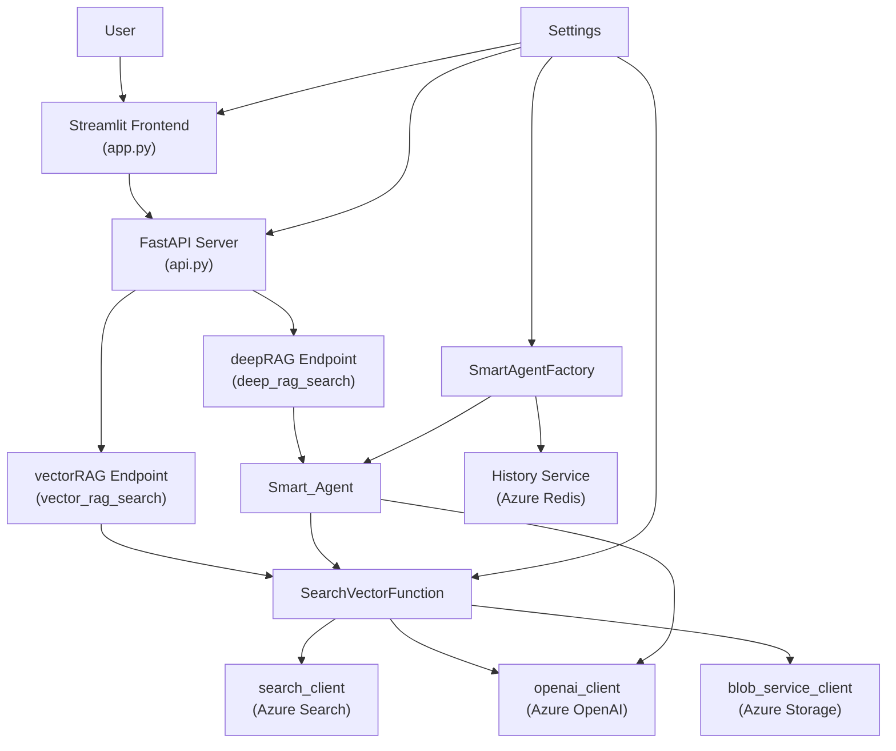
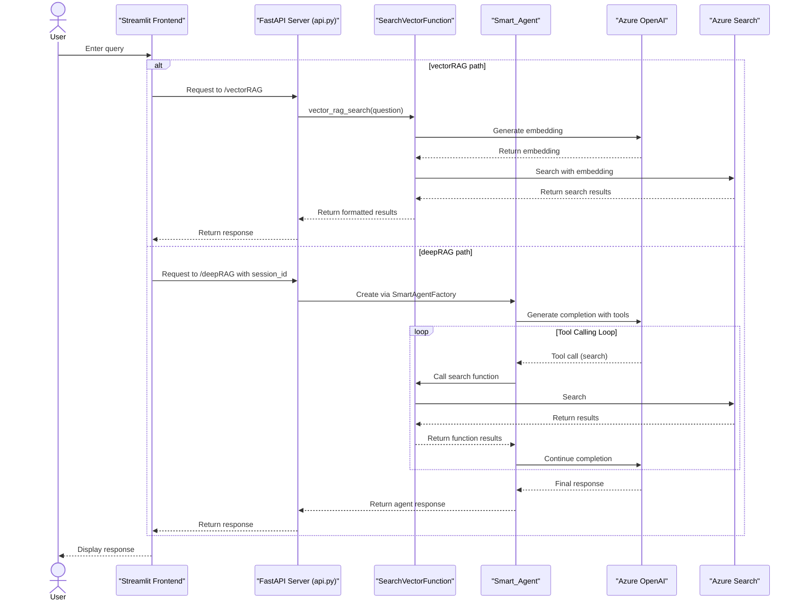
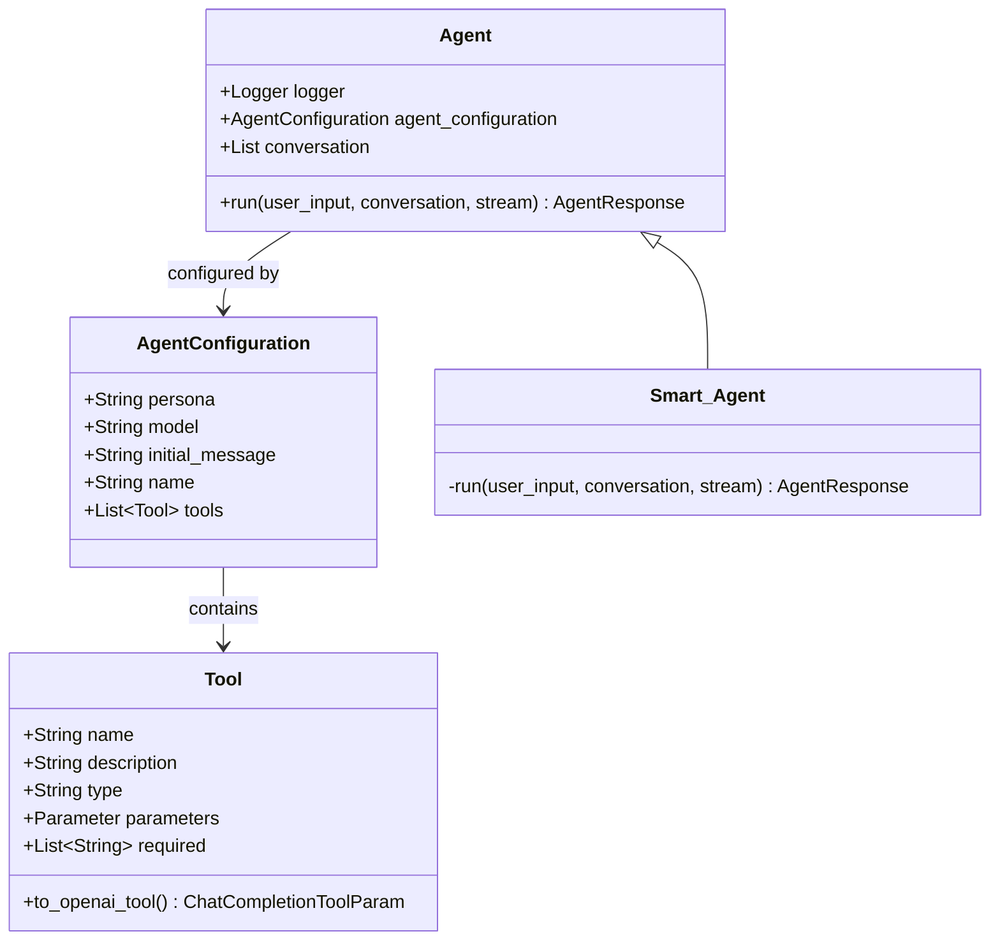

<!-- source: DeepWiki mcp.deepwiki.com · repo microsoft/deepRAG · page 1 Overview · fetched 2026-10-26 -->

# Overview

<details>
<summary>Relevant source files</summary>

The following files were used as context for generating this wiki page:

- [README.md](README.md)
- [pyproject.toml](pyproject.toml)
- [src/agents/README.md](src/agents/README.md)
- [src/agents/agent.py](src/agents/agent.py)
- [src/api/api.py](src/api/api.py)
- [src/models/agent_configuration.py](src/models/agent_configuration.py)

</details>


deepRAG is a sophisticated Retrieval-Augmented Generation (RAG) system that extends classic vector-based retrieval with additional search technologies to provide enhanced information retrieval capabilities. This repository implements an advanced RAG architecture with two primary approaches: a straightforward vector-based retrieval and a more sophisticated agent-based approach that can perform multiple retrieval steps while maintaining conversation context.

## Purpose and Scope

The deepRAG project aims to overcome limitations of traditional RAG systems by incorporating multiple search types beyond simple vector embeddings. As stated in the repository's README:

> The deepRAG project seeks to extend classic retrieval using vector databases to optional utilize other search technologies for extended results. This will initially be done by utilizing graph databases to help answer queries related to content summaries that aren't directly related to snippets of content.

This overview document introduces the core concepts, architecture, and components of the deepRAG system. For detailed information about specific components, see other sections of this documentation: [System Architecture](#2), [Smart Agent](#3), or [Search Vector Function](#4).

Sources:
- [README.md:1-7]()

## System Architecture

deepRAG follows a modular architecture with clear separation of concerns between frontend interaction, API services, agent logic, and search functionality. The system leverages several Azure services for its operation.



Sources:
- [src/api/api.py:1-88]()
- [pyproject.toml:1-39]()

## Core Components

### API Server

The API server provides two main endpoints:
1. `/vectorRAG`: For simple vector-based retrieval
2. `/deepRAG`: For agent-based retrieval with state management

The API server is implemented using FastAPI and integrates with LangChain's Runnable interfaces to create a robust service architecture.

### Data Flow

The following sequence diagram illustrates how data flows through the system for both approaches:



Sources:
- [src/api/api.py:20-31]()
- [src/api/api.py:33-51]()

### Key Differentiators: vectorRAG vs deepRAG

| Feature | vectorRAG | deepRAG |
|---------|-----------|---------|
| Endpoint | `/vectorRAG` | `/deepRAG` |
| Implementation | Direct vector search | Agent-based with tool calling |
| State Management | Stateless | Stateful (session-based) |
| Search Capabilities | Single vector search | Multiple search types possible |
| Conversation History | None | Maintained across interactions |
| Code Implementation | `vector_rag_search()` | `deep_rag_search()` |

## Integration with Azure Services

The deepRAG system integrates with several Azure services:

| Azure Service | Purpose | Component |
|---------------|---------|-----------|
| Azure OpenAI | Embedding generation and LLM capabilities | Both vectorRAG and deepRAG |
| Azure Search | Vector search for semantic retrieval | Both vectorRAG and deepRAG |
| Azure Storage | Document and image storage | Used by SearchVectorFunction |
| Azure Redis | Conversation history and session state | Used by Smart Agent |

## Agent Configuration

The Smart Agent is configured using the `AgentConfiguration` class, which defines the agent's persona, model, initial message, and available tools.



Sources:
- [src/models/agent_configuration.py:62-89]()
- [src/agents/agent.py:1-27]()

## Getting Started

To run the deepRAG project:

1. Install the required dependencies:
   ```
   poetry install
   ```

2. Select the interpreter in the poetry cache

3. Configure the required Azure services and update the `.env` file with the appropriate credentials

For more detailed information on configuration and settings, see [Settings and Configuration](#7).

Sources:
- [README.md:8-14]()
- [pyproject.toml:1-39]()

---

