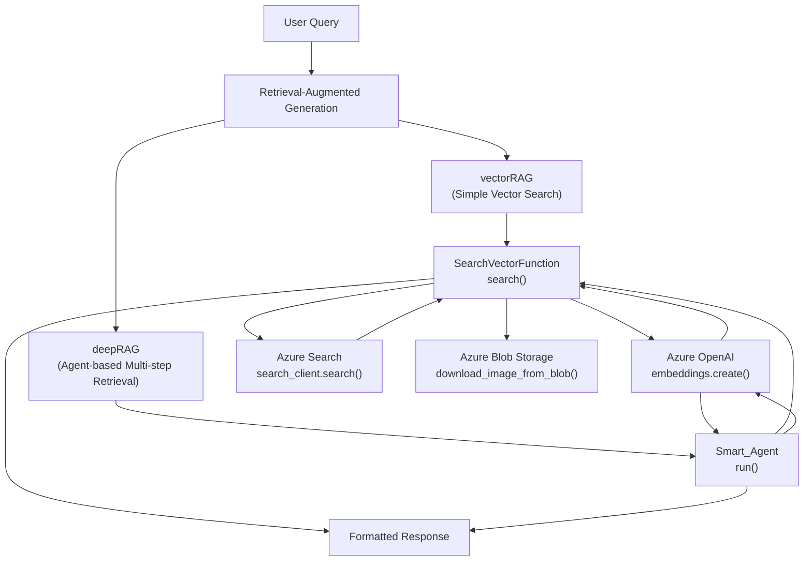
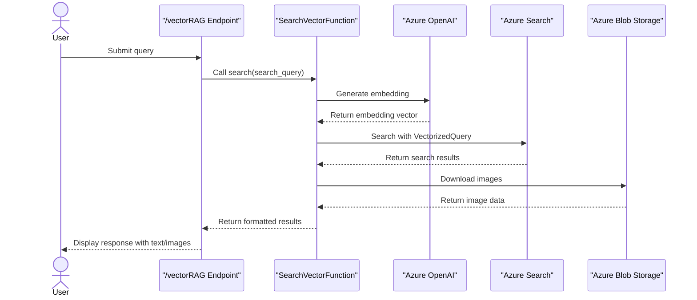
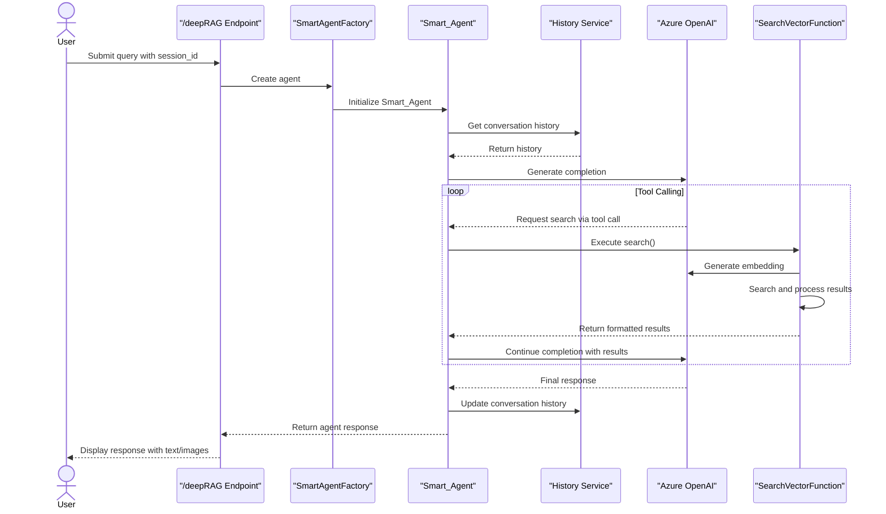
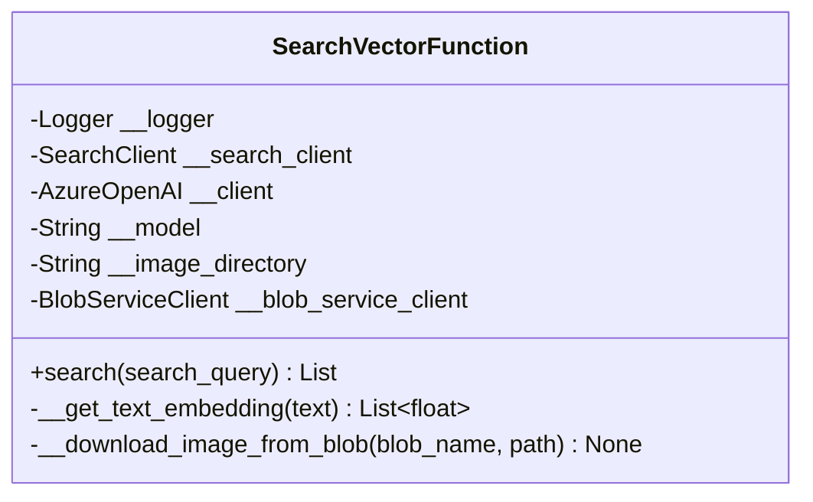
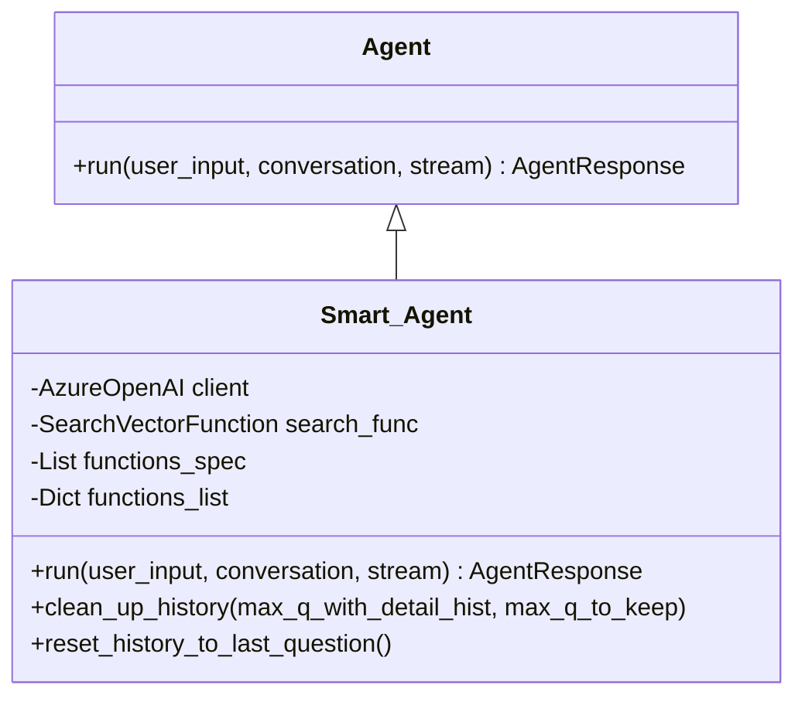
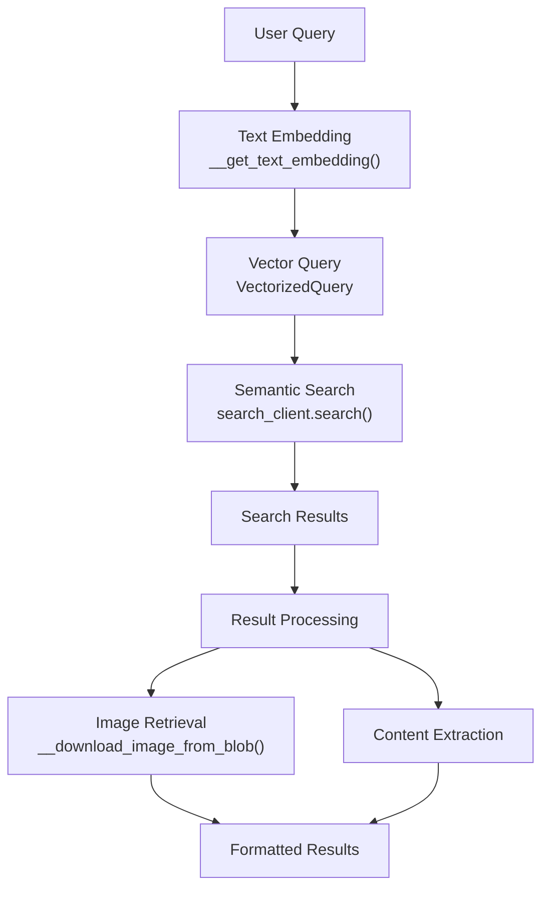
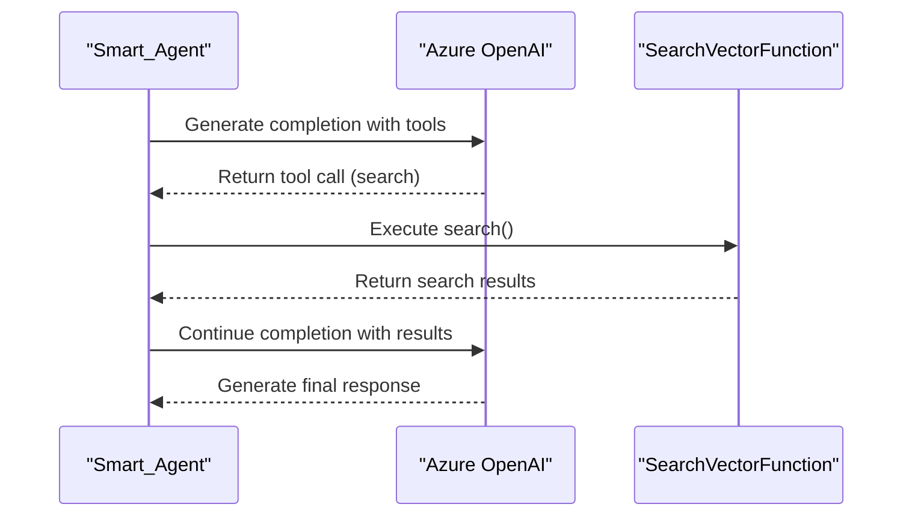

<!-- source: DeepWiki mcp.deepwiki.com · repo microsoft/deepRAG · page 1.1 Key Concepts · fetched 2026-10-26 -->

# Key Concepts

Relevant source files

The following files were used as context for generating this wiki page:

- [src/agents/pyproject.toml](src/agents/pyproject.toml)
- [src/functions/functions.py](src/functions/functions.py)
- [src/functions/search_vector_function.py](src/functions/search_vector_function.py)
- [src/utils/utils.py](src/utils/utils.py)
- [tests/test_server.py](tests/test_server.py)
- [tests/test_vectors.py](tests/test_vectors.py)
- [tests/tests.py](tests/tests.py)

## Purpose and Scope

This document explains the core concepts behind the deepRAG system, focusing on Retrieval-Augmented Generation (RAG), vector search, and agent-based retrieval approaches. For implementation details of the system architecture, see [System Architecture](#2), and for information about specific components, see [Smart Agent](#3) and [Search Vector Function](#4).

## Retrieval-Augmented Generation (RAG)

Retrieval-Augmented Generation is a technique that enhances large language models by incorporating relevant information retrieved from external knowledge sources. Instead of relying solely on the model's pre-trained knowledge, RAG systems retrieve contextually relevant information from a knowledge base before generating responses.

The deepRAG system implements two distinct RAG approaches:

Sources: [src/functions/search_vector_function.py:14-90](), [tests/test_server.py:10-18]()

## Vector-Based RAG

The simplest form of RAG in the system is vectorRAG, implemented through the `/vectorRAG` endpoint. It uses vector embeddings to find semantically similar content from a knowledge base.

### How Vector RAG Works

Key components of Vector RAG:

1. **Text Embeddings**: Converts text into vector embeddings using Azure OpenAI
2. **Vector Search**: Uses these embeddings to find semantically similar content in Azure Search
3. **Result Processing**: Retrieves and formats the search results, including downloading relevant images

Sources: [src/functions/search_vector_function.py:39-73](), [src/functions/search_vector_function.py:75-80](), [tests/test_server.py:10-13](), [tests/test_vectors.py:29-47]()

## Agent-Based RAG (deepRAG)

The more advanced approach is deepRAG, implemented through the `/deepRAG` endpoint. It uses a Smart Agent that can perform multiple search steps and maintain conversation context.

### How Deep RAG Works

Key features of Agent-Based RAG:

1. **Stateful Conversations**: Maintains conversation history across turns
2. **Multi-Step Retrieval**: Can perform multiple search operations based on the conversation flow
3. **Tool Calling**: Uses function calling to integrate search and other capabilities
4. **Context Management**: Intelligently manages and cleans up conversation history

Sources: [src/functions/search_vector_function.py:14-90](), [tests/test_server.py:15-18]()

## Key Technical Components

### SearchVectorFunction

This class handles vector search operations and is a core component used by both vector RAG and agent-based RAG.

Main capabilities:
- Converting text to embeddings using Azure OpenAI (`__get_text_embedding`)
- Performing semantic search with vector queries (`search`)
- Retrieving and processing search results, including images (`__download_image_from_blob`)

Sources: [src/functions/search_vector_function.py:14-90]()

### Smart Agent

The Smart Agent is responsible for orchestrating the deepRAG process:

Key capabilities:
- Managing conversation context and history
- Using tool calling to execute search operations
- Orchestrating multiple retrieval steps when needed
- Cleaning up and managing conversation history

Sources: [src/agents/pyproject.toml:1-24](), [src/utils/utils.py:3]()

## Vector Search Mechanism

The vector search mechanism is fundamental to both RAG approaches:

Key implementation details:
1. The query is converted to a vector embedding using Azure OpenAI
2. A `VectorizedQuery` is created with this embedding
3. Semantic search is performed with Azure Search
4. Results are processed, including downloading relevant images
5. Formatted results are returned for use in response generation

Sources: [src/functions/search_vector_function.py:39-73](), [src/functions/search_vector_function.py:75-80](), [src/functions/search_vector_function.py:82-89](), [tests/test_vectors.py:29-47]()

## Tool Calling in deepRAG

The deepRAG approach uses tool calling to enable the Smart Agent to perform search operations:

This approach enables more dynamic and contextual retrieval, as the agent can determine when and what to search for based on the conversation context.

Sources: [src/agents/pyproject.toml:1-24](), [src/utils/utils.py:3]()

## Comparison: Vector RAG vs. Deep RAG

| Feature | Vector RAG (vectorRAG) | Agent-Based RAG (deepRAG) |
|---------|------------------------|---------------------------|
| Endpoint | `/vectorRAG` | `/deepRAG` |
| Stateful | No | Yes (maintains conversation history) |
| Retrieval Steps | Single search operation | Multiple search operations possible |
| Context Management | None | Advanced (cleans up and manages history) |
| Use Case | Simple factual queries | Complex, multi-step information needs |
| Implementation | Direct call to SearchVectorFunction | Smart Agent orchestrating multiple functions |

Sources: [tests/test_server.py:10-18]()

## Key Technical Patterns

1. **Vector Embeddings**: Converting text to numerical vector representations for semantic similarity search
2. **Tool Calling**: Enabling the language model to call external functions for enhanced capabilities
3. **Conversation State Management**: Maintaining and managing conversation history for contextual responses
4. **Multi-Modal Responses**: Combining text with retrieved images in responses

Sources: [src/functions/search_vector_function.py:14-90](), [src/agents/pyproject.toml:1-24](), [src/utils/utils.py:3]()

---

