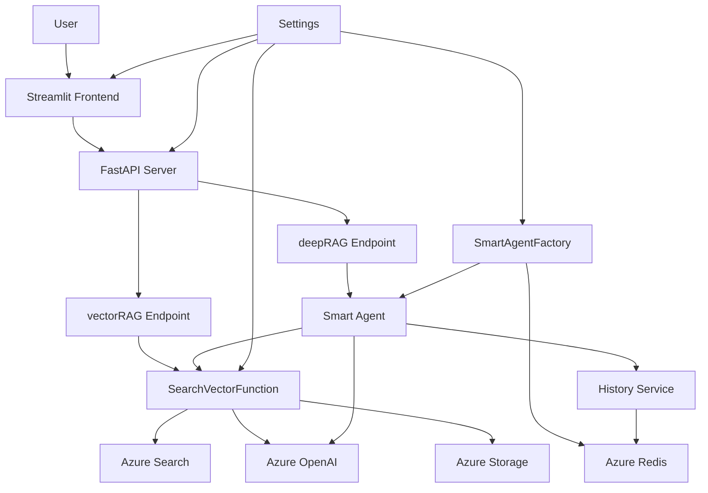
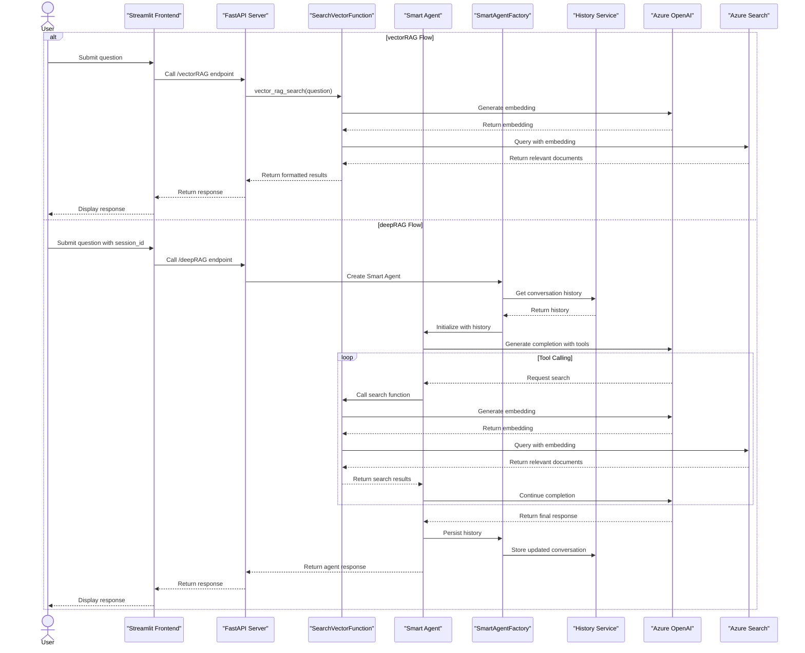
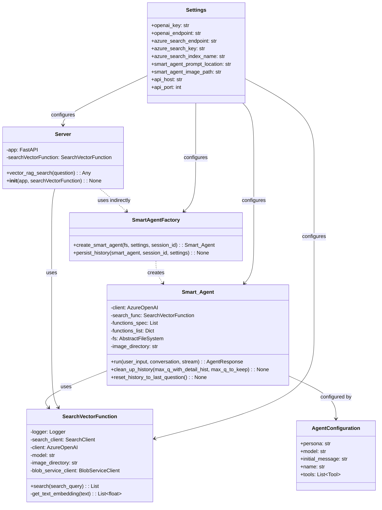
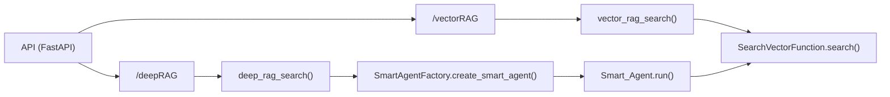
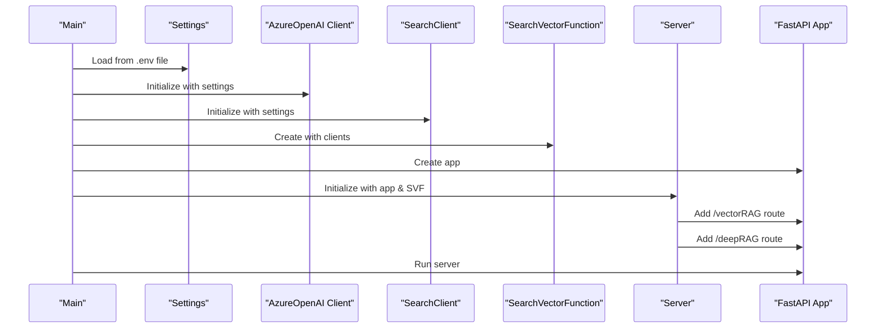

<!-- source: DeepWiki mcp.deepwiki.com · repo microsoft/deepRAG · page 2 System Architecture · fetched 2026-10-26 -->

# System Architecture

<details>
<summary>Relevant source files</summary>

The following files were used as context for generating this wiki page:

- [docs/ARCHITECTURE.md](docs/ARCHITECTURE.md)
- [src/api/api.py](src/api/api.py)
- [src/app/app.py](src/app/app.py)

</details>


This document provides a comprehensive overview of the deepRAG system architecture, detailing its components, their relationships, and how they interact to deliver advanced Retrieval-Augmented Generation capabilities. The architecture described here encompasses both the vectorRAG and deepRAG approaches implemented in the system.

For key concepts related to RAG, vector search, and agent-based approaches, see [Key Concepts](#1.1). For more detailed information about specific component interactions, see [Component Interactions](#2.1).

## High-Level Architecture Overview

The deepRAG system follows a modular architecture that integrates multiple Azure services with custom components to provide sophisticated retrieval and generation capabilities.



Sources: [src/app/app.py:1-154](), [src/api/api.py:1-89]()

## Core Components

The deepRAG system consists of the following core components:

### Client Applications
- **Streamlit Frontend**: A web-based user interface that allows users to interact with the system through a chat interface. It handles session management and rendering of responses.

### Server Components
- **FastAPI Server**: Provides REST API endpoints for both vectorRAG and deepRAG functionality.
- **SearchVectorFunction**: Handles vector search operations by generating embeddings and querying Azure Search.
- **Smart Agent**: Advanced agent that orchestrates retrieval and generation processes for deepRAG.
- **SmartAgentFactory**: Creates and configures Smart Agent instances and handles persistence of conversation history.
- **History Service**: Manages conversation history across sessions.

### Configuration
- **Settings**: Central configuration object that provides configuration values for all components.

The table below outlines the responsibilities of each component:

| Component | Primary Responsibility | Key Dependencies |
|-----------|------------------------|------------------|
| Streamlit Frontend | User interaction | RemoteRunnable, Settings |
| FastAPI API | Expose endpoints, orchestrate requests | SmartAgentFactory, SearchVectorFunction |
| SearchVectorFunction | Vector search operations | Azure Search, Azure OpenAI, Azure Storage |
| Smart Agent | Multi-step retrieval, tool calling | SearchVectorFunction, Azure OpenAI |
| SmartAgentFactory | Agent creation, history persistence | Azure Redis |
| History Service | Conversation management | Azure Redis |

Sources: [src/app/app.py:12-31](), [src/api/api.py:33-51]()

## System Data Flow

The system supports two primary data flows: vectorRAG and deepRAG.



Sources: [src/api/api.py:20-31](), [src/app/app.py:119-154]()

## Component Relationships and Code Structure

The codebase is organized into several modules that work together to implement the deepRAG functionality.



Sources: [src/api/api.py:32-51](), [src/app/app.py:24-38]()

## Integration with Azure Services

The deepRAG system integrates with multiple Azure services to provide its functionality.

```mermaid
graph TD
    subgraph "deepRAG System"
        Frontend["Streamlit Frontend"]
        API["FastAPI Server"]
        SearchVectorFunction["SearchVectorFunction"]
        SmartAgent["Smart Agent"]
        SmartAgentFactory["SmartAgentFactory"]
        HistoryService["History Service"]
    end
    
    subgraph "Azure Services"
        AzureOpenAI["Azure OpenAI"]
        AzureSearch["Azure AI Search"]
        AzureStorage["Azure Storage"]
        AzureRedis["Azure Redis Cache"]
    end
    
    SearchVectorFunction --> AzureOpenAI: "Generate embeddings"
    SearchVectorFunction --> AzureSearch: "Query for relevant documents"
    SearchVectorFunction --> AzureStorage: "Retrieve images"
    
    SmartAgent --> AzureOpenAI: "Generate completions"
    SmartAgent --> SearchVectorFunction: "Retrieve documents"
    
    SmartAgentFactory --> AzureRedis: "Store/retrieve conversation state"
    HistoryService --> AzureRedis: "Manage conversation history"
```

Sources: [src/api/api.py:63-86]()

## API Endpoints

The system exposes two main API endpoints:

1. **/vectorRAG** - Provides simple vector-based retrieval and generation
2. **/deepRAG** - Provides agent-based retrieval with multi-step reasoning and state management

The API is implemented using FastAPI and LangChain's Runnable interfaces, with each endpoint mapped to a specific functionality:



Sources: [src/api/api.py:33-51](), [src/api/api.py:56-88]()

## Initialization Process

The system initialization process involves:

1. Loading configuration from environment variables
2. Initializing connections to Azure services
3. Setting up the API server
4. Creating the necessary component instances



Sources: [src/api/api.py:53-88](), [src/app/app.py:24-38]()

## Frontend Application

The Streamlit frontend application provides a chat interface for users to interact with the deepRAG system. It:

1. Maintains session state for conversation history
2. Communicates with the API server via the RemoteRunnable interface
3. Renders responses, including text and images
4. Provides sample questions and a way to clear chat history

The frontend interacts with the backend through the `/deepRAG` endpoint, passing the user's question and a session ID to maintain conversation context.

Sources: [src/app/app.py:39-154]()

---

