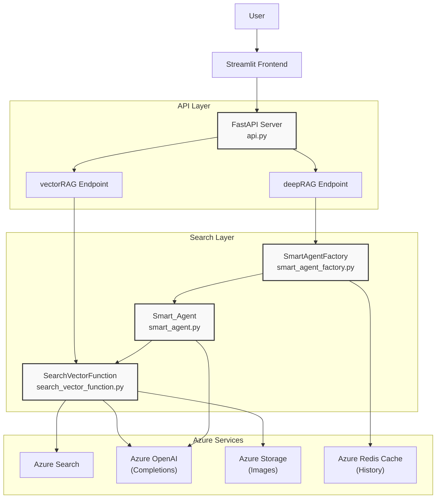
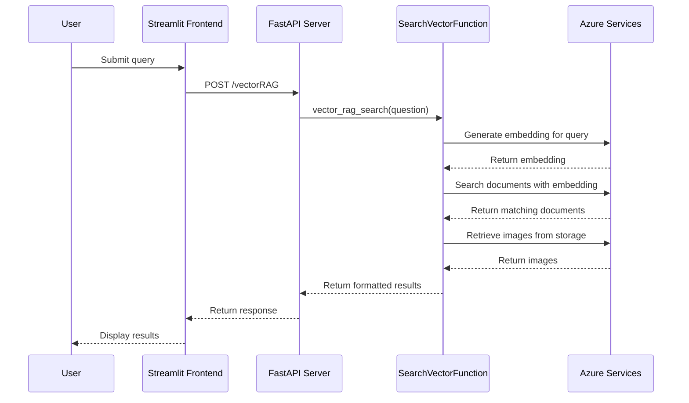
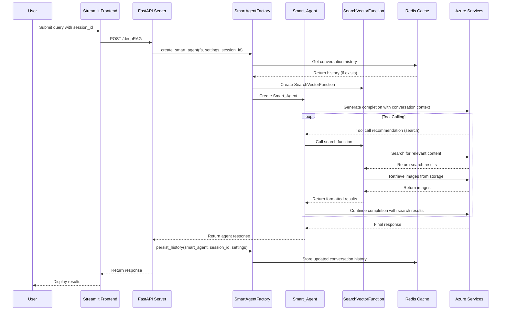
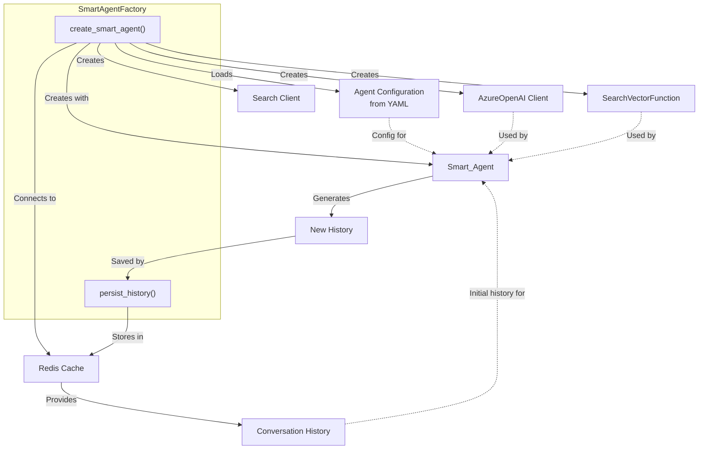
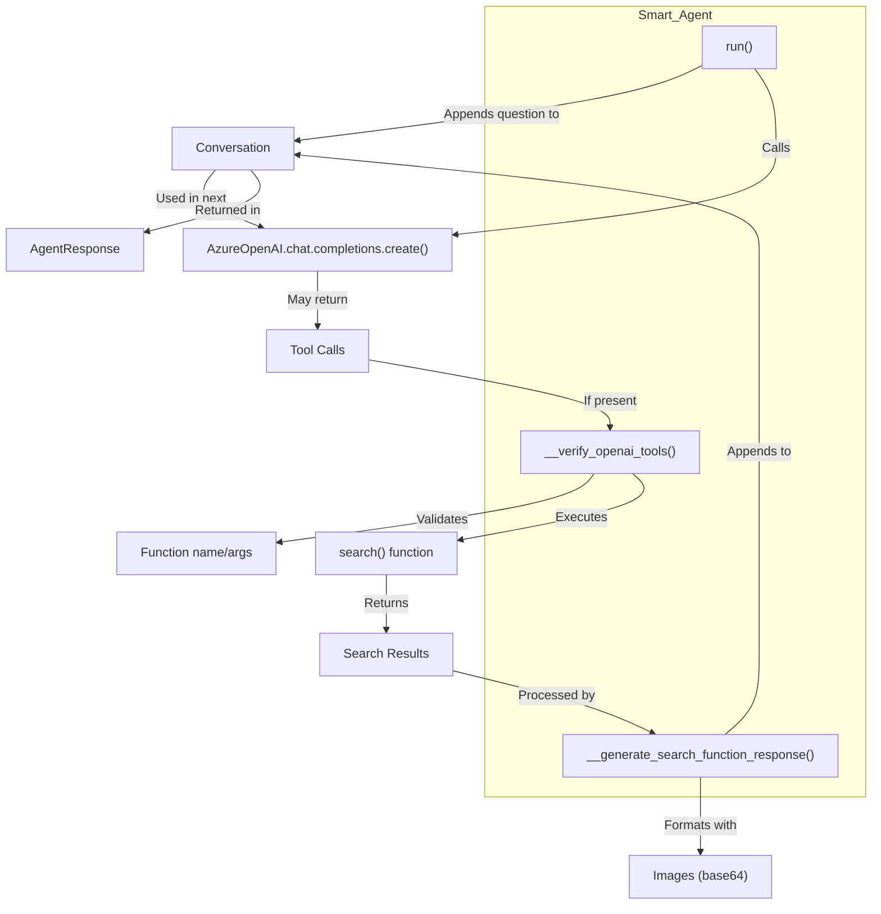
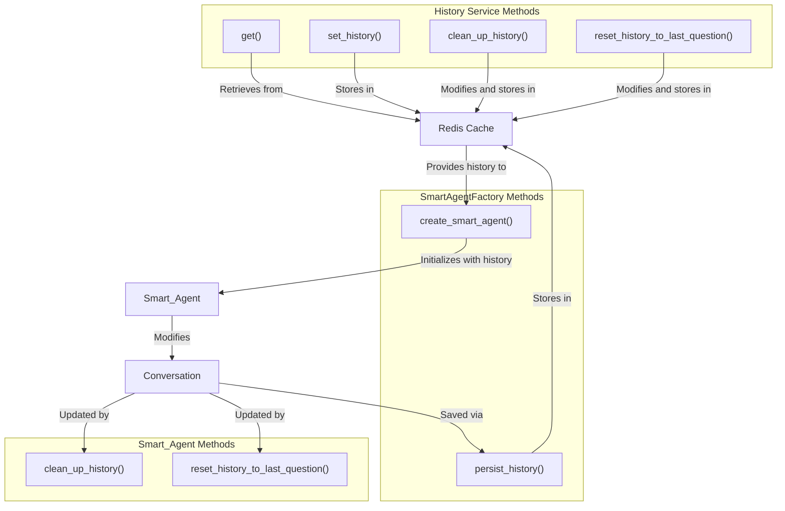
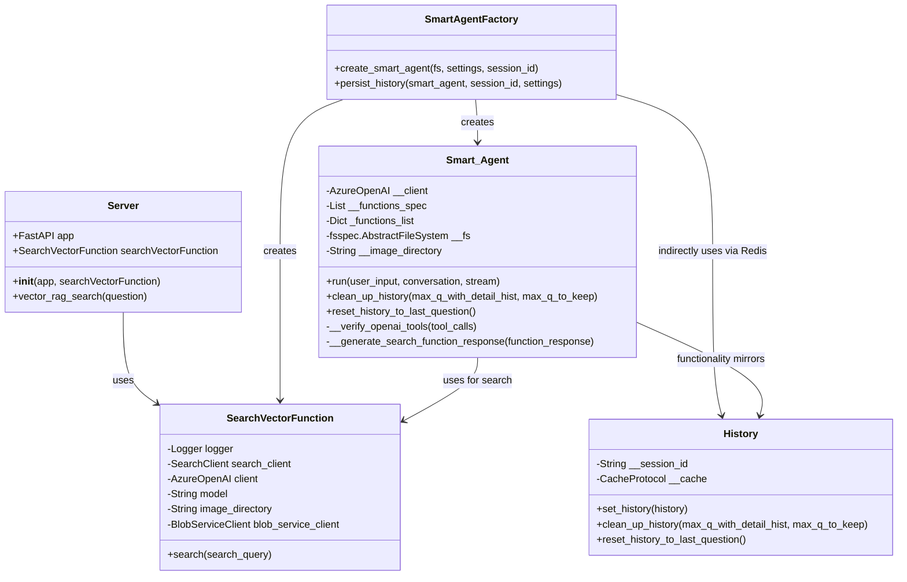
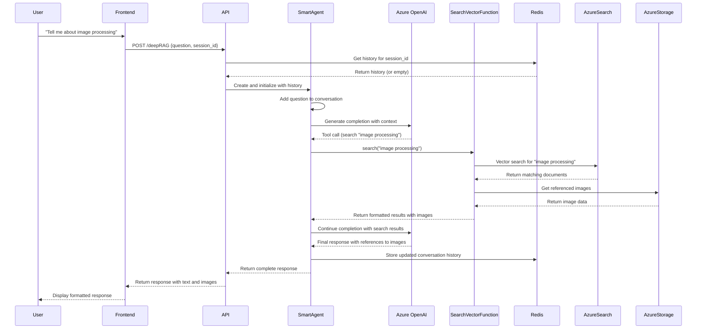

<!-- source: DeepWiki mcp.deepwiki.com · repo microsoft/deepRAG · page 2.1 Component Interactions · fetched 2026-10-26 -->

# Component Interactions

Relevant source files

The following files were used as context for generating this wiki page:

- [src/agents/smart_agent/smart_agent.py](src/agents/smart_agent/smart_agent.py)
- [src/api/api.py](src/api/api.py)
- [src/services/history.py](src/services/history.py)
- [src/utils/smart_agent_factory.py](src/utils/smart_agent_factory.py)

## Purpose and Scope

This document details how the various components of the deepRAG system interact with each other and with external services. It covers the communication flows between the API server, Smart Agent, Search Vector Function, and Azure services that enable both vector-based and agent-based retrieval augmented generation. For information about Azure service integration specifics, see [Azure Services Integration](#2.2).

## Core Components and Their Relationships

The deepRAG system consists of several interconnected components that work together to provide retrieval-augmented generation capabilities.

Sources:
- [src/api/api.py:33-49]()
- [src/utils/smart_agent_factory.py:19-70]()
- [src/agents/smart_agent/smart_agent.py:19-49]()

## Request Flows

The deepRAG system supports two main types of request flows:

1. **Vector RAG Flow**: A simpler approach using direct vector search
2. **Deep RAG Flow**: A more complex approach using the Smart Agent with conversation history

### Vector RAG Flow

Sources:
- [src/api/api.py:34-42]()
- [src/api/api.py:50-51]()
- [src/functions/search_vector_function.py]() (implied from references)

### Deep RAG Flow

Sources:
- [src/api/api.py:20-31]()
- [src/api/api.py:43-48]()
- [src/utils/smart_agent_factory.py:21-70]()
- [src/agents/smart_agent/smart_agent.py:88-140]()

## Component-to-Component Interactions

### API Server and External Interfaces

The API server (`api.py`) serves as the main entry point for client requests. It exposes two main endpoints:

| Endpoint | Purpose | Implementation | Key Interactions |
|----------|---------|----------------|-----------------|
| `/vectorRAG` | Simple vector-based retrieval | `Server.vector_rag_search` | Calls `SearchVectorFunction.search` directly |
| `/deepRAG` | Advanced agent-based retrieval | `deep_rag_search` | Creates a Smart Agent via factory, runs it, and persists history |

Sources:
- [src/api/api.py:33-52]()

### Smart Agent Factory and Smart Agent Creation

The Smart Agent Factory is responsible for creating Smart Agent instances and handling conversation persistence:

Sources:
- [src/utils/smart_agent_factory.py:21-70]()
- [src/utils/smart_agent_factory.py:72-83]()

### Smart Agent and Tool Execution

The Smart Agent processes user queries by interacting with the Azure OpenAI service and executing tool calls:

Sources:
- [src/agents/smart_agent/smart_agent.py:88-140]()
- [src/agents/smart_agent/smart_agent.py:157-196]()
- [src/agents/smart_agent/smart_agent.py:198-221]()

### History Management

The History service and Smart Agent work together to maintain conversation history across sessions:

Sources:
- [src/agents/smart_agent/smart_agent.py:50-86]()
- [src/utils/smart_agent_factory.py:21-70]()
- [src/utils/smart_agent_factory.py:72-83]()
- [src/services/history.py:5-75]()

## Code-Level Component Relationships

The following diagram illustrates the relationships between specific classes and methods that make up the component interactions:

Sources:
- [src/api/api.py:33-52]()
- [src/utils/smart_agent_factory.py:19-83]()
- [src/agents/smart_agent/smart_agent.py:19-221]()
- [src/services/history.py:5-75]()

## End-to-End Interaction Example

The following sequence illustrates a complete interaction from user query to response for the deepRAG approach:

Sources:
- [src/api/api.py:20-31]()
- [src/utils/smart_agent_factory.py:21-83]()
- [src/agents/smart_agent/smart_agent.py:88-140]()
- [src/agents/smart_agent/smart_agent.py:157-221]()

---

