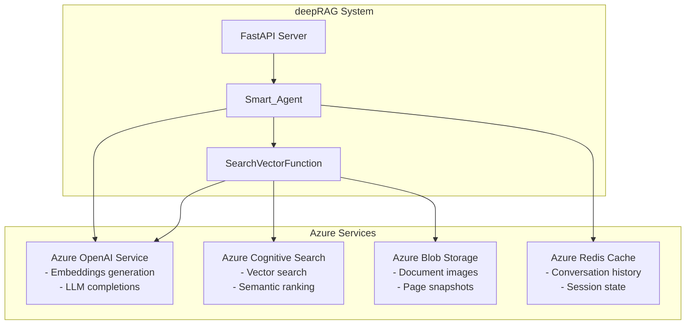
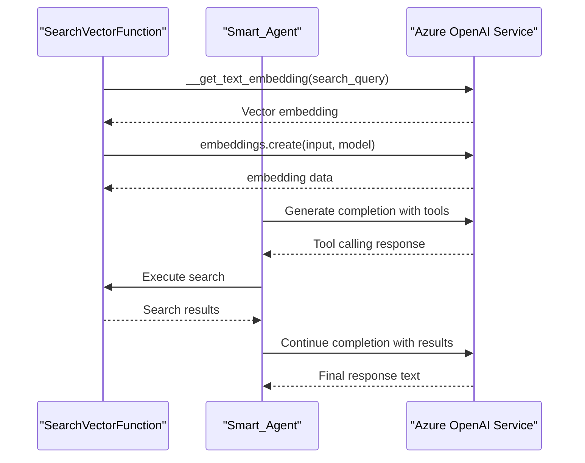
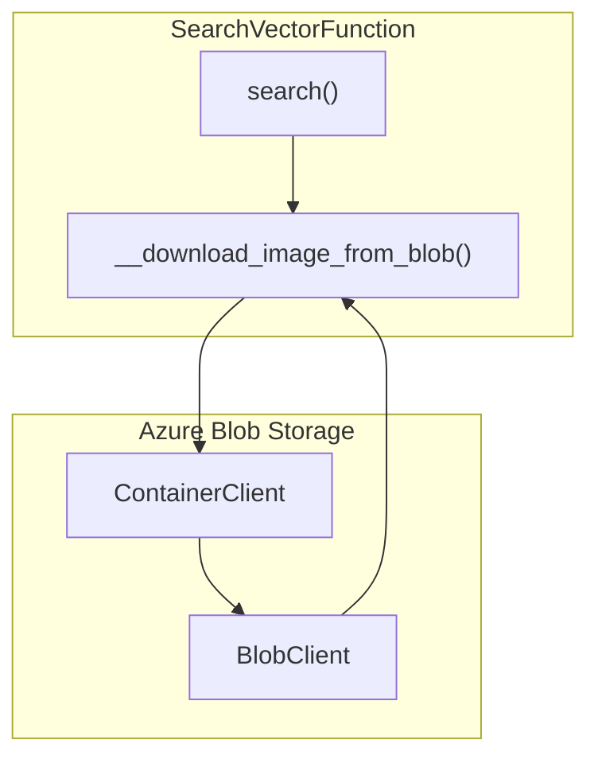
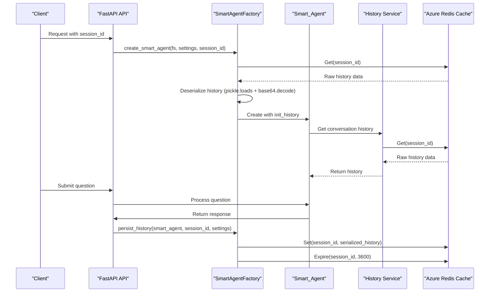
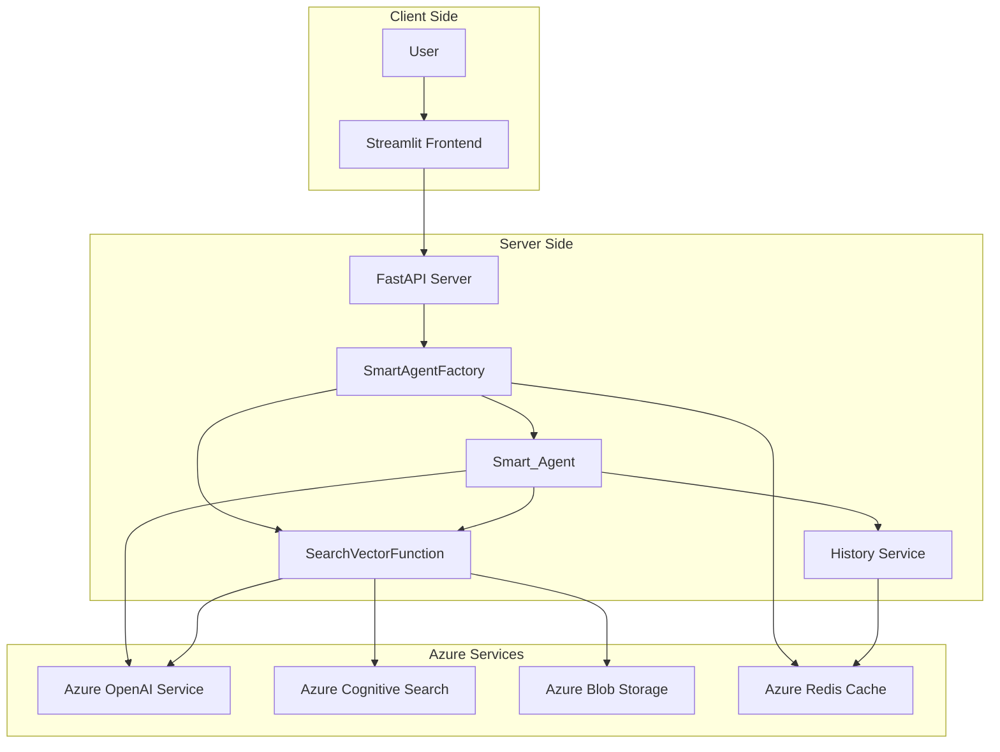

<!-- source: DeepWiki mcp.deepwiki.com · repo microsoft/deepRAG · page 2.2 Azure Services Integration · fetched 2026-10-26 -->

# Azure Services Integration

<details>
<summary>Relevant source files</summary>

The following files were used as context for generating this wiki page:

- [.devcontainer/devcontainer.json](.devcontainer/devcontainer.json)
- [.vscode/launch.json](.vscode/launch.json)
- [src/functions/search_vector_function.py](src/functions/search_vector_function.py)
- [src/models/settings.py](src/models/settings.py)
- [src/services/history.py](src/services/history.py)
- [src/utils/smart_agent_factory.py](src/utils/smart_agent_factory.py)

</details>


## Purpose and Scope

This document details how the deepRAG system integrates with various Azure services for its core functionality. It covers the specific integration points with Azure OpenAI, Azure Cognitive Search, Azure Blob Storage, and Azure Redis Cache, explaining how these services support the system's retrieval-augmented generation capabilities.

For information about the overall system architecture, see [System Architecture](#2), and for component interactions, see [Component Interactions](#2.1).

## Azure Services Overview

The deepRAG system relies on four key Azure services that work together to enable advanced retrieval and generation capabilities:



Sources: [src/functions/search_vector_function.py:13-37](). [src/utils/smart_agent_factory.py:19-47](). [src/models/settings.py:4-27]().

## Service Configuration

All Azure service configurations are centralized in the `Settings` class, which uses environment variables for connection details:

| Azure Service | Configuration Parameters |
|---------------|--------------------------|
| Azure OpenAI | `openai_endpoint`, `openai_key`, `openai_embedding_deployment`, `openai_chat_deployment`, `openai_api_version` |
| Azure Cognitive Search | `azure_search_endpoint`, `azure_search_key`, `azure_search_index_name` |
| Azure Blob Storage | `azure_storage_account_key`, `azure_storage_account_name`, `azure_container_name` |
| Azure Redis Cache | `azure_redis_endpoint`, `azure_redis_key` |

Sources: [src/models/settings.py:4-27]().

## Azure OpenAI Integration

Azure OpenAI Service provides the linguistic intelligence for the deepRAG system through two main functions:

1. **Embeddings Generation** - Converting text to vector representations
2. **Large Language Model Completions** - Generating responses and handling tool calls



Sources: [src/functions/search_vector_function.py:74-80](). [src/utils/smart_agent_factory.py:32-36]().

### Implementation Details

The Azure OpenAI client is initialized in `SmartAgentFactory`:

```python
client = AzureOpenAI(
    api_key=settings.openai_key,
    api_version=settings.openai_api_version,
    azure_endpoint=settings.openai_endpoint,
)
```

This client is passed to both the Smart Agent for LLM interactions and the SearchVectorFunction for embedding generation.

Sources: [src/utils/smart_agent_factory.py:32-36]().

## Azure Cognitive Search Integration

Azure Cognitive Search powers the vector search capabilities, allowing the system to find semantically similar content based on embeddings.

```mermaid
classDiagram
    class "SearchVectorFunction" {
        +search(search_query): list
        -__get_text_embedding(text): List~float~
        -__download_image_from_blob(blob_name, download_file_path): None
    }
    
    class "SearchClient" {
        +search(query_type, semantic_configuration_name, vector_queries, etc): SearchItemPaged
    }
    
    class "VectorizedQuery" {
        +vector: List~float~
        +k_nearest_neighbors: int
        +fields: string
    }
    
    "SearchVectorFunction" --> "SearchClient" : uses
    "SearchVectorFunction" --> "VectorizedQuery" : creates
```

Sources: [src/functions/search_vector_function.py:39-73](). [src/utils/smart_agent_factory.py:26-30]().

### Search Process

1. Generate text embedding for the search query using Azure OpenAI
2. Create a `VectorizedQuery` with the embedding vector
3. Execute a semantic search with the vector query
4. Process search results to retrieve related content and images
5. Download associated page images from Azure Blob Storage

The search operation includes semantic ranking and extractive capabilities:

```python
results: SearchItemPaged[Dict] = self.__search_client.search(
    query_type=QueryType.SEMANTIC,
    semantic_configuration_name='my-semantic-config',
    query_caption=QueryCaptionType.EXTRACTIVE,
    query_answer=QueryAnswerType.EXTRACTIVE,
    vector_queries=[vector_query],
    select=["topic", "file_name", "page_number", "related_content"],
    top=3
)
```

Sources: [src/functions/search_vector_function.py:47-56]().

## Azure Blob Storage Integration

Azure Blob Storage is used to store document images that are retrieved as part of search results.



Sources: [src/functions/search_vector_function.py:82-89]().

### Image Retrieval Process

1. For each search result, determine the corresponding page image name
2. Ensure the local directory exists for storing the downloaded image
3. Download the image from Azure Blob Storage using the container client
4. Include the local image path in the search results

```python
def __download_image_from_blob(self, blob_name: str, download_file_path: str) -> None:
    """
    Download an image from Azure Blob Storage to a local file
    """
    with open(download_file_path, "wb") as download_file:
        blob_client = self.__container_client.get_blob_client(blob_name)
        download_stream = blob_client.download_blob()
        download_file.write(download_stream.readall())
```

Sources: [src/functions/search_vector_function.py:82-89]().

## Azure Redis Cache Integration

Azure Redis Cache provides distributed caching capabilities for maintaining conversation history across user sessions.



Sources: [src/utils/smart_agent_factory.py:49-62](). [src/utils/smart_agent_factory.py:72-83](). [src/services/history.py:1-75]().

### History Management

The `History` service provides several key functions for conversation history:

1. **Retrieval**: Loads history from Redis for a specific session
2. **Persistence**: Saves updated history back to Redis
3. **Cleanup**: Removes old messages to prevent history from growing too large
4. **Reset**: Resets history to the last question for recovery purposes

History data is serialized using pickle and base64 encoding before storage in Redis:

```python
# Storing history
self.__cache.set(name=self.__session_id, value=base64.b64encode(s=pickle.dumps(obj=history)))

# Retrieving history
history = pickle.loads(base64.b64decode(s=cache_history))
```

Session data in Redis has a 1-hour (3600 seconds) expiration time to manage resource usage.

Sources: [src/services/history.py:20-23](). [src/services/history.py:27-32](). [src/utils/smart_agent_factory.py:81-82]().

## Integration Flow

The following diagram shows how all Azure services work together in the deepRAG system:



Sources: [src/utils/smart_agent_factory.py:19-83](). [src/services/history.py:5-75](). [src/functions/search_vector_function.py:14-89]().

## Conclusion

The deepRAG system's architecture demonstrates a sophisticated integration of multiple Azure services to create a powerful retrieval-augmented generation system. Each Azure service plays a critical role:

- **Azure OpenAI** provides the language intelligence through embeddings and LLM capabilities
- **Azure Cognitive Search** enables semantic vector search for relevant content retrieval
- **Azure Blob Storage** stores and serves document images to enhance responses
- **Azure Redis Cache** maintains conversation state for persistent, context-aware interactions

This integration allows the system to deliver both simple vector-based retrieval (`/vectorRAG`) and more complex agent-based retrieval with conversation context (`/deepRAG`).

---

