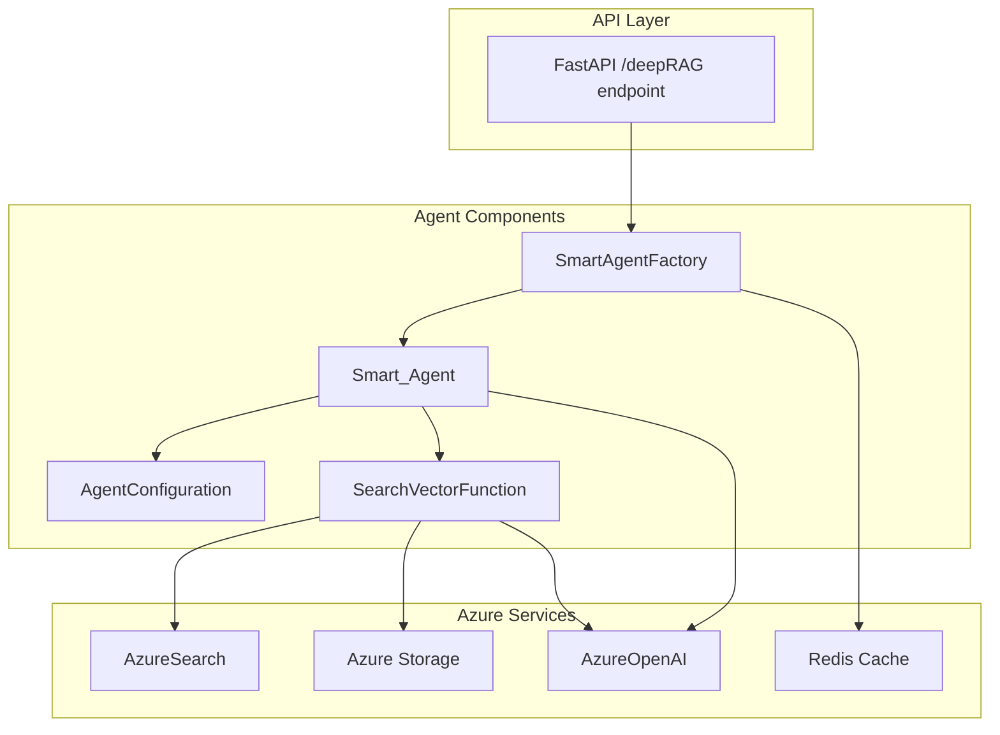

<!-- source: DeepWiki mcp.deepwiki.com · repo microsoft/deepRAG · page 3 Smart Agent · fetched 2026-10-26 -->

# Smart Agent

<details>
<summary>Relevant source files</summary>

The following files were used as context for generating this wiki page:

- [README.md](README.md)
- [src/agents/README.md](src/agents/README.md)
- [src/agents/agent.py](src/agents/agent.py)
- [src/agents/smart_agent/smart_agent.py](src/agents/smart_agent/smart_agent.py)
- [src/models/agent_configuration.py](src/models/agent_configuration.py)
- [src/services/history.py](src/services/history.py)
- [src/utils/smart_agent_factory.py](src/utils/smart_agent_factory.py)

</details>


## Introduction and Purpose

The Smart Agent is a key component in the deepRAG system that implements advanced retrieval-augmented generation capabilities. It extends beyond simple vector search by maintaining conversation context, performing tool-based searches when needed, and intelligently integrating retrieved information into responses. The Smart Agent represents the core functionality behind the `/deepRAG` endpoint in the API.

For information about the simpler vector search approach, see [Search Vector Function](#4).

Sources: [src/agents/smart_agent/smart_agent.py:19-21](), [README.md:3-4]()

## Architecture

### Class Structure

The Smart Agent architecture follows an object-oriented design with clear inheritance and dependency relationships:

```mermaid
classDiagram
    class Agent {
        +Logger _logger
        +AgentConfiguration _agent_configuration
        +List _conversation
        +run(user_input, conversation, stream)* AgentResponse
    }
    
    class Smart_Agent {
        -AzureOpenAI __client
        -SearchVectorFunction _functions_list
        -List __functions_spec
        -Dict _functions_list
        -fsspec.AbstractFileSystem __fs
        -String __image_directory
        +run(user_input, conversation, stream) AgentResponse
        +clean_up_history(max_q_with_detail_hist, max_q_to_keep)
        +reset_history_to_last_question()
        -__verify_openai_tools(tool_calls)
        -__generate_search_function_response(function_response)
    }
    
    class SmartAgentFactory {
        +create_smart_agent(fs, settings, session_id) Smart_Agent
        +persist_history(smart_agent, session_id, settings)
    }
    
    class AgentConfiguration {
        +String persona
        +String model
        +String initial_message
        +String name
        +List~Tool~ tools
    }
    
    Agent <|-- Smart_Agent : "extends"
    SmartAgentFactory ..> Smart_Agent : "creates"
    Smart_Agent --> AgentConfiguration : "configured by"
    Smart_Agent --> "SearchVectorFunction" : "uses for search"
```

Sources: [src/agents/smart_agent/smart_agent.py:19-50](), [src/agents/agent.py:9-26](), [src/utils/smart_agent_factory.py:19-70]()

### Component Interaction

The Smart Agent integrates with several components and services to provide its functionality:



Sources: [src/utils/smart_agent_factory.py:21-70](), [src/agents/smart_agent/smart_agent.py:22-49]()

## Implementation Details

### Initialization

The Smart Agent is created by the SmartAgentFactory, which:
1. Loads agent configuration from YAML
2. Sets up connections to Azure services
3. Retrieves conversation history from Redis
4. Initializes the Smart Agent with necessary dependencies

Sources: [src/utils/smart_agent_factory.py:21-70]()

### Run Method Execution Flow

The core functionality of the Smart Agent is implemented in its `run` method:

```mermaid
sequenceDiagram
    participant Client as "API Client"
    participant SA as "Smart_Agent.run()"
    participant AO as "AzureOpenAI"
    participant SVF as "SearchVectorFunction"
    
    Client->>SA: call run(user_input)
    SA->>SA: Add user input to conversation
    SA->>SA: clean_up_history()
    
    loop Until final response
        SA->>AO: chat.completions.create()
        AO-->>SA: Response with tool_calls
        
        alt has tool_calls
            SA->>SA: __verify_openai_tools()
            SA->>SVF: search()
            SVF-->>SA: function_response
            SA->>SA: __generate_search_function_response()
            SA->>SA: Add to conversation
        else no tool_calls
            AO-->>SA: Final response
            break
        end
    end
    
    SA-->>Client: Return AgentResponse
```

Sources: [src/agents/smart_agent/smart_agent.py:88-140]()

### Key Methods

The Smart Agent implements several key methods:

1. **run**: Processes user input and generates responses with optional tool calls
2. **clean_up_history**: Maintains conversation history within configurable limits
3. **reset_history_to_last_question**: Resets history to the most recent user query
4. **__verify_openai_tools**: Validates and executes tool calls from the LLM
5. **__generate_search_function_response**: Formats search results with text and images

Sources: [src/agents/smart_agent/smart_agent.py:50-221]()

## Conversation History Management

The Smart Agent provides sophisticated conversation history management:

1. **History Initialization**: Loads previous conversation from Redis when creating a new agent instance
2. **History Cleanup**: Prunes history based on configurable parameters:
   - `max_question_with_detail_hist`: Number of recent questions to keep with full context
   - `max_question_to_keep`: Total number of questions to maintain in history
3. **History Reset**: Can reset history to the last question when needed
4. **History Persistence**: Saves conversation history to Redis after each interaction

This enables stateful conversations across user sessions while managing token usage.

Sources: [src/agents/smart_agent/smart_agent.py:50-86](), [src/services/history.py:1-76]()

## Tool Calling Implementation

The Smart Agent leverages the OpenAI tool calling functionality to dynamically retrieve relevant information:

### Tool Definition and Registration

```
_functions_list = {
    "search": search_vector_function.search
}
```

Tools are defined in the AgentConfiguration and converted to OpenAI-compatible format at initialization.

### Tool Call Processing Flow

1. OpenAI model decides when to call a tool based on user query
2. Smart Agent receives tool calls in response
3. Agent validates tool calls through `__verify_openai_tools`
4. Function arguments are parsed from JSON
5. Function is executed with provided arguments
6. Results are formatted and added to conversation
7. Agent continues generating response with the new context

The primary tool is the search function, which retrieves relevant information from Azure Search.

Sources: [src/agents/smart_agent/smart_agent.py:141-196](), [src/models/agent_configuration.py:29-59]()

## Image Processing

The Smart Agent can include images in responses through:

1. Retrieving image paths from search results
2. Reading image data from the filesystem
3. Converting images to base64-encoded strings
4. Formatting responses with both text and images

This allows the agent to provide rich, multimodal responses.

Sources: [src/agents/smart_agent/smart_agent.py:198-221]()

## Configuration

The Smart Agent is configured using an AgentConfiguration object with the following properties:

| Property | Description | 
|----------|-------------|
| persona | System prompt defining the agent's behavior |
| model | Azure OpenAI model to use |
| initial_message | First message the agent displays |
| name | Agent's name identifier |
| tools | List of tools the agent can use |

Tools are defined with:
- Name
- Description
- Parameters (properties and types)
- Required parameters

Sources: [src/models/agent_configuration.py:62-89]()

## Integration with External Services

### Azure OpenAI

The Smart Agent integrates with Azure OpenAI for:
- Generating completions with tool definitions
- Processing tool calls and responses
- Maintaining conversation context

### Azure Search

Integration with Azure Search occurs through the SearchVectorFunction for:
- Semantic search using vector embeddings
- Retrieving relevant content and images
- Formatting search results for consumption by the agent

### Azure Redis

Used for:
- Retrieving conversation history at initialization
- Persisting conversation history after interactions
- Maintaining conversation state across sessions

Sources: [src/utils/smart_agent_factory.py:32-36](), [src/utils/smart_agent_factory.py:49-56](), [src/utils/smart_agent_factory.py:71-82]()

## Usage Example

The Smart Agent is primarily used through the `/deepRAG` endpoint, which:
1. Receives a user query and session ID
2. Creates or retrieves a Smart Agent instance
3. Processes the query using the agent's run method
4. Returns the agent's response with retrieved information
5. Persists conversation history for future interactions

This enables sophisticated, stateful RAG capabilities with the ability to perform multiple search operations based on the specific information needs identified by the model.

Sources: [src/utils/smart_agent_factory.py:21-70]()

---

