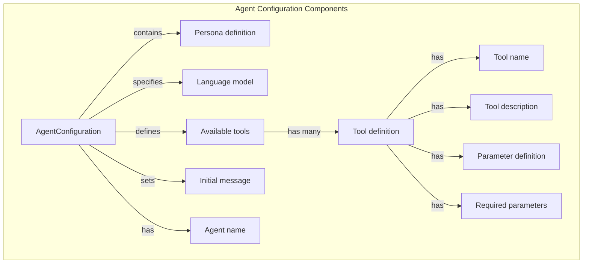
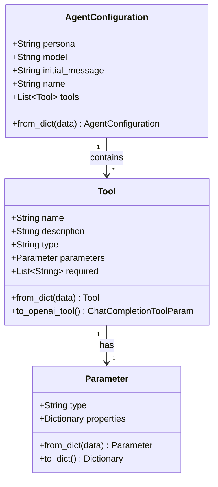
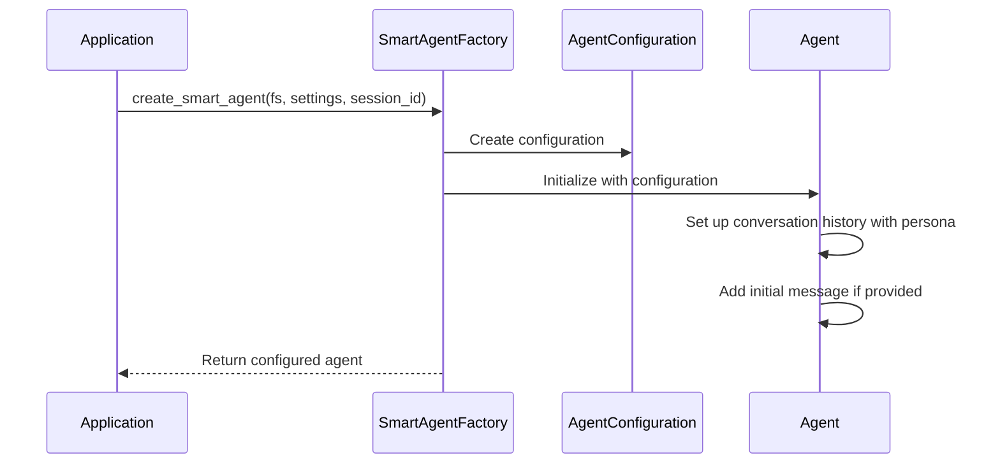
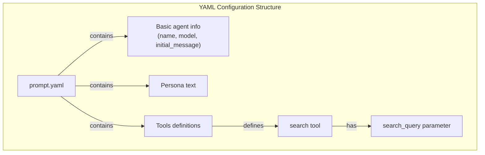
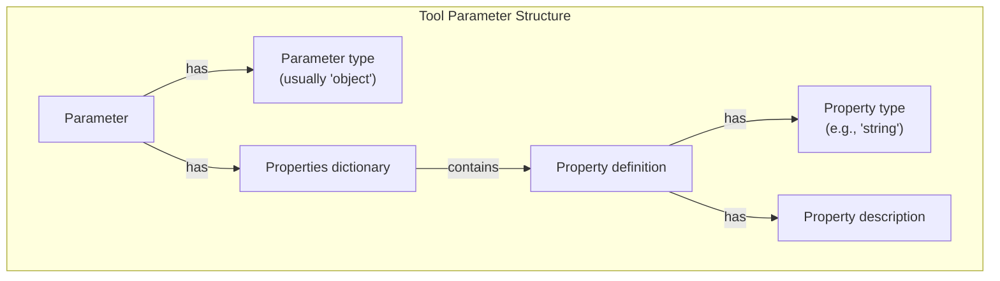
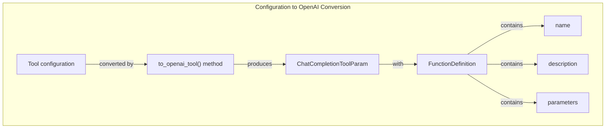
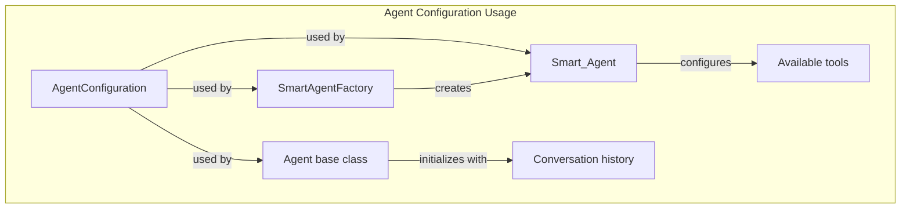

<!-- source: DeepWiki mcp.deepwiki.com · repo microsoft/deepRAG · page 3.1 Agent Configuration · fetched 2026-10-26 -->

# Agent Configuration

<details>
<summary>Relevant source files</summary>

The following files were used as context for generating this wiki page:

- [README.md](README.md)
- [src/agents/README.md](src/agents/README.md)
- [src/agents/agent.py](src/agents/agent.py)
- [src/agents/agents.py](src/agents/agents.py)
- [src/agents/smart_agent/prompt.yaml](src/agents/smart_agent/prompt.yaml)
- [src/models/agent_configuration.py](src/models/agent_configuration.py)
- [src/models/models.py](src/models/models.py)
- [src/utils/utilities.py](src/utils/utilities.py)

</details>


This document provides detailed information on how to configure agents in the deepRAG system. Agent configuration is a crucial part of the system as it defines the agent's behavior, capabilities, and interaction style. For information about how the Smart Agent uses these configurations at runtime, see [Smart Agent](#3).

## Overview of Agent Configuration

The deepRAG system uses a configuration-driven approach to define and create agents. The configuration specifies the agent's persona, language model, available tools, and other attributes that determine how the agent functions and responds to user queries.



Sources: [src/models/agent_configuration.py:62-80](), [src/agents/agent.py:9-22]()

## The AgentConfiguration Class

The `AgentConfiguration` class is the core component that encapsulates all configuration settings for an agent. It is defined in `src/models/agent_configuration.py`.



Sources: [src/models/agent_configuration.py:6-89]()

### AgentConfiguration Properties

The `AgentConfiguration` class contains the following properties:

| Property | Type | Description |
|----------|------|-------------|
| persona | string | Defines the agent's behavior, knowledge, and response style |
| model | string | The language model to use (e.g., "gpt-4o") |
| initial_message | string | First message the agent sends to the user |
| name | string | Name identifier for the agent |
| tools | list[Tool] | List of tools the agent can use |

Sources: [src/models/agent_configuration.py:62-68]()

### Agent Initialization

When an agent is initialized with a configuration, it sets up the initial conversation history and prepares available tools. The base `Agent` class handles this initialization:



Sources: [src/agents/agent.py:9-22](), [src/utils/utilities.py:353-370]()

## Creating Agent Configurations

There are two ways to create agent configurations:

1. Directly instantiating the `AgentConfiguration` class
2. Using the `from_dict` static method to create a configuration from a dictionary

### From Dictionary

The `from_dict` static method provides a convenient way to create agent configurations from dictionaries:

```python
agent_config = AgentConfiguration.from_dict({
    "persona": "You are a helpful assistant...",
    "model": "gpt-4o",
    "initial_message": "Hello! How can I help you today?",
    "name": "ResearchAssistant",
    "tools": [...]
})
```

Sources: [src/models/agent_configuration.py:71-79](), [src/models/agent_configuration.py:81-89]()

### From YAML Configuration

In practice, configurations are often defined in YAML files and loaded at runtime. The file `src/agents/smart_agent/prompt.yaml` provides an example of a complete agent configuration:



Sources: [src/agents/smart_agent/prompt.yaml:1-175]()

## Tool Configuration

Tools are a critical part of agent configuration as they define the capabilities an agent can use to respond to queries. Each tool is defined with the following properties:

| Property | Type | Description |
|----------|------|-------------|
| name | string | The name of the tool |
| description | string | Description of what the tool does |
| type | string | Type of the tool (currently only "function" is supported) |
| parameters | Parameter | The parameters the tool accepts |
| required | list[string] | List of required parameter names |

Sources: [src/models/agent_configuration.py:29-59]()

### Parameter Configuration

Each tool includes a `parameters` property that defines the structure of the parameters the tool accepts:



Sources: [src/models/agent_configuration.py:6-27]()

## Example Configuration

Below is an example of a complete agent configuration for the Smart Agent:

```yaml
name: "SmartAgent"
model: "gpt-4o"
initial_message: "Hi, I'm your smart research assistant. How can I help you today?"
persona: |
    You are an intelligent AI assistant designed to help users find information...
    [extensive persona definition]
tools:
    - name: "search"
      description: "Semantic Search Engine to search for content"
      type: "function"
      parameters:
        type: "object"
        properties:
        - search_query: 
            type: "string"
            description: "Natural language query to search for content"                
      required: 
        - "search_query"
```

Sources: [src/agents/smart_agent/prompt.yaml:1-175]()

## Converting Configuration to OpenAI Format

The `Tool` class has a `to_openai_tool()` method that converts a tool definition to the format required by the OpenAI API:



Sources: [src/models/agent_configuration.py:49-59]()

## Using Agent Configuration in the System

The agent configuration is used throughout the system to create and manage agents:

1. When creating a new agent via `SmartAgentFactory`
2. When initializing the agent's conversation history
3. When determining which tools the agent can use
4. When setting up the agent's persona and initial behavior



Sources: [src/agents/agent.py:9-22](), [src/utils/utilities.py:353-370]()

## Best Practices for Agent Configuration

When creating agent configurations:

1. **Detailed Persona**: Provide a comprehensive persona description that guides the agent's behavior
2. **Clear Tool Descriptions**: Define tools with clear descriptions and parameter definitions
3. **Appropriate Model Selection**: Choose the right model based on the complexity of tasks
4. **Welcoming Initial Message**: Set an initial message that clearly communicates the agent's purpose
5. **Required Parameters**: Clearly specify which parameters are required for each tool

Sources: [src/agents/smart_agent/prompt.yaml:1-175](), [src/models/agent_configuration.py:29-59]()

## Conclusion

Agent configuration is a fundamental aspect of the deepRAG system that allows for flexible and powerful agent creation. By properly configuring agents, you can define their behavior, capabilities, and interactions to suit specific use cases and requirements.

---

