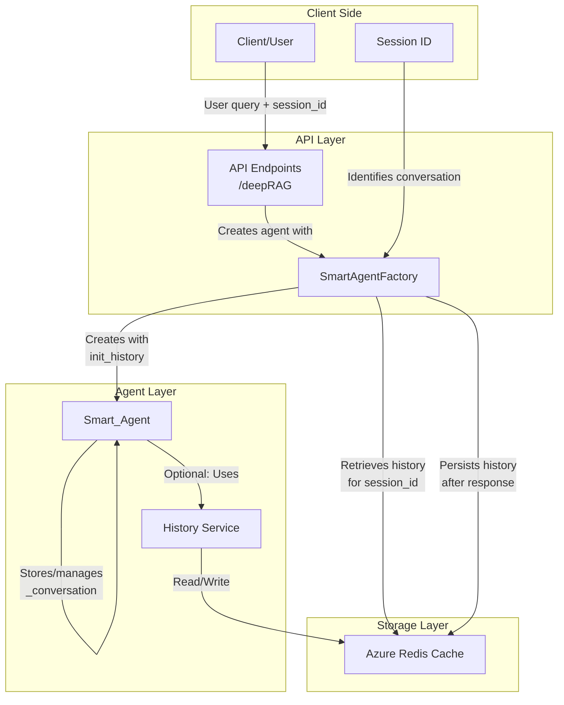
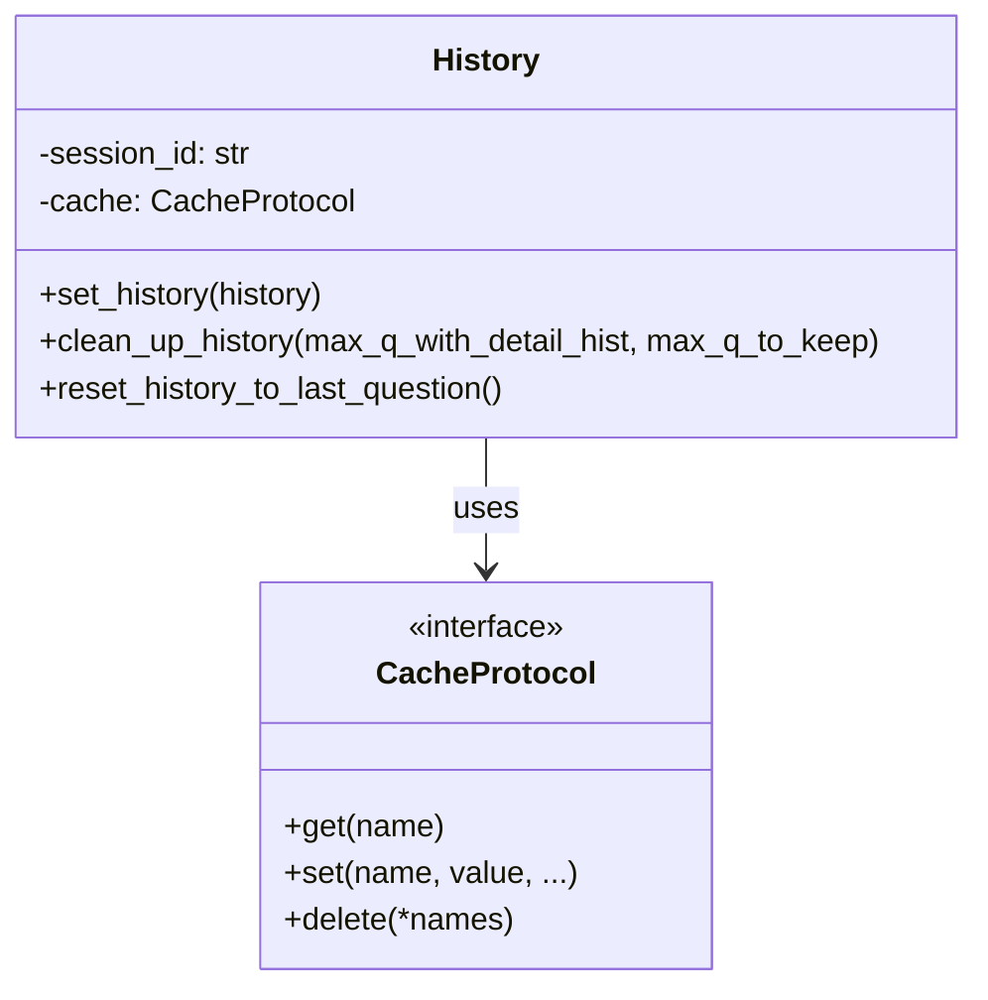
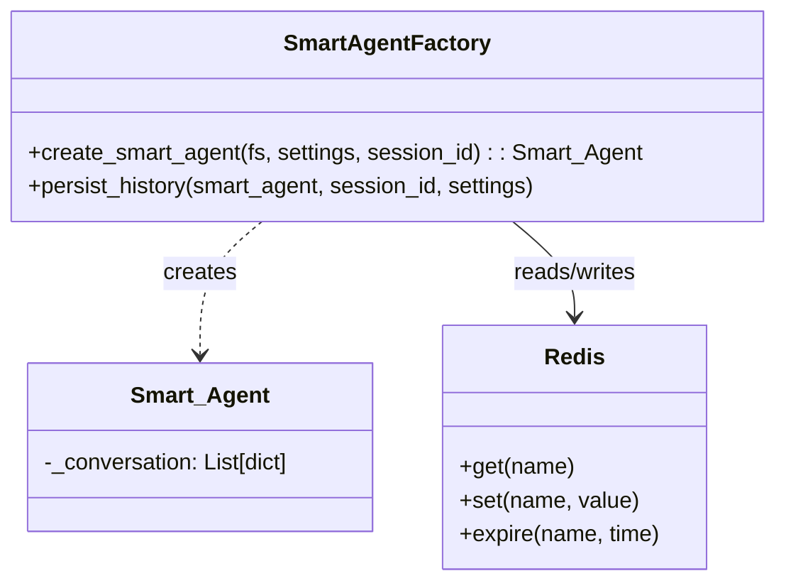
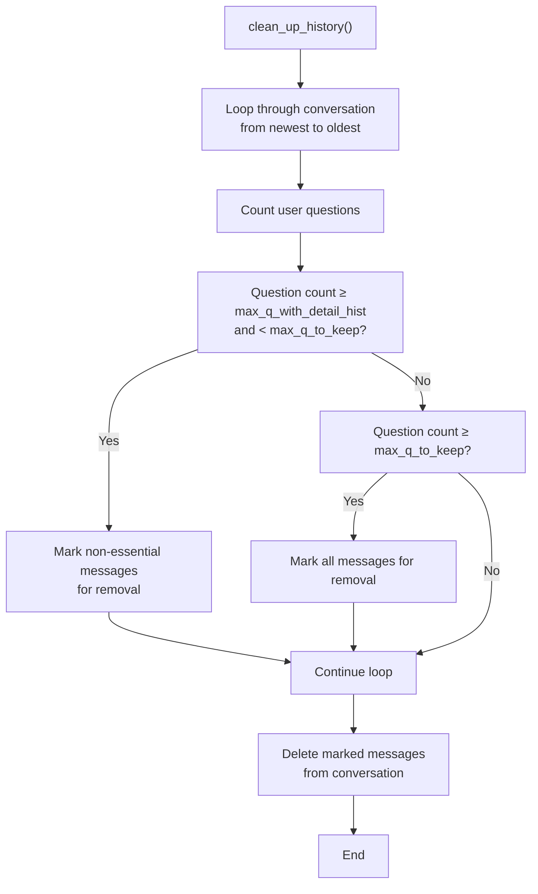
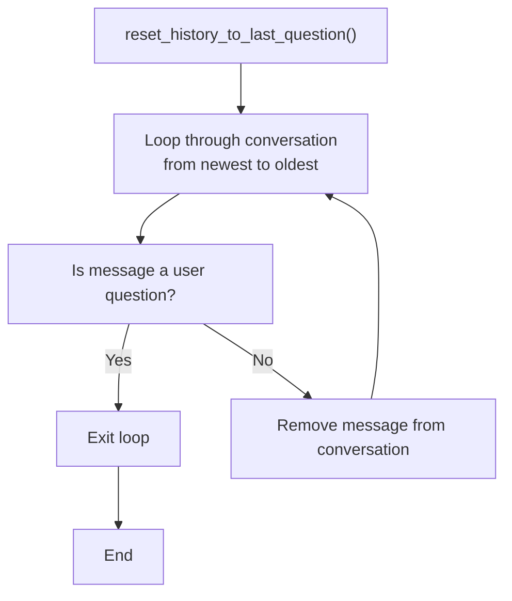

<!-- source: DeepWiki mcp.deepwiki.com · repo microsoft/deepRAG · page 3.2 Conversation History Management · fetched 2026-10-26 -->

# Conversation History Management

<details>
<summary>Relevant source files</summary>

The following files were used as context for generating this wiki page:

- [src/agents/smart_agent/smart_agent.py](src/agents/smart_agent/smart_agent.py)
- [src/distributed_cache/README.md](src/distributed_cache/README.md)
- [src/distributed_cache/cache.py](src/distributed_cache/cache.py)
- [src/services/README.md](src/services/README.md)
- [src/services/history.py](src/services/history.py)
- [src/services/services.py](src/services/services.py)
- [src/utils/smart_agent_factory.py](src/utils/smart_agent_factory.py)

</details>


## Overview

This document details how deepRAG manages, maintains, and persists conversation history between users and the Smart Agent. Effective conversation history management is crucial for providing contextually relevant responses across user sessions, enabling the Smart Agent to reference previous questions and answers.

For information about the Smart Agent itself, see [Smart Agent](#3). For details on agent configuration, see [Agent Configuration](#3.1).

Sources: [src/agents/smart_agent/smart_agent.py:19-50](). [src/utils/smart_agent_factory.py:19-25]()

## Architecture

The conversation history management system in deepRAG consists of several components working together to store, retrieve, and maintain conversation state.



Sources: [src/agents/smart_agent/smart_agent.py:19-50](). [src/utils/smart_agent_factory.py:19-83](). [src/services/history.py:5-16]()

## Components

### History Service

The `History` class provides a dedicated service for managing conversation history:



The History service provides methods to:
- Retrieve history from the distributed cache
- Store updated history in the cache
- Clean up history based on configurable parameters
- Reset history to the last question asked

Sources: [src/services/history.py:5-76](). [src/distributed_cache/cache.py:10-34]()

### Smart Agent History Management

The `Smart_Agent` class incorporates history management directly:

```mermaid
classDiagram
    class Smart_Agent {
        -_conversation: List[dict]
        -__max_question_with_detail_hist: int
        -__max_question_to_keep: int
        +clean_up_history(max_q_with_detail_hist, max_q_to_keep)
        +reset_history_to_last_question()
        +run(user_input, conversation, stream)
    }
    
    Smart_Agent --> "History Management" : implements
```

The Smart Agent maintains:
- The current conversation as a list of message dictionaries
- Configuration for how many questions to keep with full details
- Configuration for the maximum number of questions to retain

Sources: [src/agents/smart_agent/smart_agent.py:19-50](). [src/agents/smart_agent/smart_agent.py:50-72](). [src/agents/smart_agent/smart_agent.py:75-85]()

### Smart Agent Factory

The `SmartAgentFactory` handles the creation of Smart Agents with appropriate history and the persistence of conversation history:



The factory provides:
- Creation of Smart Agents with initialization from cached history
- Persistence of conversation history back to the cache after agent runs
- Session management through unique session IDs

Sources: [src/utils/smart_agent_factory.py:19-70](). [src/utils/smart_agent_factory.py:71-83]()

## History Storage Format

Conversation history in deepRAG is stored as a list of message dictionaries in Redis cache. The format follows the OpenAI chat completion message structure.

Each message in the conversation history typically includes:
- `role`: The sender role ("user", "assistant", "system", or "tool")
- `content`: The message content (text or structured data)
- Additional fields for tool calls and tool responses

```
[
  {"role": "system", "content": "System prompt..."},
  {"role": "user", "content": "User question 1"},
  {"role": "assistant", "content": "Assistant response 1"},
  {"role": "user", "content": "User question 2"},
  {"role": "assistant", "content": null, "tool_calls": [...]},
  {"role": "tool", "name": "search", "tool_call_id": "...", "content": "..."}
  ...
]
```

The history is serialized using Python's pickle, encoded in base64, and stored in Redis using the session ID as the key.

Sources: [src/utils/smart_agent_factory.py:57-61](). [src/utils/smart_agent_factory.py:71-83](). [src/services/history.py:17-22]()

## History Management Operations

### Initialization

When a Smart Agent is created, its conversation history is initialized from Redis if a session ID is provided:

1. SmartAgentFactory retrieves serialized history from Redis using the session ID
2. If found, the history is decoded from base64 and deserialized from pickle
3. The Smart Agent is initialized with this history
4. If no history is found, the agent starts with an empty history

Sources: [src/utils/smart_agent_factory.py:57-69](). [src/agents/smart_agent/smart_agent.py:42-44]()

### History Cleanup

The system implements a strategy to limit the size of conversation history to maintain performance:



Key parameters:
- `max_q_with_detail_hist`: Number of recent questions to keep with full history (including tool calls)
- `max_q_to_keep`: Maximum total number of questions to retain

The cleanup process:
1. Counts questions from newest to oldest
2. For questions beyond `max_q_with_detail_hist` but within `max_q_to_keep`, removes intermediary messages (tool calls, etc.)
3. Removes all messages for questions beyond `max_q_to_keep`

Sources: [src/agents/smart_agent/smart_agent.py:50-72](). [src/services/history.py:24-55]()

### Reset to Last Question

The system can also reset the history to only include the most recent question:



This operation is useful when:
- The history needs to be cleared after a completed interaction
- The conversation has taken an undesired path
- A fresh start is needed while keeping the current context

Sources: [src/agents/smart_agent/smart_agent.py:75-85](). [src/services/history.py:57-75]()

### Persistence

After a Smart Agent processes a user query, its updated conversation history needs to be persisted:

1. The Smart Agent's `_conversation` attribute contains the updated history
2. SmartAgentFactory serializes this history using pickle
3. The serialized data is encoded in base64
4. The encoded data is stored in Redis with the session ID as the key
5. An expiration time (3600 seconds/1 hour) is set for the Redis entry

Sources: [src/utils/smart_agent_factory.py:71-83](). [src/services/history.py:20-22]()

## Usage in Agent Flow

The conversation history management is integrated into the Smart Agent's request processing flow:

1. When the agent's `run` method is called with a user query:
   - The query is added to the conversation history
   - The history is cleaned up to maintain size limits
   - The agent generates a response using the conversation context
   - The updated history is returned with the response

2. After the response is generated:
   - The API layer calls SmartAgentFactory to persist the updated history
   - The session ID and history are stored for future interactions

Sources: [src/agents/smart_agent/smart_agent.py:88-140](). [src/utils/smart_agent_factory.py:71-83]()

## Best Practices

When working with the conversation history management system:

1. Always provide a consistent session ID for conversations with the same user
2. Use the history cleanup methods to prevent history from growing too large
3. Consider the balance between history retention and performance
4. Be aware that history has a 1-hour expiration by default
5. Use the SmartAgentFactory methods for creating agents and persisting history rather than manipulating the cache directly

Sources: [src/utils/smart_agent_factory.py:82](). [src/agents/smart_agent/smart_agent.py:98-99]()

---

