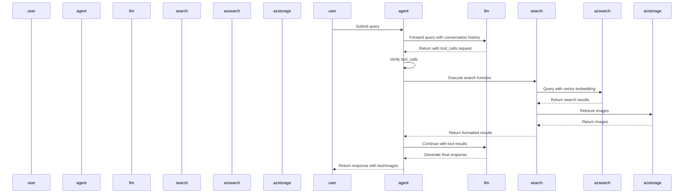
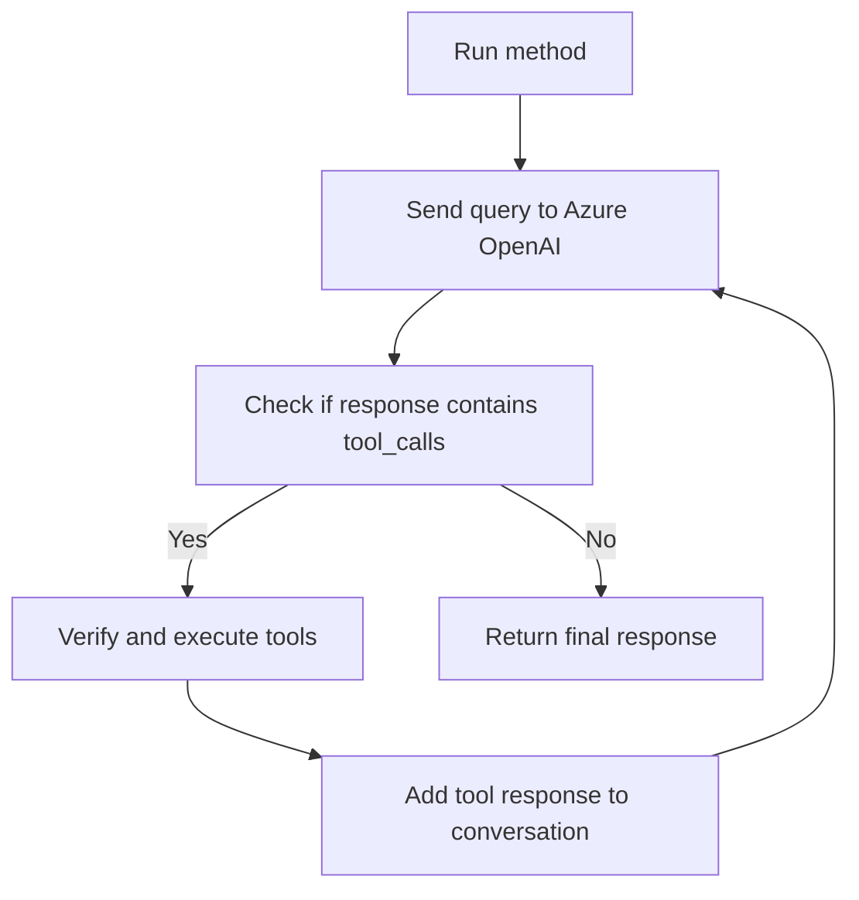
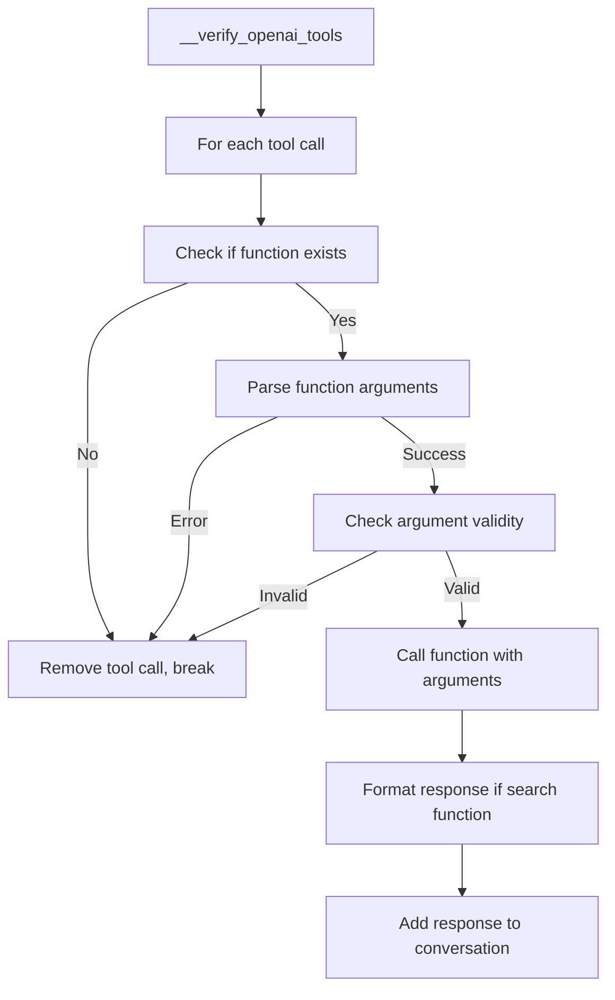
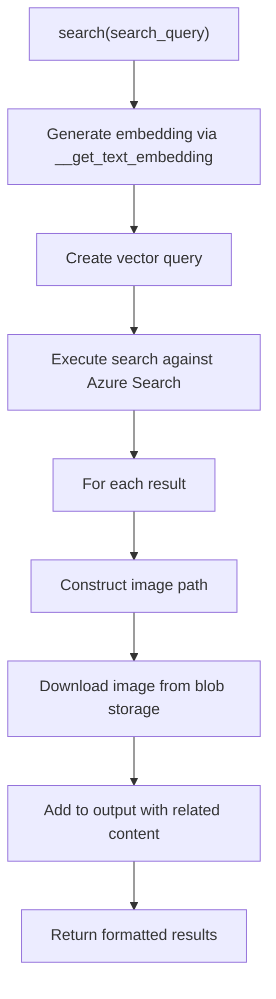
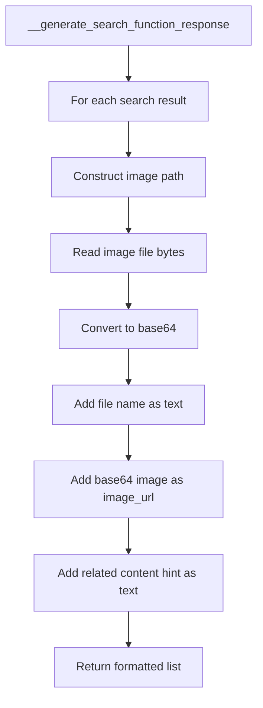

<!-- source: DeepWiki mcp.deepwiki.com · repo microsoft/deepRAG · page 3.3 Tool Calling · fetched 2026-10-26 -->

# Tool Calling

<details>
<summary>Relevant source files</summary>

The following files were used as context for generating this wiki page:

- [src/agents/smart_agent/smart_agent.py](src/agents/smart_agent/smart_agent.py)
- [src/functions/search_vector_function.py](src/functions/search_vector_function.py)
- [tests/test_search_vector_function.py](tests/test_search_vector_function.py)
- [tests/test_smart_agent.py](tests/test_smart_agent.py)

</details>


## Purpose and Scope

This document explains how the Smart Agent in deepRAG implements tool calling functionality to enhance its responses. Tool calling allows the agent to interact with external systems and retrieve information during a conversation. The primary focus is on the search tool, which enables the agent to query Azure Search for relevant content and images that support its responses.

For information about the overall Smart Agent architecture, see [Smart Agent](#3), and for details on the vector search function itself, see [Search Vector Function](#4).

## Tool Calling Overview

Tool calling in deepRAG follows this general flow: the Smart Agent submits a user query to Azure OpenAI, which may determine that a tool (like search) should be called to answer the query effectively. The agent then executes the tool, processes the results, and feeds them back to the model to generate a final response.



Sources:
- [src/agents/smart_agent/smart_agent.py:87-140]()
- [src/functions/search_vector_function.py:39-73]()

## Tool Configuration and Registration

The Smart Agent is initialized with a set of tool specifications derived from the `AgentConfiguration`. Currently, the system primarily uses the `search` function as a tool.

```mermaid
classDiagram
    class "Smart_Agent" {
        -AzureOpenAI __client
        -List __functions_spec
        -Dict _functions_list
        +run(user_input, conversation, stream)
    }
    
    class "AgentConfiguration" {
        +String model
        +List~Tool~ tools
        +to_openai_tool()
    }
    
    class "SearchVectorFunction" {
        +search(search_query)
        -__get_text_embedding(text)
        -__download_image_from_blob(blob_name, download_file_path)
    }
    
    "Smart_Agent" --> "AgentConfiguration" : uses
    "Smart_Agent" --> "SearchVectorFunction" : calls
    "AgentConfiguration" --> "Tool" : contains
```

During initialization, the Smart Agent registers available tools:

1. It converts tool definitions from the agent configuration into the OpenAI tool format
2. It maps function names to actual function implementations in a dictionary
3. Currently, the primary tool is the `search` function from `SearchVectorFunction`

Sources:
- [src/agents/smart_agent/smart_agent.py:22-49]()

## Tool Calling Process

### 1. Tool Call Detection

When the Smart Agent receives a response from Azure OpenAI, it checks for tool calls:



The agent calls the OpenAI API with the current conversation history and tool specifications:

```
response: ChatCompletion = self.__client.chat.completions.create(
    model=self._agent_configuration.model,
    messages=self._conversation,
    tools=self.__functions_spec,
    tool_choice='auto',
    temperature=0.2,
)
```

Sources:
- [src/agents/smart_agent/smart_agent.py:113-119]()
- [src/agents/smart_agent/smart_agent.py:127-134]()

### 2. Tool Verification

Before executing a tool, the Smart Agent verifies:
- That the requested function exists in the `_functions_list`
- That the function arguments can be parsed as valid JSON
- That the arguments match the expected function signature



Sources:
- [src/agents/smart_agent/smart_agent.py:157-196]()
- [src/agents/smart_agent/smart_agent.py:142-155]()

### 3. Tool Response Processing

For search function calls, the results are specially formatted to include:
1. Image file paths
2. Base64-encoded images for display
3. Related content hints from the search results

The search results are then added to the conversation as a tool response:

```
self._conversation.append(
    {
        "tool_call_id": tool_call.id,
        "role": "tool",
        "name": function_name,
        "content": function_response,
    }
)
```

Sources:
- [src/agents/smart_agent/smart_agent.py:185-196]()
- [src/agents/smart_agent/smart_agent.py:198-221]()

## Search Function Implementation

The `search` function in `SearchVectorFunction` is the primary tool used by the Smart Agent. It performs the following operations:

1. Generates a text embedding for the search query using Azure OpenAI
2. Queries Azure Search with vector search to find semantically similar content
3. Retrieves and formats relevant images from Azure Blob Storage
4. Returns structured data with image paths and contextual content



The search results are structured to include:
- The document ID
- The path to the related image
- Related content text that provides context

Sources:
- [src/functions/search_vector_function.py:39-73]()
- [src/functions/search_vector_function.py:75-80]()
- [src/functions/search_vector_function.py:82-89]()

## Tool Response Formatting

When the search function is called, its results need special formatting for inclusion in the conversation. The Smart Agent's `__generate_search_function_response` method does this by:

1. Reading the image file from the file system
2. Converting the image to base64 format for inline display
3. Formatting the response as a list of message parts including text and image URLs



The formatted response consists of a list of different content types:
1. Text elements with file name information
2. Image URL elements with base64-encoded images
3. Text elements with hints about related content

Sources:
- [src/agents/smart_agent/smart_agent.py:198-221]()

## Example Tool Calling Flow

When a user submits a question that requires retrieval of information, the following typical flow occurs:

1. User submits a query like "Tell me about solar energy in California"
2. Smart Agent forwards the query to Azure OpenAI
3. OpenAI model determines it needs to search for information
4. Model returns a response with a tool call to the search function
5. Agent validates and executes the search function with the query
6. Search function queries Azure Search and retrieves relevant images and content
7. Agent formats the search results and adds them to the conversation
8. Agent sends the updated conversation back to Azure OpenAI
9. OpenAI model generates a final response incorporating the search results
10. Agent returns the final response to the user

This flow allows the agent to provide more accurate, contextual responses by retrieving and incorporating relevant information during the conversation.

Sources:
- [src/agents/smart_agent/smart_agent.py:87-140]()
- [tests/test_smart_agent.py:133-184]()

## Error Handling

The Smart Agent implements several error handling mechanisms for tool calling:

1. **Function existence check**: Verifies that the requested function exists before attempting to call it
2. **JSON parsing**: Handles JSON parsing errors for function arguments
3. **Argument validation**: Ensures that function arguments match the expected signature
4. **Maximum run count**: Limits the number of tool calls per question to prevent infinite loops
5. **Conversation cleanup**: Periodically cleans up conversation history to manage context size

If errors occur during tool calling, the agent typically:
1. Removes the problematic tool call from the conversation
2. Breaks out of the current tool calling loop
3. If max runs are reached, returns a fallback message: "I am unable to answer this question at the moment, please ask another question."

Sources:
- [src/agents/smart_agent/smart_agent.py:104-111]()
- [src/agents/smart_agent/smart_agent.py:164-178]()
- [tests/test_smart_agent.py:111-131]()

---

