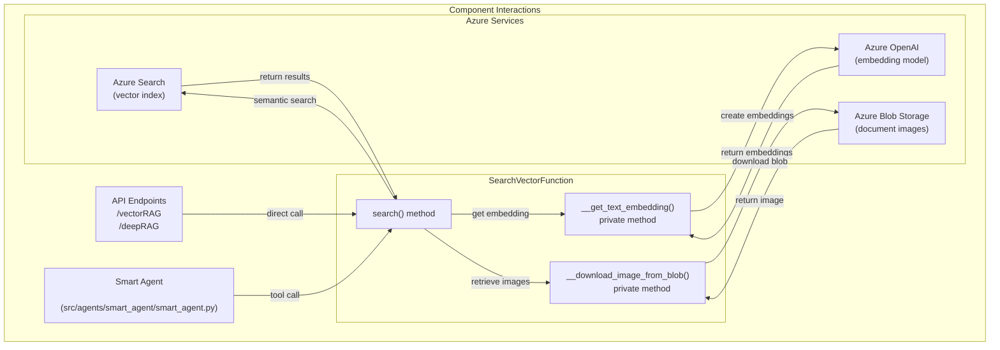
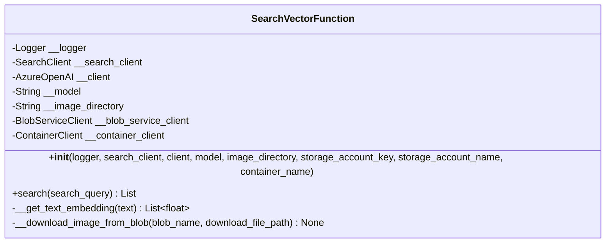
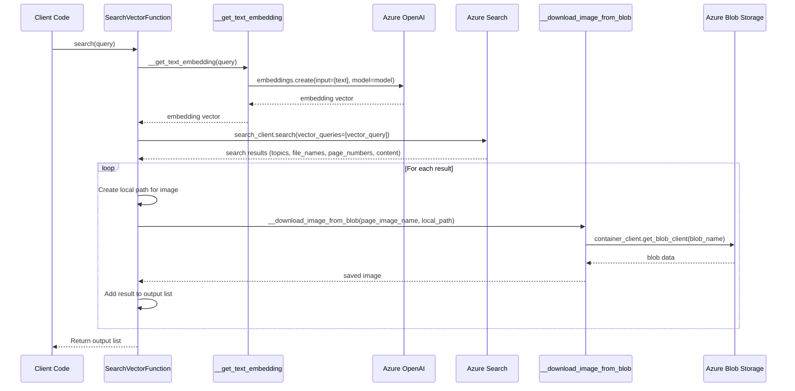
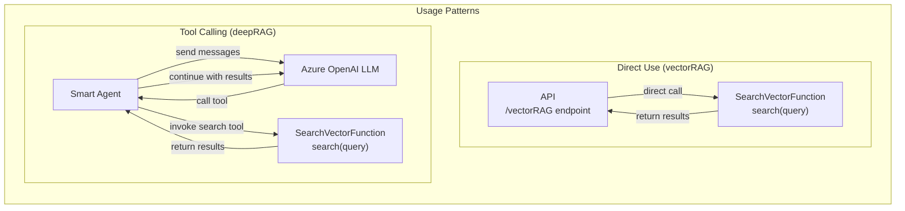

<!-- source: DeepWiki mcp.deepwiki.com · repo microsoft/deepRAG · page 4 Search Vector Function · fetched 2026-10-26 -->

# Search Vector Function

<details>
<summary>Relevant source files</summary>

The following files were used as context for generating this wiki page:

- [src/functions/README.md](src/functions/README.md)
- [src/functions/pyproject.toml](src/functions/pyproject.toml)
- [src/functions/search_vector_function.py](src/functions/search_vector_function.py)
- [src/models/README.md](src/models/README.md)
- [src/models/pyproject.toml](src/models/pyproject.toml)
- [src/utils/utils.py](src/utils/utils.py)
- [tests/test_vectors.py](tests/test_vectors.py)
- [tests/tests.py](tests/tests.py)

</details>


## Overview

The Search Vector Function is a core component of the deepRAG system that provides vector-based semantic search capabilities. It serves as the bridge between user queries and the knowledge base stored in Azure Search, enabling both the simple vectorRAG endpoint and the more sophisticated Smart Agent to retrieve relevant content based on semantic similarity rather than just keyword matching.

For information about the Smart Agent that uses this function, see [Smart Agent](#3).

Sources: [src/functions/search_vector_function.py:14-16]()

## Component Architecture

The Search Vector Function acts as an abstraction layer over Azure Search and integrates with Azure OpenAI for embedding generation and Azure Blob Storage for image retrieval. The diagram below illustrates its position in the deepRAG architecture:



Sources: 
- [src/functions/search_vector_function.py:14-38]()
- [src/functions/search_vector_function.py:39-90]()

## Class Implementation

The `SearchVectorFunction` class is implemented in [src/functions/search_vector_function.py]() and handles the vector search operations. The class structure is as follows:



Sources: [src/functions/search_vector_function.py:14-38]()

## Initialization and Dependencies

The `SearchVectorFunction` class requires several dependencies to be injected during initialization:

| Parameter | Type | Description |
|-----------|------|-------------|
| logger | Logger | Logging instance for debugging and monitoring |
| search_client | SearchClient | Azure Search client for querying the vector index |
| client | AzureOpenAI | Azure OpenAI client for generating text embeddings |
| model | str | The model name used for embeddings (e.g., "text-embedding-ada-002") |
| image_directory | str | Local directory where retrieved images will be stored |
| storage_account_key | str | Azure Storage account access key |
| storage_account_name | str | Azure Storage account name |
| container_name | str | Azure Blob Storage container name |

These dependencies are stored as private instance variables and used by the class methods to perform their operations.

Sources: [src/functions/search_vector_function.py:17-38]()

## Search Process Flow

The core functionality is implemented in the `search()` method, which follows this process:



Sources: [src/functions/search_vector_function.py:39-73]()

## Key Method: search()

The `search()` method is the main public interface for the class, implementing vector-based semantic search:

1. It takes a search query as input
2. Converts the query to a vector embedding using OpenAI
3. Constructs a vectorized query for Azure Search with parameters:
   - k_nearest_neighbors=3 (retrieve 3 closest matching vectors)
   - fields="contentVector" (vector field to search against)
4. Executes a semantic search with configuration:
   - query_type=QueryType.SEMANTIC
   - semantic_configuration_name='my-semantic-config'
   - query_caption and query_answer set to EXTRACTIVE
   - Select fields: "topic", "file_name", "page_number", "related_content"
   - top=3 results
5. For each result:
   - Logs debug information
   - Constructs a path for the page image
   - Creates the directory if it doesn't exist
   - Downloads the image from Azure Blob Storage
   - Adds the result (id, image_path, related_content) to the output list
6. Returns the output list

Sources: [src/functions/search_vector_function.py:39-73]()

## Private Methods

### __get_text_embedding()

This private method converts text into vector embeddings using Azure OpenAI:

1. Replaces newlines with spaces in the input text
2. Calls the OpenAI embeddings API to generate an embedding vector
3. Returns the embedding as a list of floats

Sources: [src/functions/search_vector_function.py:75-80]()

### __download_image_from_blob()

This private method downloads an image from Azure Blob Storage to a local file:

1. Opens a local file for writing in binary mode
2. Gets a blob client for the specified blob name
3. Downloads the blob content as a stream
4. Writes the stream data to the local file

Sources: [src/functions/search_vector_function.py:82-89]()

## Integration with deepRAG

The Search Vector Function is used in two main contexts within the deepRAG system:

1. **Direct use by vectorRAG endpoint**: The API calls the function directly to perform vector-based searches
2. **Tool calling by Smart Agent**: The function is registered as a tool that can be called by the Smart Agent during conversation



Sources: 
- [src/functions/search_vector_function.py:39-73]()
- System Architecture Diagrams (Core System Components and Data Flow Architecture)

## Output Format

The function returns a list of dictionaries with the following structure:

```python
[
    {
        'id': '<document_id>',  # ID from Azure Search or None if not available
        'image_path': '<path_to_image>',  # Path to the downloaded page image
        'related_content': '<content_text>'  # The relevant content from the document
    },
    # More results...
]
```

This format makes it easy for both the API and the Smart Agent to process and present the search results to the user.

Sources: [src/functions/search_vector_function.py:68-72]()

## Testing

The search vector function's behavior can be tested using a vector store and document retrieval approach. The project includes test cases in `tests/test_vectors.py` that demonstrate how to test vector-based retrieval using a fake embedding model and in-memory vector store.

Sources: [tests/test_vectors.py:1-48]()

## Related Components

- For information about how the Smart Agent uses this function, see [Smart Agent](#3).
- For details on the vectorRAG endpoint implementation, see [vectorRAG Endpoint](#5.1).
- For information about the deepRAG endpoint that uses the Smart Agent, see [deepRAG Endpoint](#5.2).

---

