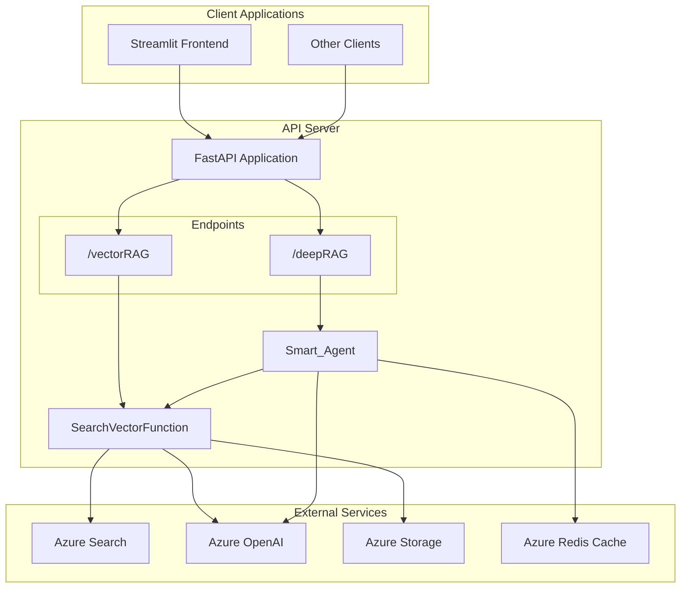
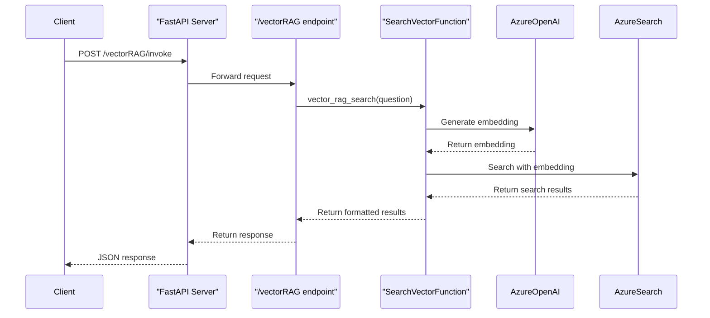
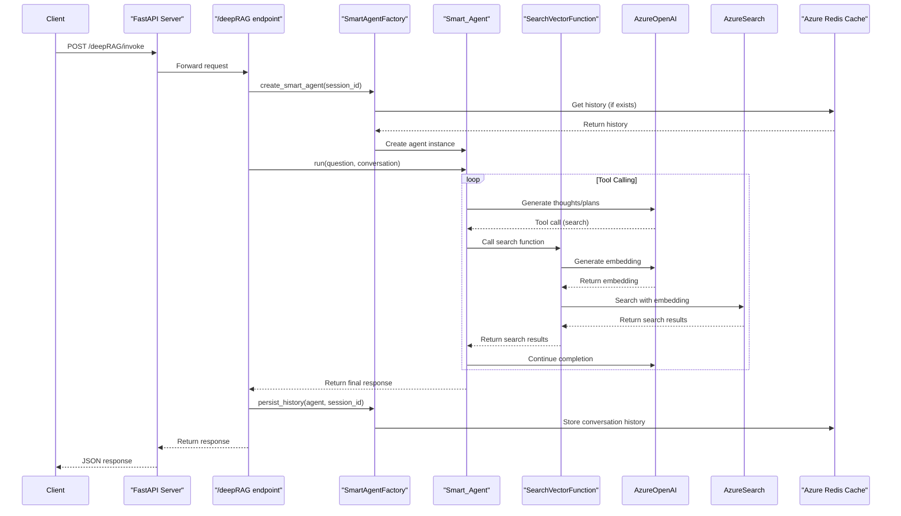
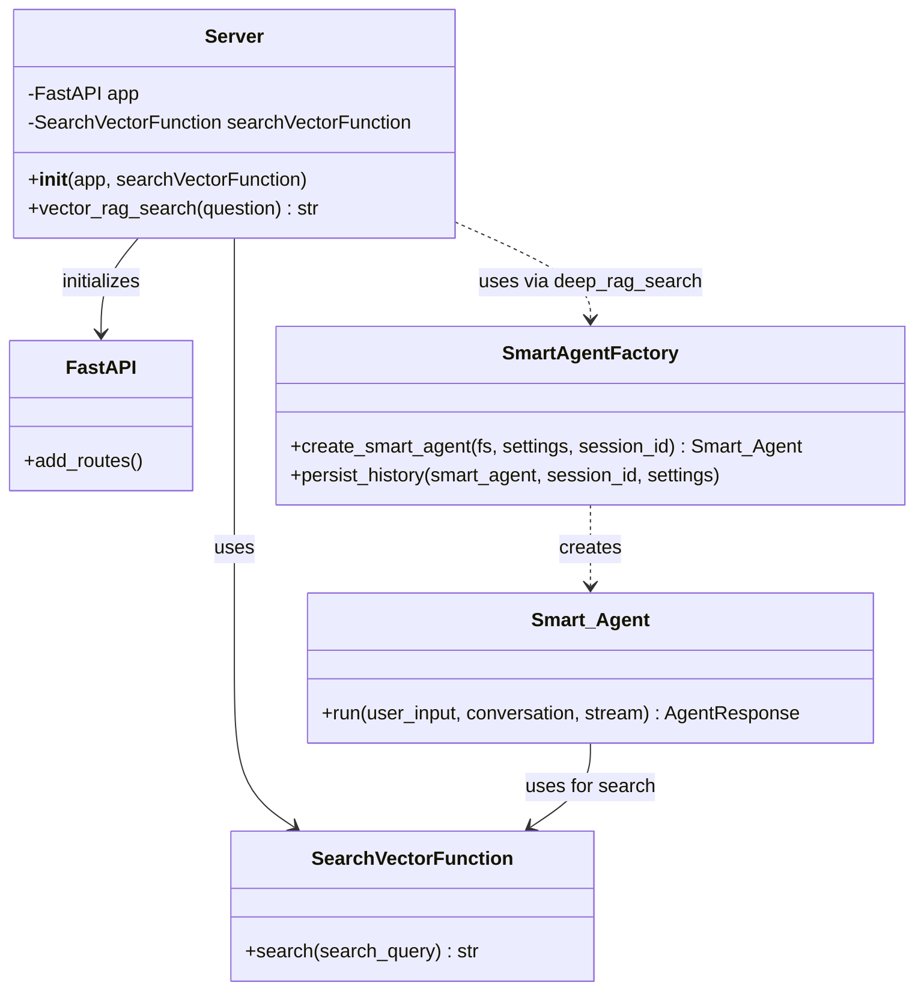

<!-- source: DeepWiki mcp.deepwiki.com · repo microsoft/deepRAG · page 5 API · fetched 2026-10-26 -->

# API

<details>
<summary>Relevant source files</summary>

The following files were used as context for generating this wiki page:

- [.gitignore](.gitignore)
- [poetry.toml](poetry.toml)
- [src/agents/pyproject.toml](src/agents/pyproject.toml)
- [src/api/api.py](src/api/api.py)
- [src/api/main.py](src/api/main.py)
- [src/functions/functions.py](src/functions/functions.py)
- [tests/test_server.py](tests/test_server.py)

</details>


This document details the API system in the deepRAG repository, covering the available endpoints, their implementation, request/response formats, and how they integrate with other components of the system. For information about the frontend application that consumes this API, see [Frontend Application](#6).

## Overview

The deepRAG API provides two main endpoints that implement different approaches to Retrieval-Augmented Generation:

1. `/vectorRAG` - A simple vector-based retrieval endpoint that performs direct semantic search
2. `/deepRAG` - An agent-based retrieval endpoint with state management and multi-step reasoning

The API is built with FastAPI and LangServe, which provides convenient routing mechanisms for LangChain runnables.



Sources: [src/api/api.py:1-60](), [src/api/api.py:61-89]()

## API Endpoints

### `/vectorRAG` Endpoint

The `/vectorRAG` endpoint provides simple vector-based search functionality:

- **Purpose**: Performs semantic search on documents using vector embeddings
- **Implementation**: Uses the `SearchVectorFunction` to generate embeddings and query Azure Search
- **State Management**: Stateless (no conversation history)

#### Request Format

```json
{
  "input": "Your search query here"
}
```

#### Response Format

The endpoint returns search results containing document content, metadata, and any associated images.

### `/deepRAG` Endpoint

The `/deepRAG` endpoint provides agent-based search with multi-step reasoning:

- **Purpose**: Performs complex search operations with reasoning and conversation history
- **Implementation**: Uses a `Smart_Agent` created via `SmartAgentFactory`
- **State Management**: Stateful (maintains conversation history via session_id)

#### Request Format

```json
{
  "input": {
    "question": "Your question here",
    "session_id": "unique-session-identifier"
  }
}
```

#### Response Format

The endpoint returns the agent's response, which may include retrieved information, reasoning steps, and potentially image references.

Sources: [src/api/api.py:33-51](), [src/api/api.py:20-31]()

## Request Flow

### vectorRAG Request Flow



### deepRAG Request Flow



Sources: [src/api/api.py:20-31](), [src/api/api.py:50-51](), [tests/test_server.py:10-18]()

## API Server Implementation

The API is implemented using a `Server` class that initializes the FastAPI application and adds routes for the two endpoints. The class holds an instance of `SearchVectorFunction` which is used for both direct vector search and as a tool for the Smart Agent.



The server is initialized with required dependencies:

1. A FastAPI application
2. A configured `SearchVectorFunction` instance with:
   - Azure Search client
   - Azure OpenAI client
   - Embedding model configuration
   - Storage configuration for images

Sources: [src/api/api.py:33-51](), [src/api/api.py:53-89](), [src/api/main.py:11-44]()

## Configuration and Initialization

The API server is configured using the `Settings` model which loads environment variables from an `.env` file. This provides configuration for:

1. OpenAI API credentials and models
2. Azure Search endpoint and index
3. Azure Storage for image retrieval
4. Redis cache for conversation history
5. API host and port settings

The API server can be started in two ways:

1. Directly from `api.py` using the `__main__` block
2. From `main.py` which imports and sets up the server

| Configuration Setting | Purpose |
|-----------------------|---------|
| `openai_endpoint` | Azure OpenAI API endpoint URL |
| `openai_key` | Azure OpenAI API key |
| `openai_api_version` | Azure OpenAI API version |
| `openai_embedding_deployment` | Embedding model deployment name |
| `azure_search_endpoint` | Azure Search endpoint URL |
| `azure_search_index_name` | Azure Search index name |
| `azure_search_key` | Azure Search API key |
| `azure_storage_account_key` | Azure Storage account key |
| `azure_storage_account_name` | Azure Storage account name |
| `azure_container_name` | Azure Storage container name |
| `smart_agent_image_path` | Local path for storing downloaded images |
| `smart_agent_prompt_location` | Location of the Smart Agent prompt template |
| `api_host` | API server host (default: 0.0.0.0) |
| `api_port` | API server port (default: 8000) |

Sources: [src/api/api.py:18](), [src/api/api.py:62-74](), [src/api/main.py:17-29]()

## Testing

The API includes basic functional tests that validate both endpoints are responding correctly. Tests use the FastAPI TestClient to make requests to both endpoints and verify successful status codes.

Test paths:
- `/vectorRAG/invoke` - Tests simple vector search
- `/deepRAG/invoke` - Tests agent-based search with reasoning

Sources: [tests/test_server.py:1-18]()

## Integration with Other Components

The API acts as a bridge between frontend applications and the core RAG functionality:

1. **SearchVectorFunction**: Used directly by the `/vectorRAG` endpoint and as a tool by the Smart Agent
2. **Smart Agent**: Created for each `/deepRAG` request to handle complex queries with state
3. **Settings**: Configures the API server and dependencies
4. **Azure Services**:
   - Azure OpenAI for embeddings and completions
   - Azure Search for retrieval
   - Azure Storage for image content
   - Azure Redis for state management

For more information about these components, see:
- [Smart Agent](#3) for details on the agent-based approach
- [Search Vector Function](#4) for details on the vector search functionality
- [Settings and Configuration](#7) for configuration options

Sources: [src/api/api.py:1-15](), [src/api/api.py:75-86]()

---

