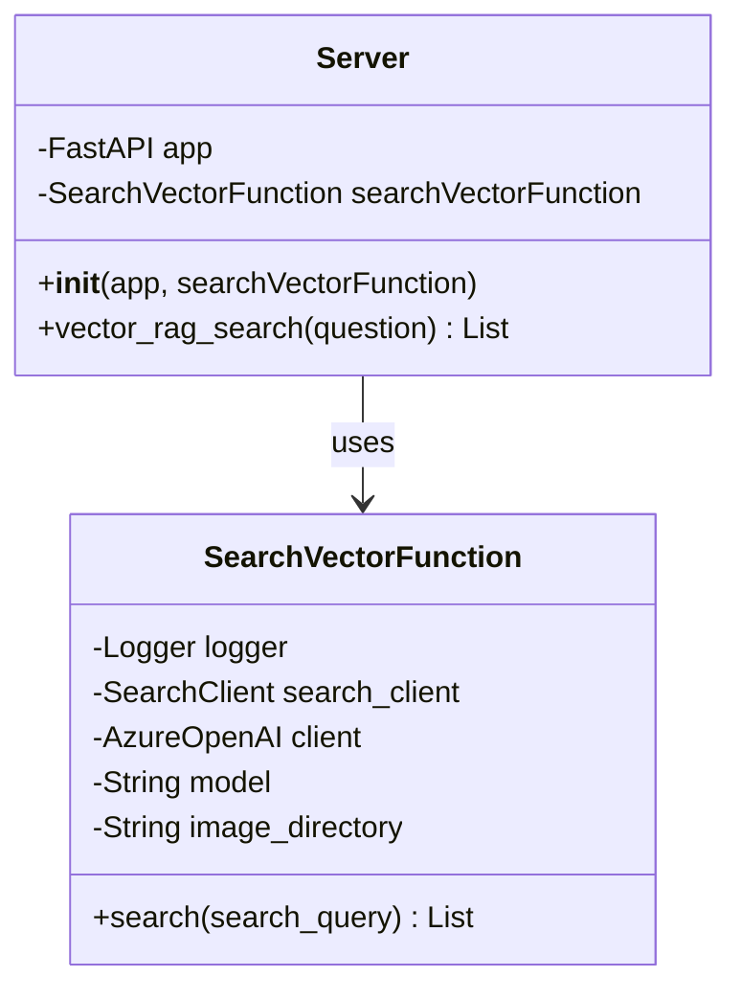
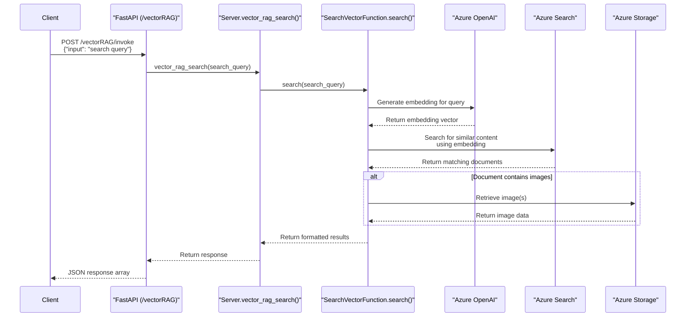
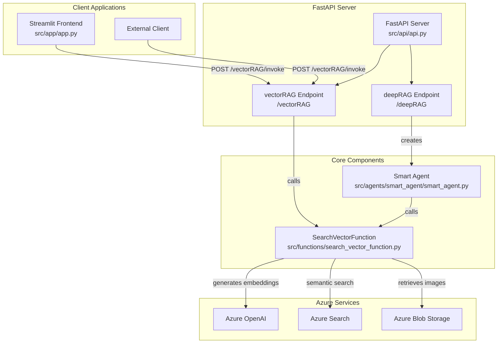
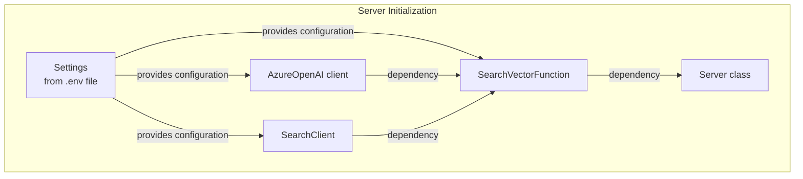

<!-- source: DeepWiki mcp.deepwiki.com · repo microsoft/deepRAG · page 5.1 vectorRAG Endpoint · fetched 2026-10-26 -->

# vectorRAG Endpoint

<details>
<summary>Relevant source files</summary>

The following files were used as context for generating this wiki page:

- [src/agents/pyproject.toml](src/agents/pyproject.toml)
- [src/api/api.py](src/api/api.py)
- [src/api/pyproject.toml](src/api/pyproject.toml)
- [src/functions/functions.py](src/functions/functions.py)
- [tests/test_api.py](tests/test_api.py)
- [tests/test_server.py](tests/test_server.py)

</details>


## Purpose and Scope

This document provides technical documentation for the vectorRAG endpoint in the deepRAG system. The vectorRAG endpoint implements a straightforward vector-based Retrieval-Augmented Generation (RAG) approach that uses semantic search to find relevant content based on a user's query. Unlike the more complex [deepRAG Endpoint](#5.2) which uses a stateful agent with tool calling capabilities, vectorRAG offers a simpler, stateless implementation focused on direct vector-based retrieval.

## Endpoint Specification

The vectorRAG endpoint is a FastAPI route that allows clients to perform semantic searches against the content repository.

| Property | Value |
|----------|-------|
| Path | `/vectorRAG` |
| HTTP Method | POST |
| Request Format | `{"input": "<search query>"}` |
| Response Format | Array of document objects containing retrieval results |

Sources: [src/api/api.py:37-42]()

## Implementation

The vectorRAG endpoint is implemented in the `Server` class using langserve's `add_routes` function, which wraps the `vector_rag_search` method in a `RunnableLambda`. This method directly delegates to the `SearchVectorFunction.search` method.



The implementation is fairly straightforward:

1. The endpoint is registered in the `Server` constructor
2. The `vector_rag_search` method acts as a thin wrapper around the `SearchVectorFunction`
3. When invoked, the endpoint takes the query string and passes it directly to the search function
4. Results are returned as a JSON-serializable structure

Sources: [src/api/api.py:33-51](), [src/api/api.py:76-86]()

## Data Flow

The following sequence diagram illustrates how data flows through the vectorRAG endpoint:



Sources: [src/api/api.py:50-51](), [tests/test_api.py:6-16]()

## System Integration

The vectorRAG endpoint is a key component in the overall deepRAG system architecture, representing the simpler of the two RAG approaches offered by the system.



Sources: [src/api/api.py:33-48]()

## Configuration and Initialization

The vectorRAG endpoint depends on the `SearchVectorFunction` which requires several dependencies and configuration parameters:



The initialization flow in the API server:

1. The FastAPI application is created
2. Settings are loaded from the .env file
3. Azure clients are initialized (OpenAI, Search)
4. The SearchVectorFunction is instantiated with required dependencies
5. The Server class is created with the FastAPI app and SearchVectorFunction
6. The server registers the vectorRAG endpoint

Sources: [src/api/api.py:56-88]()

## Request and Response Format

### Request

The vectorRAG endpoint expects a POST request with a JSON body containing an `input` field:

```json
{
  "input": "What is a vector database?"
}
```

### Response

The response is an array of document objects that match the query. Each document object typically contains:

```json
[
  {
    "title": "Document Title",
    "content": "Document content snippet...",
    "related_content": "Additional context from the document...",
    "image_path": "/path/to/image.jpg",
    "score": 0.89
  },
  ...
]
```

The exact schema may vary depending on the indexed fields in Azure Search.

Sources: [tests/test_api.py:6-16]()

## Differences from deepRAG Endpoint

The vectorRAG endpoint differs from the deepRAG endpoint in several key ways:

| Feature | vectorRAG | deepRAG |
|---------|-----------|---------|
| Complexity | Simple, direct retrieval | Complex agent-based retrieval |
| State Management | Stateless | Maintains conversation history |
| Iteration | Single search operation | Can perform multiple search operations |
| Implementation | Direct function call | Uses a Smart Agent with tool calling |
| Session ID | Not required | Required for conversation history |
| Response Generation | Returns raw search results | Generates natural language responses |

Sources: [src/api/api.py:20-51]()

## Usage Example

To use the vectorRAG endpoint from Python:

```python
from langserve.client import RemoteRunnable

# Create a client for the vectorRAG endpoint
vector_rag_client = RemoteRunnable(url="http://localhost:8000/vectorRAG")

# Perform a search
results = vector_rag_client.invoke(input="What is a vector database?")

# Process the results
for document in results:
    print(f"Title: {document.get('title')}")
    print(f"Content: {document.get('content')}")
    if 'image_path' in document:
        print(f"Image: {document.get('image_path')}")
    print("---")
```

Sources: [tests/test_api.py:6-16]()

## Technical Considerations

- The vectorRAG endpoint is designed for simplicity and direct retrieval without the complexity of a stateful agent
- It relies on Azure Search for vector embeddings and semantic search capabilities
- Images referenced in search results are stored in Azure Blob Storage
- The endpoint's performance is directly tied to the quality of the vector embeddings and the Azure Search index configuration

Sources: [src/api/api.py:50-51](), [src/api/api.py:76-86]()

---

