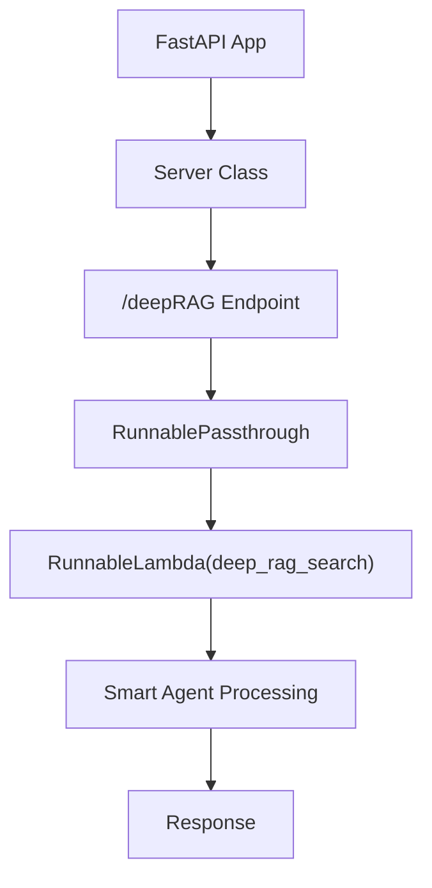
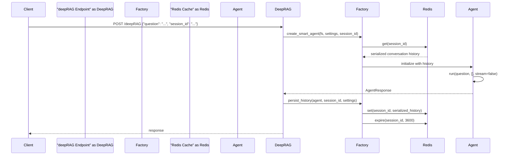
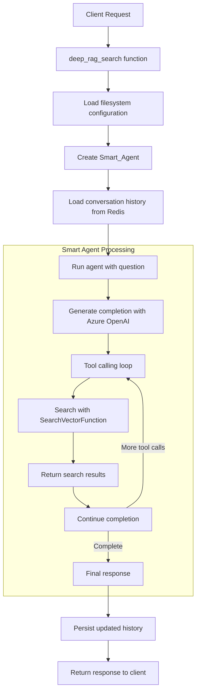
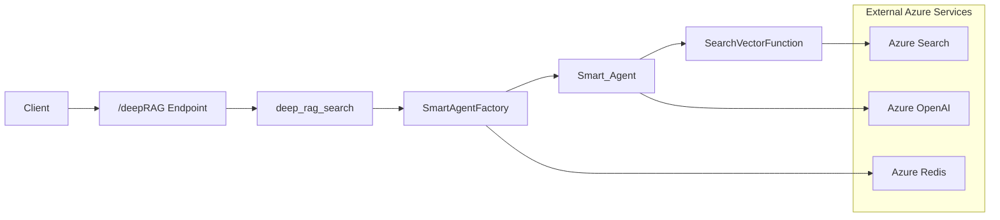

<!-- source: DeepWiki mcp.deepwiki.com · repo microsoft/deepRAG · page 5.2 deepRAG Endpoint · fetched 2026-10-26 -->

# deepRAG Endpoint

<details>
<summary>Relevant source files</summary>

The following files were used as context for generating this wiki page:

- [src/agents/pyproject.toml](src/agents/pyproject.toml)
- [src/api/api.py](src/api/api.py)
- [src/functions/functions.py](src/functions/functions.py)
- [src/services/history.py](src/services/history.py)
- [src/utils/smart_agent_factory.py](src/utils/smart_agent_factory.py)
- [tests/test_server.py](tests/test_server.py)

</details>


## Purpose and Scope

The `/deepRAG` endpoint provides access to the advanced agent-based Retrieval-Augmented Generation capabilities of the deepRAG system. Unlike the simpler vector-based approach (see [vectorRAG Endpoint](#5.1)), this endpoint leverages a stateful Smart Agent that can perform complex reasoning, maintain conversation history across sessions, and execute multiple search operations through tool calling to generate comprehensive responses.

Sources: [src/api/api.py:43-48]()

## Technical Implementation

The `/deepRAG` endpoint is implemented in the FastAPI server as a route that processes user queries through a Smart Agent.

### API Route Definition



The endpoint is defined in the Server class using langserve's `add_routes` function, which registers a route at `/deepRAG` that processes incoming requests through the `deep_rag_search` function.

Sources: [src/api/api.py:43-48]()

### Request and Response Format

**Request Format:**
```json
{
  "input": {
    "question": "User query text",
    "session_id": "unique_session_identifier"
  }
}
```

**Response Format:**
```json
{
  "output": "Agent-generated response with citations and references to retrieved documents"
}
```

Sources: [src/api/api.py:20-31](), [tests/test_server.py:15-18]()

## Core Components

### Smart Agent Creation and Management

```mermaid
classDiagram
    class "deepRAG Endpoint" {
        +deep_rag_search(input)
    }
    
    class "SmartAgentFactory" {
        +create_smart_agent(fs, settings, session_id)
        +persist_history(smart_agent, session_id, settings)
    }
    
    class "Smart_Agent" {
        +run(user_input, conversation, stream)
        +_conversation
    }
    
    class "Redis Cache" {
        +get(session_id)
        +set(session_id, value)
        +expire(session_id, time)
    }
    
    "deepRAG Endpoint" --> "SmartAgentFactory" : uses
    "SmartAgentFactory" --> "Smart_Agent" : creates
    "SmartAgentFactory" --> "Redis Cache" : persists history
    "Smart_Agent" --> "SearchVectorFunction" : calls
```

When a request is received, the `deep_rag_search` function:

1. Extracts the user's question and session ID
2. Loads the Smart Agent configuration from the specified location
3. Creates a Smart Agent instance through the SmartAgentFactory
4. Runs the agent with the user's question
5. Persists the updated conversation history
6. Returns the agent's response

Sources: [src/api/api.py:20-31](), [src/utils/smart_agent_factory.py:19-83]()

### Session and History Management



The endpoint maintains conversation state through:

1. **Session Identification**: Each client interaction includes a session ID that links related conversations
2. **Redis Cache**: Conversation history is stored in Redis with a 1-hour expiration
3. **Serialization**: History is serialized using pickle and base64 encoding for storage
4. **Retrieval on Session Start**: Previous conversation context is loaded when a session is resumed

Sources: [src/api/api.py:20-31](), [src/utils/smart_agent_factory.py:71-83](), [src/services/history.py:1-76]()

## Deep RAG Processing Flow



When processing a query, the Smart Agent leverages:

1. **Tool Calling**: The agent can invoke the SearchVectorFunction multiple times to gather relevant information
2. **Conversation History**: Previous interactions guide the response generation
3. **Azure Services Integration**: Azure OpenAI for completions, Azure Search for vector search, and Azure Redis for state management

Sources: [src/api/api.py:20-31](), [src/utils/smart_agent_factory.py:19-70]()

## Differences from vectorRAG Endpoint

| Feature | deepRAG Endpoint | vectorRAG Endpoint |
|---------|-----------------|-------------------|
| **State Management** | Maintains conversation history across requests | Stateless, each request is independent |
| **Processing Approach** | Agent-based with reasoning capabilities | Simple vector-based search and response |
| **Tool Calling** | Can make multiple search calls as needed | Single search operation per request |
| **Session Handling** | Requires and utilizes session IDs | No session concept |
| **Response Generation** | Complex reasoning over multiple search results | Direct response based on top search results |
| **External Services** | Azure OpenAI, Azure Search, Azure Redis | Azure OpenAI, Azure Search |

Sources: [src/api/api.py:33-51]()

## Usage Example

### Sample Request

```python
import requests

response = requests.post(
    url="http://localhost:8000/deepRAG/invoke",
    json={
        "input": {
            "question": "Tell me about NESCAFÉ's sustainability initiatives",
            "session_id": "user123_session456"
        }
    }
)

print(response.json()["output"])
```

Sources: [tests/test_server.py:15-18]()

## Implementation Details

The deepRAG endpoint is implemented through two key functions:

1. **`deep_rag_search`**: The main function that processes incoming requests
   ```python
   def deep_rag_search(input) -> Any | str | None:
       question = input['question']
       session_id = input['session_id']
       # Get filesystem for agent config
       protocol: str = get_protocol(url=settings.smart_agent_prompt_location)
       fs: fsspec.AbstractFileSystem = fsspec.filesystem(protocol=protocol)
       # Create Smart Agent with history
       agent: Smart_Agent = SmartAgentFactory.create_smart_agent(
           fs=fs, settings=settings, session_id=session_id)
       # Run agent with user input
       agent_response: AgentResponse = agent.run(
           user_input=question, conversation=[], stream=False)
       # Persist conversation history
       SmartAgentFactory.persist_history(smart_agent=agent, session_id=session_id, settings=settings)
       
       return agent_response.response
   ```

2. **Route Registration**: The endpoint is registered in the Server class constructor
   ```python
   add_routes(
       app=app,
       runnable=RunnablePassthrough() | RunnableLambda(
           func=lambda input: deep_rag_search(input=input)),
       path="/deepRAG",
   )
   ```

Sources: [src/api/api.py:20-48]()

## System Integration



The deepRAG endpoint integrates with multiple components across the system:

1. **API Layer**: Receives requests and returns responses
2. **Smart Agent**: Provides reasoning and tool calling capabilities
3. **Search Function**: Retrieves relevant information from the knowledge base
4. **External Services**: Azure OpenAI for language processing, Azure Search for knowledge retrieval, and Azure Redis for state management

Sources: [src/api/api.py:20-48](), [src/utils/smart_agent_factory.py:19-83]()

---

