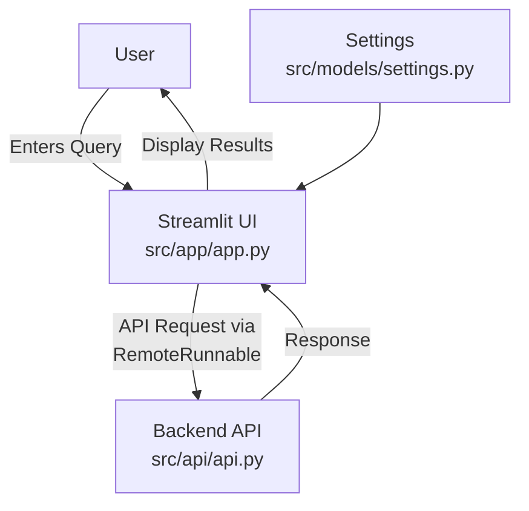
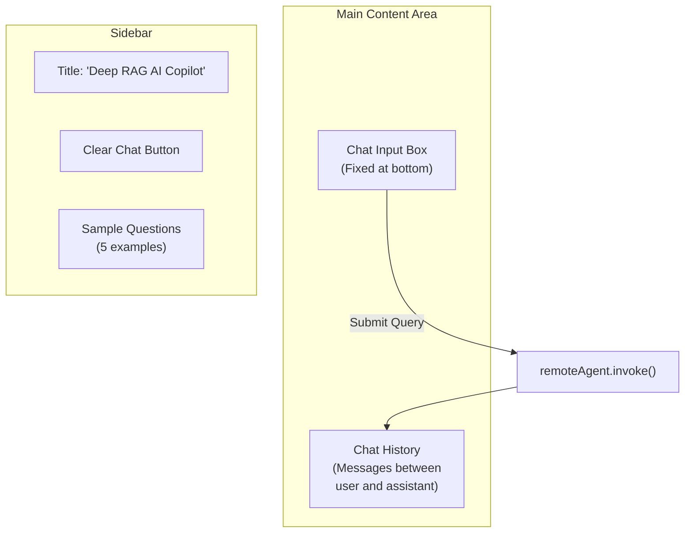
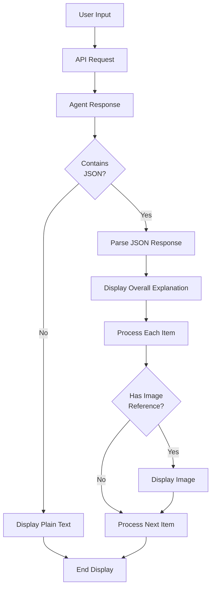

<!-- source: DeepWiki mcp.deepwiki.com · repo microsoft/deepRAG · page 6 Frontend Application · fetched 2026-10-26 -->

# Frontend Application

<details>
<summary>Relevant source files</summary>

The following files were used as context for generating this wiki page:

- [.devcontainer/devcontainer.json](.devcontainer/devcontainer.json)
- [.vscode/launch.json](.vscode/launch.json)
- [src/app/app.py](src/app/app.py)
- [src/app/pyproject.toml](src/app/pyproject.toml)
- [src/models/settings.py](src/models/settings.py)

</details>


This page documents the Streamlit-based frontend application of the deepRAG system. The frontend provides an interactive chat interface for users to engage with the RAG (Retrieval-Augmented Generation) capabilities of the system. For information about the API that powers this frontend, see [API](#5).

## Overview

The Frontend Application is a Streamlit web application that provides a user-friendly interface to interact with the deepRAG system. It enables users to input queries, receive responses from the AI, and view multimodal results including text and images.



Sources: [src/app/app.py:1-154](), [src/models/settings.py:1-27]()

## Architecture and Components

The frontend application is built using Streamlit, a Python framework for building interactive web applications. It communicates with the backend API using `RemoteRunnable` from the `langserve` library.

```mermaid
classDiagram
    class "Frontend Application" {
        +settings: Settings
        +session_id: str
        +history: list
        +remoteAgent: RemoteRunnable
        +initialize()
        +handle_user_input(user_input)
        +display_response(agent_response)
        +clear_chat()
    }
    
    class "RemoteRunnable" {
        +invoke(input)
    }
    
    class "Settings" {
        +api_host: str
        +api_port: int
        +smart_agent_image_path: str
        +smart_agent_prompt_location: str
    }
    
    "Frontend Application" --> "RemoteRunnable" : uses
    "Frontend Application" --> "Settings" : configured by
```

The application consists of several key components:

1. **Session Management**: Manages user sessions with unique IDs
2. **Chat Interface**: Provides the input and display areas for conversations
3. **Remote Agent Client**: Connects to the backend API
4. **Response Renderer**: Processes and displays various response formats

Sources: [src/app/app.py:12-40](), [src/app/app.py:79-86]()

## User Interface

The Streamlit frontend features a clean, chat-based interface with a sidebar for additional functionality.



### UI Components:

- **Sidebar**: Contains the application title, a "Clear Chat" button, and sample questions
- **Chat History**: Shows the conversation between the user and assistant
- **Chat Input**: Fixed at the bottom of the page for entering queries

The frontend applies custom CSS to position the chat input at the bottom of the screen for better usability.

Sources: [src/app/app.py:40-51](), [src/app/app.py:54-77](), [src/app/app.py:119]()

## Session Management

The application creates and maintains sessions to preserve conversation context across interactions.

### Session Handling:

1. A unique session ID is generated using UUID when a user first loads the application
2. This session ID is stored in Streamlit's session state
3. The session ID is passed to the backend API with each request
4. Conversation history is maintained in the session state

```python
if 'session_id' in st.session_state:
    session_id = st.session_state['session_id']
else:
    session_id = str(object=uuid.uuid4())
    st.session_state['session_id'] = session_id
```

When the user clicks "Clear Chat", both the conversation history and session ID are reset, creating a fresh conversation.

Sources: [src/app/app.py:33-37](), [src/app/app.py:60-65]()

## Response Handling

The frontend handles various response types from the backend API, including plain text responses and JSON responses with embedded images.



### Response Processing Flow:

1. The application receives a response from the backend API
2. If the response contains a JSON structure (identified by "overall_explanation" field):
   - The JSON is parsed
   - The "overall_explanation" text is displayed
   - For each additional item in the JSON:
     - The corresponding text is displayed
     - If the item references an image, the image is loaded and displayed
3. If the response is plain text, it's displayed directly

Sources: [src/app/app.py:91-111](), [src/app/app.py:132-154]()

## Configuration and Settings

The frontend application uses the `Settings` class from `src/models/settings.py` to load and access configuration values.

Key settings used by the frontend include:

- `api_host` and `api_port`: For connecting to the backend API
- `smart_agent_image_path`: Directory path where images are stored
- `smart_agent_prompt_location`: Location of the agent configuration file

Configuration is loaded from environment variables or a `.env` file when the application starts.

```python
settings: Settings = Settings(_env_file=".env")
```

The frontend also loads the agent configuration from a YAML file specified in settings.

Sources: [src/app/app.py:24-31](), [src/models/settings.py:4-26]()

## Development and Debugging

The repository includes VS Code launch configurations for running and debugging the frontend application:

```json
{
    "name": "App",
    "type": "debugpy",
    "request": "launch",
    "module": "streamlit",
    "cwd": "${workspaceFolder}",
    "env": {
        "PYTHONPATH": "${workspaceFolder}/src"
    },
    "args": [
        "run",
        "${cwd}/src/app/app.py",
        "--server.port",
        "8000"
    ]
}
```

There's also a compound configuration "Server/Client" that launches both the frontend and backend services together for a complete development environment.

Sources: [.vscode/launch.json:13-28](), [.vscode/launch.json:30-38]()

## Dependencies

The frontend application has the following key dependencies:

- `streamlit`: The core framework for building the web interface
- `streamlit-extras`: Additional components for enhanced UI
- `langserve`: Client for communicating with the backend API
- `fsspec`: For filesystem operations
- Internal packages: `models`, `agents`, `functions`, `utils`

These dependencies are specified in the `pyproject.toml` file.

Sources: [src/app/pyproject.toml:9-18]()

---

